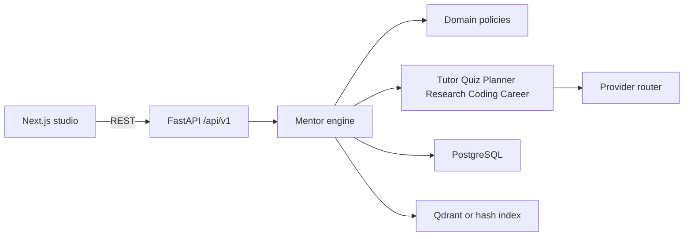
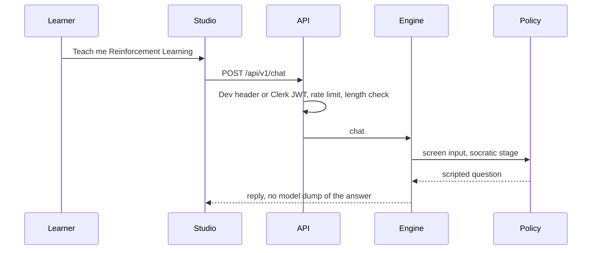

# Architecture

AI Mentor is a modular monolith. Teaching rules do not import FastAPI or SQLAlchemy. HTTP handlers do not decide what to teach.

This page describes the code that runs today. The target design, including work that is not built yet, is [SystemArchitecture.md](SystemArchitecture.md). Where the two differ, this page and the records in [adr/README.md](adr/README.md) match the repository. The system architecture document describes the later shape.

The decision records are in [adr/README.md](adr/README.md).

## Layers

| Layer | Responsibility |
| --- | --- |
| `app/domain` | Roles, SM-2, mastery, XP, graph, grading, sandbox policy, prompt screening, catalog |
| `app/models` | SQLAlchemy tables. This file is the schema source of truth for the first migration |
| `app/repositories` | Queries. Routes do not write SQL |
| `app/services` | Use cases: chat, quiz, plan, ingest, lab, dashboard |
| `app/agents` | Prompted specialists. The orchestrator routes intent |
| `app/api` | Validation, auth dependency, status codes |
| `app/prompts` | Versioned instructions, including the security prompt composed into every call |

FastAPI `Depends` is the composition root. There is no separate DI container.

## Teaching policy

Socratic stages 0 and 1 are scripted from the catalog. A chatty model cannot dump the answer on the opening turn. The locked opener for “Teach me Reinforcement Learning” is “What do you think an agent does in an environment?” Direct mode, and socratic stage 3 and later, may include the full account. Later wording may come from a model.

Quizzes are authored templates. A model may add a `COACH:` note. It cannot write the answer key. Grading is deterministic. Research questions are capped at 0.70.

Mastery is 0–100 and is renormalized over the evidence that exists: quizzes 0.45, lessons 0.25 when the learner has engaged and a lesson exists, projects 0.20 when attempted, recall 0.10. Bands are strength at 75, developing at 60, gap above 0, otherwise unstarted. Recommendations skip scores at or above 75 and require prerequisites at 70 or above. A new learner is pointed at the roots (AI fundamentals, Python), not at PPO.

XP: lesson 40, review 5, passing code 25, analysis 20, quiz `10 + round(40 * ratio)`. Chat updates the streak and does not grant XP. The daily cap is 400. Level is `1 + xp // 250`.

## Identity

Clerk issues RS256 JWTs. The API verifies them against the Clerk JWKS and reads a role from token metadata only when that claim is present, so a token without a role does not demote an admin. The role of record is the Postgres `users.role`. In development, `X-Dev-User-Id` selects a seeded user and cannot set a role. New users created that way are students.

## Retrieval

Ingestion is synchronous and capped at 10 MB: parse PDF, DOCX, Markdown, or text; chunk at 800 characters with 120 of overlap; embed; store chunk text in Postgres. When `QDRANT_URL` starts with `http`, the vector goes to Qdrant. Otherwise a 64-dimension hash embedding is computed at query time and the `embeddings` row records `hash-v1` without storing the vector twice. Critique, gaps, and future work stay null unless the model output cites a supplied chunk label.

## Code execution

Student source is parsed. Imports must be in the allowlist (`math`, `random`, `statistics`, `itertools`, `functools`, `collections`, `dataclasses`, `typing`). `os`, dunder attribute access, `open`, `eval`, `exec`, and `getattr` are rejected before the process starts. Accepted code runs as `python -I` with a cleaned environment, a three-second timeout, and truncated output. Resource limits are applied inside the child, not with `preexec_fn`, because the API runs sync routes in a thread pool.

## What this is not

- Not a microservice mesh. Splitting agents into services would duplicate the learner record.
- Not event sourcing. Dashboard and mastery are computed read models.
- Not three cloud backends. One image. Vercel for the studio. Azure Container Apps is the primary API host; AWS pulls the same image.
- Not a queue. There is no Celery. OCR of scanned PDFs is out of scope.
- OpenTelemetry writes to the console exporter when an endpoint is set, and failures do not fail the request. A real OTLP exporter is a follow-up.

## Request path

