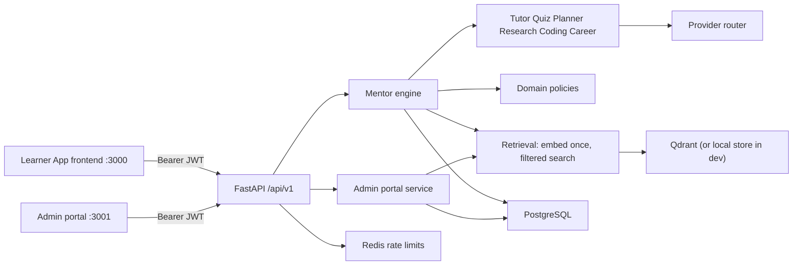
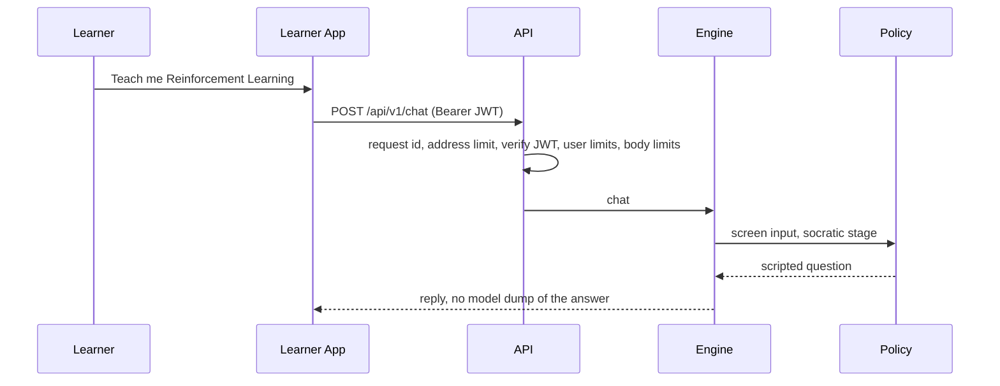

# Architecture

AI Mentor is a modular monolith. Teaching rules do not import FastAPI or SQLAlchemy. HTTP handlers do not decide what to teach.

This page describes the code that runs today. The target design is five Next.js applications on this same API ([ADR 0013](adr/0013-five-applications-shared-platform.md), [platform/README.md](platform/README.md)). [SystemArchitecture.md](SystemArchitecture.md) and [platform/06-system-architecture.md](platform/06-system-architecture.md) describe that later shape. Where they differ from this page, this page and the records in [adr/README.md](adr/README.md) match the repository.

## Layers

| Layer | Responsibility |
| --- | --- |
| `app/domain` | Roles and role-change rules, SM-2, mastery, the XP table and learner-day logic, graph, grading, sandbox policy, prompt screening, studio catalog, Resource Catalog (`app/domain/knowledge`) |
| `app/models` | SQLAlchemy tables, kept in step with Alembic (`alembic check` in CI) |
| `app/repositories` | Queries. Routes do not write SQL |
| `app/services` | Use cases: `engine` (learning), `admin_portal` (library and staff views), `catalog` and `ingestion` (Resource Catalog), `retrieval` and `vector_store` (RAG), `privacy` (export, erasure), `webhooks`, `llm` |
| `app/agents` | Prompted specialists. The orchestrator routes intent |
| `app/api` | Validation, auth and rate-limit dependencies, the staff gate on `/admin`, status codes |
| `app/core` | Settings and the production validator, Clerk verification, problem details, rate limiting, logging and tracing |
| `app/cli.py` | `migrate`, `seed`, `seed-pack`, `write-pack`, `grant-admin`, `reapply-erasures`; run as jobs, never from the web process |
| `app/prompts` | Versioned instructions, including the security prompt composed into every call |

FastAPI `Depends` is the composition root. There is no separate DI container.

The Resource Catalog is a bounded context beside the four studio tracks. `domain/catalog.py` still seeds lessons and quiz keys. Knowledge Pack v1.0 (`make write-pack`, `make seed-pack`) loads books, papers, courses, and the concept graph used by catalog search and recommendations. The web process does not load the pack. See [Knowledge-Catalog.md](Knowledge-Catalog.md).

## Teaching policy

Socratic stages 0 and 1 are scripted from the catalog. A chatty model cannot dump the answer on the opening turn. The locked opener for “Teach me Reinforcement Learning” is “What do you think an agent does in an environment?” Direct mode, and socratic stage 3 and later, may include the full account. Later wording may come from a model.

Quizzes are authored templates. A model may add a `COACH:` note. It cannot write the answer key. Grading is deterministic. Research questions are capped at 0.70. A quiz is graded once.

Mastery is 0–100 and is renormalized over the evidence that exists: quizzes 0.45, lessons 0.25 when the learner has engaged and a lesson exists, projects 0.20 when attempted, recall 0.10. Bands are strength at 75, developing at 60, gap above 0, otherwise unstarted. Recommendations skip scores at or above 75 and require prerequisites at 70 or above. A new learner is pointed at the roots (AI fundamentals, Python), not at PPO.

XP follows SRS GAM-002. Every award has a source key and is paid at most once:

| Event | XP | Limit |
| --- | --- | --- |
| Lesson completed | 40 | Once per lesson |
| Quiz graded | `10 + round(40 × ratio)`, half rounds up | Once per quiz; 10 a day earn XP |
| Project passed | 25 | Once per project |
| Flashcard review | 5 | 20 a day earn XP |
| Research analysis | 10 | Once per document; 3 a day earn XP |
| Tutor chat | 0 | Streak only |

The daily cap is 400 XP on the learner's local day (their IANA time zone). Level is `1 + xp // 250`.

## Identity

Clerk issues RS256 JWTs. The API checks the signature, issuer, expiry, not-before, and `azp`, plus `aud` when configured. It never reads a role from the token. On first sight a Clerk user becomes a `student` row. After that only email and name are refreshed from the token or the `user.created`/`user.updated` webhooks. Staff requests require a second factor in production. In development, `X-Dev-User-Id` selects or creates a user and cannot set a role.

## Retrieval

Ingestion is synchronous and capped at 10 MB (10 uploads an hour per user): parse PDF, DOCX, Markdown, or text, then chunk at 800 characters with 120 of overlap. All chunks are embedded in one batched provider call and upserted to `learner_docs_v1` with `owner_id` and `document_id` payloads. If the index is unavailable, the document is stored with status `unindexed` and analysis falls back to its opening passages, and says so.

A question is embedded once and searched with the owner-and-document filter. Results are re-checked in PostgreSQL. Critique, gaps, and future work stay null unless the model output cites a supplied chunk label.

Curated assets are chunked and indexed into `knowledge_v1` when they are published. They are removed when they are archived or returned to draft. Direct-mode tutor replies list up to six library passages scoring at least 0.30 (at most three per asset) as `[S1]`…`[S6]`.

With no Qdrant URL, a local store keeps vectors on the `embeddings` row and uses 64-dimension hash embeddings. With Qdrant, a real embedding model is required (RAG-010).

## Errors, limits, and observability

Every error is RFC 9457 problem details with a `trace_id`. Each request gets an `X-Request-Id`, which can be supplied by the caller. Logs are JSON outside development, carrying the request and trace ids. With `OTEL_EXPORTER_OTLP_ENDPOINT` set, spans go to an OTLP/HTTP collector. Model calls have a 20 s timeout and one retry. Langfuse generations are recorded best-effort and carry no user id.

Rate limits are per user after authentication, plus a per-address ceiling in middleware, with counters in Redis.

## Code execution

Student source is parsed. Imports must be in the allowlist (`math`, `random`, `statistics`, `itertools`, `functools`, `collections`, `collections.abc`, `dataclasses`, `typing`). The parser rejects names starting with `__`, attributes starting with `_`, frame and code introspection attributes, module-reaching names such as `sys`, `os`, `modules`, and `inspect`, and `.format` on anything but a literal without field traversal. It also rejects `open`, `eval`, `exec`, `getattr`, and similar calls. All of this happens before the process starts. Accepted code runs as `python -I` with a cleaned environment, a three-second timeout, and truncated output. Resource limits are applied inside the child, not with `preexec_fn`, because the API runs sync routes in a thread pool.

That is a filter, not isolation. The lab is off by default in production, and production refuses to enable it until runs move to an isolated runner (Security-Compliance SEC-01).

## What this is not

- Not five frontend applications yet. Today there are two: the Learner App (`frontend/`, still labelled "studio" in its route group) and one staff portal (`admin/`) that mixes platform operations with content tooling. Instructor App, Institution App, and Content Studio are target apps on this same API (ADR 0013). Content screens move to `apps/studio` in R1.
- Not a microservice mesh. Splitting agents into services would duplicate the learner record.
- Not event sourcing. Dashboard and mastery are computed read models.
- Not three cloud backends. One image. Vercel for the frontends. Azure Container Apps is the primary API host; AWS pulls the same image.
- Not a queue. There is no Celery. Ingestion and parsing still run in the request (SEC-13). OCR of scanned PDFs is out of scope.

## Request path

