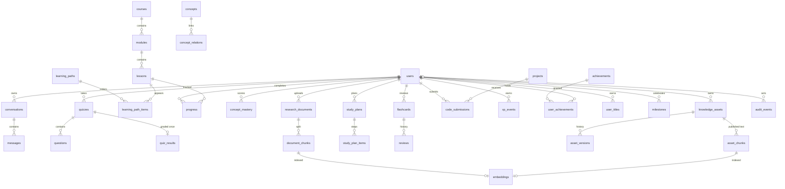

# Database

This page describes the schema that runs today. The target architecture (domain schemas, partitioning, RLS, audit, retention) is in [docs/database](database/README.md) and [ADR 0011](adr/0011-target-database-architecture.md), accepted on 2026-10-13. The move is phased; see [migration-strategy.md](database/migration-strategy.md).

PostgreSQL is the system of record. The SQLAlchemy models in `backend/app/models/entities.py` describe the live tables. Alembic revision `20261013_0001` creates the original set with explicit `op.create_table` calls. It was generated against an empty PostgreSQL 16 database and reviewed. Every later change is a new hand-written revision (`0005` adds engagement columns and tables). CI runs `alembic upgrade head`, `alembic check` (models and migrations must agree), a downgrade to base, and the full test suite against the migrated PostgreSQL schema.

UUIDs are primary keys. Most tables have `created_at` and `updated_at`; append-only tables (`xp_events`, `audit_events`, `asset_versions`, `webhook_events`) have a creation time only. JSON columns are portable JSON, not JSONB, so the same models run on SQLite in quick local tests.

## Entity map



`webhook_events` stands alone.

## Notes that are easy to get wrong

- **Users.** `role` is constrained to `student`, `instructor`, `admin` and is never written from a token or webhook. Other columns: `handle` (unique), `locale` (`en`, `fr`, `es`), `timezone` (IANA, default `UTC`), `country_code`, `leaderboard_opt_out`, `suspended`, `subscription_status`, `subscription_tier` (`free`, `pro`, `research`), `subscription_event_at` (the `created` time of the last Stripe event applied), `longest_streak`, `streak_freezes` (0–2), `equipped_title`, and `onboarded_at` (set by `POST /onboarding`). `learning_preferences` also stores `maths_comfort`, `programming_experience`, and `tutor_mode`.
- **XP ledger.** `xp_events` has `source_type` (`lesson`, `quiz`, `project`, `review`, `analysis`, `daily`, plus journey types), `source_id`, `requested_amount`, `amount` (granted), and `local_date` (the learner's day in their time zone). `(user_id, source_type, source_id)` is unique, so a retried request cannot pay twice. The GAM-003 "capped" figure is `requested_amount - amount`. A check constraint keeps `0 <= amount <= requested_amount`.
- **Engagement.** `user_titles` is unique on `(user_id, slug)`. `milestones` is unique on `(user_id, kind, source_id)` with `kind` in `badge`, `title`, `level`, `streak`, `card`, `path`, `daily`. `achievements` carry `category`, `tier`, and `rarity`. Skill cards are not stored; they are derived from `concept_mastery.score`.
- **Quiz results.** `quiz_results.quiz_id` is unique: a quiz is submitted once (FR-QZ-007). A second submission is a 409.
- **Embeddings.** One row per embedded chunk. Exactly one of `document_chunk_id` or `asset_chunk_id` is set (check constraint), each with `ON DELETE CASCADE`. The row stores `collection` (`learner_docs_v1` or `knowledge_v1`), `provider`, `model`, `dimensions`, and `point_id`, which equals the chunk id and is unique. With Qdrant configured, the vector and payload live only in Qdrant. The local development store keeps them in `vector` and `payload`.
- **Curated library.** `knowledge_assets.state` moves through `draft`, `review`, `approved`, `published`, `archived`. `asset_chunks` exist only while an asset is published. `asset_versions` snapshots every edit and transition. Catalog fields (`resource_type`, `category`, `quality_score`, `dedupe_key`, …) live on the same row. Satellite tables from Alembic `20261013_0002`: `content_sources`, `import_jobs`, `taxonomy_nodes`, `skills`, `question_bank_items`, `challenge_specs`, `catalog_path_steps`, `duplicate_candidates`, `learning_preferences`, `learner_resources`. Answer keys on `question_bank_items` and hidden tests on `challenge_specs` are never serialised to learners. Knowledge Pack v1.0 is loaded with `make seed-pack`, not on API start.
- **Erasure.** Deleting a `users` row cascades every learner-owned table. `knowledge_assets.owner_id`, `asset_versions.editor_id`, and `audit_events.actor_id` are `ON DELETE SET NULL`, so staff-authored content and the audit trail survive a staff member's erasure without naming them.
- **Webhooks.** `webhook_events` is unique on `(provider, event_id)`.
- Lesson slugs match concept slugs. Completing a lesson and scoring a concept use the same key.
- `progress` is unique on `(user_id, lesson_id)`.
- `concept_mastery.score` is an integer 0–100.
- Quiz answer keys live on `questions.answer_key` and are never returned by the generate endpoint.
- Seeded catalog rows (courses, lessons, paths, achievements, projects) are upserted. Seed does not delete lessons, because that would cascade learner progress.
- Demo users (`demo-student`, `demo-instructor`, `demo-admin`) are created only outside production.
- **Academies.** `academies.faculty` is `ai`, `robotics`, or `data-science`. World (`GET /learn/world`) lists learning paths and uses faculty and level as filters; academies are a filter, not the top-level cards.

## Migrations

```bash
# Apply migrations and seed the catalog (the same command the deploy job runs)
make migrate

# New revision: change the models, then
cd backend && ../.venv/bin/alembic revision --autogenerate -m "describe the change"
# Review and edit the generated file, then
../.venv/bin/alembic upgrade head && ../.venv/bin/alembic check
```

The web process never migrates. In production, run `python -m app.cli migrate` as a one-off job before rolling out a new image ([Deployment.md](Deployment.md)). For a quick start without PostgreSQL, development with a SQLite `DATABASE_URL` calls `create_all` on startup. PostgreSQL in development uses migrations like everywhere else.
