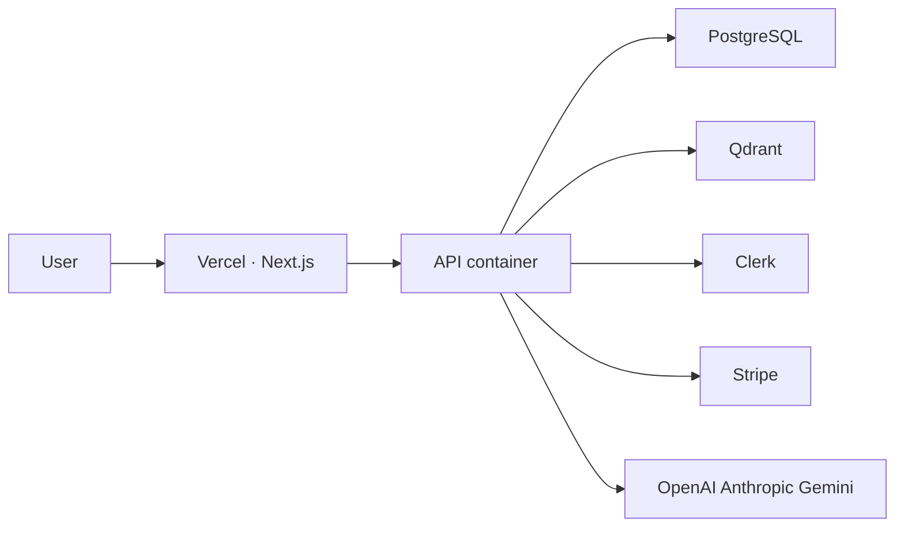

# Deployment

The platform specification — Azure layout, pipelines, environments, secrets, migrations, monitoring, backups, and recovery — is [Infrastructure.md](Infrastructure.md). This page is the short operator view.

The studio is a Next.js app. The API is one container. One image serves Azure Container Apps. AWS pulls that same image if it is ever used.



Azure Container Apps is the primary API host. AWS ECS or App Runner can pull the same image from GHCR. The publish workflow builds that image on a tag or a manual run. It does not deploy on every push, and it does not pretend to provision three clouds.

## Container

`backend/Dockerfile` is Python 3.12, non-root user `mentor`, then `alembic upgrade head` and Uvicorn on `0.0.0.0:8000`.

`infrastructure/compose.yaml` runs Postgres 16 (`mentor` / `mentor` / database `mentor`), Qdrant, and the API with `QDRANT_URL=http://qdrant:6333`. Dev auth is on in that compose file. Do not publish that compose stack to the internet.

```bash
make up
```

The frontend image is a Next.js standalone build. Local development uses `make web` instead.

## Production settings

`APP_ENV=production` refuses to start when any of these are true:

- `DEV_AUTH` is on
- `CLERK_JWKS_URL` or `CLERK_ISSUER` is missing
- `DATABASE_URL` is not PostgreSQL
- `QDRANT_URL` does not start with `http`

Set `CORS_ORIGINS` to the studio origin. Stripe return URLs must start with one of those origins. Leave Stripe keys empty and checkout stays a 503.

Secrets belong in the host’s secret store (Vercel env, Azure Container Apps secrets, AWS secrets). Do not bake them into the image.

## Clerk on the studio

The current studio builds without a Clerk publishable key and uses the dev session switcher. Before a public deploy, mount `ClerkProvider` and protect studio routes with `clerkMiddleware`, and set `NEXT_PUBLIC_DEV_AUTH` empty so the browser stops sending `X-Dev-User-Id`.

## Observability

Set `OTEL_EXPORTER_OTLP_ENDPOINT` only when you want spans. The process currently exports them to the console and ignores exporter failures. Langfuse is best-effort when both keys are set. A missing model key does not break teaching: the curriculum policy still answers.

## Threat notes for the host

The code runner is a child interpreter, not a sandbox product. Do not mount the Docker socket. Do not run the API as root. Cap request size at the proxy as well as the 10 MB application limit. The in-process rate limiter does not coordinate across replicas; put a shared limiter in front if you run more than one API task.
