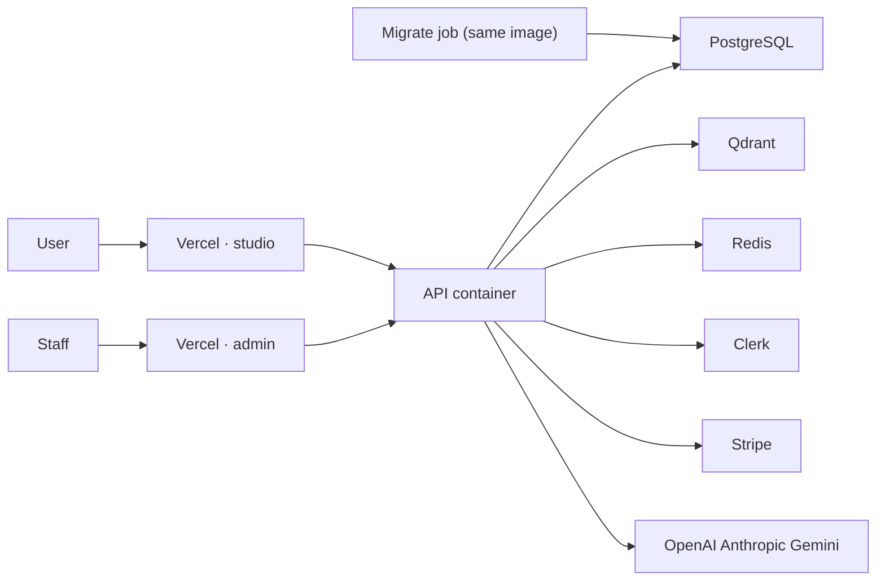

# Deployment

The platform specification — Azure layout, pipelines, environments, secrets, migrations, monitoring, backups, and recovery — is [Infrastructure.md](Infrastructure.md). This page is the short operator view.

The studio and the admin portal are Next.js apps, deployed to Vercel as separate projects. The API is one container. One image serves Azure Container Apps, and AWS can pull the same image if it is ever used.



Azure Container Apps is the primary API host. AWS ECS or App Runner can pull the same image from GHCR. The publish workflow builds that image on a tag or a manual run. It does not deploy on every push.

## Container

`backend/Dockerfile` is Python 3.12 and runs as the non-root user `mentor` (uid 10001). It starts Uvicorn on `0.0.0.0:8000` with `--proxy-headers --forwarded-allow-ips "$FORWARDED_ALLOW_IPS"`. Set `FORWARDED_ALLOW_IPS` to the ingress range. The default, `127.0.0.1`, trusts no proxy, so every learner would share the address of the ingress.

The web process never migrates or seeds. Each rollout is:

1. Run `python -m app.cli migrate` from the new image as a one-off job (Container Apps Job). It applies Alembic migrations, then the idempotent catalog seed. It creates no demo accounts in production.
2. Shift traffic to the new revision once `GET /ready` is 200.

To make the first admin, run `python -m app.cli grant-admin <clerk_user_id> --reason "..."` as a job. The change is audited with `via: cli`. Every later role change goes through the admin portal.

`infrastructure/compose.yaml` runs Postgres 16 (`mentor` / `mentor` / database `mentor`), Qdrant, Redis, the migrate job, and the API. Every port is bound to `127.0.0.1`, and dev auth is on. Do not publish that stack to the internet.

```bash
make up
```

The frontend image is a Next.js standalone build. Local development uses `make web` and `make admin`.

## Production settings

`APP_ENV=production` refuses to start when any of these are true:

- `DEV_AUTH` is on
- `CLERK_JWKS_URL`, `CLERK_ISSUER`, or `CLERK_SECRET_KEY` is missing
- `DATABASE_URL` is not PostgreSQL
- `QDRANT_URL` is not `https://`, or `QDRANT_API_KEY` is missing
- `REDIS_URL` is missing
- `OPENAI_API_KEY` is missing (hash embeddings are for local use only)
- `LAB_ENABLED` is on (until the isolated runner exists)
- `REQUIRE_STAFF_MFA` is off
- any of `CORS_ORIGINS`, `STUDIO_ORIGINS`, or `CLERK_AUTHORIZED_PARTIES` is `*` or not `https://`

Set `CORS_ORIGINS` to all five app origins and `LEARNER_ORIGINS` (and `INSTITUTION_ORIGINS` when used) for Stripe return URLs. `STUDIO_ORIGINS` is a Learner App alias. Set `CLERK_AUTHORIZED_PARTIES` to the same five origins if they differ from `CORS_ORIGINS`. Leave Stripe keys empty and checkout stays a 503. Leave `CONTENT_SELF_APPROVAL` off unless the team is too small for a second reviewer; when on, every self-approval is flagged in the audit log.

Secrets belong in the host's secret store (Vercel env, Azure Key Vault referenced by Container Apps, AWS secrets). Do not bake them into the image.

## Frontends

Both apps refuse to build for production (`DEPLOY_ENV=production` or `VERCEL_ENV=production`) when `NEXT_PUBLIC_DEV_AUTH` is set or `NEXT_PUBLIC_CLERK_PUBLISHABLE_KEY` is missing. With a publishable key, Clerk protects every route except the landing page and sign-in or sign-up, and API calls carry the session token.

Each request gets a nonce-based Content-Security-Policy from `proxy.ts`. When a policy changes (new Clerk or Stripe host, a new script), deploy with `CSP_REPORT_ONLY=true` for a week, check the browser reports, then remove the variable to enforce (Security-Compliance §8.4). Take Clerk and Stripe hosts from their current CSP documentation for the production instance.

The admin portal sends `X-Robots-Tag: noindex` and disallows all crawlers. Put it on its own hostname.

## Observability

Set `OTEL_EXPORTER_OTLP_ENDPOINT` to an OTLP/HTTP collector to export traces (health probes are excluded). Logs are JSON outside development and carry `request_id` and `trace_id`; every error response carries the same `trace_id`. Langfuse is best-effort when both keys are set and records no user id. A missing model key does not break teaching: the curriculum policy still answers.

## Threat notes for the host

The code runner is a child interpreter, not a sandbox product, which is why production refuses to enable it. Do not mount the Docker socket. Do not run the API as root. Cap request size at the proxy as well as the 10 MB application limit. Rate limits are shared across replicas through Redis; if Redis is unreachable the API logs a warning and falls back to per-process counters rather than failing requests.
