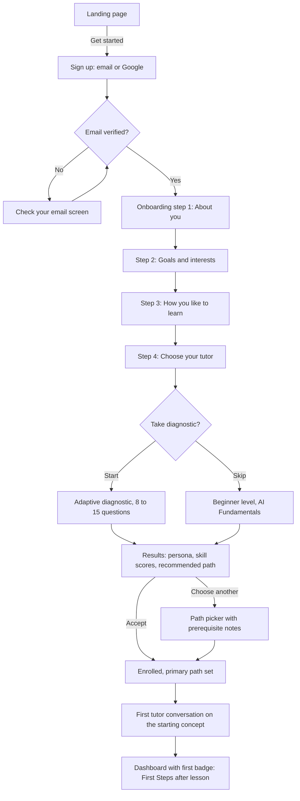
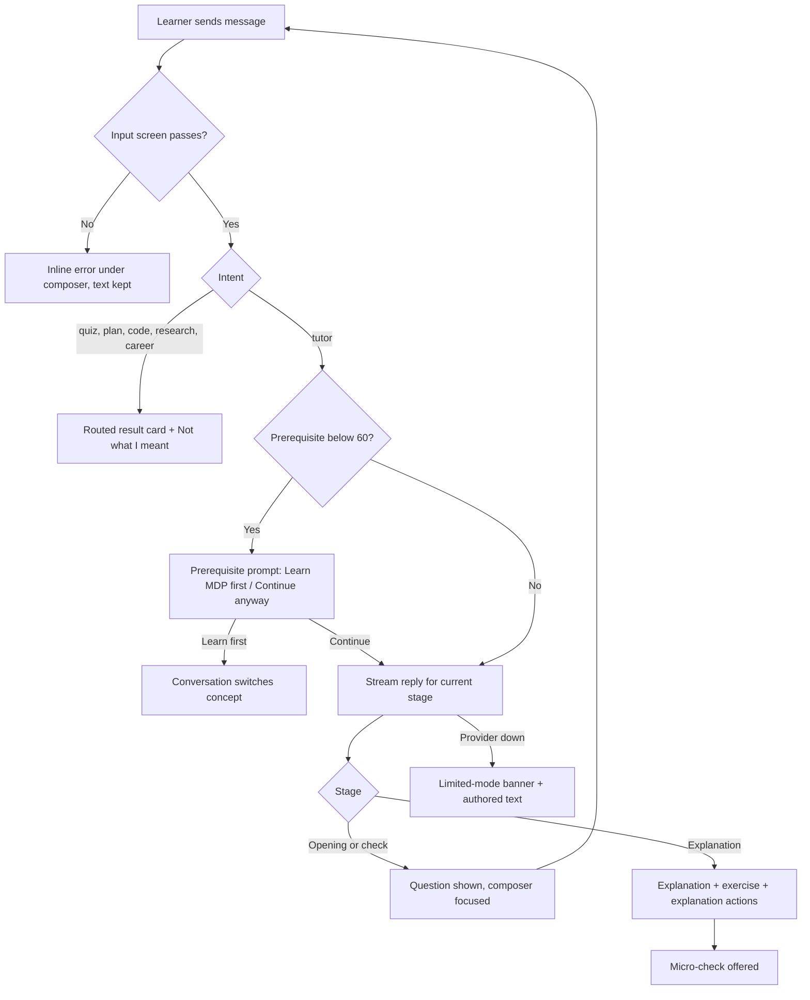
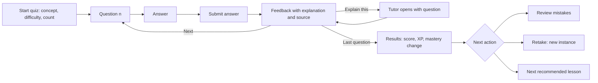
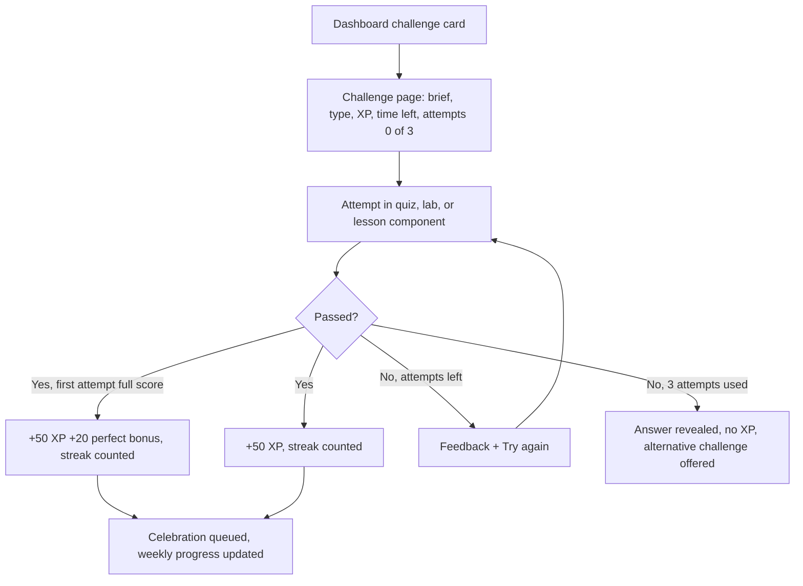
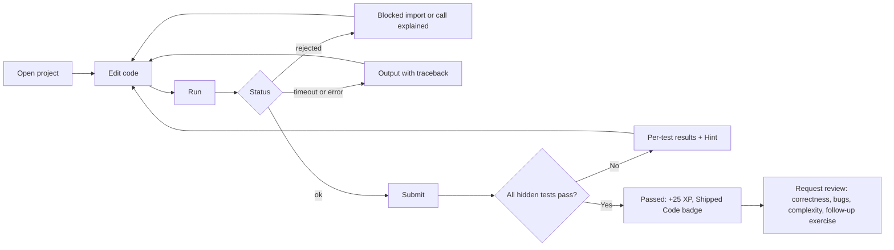
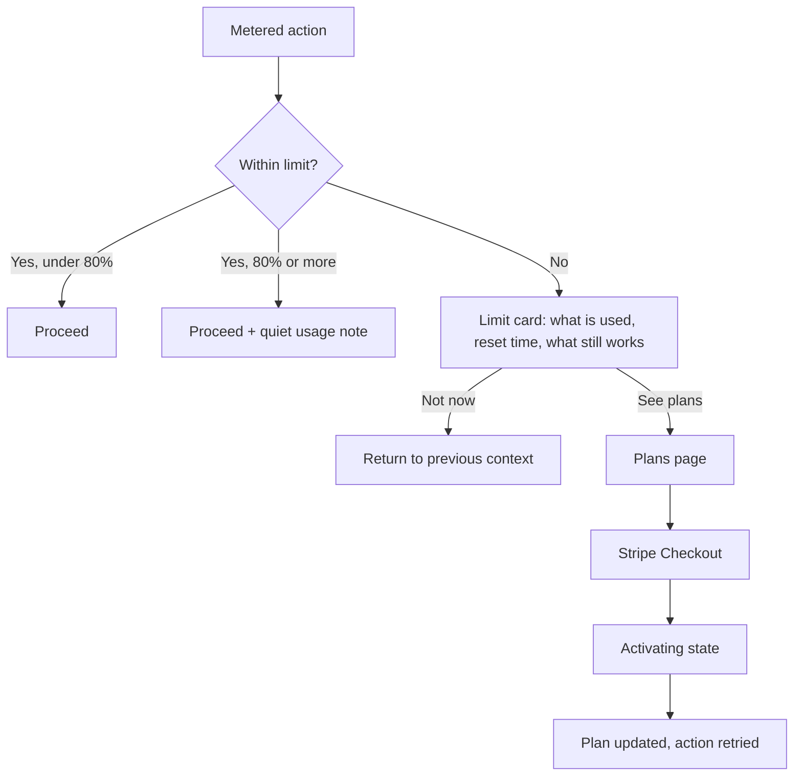
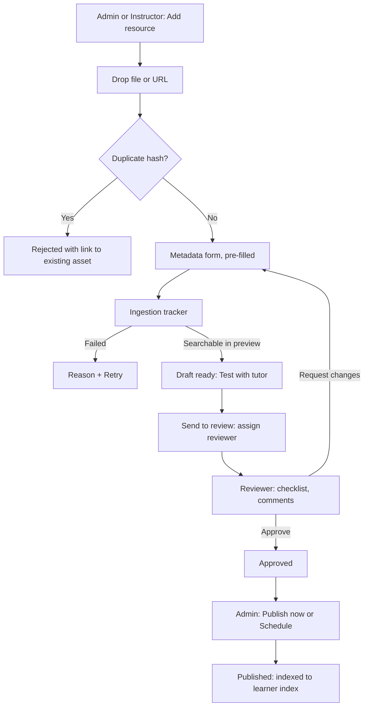
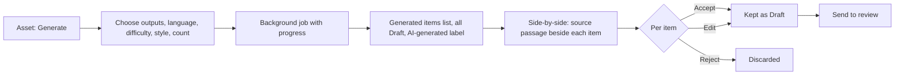

# AI Mentor — UI/UX Design Specification

| | |
| --- | --- |
| Status | Draft for MVP build |
| Owners | Product Design, Frontend |
| Sources | [SRS.md](SRS.md), [PRD.md](PRD.md), [UseCases.md](UseCases.md), [Admin.md](Admin.md), [Requirements.md](Requirements.md), the shipped `frontend/` |
| Stack | Next.js 15 App Router, Tailwind CSS 3, shadcn/ui, Radix primitives, Framer Motion, lucide-react, KaTeX, Mermaid |

This document defines how AI Mentor looks, behaves, and reads, from design tokens to full screens. It is written for designers building the Figma library and for engineers building the components. Where the SRS fixes a behaviour (for example leaderboard fields or workflow transitions), this spec designs that behaviour and cites the requirement ID. It does not redefine it.

**Conventions.** "Must" is required for launch. "Should" is expected unless a design record explains otherwise. Requirement IDs such as `FR-TUT-008` refer to the SRS. Wireframes use the notation in [9.1](#91-wireframe-notation).

## Contents

1. [Design philosophy](#1-design-philosophy)
2. [Color system](#2-color-system)
3. [Typography](#3-typography)
4. [Design tokens](#4-design-tokens)
5. [Component library](#5-component-library)
6. [Responsive layouts](#6-responsive-layouts)
7. [Accessibility requirements](#7-accessibility-requirements)
8. [User flows](#8-user-flows)
9. [Wireframes](#9-wireframes)
10. [Page hierarchies](#10-page-hierarchies)
11. [Dashboard design](#11-dashboard-design)
12. [Tutor chat design](#12-tutor-chat-design)
13. [Leaderboard design](#13-leaderboard-design)
14. [Challenge system design](#14-challenge-system-design)
15. [Admin portal design](#15-admin-portal-design)
16. [Knowledge management interface](#16-knowledge-management-interface)
17. [Mobile experience](#17-mobile-experience)
18. [Appendix A: Changes needed in the current frontend](#appendix-a-changes-needed-in-the-current-frontend)
19. [Appendix B: Open design questions](#appendix-b-open-design-questions)

---

## 1. Design philosophy

### 1.1 The idea: a studio, not a feed

AI Mentor is a place to think. The product calls its learner app "the studio", and the design follows that word: warm paper, an editorial serif for titles, generous reading space, and tools laid out where the hands expect them. Gamification is present and real, but it sits at the edge of the work, not on top of it.

Three products shaped the brief: the depth of a university course, the habit loop of Duolingo, and the mentorship of a private tutor. The design takes clarity from the first, momentum from the second, and patience from the third. It does not copy the visual noise of any of them.

### 1.2 Principles

**1. Ask before telling.**
The tutor's Socratic method is the product's core. The interface mirrors it. Quiz feedback explains *why* before showing the next question. Empty states ask what the learner wants to do. The interface never auto-advances past a moment where the learner should think.

**2. One clear next step.**
Every screen has a single primary action. The dashboard leads with one recommendation, not a menu. Secondary options exist, but they are visually quieter.

**3. Evidence over decoration.**
Mastery scores, ranks, and badges are only shown alongside the evidence that produced them, or one tap away from it. A number that cannot be explained does not ship.

**4. Trust is visible.**
The learner always knows where an answer came from and what state the system is in. Citations are inline. Limited mode (no model available) is labelled. AI-generated content is labelled for staff. Machine-translated text is labelled for learners. Drafts never look like published content.

**5. Motivation without manipulation.**
XP, streaks, and leaderboards encourage study. They never punish, shame, or block learning. No guilt copy ("You're letting your streak die!"), no fake urgency, no loot-box mechanics, no dark patterns on upgrade prompts. A learner who opts out of leaderboards loses nothing else.

**6. Calm by default, celebratory on purpose.**
Motion and colour are reserved for meaning: a level-up, a correct answer, a streak milestone. Reading surfaces stay still. Every celebration respects reduced motion.

**7. Accessible is the baseline.**
WCAG 2.2 AA is a launch gate (`NFR-USE-001`). Accessibility is designed into each component spec, not audited in at the end.

**8. One studio, three languages.**
English, French, and Spanish ship together. Layouts are designed with French as the length reference (about 20–30% longer than English) and use logical CSS properties (`I18N-006`).

### 1.3 Voice and tone

| Context | Tone | Example |
| --- | --- | --- |
| Tutor | Curious, warm, precise | "What do you think the agent is trying to maximise?" |
| Feedback (correct) | Specific, brief | "Right. The discount factor shrinks rewards that arrive later." |
| Feedback (incorrect) | Supportive, explanatory, never "Wrong!" | "Not quite. You found the reward. The value also counts what comes after it." |
| Errors | Plain, says what happened and what to do | "The mentor service is offline. Your work is saved. Try again in a minute." |
| Gamification | Upbeat, not breathless | "Level 6. You've moved from Apprentice to Practitioner." |
| Limits | Factual, offers a path | "You've used today's 30 tutor messages. They reset at midnight. Lessons and quizzes are still open." |
| Admin | Neutral, exact | "Version 2.3 published. 412 chunks indexed." |

Rules: sentence case everywhere. No exclamation marks except in celebrations (one maximum). No "Oops". Numbers as numerals. Use "you" for the learner. Use the learner's chosen tutor name for the tutor ("Ada asked…"), never "the AI".

### 1.4 Visual personality

- **Paper and ink.** A cool-white canvas (`#F6F7FB`) with near-black ink (`#0F172A`). The dark theme uses deep navy (`#0B1020`), not pure black.
- **Editorial headings.** Fraunces for display and page titles gives the product a book-like authority. Source Sans 3 carries everything else for legibility at small sizes and full Latin accent coverage.
- **Soft geometry.** Cards use a 24 px radius and buttons are pills, as already shipped. Inputs use a 16 px radius. The softness is offset by strict alignment to a 4 px grid.
- **Restrained colour.** Blue means action. Violet means AI and the tutor. Emerald means progress. Everything else is neutral until it needs to signal something.
- **Illustration.** Line-based, two-colour spot illustrations for empty states and onboarding. The tutor avatar is a static illustrated portrait from a set of 18 (`FR-AVT-001`).

### 1.5 Anti-patterns

The following are explicitly out of bounds:

- Confetti or animation over lesson text, a quiz question, or code.
- Red badges with counts on the main navigation. Use a quiet dot for "something new".
- Auto-playing sound.
- Leaderboards on the lesson or quiz screen.
- Modals that interrupt a streaming tutor reply.
- Showing a mastery number without its band label.
- Disabled buttons with no explanation. Prefer an enabled button that explains what is missing.
- Upgrade prompts that look like system errors, or that hide the "Not now" option.

---

## 2. Color system

### 2.1 Structure

Colours are defined in three layers (see [4.1](#41-token-architecture)):

1. **Primitives:** raw palette values such as `blue-700`. Never used directly in components.
2. **Semantic tokens:** purpose-named values such as `color.action.primary.bg`, each with a light and dark value.
3. **Component tokens:** optional overrides such as `button.primary.bg`, which point to semantic tokens.

### 2.2 Brand colours

| Name | Hex | Role | Use rules |
| --- | --- | --- | --- |
| Mentor Blue | `#2563EB` (blue-600) | Brand, action | Brand marks and large fills. For buttons and links use blue-700 `#1D4ED8` (6.70:1 on white) for headroom. |
| Tutor Violet | `#7C3AED` (violet-600) | The tutor, AI features | Tutor avatar ring, AI-generated labels, Direct/Socratic toggle accent. Text and fills on white use violet-700 `#6D28D9` (7.10:1). |
| Progress Emerald | `#10B981` (emerald-500) | Progress, XP | **Decorative only.** 2.54:1 on white fails for text and for meaningful graphics. Use emerald-600 `#059669` for bars and icons (3.77:1) and emerald-700 `#047857` for text (5.48:1). |

### 2.3 Neutral palette

Based on Tailwind slate, which the frontend already uses.

| Token | Light | Dark | Notes |
| --- | --- | --- | --- |
| `neutral-0` | `#FFFFFF` | — | Surface (light) |
| `canvas` | `#F6F7FB` | `#0B1020` | Page background (already in `globals.css` as `--paper`) |
| `neutral-50` | `#F8FAFC` | | |
| `neutral-100` | `#F1F5F9` | | Subtle fills, user chat bubble |
| `neutral-200` | `#E2E8F0` | | Decorative borders, progress tracks |
| `neutral-300` | `#CBD5E1` | | Dividers only. Not for control borders. |
| `neutral-400` | `#94A3B8` | | Disabled text (light), control borders (dark) |
| `neutral-500` | `#64748B` | | Control borders (light). Tertiary text **on white surfaces only** (4.76:1; only 4.45:1 on canvas). |
| `neutral-600` | `#475569` | | Secondary text (7.58:1 on white) |
| `neutral-700` | `#334155` | | |
| `neutral-800` | `#1E293B` | | |
| `neutral-900` | `#0F172A` | | Ink (16.68:1 on canvas) |
| `dark-surface` | — | `#121A2F` | Card surface (dark) |
| `dark-raised` | — | `#1A2440` | Popover and dialog surface (dark) |
| `dark-border` | — | `#24304F` | Decorative borders (dark) |
| `dark-ink` | — | `#E8EEFC` | Text (dark), 16.29:1 on dark canvas |

Dark canvas and dark surface differ by only 1.09:1. In dark mode every card must have a `dark-border` outline. Shadows are not visible enough to separate them.

### 2.4 Semantic colours

Each status has a foreground (text and icon), a background (tinted fill), and a border (≥ 3:1 against the surface, for non-text contrast).

| Status | Light fg | Light bg | Light border | Dark fg | Dark bg | Dark border | Use |
| --- | --- | --- | --- | --- | --- | --- | --- |
| Success | `#047857` | `#ECFDF5` | `#059669` | `#6EE7B7` | `#022C22` | `#34D399` | Correct answers, passed tests, published |
| Warning | `#B45309` | `#FFFBEB` | `#D97706` | `#FCD34D` | `#451A03` | `#FBBF24` | Limits approaching, review overdue, locked advisory |
| Danger | `#B91C1C` | `#FEF2F2` | `#DC2626` | `#FCA5A5` | `#450A0A` | `#F87171` | Errors, destructive actions, failed ingestion |
| Info | `#1D4ED8` | `#EFF6FF` | `#2563EB` | `#93C5FD` | `#172554` | `#60A5FA` | Neutral notices, limited mode, citations |
| AI | `#6D28D9` | `#F5F3FF` | `#7C3AED` | `#C4B5FD` | `#2E1065` | `#A78BFA` | Tutor identity, AI-generated labels |

Measured contrast: every foreground on its own background is at least 4.8:1 (for example amber-700 on amber-50 is 4.84:1, rose-700 on rose-50 is 5.72:1, emerald-300 on its dark background is 9.94:1).

### 2.5 Mastery band colours

Mastery bands (`FR-MST-002`) appear on the dashboard, paths, the concept map, and analytics. Each band has a colour, an icon, and a text label. **Colour is never the only signal** (WCAG 1.4.1).

| Band | Range | Colour (light / dark) | Icon (lucide) | Label | Pattern (charts) |
| --- | --- | --- | --- | --- | --- |
| Strength | 75–100 | emerald-700 `#047857` / emerald-300 `#6EE7B7` | `circle-check` | Strong | Solid |
| Developing | 60–74 | amber-700 `#B45309` / amber-300 `#FCD34D` | `circle-dot-dashed` | Developing | Diagonal hatch |
| Gap | 1–59 | rose-700 `#BE123C` / rose-300 `#FDA4AF` | `circle-alert` | Gap | Dots |
| Unstarted | 0 | slate-500 `#64748B` / slate-400 `#94A3B8` | `circle-dashed` | Not started | Outline only |

Gap uses rose rather than danger-red so a weak concept never reads as a system error.

### 2.6 Gamification colours

| Element | Light | Dark | Notes |
| --- | --- | --- | --- |
| XP bar fill | emerald-600 `#059669` | emerald-400 `#34D399` | 3.06:1 vs track, meets 1.4.11 |
| XP bar track | slate-200 `#E2E8F0` | slate-800 `#1E293B` | |
| Streak flame (icon) | orange-600 `#EA580C` | orange-400 `#FB923C` | Icon only (3.56:1). Streak number uses text colour. |
| Streak text accent | orange-700 `#C2410C` | orange-400 `#FB923C` | 5.18:1 |
| Badge tier: Bronze | `#9A5B24` | `#E2A66B` | Tier name always shown in text |
| Badge tier: Silver | `#64748B` | `#CBD5E1` | |
| Badge tier: Gold | `#A16207` | `#FDE047` | |
| Badge tier: Platinum | `#0E7490` | `#67E8F9` | |
| Rank medals 1 / 2 / 3 | Gold / Silver / Bronze tier colours | Same | Always paired with the rank number |
| Celebration accents | violet-600, emerald-500, amber-400, blue-500 | Same | Decorative particles only |

### 2.7 Path identity colours

Each launch path has an accent used on its card header strip, its concept-map cluster, and its chart series. Accents are always paired with the path name.

| Path | Accent (light) | Accent (dark) | Icon |
| --- | --- | --- | --- |
| AI Fundamentals | blue-700 `#1D4ED8` | blue-300 `#93C5FD` | `brain` |
| Reinforcement Learning | violet-700 `#6D28D9` | violet-300 `#C4B5FD` | `repeat` |
| Robotics | teal-700 `#0F766E` | teal-300 `#5EEAD4` | `bot` |
| LLM Engineering | amber-700 `#B45309` | amber-300 `#FCD34D` | `message-square-code` |

### 2.8 Data visualisation palette

Categorical charts use a colour-blind-safe set adapted from Okabe–Ito, in this order:

| # | Name | Hex | Avoid |
| --- | --- | --- | --- |
| 1 | Blue | `#0072B2` | |
| 2 | Orange | `#E69F00` | Thin lines on white |
| 3 | Green | `#009E73` | |
| 4 | Pink | `#CC79A7` | |
| 5 | Sky | `#56B4E9` | Text on white |
| 6 | Vermillion | `#D55E00` | |
| 7 | Grey | `#6B7280` | |

Sequential (heat maps, mastery density): a single-hue blue ramp from `#EFF6FF` to `#1E3A8A` in 7 steps, with numeric labels in each cell. Diverging (change over time): vermillion `#D55E00` ↔ slate-100 ↔ blue `#0072B2`.

Every chart has a data table alternative ([7.6](#76-media-math-diagrams-and-charts)).

### 2.9 Contrast reference

All values measured against WCAG 2.x relative luminance.

| Pair | Ratio | Result |
| --- | --- | --- |
| Ink `#0F172A` on canvas `#F6F7FB` | 16.68 | AAA |
| Secondary text slate-600 on white | 7.58 | AAA |
| Secondary text slate-600 on canvas | 7.08 | AAA |
| Tertiary text slate-500 on white | 4.76 | AA |
| Tertiary text slate-500 on canvas | 4.45 | **Fails AA**: do not use |
| Primary button: white on blue-700 | 6.70 | AA |
| Secondary button: white on violet-700 | 7.10 | AAA |
| Link blue-700 on canvas | 6.26 | AA |
| Emerald-500 on white | 2.54 | **Fails**: decorative only |
| Emerald-600 bar on slate-200 track | 3.06 | AA non-text |
| Control border slate-500 on white | 4.76 | AA non-text |
| Control border slate-300 on white | 1.48 | **Fails** non-text |
| Dark: text `#E8EEFC` on `#0B1020` | 16.29 | AAA |
| Dark: secondary slate-300 on dark surface | 11.65 | AAA |
| Dark: tertiary slate-400 on dark surface | 6.74 | AA |
| Dark: primary button `#0B1020` on blue-400 | 7.45 | AAA |
| Dark: link blue-300 on dark canvas | 10.50 | AAA |
| Dark: control border slate-400 on dark surface | 6.74 | AA non-text |
| Focus ring blue-700 on canvas | 6.26 | AA non-text |
| Focus ring blue-400 on dark canvas | 7.45 | AA non-text |

---

## 3. Typography

### 3.1 Typefaces

| Role | Family | Source | Fallback | Why |
| --- | --- | --- | --- | --- |
| Display and page titles | **Fraunces** (variable, opsz 9–144, wght 400–700) | `next/font/google`, already loaded as `--font-display` | `ui-serif, Georgia, serif` | Editorial authority, distinctive brand voice |
| UI and body | **Source Sans 3** (variable, wght 400–700) | `next/font/google`, already loaded as `--font-sans` | `ui-sans-serif, system-ui, sans-serif` | Excellent small-size legibility, full Latin Extended (French and Spanish accents), tabular figures |
| Code | **JetBrains Mono** (wght 400–600) | `next/font/google` (new `--font-mono`) | `ui-monospace, SFMono-Regular, Menlo, monospace` | Clear `0/O` and `1/l/I`, ligatures off by default |
| Mathematics | KaTeX fonts | `katex/dist/katex.min.css` | — | Already shipped |

Load subsets `latin` and `latin-ext`. The current layout loads `latin` only, which forces fallback glyphs for some French and Spanish characters in Fraunces.

### 3.2 Type scale

The scale steps by roughly 1.2 at body sizes and 1.25 at display sizes. Mobile sizes apply below 768 px.

| Token | Family | Weight | Desktop size / line height | Mobile size / line height | Tracking | Use |
| --- | --- | --- | --- | --- | --- | --- |
| `display-xl` | Fraunces | 600 | 56 / 60 | 40 / 44 | -0.02em | Landing hero only |
| `display-lg` | Fraunces | 600 | 44 / 50 | 32 / 38 | -0.02em | Landing section titles, celebration titles |
| `heading-1` | Fraunces | 600 | 36 / 42 | 30 / 36 | -0.02em | Page title (one per page) |
| `heading-2` | Fraunces | 600 | 24 / 32 | 22 / 28 | -0.01em | Section titles |
| `heading-3` | Source Sans 3 | 650 | 20 / 28 | 18 / 26 | 0 | Card titles |
| `heading-4` | Source Sans 3 | 650 | 17 / 24 | 16 / 24 | 0 | Sub-sections, table group headers |
| `body-lg` | Source Sans 3 | 400 | 18 / 30 | 17 / 28 | 0 | Lesson body, tutor replies |
| `body` | Source Sans 3 | 400 | 16 / 24 | 16 / 24 | 0 | Default UI text |
| `body-sm` | Source Sans 3 | 400 | 14 / 20 | 14 / 20 | 0 | Secondary text, table cells |
| `caption` | Source Sans 3 | 500 | 13 / 18 | 13 / 18 | 0.01em | Metadata, timestamps, helper text |
| `overline` | Source Sans 3 | 650 | 12 / 16 | 12 / 16 | 0.06em, uppercase | Section eyebrows. Use sparingly; never for sentences. |
| `label` | Source Sans 3 | 600 | 14 / 20 | 14 / 20 | 0 | Form labels, buttons (sm) |
| `button` | Source Sans 3 | 600 | 16 / 24 | 16 / 24 | 0 | Buttons (md, lg) |
| `numeric-xl` | Source Sans 3 | 700 | 40 / 44 | 32 / 36 | -0.01em, tabular | Rank, level, score hero numbers |
| `numeric` | Source Sans 3 | 600 | 16 / 24 | 16 / 24 | tabular | XP, counts in tables |
| `code` | JetBrains Mono | 400 | 14 / 22 | 14 / 22 | 0 | Code blocks and editor |
| `code-inline` | JetBrains Mono | 500 | 0.92em | 0.92em | 0 | Inline code within body text |

Rules:
- Minimum text size is 13 px. Nothing a learner must read is smaller.
- Reading measure for lessons and tutor replies is 68 characters maximum (`max-width: 68ch`).
- Numbers that change or compare (XP, rank, timers, scores) use `font-variant-numeric: tabular-nums` so columns do not jitter.
- Weight 650 is used for headings because Source Sans 3 at 700 is heavy at small sizes. The variable font supports it.
- Text must reflow at 200% zoom and with WCAG 1.4.12 text-spacing overrides without clipping.

### 3.3 Localisation and typography

- French adds narrow no-break spaces before `: ; ! ?` and inside `« »`. Use the `Intl`-aware formatter and do not hard-code punctuation in strings.
- Spanish uses inverted `¿ ¡`. Fraunces covers them.
- Buttons and tabs must fit French strings at the mobile size. Test with "Commencer le parcours" and "Révisions du jour". When a label truncates, it wraps to two lines; it never uses an ellipsis on a primary action.
- `lang` is set on `<html>` from the UI language, and on any block whose language differs (for example an English source quote in a French reply).

---

## 4. Design tokens

### 4.1 Token architecture

```text
Primitive          Semantic                         Component
-----------        ------------------------------   --------------------------
blue-700      -->  color.action.primary.bg     -->  button.primary.bg
slate-500     -->  color.border.control        -->  input.border
emerald-600   -->  color.progress.fill         -->  xpbar.fill
space-4       -->  space.inset.card            -->  card.padding
radius-24     -->  radius.surface              -->  card.radius
```

- Tokens are authored once in a JSON source (`frontend/design/tokens.json`) in the W3C Design Tokens format, and exported to CSS custom properties, the Tailwind theme, and Figma variables.
- Components reference semantic tokens. Hex values in component code (for example the current `bg-[#1d4ed8]`) are a lint error.
- Light and dark values live on the same semantic token. Theme switching changes the variable values under `.dark`, not class names.

### 4.2 Color tokens (semantic)

| Token | Light | Dark |
| --- | --- | --- |
| `color.bg.canvas` | `#F6F7FB` | `#0B1020` |
| `color.bg.surface` | `#FFFFFF` | `#121A2F` |
| `color.bg.raised` | `#FFFFFF` | `#1A2440` |
| `color.bg.subtle` | `#F1F5F9` | `#172036` |
| `color.bg.inverse` | `#0F172A` | `#E8EEFC` |
| `color.bg.overlay` | `rgba(15,23,42,0.48)` | `rgba(2,6,23,0.72)` |
| `color.text.primary` | `#0F172A` | `#E8EEFC` |
| `color.text.secondary` | `#475569` | `#CBD5E1` |
| `color.text.tertiary` | `#64748B` (surface only) | `#94A3B8` |
| `color.text.disabled` | `#94A3B8` | `#64748B` |
| `color.text.inverse` | `#FFFFFF` | `#0B1020` |
| `color.text.link` | `#1D4ED8` | `#93C5FD` |
| `color.text.link.hover` | `#1E3A8A` | `#BFDBFE` |
| `color.border.subtle` | `#E2E8F0` | `#24304F` |
| `color.border.control` | `#64748B` | `#94A3B8` |
| `color.border.strong` | `#334155` | `#CBD5E1` |
| `color.focus.ring` | `#1D4ED8` | `#60A5FA` |
| `color.action.primary.bg` | `#1D4ED8` | `#60A5FA` |
| `color.action.primary.bg.hover` | `#1E40AF` | `#93C5FD` |
| `color.action.primary.bg.active` | `#1E3A8A` | `#BFDBFE` |
| `color.action.primary.fg` | `#FFFFFF` | `#0B1020` |
| `color.action.secondary.bg` | `#6D28D9` | `#A78BFA` |
| `color.action.secondary.bg.hover` | `#5B21B6` | `#C4B5FD` |
| `color.action.secondary.fg` | `#FFFFFF` | `#0B1020` |
| `color.action.quiet.bg` | `#FFFFFF` | `#121A2F` |
| `color.action.quiet.bg.hover` | `#F1F5F9` | `#1A2440` |
| `color.action.danger.bg` | `#B91C1C` | `#F87171` |
| `color.action.danger.fg` | `#FFFFFF` | `#0B1020` |
| `color.status.{success,warning,danger,info,ai}.{fg,bg,border}` | See [2.4](#24-semantic-colours) | See 2.4 |
| `color.mastery.{strength,developing,gap,unstarted}` | See [2.5](#25-mastery-band-colours) | See 2.5 |
| `color.progress.fill` / `.track` | `#059669` / `#E2E8F0` | `#34D399` / `#1E293B` |
| `color.streak.icon` / `.text` | `#EA580C` / `#C2410C` | `#FB923C` / `#FB923C` |
| `color.tier.{bronze,silver,gold,platinum}` | See [2.6](#26-gamification-colours) | See 2.6 |
| `color.chat.user.bg` | `#F1F5F9` | `#1E293B` |
| `color.chat.tutor.bg` | `#FFFFFF` | `#121A2F` |
| `color.chat.tutor.accent` | `#7C3AED` | `#A78BFA` |
| `color.code.bg` | `#0F172A` | `#020617` |
| `color.code.fg` | `#E2E8F0` | `#E2E8F0` |

### 4.3 Spacing

Base unit 4 px. Tailwind's default spacing scale already matches.

| Token | px | Tailwind | Typical use |
| --- | --- | --- | --- |
| `space-0` | 0 | `0` | |
| `space-1` | 4 | `1` | Icon-to-text in tight chips |
| `space-2` | 8 | `2` | Icon-to-text, inline gaps |
| `space-3` | 12 | `3` | Compact list item padding |
| `space-4` | 16 | `4` | Default stack gap, input padding-x |
| `space-5` | 20 | `5` | Card padding (mobile), page gutter (current) |
| `space-6` | 24 | `6` | Card padding (desktop), section gap |
| `space-8` | 32 | `8` | Between page sections |
| `space-10` | 40 | `10` | |
| `space-12` | 48 | `12` | Page top padding (desktop) |
| `space-16` | 64 | `16` | Landing section spacing |
| `space-24` | 96 | `24` | Landing hero padding |

Semantic aliases: `space.inset.card` = 20 (mobile) / 24 (desktop); `space.stack.section` = 32; `space.stack.default` = 16; `space.gutter.page` = 16 (< 640) / 24 (≥ 640) / 32 (≥ 1280).

### 4.4 Radius

| Token | px | Tailwind | Use |
| --- | --- | --- | --- |
| `radius-xs` | 6 | `rounded-md` | Inline code, kbd, small tags |
| `radius-sm` | 8 | `rounded-lg` | Checkboxes, table row focus, tooltips |
| `radius-md` | 12 | `rounded-xl` | Dropdown menus, toasts, list items |
| `radius-lg` | 16 | `rounded-2xl` | Inputs, text areas, code blocks, chat bubbles |
| `radius-xl` | 24 | `rounded-3xl` | Cards, dialogs, panels |
| `radius-full` | 9999 | `rounded-full` | Buttons, chips, avatars, progress bars |

### 4.5 Elevation

Light theme uses shadow. Dark theme uses surface lightness plus a border, because shadows disappear on navy.

| Token | Light | Dark | Use |
| --- | --- | --- | --- |
| `elevation-0` | none | none | Inline content |
| `elevation-1` | `0 1px 2px rgba(15,23,42,.06), 0 12px 32px rgba(15,23,42,.06)` (existing `shadow-card`) | `bg.surface` + `border.subtle` | Cards, tutor messages |
| `elevation-2` | `0 4px 12px rgba(15,23,42,.10), 0 16px 40px rgba(15,23,42,.08)` | `bg.raised` + `border.subtle` | Popovers, menus, sticky composer |
| `elevation-3` | `0 12px 24px rgba(15,23,42,.14), 0 32px 64px rgba(15,23,42,.12)` | `bg.raised` + `border.strong` at 40% | Dialogs, sheets |

### 4.6 Borders

| Token | Value | Use |
| --- | --- | --- |
| `border-width-1` | 1 px | Cards, dividers, inputs |
| `border-width-2` | 2 px | Focus ring, selected option, active tab indicator |
| `border-style-dashed` | 1 px dashed | Unearned badges, empty drop zones, unstarted mastery |

### 4.7 Motion

| Token | Value | Use |
| --- | --- | --- |
| `duration-instant` | 0 ms | Reduced-motion replacement |
| `duration-fast` | 120 ms | Hover, press, colour changes |
| `duration-base` | 200 ms | Popovers, toasts, accordion |
| `duration-slow` | 320 ms | Sheets, dialogs, page transitions |
| `duration-progress` | 600 ms | XP bar fill, progress rings |
| `duration-celebrate` | 1,200 ms | Level-up, badge reveal (maximum) |
| `ease-standard` | `cubic-bezier(0.2, 0, 0, 1)` | Most transitions |
| `ease-enter` | `cubic-bezier(0, 0, 0.2, 1)` | Elements appearing |
| `ease-exit` | `cubic-bezier(0.4, 0, 1, 1)` | Elements leaving |
| `ease-spring` | Framer `{ type: "spring", stiffness: 380, damping: 30 }` | Badge pop, card reorder |

Reduced motion: all non-essential motion collapses to `duration-instant` (already in `globals.css`). Progress bars jump to their final value. Celebrations show a static card.

### 4.8 Layering (z-index)

| Token | Value | Use |
| --- | --- | --- |
| `z-base` | 0 | Content |
| `z-sticky` | 10 | Sticky table headers, composer |
| `z-header` | 20 | App header, bottom nav |
| `z-dropdown` | 30 | Menus, popovers, comboboxes |
| `z-overlay` | 40 | Dialog and sheet backdrop |
| `z-modal` | 50 | Dialogs, sheets |
| `z-toast` | 60 | Toasts, celebration |
| `z-skip` | 70 | Skip link (currently 50; must sit above modals) |

### 4.9 Sizing

| Token | Value | Use |
| --- | --- | --- |
| `size-target-min` | 44 × 44 px | Minimum touch target for all interactive elements (exceeds WCAG 2.5.8's 24 px) |
| `size-icon-sm` / `md` / `lg` | 16 / 20 / 24 px | lucide icons |
| `size-avatar-xs` … `xl` | 24 / 32 / 40 / 56 / 96 px | |
| `size-control-sm` / `md` / `lg` | 36 / 44 / 52 px height | Buttons, inputs, selects |
| `size-sidebar` | 240 px | Desktop studio sidebar (shipped) |
| `size-sidebar-admin` | 264 px | Admin sidebar |
| `size-rail` | 72 px | Tablet navigation rail |
| `size-bottom-nav` | 64 px + safe area | Mobile navigation |
| `size-measure` | 68ch | Reading width |
| `size-content-max` | 1280 px | Studio content max width |
| `size-admin-max` | 1440 px | Admin content max width |

### 4.10 Breakpoints

| Token | Min width | Tailwind | Device class |
| --- | --- | --- | --- |
| `bp-xs` | 360 px | (base) | Small phones (minimum supported, `NFR-USE-004`) |
| `bp-sm` | 640 px | `sm` | Large phones, landscape |
| `bp-md` | 768 px | `md` | Tablets portrait |
| `bp-lg` | 1024 px | `lg` | Tablets landscape, small laptops |
| `bp-xl` | 1280 px | `xl` | Laptops, desktops |
| `bp-2xl` | 1536 px | `2xl` | Large desktops |

### 4.11 Implementation

CSS variables in `frontend/app/globals.css` (excerpt):

```css
:root {
  --color-bg-canvas: 246 247 251;
  --color-bg-surface: 255 255 255;
  --color-text-primary: 15 23 42;
  --color-text-secondary: 71 85 105;
  --color-border-subtle: 226 232 240;
  --color-border-control: 100 116 139;
  --color-action-primary: 29 78 216;
  --color-action-primary-fg: 255 255 255;
  --color-focus: 29 78 216;
  --color-progress-fill: 5 150 105;
  --radius-surface: 24px;
  --radius-control: 16px;
}

.dark {
  --color-bg-canvas: 11 16 32;
  --color-bg-surface: 18 26 47;
  --color-text-primary: 232 238 252;
  --color-text-secondary: 203 213 225;
  --color-border-subtle: 36 48 79;
  --color-border-control: 148 163 184;
  --color-action-primary: 96 165 250;
  --color-action-primary-fg: 11 16 32;
  --color-focus: 96 165 250;
  --color-progress-fill: 52 211 153;
}
```

Tailwind mapping in `frontend/tailwind.config.js` (excerpt):

```js
colors: {
  canvas: "rgb(var(--color-bg-canvas) / <alpha-value>)",
  surface: "rgb(var(--color-bg-surface) / <alpha-value>)",
  ink: {
    DEFAULT: "rgb(var(--color-text-primary) / <alpha-value>)",
    secondary: "rgb(var(--color-text-secondary) / <alpha-value>)",
  },
  line: {
    subtle: "rgb(var(--color-border-subtle) / <alpha-value>)",
    control: "rgb(var(--color-border-control) / <alpha-value>)",
  },
  action: {
    DEFAULT: "rgb(var(--color-action-primary) / <alpha-value>)",
    fg: "rgb(var(--color-action-primary-fg) / <alpha-value>)",
  },
  focus: "rgb(var(--color-focus) / <alpha-value>)",
  progress: "rgb(var(--color-progress-fill) / <alpha-value>)",
},
borderRadius: { surface: "var(--radius-surface)", control: "var(--radius-control)" },
fontFamily: { mono: ["var(--font-mono)", "ui-monospace", "monospace"] },
```

The space-separated RGB format lets Tailwind opacity modifiers (`bg-action/10`) work with variables.

### 4.12 Token governance

- New tokens need a design review. Prefer an existing semantic token over a new one.
- Every colour token change re-runs an automated contrast test across the pairs in [2.9](#29-contrast-reference).
- Figma variables and code tokens are generated from the same JSON. A token present in one and not the other fails CI.

---

## 5. Component library

### 5.1 Conventions

- **Base.** Components are built on shadcn/ui (Radix primitives) per `IF-UI-003`, restyled with the tokens above. They live in `frontend/components/ui/` (generic) and `frontend/components/{studio,tutor,learn,game}/` (product-specific). The admin portal keeps its own `admin/components/`, built from the same primitives and tokens. Primitives move to a shared `packages/ui` when both apps need the same component (ADR 0012).
- **Variants** are defined with `class-variance-authority`, as the shipped `Button` already does.
- **States.** Every interactive component specifies: default, hover, focus-visible, active (pressed), disabled, loading, and, where relevant, selected, invalid, and read-only.
- **Focus.** All focusable elements show a 2 px `color.focus.ring` outline with a 2 px offset on `:focus-visible`. Focus is never removed without a replacement.
- **Targets.** All interactive elements have a hit area of at least 44 × 44 px, using padding or a pseudo-element if the visible element is smaller.
- **Text.** No user-visible string is hard-coded. Every label comes from the i18n catalogue (`I18N-001`).
- **Direction.** Spacing uses logical properties (`ps-`, `pe-`, `ms-`, `me-`) so RTL can be added later (`I18N-006`).

### 5.2 Component inventory

| Group | Components | Status |
| --- | --- | --- |
| Actions | Button, Icon button, Link, Split button | Button shipped; others new |
| Inputs | Text field, Text area, Select, Combobox, Checkbox, Radio group, Switch, Segmented control, Slider, File drop zone, Search field | New |
| Containers | Card, Panel, Accordion, Tabs, Dialog, Sheet, Popover, Tooltip, Dropdown menu | New |
| Feedback | Toast, Banner, Inline alert, Progress bar, Meter, Spinner, Skeleton, Empty state, Error state | New |
| Navigation | Sidebar, Rail, Bottom nav, Top bar, Breadcrumbs, Pagination, Stepper, Command menu | Sidebar shipped (in `StudioShell`); others new |
| Data display | Avatar, Chip, Tag, Status pill, Table, Stat tile, Key-value list, Timeline, Chart frame | New |
| Learning | Mastery chip, Mastery ring, Path card, Concept row, Lesson reader, Quiz question, Answer feedback, Code editor, Output console, Flashcard, Concept graph | New |
| Tutor | Message, Composer, Citation marker, Source card, Explanation actions, Prerequisite prompt, Routed result card, Micro-check, Limited-mode banner, Conversation list item | Basic message shipped |
| Gamification | XP bar, Level badge, Rank title, Streak indicator, Badge medallion, Celebration, Leaderboard row, Podium, Challenge card, Countdown | XP bar shipped (basic) |
| Admin | Filter bar, Bulk action bar, Workflow pill, Transition menu, Review checklist, Diff viewer, Version timeline, Ingestion tracker, Tree editor, Graph editor, Curriculum builder, Config field, Audit row | New |

---

### 5.3 Actions

#### Button

**Purpose.** Triggers an action. One primary button per view region.

**Anatomy.** Container (pill) · optional leading icon · label · optional trailing icon or spinner.

| Variant | Background | Text | Border | Use |
| --- | --- | --- | --- | --- |
| `primary` | `action.primary.bg` | `action.primary.fg` | none | The main action of a region |
| `secondary` | `action.secondary.bg` | `action.secondary.fg` | none | Tutor and AI actions ("Ask the tutor", "Generate") |
| `quiet` | `action.quiet.bg` | `text.primary` | 1 px `border.control` | Secondary actions next to a primary |
| `ghost` | transparent | `text.primary` | none | Toolbars, low-emphasis actions |
| `danger` | `action.danger.bg` | `action.danger.fg` | none | Destructive confirmation (delete, archive, suspend) |
| `link` | transparent | `text.link`, underlined | none | Inline actions inside text |

| Size | Height | Padding-x | Text | Icon |
| --- | --- | --- | --- | --- |
| `sm` | 36 (hit area 44) | 14 | `label` 14 | 16 |
| `md` (default) | 44 | 20 | `button` 16 | 20 |
| `lg` | 52 | 24 | `button` 16 | 20 |

States: hover darkens one step (`bg.hover`); active darkens two steps and scales to 0.98; focus-visible shows ring; disabled uses 50% opacity, `cursor: not-allowed`, and `aria-disabled="true"` so it stays focusable and can expose a tooltip with the reason; loading replaces the leading icon with a spinner, keeps the label ("Saving"), sets `aria-busy="true"`, and blocks repeat clicks.

Behaviour: buttons with `href` render an `<a>` (shipped). Destructive buttons always open a confirmation dialog except for undoable actions, which use an undo toast instead.

Accessibility: icon-only usage must use **Icon button** instead. Label text describes the outcome ("Submit answer", not "OK").

#### Icon button

Square variant of Button for toolbars (copy, flag, rate, close). Sizes 36 / 44 visible with a 44 px minimum hit area. Requires `aria-label` and a tooltip showing the same text. Toggle icon buttons (thumbs up) use `aria-pressed`.

#### Link

Inline text link in `text.link`, underlined with 3 px offset (shipped in `.prose-mentor`). External links add a `external-link` icon and "(opens in a new tab)" in visually hidden text. Visited state is not styled differently.

#### Split button

Primary action plus a menu of related actions. Used in admin for "Publish now ▾ / Schedule". The two halves are separate tab stops with separate labels.

---

### 5.4 Inputs

All inputs share: 44 px height (md), `radius-lg`, 1 px `border.control` (meets 3:1), `bg.surface`, `body` text, a visible `label` above (never placeholder-only), optional helper text below in `caption`, and an error message below that replaces the helper.

| State | Border | Other |
| --- | --- | --- |
| Default | 1 px `border.control` | |
| Hover | 1 px `border.strong` | |
| Focus | 2 px `focus.ring` (inset so layout does not shift) | |
| Invalid | 2 px `status.danger.border` | `aria-invalid="true"`, error text with `circle-alert` icon, linked by `aria-describedby` |
| Disabled | 1 px `border.subtle`, `bg.subtle`, `text.disabled` | |
| Read-only | No border, `bg.subtle` | Text selectable |

#### Text field

Types: text, email, number, search, password (Clerk-hosted). Optional leading icon, trailing clear button (search), and character counter (shown from 80% of the limit, for example "7,520 / 8,000").

#### Text area

Auto-grows from 3 to 10 lines, then scrolls. Used for tutor composer (see [12.6](#126-composer)), notes, short answers, review comments. Counter rules as Text field.

#### Select and Combobox

Select for ≤ 7 fixed options; Combobox (searchable, Radix `Popover` + `Command`) for longer lists such as country (ISO 3166), taxonomy nodes, and concepts. Combobox supports multi-select with chips for tags and taxonomy. Keyboard: arrow keys move, Enter selects, Escape closes, typing filters.

#### Checkbox, Radio group, Switch

- Checkbox: 20 px box, `radius-sm`, 2 px `border.control`; checked fills `action.primary.bg` with a check icon. Indeterminate state for bulk select.
- Radio group: 20 px circle. Rendered as a group with a visible `legend`. For teaching controls, radios are styled as **option cards** (see below).
- Switch: 44 × 24 track. Only for settings that apply immediately (dark mode, email opt-in, leaderboard visibility). Label states the setting, not the state.

**Option card** (radio variant): a card with title, one-line description, and optional example. Selected state: 2 px `action.primary.bg` border, tinted `status.info.bg`, and a `check` icon in the corner. Used in onboarding and teaching controls, where each style has an example sentence.

#### Segmented control

2–5 mutually exclusive options in a pill track, for example Socratic | Direct, Global | Country, Weekly | Monthly | All time. Implemented as a radio group (`role="radiogroup"`) with arrow-key navigation. Selected segment uses `bg.surface` with `elevation-1` on a `bg.subtle` track. Minimum segment width 72 px; labels must not truncate.

#### Slider

Used only where an ordinal scale is clearer than a list (pace: Slow → Intensive). Always shows the current value as text and has stepped values. Arrow keys change one step.

#### File drop zone

Dashed `border.control` area, `radius-xl`, with icon, "Drop files here or **browse**", accepted types, and size limit. Drag-over state: solid `focus.ring` border and `status.info.bg`. Is a `<button>` that opens the file picker, so it works without dragging (WCAG 2.5.7). Shows per-file rows after selection with name, size, progress, and remove action.

#### Search field

Text field with `search` icon and clear button. Debounce 250 ms. Shows result count to screen readers through a polite live region ("12 results").

---

### 5.5 Containers and overlays

#### Card

The main surface. `bg.surface`, `radius-xl`, `elevation-1`, padding `space.inset.card`. In dark mode it adds a 1 px `border.subtle` (shadows are not enough there).

Anatomy: optional header (eyebrow, title `heading-3`, header action), body, optional footer (actions aligned to the end). A card that is entirely clickable uses a single link on the title with a stretched pseudo-element, so screen readers hear one link, not the whole card text.

Variants: `default`, `tinted` (status background, for banners in cards), `outlined` (no shadow, for nested content), `interactive` (hover raises to `elevation-2` over `duration-fast`).

#### Panel

A full-height side region (tutor side panel, admin detail panel). `bg.surface`, border on the inline-start edge, own scroll. Collapsible with a labelled toggle button; collapsed state persists per user.

#### Tabs

Underline style: active tab has 2 px `action.primary.bg` bottom border and `text.primary`; inactive uses `text.secondary`. Horizontal scroll on overflow with fade edges. Radix Tabs semantics (`tablist`, `tab`, `tabpanel`) with arrow-key navigation. Tabs that change the URL use links (`aria-current="page"`) instead of the tab pattern.

#### Accordion

For FAQs, lesson objectives, settings groups. Header is a button with `aria-expanded`; chevron rotates over `duration-base`.

#### Dialog

Centred, max-width 560 px (sm) / 720 px (md), `radius-xl`, `elevation-3`, overlay `bg.overlay`. Title is required (`aria-labelledby`). Focus moves to the first field or, for confirmations, to the least destructive button. Escape and overlay click close it unless there is unsaved input, in which case a "Discard changes?" confirmation appears. Focus returns to the trigger on close. Destructive dialogs name the object and consequence ("Delete 'Bellman intuition'? Learners lose access immediately.").

#### Sheet

Slides in from the inline-end edge (desktop) or bottom (mobile) for secondary tasks: conversation list on mobile, filters, asset quick view. Same focus rules as Dialog. Bottom sheets have a drag handle **and** a close button; dragging is never the only way to close.

#### Popover and Dropdown menu

`bg.raised`, `radius-md`, `elevation-2`, max-height 360 px with scroll. Dropdown menu uses `role="menu"` with arrow keys, type-ahead, and Escape. Destructive items sit last, separated by a divider, in `status.danger.fg`.

#### Tooltip

Short text label only (never interactive content). Appears after 400 ms on hover and immediately on keyboard focus; dismissible with Escape (WCAG 1.4.13); stays while the pointer is over it. Max width 240 px. Not used on touch-only devices; important information must also be visible elsewhere.

---

### 5.6 Feedback and status

#### Toast

Bottom-end on desktop, top on mobile (above the bottom nav). `bg.inverse` with `text.inverse`, `radius-md`. Auto-dismiss after 6 s, paused on hover or focus; toasts with an action (Undo) stay 10 s. Announced via `role="status"` (polite). At most 3 stacked. Errors that need action are not toasts; they are inline alerts.

#### Banner

Full-width message at the top of a page or region. Variants: info, warning, danger, AI. Used for limited mode, plan limits approaching, scheduled maintenance, "This source has been updated" (`KR-045`), and "Machine translated — not reviewed" (`I18N-031`). Dismissible only if the condition is not ongoing.

#### Inline alert

Inside forms and cards. Icon + title + body + optional action. `role="alert"` only for errors that appear after a user action.

#### Progress bar

8 px (default) or 12 px (XP) high, `radius-full`, `progress.track` track and `progress.fill` fill, with `role="progressbar"` (task progress) or `role="meter"` (XP, mastery), `aria-valuenow/min/max`, and `aria-valuetext` in words ("120 of 250 XP"). The numeric value is always shown as visible text next to the bar. Fill animates over `duration-progress` unless reduced motion is on.

#### Spinner

16 / 20 / 24 px ring, `currentColor`. Only for actions under 10 s. Longer jobs (ingestion, generation, document processing) use a step tracker with status text.

#### Skeleton

Rounded blocks in `bg.subtle` with a slow (1.6 s) shimmer, disabled under reduced motion. Skeletons match the final layout to avoid layout shift (CLS ≤ 0.1, `NFR-PERF-014`). Container has `aria-busy="true"` and a visually hidden "Loading {section}".

#### Empty state

Centred in its container: spot illustration (decorative, `alt=""`), title (`heading-3`), one sentence explaining why it is empty and what happens next, one primary action. Example (Gaps on a new account): "Gaps show up after you try something. Take a 5-question quiz to see where you stand." [Start a quiz]. The shipped empty-state copy on the dashboard follows this pattern already.

#### Error state

Same layout as Empty state with a `cloud-off` or `circle-alert` icon, a plain explanation, what is preserved ("Your answers are saved"), and a Retry button. Shows a support reference code in `caption` for 5xx errors.

---

### 5.7 Navigation

#### Sidebar (desktop studio)

240 px, `bg.surface`, inline-end border. Contents top to bottom: wordmark, primary nav, a divider, secondary nav (Leaderboard, Research, Career), and pinned at the bottom: plan chip, language switcher, theme toggle, account menu.

Nav item: 44 px high, `radius-full`, icon 20 px + label. Active: `action.primary.bg` with `action.primary.fg` and `aria-current="page"` (as shipped). Hover: `bg.subtle`. A small 8 px dot (not a count) marks new content, with visually hidden text "new".

Role-aware: the Admin item is rendered only for Instructor and Admin roles. The shipped shell shows it to everyone; see [Appendix A](#appendix-a-changes-needed-in-the-current-frontend).

#### Rail (tablet)

72 px wide icon rail with labels under icons (12 px `overline` style without uppercase). Expands to the full sidebar as an overlay sheet via a menu button.

#### Bottom navigation (mobile)

See [17.2](#172-navigation).

#### Top bar

64 px high, sticky (`z-header`). Studio: page title on mobile, global search (`⌘K`) on desktop, streak indicator, XP/level chip, notifications bell, avatar menu. The current header line ("Name · Level 3 · 4 day streak") becomes these discrete, clickable chips.

#### Breadcrumbs

Used on pages three or more levels deep (Path → Module → Lesson; Admin → Library → Asset → Version). `nav` with `aria-label="Breadcrumb"`, last item is `aria-current="page"` and not a link. On mobile, collapses to a single "‹ Parent" back link.

#### Stepper

Onboarding and multi-step admin wizards. Shows "Step 2 of 6" as text plus a segmented bar. Completed steps are links (users can go back); future steps are not. Each step change moves focus to the step heading.

#### Pagination

Admin tables: "1–25 of 412", previous/next, page size (25, 50, 100). Learner lists use "Show more" instead.

#### Command menu

`⌘K` / `Ctrl K` on desktop. Searches concepts, lessons, conversations, and actions ("Start a quiz on…", "Switch to Direct mode"). Radix `Command` with listbox semantics. Should (post-launch acceptable).

---

### 5.8 Data display

#### Avatar

Circle. Learner avatar: uploaded image or initials on a neutral tint. Tutor avatar: one of 18 illustrated portraits (`FR-AVT-001`) with a 2 px `chat.tutor.accent` ring, so the tutor is always recognisable. Sizes xs–xl. Images have `alt` equal to the person's display name, or `alt=""` when the name is printed next to it.

#### Chip, Tag, Status pill

- **Chip:** interactive pill (filter chip, removable selection). 32 px visible, 44 px hit area. Selected state uses `status.info.bg` and a check icon.
- **Tag:** non-interactive label (`#bellman`, "Intermediate"). `bg.subtle`, `caption` text.
- **Status pill:** icon + text in status colours. Never colour alone.

#### Table

For admin data and leaderboards on desktop. Header row sticky, `body-sm` cells, 52 px rows (comfortable) or 40 px (compact, admin toggle). Sortable headers are buttons with `aria-sort`. Row selection uses checkboxes in the first column. Numeric columns align to the end with tabular figures. On narrow screens tables transform into stacked cards rather than horizontal scroll, except data-dense admin tables, which scroll with a sticky first column.

#### Stat tile

Label (`caption`, `text.secondary`), value (`numeric-xl`), optional delta ("+12% vs last week" with an arrow icon and text, never colour alone), optional sparkline with `aria-hidden` and the same data in the tile's accessible description.

#### Key-value list

Two columns (term/description) using `<dl>`. Used for asset metadata, user profile in admin.

#### Timeline

Vertical list of events with time, actor, action. Used for version history, audit, and conversation activity.

#### Chart frame

Wrapper for every chart: title, one-sentence takeaway ("Your quiz accuracy rose from 58% to 71% this month"), the chart, a legend with patterns, and a "View as table" toggle. Charts are SVG with `role="img"` and `aria-labelledby` the title and takeaway.

---

### 5.9 Learning components

#### Mastery chip

Inline pill: band icon + band label + score, for example `◎ Developing · 64`. Colours from [2.5](#25-mastery-band-colours). Accessible name: "Mastery 64, developing". Tapping opens the evidence popover (`US-081`): quiz average, lessons completed of available, projects passed of attempted, recall rate, each with "No evidence yet" where missing.

#### Mastery ring

Circular meter 40 / 64 / 96 px, stroke 4 / 6 / 8 px, filled to the score in the band colour, with the score in the centre and band label beneath. `role="meter"`.

#### Path card

```text
+-----------------------------------------------+
|▌ REINFORCEMENT LEARNING            [repeat]   |  <- 4 px path accent strip
|  From MDPs to PPO                             |
|  Intermediate–PhD · 38 h · 24 concepts        |
|  EN FR ES                                     |
|  ▓▓▓▓▓▓▓░░░░░░░░░░  37%  9 of 24 lessons      |
|  Next: Bellman expectation equation           |
|                              [Continue]       |
+-----------------------------------------------+
```

States: not enrolled (button "Start", no progress bar), enrolled, primary (a "Primary" tag), completed (emerald check and "Review" button). Languages available shown as tags.

#### Concept row

Used in path detail lists. Order number, concept name, lesson count, estimated minutes, mastery chip, status (`locked`, `available`, `in_progress`, `completed` per `FR-PATH-002`). Locked rows show a `lock` icon and "Needs: MDP, Probability" in `caption`. Locks are advisory: tapping opens a dialog explaining unmet prerequisites with "Learn MDP first" (primary) and "Open anyway" (quiet), per `FR-PATH-003`.

#### Lesson reader

Single column at 68ch, `body-lg`. Header: breadcrumb, title, objectives (accordion, open by default on first visit), estimated minutes, language tag. Body: Markdown, KaTeX, code blocks with copy and "Open in lab", Mermaid diagrams with a "Text description" disclosure (`NFR-USE-003`), callouts (Intuition, Definition, Warning, Try it). Inline check questions use the Quiz question component. Footer: end-of-lesson check (≥ 3 questions, `FR-PATH-004`), then "Mark complete". A reading progress bar (2 px) sits under the top bar. An "Ask the tutor" button floats at the end-bottom on desktop and opens the tutor panel with the lesson concept.

#### Quiz question

Anatomy: progress ("Question 3 of 10"), difficulty tag, question stem (Markdown + math), answer area by type, "Submit answer" button, then feedback.

| Type | Answer area |
| --- | --- |
| `mcq` | Option cards (radio), letters A–D shown, full-width, min 56 px |
| `mcq_multi` | Option cards (checkbox), "Select all that apply" |
| `true_false` | Two large option cards side by side |
| `fill_blank` | Inline text inputs within the stem, each with an accessible label "Blank 1 of 2" |
| `short_answer` | Text area, 3 lines, counter at 80% of limit |
| `code` | Compact Code editor (12 lines) with Run tests |
| `derivation` | Text area with LaTeX preview below it |

Keyboard: number keys 1–4 select options **only while focus is inside the question** (WCAG 2.1.4). Enter submits.

#### Answer feedback

Appears below the answer area after submission, announced politely, and focus moves to its heading.

```text
+-----------------------------------------------------------+
| ✓ Correct                                       +4 XP     |   <- success tint
| The discount factor γ weights later rewards less, so the  |
| return converges when γ < 1.                              |
| Source: Sutton & Barto, §3.3  [S1]                        |
| [Explain this in the tutor]                 [Next ›]      |
+-----------------------------------------------------------+
```

Incorrect: danger tint is **not** used; a neutral surface with a `circle-x` icon in `status.danger.fg`, the heading "Not quite", the correct answer, and the explanation. This keeps mistakes from feeling like system errors. LLM-graded answers show "Graded by the tutor" with a "Dispute" link (`FR-QZ-010`).

#### Code editor

Monaco (`FR-LAB-001`) themed with tokens: `code.bg`, JetBrains Mono 14 px, line numbers, bracket matching, no minimap. Toolbar: file name, Reset (confirm), Run (`⌘↵`), Submit (primary), Hints, Review. Autosave indicator ("Saved" in `caption`). Accessibility: Monaco's screen-reader mode enabled; `Esc` then `Tab` leaves the editor (announced in a visible hint "Press Esc then Tab to leave the editor").

#### Output console

Below or beside the editor. Tabs: Output, Tests, Review. Monospace, `code.bg`. Status line with icon + text: `ok`, `error`, `rejected`, `timeout` (`FR-LAB-003`). Rejected shows the blocked import or call and line, with the allowed list. Tests tab lists each test with pass/fail icon and learner-safe message. Live region announces only the final status, not streamed output.

#### Flashcard

Card 3:2 ratio (desktop max 560 px wide). Front shows the prompt; "Show answer" (Space) flips with a 320 ms rotate (cross-fade under reduced motion). Back shows the answer and four rating buttons: Again (1), Hard (2), Good (3), Easy (4), each with its next interval in `caption` ("< 1 day", "1 day", "6 days", "15 days"). Queue progress "8 of 23 due" above. Swipe gestures on mobile are a shortcut only; buttons are always present.

#### Concept graph

Interactive node-link diagram (concept map page and admin graph editor). Nodes are rounded rectangles showing the concept name and a mastery ring; edges are arrows (prerequisite solid, related dashed, `advanced_of` double line). Pan with drag or arrow keys, zoom with buttons and `+`/`-`. A synchronised **text list** beside the diagram (already shipped) is the accessible primary representation: each concept lists "Requires" and "Unlocks". Selecting a node in either view selects it in both.

---

### 5.10 Tutor components

Summarised here; full behaviour is in [section 12](#12-tutor-chat-design).

| Component | Summary |
| --- | --- |
| Message | Tutor or learner turn, with avatar, name, time, Markdown body, citations, actions |
| Composer | Auto-growing text area, attachments (paper), send and stop, character counter |
| Citation marker | Superscript-style `[S1]` button that opens a Source card |
| Source card | Asset title, section, version, snippet, "Open source", archived/updated banner |
| Explanation actions | Five one-click alternatives (`FR-TCH-003`) |
| Prerequisite prompt | Inline card offering to cover a weak prerequisite first (`FR-TUT-004`) |
| Routed result card | Inline quiz, plan, review, or advice with "Not what I meant" (`FR-TUT-006`) |
| Micro-check | 1–3 inline questions at checkpoints (`FR-TUT-014`) |
| Limited-mode banner | Info banner when no model is available (`FR-TUT-013`) |
| Conversation list item | Title, concept chip, last activity, overflow menu (rename, delete) |

---

### 5.11 Gamification components

#### XP bar

Level badge at the start, bar in the middle, "120 / 250 XP" at the end, and "Level 7" announced via `aria-valuetext`. When XP is awarded, a "+40 XP" label floats up 8 px and fades (`duration-base`), and the bar fills over `duration-progress`. When the daily cap is reached, a `caption` line reads "Daily XP cap reached. XP resumes tomorrow. Learning still counts toward mastery."

#### Level badge and rank title

Level badge: circular 32 px with level number (`numeric`), ring in the current rank colour. Rank title text sits next to it ("AI Practitioner", from `GAM-011`). Displayed title (from `GAM-012`) is chosen in profile settings and shown on leaderboards.

#### Streak indicator

Flame icon (`streak.icon`) + day count + "day streak". States:

| State | Visual | Copy |
| --- | --- | --- |
| Active today | Filled flame | "12 day streak" |
| Not yet active today | Outline flame | "12 day streak · study today to keep it" |
| At risk (after 18:00 learner time, `FR-NOT-001`) | Outline flame with amber dot | "Keep your 12 day streak: one quiz or 5 flashcards is enough" |
| Broken | Grey outline flame | "Start a new streak today" (never "You lost your streak") |

Opens a popover with a 7-day strip (filled circles for active days, each with an accessible label like "Monday, active").

#### Badge medallion

Circular 56 / 96 px. Earned: full colour illustration with a tier ring (bronze, silver, gold, platinum) and tier name text below. Unearned: dashed outline with a lock icon and the criteria ("Complete 10 daily challenges"). Progress where meaningful ("6 of 10"). Accessible name: "Challenger, silver badge, earned 3 March" or "Challenger, silver badge, not earned, 6 of 10 challenges".

#### Celebration

Triggered by level-up, rank change, title unlock, badge earned (`GAM-014`), and rank entering top 10. Two tiers:

- **Minor** (XP, bronze badge): toast with icon, no overlay.
- **Major** (level-up, rank change, gold/platinum badge, top 10): centred dialog with illustration, `display-lg` headline, one sentence, and two actions: "Continue" (primary, focused) and "View badges". Particle burst for ≤ 1,200 ms behind the card, not over it.

Never interrupts streaming chat, a quiz in progress, or the code editor; the celebration queues until the learner reaches a natural pause (answer submitted, lesson completed, page change). Multiple awards merge into one celebration. Under reduced motion there are no particles and no scaling.

#### Leaderboard row and Podium

See [section 13](#13-leaderboard-design).

#### Challenge card and Countdown

See [section 14](#14-challenge-system-design).

---

### 5.12 Admin components

| Component | Specification |
| --- | --- |
| **Filter bar** | Search field + filter chips (type, taxonomy, concept, difficulty, language, state, licence, owner, AI-generated per `KR-004`) + "More filters" sheet + saved views menu. Active filters show as removable chips with "Clear all". Filter state lives in the URL. |
| **Bulk action bar** | Appears when ≥ 1 row is selected, replacing the filter bar: "12 selected", actions (Tag, Assign reviewer, Archive), and "Clear selection". Announced politely. |
| **Workflow pill** | Status pill per state: Draft (slate, `pencil`), Review (blue, `eye`), Approved (violet, `badge-check`), Published (emerald, `globe`), Archived (slate dashed, `archive`). Scheduled publish adds a `clock` icon and date. |
| **Transition menu** | Shows only transitions allowed for the current user and state (`KR-046`). Each item names the result ("Send to review"). Items that need a comment or checklist open a dialog. Unavailable transitions appear disabled with the reason in a tooltip and in visible helper text ("You wrote this version. Another reviewer must approve it."). |
| **Review checklist** | Required checkboxes: accuracy, level fit, licence, language quality, accessibility (alt text, captions). Approve stays enabled; pressing it with unchecked items shows which remain. |
| **Diff viewer** | Side-by-side (≥ 1024 px) or inline (narrow). Word-level highlighting: additions `status.success.bg` with underline, deletions `status.danger.bg` with strikethrough, so colour is not the only cue. Metadata diff as a field table. Navigation "Next change" / "Previous change" with a count. |
| **Version timeline** | Vertical timeline: version number, workflow pill, editor avatar and name, date, change summary. Actions per version: View, Compare with current, Restore (creates Draft, `KR-043`). |
| **Ingestion tracker** | Horizontal step tracker: Uploaded → Parsed → Chunked → Embedded → Indexed → Searchable. Current step has a spinner; failed step shows a danger icon, reason, and Retry. Shows chunk count and duration on success. Polite live region announces step changes. |
| **Tree editor** | Taxonomy tree (`role="tree"`) with expand/collapse, drag to move, and a keyboard alternative: select node then "Move…" opens a dialog with a destination picker. Inline rename on Enter. Depth limit 6 (`KR-010`) enforced with an explanation. |
| **Graph editor** | 2-hop neighbourhood view of a concept (`KR-024`), edge list beside it, "Add edge" form (type, target, strength), cycle errors drawn on the canvas as a highlighted path and described in text, and an "Impacted paths" panel before publishing. |
| **Curriculum builder** | Outline editor (Path → Course → Module → Lesson/Assessment/Project/Resource). Drag handles plus "Move up / Move down / Move to…" buttons (`KR-031`). Validation messages appear inline on the offending row (`KR-032`). |
| **Config field** | Label, current value, default, allowed range (from SRS Appendix B), unit, and "Changed by X on date". Save requires a reason; shows "Takes effect within 60 seconds" (`FR-ADM-003`). |
| **Audit row** | Time, actor, action, entity link, before/after summary, expandable JSON diff. |

---

## 6. Responsive layouts

### 6.1 Approach

Mobile first. Every screen is designed at 360 px first, then expanded. The layout changes at three points that matter: navigation (bottom nav → rail → sidebar), panels (stacked → sheet → side-by-side), and tables (cards → scrolling table → full table).

### 6.2 Grid

| Range | Columns | Gutter | Page margin | Max content width |
| --- | --- | --- | --- | --- |
| 360–639 | 4 | 16 | 16 | fluid |
| 640–767 | 8 | 16 | 24 | fluid |
| 768–1023 | 8 | 24 | 24 | fluid |
| 1024–1279 | 12 | 24 | 24 | fluid |
| ≥ 1280 | 12 | 24 | 32 | 1280 (studio), 1440 (admin) |

Reading content (lessons, tutor messages) is capped at 68ch regardless of grid.

### 6.3 Shell by breakpoint

| Range | Studio navigation | Top bar | Side panels |
| --- | --- | --- | --- |
| < 768 | Bottom nav (5 items) | Page title, streak, avatar | Open as bottom sheets |
| 768–1023 | Icon rail (72 px) | Title, search icon, streak, XP chip, avatar | Open as end-side sheets (400 px) |
| ≥ 1024 | Sidebar (240 px) | Search field, streak, XP chip, notifications, avatar | Docked (280–360 px), collapsible |

Admin uses its own sidebar (264 px) at ≥ 1024, a rail at 768–1023, and a top menu button with a navigation sheet below 768 (see [15.1](#151-shell-and-navigation)).

### 6.4 Page templates

```text
A. Single column (lesson, settings, onboarding)
+-----------------------------------------------+
| top bar                                       |
+---------+-------------------------------------+
| sidebar |        [ 68ch content column ]      |
+---------+-------------------------------------+

B. Dashboard grid (dashboard, analytics)
+---------+-------------------------------------+
| sidebar | [ hero: 8 cols    ][ side: 4 cols ] |
|         | [ 4 ][ 4 ][ 4 ]                     |
|         | [ 6        ][ 6        ]            |
+---------+-------------------------------------+

C. Work + panel (tutor, lab, research)
+---------+---------------------------+---------+
| sidebar |   primary work area       |  panel  |
|         |   (fluid, min 480)        | 280–360 |
+---------+---------------------------+---------+

D. List + detail (admin library, moderation, users)
+---------+--------------------+----------------+
| admin   |  filterable table  |  detail panel  |
| sidebar |  (fluid)           |  (480, opens   |
|         |                    |   on select)   |
+---------+--------------------+----------------+

E. Split editor (review, diff, generation review)
+---------+-----------------------+-----------------------+
| admin   |  source / version A   |  draft / version B    |
+---------+-----------------------+-----------------------+
```

### 6.5 Component behaviour by breakpoint

| Component | < 768 | 768–1023 | ≥ 1024 |
| --- | --- | --- | --- |
| Dashboard modules | Single column, priority order | 2 columns | 12-col grid |
| Tutor side panel | Bottom sheet via "Sources" / "Notes" buttons | End sheet | Docked, collapsible |
| Conversation list | Full-screen sheet | End sheet | Collapsible column inside tutor |
| Coding lab | Tabs: Brief / Code / Output | Editor over output | Editor and output side by side, brief collapsible |
| Leaderboard | Card rows, sticky "You" row at bottom | Table | Table with podium |
| Admin tables | Stacked cards (users, queue); scrolling table with sticky first column (library) | Scrolling table | Full table + detail panel |
| Diff viewer | Inline | Inline | Side-by-side |
| Dialogs | Full-screen (with top bar and close) | Centred | Centred |
| Celebrations | Full-width bottom card | Centred dialog | Centred dialog |

### 6.6 Layout rules

- No horizontal scrolling of the page at 320 CSS px wide (WCAG 1.4.10 reflow), except data tables and code blocks, which scroll inside their own container.
- Fixed elements (top bar, bottom nav, composer) together never cover more than 30% of the viewport height, so content stays usable at 200% zoom and in landscape on phones.
- Sticky elements must not hide the focused element (WCAG 2.4.11). Scroll padding is set to the sticky header height: `scroll-padding-top: 72px; scroll-padding-bottom: 88px` on mobile.
- Layouts support portrait and landscape (WCAG 1.3.4).

---

## 7. Accessibility requirements

Target: **WCAG 2.2 Level AA** for the learner app and admin portal (`NFR-USE-001`, `CMP-012`). The criteria below are the ones most likely to be missed in this product, with how each is met.

### 7.1 Perceivable

| Criterion | Requirement in AI Mentor |
| --- | --- |
| 1.1.1 Non-text content | Tutor avatar portraits have `alt` with the tutor name; decorative illustrations use `alt=""`. Badge images have names and states. Uploaded images in lessons require alt text before an asset can be approved (review checklist). |
| 1.2.x Media | Video links in lessons must declare captions available; the review checklist blocks approval without them. |
| 1.3.1 Info and relationships | Real headings (one `h1` per page), lists, tables, `fieldset`/`legend` for option groups, `dl` for metadata. Chat log is a list of `article` elements. |
| 1.3.4 Orientation | All screens work in both orientations. |
| 1.3.5 Identify input purpose | `autocomplete` on name, email, country fields. |
| 1.4.1 Use of colour | Mastery bands, workflow states, diff changes, correct/incorrect, chart series all carry an icon, text, or pattern. |
| 1.4.3 / 1.4.6 Contrast | Body text ≥ 4.5:1 (most pairs exceed 7:1, see [2.9](#29-contrast-reference)). |
| 1.4.4 / 1.4.10 Resize and reflow | Works at 200% zoom and 320 px width without loss. |
| 1.4.11 Non-text contrast | Control borders, focus rings, progress fills, chart lines ≥ 3:1. |
| 1.4.12 Text spacing | No clipping with increased line, letter, word, and paragraph spacing. |
| 1.4.13 Content on hover or focus | Tooltips dismissible (Esc), hoverable, persistent. |

### 7.2 Operable

| Criterion | Requirement in AI Mentor |
| --- | --- |
| 2.1.1 Keyboard | Everything works by keyboard, including the concept graph (arrow keys between nodes), curriculum builder (move buttons), tree editor, flashcards, and the code editor (Esc then Tab to leave). |
| 2.1.2 No keyboard trap | Monaco and KaTeX editors provide an exit; dialogs trap focus intentionally and release on close. |
| 2.1.4 Character key shortcuts | Single-key shortcuts (quiz 1–4, flashcards 1–4, Space to flip) are active only while focus is within that component, and can be turned off in Settings → Accessibility. |
| 2.2.1 Timing adjustable | Quiz time is a guideline, never enforced. Daily challenges expire at the end of the learner day, which is a real-time event (exception). Session expiry warns 2 minutes before and offers to extend. |
| 2.2.2 Pause, stop, hide | Streaming text can be stopped (`FR-TUT-012`). Shimmer and celebrations stop within 5 s and respect reduced motion. |
| 2.3.1 Three flashes | Celebrations never flash more than 3 times per second. |
| 2.4.1 Bypass blocks | "Skip to content" link (shipped), plus "Skip to composer" on the tutor page. |
| 2.4.2 Page titled | `"{Page} · AI Mentor"` (shipped template), localised. |
| 2.4.3 Focus order | Follows visual order; panels opened as sheets receive focus and return it on close. |
| 2.4.6 Headings and labels | Every section has a heading; every control has a visible label. |
| 2.4.7 / 2.4.11 Focus visible, not obscured | 2 px ring, 2 px offset; scroll padding keeps it clear of sticky bars. |
| 2.5.3 Label in name | Accessible names start with the visible label. |
| 2.5.7 Dragging movements | Every drag (curriculum, taxonomy, graph, file upload, flashcard swipe, bottom-sheet drag) has a single-pointer alternative. |
| 2.5.8 Target size | 44 × 44 px minimum (exceeds the 24 px requirement). |

### 7.3 Understandable

| Criterion | Requirement in AI Mentor |
| --- | --- |
| 3.1.1 / 3.1.2 Language | `<html lang>` follows UI language; mixed-language content (source quotes, code comments) is wrapped with its own `lang`. |
| 3.2.1 / 3.2.2 On focus, on input | Changing teaching style applies on the next turn, not by reloading. Language switch keeps screen state (`I18N-003`) and announces "Language changed to French". |
| 3.2.6 Consistent help | The Help link sits in the same place (account menu) on every page. |
| 3.3.1 / 3.3.3 Error identification and suggestion | Errors name the field and the fix ("Handle must be 3–24 characters: letters, numbers, underscore"). |
| 3.3.4 Error prevention | Destructive and paid actions confirm. Deleting an account requires typing the email. |
| 3.3.7 Redundant entry | Onboarding pre-fills from Clerk profile; re-entering information in a session is not required. |
| 3.3.8 Accessible authentication | Clerk sign-in allows paste and password managers, offers Google OAuth and email codes; no cognitive puzzles. |

### 7.4 Robust

- 4.1.2 Name, role, value: Radix primitives supply roles; custom widgets (graph, tree, segmented control) follow ARIA Authoring Practices patterns.
- 4.1.3 Status messages: toasts (`role="status"`), XP awards, quiz feedback, ingestion steps, and search result counts use live regions without moving focus.

### 7.5 Streaming chat and live regions

The shipped tutor uses `role="log"` with `aria-live="polite"` on the whole message list. With streaming this would announce every token. The required behaviour:

1. The message list is `role="log"` with `aria-live="off"` while a reply streams.
2. A separate visually hidden status region announces "Ada is replying" when streaming starts and "Ada replied" plus the first sentence when it completes.
3. A setting "Read tutor replies aloud when complete" (screen reader users) puts the full reply into the status region on completion.
4. "Stop" is reachable by keyboard during streaming and announced.

### 7.6 Media, math, diagrams, and charts

- **Math:** KaTeX renders with `output: "htmlAndMathml"` so screen readers read MathML (`NFR-USE-003`). Display equations are focusable when they overflow, so keyboard users can scroll them.
- **Mermaid:** every diagram has a generated text description in a disclosure under it ("Text description"). The tutor prompt requests a one-sentence description with any diagram.
- **Charts:** a "View as table" toggle and a takeaway sentence.
- **Code:** code blocks are `pre` with a language label; the copy button announces "Copied".

### 7.7 Cognitive accessibility

- One primary action per region; short paragraphs; plain words.
- Progress is always saved; nothing is lost when leaving a page.
- Timers are informational. The challenge countdown never blocks submission of an attempt that started before expiry.
- "Simple" teaching style and "Slow" pace exist for learners who need them; the tutor never comments on a learner's speed.

### 7.8 Testing

| Layer | Method | Gate |
| --- | --- | --- |
| Components | Storybook with `@storybook/addon-a11y` (axe) on every story, both themes | CI blocks on violations |
| Pages | Playwright + `@axe-core/playwright` on every route in en and fr | CI blocks on violations |
| Contrast | Token test across all semantic pairs | CI blocks below thresholds |
| Keyboard | Scripted Playwright journeys (sign up → onboarding → tutor → quiz) using keyboard only | CI |
| Screen readers | Manual: NVDA + Firefox, JAWS + Chrome, VoiceOver + Safari (macOS and iOS), TalkBack + Chrome | Before launch and each major release |
| Zoom | 200% and 400% manual check on key flows | Before launch |

---

## 8. User flows

### 8.1 First run: landing to first lesson



Design notes: onboarding has 6 screens maximum before the diagnostic and autosaves after each (`FR-ONB-007`). The tutor chosen in step 4 greets the learner by name on the results screen, which establishes the relationship before the first lesson.

### 8.2 Socratic tutor turn



### 8.3 Quiz



### 8.4 Daily challenge



### 8.5 Coding lab



### 8.6 Plan limit and upgrade



### 8.7 Content: upload to published



### 8.8 AI content generation review



---

## 9. Wireframes

Screen wireframes for the dashboard, tutor, leaderboard, challenges, admin, knowledge management, and mobile are in their own sections (11–17). This section covers the remaining learner screens.

### 9.1 Wireframe notation

```text
[Button]        primary button          [ Quiet ]     quiet button
( ) / (•)       radio off / on          [ ] / [x]     checkbox off / on
[____________]  text input              [______ ▾]    select / combobox
▓▓▓░░░          progress (filled/track) ◉ ◎ ◌ ○       mastery: strength, developing, gap, unstarted
{value}         dynamic data            ›  ‹          navigation affordance
🔥              streak indicator        ⋯             overflow menu
|               region boundary         ▌             accent strip
```

Emoji in wireframes are placeholders for lucide icons; the product does not use emoji as icons.

### 9.2 Landing page (≥ 1024)

```text
+------------------------------------------------------------------------------------+
| AI Mentor        Paths  How it works  Pricing  FAQ        EN ▾  [ Sign in ] [Get started] |
+------------------------------------------------------------------------------------+
|                                                                                    |
|   A tutor that asks                              +----------------------------+    |
|   before it tells.                               | Ada                        |    |
|   (display-xl, Fraunces)                         | What do you think an agent |    |
|                                                  | is trying to maximise?     |    |
|   Learn AI, reinforcement learning, robotics,    |                            |    |
|   and LLM engineering with a Socratic tutor,     |  You: the reward?          |    |
|   graded practice, and sources you can check.    |                            |    |
|                                                  | Ada: Close. Rewards now,   |    |
|   [Start learning free]  [ See the paths ]       | or rewards over time? [S1] |    |
|                                                  +----------------------------+    |
+------------------------------------------------------------------------------------+
|  ▌AI Fundamentals   ▌Reinforcement Learning   ▌Robotics   ▌LLM Engineering          |
|   4 path cards (Path card, not enrolled state)                                     |
+------------------------------------------------------------------------------------+
|  How it works: 1 Ask  ·  2 Practise  ·  3 Prove it (3 columns, illustrations)      |
+------------------------------------------------------------------------------------+
|  Illustrative scenarios (labelled as such)  ·  Pricing (Free / Pro / Research)      |
|  FAQ (accordion)  ·  Footer: language, legal, accessibility statement               |
+------------------------------------------------------------------------------------+
```

Notes: the hero chat is a static illustration with real text, not an image of text. Testimonials are labelled "Illustrative scenarios" (shipped decision). Public leaderboard top 10 (pseudonymous) is linked from the footer for guests (`LB-011`).

### 9.3 Onboarding: preference step

```text
+------------------------------------------------------------------+
| AI Mentor                                   Step 3 of 6  ▓▓▓░░░  |
+------------------------------------------------------------------+
|  How do you like to learn?            (heading-1)                |
|  You can change any of this later, even mid-conversation.        |
|                                                                  |
|  Teaching style                                                  |
|  +-------------------+ +-------------------+ +-----------------+ |
|  |(•) Simple         | |( ) Storytelling   | |( ) Visual       | |
|  | "A policy is the  | | "Imagine a robot  | | [tiny diagram]  | |
|  |  agent's rulebook"| |  in a maze..."    | |                 | |
|  +-------------------+ +-------------------+ +-----------------+ |
|  ( ) Mathematical  ( ) Research  ( ) Industry  ( ) Mixed  (cards)|
|                                                                  |
|  Mathematics      None ─ Light ─ ●Moderate ─ Formal ─ Full proofs|
|  Pace             Slow ─ ●Moderate ─ Fast ─ Intensive            |
|  Study time       [ 180 minutes a week ▾ ]                       |
|                                                                  |
|  [ ‹ Back ]                                    [Continue]        |
+------------------------------------------------------------------+
```

Step list: 1 About you (background, experience, sector), 2 Goals (goal type, free text, interests), 3 How you learn (style, maths, pace, time), 4 Your tutor (portrait, name, personality), 5 Difficulty and programming, 6 Language and notifications. Then the diagnostic.

### 9.4 Onboarding: choose your tutor

```text
+------------------------------------------------------------------+
|  Choose your tutor                                Step 4 of 6    |
|                                                                  |
|  Appearance     ( ) Young adult  (•) Adult  ( ) Senior expert    |
|  Presentation   ( ) Male  ( ) Female  (•) Neutral                |
|                                                                  |
|  +--------+  Name  [ Ada________ ]  (1–24 characters)            |
|  | [face] |                                                      |
|  |  ring  |  Personality                                         |
|  +--------+  [Friendly] [Professional] [Academic]                |
|              [Motivational] [Strict coach] [•Socratic]           |
|                                                                  |
|  Preview:  "Hello. Before I explain anything, tell me what you   |
|             already know about learning from rewards."           |
|                                                                  |
|  [ ‹ Back ]                                    [Continue]        |
+------------------------------------------------------------------+
```

The preview line updates instantly with personality and language. Voice accent selection appears here in R2 (`FR-AVT-004`).

### 9.5 Onboarding: diagnostic and results

```text
DIAGNOSTIC                                    RESULTS
+-----------------------------------+         +-------------------------------------+
| Quick check · Question 4          |         |  Here's where you're starting       |
| Probability · Intermediate        |         |  [Ada portrait] "Good foundations   |
|                                   |         |   in Python. Let's build up the     |
| If P(A)=0.3 and P(B|A)=0.5,       |         |   probability you'll need for RL."  |
| what is P(A and B)?               |         |                                     |
|                                   |         |  Persona: Career switcher           |
| ( ) 0.80  ( ) 0.15  ( ) 0.60      |         |  Python        ▓▓▓▓▓▓▓░░ 59         |
| ( ) I'm not sure                  |         |  Probability   ▓▓▓▓░░░░░ 41         |
|                                   |         |  Linear algebra▓▓▓░░░░░░ 33         |
| No score is shown until the end.  |         |  ML basics     ▓▓░░░░░░░ 22         |
| [Skip the rest]          [Next]   |         |                                     |
+-----------------------------------+         |  Recommended: AI Fundamentals       |
                                              |  Start with: Conditional probability|
                                              |  [Start learning]  [ Choose another ]|
                                              +-------------------------------------+
```

"I'm not sure" is always offered so the diagnostic does not reward guessing. Scores are capped at 59 at seed time (`FR-ONB-004`), so results use "starting point" language and never show "Strong".

### 9.6 Path detail

```text
+----------+-------------------------------------------------------------------+
| sidebar  | Paths › Reinforcement Learning                                    |
|          | ▌Reinforcement Learning              (heading-1)   [Primary]      |
|          | From MDPs to PPO · 38 h · Intermediate–PhD · EN FR ES             |
|          | ▓▓▓▓▓▓▓░░░░░░░░ 37%  9 of 24 lessons       [Continue: Bellman ›]  |
|          | [ Outline ]  [ Concept map ]  [ Resources ]                       |
|          |-------------------------------------------------------------------|
|          | Module 1 · Foundations                              4 of 4 ✓      |
|          |   1  Agent–environment loop      2 lessons  25 min  ◉ Strong 82   |
|          |   2  Markov decision processes   3 lessons  40 min  ◎ Dev. 68     |
|          | Module 2 · Value functions                          1 of 5        |
|          |   3  Bellman expectation eq.     2 lessons  35 min  ◌ Gap 42  ▸   |
|          |   4  Dynamic programming 🔒      Needs: Bellman expectation eq.   |
|          |   ...                                                             |
+----------+-------------------------------------------------------------------+
```

### 9.7 Lesson

```text
+----------+-----------------------------------------------------+----------------+
| sidebar  | RL › Value functions › Bellman expectation equation | Tutor panel    |
|          | ▔▔▔▔▔▔▔▔▔▔▔▔▔▔▔▔▔▔ reading progress                 | (collapsed by  |
|          | Bellman expectation equation        (heading-1)     |  default;      |
|          | 35 min · Intermediate · EN                          |  opens on      |
|          | ▾ What you'll be able to do (3 objectives)          |  "Ask the      |
|          |                                                     |   tutor")      |
|          | Body text at 68ch, body-lg ...                      |                |
|          |   $$ v_\pi(s) = \sum_a \pi(a|s) \sum_{s',r} ... $$  |                |
|          | ┌ Intuition ──────────────────────────────┐         |                |
|          | │ Today's value = reward now + discounted │         |                |
|          | │ value of where you land.                │         |                |
|          | └─────────────────────────────────────────┘         |                |
|          | Check: inline quiz question                         |                |
|          | ...                                                 |                |
|          | End-of-lesson check (3 questions)                   |                |
|          | [Mark complete]                [ Ask the tutor ]    |                |
+----------+-----------------------------------------------------+----------------+
```

### 9.8 Quiz results

```text
+----------------------------------------------------------------+
|  Quiz complete                                                 |
|  Bellman expectation equation · Intermediate                   |
|                                                                |
|      8 / 10                 +42 XP          Mastery            |
|      (numeric-xl)          ▓▓▓▓▓▓▓▓░░      ◌ 42 → ◎ 64         |
|                                            Gap → Developing    |
|  Next quiz on this concept will start at Advanced.             |
|                                                                |
|  ✓ 1  ✓ 2  ✗ 3  ✓ 4  ✓ 5  ✓ 6  ✗ 7  ✓ 8  ✓ 9  ✓ 10           |
|                                                                |
|  [Review 2 mistakes]   [ Retake ]   [ Next: Dynamic programming › ] |
+----------------------------------------------------------------+
```

The adaptive difficulty note reflects `FR-QZ-004` (≥ 80% up, < 50% down).

### 9.9 Coding lab (≥ 1280)

```text
+----------+------------------------+-----------------------------------------------+
| sidebar  | Brief             [‹]  | value_iteration.py   Saved     [Reset][Hints] |
|          | Value iteration        |                          [ Run ⌘↵ ] [Submit]  |
|          | GridWorld 4×4 · 30 min |  1  def value_iteration(env, gamma=0.9):      |
|          | Concept: Dynamic prog. |  2      V = {s: 0.0 for s in env.states}      |
|          |                        |  3      ...                                   |
|          | Implement value        |                                               |
|          | iteration until the    |-----------------------------------------------|
|          | max change < 1e-6.     | [ Output ] [ Tests 3/5 ] [ Review ]           |
|          |                        | ✓ converges_on_4x4                            |
|          | Allowed imports:       | ✓ terminal_states_zero                        |
|          | math, itertools, ...   | ✗ respects_gamma: expected 0.81, got 0.9      |
|          |                        | ok · 0.42 s                                   |
+----------+------------------------+-----------------------------------------------+
```

### 9.10 Flashcards review

```text
+-------------------------------------------------------------+
|  Today's review                         8 of 23 · ▓▓▓░░░░░  |
|                                                             |
|   +-----------------------------------------------------+   |
|   |  RL · Q-learning                                    |   |
|   |                                                     |   |
|   |  Why is Q-learning called "off-policy"?             |   |
|   |                                                     |   |
|   |                [Show answer  Space]                 |   |
|   +-----------------------------------------------------+   |
|                                                             |
|  After reveal:                                              |
|  [ Again 1 ]  [ Hard 2 ]  [ Good 3 ]  [ Easy 4 ]            |
|   < 1 day      1 day       6 days      15 days              |
+-------------------------------------------------------------+
```

### 9.11 Research: document analysis

```text
+----------+-------------------------------------------+-------------------------+
| sidebar  | My papers › attention_is_all.pdf          | Document                |
|          | Ready · 15 pages · uploaded 2 Oct          | page thumbnails,        |
|          | [Summary][Contributions][Equations]        | selected chunk          |
|          | [Methodology][Gaps][Ask a question]        | highlighted when a      |
|          |-------------------------------------------| citation is clicked     |
|          | Methodology critique                      |                         |
|          | The ablation in Table 3 varies heads but  |  [3] p.8 "We vary the   |
|          | holds d_model fixed [3], so ...           |   number of attention   |
|          |                                           |   heads..."             |
|          | I could not find support in the document  |                         |
|          | for a claim about training cost.          |                         |
|          | (shown when a critique had no citation)   |                         |
+----------+-------------------------------------------+-------------------------+
```

Processing states: `uploaded → processing → ready` or `failed` with reason and Retry (`FR-RES-002`). A privacy note under the upload control: "Only you can see this document. It is never used to answer other learners."

### 9.12 Settings: teaching controls

```text
+----------+--------------------------------------------------------------+
| sidebar  | Settings                                                     |
|          | [Profile][Teaching][Tutor][Language][Notifications]          |
|          | [Privacy][Accessibility][Plan]                               |
|          |--------------------------------------------------------------|
|          | Teaching                                                     |
|          | Style        [ Mixed ▾ ]      Example: "..."                 |
|          | Pace         Slow ─ ●Moderate ─ Fast ─ Intensive             |
|          | Depth        [ Intermediate ▾ ]                              |
|          | Mathematics  None ─ Light ─ ●Moderate ─ Formal ─ Full proofs |
|          | Breadth      ( ) Survey  (•) Balanced  ( ) Specialist        |
|          | Default mode (•) Socratic  ( ) Direct                        |
|          | Changes apply from the next tutor reply.                     |
|          |                                                              |
|          | Privacy: [x] Show me on leaderboards   [Export my data]      |
|          |          [ Delete account ] (danger, confirmation)            |
+----------+--------------------------------------------------------------+
```

---

## 10. Page hierarchies

### 10.1 Sitemap

```text
Public (guest)
├── /                         Landing
├── /paths                    Path catalogue (public)
│   └── /paths/[slug]         Path overview (public; lessons need sign-in)
├── /leaderboard              Global weekly top 10 (pseudonymous, LB-011)
├── /pricing
├── /sign-in, /sign-up        Clerk
└── /legal/*, /accessibility

Studio (learner; also available to Instructor and Admin)
├── /onboarding/[step]        Multi-step, then /onboarding/diagnostic, /onboarding/results
├── /dashboard
├── /tutor                    New conversation
│   └── /tutor/[conversationId]
├── /learn                    My paths (enrolled) + catalogue
│   ├── /paths/[slug]
│   │   └── /paths/[slug]/[lessonId]
│   ├── /graph                Concept map
│   └── /plan                 Study plan
├── /practice
│   ├── /quiz                 Start; /quiz/[id]; /quiz/[id]/results
│   ├── /lab                  Projects; /lab/[projectId]
│   ├── /flashcards           Review; /flashcards/decks
│   └── /challenges           Today; /challenges/history
├── /leaderboard              Full (scopes, periods, metrics)
├── /research                 My papers; /research/[docId]
├── /career
├── /analytics                Personal analytics (FR-DASH-002)
├── /notifications
├── /profile/[handle]         Public profile (title, level, badges; respects privacy)
└── /settings/[tab]           profile, teaching, tutor, language, notifications,
                              privacy, accessibility, plan

Admin portal (separate app in admin/, served at admin.<domain>; Instructor and Admin; ADR 0012)
├── /                         Overview
├── /library                  Assets; /library/new; /library/[assetId]
├── /review                   Review queue
├── /taxonomy
├── /graph                    Knowledge graph editor
├── /curriculum               Paths; /curriculum/[pathId]
├── /generate                 AI generation jobs
├── /moderation               Flags, guardrail blocks, disputes
├── /challenges               Calendar
├── /analytics                Platform (Admin), content (Instructor: own assets)
├── /users                    (Admin) ; /users/[userId]
├── /configuration            (Admin)
├── /providers                Providers and routing (Admin)
└── /audit                    (Admin)
```

The studio's `/admin` route holds no admin data. It only links staff to the admin portal and will be removed once every staff bookmark points at `admin.<domain>`.

The shipped routes (`/quiz`, `/lab`, `/flashcards`, `/research`, `/graph`, `/paths`) keep working; `/learn` and `/practice` are hub pages, not URL prefixes, so existing links do not break.

### 10.2 Primary navigation

| Desktop sidebar | Mobile bottom nav | Contains |
| --- | --- | --- |
| Dashboard | **Home** | Dashboard |
| Tutor | **Tutor** | Conversations |
| Learn (Paths, Concept map, Study plan) | **Learn** | Hub with paths, plan, map |
| Practice (Quiz, Lab, Flashcards, Challenges) | **Practice** | Hub with today's challenge first |
| Leaderboard, Research, Career, Analytics | **Me** | Profile, leaderboard, research, career, analytics, settings |
| Admin (role-gated) | In **Me** (role-gated) | Opens admin portal |

### 10.3 Heading hierarchy rules

- One `h1` per page: the page title. The app name is not a heading.
- Dashboard modules are `h2`; items inside are `h3`.
- Chat messages are `article` elements labelled by author and time; the tutor's Markdown headings inside a reply are demoted by two levels (a reply's `#` renders as `h3`) so they never compete with the page outline.
- Lesson Markdown headings start at `h2`.

### 10.4 Screen inventory (IF-UI-001)

| Screen | Section | Template |
| --- | --- | --- |
| Landing | 9.2 | Marketing |
| Sign in / up | Clerk | Centred card |
| Onboarding, Diagnostic, Results | 9.3–9.5 | A |
| Dashboard | 11 | B |
| Tutor chat | 12 | C |
| Paths catalogue, Path detail, Lesson | 9.6, 9.7 | A / C |
| Quiz, Quiz results | 5.9, 9.8 | A |
| Coding lab | 9.9 | C |
| Flashcards review | 9.10 | A |
| Study plan | 11.6 | A |
| Daily challenge | 14 | A |
| Leaderboards | 13 | A |
| Analytics | 11.7 | B |
| Research documents, analysis | 9.11 | C |
| Career | 11.8 | A |
| Profile and settings | 9.12 | A |
| Billing | 8.6 | A |
| Admin portal (all) | 15, 16 | D / E |

---

## 11. Dashboard design

### 11.1 Purpose

The dashboard answers three questions in this order, within five seconds of landing:

1. **What should I do now?** (one recommended action)
2. **How am I doing?** (level, streak, mastery, rank)
3. **What's waiting?** (today's challenge, due flashcards, plan items)

### 11.2 Content and priority

Every item from `FR-DASH-001` is present. Priority sets mobile order and desktop prominence.

| Priority | Module | Data | Primary action |
| --- | --- | --- | --- |
| 1 | **Continue** hero | Top recommendation (`FR-PLAN-001`) with its reason | Start / Continue |
| 2 | **Today** | Daily challenge status, due flashcards count, streak state | Open challenge / Review cards |
| 3 | **Progress** | Level, XP to next level, rank and title, daily cap state | View badges |
| 4 | **Standing** | Weekly XP rank: global and country, percentile (`LB-007`) | View leaderboard |
| 5 | **Mastery** | Top 5 strengths, top 5 gaps, developing count | Open concept |
| 6 | **Paths** | Each enrolled path: progress %, next lesson; primary first | Continue path |
| 7 | **Up next** | Remaining recommendations (up to 4 more) | Open item |
| 8 | **This week** | Study plan items for the next 7 days with status | Open plan |
| 9 | **Recent badges** | Last 3 earned + nearest unearned with progress | View all |

### 11.3 Desktop wireframe (≥ 1280)

```text
+----------+---------------------------------------------------------------------------------+
| AI Mentor| [Search concepts, lessons…  ⌘K]          🔥 12   ◯ Lv 7  120/250   🔔   (avatar)  |
|          +---------------------------------------------------------------------------------+
| Dashboard| Good evening, Amara                    (heading-1, Fraunces)                    |
| Tutor    | Tuesday 13 October                                                              |
| Learn    |                                                                                 |
| Practice | +--------------------------------------------------+ +------------------------+ |
|          | | CONTINUE                                         | | TODAY                  | |
| ──────── | | Bellman expectation equation                     | | Daily challenge        | |
| Leader-  | | Reinforcement Learning · Lesson 2 of 2 · 20 min  | | Debugging · 50 XP      | |
|  board   | | "Dynamic programming needs this, and your score  | | 6 h left · 0 of 3      | |
| Research | |  here is 42."                                    | | [Open challenge]       | |
| Career   | |                                                  | |------------------------| |
| Analytics| | [Continue lesson]   [ Ask Ada about it ]         | | 23 flashcards due      | |
|          | +--------------------------------------------------+ | [ Review ]             | |
|          |                                                      |------------------------| |
|          |                                                      | 🔥 12 day streak        | |
|          |                                                      | Active today ✓         | |
|          |                                                      +------------------------+ |
|          | +----------------------+ +----------------------+ +---------------------------+ |
|          | | PROGRESS             | | THIS WEEK'S STANDING | | RECENT BADGES             | |
|          | | ◯7 AI Practitioner   | | Global    #1,204     | | [Week Streak] [Mastery]   | |
|          | | ▓▓▓▓▓▓░░░░ 120/250 XP| |           Top 9%     | | [First Steps]             | |
|          | | 130 XP to level 8    | | Nigeria   #38        | | Next: Challenger 6 of 10  | |
|          | | Today 220 / 400 XP   | |           Top 4%     | | [ All badges ]            | |
|          | | Title: RL Explorer   | | [ Leaderboard › ]    | |                           | |
|          | +----------------------+ +----------------------+ +---------------------------+ |
|          | +---------------------------------------+ +-----------------------------------+ |
|          | | MASTERY                [ Concept map ]| | PATHS                             | |
|          | | Strong                                | | ▌Reinforcement Learning  Primary  | |
|          | |  ◉ Agent–environment loop      82     | |  ▓▓▓▓▓▓░░░░░░ 37% · Next: Bellman | |
|          | |  ◉ Python for ML               79     | | ▌AI Fundamentals                  | |
|          | | Gaps                                  | |  ▓▓▓▓▓▓▓▓▓▓░░ 81% · Next: SVMs    | |
|          | |  ◌ Bellman expectation eq.     42  ›  | | [ Browse paths ]                  | |
|          | |  ◌ Linear algebra: eigenvectors 35 ›  | |                                   | |
|          | | 4 concepts developing                 | |                                   | |
|          | +---------------------------------------+ +-----------------------------------+ |
|          | +---------------------------------------+ +-----------------------------------+ |
|          | | UP NEXT                               | | THIS WEEK                [ Plan › ]| |
|          | | 1 Review 23 flashcards                | | Tue ✓ MDPs · Wed ● Bellman        | |
|          | | 2 Quiz: MDPs (Advanced)               | | Thu ○ DP · Fri ○ Policy iteration | |
|          | | 3 Today's challenge                   | | 1 item overdue  [Reschedule]      | |
|          | +---------------------------------------+ +-----------------------------------+ |
+----------+---------------------------------------------------------------------------------+
```

Grid: Continue spans 8 columns, Today 4. Progress, Standing, Badges are 4 each. Mastery and Paths 6 each. Up next and This week 6 each.

### 11.4 Module specifications

**Continue hero.** `bg.surface` card with a 4 px path accent strip at the inline-start edge. Title in `heading-2`. The reason sentence (from `FR-PLAN-002`) is quoted in `body` with `text.secondary`. Primary button plus a secondary "Ask {tutor name} about it" that opens the tutor on that concept. When the top recommendation is "Review flashcards" (≥ 10 due), the hero shows the deck count and estimated minutes.

**Today.** Three stacked rows separated by dividers. The challenge row shows type icon, type, XP available, time remaining (Countdown, [14.6](#146-components)), and attempts used. Completed state: emerald check and "Done · +50 XP". The flashcards row hides when 0 are due and shows "Next review tomorrow" instead. The streak row uses the Streak indicator states ([5.11](#511-gamification-components)).

**Progress.** Level badge and rank title, XP bar, "N XP to level N+1", today's XP against the daily cap as text ("220 / 400 XP today"). When capped: "Daily XP cap reached. Learning still improves mastery." Displayed title below.

**Standing.** Weekly XP leaderboard positions, global and country, each with rank (`numeric`) and percentile ("Top 9%", `LB-006`). Not eligible: "Not ranked yet. Earn XP this week to join." Opted out: "You've hidden yourself from leaderboards." with a link to settings. No up/down arrows unless backed by last week's snapshot, and then with text ("Up 140 places").

**Mastery.** Two lists of up to 5 concepts with Mastery chips, plus a "N concepts developing" link. Gaps are sorted by impact (gaps that block the primary path first). Each row links to the concept's first lesson; the chip opens the evidence popover.

**Paths.** One row per enrolled path, primary first with a "Primary" tag, each with progress bar, percentage (rounded down, `FR-PATH-006`), and next lesson link.

**Up next.** Ordered list of up to 4 further recommendations, each with type icon, title, and a one-line reason on hover/focus and always visible on mobile.

**This week.** Day strip of plan items: ✓ done, ● today, ○ planned, ! overdue (icon + text). "Reschedule" appears when items are overdue (`FR-PLAN-005`).

**Recent badges.** Last 3 earned medallions and the nearest unearned badge with progress.

### 11.5 Dashboard states

| State | Trigger | Change |
| --- | --- | --- |
| First visit | Onboarding just completed | Continue hero shows the starting concept with "Your first lesson"; Mastery shows "Your strengths and gaps appear after your first quiz"; Standing shows "Not ranked yet"; a dismissible tour of 3 tooltips (Continue, Today, Progress) |
| Returning | Normal | As wireframe |
| Streak at risk | After 18:00 learner time, no activity today | Today's streak row uses at-risk state; Continue hero suggests the fastest streak-keeping action (5 flashcards or the challenge) |
| All done today | Challenge done, no cards due | Today shows "You're done for today" with an optional "Keep going" link; no nagging |
| XP capped | 400 XP today | Progress module note; XP float animations suppressed for the rest of the day |
| Limited mode | No LLM provider | Info banner at top: "Ada is in limited mode. Lessons, quizzes, and flashcards work normally." |
| Partial failure | One module's request fails | That module shows its own Error state with Retry; others render |
| Loading | Initial fetch | Skeletons per module matching final layout |

### 11.6 Study plan page

Header with goal text, weekly time budget, and "Regenerate from today". A week-by-week list of dated items (concept, lesson, quiz, project) with status `planned`, `done`, `skipped`, `overdue` (`FR-PLAN-004`) shown as icon + text. Each item shows estimated minutes; each week shows its total against the budget ("150 of 180 min"). When more than 30% of last week was overdue, a banner proposes a lighter plan (`FR-PLAN-006`).

### 11.7 Personal analytics page

Range selector (7 days, 30 days, 90 days, all time) as a Segmented control. Modules, each in a Chart frame with a table alternative (`FR-DASH-002`):

- Mastery heat map: rows are concepts grouped by domain, a single cell per concept coloured on the sequential blue ramp with the score printed in the cell.
- Learning velocity: bars of concepts moved to Strong per week.
- Study time per day: bars, active time only (`FR-DASH-003`).
- Quiz accuracy trend by difficulty: lines with distinct markers per difficulty.
- Coding pass rate, flashcard recall rate, research documents analysed: Stat tiles with sparklines.
- Weekly and monthly report archive.

### 11.8 Career page

Disclaimer banner (info) at top (`FR-CAR-002`). Up to 3 role cards: role name, description, required concepts as Mastery chips (gaps first), and "Build a plan for this role" which seeds the study plan.

---

## 12. Tutor chat design

### 12.1 Goals

- Make thinking the default: the composer is focused and inviting after every tutor question.
- Make the tutor a consistent character: same portrait, name, and personality everywhere.
- Make trust visible: citations, limited mode, and routing are always explicit.
- Never make the learner wait without knowing why.

### 12.2 Layout (≥ 1280)

```text
+----------+-----------------------------------------------------------+------------------------+
| sidebar  | [≡ Conversations]  Bellman expectation eq. ▾   [Socratic|Direct]  [⚙ Teaching] [⋯]  |
|          +-----------------------------------------------------------+------------------------+
|          |                                                           | [ Sources ][ Notes ]   |
|          |  (Ada) Ada · 14:02                                        | [ Concept ]            |
|          |  ┌─────────────────────────────────────────────────────┐  |------------------------|
|          |  │ Before the equation: if you stand in a state and    │  | Sources in this chat   |
|          |  │ follow your policy forever, what are you adding up? │  | [S1] Sutton & Barto    |
|          |  └─────────────────────────────────────────────────────┘  |      §3.5 · v2.1       |
|          |                                                           | [S2] RL Fundamentals   |
|          |                                    You · 14:03            |      Lesson 4          |
|          |               ┌──────────────────────────────────────┐    |                        |
|          |               │ the rewards I get, maybe discounted? │    | Concept                |
|          |               └──────────────────────────────────────┘    | Bellman expectation eq.|
|          |                                                           | ◌ Gap 42               |
|          |  (Ada) Ada · 14:03                                        | Requires: MDP ◎ 68     |
|          |  ┌─────────────────────────────────────────────────────┐  | Unlocks: DP, Q-learning|
|          |  │ Yes, discounted. So the value of a state is the     │  | [Quiz me on this]      |
|          |  │ expected discounted return [S1]. Now split it: what  │  |                        |
|          |  │ happens on the very next step, and what comes after? │  |                        |
|          |  │                                                     │  |                        |
|          |  │ [Explain simpler][Example][Analogy][Show the maths] │  |                        |
|          |  │ [Practice exercise]                    👍 👎 ⚑  ⧉   │  |                        |
|          |  └─────────────────────────────────────────────────────┘  |                        |
|          |                                                           |                        |
|          | +-------------------------------------------------------+ |                        |
|          | | Type your answer…                                     | |                        |
|          | |                                                       | |                        |
|          | | [📎 Paper]                     7,520/8,000  [Send ↵]  | |                        |
|          | +-------------------------------------------------------+ |                        |
|          | Enter to send · Shift+Enter for a new line                |                        |
+----------+-----------------------------------------------------------+------------------------+
```

The message column is centred and capped at 760 px (68ch of `body-lg` plus padding). The side panel is 320 px, collapsible.

### 12.3 Header

| Element | Behaviour |
| --- | --- |
| Conversations toggle | Opens the conversation list as a 300 px column (desktop) or sheet (mobile) |
| Concept chip with ▾ | Shows the sticky concept (`FR-TUT-003`). Menu: change concept (combobox), clear concept, open lesson |
| Mode segmented control | Socratic \| Direct. Change applies next turn and is announced: "Direct mode. Ada will explain directly from the next reply." |
| Teaching popover | Style, personality, pace, depth, mathematics, breadth for this conversation (`FR-TCH-001`, `FR-TCH-004`), with "Save as my default" |
| Overflow ⋯ | Rename, export as Markdown, delete (confirmation) |

### 12.4 Message anatomy

**Tutor message.** Avatar (40 px, violet ring) and name + time above the bubble. Bubble: `chat.tutor.bg`, `elevation-1`, `radius-lg` with the top-start corner at `radius-xs` (speech origin). Body in `body-lg` Markdown (`FR-TUT-007`), headings demoted ([10.3](#103-heading-hierarchy-rules)). Below the body: explanation actions (only on explanation-stage replies and when a concept is set), then the action row: thumbs up, thumbs down (opens reason menu: incorrect, unclear, too long, too short, wrong language, unsafe, other, per `FR-TUT-011`), flag, copy.

**Learner message.** Aligned to the end, `chat.user.bg`, no avatar, `body` size, max 80% width. Edit is not offered (it would rewrite the Socratic history); "Retry from here" is.

**System notes.** Centred `caption` lines for events: "Switched to Direct mode", "Concept changed to MDP", "Reply stopped".

**Grouping.** Consecutive messages from the same author within 2 minutes share one avatar/name header.

### 12.5 Streaming and waiting

| Phase | Visual | Announcement |
| --- | --- | --- |
| Sent, waiting for first token | Tutor bubble with 3-dot typing indicator; the composer's Send button becomes **Stop** | "Ada is replying" |
| First token under 1.5 s (target, `BG-6`) | Text streams in; caret-like 2 px bar at the end | — |
| Waiting over 4 s (`llm.first_token_timeout_s`) | Indicator text: "Still thinking. Trying another model…" (failover) | Same text, once |
| Streaming | Auto-scroll only if the learner is already at the bottom; otherwise a "New reply ↓" pill appears | — |
| Complete | Actions fade in; Stop returns to Send; composer focused | "Ada replied: {first sentence}" |
| Stopped | Partial text kept, `caption` "Stopped" tag (`FR-TUT-012`) | "Reply stopped" |
| Dropped | Partial text kept, inline "Connection lost. [Retry]" | "Connection lost" |

Markdown is rendered progressively, but math and Mermaid blocks render only when their closing delimiter arrives, to avoid flicker. Code blocks render as monospace while streaming and syntax-highlight on completion.

### 12.6 Composer

- Auto-growing text area (1–10 lines), `radius-lg`, `elevation-2` when sticky over content.
- **Enter sends, Shift+Enter adds a new line** on devices with a physical keyboard. On touch devices Enter inserts a new line and the Send button sends. (The shipped composer uses ⌘↵; Enter is the common chat convention and better for learners.) The hint line under the composer states the current binding.
- Character counter appears at 7,200 characters (90% of 8,000, `FR-TUT-001`). Over the limit, Send is blocked with the message "Shorten your message to 8,000 characters".
- Attach paper (`📎`) opens the research upload sheet; after processing the conversation becomes scoped to that document.
- Pasting code shows a hint chip: "Ada can explain this but won't run it. [Open in lab]" (`FR-TUT-009`).
- Input screening errors (`BR-11` in UseCases) appear as an inline alert above the composer; the text is preserved.
- Empty-state prompt suggestions (3 chips) appear above the composer for new conversations, based on the primary path: "Teach me the Bellman equation", "Quiz me on MDPs", "Plan my week".

### 12.7 Citations

- Inline markers `[S1]` render as small pill buttons (`caption`, `status.info` colours) inside the text (`FR-TUT-008`). Accessible name: "Source 1: Sutton & Barto, section 3.5".
- Activating a marker opens a **Source card** popover (desktop) or bottom sheet (mobile): asset title, author, section, version, language, a 2–3 line snippet with the cited passage highlighted, and "Open source" (opens the asset reader at that section).
- If the cited version is no longer published, the card shows the banner "This source has been updated" with a link to the current version (`KR-045`). Archived sources show "This source has been archived".
- The side panel "Sources" tab lists every source cited in the conversation, deduplicated.
- Replies with no curated source show a quiet `caption` tag: "Not from the AI Mentor library" (`US-025`).

### 12.8 Explanation actions

Five actions per `FR-TCH-003`: **Explain simpler**, **Give an example**, **Use an analogy**, **Show the maths**, **Practice exercise**. Rendered as ghost chip buttons in a wrapping row. Selecting one sends a visible learner turn ("Show the maths") so the history remains honest, and the tutor regenerates with the temporary override. On mobile, the row collapses to a single "Explain differently ▾" menu.

### 12.9 Inline cards

**Prerequisite prompt** (`FR-TUT-004`):

```text
┌───────────────────────────────────────────────────────────┐
│ ⚠ Before Q-learning                                       │
│ Q-learning builds on MDPs, and your MDP score is 48.      │
│ [Learn MDPs first]        [ Continue with Q-learning ]    │
└───────────────────────────────────────────────────────────┘
```

Warning tint. Both choices are recorded. After a choice the card collapses to a system note.

**Routed result card** (`FR-TUT-006`): a compact embed of the routed feature with a header naming it ("Quiz · MDPs · 5 questions"), the content (first question inline, plan summary, review summary, career roles), "Open full view", and always "Not what I meant — continue as tutor".

**Micro-check** (`FR-TUT-014`): after an explanation is acknowledged, a card with 1–3 quick questions using the Quiz question component in compact mode. Skippable ("Not now"). Results show a one-line outcome and "+5 XP" per correct answer.

**Limited-mode banner** (`FR-TUT-013`): info banner pinned under the header: "Ada is in limited mode and is answering from the course notes. Full conversation returns automatically." No error styling.

**Limit card** (entitlement, `FR-BIL-004`): replaces the composer when the daily message allowance is used: usage, reset time, what still works, "See plans", "Not now".

### 12.10 Conversation list

300 px column. "New conversation" primary button at the top, search field, then groups: Today, Yesterday, Previous 7 days, Older. Each item: title (auto-generated from the first concept, editable), concept chip, relative time, overflow (rename, delete). Active conversation has `bg.subtle` and `aria-current="page"`. Empty: "Your conversations will appear here."

### 12.11 Side panel

Tabs: **Sources** (citations in this chat), **Notes** (per-conversation notes, synced to the account; the shipped version stores notes in the browser only and says so), **Concept** (sticky concept, mastery chip, prerequisites and what it unlocks, "Quiz me", "Open lesson", "Make flashcards").

### 12.12 Empty conversation

```text
              (Ada portrait, 96 px)
              Hi Amara. What do you want to understand today?
              I'll start with a question, because that's how it sticks.

              [Teach me the Bellman equation]  [Quiz me on MDPs]  [Plan my week]

              Mode: Socratic · Change in the header
```

### 12.13 Accessibility specifics

- Message list is a `role="log"` containing `article` elements; live announcement is handled separately ([7.5](#75-streaming-chat-and-live-regions)).
- "Skip to composer" link appears on focus at the top of the chat column.
- After a reply completes, focus stays in the composer; the learner can press `Shift+Tab` to reach the last message's actions.
- Keyboard: `Esc` stops streaming when focus is in the composer; `⌘/` opens the teaching popover; `⌘K` opens the command menu.
- `lang` is set on each message from the tutor language.

---

## 13. Leaderboard design

### 13.1 Rules being designed

From the SRS: scopes global and country (`LB-001`), periods weekly, monthly, all time (`LB-002`), metrics XP, challenges, quiz accuracy, projects (`LB-003`), top 10 plus the learner's own row with neighbours above and below (`LB-005`), "Top X%" percentile and "Not ranked yet" (`LB-006`), privacy fields only (`LB-008`), exclusions (`LB-009`), guest view (`LB-011`), period-end snapshots and Top 10 badge (`LB-013`).

### 13.2 Desktop wireframe

```text
+----------+-------------------------------------------------------------------------+
| sidebar  | Leaderboard                                    (heading-1)              |
|          | [ Global | Nigeria ]   [ This week | This month | All time ]  [ XP ▾ ]  |
|          | Week of 12 Oct · resets Monday 00:00 UTC (in 5 days)                   |
|          |                                                                         |
|          |             +---------+                                                 |
|          |  +-------+  |   (1)   |  +-------+                                      |
|          |  |  (2)  |  | @kemi_ml|  |  (3)  |        ← Podium, top 3              |
|          |  |@lucas |  | Lv 31   |  |@sofia |                                      |
|          |  | 2,940 |  |  3,180  |  | 2,815 |                                      |
|          |  +-------+  +---------+  +-------+                                      |
|          |                                                                         |
|          | Rank  Learner                    Title             Level    XP          |
|          | ─────────────────────────────────────────────────────────────────────── |
|          |  1 🥇 (av) @kemi_ml     🇳🇬      RL Engineer        31    3,180          |
|          |  2 🥈 (av) @lucas       🇫🇷      AI Engineer        28    2,940          |
|          |  3 🥉 (av) @sofia       🇪🇸      Data Scientist     25    2,815          |
|          |  4    (av) @tunde       🇳🇬      AI Practitioner    19    2,602          |
|          |  …                                                                      |
|          | 10    (av) @mei         🇸🇬      RL Explorer        14    2,011          |
|          | ┄┄┄┄┄┄┄┄┄┄┄┄┄┄┄┄┄┄┄┄┄┄┄┄┄┄┄┄┄┄┄┄┄┄┄┄┄┄┄┄┄┄┄┄┄┄┄┄┄┄┄┄┄┄┄┄┄┄┄┄┄┄┄┄┄┄┄┄┄┄┄ |
|          | 1,203  (av) @ada_fan   🇳🇬      AI Practitioner     7      452          |
|          |▌1,204  (av) You         🇳🇬      RL Explorer         7      450  Top 9%  |
|          | 1,205  (av) @r_okafor  🇳🇬      AI Apprentice       4      449          |
|          |                                                                         |
|          | 240 XP to pass 10 more people.     [ Hide me from leaderboards ]        |
+----------+-------------------------------------------------------------------------+
```

### 13.3 Controls

- **Scope** segmented control: Global | {Country name}. The country label uses the learner's profile country name (localised). With no country set: "Country" with a prompt to set it.
- **Period** segmented control: This week | This month | All time. Default This week (`LB-007`).
- **Metric** select: XP (default), Challenges completed, Quiz accuracy, Projects passed. The score column header and units change with the metric ("82% accuracy", "14 challenges").
- Control state is reflected in the URL (`/leaderboard?scope=country&period=monthly&metric=xp`).
- A reset line shows the period window and the time until reset, localised.

### 13.4 Row specification

| Field | Source | Notes |
| --- | --- | --- |
| Rank | Server | `numeric`, tabular. Ranks 1–3 show a medal icon with tier colour **and** the number. |
| Avatar | Profile | 32 px |
| Handle | `@handle` | Display name only if the learner set it as their display name (`LB-008`) |
| Country | Flag + ISO name in tooltip and accessible name | Flag emoji are not reliable on Windows; use SVG flags with `alt` = country name |
| Title | Displayed title | Rank title if none chosen |
| Level | | |
| Score | Metric | End-aligned, tabular, with unit in header |

Row height 56 px. Hover shows `bg.subtle`. Rows link to public profiles, which show title, level, badges, and nothing else.

**You row.** Sticky to the bottom of the table viewport when the learner's own row is not visible. Accent strip `action.primary.bg`, "You" label, percentile chip. Neighbours above and below are shown with it (`LB-005`). If the learner is in the top 10, their row is highlighted in place and the sticky row is hidden.

**Gap to next.** A single motivating line under the table, computed from the neighbour above: "240 XP to pass 10 more people" (or "10 XP to pass @ada_fan"). Never shown when the learner is opted out.

### 13.5 Podium

Shown only on the desktop and tablet XP view, top 3 as three cards with the first place raised by 16 px. Each card: medal, avatar (56 px), handle, level, score. Purely presentational duplication of rows 1–3, so it is `aria-hidden="true"`; the table remains the accessible source.

### 13.6 States

| State | Display |
| --- | --- |
| Not eligible | You row replaced by "Not ranked yet. {requirement}" (for quiz accuracy: "Complete 10 quizzes this week to be ranked") per `LB-006` |
| Opted out | Banner: "You're hidden from leaderboards. Your rank isn't counted." [Show me again]. Private rank is not shown, because opted-out learners are excluded from N (`LB-008`). |
| Flagged / suspended | Learner sees "Your account is under review, so you're not listed right now." No accusation copy. |
| Staff account | "Instructor and Admin accounts aren't ranked" (`LB-009`) |
| Guest | Global weekly XP top 10 only, handles only, plus "Sign up to see where you'd rank" |
| Period ended | First visit in a new period shows a dismissible card: "Last week you finished #38 in Nigeria." Top 10 finishers get the Top 10 celebration (`LB-013`). |
| Loading | 10 skeleton rows |
| Empty scope | "No one is ranked in {country} yet this week. You could be first." |

### 13.7 Fairness and well-being

- Leaderboards are never shown inside lessons, quizzes, or the tutor.
- Default period is weekly so newcomers can compete; all-time is available but not default.
- No notifications for losing rank. Only rank gains into the top 10 notify (`FR-NOT-001`).
- The "Hide me" control is visible on the page itself, not buried in settings.

### 13.8 Accessibility

- The ranking is a real `<table>` with `<caption>` ("Global leaderboard, this week, by XP") and column headers.
- Sticky You row is a duplicate rendered outside the table with `aria-hidden="true"`; the in-table row (possibly far down) is the accessible one, and a "Jump to my rank" link moves focus to it.
- Changing scope, period, or metric announces "Showing Nigeria, this month, by XP".

---

## 14. Challenge system design

### 14.1 Rules being designed

From the SRS: one primary challenge per learner day matched to primary path and difficulty band, optionally one alternative (`GAM-040`); MVP types quiz (5 questions), coding, debugging, lesson goal (`GAM-041`); identical for everyone with the same combination (`GAM-044`); up to 3 attempts, pass at ≥ 60% for quizzes (`GAM-045`); expires at the end of the learner day, with history (`GAM-046`); 50 XP plus 20 for a perfect first attempt (`GAM-002`); Challenger badge at 10 (`GAM-023`); Weekly Warrior for completing every day in a week (`GAM-048`).

### 14.2 Challenge card (dashboard and Practice hub)

```text
┌──────────────────────────────────────────────┐
│ DAILY CHALLENGE                  ⏱ 6 h left  │
│ [bug] Debugging · Reinforcement Learning     │
│ Fix the off-by-one in this TD(0) update      │
│ Intermediate · ~10 min                       │
│ 50 XP  +20 perfect first try                 │
│ Attempts 0 of 3                              │
│ [Start challenge]        or try: Quiz ›      │
└──────────────────────────────────────────────┘
```

| State | Changes |
| --- | --- |
| Not started | As above |
| In progress | "Attempt 1 of 3 · in progress" and [Resume] |
| Failed attempt, attempts left | "Attempt 1 didn't pass. 2 left." [Try again] |
| Passed | Success tint, check icon, "Done · +50 XP" (or "+70 XP · Perfect"), "Come back tomorrow at {local midnight}" |
| Out of attempts | Neutral, "Answer revealed" link, "Try the alternative" if available (no XP for the primary) |
| Last hour | Countdown text turns `status.warning.fg` with a `clock` icon; never red, never flashing |
| Expired (seen next day) | Card replaced by today's; yesterday appears in history |

### 14.3 Challenge page

```text
+----------+----------------------------------------------------------------+
| sidebar  | Practice › Daily challenge                                     |
|          | Fix the off-by-one in this TD(0) update        (heading-1)     |
|          | [bug] Debugging · RL · Intermediate · ~10 min   ⏱ 6 h 12 min   |
|          | 50 XP · +20 if you pass on the first try · Attempts 0 of 3     |
|          |----------------------------------------------------------------|
|          | Brief                                                          |
|          | The update below should move V(s) toward r + γV(s'). It        |
|          | diverges on the 3-state chain. Find and fix the bug.           |
|          |                                                                |
|          | [Code editor with provided broken code, tests hidden]          |
|          |                                                                |
|          | [ Run ]   [Submit attempt]                                     |
|          |----------------------------------------------------------------|
|          | Everyone on the RL intermediate track has this challenge today.|
|          | Solutions are revealed after you submit.                       |
+----------+----------------------------------------------------------------+
```

Type-specific bodies reuse existing components:

| Type | Body | Pass rule shown |
| --- | --- | --- |
| Quiz | 5 Quiz questions, one per screen, 5-minute guideline shown as text, not enforced | "Pass with 3 of 5 or more" |
| Coding | Brief + Code editor + hidden tests | "Pass all tests" |
| Debugging | Broken code pre-filled + hidden tests | "Pass all tests" |
| Lesson goal | Link card to the specified lesson; completes when the lesson is completed | "Finish the lesson and its check" |

### 14.4 Result screen

Pass: celebration (minor for the first few, major for streak or badge milestones), XP breakdown ("Challenge 50 · Perfect first try 20 · Total 70"), streak update, weekly progress strip, "See the reference solution", and "Back to dashboard". Fail with attempts left: what failed (test names or question numbers), a hint offer, "Try again" (primary). Out of attempts: reference solution revealed, explanation, no XP, and the alternative challenge if there is one.

### 14.5 History and weekly progress

```text
This week                                    Weekly Warrior: 4 of 7
 Mon   Tue   Wed   Thu   Fri   Sat   Sun
  ✓     ✓     ✓     ●     ○     ○     ○        ✓ done  ● today  ✗ missed  ○ upcoming

History
 12 Oct  Debugging · TD(0) off-by-one      Passed · 70 XP · 1 attempt
 11 Oct  Quiz · MDP basics                 Passed · 50 XP · 2 attempts
 10 Oct  Coding · ε-greedy policy          Missed
 [Show more]

Challenger badge: 6 of 10 challenges
```

Each day cell has an accessible label ("Wednesday 9 October, passed"). Missed days use a neutral `x` icon and the word "Missed", never red.

### 14.6 Components

**Countdown.** Shows remaining time to the end of the learner day in the largest useful unit ("6 h left", "42 min left"). Updates every minute (every second is unnecessary and noisy for screen readers). `aria-live="off"`; the remaining time is part of the card's accessible name and refreshed on focus. Under 60 minutes: warning colour and icon.

**Attempt meter.** Three small circles with text "Attempts 1 of 3". Used attempts filled.

**Type icon.** `list-checks` quiz, `code` coding, `bug` debugging, `book-open` lesson goal; R2: `file-search` research, `bot` robotics.

### 14.7 Notifications

In-app only by default. "Streak at risk" after 18:00 learner time mentions the challenge as the quickest option. Email reminder is opt-in (`FR-NOT-002`). No push notifications in the MVP.

### 14.8 Admin challenge calendar

See [15.7](#157-challenge-calendar).

---

## 15. Admin portal design

### 15.1 Shell and navigation

The admin portal (a separate app at `admin.<domain>`, `FR-ADM-001`, ADR 0012) shares the Tailwind tokens and primitives with the studio, with no second component library, but has a denser, work-focused shell: a 264 px sidebar, compact tables by default, and a persistent "Back to studio" link. A coloured environment chip in the top bar ("Production", "Staging") prevents mistakes.

```text
+----------------------+----------------------------------------------------------------------+
| AI Mentor  Admin     | [Search assets, users, concepts…  ⌘K]     Production ●   🔔   (avatar) |
| ‹ Back to studio     +----------------------------------------------------------------------+
|                      |                                                                      |
| Overview             |                         (page content)                               |
| CONTENT              |                                                                      |
|  Library             |                                                                      |
|  Review queue    (7) |                                                                      |
|  Generate            |                                                                      |
|  Curriculum          |                                                                      |
|  Taxonomy            |                                                                      |
|  Knowledge graph     |                                                                      |
| LEARNERS             |                                                                      |
|  Moderation      (3) |                                                                      |
|  Challenges          |                                                                      |
|  Analytics           |                                                                      |
| PLATFORM (Admin)     |                                                                      |
|  Users               |                                                                      |
|  Configuration       |                                                                      |
|  AI providers        |                                                                      |
|  Audit log           |                                                                      |
+----------------------+----------------------------------------------------------------------+
```

Counts appear only on work queues (Review, Moderation), as plain numbers in `caption`, not red badges.

**Role-aware navigation** (from the SRS permission matrix, §5.2):

| Item | Instructor | Admin |
| --- | --- | --- |
| Overview | Own content summary | Platform summary |
| Library | All Published + own Drafts; edit own | All; edit any; bulk actions |
| Review queue | Items assigned to them (not own) | All |
| Generate | Yes | Yes |
| Curriculum | Draft paths | Draft and publish |
| Taxonomy, Knowledge graph | Propose changes (Draft change sets) | Edit and publish |
| Moderation | Yes | Yes |
| Challenges | View | Preview, edit, replace, pin (`FR-ADM-006`) |
| Analytics | Own assets | All |
| Users, Configuration, AI providers, Audit log | Hidden | Yes |

If the organisation adopts the **Content Manager** role proposed in [UseCases.md](UseCases.md), it maps to the Admin column for the Content section and is hidden from the Platform section. The navigation is driven by a capability list from `GET /me`, so the role model can change without redesign.

Unauthorised routes render a 403 page that says which role is needed and who to ask, rather than a blank screen. Server-side checks remain the authority.

### 15.2 Overview

```text
Overview                                            [ Last 7 days ▾ ]  [Export CSV]
MVP SUCCESS METRICS
+----------------+ +----------------+ +----------------+ +----------------+
| Active learners| | Weekly         | | Sessions /     | | Onboarding     |
| 1,284          | | retention      | | learner / week | | completion     |
| Target 100+ ✓  | | 43%  Target 40%| | 3.4  Target 3+ | | 71%  Target 70%|
| ▁▂▃▅▆▇ +12%    | | ✓              | | ✓              | | ✓              |
+----------------+ +----------------+ +----------------+ +----------------+
+----------------+ +----------------+ +----------------+
| Challenge      | | Quiz           | | Tutor first    |
| participation  | | completion     | | token p95      |
| 54% Target 60% | | 78% Target 75% | | 1.31 s < 1.5 s |
| ! Below target | | ✓              | | ✓              |
+----------------+ +----------------+ +----------------+

NEEDS ATTENTION                                  CONTENT HEALTH
• 7 items in review, 2 older than 5 days  ›     Published assets     412
• 3 flagged tutor replies (1 unsafe)      ›     In review              7
• 2 ingestion jobs failed                 ›     Unanswered topics     18  ›
• AI spend 82% of monthly budget          ›     Thumbs-down rate    2.1%
```

Stat tiles show the value, the target, and a status as icon + text ("Below target"), per the SRS business goals table. Each "Needs attention" item links to a filtered view.

### 15.3 Users

List (Admin only, `FR-ADM-002`): search by email, handle, or id; filters role, tier, country, status (active, suspended, flagged); columns name, handle, email, role, tier, XP, country, joined, last active. Compact rows, sticky header, pagination.

```text
User detail (panel, 480 px)
+----------------------------------------------+
| (avatar) Amara Okafor  @amara_o              |
| amara@…   Nigeria · Joined 2 Sep · Active 2h |
| [ Student ▾ ]  Role change needs a reason    |
| Pro · active · renews 2 Nov                  |
|----------------------------------------------|
| Learning  Lv 7 · 1,780 XP · 12 day streak    |
| Primary path: Reinforcement Learning 37%     |
| Flags: none                                  |
|----------------------------------------------|
| [ Suspend ]   [ Export data ]   [ Delete… ]  |
| Audit: 3 entries ›                           |
+----------------------------------------------+
```

- The role select opens a dialog requiring a reason. The last-Admin rule (`FR-ACC-009`) disables demotion with the explanation "This is the only Admin. Promote someone else first." Admins cannot change their own role.
- Suspend requires a reason and shows consequences ("They'll be signed out and removed from leaderboards").
- Conversation content is **not** visible here. It is only reachable through the moderation queue (§5.2 of the SRS).

### 15.4 Moderation queue

Sources: tutor replies rated "incorrect" or "unsafe", guardrail-blocked messages, grading disputes (`FR-ADM-004`).

```text
+-------------------------------+--------------------------------------------------+
| Moderation          [Type ▾]  | Flag · Incorrect · 2 reports · Q-learning        |
| [Status: Open ▾]              |--------------------------------------------------|
|-------------------------------| Context (3 turns)                                |
| ● Unsafe   Robotics   1h      |  Learner: …                                      |
| ● Incorrect Q-learning 3h  ◀  |  Ada: … "Q-learning is on-policy" [S2]           |
| ● Dispute  MDP quiz    1d     |  Learner comment: "It's off-policy."             |
| ○ Blocked  —           1d     |--------------------------------------------------|
|                               | Cited: [S2] RL Fundamentals L4 v1.2              |
|                               | Resolution                                       |
|                               | ( ) Not an issue  (•) Content error              |
|                               | ( ) Model error   ( ) Unsafe — escalate          |
|                               | Link to asset [ RL Fundamentals L4 ▾ ]           |
|                               | Note [_______________________________]           |
|                               | [ Open draft fix ]          [Resolve]            |
+-------------------------------+--------------------------------------------------+
```

Learner identity is pseudonymised (handle only) unless the Admin reveals it with a reason (audited). Disputes show the question, the learner's answer, the rubric, and the grade, with "Uphold" (recalculates score, mastery, XP) or "Reject".

### 15.5 Analytics

Tabs: **Learning** (most visited lessons, most difficult concepts with n ≥ 20, quiz pass rate by concept, completion by path, knowledge gaps across learners, `KR-070`–`KR-072`), **Content** (per-asset views, unique learners, completion, time spent, citation count, thumbs-down rate, effectiveness when n ≥ 20 per group, `KR-071`), **Engagement** (DAU/WAU, retention cohorts, challenge participation by type), **AI** (latency, failover rate, cost by provider and task). Filters: date range, path, country, language, tier. Every chart uses the Chart frame with table alternative and CSV export. Segments under the privacy threshold display "Not enough learners to show (n < 20)".

### 15.6 Configuration

Grouped forms for every key in SRS Appendix B (XP, mastery, quiz adaptation, challenges, rate limits, tier limits, RAG, LLM, sandbox, uploads, leaderboard, profile).

```text
XP and gamification
+------------------------------------------------------------------------------+
| Daily XP cap                 [ 400 ] XP     Default 400 · Allowed 100–2,000   |
|                              Changed by @admin_k on 2 Oct                     |
| Lesson completed             [  40 ] XP     Default 40 · Allowed 0–200        |
| Challenge / perfect bonus    [  50 ] / [ 20 ] XP                              |
| XP per level                 250 (fixed in MVP)                               |
+------------------------------------------------------------------------------+
  2 unsaved changes         Reason [__________________]   [ Discard ] [Save]
  Takes effect within 60 seconds. Every change is audit-logged.
```

Out-of-range values show the allowed range inline and block save. Saving shows a summary dialog of before → after values. Fixed values are read-only text, not disabled inputs.

### 15.7 Challenge calendar

Month grid; each day shows the generated sets (60 per day: 4 paths × 5 difficulty bands × 3 languages, `GAM-042`) summarised as coverage: "60 of 60 ready", or "57 of 60 · 3 fallback". Selecting a day opens a matrix (paths × difficulty) with per-language status icons. Selecting a cell opens the challenge preview with **Edit**, **Replace with authored**, and **Pin** (`FR-ADM-006`). Past days show participation and pass rate.

### 15.8 AI providers

Provider list (OpenAI, Anthropic, Gemini) with status (healthy, degraded, disabled + last error), per-task routing order (chat, quiz, grading, research, embeddings, generation) as reorderable lists with keyboard move controls, model names, failover count today, latency p95, and spend against monthly budget. API keys are never displayed or editable here; the page shows "Key configured in secrets manager ✓". Changing the embedding model opens a re-index warning dialog (`US-139`).

### 15.9 Audit log

Filterable table (actor, action, entity, date range) with CSV export (`FR-ADM-005`). Each row expands to show before/after values. Self-approvals in single-admin mode are flagged with a warning icon and "Self-approved" text (`KR-034`).

---

## 16. Knowledge management interface

### 16.1 Library

```text
Library                                                     [ + Add resource ]
[Search title, text, or meaning… ]  [Type ▾][Taxonomy ▾][Concept ▾][Difficulty ▾]
[Language ▾][State ▾][Licence ▾][Owner ▾][ AI-generated ]   Saved views ▾   Clear all
──────────────────────────────────────────────────────────────────────────────────────
[ ] Title                            Type     Concepts        State       Lang  Updated
[ ] Introduction to RL               lesson   MDP, Bellman    ● Published EN FR 2 Oct
[ ] Bellman equation derivations     notes    Bellman         ● Review    EN    1 Oct
[ ] Q-learning quiz set (AI)         quiz     Q-learning      ● Draft  ✦  EN    1 Oct
[ ] Sutton & Barto ch. 3             book     MDP             ● Published EN    28 Sep
──────────────────────────────────────────────────────────────────────────────────────
1–25 of 412    ‹ 1 2 3 … 17 ›    Rows [25 ▾]   Density [Comfortable | Compact]
```

- Search toggles between **Keyword** and **Semantic** (`KR-004`), with a segmented control beside the field.
- `✦` marks AI-generated assets (AI tint + text "AI-generated" in the accessible name and tooltip).
- Language column lists published variants; missing variants are shown in the detail view.
- Selecting rows swaps the filter bar for the Bulk action bar (Admin): Tag, Assign reviewer, Archive.
- Clicking a title opens the asset detail page. A quick-look icon opens the detail as a side panel.
- Empty library: "Add your first resource. PDFs, slides, Markdown, and links are supported." [Add resource]

### 16.2 Add resource

Three steps in a full-page flow with a Stepper.

```text
Step 1 · Source                Step 2 · Describe                    Step 3 · Process
+--------------------------+   +--------------------------------+   +------------------------------+
| ┌ ─ ─ ─ ─ ─ ─ ─ ─ ─ ─ ─ ┐|   | Title*  [Bellman derivations ] |   | Uploaded       ✓             |
|   Drop files or browse   |   | Type*   [ lecture_notes ▾ ]    |   | Parsed         ✓ 14 pages    |
|   PDF DOCX PPTX TXT MD   |   | Description* [______________]  |   | Chunked        ✓ 96 chunks   |
|   HTML · up to 200 MB    |   | Taxonomy* [RL › Value funcs ×] |   | Embedded       ◌ 61 of 96    |
| └ ─ ─ ─ ─ ─ ─ ─ ─ ─ ─ ─ ┘|   | Concepts* [Bellman ×][MDP ×]   |   | Indexed (preview)            |
|  or  [ Add a URL ]       |   | Difficulty* [Intermediate ▾]   |   | Searchable                   |
|  or  [ Write in editor ] |   | Language*  [ English ▾ ]       |   |                              |
|                          |   | Licence*   [ CC BY 4.0 ▾ ]     |   | You can leave this page;     |
| bellman.pdf  2.1 MB  ✓   |   | Objectives (1–10) [+ Add]      |   | we'll notify you when done.  |
|                          |   | Study time [ 45 ] min          |   |                              |
|                          |   | Styles suited [Visual][Maths]  |   | [ Open draft ] (when ready)  |
|                          |   | Visibility (•) All tiers       |   |                              |
|                          |   | Pre-filled from file: title,   |   |                              |
|                          |   | author, date (check them)      |   |                              |
| [Continue]               |   | [ ‹ Back ]       [Continue]    |   |                              |
+--------------------------+   +--------------------------------+   +------------------------------+
```

- Duplicate hash: rejected in step 1 with "This file is already in the library as 'X'" and a link (`KR-005`). Near-duplicates: a warning in step 3 with a comparison link.
- Required fields are marked with `*` and "required" in the accessible name. Validation runs on Continue, focusing the first error, with an error summary at the top listing all errors as links.
- Field constraints come from `KR-003` (title 3–200 characters, description 20–2,000, objectives 1–10, study time 1–600 minutes, tags ≤ 20 at ≤ 32 characters).

### 16.3 Asset detail

```text
Library › Introduction to RL                                     ● Published v2.1  EN
Introduction to Reinforcement Learning      (heading-1)
lesson · Intermediate · 45 min · Owner @dr_bello · CC BY 4.0
[ Edit ]  [ Generate ✦ ]  [ Test with tutor ]  [ Transition ▾ ]  [⋯]
──────────────────────────────────────────────────────────────────────────────────
[ Overview ] [ Content ] [ Versions ] [ Languages ] [ Analytics ] [ Activity ]

Overview                                         | Ingestion   Searchable ✓
  Description …                                  | 96 chunks · indexed 2 Oct 14:10
  Objectives                                     | Concepts    MDP · Bellman
   • Define an MDP                               | Taxonomy    AI › RL › MDP
   • …                                           | Used in     RL path · Module 1
                                                 | Cited       318 times (30 days)
                                                 | Thumbs-down 1.2%
```

| Tab | Content |
| --- | --- |
| Overview | Metadata, objectives, where used, ingestion state, key metrics |
| Content | Rendered content (learner view) with a toggle to show chunk boundaries |
| Versions | Version timeline; select two for compare |
| Languages | Variants per language with own state and version; "Out of date" when the source changed; "Generate translation draft" (`KR-053`) |
| Analytics | Asset metrics (`KR-070`) and effectiveness when n ≥ 20 |
| Activity | Comments, review history, workflow transitions |

Editing a Published asset shows the banner "You're editing a new draft (v2.2). v2.1 stays live until this is published." (`KR-044`).

### 16.4 Editor

Two-pane Markdown editor: source (JetBrains Mono, line numbers) and live preview using the same renderer as the learner app (`MentorMarkdown`). Toolbar: headings, bold, italic, link, image (alt text required before insert), code block (language select), math (inline/display), callout (Intuition, Definition, Warning, Try it), Mermaid (with required text description field), quiz item embed. Autosave to the draft every 5 seconds. Save version requires a change summary (5–500 characters) and a "Substantive change" checkbox for a major version bump (`KR-040`). On narrow screens the panes become tabs (Write / Preview).

### 16.5 Workflow controls

The Transition menu ([5.12](#512-admin-components)) shows only allowed transitions:

| Current state | Owner sees | Reviewer sees | Admin sees |
| --- | --- | --- | --- |
| Draft | Send to review (choose reviewer) | — | Send to review |
| Review | Withdraw to draft | Request changes (comment ≥ 10 characters), Approve (checklist) | Same as reviewer, unless author |
| Approved | — | — | Publish now, Schedule, Return to draft (comment) |
| Published | Edit (creates draft) | — | Archive (reason), Edit |
| Archived | — | — | Restore to draft |

Review queue page: list sorted by age, with the age shown as text and items older than 5 business days marked with a warning icon and "Overdue" (`KR-048`). Filters: assigned to me, type, concept, AI-generated.

### 16.6 Review screen

```text
Review · Bellman equation derivations v1.0                    Submitted by @dr_bello · 2 d ago
+------------------------------------------+------------------------------------------+
| Content                                  | Review                                   |
| (rendered with comment anchors)          | Checklist                                |
|                                          | [x] Accuracy                             |
| …the Bellman expectation equation ①…     | [x] Level fit                            |
|                                          | [ ] Licence confirmed                    |
|                                          | [ ] Language quality                     |
|                                          | [ ] Accessibility (alt text, captions)   |
|                                          |------------------------------------------|
|                                          | Comments                                 |
|                                          | ① "Define γ before using it." @reviewer  |
|                                          | [Add comment on selection]               |
|                                          |------------------------------------------|
|                                          | [ Request changes ]      [Approve]       |
+------------------------------------------+------------------------------------------+
```

Pressing Approve with unchecked items lists them and moves focus to the first. The author's own items show "You can't approve your own work" in place of Approve (`KR-034`).

**AI-generated review** (`KR-052`): the left pane shows the source passage that each generated item cites; the right pane lists generated items one by one with **Accept**, **Edit**, **Reject**, and a progress count ("6 of 12 reviewed"). Items with no matching source citation carry the "Ungrounded" warning and cannot be accepted without editing.

### 16.7 Version compare

Diff viewer ([5.12](#512-admin-components)) with version selectors at the top ("v2.0 ⇄ v2.1"), a toggle Side by side | Inline, and a metadata diff table first. Text diff is word-level. "Restore v2.0" creates a new Draft (`KR-043`).

### 16.8 Taxonomy editor

Left: tree (`role="tree"`), max depth 6, with node counts. Right: selected node form (localised names in EN, FR, ES; description; slug read-only after creation) and the list of linked assets. Actions: Add child, Rename, Move (drag or "Move to…" dialog), Merge into…, Deprecate. Moves and merges show the number of assets that will be re-tagged and run in the background with a progress toast (`KR-011`). Instructors see the same screen with "Propose change" in place of save, creating a Draft change set.

### 16.9 Knowledge graph editor

```text
+-------------------------------------------------+-------------------------------+
| Concept: Q-learning   [ Find concept… ]         | Edges                         |
|                                                 | Prerequisites                 |
|        [MDP]──▶[Bellman opt.]──▶(Q-learning)    |  MDP            strength 1.0 ×|
|                     [TD learning]──▶   │        |  TD learning    strength 1.0 ×|
|                                       ▼        |  Bellman opt.   strength 0.8 ×|
|                                    [DQN]        | Related                       |
|        2-hop neighbourhood · zoom [+][-][fit]   |  SARSA                        |
|                                                 | [+ Add edge]                  |
|                                                 |  Type [prerequisite ▾]        |
|                                                 |  Target [Policy gradient ▾]   |
|                                                 |  Strength [1.0]               |
|                                                 |-------------------------------|
|                                                 | Impacted paths                |
|                                                 |  RL path: Module 3 order      |
|                                                 |  changes for 2 lessons        |
|                                                 | [ Save as draft change set ]  |
+-------------------------------------------------+-------------------------------+
```

- Cycle attempt: the save is refused; the canvas highlights the cycle edges in `status.danger.border` with a dashed pattern, and an inline alert spells out the path: "This would create a cycle: Q-learning → DQN → Q-learning." (`KR-022`).
- Edge types use distinct line styles ([5.9](#59-learning-components)) plus a legend.
- The edge list on the right is the keyboard-first editing surface; the canvas is a visual aid and fully mirrors it.
- Graph changes publish as a change set through the workflow (`KR-023`).

### 16.10 Curriculum builder

```text
Curriculum › Reinforcement Learning                        ● Draft · 38 h computed
+--------------------------------------------------------------------------------+
| ⠿ Course 1 · Foundations                                         [⋯]           |
|   ⠿ Module 1 · The agent–environment loop                        [⋯]           |
|     ⠿ Lesson  Agent–environment loop          25 min  ✓ concept  [↑][↓][⋯]     |
|     ⠿ Quiz    Loop basics (5 items)                              [↑][↓][⋯]     |
|   ⠿ Module 2 · MDPs                                                            |
|     ⠿ Lesson  Bellman expectation eq.          35 min                          |
|       ⚠ Placed before its prerequisite "MDP definition". [Fix order][Override…]|
|     ⠿ Lesson  MDP definition                   20 min                          |
|     ⚠ This module has no assessment. [+ Add assessment]                        |
|   [+ Add lesson] [+ Add quiz] [+ Add project] [+ Add resource] [+ Add module]  |
+--------------------------------------------------------------------------------+
[ Preview as learner ]                       [ Save draft ]  [Send to review]
```

- Drag handles (⠿) with keyboard alternatives (↑ ↓ and "Move to…") (`KR-031`, WCAG 2.5.7).
- Validation from `KR-032` appears inline on the offending row: lesson with no concept, prerequisite order (warning, override requires a reason), module without assessment, and computed hours.
- "Preview as learner" opens the path detail page rendered from the draft.
- Publishing never resets learner progress (`KR-033`); the review dialog states how many enrolled learners are affected.

### 16.11 AI generation

Generation wizard from an asset's "Generate ✦" button or the Generate page:

1. Choose outputs: lesson notes, flashcards, quiz (type and difficulty mix), coding exercise (with tests), project ideas, study guide, concept map (`KR-050`).
2. Settings: target languages, difficulty, teaching style, count (`KR-051`).
3. Run: background job with per-output progress; the user can leave and is notified.
4. Review: the side-by-side AI review ([16.6](#166-review-screen)).

Every generated asset carries the AI badge and provenance ("Generated from 'Sutton & Barto ch. 3' v1.4 on 2 Oct by @dr_bello") on its detail page.

### 16.12 Test with tutor

A sandboxed tutor chat in the admin portal that retrieves from the **preview index** (`KR-047`), so staff can ask questions and see whether the draft is cited correctly before publishing. Same chat components as the studio, with an AI-tinted banner: "Test mode: answers can use Draft and Review content. Learners never see this."

### 16.13 Unanswered questions

A weekly list of topic clusters from tutor queries with no source above threshold (`KR-073`): cluster label, example questions (anonymised), volume, trend, and "Create asset for this topic" (pre-fills taxonomy and concepts in Add resource).

---

## 17. Mobile experience

### 17.1 Principles

- **Learn in short sessions.** Mobile is optimised for the 5–15 minute loop: Continue, today's challenge, flashcards, a tutor exchange.
- **Thumb reach.** Primary actions sit in the bottom third. Navigation is at the bottom.
- **Same features, different emphasis.** Every learner feature works on a 360 px phone (`NFR-USE-004`). Heavy authoring (curriculum builder, graph editor) works on tablet and desktop; on phones it is read-only with a clear note.
- **Fast on mid-range phones over 4G**: LCP ≤ 2.5 s, INP ≤ 200 ms, CLS ≤ 0.1 (`NFR-PERF-014`).

### 17.2 Navigation

Bottom navigation, 64 px plus `env(safe-area-inset-bottom)`, five items with icon and label (labels always visible): **Home**, **Tutor**, **Learn**, **Practice**, **Me**. Active item uses `action.primary` icon and label with a 2 px top indicator. A dot (not a count) marks new content in Practice when today's challenge is unstarted. The bottom nav hides while the software keyboard is open and inside focused task screens (quiz question, flashcard review, challenge attempt), which show a top bar with a close button instead.

The top bar (56 px) shows the page title, the streak flame with count, and the avatar menu. The XP and level chip moves into the Home screen's Progress module to save width.

### 17.3 Home (360 px)

```text
+------------------------------------+
| Home                 🔥12   (av)   |
+------------------------------------+
| Good evening, Amara                |
| ┌────────────────────────────────┐ |
| │▌CONTINUE                       │ |
| │ Bellman expectation equation   │ |
| │ RL · 20 min                    │ |
| │ "DP needs this; you're at 42." │ |
| │ [      Continue lesson       ] │ |
| └────────────────────────────────┘ |
| ┌────────────────────────────────┐ |
| │ TODAY                          │ |
| │ [bug] Debugging · 50 XP · 6 h  │ |
| │ [ Open challenge ]             │ |
| │ 23 flashcards due  [ Review ]  │ |
| └────────────────────────────────┘ |
| ┌────────────────────────────────┐ |
| │ ◯7 AI Practitioner             │ |
| │ ▓▓▓▓▓▓░░░░ 120/250 XP          │ |
| │ Global top 9% · Nigeria #38 ›  │ |
| └────────────────────────────────┘ |
| Mastery · Paths · Up next · Badges |
| (collapsed cards, tap to expand)   |
+------------------------------------+
| Home  Tutor  Learn  Practice  Me   |
+------------------------------------+
```

Modules follow the priority order in [11.2](#112-content-and-priority). Lower-priority modules are collapsible cards whose open/closed state persists.

### 17.4 Tutor (360 px)

```text
+------------------------------------+       +------------------------------------+
| ‹  Bellman eq. ▾      [Soc|Dir] ⋯ |       | ‹  Sources                     ✕   |
+------------------------------------+       +------------------------------------+
| (Ada) Ada · 14:03                  |       | [S1] Sutton & Barto §3.5  v2.1     |
| ┌────────────────────────────────┐ |       | "The value of a state under a      |
| │ Yes, discounted. So the value  │ |       |  policy is the expected return…"   |
| │ of a state is the expected     │ |       | [ Open source ]                    |
| │ discounted return [S1]. What   │ |       |                                    |
| │ happens on the next step?      │ |       | [S2] RL Fundamentals · Lesson 4    |
| │ [Explain differently ▾] 👍👎 ⋯ │ |       |                                    |
| └────────────────────────────────┘ |       |   (bottom sheet, 80% height,       |
|                  ┌───────────────┐ |       |    drag handle + close button)     |
|                  │ the reward... │ |       |                                    |
|                  └───────────────┘ |       |                                    |
+------------------------------------+       +------------------------------------+
| [Type your answer…           ] [➤] |
| [📎]  [Sources] [Notes] [Concept]  |
+------------------------------------+
```

- Full-screen task view: the bottom nav is replaced by the composer. A back chevron returns to the conversation list.
- The composer sticks above the software keyboard using the `visualViewport` API, so the input is never hidden. The message list scroll anchors to the bottom when the keyboard opens.
- Enter inserts a new line; the Send button sends ([12.6](#126-composer)).
- Side panel tabs become buttons under the composer that open bottom sheets.
- Explanation actions collapse into "Explain differently ▾".
- Long code blocks scroll horizontally inside the block; long equations scroll inside a focusable container.
- Tapping a citation opens the Source card bottom sheet.

### 17.5 Practice screens

**Quiz.** One question per screen, full-width option cards (min 56 px), a sticky "Submit answer" button above the safe area, progress at top. Feedback slides up as a bottom card with "Next". Close (✕) asks to save and exit.

**Flashcards.** Card fills the width; tap "Show answer" or the card to flip. Rating buttons in a 2 × 2 grid (Again, Hard / Good, Easy) with intervals beneath each label. Swipe left/right is an optional shortcut, introduced once in a coach mark, and can be turned off.

**Daily challenge.** Same structure as the desktop page, with the countdown and attempts in a sticky header. Coding and debugging challenges show a note: "Coding is easier on a larger screen. You can still do it here." and open the mobile lab.

**Coding lab.** Tabs **Brief**, **Code**, **Output**. The editor uses a mobile-friendly configuration: larger font (15 px), a symbol bar above the keyboard (`( ) [ ] : = _ # Tab`), and Run/Submit in the top bar. Monaco is replaced by CodeMirror 6 on touch devices if Monaco's mobile behaviour fails usability testing (see [Appendix B](#appendix-b-open-design-questions)).

### 17.6 Leaderboard (360 px)

```text
+------------------------------------+
| ‹ Leaderboard                      |
| [ Global | Nigeria ]               |
| [ Week | Month | All ]  [ XP ▾ ]   |
| Resets Monday · 5 days             |
|------------------------------------|
|  1 🥇 (av) @kemi_ml  Lv31   3,180  |
|        RL Engineer · 🇳🇬            |
|  2 🥈 (av) @lucas    Lv28   2,940  |
|  3 🥉 (av) @sofia    Lv25   2,815  |
|  …                                 |
| 10    (av) @mei      Lv14   2,011  |
|------------------------------------|
|▌1,204 You  Lv7  450 XP · Top 9%    |  ← sticky above bottom nav
+------------------------------------+
| Home  Tutor  Learn  Practice  Me   |
+------------------------------------+
```

No podium on phones. Rows become two-line cards. The You row sticks above the bottom navigation.

### 17.7 Celebrations and notifications on mobile

Major celebrations render as a bottom card (not a centred modal) with a single "Continue" button in thumb reach. In-app notifications live under the bell in the Me tab's header and as toasts at the top of the screen. Web push is not in the MVP.

### 17.8 Admin on mobile

The admin portal is responsive, but phones support a defined subset: Overview, Review queue (read, comment, approve, request changes), Moderation (read and resolve), Users (search and view), and Library (search and view). Editors (asset editor, curriculum builder, taxonomy and graph editors, configuration) show a read-only view with the note "Editing is available on a tablet or computer." This is deliberate: accidental edits to live content on a small screen are costly.

### 17.9 Network and device resilience

- **Slow networks.** Skeletons within 100 ms; text before images; route-level code splitting (Mermaid, Monaco, KaTeX loaded on demand, since they are the heaviest bundles in the current build).
- **Offline.** A service worker caches the app shell and the last-viewed lesson. Offline, the app shows a banner "You're offline. Lessons you've opened are still readable. Answers will send when you're back online." Quiz answers and flashcard ratings queue locally and sync; tutor chat is disabled with an explanation.
- **Interrupted streams.** Partial replies are kept and resumable ([12.5](#125-streaming-and-waiting)).
- **Installable.** A web app manifest (name, icons, theme colour `#1D4ED8`, background `#F6F7FB`) makes the studio installable to the home screen. Should.
- **Safe areas and notches.** All fixed bars use `env(safe-area-inset-*)`.
- **Text size.** Respects OS text-size settings; layouts tested at 130% and 200%.

### 17.10 Gestures

| Gesture | Where | Alternative (always present) |
| --- | --- | --- |
| Swipe left/right | Flashcards rating | Rating buttons |
| Pull down | Bottom sheets close | Close button |
| Swipe on list item | Conversation delete | Overflow menu |
| Pinch | Concept map zoom | Zoom buttons |
| Long press | None | — (not used; undiscoverable) |

---

## Appendix A: Changes needed in the current frontend

Gaps found by comparing the shipped `frontend/` with this spec.

| # | Location | Current | Change | Why |
| --- | --- | --- | --- | --- |
| 1 | `app/(studio)/dashboard/page.tsx` | XP fill `bg-[#10B981]` on `bg-slate-200` | `bg-progress` (emerald-600) | 2.06:1 fails WCAG 1.4.11; emerald-600 is 3.06:1 |
| 2 | `app/(studio)/tutor/page.tsx` and others | Helper text `text-slate-500` on the page canvas | `text-ink-secondary` (slate-600) | 4.45:1 fails AA for small text |
| 3 | `app/(studio)/tutor/page.tsx`, shell select | Input borders `border-slate-300` | `border-line-control` (slate-500) | 1.48:1 fails non-text contrast |
| 4 | `components/ui/button.tsx`, shell, dashboard | Hard-coded hex classes (`bg-[#1d4ed8]`, `text-[#1d4ed8]`) | Semantic token classes | Single token set (`IF-UI-003`); theming |
| 5 | `app/(studio)/tutor/page.tsx` | Message log `aria-live="polite"` | Live region pattern in [7.5](#75-streaming-chat-and-live-regions) | Streaming would announce every token |
| 6 | `app/(studio)/tutor/page.tsx` | ⌘↵ to send; no Stop | Enter to send, Shift+Enter newline; Stop during streaming | Convention; `FR-TUT-012` |
| 7 | `app/(studio)/tutor/page.tsx` | Role label "assistant" / "user" | Tutor name + avatar; "You" | Consistent tutor identity (`FR-AVT-003`) |
| 8 | `app/(studio)/tutor/page.tsx` | Notes stored in browser only | Synced per conversation (with the existing note kept until migrated) | Cross-device; the current label is honest but limiting |
| 9 | `components/studio/shell.tsx` | Admin nav item shown to all roles | Render by capability from `/me` | Role-aware navigation |
| 10 | `components/studio/shell.tsx` | Mobile nav is a horizontal scrolling row of 9 links | Bottom nav with 5 items ([17.2](#172-navigation)) | Thumb reach, discoverability |
| 11 | `app/layout.tsx` | Fonts load `latin` subset only | Add `latin-ext`; add JetBrains Mono `--font-mono` | French and Spanish glyph coverage; code font |
| 12 | `app/layout.tsx` | `<html lang="en">` fixed | Set from UI language | WCAG 3.1.1, `I18N-003` |
| 13 | `app/globals.css` | `.skip-link` `z-index: 50` | `z-skip` (70) | Must sit above dialogs |
| 14 | `app/(studio)/dashboard/page.tsx` | Badges as text pills | Badge medallions with tier and progress | `GAM-023` tiers, AP |
| 15 | `app/(studio)/dashboard/page.tsx` | Missing modules: Today (challenge, due cards), Standing, rank title | Add per [11.2](#112-content-and-priority) | `FR-DASH-001` |
| 16 | `components/markdown-view.tsx` | KaTeX output mode unknown | `output: "htmlAndMathml"`; demote headings by 2 in chat | `NFR-USE-003`; heading outline |

## Appendix B: Open design questions

1. **Content Manager role.** The SRS has Instructor and Admin; [UseCases.md](UseCases.md) proposes a Content Manager. The portal is capability-driven so either model works. Product should decide before the Figma library labels roles.
2. **Mobile code editor.** Monaco's touch support is weak. Plan a usability test of Monaco versus CodeMirror 6 on iOS Safari and Android Chrome in week 3.
3. **Podium.** The podium duplicates the top 3 rows. Keep it only if testing shows it increases leaderboard engagement without discouraging lower-ranked learners.
4. **Tutor portrait set.** 18 portraits (`FR-AVT-001`) need an illustrator brief: consistent style, culturally diverse, neutral backgrounds, legible at 24 px.
5. **Celebration intensity.** Validate in testing that major celebrations feel rewarding to the Student persona without annoying Researcher and Professional personas. Offer "Fewer celebrations" in Settings → Accessibility if needed.
6. **Dark mode default.** Follow the system preference (current `next-themes` setup) or default to light for reading? Recommendation: follow the system.
7. **Discrepancies between UseCases.md and the SRS.** UseCases.md was drafted from the earlier specs and differs from the SRS in places: it proposes challenge rotation at 00:00 UTC and a 5-second sandbox limit, while the SRS has challenges expire at the end of the learner day and sets a 3-second run timeout. This spec follows the SRS; UseCases.md should be aligned.
