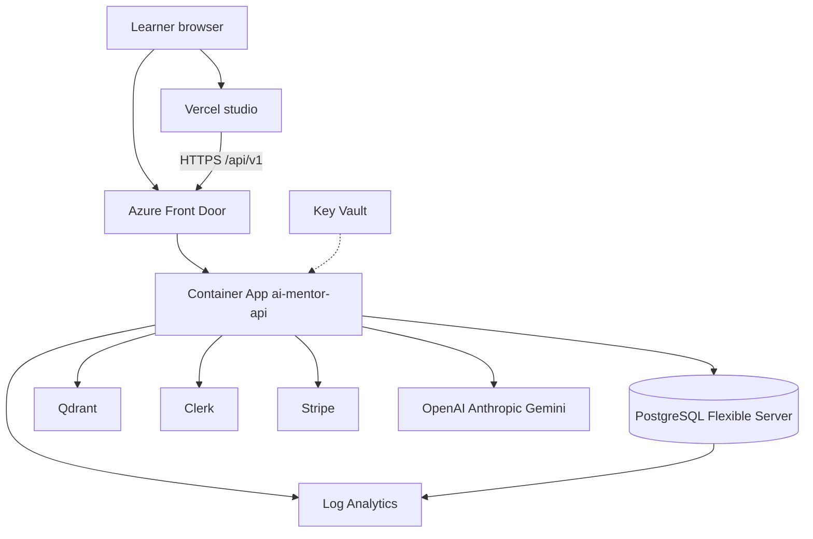
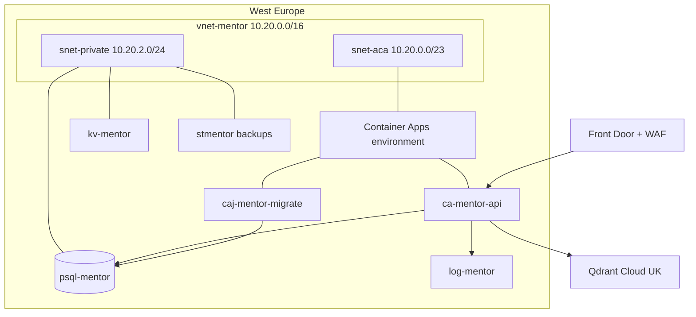
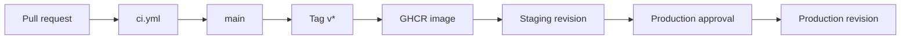
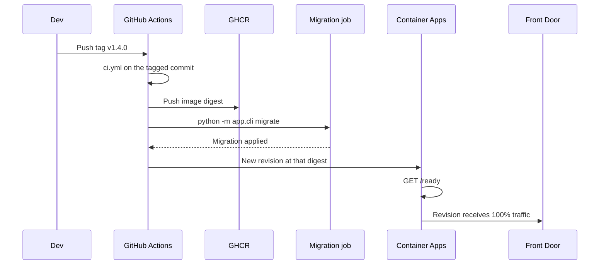
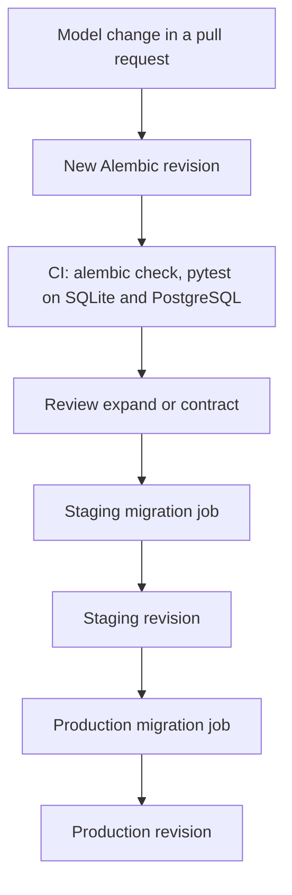
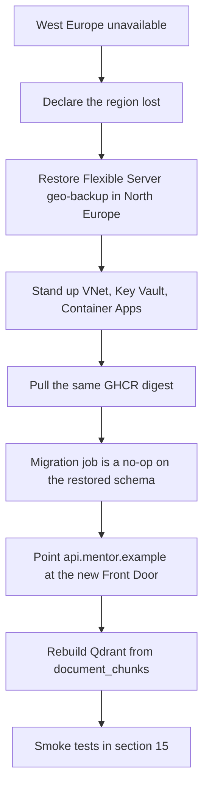

# Deployment and infrastructure specification

> **v2.0 amendment (13 October 2026).** This layout covers two frontends. The target is five Vercel projects (`learn.`, `teach.`, `org.`, `admin.`, `studio.`) on one API, per [ADR 0013](adr/0013-five-applications-shared-platform.md) and [platform/06-system-architecture.md](platform/06-system-architecture.md). Updating this document is follow-up F-03.

AI Mentor runs as two deployable parts: a Next.js studio and one API container. PostgreSQL is the system of record. Qdrant is a derived index that can be rebuilt from `document_chunks`. Clerk owns identity. Stripe owns subscriptions. Model providers are optional; with no key the curriculum policy still teaches.

This document is the target platform that matches the accepted hosting decision: the studio on Vercel, the API on Azure Container Apps. The repository already contains the local Compose stack, both Dockerfiles, the CI workflow, and the GHCR publish workflow. Azure resources, the migration job, and the production telemetry exporter are specified here and are not provisioned by the current workflows.

[SystemArchitecture.md](SystemArchitecture.md) section 17 describes a later layout that also hosts Next.js on Container Apps. Until [ADR 0006](adr/0006-azure-container-apps.md) is superseded, this file is the hosting specification.

Primary region: **West Europe**. Recovery region: **North Europe**. Both are in the EU, as SRS CON-002 and CMP-007 require. One API image. AWS may pull that image later. There is no second backend codebase.

## 1. Infrastructure overview



| Piece | Role | Where it runs |
| --- | --- | --- |
| Studio | Landing, dashboard, tutor, quiz, lab, research | Vercel |
| Admin portal | Library, review, curriculum, taxonomy, users, configuration, audit (ADR 0012) | Separate Vercel project at `admin.<domain>` |
| API | FastAPI mentor, grading, sandbox, ingestion | Azure Container Apps |
| Database | Users, curriculum, progress, chunk text | Azure Database for PostgreSQL Flexible Server |
| Vectors | Chunk embeddings | Qdrant Cloud, same region |
| Identity | Sign-up, login, OAuth, JWT | Clerk |
| Payments | Checkout and subscription webhooks | Stripe |
| Secrets | Runtime configuration | Azure Key Vault, Vercel env |
| Registry | Immutable API images | GHCR `ghcr.io/<owner>/<repo>/api` |

Public hostnames:

| Name | Points at |
| --- | --- |
| `mentor.example` | Vercel production |
| `staging.mentor.example` | Vercel staging |
| `api.mentor.example` | Front Door, production API |
| `api.staging.mentor.example` | Front Door, staging API |

The browser calls the API directly. `CORS_ORIGINS` is the studio origin for that environment. Stripe return URLs must start with one of those origins.

## 2. Azure architecture

Two resource groups: `rg-mentor-stg` and `rg-mentor-prd`. Each group holds its own network, database, Key Vault, and Container Apps environment. They do not share a database.



Network:

- Container Apps environment is VNet-injected. Ingress is external and HTTPS only.
- PostgreSQL has no public endpoint. The API reaches it through a private endpoint in `snet-private`.
- Key Vault and the backup storage account use private endpoints and a firewall that allows the VNet.
- Front Door is the only public entry to the API. It terminates TLS, applies the WAF managed ruleset, and rate-limits `/api/v1/chat`, `/api/v1/lab`, `/api/v1/research`, and `/api/v1/quiz` once more than one replica is running. The process-local limiter remains the control while the API stays at one replica.
- The container has no Docker socket, no privileged mode, and no Azure management identity beyond `id-mentor-api`.

API container shape:

| Setting | Staging | Production |
| --- | --- | --- |
| CPU / memory | 0.5 vCPU, 1 Gi | 1 vCPU, 2 Gi |
| Replicas | 0–1 | 1–4 |
| Ingress target port | 8000 | 8000 |
| Liveness probe | `GET /health` | `GET /health` |
| Readiness probe | `GET /ready` | `GET /ready` |
| User | `mentor` uid 10001 | `mentor` uid 10001 |
| Revision mode | Single | Single |

`/health` returns `{"status":"ok"}` while the process serves and reveals no configuration. `/ready` runs `select 1` and pings Qdrant and Redis; any failure is a 503, and the revision stops receiving traffic until it recovers.

The coding lab would fork `python -I` inside this container. That is an application limit, not a microVM boundary, so production refuses `LAB_ENABLED=true` until the isolated runner exists (Security-Compliance SEC-01).

## 3. Docker strategy

| Image | Dockerfile | Used for |
| --- | --- | --- |
| `ai-mentor-api` | `backend/Dockerfile` | Staging, production, and the Compose API |
| `ai-mentor-web` | `frontend/Dockerfile` | Optional self-hosted studio. Production studio is Vercel |
| `postgres:16-alpine` | upstream | Local only |
| `qdrant/qdrant:v1.13.4` | upstream | Local only |

API image rules:

- Base `python:3.12-slim`. Dependencies install from `pyproject.toml` with `pip install .`. No dev extras in the image.
- Build context is `backend/`. The image contains `app/`, `alembic/`, and `alembic.ini`.
- Runs as uid 10001. Listens on `0.0.0.0:8000`.
- Tag is the git tag (`v1.4.0`) plus the commit SHA. Tags are immutable. `latest` is not a deploy pointer.
- Build with Buildx on GitHub-hosted runners. The workflow that exists today pushes to GHCR on `v*` tags and on `workflow_dispatch`.

Local Compose (`infrastructure/compose.yaml`) is a development stack: Postgres `mentor`/`mentor`, Qdrant, Redis, a one-off migrate service, and the API with `APP_ENV=development` and `DEV_AUTH=true`, all bound to `127.0.0.1`. It is not a production template. `make up` builds and starts it. `make down` stops it.

The image command starts Uvicorn only, with `--proxy-headers --forwarded-allow-ips "$FORWARDED_ALLOW_IPS"`; set that variable to the Container Apps ingress range. Migrations and seed run from the same image as `python -m app.cli migrate` in the `caj-mentor-migrate` job (section 7), so replicas never race to migrate.

The studio image is a Next.js standalone build on Node 22, also uid 10001. Vercel builds from the same `frontend/` directory and does not need that image.

## 4. CI/CD pipelines



What runs today:

| Workflow | Trigger | Result |
| --- | --- | --- |
| `.github/workflows/ci.yml` | Push and pull request | Python 3.12, Ruff, pytest with the 90% domain coverage gate, `tsc`, `next build` |
| `.github/workflows/publish.yml` | Tag `v*` or manual | Build `backend/` and push `ghcr.io/<repo>/api:<ref>` |

CI does not deploy. A green main build is eligible for a tag. The tag is the release.

Target promotion, added when the Azure subscription is connected:

1. GitHub Environment `staging` uses OIDC to Azure. No long-lived client secret.
2. On a published tag, a migration job runs `alembic upgrade head` against staging.
3. Container Apps updates the staging revision to that digest and waits for `/ready`.
4. GitHub Environment `production` requires one reviewer.
5. The same digest is promoted to production after the migration job succeeds there. The staging image is not rebuilt.



Rollback selects the previous Container Apps revision. It does not retag `latest`. A schema change that already ran is rolled forward with a new migration, not by starting an older image that expects dropped columns.

Vercel deploys the studio on its own. Production tracks `main`. Pull requests get preview URLs. Preview studios call the staging API, and staging `CORS_ORIGINS` includes `https://*.vercel.app` only while previews are in use. Production CORS lists the production studio origin alone.

## 5. Environment strategy

| | Local | Staging | Production |
| --- | --- | --- | --- |
| Purpose | Feature work | Release candidate | Learners |
| `APP_ENV` | `development` | `production` | `production` |
| `DEV_AUTH` | on | off | off |
| Database | Compose Postgres, or SQLite for a single laptop | Flexible Server, burstable, public access off | Flexible Server, zone-redundant |
| Vectors | Compose Qdrant, or `QDRANT_URL=memory` | Qdrant Cloud staging collection | Qdrant Cloud production collection |
| Clerk | Optional. Header session when unset | Clerk development instance | Clerk production instance |
| Stripe | Empty. Checkout returns 503 | Test keys and test prices | Live keys and live prices |
| Studio | `next dev` | Vercel preview or staging domain | Vercel production |
| Data | Seeded demo users | Synthetic accounts | Real learner records |
| Rate limits | Per process, or Compose Redis | Azure Cache for Redis | Azure Cache for Redis |
| Startup | `make migrate` (or `create_all` on SQLite) | Migrate job, then the revision | Migrate job, then the revision |

`APP_ENV=production` refuses to boot when dev auth is on; Clerk JWKS, issuer, or secret key is missing; `DATABASE_URL` is not PostgreSQL; Qdrant is not `https://` with an API key; Redis or an OpenAI key is missing; the lab is on; staff MFA is off; or an origin is not explicit `https://`. That guard is the last line. The pipeline also sets those values.

Demo users (`demo-student`, `demo-instructor`, `demo-admin`) are created only in development and test. Production and staging have no demo accounts; staff smoke tests use real Clerk accounts, and the first admin is granted with `python -m app.cli grant-admin`.

Catalog seed upserts courses, lessons, paths, and achievements. It does not delete lessons, so a deploy does not wipe progress.

## 6. Secrets management

Secrets live in Key Vault for the API and in Vercel for the studio. The image, the git history, and workflow logs do not contain them. Container Apps references Key Vault through the managed identity `id-mentor-api`.

| Secret | Consumer | Notes |
| --- | --- | --- |
| `DATABASE_URL` | API, migration job | Includes the password. Private endpoint hostname |
| `CLERK_JWKS_URL`, `CLERK_ISSUER`, `CLERK_WEBHOOK_SECRET` | API | Webhook secret verifies Svix |
| `CLERK_SECRET_KEY` | API, both frontends | API deletes the Clerk user on erasure; frontends run Clerk middleware |
| `REDIS_URL` | API | Shared rate-limit counters. Use TLS (`rediss://`) |
| `STRIPE_SECRET_KEY`, `STRIPE_WEBHOOK_SECRET`, `STRIPE_PRICE_PRO`, `STRIPE_PRICE_RESEARCH` | API | Absent until billing is switched on. Checkout stays 503 |
| `OPENAI_API_KEY`, `ANTHROPIC_API_KEY`, `GEMINI_API_KEY` | API | Any empty set falls through. All empty uses the curriculum |
| `QDRANT_URL`, `QDRANT_API_KEY` | API | URL must be HTTPS; the key is required in production |
| `LANGFUSE_PUBLIC_KEY`, `LANGFUSE_SECRET_KEY` | API | Optional. Failures are ignored |
| `NEXT_PUBLIC_API_URL` | Studio | Public by design |
| `NEXT_PUBLIC_CLERK_PUBLISHABLE_KEY` | Studio | Public by design |
| GHCR pull credential | Container Apps | Read-only package scope |

`NEXT_PUBLIC_DEV_AUTH` is unset on staging and production. The studio then stops sending `X-Dev-User-Id`.

Rotation: database password and provider keys rotate in Key Vault, then a new revision is started so the process reloads settings. Clerk and Stripe webhook secrets rotate in the provider and in Key Vault in the same change. GitHub deploy credentials are OIDC federation, renewed by Azure, not stored as a paste-able secret.

Local developers copy `.env.example` to `backend/.env` and `frontend/.env.example` to `frontend/.env.local`. Those files are gitignored.

## 7. Database migration process

Schema source of truth is `backend/app/models/entities.py`. The first Alembic revision, `20261013_0001`, creates that metadata. Every later revision is an explicit Alembic operation. A second `create_all` revision is not a migration.



Rules:

- The migration job runs `python -m app.cli migrate` (Alembic `upgrade head`, then the catalog seed) with `DATABASE_URL` set to that environment. It runs once, as a Container Apps Job, before the API revision that needs the new schema receives traffic.
- Expand, then deploy the code that writes both shapes, then contract in a later release. A single release does not drop a column the previous revision still reads.
- Downgrade is reserved for a revision that was applied and whose `downgrade()` was exercised on staging. Learner data is recovered from backups, not from an untested downgrade.
- Seed runs in the migration job after migrations, never in the API process. It is idempotent and keeps existing progress rows.
- CI runs `alembic upgrade head`, `alembic check` (no drift between models and migrations), a full downgrade and re-upgrade, and the whole test suite against PostgreSQL 16. A staging migration against Flexible Server is the final check on real data volume.
- Connection pooling stays inside SQLAlchemy. Add PgBouncer only after connection count, not replica count, is the bottleneck.

Only a development or test process on SQLite calls `create_all`. PostgreSQL everywhere, including laptops, is migrated with Alembic.

## 8. Monitoring

Current code: if `OTEL_EXPORTER_OTLP_ENDPOINT` is set, the API installs a FastAPI instrumentor and an OTLP/HTTP span exporter (`/v1/traces` is appended), excluding the health probes. Export failures are logged and do not fail the request. Logs are JSON on stdout with `request_id` and `trace_id`; error responses carry the same `trace_id`. Point the endpoint at an OpenTelemetry Collector or the Azure Monitor OTLP ingestion endpoint.

Target signals, once the collector writes to Application Insights via the workspace `log-mentor-*`:

| Signal | Source |
| --- | --- |
| Availability | Front Door probe on `/health` |
| Request rate, status, latency | API spans. Separate `chat`, `quiz`, `lab`, `research` |
| Sandbox outcomes | Log fields `status=ok|rejected|error` |
| Dependency health | Postgres probe, Qdrant errors, provider HTTP status |
| LLM quality | Langfuse traces when both Langfuse keys are set |
| Saturation | Replica CPU and memory, Postgres CPU, connections, storage |
| Business | Quizzes graded, lessons completed, documents ingested. From Postgres, daily |

Service objectives for the first production quarter, measured on the API in West Europe:

| Objective | Target |
| --- | --- |
| Availability of `GET /health` | 99.5% monthly |
| `POST /chat` p95, curriculum path | Under 800 ms |
| `POST /chat` p95, with an external model | Under 8 s |
| `POST /lab/run` p95 | Under 4 s, including the 3 s sandbox cap |
| Error budget burn | Page when 2% of the monthly budget is spent in an hour |

Langfuse is the place for prompt versions and model latency. Azure Monitor is the place for user-facing availability. A missing model key is a successful curriculum response, not an outage.

## 9. Logging

The process writes text logs to stdout (`time level logger message`). Container Apps forwards stdout and stderr to the Log Analytics workspace. Retention is 30 days in staging and 90 days in production.

Production log policy, applied as the JSON formatter is added:

- One line per request: method, path, status, duration, request id. The body is not logged.
- `Authorization`, cookies, webhook signing secrets, and database URLs are redacted.
- Student source and uploaded document text stay out of info logs. Sandbox stdout in the API response is enough for the learner. A rejection reason at info level is enough for operators.
- Prompt text sent to a provider is visible in Langfuse, which has its own access control, and is absent from Log Analytics.
- Catalog seed and migration messages stay at info so a revision start can be audited.

Correlation: Front Door generates a request id, the API logs it, and the future OTLP exporter puts it on the span. Support can join a learner report to one trace without a document dump.

## 10. Alerting

Alerts go to an action group: email for staging, email plus the on-call channel for production. Thresholds use a 5-minute window unless noted.

| Severity | Condition | Response |
| --- | --- | --- |
| 1 | `/health` failing for 5 minutes, or Postgres unavailable | Page. Follow the restore runbook if the database is the cause |
| 1 | HTTP 5xx above 5% for 10 minutes | Page. Roll back the revision if the error starts at the deploy |
| 2 | Chat p95 above 8 s for 15 minutes | Ticket. Check provider status. Curriculum fallback still serves |
| 2 | Lab `error` rate above 20% for 15 minutes | Ticket. `rejected` is a learner mistake and is not this alert |
| 2 | Qdrant errors above 10 per minute | Ticket. Research degrades. Chunk text in Postgres is intact |
| 2 | Stripe or Clerk webhook failures | Ticket the same day. Subscription status and new users lag until it is fixed |
| 3 | Postgres storage above 80%, or a daily cost increase above 40% | Next business day |
| 3 | Backup job missed its window | Next business day. Section 13 |

Front Door WAF blocks are a weekly review, not a page. A spike in 429s means the edge limit is doing its job. Raise the limit only after looking at the caller.

## 11. Scaling strategy

Scale the API horizontally for request fan-out. Scale Postgres vertically until a metric says otherwise.

| Layer | Policy |
| --- | --- |
| Studio | Vercel. Independent of the API |
| API | Production minimum 1, maximum 4. Scale out at 70% CPU. Scale in after 10 quiet minutes |
| API at night | Staging may scale to 0. Production stays at 1 so `/health` and webhooks stay warm |
| Postgres | Raise compute when CPU holds above 70% for an hour. Add a read replica only for dashboard read load, which is not the current bottleneck |
| Qdrant | One node while the collection fits in memory. A larger node comes before a cluster |
| Ingestion | Synchronous, 10 MB cap. Front Door concurrency limit on `POST /research/documents` protects the event loop |
| Models | Provider-side budgets. The app does not queue calls |

Rate limits are counted in Redis, so they hold across replicas: 60 requests a minute per user, 20 on AI routes, 10 uploads an hour, and 120 a minute per address before authentication. Front Door's WAF rate rule is a coarser outer layer, not the primary limiter.

The lab is off in production. When the isolated runner exists, it runs in its own pool, not beside the mentor on the API replicas.

There is no Celery and no separate worker. A queue is a later change, and only for ingestion.

## 12. Cost optimisation

The bill concentrates in three places: Postgres, model tokens, and always-on API capacity. Vercel and a small Qdrant cluster stay secondary at this size.

| Lever | Practice |
| --- | --- |
| One region, one API | West Europe only. A second cloud is an image pull, not a second platform |
| Staging shape | Burstable Postgres, API scale-to-zero outside the workday, 30-day logs |
| Production shape | One replica until CPU requires another. Zone-redundant Postgres is the availability spend. It is justified for learner records |
| Models | Leave keys empty and the curriculum answers. Set a monthly cap in each provider account. Prefer the smallest configured model |
| Logs and traces | 90 days in production. Sampling on successful chat spans after the first month |
| Images | GHCR included with the repository. No second registry |
| Reservations | Consider a one-year Postgres reservation after 30 days of steady compute. Skip reservations during the first month |
| Bandwidth | Studio and API in nearby edges. Uploads are capped at 10 MB |
| Idle preview | Vercel preview builds are the PR cost. They share the staging API |

Planning envelope, list prices move and this is not a quote: a quiet staging stack is tens of pounds a month if the API scales to zero. Production is dominated by a small zone-redundant Flexible Server plus token usage. Token usage is uncapped by XP. The provider budget is the control.

## 13. Backup strategy

Postgres holds learner state. Qdrant can be rebuilt by re-embedding `document_chunks`. Clerk and Stripe remain the sources for login and payment, with a copy of role and `subscription_status` in Postgres.

| Data | Method | Retention | Restore drill |
| --- | --- | --- | --- |
| PostgreSQL | Flexible Server point-in-time restore, geo-redundant backup | 14 days | Quarterly, into an isolated server |
| PostgreSQL | Weekly `pg_dump` to container `backups` on `stmentor<env>`, immutability 30 days | 30 days | Quarterly, one table restored and counted |
| Qdrant | Weekly snapshot to the same storage account | 30 days | Optional. Rebuild from chunks is the supported path |
| Blob | Versioning on, soft delete 14 days | As above | Included in the dump drill |
| Key Vault | Soft delete and purge protection | 90 days | Annual |
| Images | GHCR retains every release tag | Life of the repository | Redeploy the previous digest |

The dump job is a Container Apps Job with a managed identity that can write blobs and read the database. It does not print the connection string. A missed run raises the severity 3 alert.

A restore of Postgres does not restore a Stripe subscription that changed after the restore point. After a point-in-time restore, replay or reconcile webhook state from Stripe before taking new checkouts.

## 14. Disaster recovery

Targets: **RPO 15 minutes** for Postgres (point-in-time restore), **RTO 4 hours** for a West Europe region outage. Vectors are a derived index, so their RPO is the time to re-embed.



The same image digest moves. Schema and learner rows come from the geo-backup. Catalog seed fills any catalog rows the backup already has, without deleting progress.

This design is single-writer and single-region. Active-active would split the rate limiter, the sandbox, and webhook handling. The recovery region stays cold.

Clerk and Stripe are outside the region. Their outages are on their status pages. The API keeps serving teaching from Postgres and the curriculum while a provider is down. Checkout returns an error when Stripe is down. Login fails when Clerk is down, because production has no password fallback.

Communication: status note on the studio, on-call owns the clock, a short log of the restore point and the digest that came back.

## 15. Deployment procedures

### Local

```bash
make up      # Postgres, Qdrant, API with dev auth
make web     # studio at http://localhost:3000
make test
make lint
```

A laptop without Docker can run the API on SQLite:

```bash
cd backend
DATABASE_URL=sqlite:///./dev.sqlite APP_ENV=development \
  ../.venv/bin/uvicorn app.main:app --reload --port 8000
```

`make api` expects the default Postgres URL.

### Staging release

1. Merge to `main` with CI green.
2. Tag `vX.Y.Z` on that commit. `publish.yml` pushes the image.
3. Confirm the digest in GHCR.
4. Run the staging migration job. Read the Alembic log to the new revision.
5. Update the staging Container App to that digest. Wait until the new revision is healthy.
6. Smoke-test staging with a Clerk test user:
   - `GET /ready` returns 200, `GET /docs` is 404, and a request with only `X-Dev-User-Id` is 401.
   - `POST /api/v1/chat` with “Teach me Reinforcement Learning” returns the socratic question.
   - `POST /api/v1/lab/run` is 503 (lab off).
   - A small Markdown upload returns an extractive summary. Critique stays empty without a citing model.
   - Studio login, dashboard, and a quiz grade succeed.
7. Leave the revision in place for the production decision.

### Production release

1. Open the GitHub production environment deployment. A reviewer confirms the staging smoke test.
2. Run the production migration job.
3. Shift production to the same digest. Single revision, 100% traffic after `/ready` passes.
4. Repeat the smoke list against `api.mentor.example` with a staff account.
5. Watch 5xx and chat latency for 30 minutes. The severity 1 alerts cover the same window.

### Rollback

1. Activate the previous Container Apps revision.
2. If the migration expanded columns, leave the schema. The previous image must still tolerate the new columns.
3. If the migration dropped or renamed something, restore Postgres to the pre-deploy point in time and then start the previous revision. Announce the learner-data window that was discarded.
4. Record the digest that is serving and the restore timestamp.

### First production cut

Before the first learner who is not staff:

- `APP_ENV=production`, dev auth off, Clerk middleware on the studio, `NEXT_PUBLIC_DEV_AUTH` unset.
- Private PostgreSQL, Key Vault references, Front Door TLS.
- Stripe either configured with live prices or left empty so checkout stays 503.
- Backup job has completed once, and one restore drill has been done on staging.
- The OTLP exporter writes to Azure Monitor, or the team accepts probe and stdout monitoring for a dated gap.

Webhook endpoints to register: `POST /api/v1/webhooks/clerk` and `POST /api/v1/webhooks/stripe`.
