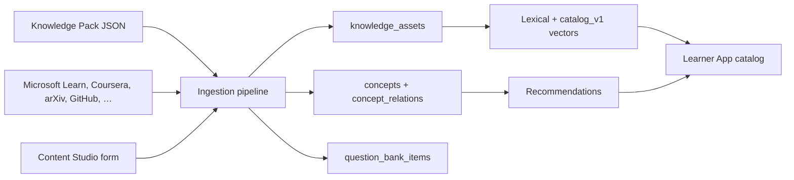

# Resource Catalog and Knowledge Pack

> **v2.0 amendment (13 October 2026).** This page describes the catalog that runs today. The Learner App searches published assets. Import, quality, duplicates, and graph screens live in Content Studio (`apps/studio`, port 3004). The API root `/api/v1/content` still aliases today's `/api/v1/admin/catalog/*` until R2. Knowledge Pack rows seed the `master` workspace (ADR 0019). Instructors do not own this repository; they consume releases.

The Resource Catalog is the bounded context that holds books, courses, papers, videos, repositories, datasets, tutorials, blogs, certifications, documentation, podcasts, learning paths, and coding challenges. Every record is a `KnowledgeAsset`. The four Learner App tracks in `backend/app/domain/catalog.py` still seed lessons and quiz keys. The catalog sits beside them and feeds search, recommendations, and Content Studio.

## Contents

1. [Architecture](#architecture)
2. [KnowledgeAsset](#knowledgeasset)
3. [Database](#database)
4. [Knowledge graph](#knowledge-graph)
5. [Ingestion](#ingestion)
6. [Search and recommendations](#search-and-recommendations)
7. [Knowledge Pack v1.0](#knowledge-pack-v10)
8. [APIs](#apis)
9. [Admin and Content Studio](#admin-and-content-studio)
10. [Operations](#operations)

## Architecture



Teaching rules live in `backend/app/domain/knowledge`. HTTP handlers validate and call `CatalogService` or `IngestionService`. The pack compiler is pure Python and does not open a database.

## KnowledgeAsset

Seed JSON and the API use the same field names. The ORM maps four of them: `author` → `author_name`, `estimated_duration` → `estimated_minutes`, `learning_outcomes` → `objectives`, `ai_generated_summary` → `ai_summary`, `thumbnail` → `thumbnail_url`, `metadata` → column `metadata` / attribute `extra`.

Required at submit: title, description, category, resource type, language, difficulty, licence. URLs are canonicalised (host lower-cased, tracking query params dropped). Dedupe keys prefer DOI, arXiv id, ISBN, then URL, then a hash of type + title + provider.

## Database

Alembic revision `20261013_0002` adds the catalog columns on `knowledge_assets` and the satellite tables: `content_sources`, `import_jobs`, `import_job_items`, `taxonomy_nodes`, `skills`, `career_roles`, `asset_skills`, `asset_concepts`, `catalog_embeddings`, `external_links`, `duplicate_candidates`, `question_bank_items`, `catalog_path_steps`, `challenge_specs`, `learning_preferences`, `learner_resources`. PostgreSQL also has `ix_knowledge_assets_fts` on `search_text`.

## Knowledge graph

Edges read left to right. `mdp prerequisite_of bellman` means the MDP is mastered before the Bellman equation. Blocking weight is 0.8 and above. Eligibility, gap repair, and path validation live in `domain/knowledge/graph.py` (ADR 0020). The v1 catalog tuples still drive the tutor; pack concepts extend the same `concepts` table with `origin = pack`.

## Ingestion

Twelve stages, in order: source registration, asset collection, metadata extraction, content validation, topic classification, difficulty classification, skill mapping, knowledge graph mapping, embedding generation, catalog registration, search indexing, recommendation registration. A rejected record stops. Connectors are registered in `domain/knowledge/taxonomy.py` (`SOURCES`). Remote harvests skip when a credential env is unset; staff upload bulk JSON instead.

## Search and recommendations

`GET /api/v1/resources` filters published rows and ranks with 0.45 lexical, 0.20 quality, 0.15 type/style, 0.10 difficulty fit, 0.10 recency. Resource recommendations add 0.35 goals, 0.25 weak skills, 0.20 career, 0.10 progress, 0.10 learning style.

## Knowledge Pack v1.1

Compiler: `app.domain.knowledge.pack.compile_pack`. Seed files: `/seed-data`. Launch floor: 2,000 resources, 500 papers, 300 books, 500 videos, 150 courses, 100 certifications, 200 datasets, 300 repositories, 50 paths, 2,000 quiz items, 500 coding challenges. The compiled pack currently holds 4,839 resources (937 papers, 551 books, 661 videos, 212 courses, 200 certifications, 379 datasets, 557 repositories, 78 paths), 2,686 quiz items, 632 coding challenges, and 158 concepts.

Five named academies are first-class paths: Computer Vision, Natural Language Processing, Federated Learning, Programming, and Modelling and Simulation. Each required module has a concept, assessments, a project-style challenge, and catalog resources. Definitions live in `pack_academies.py`; `academy_gaps()` fails the unit tests if a module is missing.

```bash
make write-pack   # emit seed-data JSON
make seed-pack    # load into the database
```

`make seed` and API startup do **not** load the pack. Tests stay fast. Landmark papers and books use real identifiers. Generated coverage records point at public documentation, lecture playlists, and Hub search pages.

## APIs

Live learner routes: `GET /api/v1/resources`, `GET /api/v1/resources/{id}`, `POST /api/v1/resources/{id}/progress`, `GET /api/v1/catalog/facets`, `GET /api/v1/catalog/recommendations`, `GET /api/v1/catalog/graph`, `GET|PATCH /api/v1/me/learning-preferences`.

Staff: `GET /api/v1/admin/catalog/overview`, `POST /api/v1/admin/catalog/import`, `GET /api/v1/admin/catalog/sources`, `POST /api/v1/admin/catalog/sources/{slug}/refresh`, `GET /api/v1/admin/catalog/jobs`, `GET /api/v1/admin/catalog/duplicates`, `POST /api/v1/admin/catalog/duplicates/{id}`. Content Studio uses the same operations under `/api/v1/content/catalog/*`, plus `GET /api/v1/content/home` (queue counts), `GET /api/v1/content/questions` (prompts and options, no answer keys), and `GET /api/v1/content/challenges` (starter and visible tests, no hidden tests or reference solutions). Library drafts stay on `/api/v1/content/assets` and omit Knowledge Pack rows.

Answer keys on `question_bank_items` and hidden tests on `challenge_specs` are never serialised to learners.

## Admin and Content Studio

These screens run in Content Studio (`apps/studio`, port 3004). That app is **not** the Institution App or the Instructor App. Those are separate frontends on the same API. The Admin App keeps users, providers, configuration, moderation, audit, and analytics.

| Screen | Route |
| --- | --- |
| Resource catalog | `/catalog` |
| Asset import centre | `/catalog/import` |
| Duplicate detection | `/catalog/duplicates` |
| Knowledge graph | `/graph` |
| Taxonomy / metadata | `/taxonomy`, `/studio/metadata` |
| Curriculum and path builder | `/curriculum`, `/studio/paths` |
| Assessment generator | `/studio/assessments` |
| Approval workflow | `/review` and library transitions |
| Lesson builder | `/library/new` |

The learner studio adds `/catalog` for faceted search.

## Operations

Pack seed is a one-off: `python -m app.cli seed-pack`. Import logs are `import_jobs`. Quality is 0–100 on completeness, provenance, usefulness, freshness, and verification. Link checks store `external_links`; a live HTTP checker is not in this revision.
