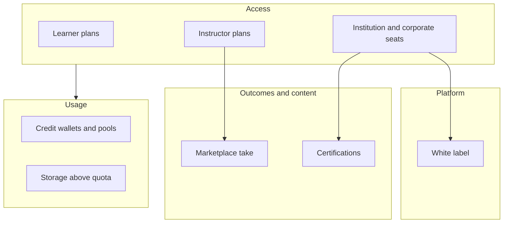
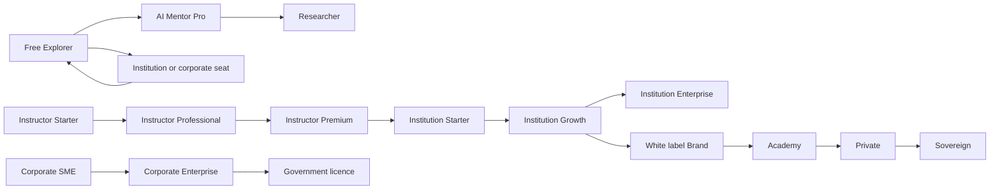

# Pricing and commercialisation

Recommended commercial model for AI Mentor, from the current product to the five-application platform. Adopted 13 October 2026.

This document is the commercial source of truth. It keeps the consumer prices in [PRD.md](PRD.md) section 15 and the institution seat prices in [platform/02-prd.md](platform/02-prd.md) (Monetisation v2), and adds the credit system, instructor and creator plans, corporate packages, certifications, marketplace rules, white-label bands, and the planning model. Those earlier sections called the numbers hypotheses. They are now the list prices to take to beta and to the first institution pilots. Pilots can still move a number; a change is an edit here, then in Stripe, not a second price book.

List prices below are **Band A charm prices**: the same numeral in GBP, USD, and EUR (£14.99, $14.99, €14.99). That is purchasing-power list design, not a foreign-exchange conversion. Bands B and C are percentages of Band A.

Nothing in this document turns on an entitlement the server does not enforce yet. Stripe checkout today accepts `pro` and `research` only. Tier limits, credit wallets, instructor plans, and institution contracts are specified here and are not live until billing enforcement ships.

## 1. Pricing strategy

### What we charge for

Nine meters, in the order a customer meets them:

| Meter | Who pays | How |
| --- | --- | --- |
| Learner licence | Individuals | Free, Pro, Researcher |
| Instructor licence | Independent teachers and small providers | Starter, Professional, Premium |
| Institution seat | Schools (16+), colleges, universities, bootcamps, training providers | Per active learner seat per year |
| Corporate seat | Companies and government | Per active learner seat per year, or an enterprise licence |
| AI credits | Anyone who exceeds the included wallet | Prepaid pool or metered overage |
| Storage | Above the included quota | Per GB-month |
| Certification | Learners, or included in Campus and corporate | Exam, certificate, renewal |
| Marketplace | Buyers; creators receive a share | Platform take rate |
| White label | Organisations that want their own brand or a private deployment | Annual platform fee plus seats |

### Principles

1. **The free tier is a real product.** A learner can form a streak, finish the opening of AI Fundamentals, and sit a quiz without paying. The limit they feel is model generations, not a locked classroom.
2. **Authored teaching is free of credits.** Socratic openers, quiz grading, XP, and the knowledge graph do not call a paid model. Credits are spent only when an agent generates. That is how the cost guardrail in PRD section 14 holds: under £0.60 of model cost per free monthly active learner, and under £3.00 per Pro learner. (The SRS states £1.50 and £6.00. This document follows the tighter PRD figures. PRD open question OQ-04 should be closed on that basis.)
3. **Price the seat, meter the model.** Institutions buy a predictable seat. AI cost above the included wallet is a credit pool the institution can see and cap. A keen cohort cannot silently erase the margin.
4. **Education is cheaper than employers.** A university seat is a distribution channel. An employer seat includes workforce reporting and is priced for the buyer's budget, not the student's.
5. **One discount, the best one.** Discounts do not stack. Annual pricing is the annual price, not a second discount on top.
6. **Do not sell what the release does not contain.** The coding lab stays off in production until the runner in [ADR 0028](adr/0028-sandbox-runner-pool.md) passes review. Pro may be sold on paths, tutor depth, and the career advisor. The lab is added to the Pro entitlement when it ships, at the same price.
7. **Gross margin above 70%** on the blended active learner, measured after model cost, payment fees, and hosting. If a plan's fully used wallet falls through that line, the wallet shrinks. The price does not rise mid-contract.

### What can be sold now

| Offer | Status |
| --- | --- |
| Free, and self-serve Pro and Researcher checkout | Live once Stripe price ids are set. The API already maps `pro` and `research`. |
| Instructor, institution, corporate, white label | Contract or waitlist. No self-serve price yet. |
| Coding lab as a paid feature | Withheld until the isolated runner ships. |
| Marketplace payouts and proctored exams | Release R5 and R3 respectively, per the platform PRD. |

### Segments

| Segment | Offer | Why they buy |
| --- | --- | --- |
| Individual learners | Free, then Pro | A tutor that stays on the path and does not dump the answer |
| Researchers and PhD students | Researcher | Papers quoted from the file, with critique only when a passage is cited |
| Independent instructors | Instructor plans | A cohort, assessments, and (from Professional) AI-assisted marking they still sign |
| Schools (16+ only) | Institution Starter | A class set. Under-16 is not sold until the safeguarding decision in platform PRD OQ-03 |
| Colleges | Starter or Growth | A department without a full campus contract |
| Universities | Growth, then white label if they want the brand | Campus structure, SSO, reports |
| Bootcamps | Starter per cohort, or Professional if the instructor is independent | One cohort, a fixed end date, an invoice |
| Professional training providers | Instructor Premium or Institution Growth | Their catalogue plus the tutor |
| Corporate learning teams | Corporate seat or SME package | Skills assessment, a private curriculum, manager reports |
| Government | Enterprise licence, often with residency | A procurement vehicle, EU data residency, audit |
| Large enterprise | Enterprise licence plus a credit pool | Workforce map, internal knowledge, SSO, SCIM |

## 2. Packaging

Commercial names map to the `subscription_tier` values the database already stores, plus new plan codes for later enforcement.

| Commercial name | Code | Buyer |
| --- | --- | --- |
| Free Explorer | `free` | Learner |
| AI Mentor Pro | `pro` | Learner |
| Researcher | `research` | Learner |
| Instructor Starter | `instructor_starter` | Instructor |
| Instructor Professional | `instructor_pro` | Instructor |
| Instructor Premium | `instructor_premium` | Instructor |
| Institution Starter | `inst_starter` | Education organisation. Same shape as the platform PRD "Classroom" plan |
| Institution Growth | `inst_growth` | Education organisation. Same shape as "Campus" |
| Institution Enterprise | `inst_enterprise` | Education organisation that needs corporate-grade controls |
| Corporate SME | `corp_sme` | Company, 25–249 seats |
| Corporate Enterprise | `corp_enterprise` | Company, 250 seats and above |
| Government | `gov` | Public body |
| Creator | `creator` | Content Studio, included with a free account |
| Creator Plus | `creator_plus` | Author who sells |
| Publisher | `publisher` | University press, certification body, or publisher |

A learner who holds an institution or corporate seat receives that plan's learner entitlements inside the tenant. Their personal Pro or Researcher subscription pauses for the months the seat is active and resumes when the seat ends, so they are not billed twice. The seat is one membership with the learner role. Three cohorts still cost one seat.

## 3. Learner plans

Band A. Bands B and C multiply the price and the included credits by 0.53 and 0.27 (section 10). Storage and the free tier do not change with the band.

| | Free Explorer | AI Mentor Pro | Researcher |
| --- | --- | --- | --- |
| Monthly | £0 | £14.99 | £29.99 |
| Annual | — | £119 (about 34% under twelve months) | £239 |
| Tutor | 20 messages a day. Opening turns are scripted and free. Model replies spend credits | Fair use, drawn from the wallet | Fair use, drawn from the wallet |
| Included credits / month | 40 | 600 (Band B 320, Band C 160) | 1,500 (Band B 800, Band C 400) |
| Paths | AI Fundamentals, plus the first module of each other path | All paths | All paths |
| Depth | Through Intermediate | All depths | All depths, including PhD |
| Quizzes and daily challenges | Yes | Advanced and Expert | Plus critique and derivation items |
| Coding coach | 3 runs a day, once the lab is on | Included | Included |
| Flashcards | Limited decks | Unlimited | Unlimited |
| Study plans | 1 | Unlimited, adaptive | Unlimited, adaptive |
| Career advisor | Basic | Full | Full |
| Analytics | Streak, XP, mastery | Full weekly report | Full weekly report |
| Paper analysis | — | — | 30 documents a month, from the wallet |
| Storage | 100 MB | 2 GB | 20 GB |
| Trial | — | 7 days, offered after the learner has had a real session, not at sign-up | — |

Upgrade: Free to Pro is the default prompt, shown when the daily tutor cap or a depth gate is hit. Pro to Researcher is offered when someone uploads a paper or asks for a literature pass. Downgrade takes effect at the end of the paid period. Unused credits expire at the end of the billing month and are not refunded. Annual credits are granted monthly, not as a lump, so a January subscriber cannot spend a year of model budget in a week.

## 4. Instructor plans

For a person teaching under their own name. A bootcamp or college that employs several instructors buys an institution plan instead, and the instructors are seats on it.

| | Starter | Professional | Premium |
| --- | --- | --- | --- |
| Monthly | £29 | £79 | £199 |
| Annual | £232 | £635 | £1,599 |
| Active learners | 30 | 200 | 1,000 |
| Cohorts at once | 1 | 8 | Unlimited |
| Course authoring | Yes, through Content Studio | Yes | Yes, and Creator Plus is included |
| Assessments | Authored quizzes | Plus AI-assisted marking from a shared wallet | Plus item banks |
| Included credits / month | 200, shared by the cohort | 2,000 | 8,000 |
| Analytics | Cohort completion | Mastery by concept, at-risk list | Plus export |
| Scheduling | — | Cohort dates and a plan | Plus calendar invites |
| Communication | Announcements | Announcements and feedback on submissions | Plus office-hours slots |

AI marking proposes a mark with the evidence quoted. The instructor submits the mark. The platform never tells a learner an AI mark is final. That matches the assessment rules already in the platform PRD.

An independent instructor who outgrows Premium moves to Institution Starter (25 seats minimum, annual invoice) rather than a fourth instructor tier.

## 5. Institution plans

Prices are per active learner seat per year, Band A. Instructor, teaching-assistant, and administrator seats are included and do not count toward the learner cap. Invoice, net 30. Monthly card is available on Starter only, at one twelfth of the annual price, for a bootcamp that will not sign a year.

| | Starter | Growth | Enterprise |
| --- | --- | --- | --- |
| Platform PRD name | Classroom | Campus | Enterprise, education edition |
| For | One course, a bootcamp cohort, a school sixth form, a small college department | College, university, large training provider | University or provider that needs the corporate control set |
| Seats | 25–500 | 500–50,000. Above 5,000 the price steps down 10% per extra 5,000, floor £18 | 500 and above |
| Price / seat / year | £48 | £30 | £72 |
| Minimum contract | £1,200 | £15,000 | £36,000 |
| Departments | 1 | Unlimited | Unlimited |
| Knowledge repository | The shared catalogue plus 1 private collection | Private collections per department | Private collections, and internal-document ingestion |
| Storage | 1 GB per seat | 5 GB per seat | 10 GB per seat |
| Included credits / seat / month | 80 | 150 | 250 |
| Reporting | Cohort | Organisation and department | Plus scheduled exports |
| SSO | Google and Microsoft login | SAML or OIDC | SAML or OIDC, and SCIM when R4 ships |
| Branding | Logo on the cohort | Logo, colours, email from their domain | Plus a custom domain on Growth's feature set |
| Compliance pack | Standard DPA | DPA, sub-processor list, EU residency (West Europe) | Plus audit log export and a named security review |

Institution Enterprise at £72 sits between the education Campus price and the £90 employer price. It is for a university that wants SCIM and a custom domain without paying the workforce product. Employers do not buy this plan. They buy section 6.

Schools are Starter only, and only for learners aged 16 and over, until OQ-03 is decided.

## 6. Corporate AI Academy

| | SME | Large enterprise | Government |
| --- | --- | --- | --- |
| Seats | 25–249 | 250 and above | 100 and above |
| Price | £12 per seat per month, annual commit (£144 / seat / year) | £90 per seat per year, or an enterprise licence | Enterprise licence from £45,000 / year |
| Minimum | £3,600 / year | £22,500 / year | £45,000 / year |
| AI skills assessment | Once at join, once a year | Unlimited on the included wallet | Unlimited on the included wallet |
| Workforce reporting | Team completion | Skills by role, talent map | The same, on the buyer's org units |
| Internal knowledge | — | Private collection from their documents | Private collection, EU residency included |
| Custom curriculum | One path branded for them | A path set, authored with them in Content Studio | A path set, plus a public-sector reporting template |
| Credits | 150 / seat / month, pooled | 250 / seat / month, pooled | 250 / seat / month, pooled |
| Identity | Google and Microsoft | SAML or OIDC, SCIM at R4 | SAML or OIDC, SCIM at R4 |
| Availability | Standard | 99.9% as a contract term, once the platform offers it | 99.9%, EU residency |

The enterprise licence is a fixed annual fee that includes a seat cap and a credit pool, for buyers who cannot take a per-seat count through procurement. Price it at the per-seat figure for the cap they name, with a floor of £22,500 (enterprise) or £45,000 (government). Unused seats are not refunded. A mid-year increase is co-terminous and charged pro rata.

Usage consumption sits on top: a credit pool (section 7), billed only when the pool is drawn below zero and the contract allows overage. The default is to stop model generations and keep authored teaching, then email the billing manager. Overage never starts silently.

## 7. AI credit model

### What a credit is

One credit is one unit of model work. Planning cost is £0.004 of model spend per credit, using a small model, short context, and caching. If the blended cost of a credit rises above £0.005 for a month, wallets are cut the following month. Prices stay. The tutor's fall-back to the authored curriculum means a cut wallet still teaches.

| Action | Credits | Notes |
| --- | --- | --- |
| Scripted tutor turn, quiz grade, XP, flashcard schedule, graph | 0 | Deterministic |
| Tutor generation | 1 | Direct mode, or a socratic turn that has passed the scripted stages |
| Career advice, full | 2 | Basic career on Free is a template and costs 0 |
| Coding review | 2 | The run itself is compute in the runner, not a credit. The written review is |
| Assessment generation | 3 | Drafting items. Grading an authored key stays 0 |
| AI-assisted marking of an open answer | 4 | Instructor confirms |
| Paper analysis | 8 | One question against one uploaded document |
| Literature review or reviewer simulation | 20 | Researcher plan |

Embeddings are included. They are not credits. A retrieval that then generates spends the generation's credits only.

### Included wallets

The monthly grants are in sections 3 to 6. Rules for every wallet:

- Granted on the billing date, or on the first day of the month for annual and seat contracts.
- Unused credits expire. They are not a bank.
- Institution and corporate wallets are pooled across the tenant. One cohort can use another cohort's quiet month. The billing manager sees the burn weekly.
- A personal Pro wallet and a seat wallet do not combine. While a seat is active, the personal wallet is frozen.

### Overage

| | Band A | Band B | Band C |
| --- | --- | --- | --- |
| Price per extra credit | £0.016 | £0.012 | £0.008 |

£0.008 is twice the planning cost, so Band C overage still clears the credit even though it does not carry Band A's margin. Included credits already scale down in Bands B and C, which is the real protection.

Default is a hard stop at the wallet, with authored teaching continuing. Pro, Researcher, and instructor plans may opt in to overage, capped at 100% of the included wallet unless the customer raises the cap. Institutions and companies opt in inside the contract. There is no uncapped overage.

### Enterprise pools

Prepaid credits, drawn after the included wallet:

| Pool | Price / credit | Minimum |
| --- | --- | --- |
| Standard | £0.012 | 10,000 credits (£120) |
| Volume | £0.010 | 100,000 credits (£1,000) |

Pools last 12 months. They are the only credits that survive a month boundary.

### Profitability controls

1. Wallet size is set so a fully used Pro wallet costs at most £3 in a month (600 × £0.004 = £2.40).
2. Free is capped at 40 credits, £0.16 of model cost, plus a 20-message daily tutor cap. The £0.60 PRD ceiling has room for a bad cache month.
3. Routing: scripted and cached answers first, small model second, a larger model only when the policy asks for one. A larger model spends 3 credits, not 1, so the wallet tracks cost.
4. Per-tenant daily ceiling of 20% of the monthly wallet, so a script cannot empty a campus on one afternoon.
5. A margin review each month. The trigger to shrink a wallet is cost per credit, not a feeling that usage is high.

## 8. Content Studio

Authors, subject experts, universities, and certification bodies use Content Studio. Teaching a cohort is an instructor or institution plan. Selling to strangers is a creator plan. Premium instructor includes Creator Plus so a working teacher is not billed twice.

| | Creator | Creator Plus | Publisher |
| --- | --- | --- | --- |
| Price | £0 | £19 / month or £152 / year | £99 / month or £792 / year |
| For | An expert drafting | An author who sells | A press, a university, a certification body |
| Published courses | 1 | 10 | Unlimited |
| Marketplace | — | Listed after review | A branded catalogue |
| Revenue share | — | 70% author / 30% platform | 80% publisher / 20% platform once trailing-twelve-month sales exceed £25,000. 70/30 before that |
| Analytics | Views | Sales and completion | Plus institution adoption |

The share is of the amount paid after tax and after refunds, not of the list price.

### Marketplace

Creators sell courses, assessments, challenge packs, learning paths, and knowledge packs.

| Rule | Value |
| --- | --- |
| Standard share | 70% creator, 30% platform |
| Publisher share | 80/20 after £25,000 trailing twelve-month sales on that publisher |
| Certification listed by a partner | 60% partner, 40% platform, because the platform runs the exam record and the proctor |
| Price floor | £4.99, or free |
| Refunds | 14 days, or until 20% of the course is completed, whichever comes first |
| Payout | Monthly, by Stripe Connect, minimum £50, 14 days after the refund window closes |
| Tax | The seller is the merchant of record for their own tax registration. The platform collects and remits VAT only where the law requires the platform to |

Review before anything is listed: the same workflow the library already uses. An editor submits, a different admin approves, and self-approval is flagged if the small-team exception is on. Quality checks before approval: a licence from the allowed list, no answer keys in the learner payload, citations on any generated draft, and a completion path a reviewer can actually finish. A listing that fails a learner complaint review is unpublished. The creator keeps the sales already paid out. New sales stop.

The platform PRD places marketplace payouts in R5. Until then, Creator Plus can be sold as a publishing tool without a public storefront.

## 9. Certification

Five credentials. Each has an exam, a certificate, and a renewal. The exam is a proctored check of mastery the platform already measures, not a second curriculum.

| Credential | Exam | Certificate bundle (includes one exam sitting) | Renewal, every 24 months | Live proctoring add-on |
| --- | --- | --- | --- | --- |
| AI Foundations | £49 | £79 | £29 | Included, automated |
| Machine Learning Associate | £79 | £129 | £49 | £19 |
| Reinforcement Learning Practitioner | £99 | £159 | £59 | £19 |
| Robotics Engineer | £99 | £159 | £59 | £19 |
| Generative AI Specialist | £129 | £199 | £79 | £25 |

A failed sitting can be retaken once within 90 days for half the exam price. A third sitting pays the full exam price. The certificate names the person, the credential, and the date. It does not name a score.

Growth institution contracts include Foundations exam sittings for their seats, one per seat per year. Corporate and government contracts include Foundations and one advanced credential per seat per year. Other sittings are billed at the table.

Proctoring cost to us is planned at £6 for an automated sitting and £14 for a live sitting. The add-on prices above clear that with margin. Live proctoring is a bought-in service until volume justifies employing it. It is not built.

These ship with the assessment release (platform R3 for the first credential, not before). They are not on sale before an exam blueprint and a pass mark are published.

## 10. White label

Annual platform fee, Band A, on top of seats unless the band says seats are included. Seats above the included cap use the buyer's normal seat price.

| Band | Fee / year | Includes |
| --- | --- | --- |
| Brand | £15,000 | Their logo, colours, and a custom domain on the shared platform. Shared catalogue plus one private collection. Standard support |
| Academy | £45,000 | Brand, plus SSO, a dedicated knowledge base, and 500 learner seats. Email from their domain |
| Private | £120,000 | Academy, plus a deployment pinned to West Europe, their own model route (their provider key or a dedicated deployment), and an integration project of up to 15 days |
| Sovereign | £250,000 and above | Private, plus a single-tenant deployment, a private network path, a named security review, and an integration programme. Quoted. The floor is £250,000 |

White label does not include moving the primary region out of the EU. A UK-only or US residency requirement is a separate residency product and is not priced here, because the platform decision is West Europe with North Europe for recovery.

"Dedicated AI models" means a private model route and, at Sovereign, a deployment that does not share prompts with other tenants. It does not mean AI Mentor trains a foundation model for the customer.

## 11. Global pricing

| Band | Markets | Factor | Pro monthly | Researcher monthly | Pro annual |
| --- | --- | --- | --- | --- | --- |
| A | United Kingdom, United States, euro area, Canada, Switzerland, Norway, Australia, New Zealand, Japan, South Korea, Singapore | 1.00 | 14.99 | 29.99 | 119 |
| B | Poland, Czechia, Romania, and the rest of EU states not in A; Turkey; Mexico; Brazil; Chile; Malaysia; Thailand; South Africa | 0.53 | 7.99 | 15.99 | 63 |
| C | Nigeria, Kenya, Ghana, francophone West Africa, India, Pakistan, Bangladesh, Indonesia, Philippines, Egypt, and other low-income markets we enable | 0.27 | 3.99 | 7.99 | 32 |

The numeral is charged in local currency where we have a Stripe presentment currency, otherwise in GBP. Band is chosen from the billing country, checked against the payment method. A Band C price requires a Band C payment method. Moving country takes effect at the next renewal.

Institution, corporate, and white-label fees use the same factors, except a government contract, which is quoted in the currency of the procurement and does not receive Band C automatically. A ministry buying for a Band C country negotiates inside the factor. It does not also take the education discount.

Education discount on top of the band, for consumer plans only, is the student discount in section 12. Institution seat prices are already the education price.

## 12. Discounts

Exactly one of these applies. The largest one that the buyer qualifies for wins. Annual pricing is not in this list.

| Discount | Amount | Who | Rule |
| --- | --- | --- | --- |
| Student | 40% off Pro or Researcher | A learner with a current student verification | Consumer plans only. Re-checked yearly |
| Educator | Instructor Starter free, or 50% off Professional and Premium | A verified teacher | One instructor account |
| Nonprofit | 30% off institution and corporate seat prices | A registered charity or equivalent | Not on white label |
| Early adopter | 40% for 12 months | The first 500 Pro subscribers and the first 5 institution contracts | Locked for that term, then the list price |
| Public institution | Already in the Growth price | Universities, colleges, schools | No further education discount |

Employees of a customer with an active seat do not also get a student or educator discount on a personal subscription. Their personal plan is paused.

## 13. Commercial model

### Revenue architecture

Access is the recurring base. Usage protects the margin when a tenant is heavy. Certifications and the marketplace are attached to people who already have access. White label is a platform fee for the few buyers who need a brand or a boundary.

### Billing mechanics

- Consumer and instructor: Stripe Checkout, monthly or annual, the price id for the band.
- Seats: annual invoice. A seat count is the number of learner memberships active on the renewal date, with a true-up at mid-year if the count has grown by more than 10%.
- Credits: included wallets first, then a prepaid pool, then opted-in overage.
- Marketplace: the platform charges the buyer and pays the creator.
- Tax: VAT-inclusive display in the UK and EU. US prices are before sales tax, added at checkout where due.

### Upgrade paths

A seat pauses a personal paid plan. Leaving the institution returns the learner to the personal plan they had, or to Free if it has expired. Instructor Premium is the last individual step. The next step is an organisation.

## 14. Financial planning model

This is a planning model with the assumptions written down. It is not a forecast of bookings and it is not a commitment. Currency is Band A GBP. Costs use the £0.004 planning figure per credit.

### Assumptions

| Input | Value | Why |
| --- | --- | --- |
| Active learner | A learner with a session in the month | Registered-but-idle users are not in the count |
| Paid consumer mix, at 10,000 actives and above | 4% Pro, 1% Researcher, of actives | Below mature consumer education products. Treated as the base, not the hope |
| Plan mix among paid consumers | 60% annual, 40% monthly | Annual is the default on the checkout page |
| Pro ARPU | £143 a year | 0.6 × £119 + 0.4 × £14.99 × 12 |
| Researcher ARPU | £287 a year | 0.6 × £239 + 0.4 × £29.99 × 12 |
| Education seats | 12% of actives at scale, blended £37 | 40% of those seats at £48, 60% at £30 |
| Corporate and government seats | 5% of actives at scale, £90 | The employer price, not the education price |
| Free share | The remainder, 78% at scale | |
| Credit use | 50% of Pro wallet, 60% of Researcher, 50% of seat wallets, 25 of 40 free credits | Expected, not the cap |
| Payment fees | 2% of revenue | Card and invoice blended |
| Hosting | £0.25 per active per year | Falls with scale. Held flat here so the model does not pretend |

Early years do not have the scale mix. Year 1 is almost all consumer. The scale table and the year table are different views. Do not multiply them.

### Revenue per active learner at scale

| Component | Share of actives | ARPU / year | Contribution |
| --- | --- | --- | --- |
| Free | 78% | £0 | £0 |
| Pro | 4% | £143 | £5.72 |
| Researcher | 1% | £287 | £2.87 |
| Education seat | 12% | £37 | £4.44 |
| Corporate seat | 5% | £90 | £4.50 |
| **Access total** | | | **£17.53** |

Model cost per active at the expected use above is about £3.40. Fees and hosting add about £0.60. Contribution after those three is about £13.50, a margin near 77% on the £17.53. A month in which every free learner uses the whole 40-credit cap adds about £0.75 of cost and the margin stays above 70%. That is the guardrail doing its job.

The access figure ignores marketplace, certificates, and white label. Those are in the year view, because they are not proportional to a learner who has only just arrived.

### Scale snapshots, access revenue only

| Active learners | Access revenue / year | Model cost / year | After model, fees, hosting |
| --- | --- | --- | --- |
| 1,000 | £18,000 | £3,400 | £13,000 |
| 10,000 | £175,000 | £34,000 | £135,000 |
| 100,000 | £1,750,000 | £340,000 | £1,350,000 |
| 1,000,000 | £17,500,000 | £3,400,000 | £13,500,000 |

Rounded to the nearest thousand. At 1,000 actives this revenue does not fund a team. The product at that scale is a beta with a Stripe account, not a business. The interesting line is 100,000, where access revenue covers a small company if the cost line holds.

### Planning years

Horizon starts October 2026. Year 1 is the first twelve months.

| | Year 1 | Year 3 | Year 5 plan | Year 5 upside |
| --- | --- | --- | --- | --- |
| Active learners, end of year | 1,000 | 10,000 | 100,000 | 1,000,000 |
| Mix | 94% free, 5% Pro, 1% Researcher | 80% free, 5% Pro, 1% Researcher, 10% education, 4% corporate | Scale mix | Scale mix |
| Access revenue | £10,000 | £174,000 | £1,750,000 | £17,500,000 |
| Marketplace take | — | £8,000 | £96,000 | £960,000 |
| Certifications, net of proctor cost | — | £12,000 | £220,000 | £2,200,000 |
| White label | — | £30,000 (two Brand) | £240,000 (four contracts) | £1,200,000 |
| **Revenue** | **£10,000** | **£224,000** | **£2,306,000** | **£21,860,000** |

Marketplace in the plan year assumes 8% of actives buy £40 of content and the platform keeps 30%. Certifications assume 3% of actives take a bundle near £99, after proctor cost. Both are zero until those products ship, so Year 1 has neither. The upside column is a different company, not a base case. It needs the government channel and the marketplace to be real.

### What would break the model

- Selling the coding lab, or unlimited tutor generations, before wallets are enforced.
- Band C prices with Band A wallets. Credits scale with the band for that reason.
- A campus contract priced at the corporate £90, which we would lose, or a corporate contract priced at £30, which we would regret.
- Stacking the student discount on a seat that is already an education price.

## 15. Decisions this document settles, and those it leaves

Settled, as list prices for beta and for the first pilots:

- Consumer prices, bands, the 40% student discount, the 7-day Pro trial, and the annual prices, as in PRD section 15.
- Institution seat prices of £48, £30, and £72, extending the platform PRD figures. The £72 education enterprise price is new. The £90 figure remains the employer price.
- Credit weights, wallet sizes, overage, and the rule that a rising model cost shrinks the wallet.
- Marketplace shares of 70/30, 80/20 after £25,000, and 60/40 on partner certifications.
- White-label bands from £15,000 to £250,000 and above.
- One discount at a time.

Still to confirm with evidence, not by editing this page in advance:

- The first five institution pilots may move a seat price. Record the result here.
- PRD open question OQ-04 (which AI cost ceiling) is recommended closed in favour of the PRD's £0.60 and £3.00.
- Certification pass marks and blueprints, before any exam is sold.
- Under-16 schools, which stay unsold.

## Related

- [PRD.md](PRD.md) section 15, consumer summary
- [platform/02-prd.md](platform/02-prd.md), institution plans and release timing
- [ADR 0028](adr/0028-sandbox-runner-pool.md), why the lab is not a paid feature yet
- [Security-Compliance.md](Security-Compliance.md), the cost and isolation constraints the wallets exist to respect
