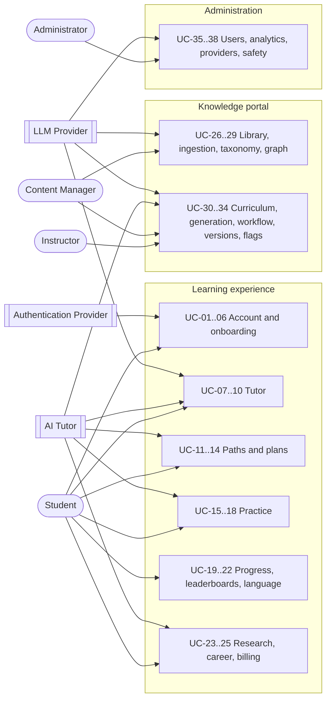

# AI Mentor MVP: Use Cases and User Stories

> **v2.0 amendment (13 October 2026).** UC-01 to UC-38 and Epics 1–16 remain valid and now belong to the Learner App, Content Studio, and Admin App. Sections 2 (actors) and 3 (permissions by role) are superseded. New use cases for all five applications are in [platform/04-use-cases.md](platform/04-use-cases.md); new stories are in [platform/05-user-stories.md](platform/05-user-stories.md).

This document turns the MVP scope in [README.md](../README.md), the product vision in [Requirements.md](Requirements.md), and the knowledge portal in [Admin.md](Admin.md) into use cases and user stories that can be estimated, built, and tested.

Where the backend already encodes a rule (in `backend/app/domain`), the acceptance criteria use the shipped values. Where the specs are silent, the document says so and records a proposed value in [Open questions](#11-open-questions-and-assumptions).

## Contents

1. [Scope](#1-scope)
2. [Actors](#2-actors)
3. [Permissions by role](#3-permissions-by-role)
4. [Business rules](#4-business-rules)
5. [Use case map](#5-use-case-map)
6. [Use cases](#6-use-cases)
7. [Story conventions](#7-story-conventions)
8. [User stories](#8-user-stories)
9. [Traceability](#9-traceability)
10. [Suggested delivery order](#10-suggested-delivery-order)
11. [Open questions and assumptions](#11-open-questions-and-assumptions)

---

## 1. Scope

### In the MVP

- Accounts: email registration, sign-in, password reset, Google sign-in, roles.
- Onboarding assessment that sets a persona, a starting path, and an initial skill score.
- Learning preferences: teaching style, tutor personality, pace, technical depth, mathematics depth, breadth.
- Tutor chat: streaming, Socratic by default, Direct mode on request, grounded in the curated knowledge base with citations.
- Intent routing to the quiz, planner, research, coding, and career agents.
- Four launch paths: AI Fundamentals, Reinforcement Learning, Robotics, LLM Engineering.
- Concept graph, prerequisite-aware recommendations, and study plans.
- Quizzes (multiple choice, true/false, fill in the blank, short answer, coding) from beginner to PhD.
- Python coding lab with a restricted sandbox, grading, and tutor review.
- Flashcards with SM-2 spaced repetition.
- Daily challenges, XP, levels, streaks, badges, global and country leaderboards.
- Progress dashboard with mastery, strengths, gaps, and the next lesson.
- English, French, and Spanish for the interface, tutor replies, lessons, and quizzes.
- Research assistant for a paper the learner uploads.
- Career advice endpoint.
- Pro and Research subscriptions through Stripe.
- Admin knowledge portal: library, ingestion into Qdrant, taxonomy, concept relationships, curriculum, AI content generation, approval workflow, versioning, analytics.
- User and role administration, platform analytics.

### After the MVP

These appear in the specs but are deferred. Stories for them are not written here.

- Coding notebooks, robotics simulations, Three.js and Pyodide visualisers.
- Voice, voice accents, and the animated tutor avatar (the tutor *personality* is in the MVP).
- Friends and regional leaderboards.
- Community challenges and research-project supervision.
- Full career coaching surface.
- iOS and Android apps.
- Ingestion of video (MP4, YouTube), audio, datasets, and GitHub repositories.

---

## 2. Actors

### Primary actors

| Actor | Kind | Role key | Description |
| --- | --- | --- | --- |
| Student | Human | `student` | Any learner: university student, professional, career switcher, enthusiast, or researcher. The default role for every new account. |
| Instructor | Human | `instructor` | A subject expert who authors and reviews content. Has every Student capability. |
| Content Manager | Human | `admin` (decided 2026-10-13: no separate role in v1) | Owns the knowledge library: ingestion, taxonomy, concept graph, curriculum, approval, and publishing. In v1 this is an Administrator; approval follows the four-eyes rule between admins, with the `CONTENT_SELF_APPROVAL` exception for very small teams. The platform's `content_reviewer` and `content_publisher` roles replace it later (platform RBAC matrix). |
| Administrator | Human | `admin` | Owns users, roles, platform configuration, analytics, and safety. Has every capability. |

### System and external actors

| Actor | Kind | Description |
| --- | --- | --- |
| AI Tutor | Internal system | The mentor engine: an orchestrator plus the Tutor, Quiz, Planner, Coding, Research, and Career agents. Domain rules decide the pedagogy. The model only phrases the turn. |
| Authentication Provider | External (Clerk) | Proves identity, issues JWTs, runs Google OAuth and password reset, and sends user lifecycle webhooks. Does not decide permissions. |
| LLM Provider | External (OpenAI, Anthropic, Gemini) | Generates text and embeddings behind a provider router. May be slow, rate-limited, or unavailable. |

### Supporting actors

These are not in the requested list but appear in several flows.

| Actor | Description |
| --- | --- |
| Payment Provider (Stripe) | Checkout, subscriptions, and billing webhooks. |
| Vector Store (Qdrant) | Stores and searches embeddings. A local hash index replaces it in development. |
| Scheduler | A clock-driven job that rotates daily challenges, closes streak days, and produces weekly reports. |

---

## 3. Permissions by role

Roles are ranked. A higher role inherits every capability of the roles below it.

| Capability | Student | Instructor | Content Manager | Admin |
| --- | :-: | :-: | :-: | :-: |
| Learn, practise, view own progress | Yes | Yes | Yes | Yes |
| Upload and analyse own research paper | Yes | Yes | Yes | Yes |
| Create and edit draft content | | Yes | Yes | Yes |
| Submit content for review | | Yes | Yes | Yes |
| Review content written by others | | Yes | Yes | Yes |
| Approve, publish, archive, restore content | | | Yes | Yes |
| Upload to the shared knowledge library | | | Yes | Yes |
| Manage taxonomy, concept graph, learning paths | | | Yes | Yes |
| View content analytics | | Yes | Yes | Yes |
| View platform analytics | | | | Yes |
| Manage users and roles | | | | Yes |
| Configure providers, limits, safety | | | | Yes |

---

## 4. Business rules

Acceptance criteria refer to these rules by number. Values marked **shipped** are already in `backend/app/domain`. Values marked **proposed** need product sign-off.

| ID | Rule | Status |
| --- | --- | --- |
| BR-01 | Roles rank `student` < `instructor` < `admin`. An unknown or missing role is treated as `student`. Content Manager duties belong to `admin` in v1. | Shipped |
| BR-02 | XP per activity (SRS GAM-002): lesson completed 40, once per lesson; quiz `10 + round(40 × score)` where score is 0–1, half rounding up, once per quiz and 10 quizzes a day; coding project passed 25, once per project; flashcard reviewed 5, 20 a day; research analysis 10, once per document and 3 a day. Each award is keyed by its source, so a retry never pays twice. | Shipped |
| BR-03 | Daily XP cap is 400. An award is `min(requested, 400 − earned today)`. XP above the cap is lost, not banked. | Shipped |
| BR-04 | Level is `1 + floor(XP / 250)`. Progress within the level is `XP mod 250`. | Shipped |
| BR-05 | Streak: activity on the same day keeps the streak (minimum 1); activity on the next calendar day adds 1; any gap resets it to 1. The day is the learner's local day. | Shipped (learner time zone in `users.timezone`) |
| BR-06 | Badges: `first_steps` (1 lesson), `streak_3` (3-day streak), `week_streak` (7-day streak), `perfect_quiz` (100% quiz), `mastery` (any concept ≥ 80), `reviewer` (1 paper analysed), `shipped_code` (1 passing submission). Each badge is awarded once. | Shipped |
| BR-07 | Concept mastery 0–100 weights quiz average 45%, lesson completion 25%, project pass rate 20%, flashcard recall 10%, renormalised over the evidence that exists. Lessons count only once the learner has some activity on the concept. Projects count only after an attempt. | Shipped |
| BR-08 | Mastery bands: 75–100 strength; 60–74 developing; 1–59 gap; 0 unstarted. | Shipped |
| BR-09 | Socratic stages by tutor turn: turn 1 asks an opening question only; turn 2 reflects the idea and asks a check; turn 3 gives a scaffold and a check; turn 4 onward gives the explanation and an exercise. If the learner asks for the answer before turn 4, the tutor gives the scaffold, one question, and tells them Direct mode exists. | Shipped |
| BR-10 | Direct mode explains the concept using the curated account plus one short example and the exercise. It must not invent a different definition. | Shipped |
| BR-11 | Learner text sent to a model is at most 8,000 characters, contains no control characters, and is not empty. Text that is only a prompt-injection phrase is rejected. Retrieved and uploaded text is fenced as untrusted. | Shipped |
| BR-12 | Rate limits: 60 requests per minute general traffic, 20 per minute AI traffic, and 10 uploads an hour, per user; 120 requests per minute per address before sign-in. Shared across instances. | Shipped (configurable) |
| BR-13 | Coding lab source is at most 20,000 characters. Allowed imports: `math`, `random`, `statistics`, `itertools`, `functools`, `collections`, `collections.abc`, `dataclasses`, `typing`. Banned calls include `exec`, `eval`, `open`, `compile`, `__import__`, `input`, `getattr`, `setattr`, `globals`, `locals`, plus dunder and private attribute access. Runs time out after 3 seconds. | Shipped as a policy filter. The isolated runner in UC step 3 is not built, so the lab is off in production (Security-Compliance SEC-01) |
| BR-14 | Coding submissions pass when normalised stdout matches the expected output. The tutor's review never marks code as passing on its own. | Shipped |
| BR-15 | Flashcards use SM-2. Recall quality is 0–5. Quality below 3 resets repetitions and interval without changing ease. Successful intervals are 1 day, then 6 days, then `ceil(interval × ease)`. | Shipped |
| BR-16 | A study plan expands the goal with its prerequisites in topological order, skips concepts with mastery ≥ 75, schedules one concept per day, and holds at most 14 items. | Shipped |
| BR-17 | Documents are chunked at 800 characters with 120 characters of overlap before embedding. | Shipped |
| BR-18 | A research critique that does not cite any supplied source is discarded. | Shipped |
| BR-19 | Content states: Draft → Review → Approved → Published → Archived. Only Published content is shown to students or retrieved by the tutor. | Shipped for the curated library (admin portal); the student resource browser is specified |
| BR-20 | Tutor first byte under 1.5 seconds at the 95th percentile. | Specified (percentile proposed) |
| BR-21 | Supported languages: English (default), French, Spanish. Progress is stored once per learner, independent of language. | Specified |
| BR-22 | Leaderboards show the top 10 globally and the top 10 in the learner's country, plus the learner's own position and percentile. | Partly shipped: global top 10 with handles or pseudonyms and opt-out; country board and own position are specified |
| BR-23 | A daily challenge awards the XP of its activity plus a 50 XP completion bonus, subject to the daily cap. Challenges rotate at 00:00 UTC. | Proposed |
| BR-24 | Development authentication is refused when `APP_ENV=production`. | Shipped |

---

## 5. Use case map

---

## 6. Use cases

### UC-01 Register an account

**Goal:** A visitor creates an AI Mentor account and lands in onboarding.

**Actors:** Primary: Student. Supporting: Authentication Provider.

**Preconditions:** The visitor is not signed in. The Authentication Provider is reachable.

**Trigger:** The visitor selects "Get started" or "Sign up".

**Main success flow:**
1. The system shows the sign-up form in the browser's language if supported, otherwise English.
2. The visitor enters name, email, and password and accepts the terms.
3. The Authentication Provider validates the password policy and sends a verification email.
4. The visitor opens the verification link.
5. The Authentication Provider marks the email verified and issues a session.
6. The system provisions the learner record (UC-04) and redirects to onboarding (UC-05).

**Alternate flows:**
- A1 (step 2) The visitor chooses "Continue with Google". The Authentication Provider runs OAuth and returns a verified identity. Continue at step 6.
- A2 (step 4) The visitor requests a new verification email. The previous link is invalidated.

**Exception flows:**
- E1 (step 3) The email is already registered. The system offers sign-in and password reset without revealing whether the account used Google or a password.
- E2 (step 3) The password fails policy. The form shows the rule that failed.
- E3 (step 4) The link has expired. The system offers to resend it.
- E4 (step 6) Provisioning fails. The session is kept and provisioning retries on the next authenticated request.

**Postconditions:** A verified identity exists in the Authentication Provider and a learner record exists with role `student`, language set, and onboarding marked incomplete.

---

### UC-02 Sign in

**Goal:** A registered user starts an authenticated session.

**Actors:** Primary: Student, Instructor, Content Manager, Administrator. Supporting: Authentication Provider.

**Preconditions:** The user has a verified account and is not suspended.

**Trigger:** The user selects "Sign in" or opens a protected page.

**Main success flow:**
1. The system redirects to the Authentication Provider's sign-in.
2. The user enters email and password.
3. The Authentication Provider issues a JWT.
4. The API verifies the JWT against the provider's JWKS and issuer.
5. The system loads the learner record and role.
6. The system routes the user to onboarding if incomplete, otherwise to the dashboard, or to the page they originally requested.

**Alternate flows:**
- A1 (step 2) The user signs in with Google.
- A2 (step 6) A Content Manager or Administrator is offered a link to the admin portal.

**Exception flows:**
- E1 (step 3) Wrong credentials. A generic error is shown. Repeated failures are throttled by the provider.
- E2 (step 4) The token is invalid, expired, or from the wrong issuer. The API returns 401 and the client restarts sign-in.
- E3 (step 5) The account is suspended. The system shows a suspension notice and ends the session.
- E4 (step 4) The environment is production and a development token is presented. The API refuses it (BR-24).

**Postconditions:** The user holds a valid session. Their last-active timestamp is updated.

---

### UC-03 Reset password

**Goal:** A user who forgot their password regains access.

**Actors:** Primary: Student. Supporting: Authentication Provider.

**Preconditions:** The account uses email and password.

**Trigger:** The user selects "Forgot password".

**Main success flow:**
1. The user enters their email.
2. The system shows the same confirmation whether or not the email exists.
3. The Authentication Provider emails a single-use reset link.
4. The user opens the link and sets a new password.
5. The Authentication Provider revokes existing sessions and signs the user in.

**Alternate flows:**
- A1 (step 1) The account uses Google only. The email explains that the account signs in with Google.

**Exception flows:**
- E1 (step 4) The link has expired or was used. The user can request a new one.
- E2 (step 4) The new password fails policy.

**Postconditions:** The password is changed and all other sessions are revoked.

---

### UC-04 Provision and synchronise user identity

**Goal:** Every identity in the Authentication Provider has exactly one matching learner record with the correct role and status.

**Actors:** Primary: Authentication Provider. Supporting: Administrator.

**Preconditions:** The webhook endpoint is configured with a signing secret.

**Trigger:** The Authentication Provider sends `user.created`, `user.updated`, or `user.deleted`, or a user makes an authenticated request with no learner record.

**Main success flow:**
1. The system verifies the webhook signature.
2. The system checks the event ID has not already been processed.
3. For `user.created`, the system creates a learner record with role `student`.
4. For `user.updated`, the system updates name, email, and avatar. Role is taken from the system, not the event.
5. The system records the event ID as processed.

**Alternate flows:**
- A1 (trigger) An authenticated request arrives before the webhook. The system creates the learner record just in time from JWT claims. The later webhook updates it.
- A2 (step 3) For `user.deleted`, the system starts account deletion (US-009).

**Exception flows:**
- E1 (step 1) The signature is invalid. The system returns 400 and logs a security event.
- E2 (step 2) The event is a duplicate. The system returns 200 and does nothing.
- E3 (step 3) The database is unavailable. The system returns 5xx so the provider retries.

**Postconditions:** Identity and learner record agree. Processing is idempotent.

---

### UC-05 Complete the onboarding assessment

**Goal:** The system learns enough about a new learner to choose a persona, a starting path, and an initial skill score.

**Actors:** Primary: Student. Supporting: AI Tutor.

**Preconditions:** The learner is signed in and onboarding is incomplete.

**Trigger:** First sign-in, or the learner selects "Resume onboarding".

**Main success flow:**
1. The system shows a short profile step: educational background, professional experience, industry, career goal, research interests.
2. The learner answers preference questions: language, teaching style, tutor personality, pace, available study time, technical depth, mathematics comfort, programming experience.
3. The system runs a short adaptive diagnostic (about 8 questions) across Python, probability, linear algebra, and machine learning basics.
4. The system computes an initial skill score and seeds mastery for the diagnosed concepts.
5. The system assigns a persona (Student, Professional, Career switcher, Enthusiast, Researcher) and recommends a starting path.
6. The learner accepts the recommended path.
7. The system marks onboarding complete and opens the first lesson or tutor conversation.

**Alternate flows:**
- A1 (step 3) The learner skips the diagnostic. The system starts them at beginner level on AI Fundamentals and offers the diagnostic later.
- A2 (step 6) The learner picks a different path. The system warns about prerequisites the learner has not shown, then enrols them.
- A3 (any step) The learner leaves. Answers so far are saved and the next sign-in resumes at the same step.

**Exception flows:**
- E1 (step 3) Question generation fails. The system uses the authored diagnostic bank.
- E2 (step 4) Scoring fails. The system sets a beginner skill score and logs the error.

**Postconditions:** Profile, preferences, persona, initial mastery, and active path are stored. Onboarding completion is recorded for analytics.

---

### UC-06 Manage learning preferences and profile

**Goal:** A learner changes how the tutor teaches and what the profile says about them.

**Actors:** Primary: Student. Supporting: AI Tutor.

**Preconditions:** The learner is signed in.

**Trigger:** The learner opens Settings, or uses the style control in the tutor.

**Main success flow:**
1. The system shows current profile (name, country, language, learning goal) and preferences (teaching style, personality, pace, technical depth, mathematics depth, breadth).
2. The learner changes one or more values.
3. The system validates each value against its allowed set and saves.
4. The next tutor turn, quiz, and recommendation use the new values.

**Alternate flows:**
- A1 (trigger) The learner changes the teaching style inside a tutor conversation. The change applies from the next turn and is saved to the profile.
- A2 (step 2) The learner changes language. See UC-22.

**Exception flows:**
- E1 (step 3) An invalid value is submitted. The API returns 422 and nothing is saved.

**Postconditions:** Preferences are saved and applied. Mastery and progress are unchanged.

---

### UC-07 Learn through a Socratic tutor conversation

**Goal:** A learner understands a concept by reasoning toward it with the tutor.

**Actors:** Primary: Student. Supporting: AI Tutor, LLM Provider, Vector Store.

**Preconditions:** The learner is signed in and within the AI rate limit.

**Trigger:** The learner sends a message in the tutor.

**Main success flow:**
1. The system screens the message (BR-11).
2. The AI Tutor classifies intent as tutoring (UC-09) and detects the target concept, or keeps the concept from earlier turns.
3. The AI Tutor plans the turn from the Socratic stage (BR-09), the learner's preferences, and the learner's mastery of the concept and its prerequisites.
4. The AI Tutor retrieves Published knowledge for the concept (UC-08).
5. The LLM Provider phrases the turn. The system streams tokens to the learner.
6. The learner answers the tutor's question. The flow repeats from step 1 at the next stage.
7. At the explanation stage the tutor gives the explanation and an exercise, then waits for an attempt.
8. The system stores the conversation and links it to the concept.

**Alternate flows:**
- A1 (step 3) The learner asks for the answer before the explanation stage. The tutor gives the scaffold, one question, and points to Direct mode (BR-09).
- A2 (step 3) The learner is in Direct mode. The tutor explains at once (BR-10).
- A3 (step 3) A prerequisite is in the gap band. The tutor names the prerequisite and offers to teach it first.
- A4 (step 2) No concept is detected. The tutor asks which area the learner wants and what they want to be able to do.
- A5 (step 7) The learner asks for an example, analogy, mathematics, or a practice exercise. The tutor produces that form.

**Exception flows:**
- E1 (step 1) Screening rejects the message. The learner sees why (too long, empty, or not allowed) and nothing is sent to a model.
- E2 (step 1) The AI rate limit is reached. The learner sees when they can send again.
- E3 (step 5) Every LLM Provider fails or no key is configured. The system returns the authored curriculum text for that stage.
- E4 (step 5) The stream drops. The client shows the partial reply and a retry action. The stored message is marked incomplete.

**Postconditions:** The conversation and messages are saved with stage, concept, provider, and latency. Tutor engagement is available to mastery and analytics.

---

### UC-08 Receive a grounded answer with citations

**Goal:** Tutor answers rely on curated, Published content and say where the content came from.

**Actors:** Primary: AI Tutor. Supporting: Vector Store, LLM Provider, Student.

**Preconditions:** At least one Published asset is indexed for the concept or query.

**Trigger:** The AI Tutor needs knowledge to plan a turn, generate a quiz, or answer a question.

**Main success flow:**
1. The AI Tutor builds a retrieval query from the message, the concept, and the learner's language.
2. The Vector Store returns the top chunks, filtered to Published assets.
3. The AI Tutor fences each chunk as untrusted content (BR-11) and adds it to the prompt with its asset ID.
4. The LLM Provider generates the reply using the chunks.
5. The system attaches citations (asset title, section, link) for chunks the reply used.
6. The learner can open a citation to see the source asset.

**Alternate flows:**
- A1 (step 2) No chunk passes the relevance threshold. The tutor answers from the authored curriculum and says the answer is not from the library.
- A2 (step 2) The best chunks are in a different language. The tutor answers in the learner's language and cites the original.

**Exception flows:**
- E1 (step 2) The Vector Store is unavailable. The tutor answers from the authored curriculum and the event is logged.
- E2 (step 4) A retrieved chunk contains an instruction aimed at the model. It is treated as text, not followed.
- E3 (step 5) The reply cites an asset that was not retrieved. The citation is removed.

**Postconditions:** The reply and its citations are stored. Retrieval hits feed content analytics.

---

### UC-09 Route a request to a specialist agent

**Goal:** A single chat box sends quiz, study plan, research, code, and career requests to the right agent.

**Actors:** Primary: AI Tutor. Supporting: Student.

**Preconditions:** The learner is signed in.

**Trigger:** A message arrives at the orchestrator.

**Main success flow:**
1. The orchestrator classifies intent: tutor, quiz, plan, research, code, or career.
2. The orchestrator calls the matching agent with the learner context.
3. The agent returns a structured result (quiz, plan, review, analysis, or advice).
4. The tutor renders the result inline with a link to the dedicated page.

**Alternate flows:**
- A1 (step 1) Intent is unclear. The orchestrator defaults to the tutor.
- A2 (step 3) The research agent needs a document. The tutor asks the learner to upload one (UC-23).

**Exception flows:**
- E1 (step 2) The agent fails. The tutor apologises briefly and offers the dedicated page.
- E2 (step 1) The message contains code to run. Chat does not execute it and offers the coding lab.

**Postconditions:** The routed intent is logged for analytics.

---

### UC-10 Manage conversation history

**Goal:** A learner finds, resumes, renames, and deletes past tutor conversations.

**Actors:** Primary: Student.

**Preconditions:** The learner is signed in.

**Trigger:** The learner opens the conversation list.

**Main success flow:**
1. The system lists the learner's conversations, newest first, with title, concept, and date.
2. The learner opens one.
3. The system loads messages, restores the concept and Socratic stage, and lets the learner continue.

**Alternate flows:**
- A1 (step 2) The learner renames a conversation.
- A2 (step 2) The learner deletes a conversation after confirming.
- A3 (step 1) The learner searches conversation titles and text.

**Exception flows:**
- E1 (step 2) The conversation belongs to another user. The API returns 404.

**Postconditions:** Changes are saved. Deleted conversations are removed from the learner's view and purged within 30 days.

---

### UC-11 Enrol in a learning path

**Goal:** A learner chooses a path and sees its structure and their position in it.

**Actors:** Primary: Student.

**Preconditions:** The learner is signed in. At least one path is Published.

**Trigger:** The learner opens Learning paths.

**Main success flow:**
1. The system lists Published paths with summary, level range, estimated hours, and the learner's progress in each.
2. The learner opens a path.
3. The system shows modules and concepts in order, with mastery band and lock state for each.
4. The learner selects "Start" or "Set as active".
5. The system enrols the learner and makes it the active path for recommendations.

**Alternate flows:**
- A1 (step 4) The learner is already enrolled. The button reads "Continue" and opens the next lesson.
- A2 (step 3) The learner opens a locked concept. The system lists the prerequisites that are not yet developing or strong.

**Exception flows:**
- E1 (step 5) The path was archived since the page loaded. The system shows a notice and keeps existing progress.

**Postconditions:** Enrolment and active path are stored.

---

### UC-12 Complete a lesson

**Goal:** A learner works through a lesson and the system records the evidence.

**Actors:** Primary: Student. Supporting: AI Tutor.

**Preconditions:** The learner is enrolled in the path. The lesson is Published.

**Trigger:** The learner opens a lesson.

**Main success flow:**
1. The system shows the lesson in the learner's language, at their chosen depth, with learning objectives and estimated time.
2. The learner reads the content and answers the inline checks.
3. The learner selects "Mark complete".
4. The system records completion, awards lesson XP (BR-02, BR-03), updates mastery (BR-07), and updates the streak (BR-05).
5. The system shows XP earned, any badge, and the next recommendation.

**Alternate flows:**
- A1 (step 2) The learner opens the tutor beside the lesson. The tutor starts on the lesson's concept.
- A2 (step 3) The lesson was already complete. No XP is awarded again.

**Exception flows:**
- E1 (step 1) No translation exists. The system shows English and labels it.
- E2 (step 4) Saving fails. The client retries and the request is idempotent.

**Postconditions:** Completion, XP, mastery, and streak are updated.

---

### UC-13 Get the next recommendation

**Goal:** The system tells the learner what to study next, respecting prerequisites.

**Actors:** Primary: Student. Supporting: AI Tutor.

**Preconditions:** The learner has an active path or a goal.

**Trigger:** The learner opens the dashboard, finishes a lesson, or asks "what next?"

**Main success flow:**
1. The system reads mastery for the active path's concepts.
2. The system finds the first concept that is not a strength and whose prerequisites are not gaps.
3. The system returns the concept, the reason ("next in path", "weak prerequisite", "due review"), and resources for it.

**Alternate flows:**
- A1 (step 2) A prerequisite is a gap. The prerequisite is recommended first, with a reason.
- A2 (step 3) Flashcards are due. A review is recommended alongside the concept.
- A3 (step 2) Every concept is a strength. The system congratulates the learner and suggests the next path.

**Exception flows:**
- E1 (step 1) The learner has no activity. The system recommends the first concept of the active path.

**Postconditions:** The recommendation shown is logged for effectiveness analytics.

---

### UC-14 Create a study plan

**Goal:** The learner gets a day-by-day plan toward a goal.

**Actors:** Primary: Student. Supporting: AI Tutor.

**Preconditions:** The learner is signed in.

**Trigger:** The learner selects "Create study plan" or asks for one in chat.

**Main success flow:**
1. The learner enters a goal (for example "understand PPO") and confirms available study time.
2. The Planner agent detects the target concept and expands its prerequisites (BR-16).
3. The planner removes strengths, orders the rest, and schedules them from the start date.
4. The system shows the plan and saves it as the active plan.
5. As the learner completes items, the plan marks them done.

**Alternate flows:**
- A1 (step 2) No concept is detected. The planner uses the learner's current recommendations as seeds.
- A2 (step 5) The learner falls behind by two or more days. The system offers to reschedule from today.

**Exception flows:**
- E1 (step 3) The goal is already mastered. The system says so and suggests a harder goal.

**Postconditions:** The plan is saved. Any previous active plan is archived.

---

### UC-15 Take a quiz

**Goal:** A learner tests understanding of a concept and gets instant feedback.

**Actors:** Primary: Student. Supporting: AI Tutor, LLM Provider.

**Preconditions:** The learner is signed in. The concept has Published content or an authored question bank.

**Trigger:** The learner starts a quiz from a lesson, the dashboard, chat, or a daily challenge.

**Main success flow:**
1. The learner chooses concept, difficulty, and number of questions, or accepts defaults.
2. The Quiz agent generates questions of mixed types grounded in Published content.
3. The learner answers each question.
4. The system grades each answer: multiple choice by option, short answer by key phrases, coding by output (BR-14).
5. The system shows correct or incorrect, the explanation, and the source.
6. At the end, the system shows the score, awards quiz XP (BR-02), updates mastery, and evaluates badges.

**Alternate flows:**
- A1 (step 1) Adaptive difficulty is on. The next quiz on the concept starts one level higher after a score of 80% or more, one lower after 40% or less.
- A2 (step 6) The learner reviews mistakes, then retakes. Retakes update mastery but award XP only up to the daily cap.

**Exception flows:**
- E1 (step 2) Generation fails or is not grounded. The system uses the authored bank.
- E2 (step 3) The learner leaves. Answers are saved and the quiz can be resumed for 24 hours.

**Postconditions:** Quiz result, per-question outcomes, XP, and mastery are stored.

---

### UC-16 Solve a coding exercise

**Goal:** A learner writes Python, runs it safely, and gets graded with a review.

**Actors:** Primary: Student. Supporting: AI Tutor, LLM Provider.

**Preconditions:** The learner is signed in. The exercise has expected output.

**Trigger:** The learner opens an exercise in the coding lab.

**Main success flow:**
1. The system shows the brief, starter code, and editor.
2. The learner writes code and selects "Run".
3. The system validates source against the sandbox policy (BR-13) and runs it in an isolated process with time and memory limits.
4. The system shows stdout, stderr, and run time.
5. The learner selects "Submit".
6. The system runs the code and compares output (BR-14).
7. On a pass, the system awards coding XP, updates project evidence, and evaluates badges.
8. The Coding agent reviews the code: correctness, bugs, clarity, and one optimisation.

**Alternate flows:**
- A1 (step 4) The learner asks for a hint. The tutor gives the smallest useful hint without the full solution.
- A2 (step 6) The submission fails. The system shows a diff of expected and actual output and offers a review.

**Exception flows:**
- E1 (step 3) Source breaks policy. The system names the banned import or call and does not run it.
- E2 (step 3) The run exceeds the time or memory limit. The process is killed and the learner is told which limit.
- E3 (step 8) The LLM Provider is unavailable. Grading still completes. The review is marked unavailable.

**Postconditions:** Submission, result, and review are stored.

---

### UC-17 Review flashcards

**Goal:** A learner keeps concepts in memory through spaced repetition.

**Actors:** Primary: Student. Supporting: AI Tutor.

**Preconditions:** The learner has at least one card.

**Trigger:** The learner opens "Review" or follows a due-review recommendation.

**Main success flow:**
1. The system shows the count of cards due today.
2. The system shows a card front. The learner recalls, then reveals the back.
3. The learner rates recall: Again, Hard, Good, or Easy (mapped to SM-2 quality 1, 3, 4, 5).
4. The system schedules the next review (BR-15), awards review XP, and updates recall evidence.
5. The flow repeats until no cards are due.

**Alternate flows:**
- A1 (trigger) The learner generates cards from a concept or lesson. The AI Tutor creates 5–10 cards grounded in Published content.

**Exception flows:**
- E1 (step 1) No cards are due. The system shows the next due date.

**Postconditions:** Each reviewed card has a new schedule. Recall evidence is updated.

---

### UC-18 Complete the daily challenge

**Goal:** A learner completes a fresh short task each day for XP and streak.

**Actors:** Primary: Student. Supporting: Scheduler, AI Tutor.

**Preconditions:** A challenge exists for today.

**Trigger:** The learner opens the dashboard or the challenge card.

**Main success flow:**
1. The Scheduler publishes today's challenges at rotation time (BR-23): a quiz, a coding task, and a lesson goal, at the learner's level band.
2. The learner opens one and completes it.
3. The system verifies completion through the normal quiz, lab, or lesson flow.
4. The system awards activity XP plus the challenge bonus, updates the streak, and evaluates badges.

**Alternate flows:**
- A1 (step 2) The learner already completed a challenge today. The other types remain available but give no bonus.

**Exception flows:**
- E1 (step 1) Generation fails. The Scheduler uses a pre-authored challenge.
- E2 (step 3) The challenge expired while in progress. Activity XP is awarded, the bonus is not.

**Postconditions:** Participation is recorded for the challenge participation metric.

---

### UC-19 Award XP, levels, streaks, and badges

**Goal:** Gamification state stays correct and resistant to farming.

**Actors:** Primary: AI Tutor (mentor engine). Supporting: Student.

**Preconditions:** A qualifying activity was recorded.

**Trigger:** Lesson completed, quiz graded, code passed, card reviewed, or challenge completed.

**Main success flow:**
1. The system computes requested XP for the activity (BR-02).
2. The system caps it against XP earned today (BR-03).
3. The system writes an XP ledger entry with the source activity.
4. The system recomputes level (BR-04) and streak (BR-05).
5. The system evaluates badges (BR-06) and awards new ones.
6. The client shows XP, level-up, and badge notifications.

**Alternate flows:**
- A1 (step 2) The cap is reached. The award is 0 and the learner is told the daily cap was reached.

**Exception flows:**
- E1 (step 3) The same activity is submitted twice. The ledger rejects the duplicate.

**Postconditions:** The ledger, totals, level, streak, and badges agree.

---

### UC-20 View the progress dashboard

**Goal:** A learner sees where they stand and what to do next.

**Actors:** Primary: Student.

**Preconditions:** The learner is signed in.

**Trigger:** The learner opens the dashboard.

**Main success flow:**
1. The system shows level, XP toward next level, streak, and badges.
2. The system shows active path progress and the next recommended lesson.
3. The system shows strengths, developing concepts, and gaps (BR-08).
4. The system shows today's challenge and due flashcards.
5. The learner opens any item to act on it.

**Alternate flows:**
- A1 (step 3) The learner opens a concept to see the evidence behind its mastery score.
- A2 The learner opens the weekly report.

**Exception flows:**
- E1 A section fails to load. The rest of the dashboard still renders and the failed section offers retry.

**Postconditions:** None beyond analytics events.

---

### UC-21 View leaderboards

**Goal:** A learner compares progress with others.

**Actors:** Primary: Student.

**Preconditions:** The learner is signed in.

**Trigger:** The learner opens Leaderboard.

**Main success flow:**
1. The system shows the global top 10 by XP with display name, country, level, and title.
2. The learner switches to Country.
3. The system shows the top 10 in the learner's country.
4. Both views show the learner's own rank and percentile.

**Alternate flows:**
- A1 (step 1) The learner has opted out. They see the boards but are not listed. Their own rank is shown privately.

**Exception flows:**
- E1 (step 3) No country is set. The system prompts the learner to set one.

**Postconditions:** None.

---

### UC-22 Switch language

**Goal:** A learner uses AI Mentor in English, French, or Spanish without losing progress.

**Actors:** Primary: Student. Supporting: AI Tutor, LLM Provider.

**Preconditions:** None.

**Trigger:** The learner selects a language in the header or settings.

**Main success flow:**
1. The system switches the interface strings.
2. The system saves the language to the profile.
3. Lessons, quizzes, and challenges load in that language.
4. The tutor replies in that language from the next turn.

**Alternate flows:**
- A1 (step 3) A lesson has no translation. English is shown with a label.

**Exception flows:**
- E1 (step 2) Saving fails. The interface still switches for the session and saving is retried.

**Postconditions:** Language is saved. Progress, XP, and mastery are unchanged (BR-21).

---

### UC-23 Analyse my research paper

**Goal:** A learner gets a summary, equations, methodology critique, and research gaps for a paper they own.

**Actors:** Primary: Student. Supporting: AI Tutor, LLM Provider, Vector Store.

**Preconditions:** The learner is signed in and their plan allows uploads.

**Trigger:** The learner uploads a PDF on the Research page or in chat.

**Main success flow:**
1. The learner uploads a PDF and confirms they have the right to use it.
2. The system validates type and size, parses it, chunks it (BR-17), and indexes it in a namespace only this learner can read.
3. The learner chooses an analysis: summary, equations, methodology, gaps, or all.
4. The Research agent retrieves from this document only and produces the analysis with section citations.
5. The system discards any critique that does not cite the document (BR-18).
6. The system shows the analysis and awards the `reviewer` badge on first use.

**Alternate flows:**
- A1 (step 4) The learner asks follow-up questions about the paper in chat.
- A2 (step 6) The learner deletes the paper. Its file, chunks, and vectors are removed.

**Exception flows:**
- E1 (step 2) The file is not a PDF, is too large, is encrypted, or has no extractable text. The learner is told which.
- E2 (step 4) The LLM Provider fails. The learner can retry. The parsed document remains.

**Postconditions:** The document and its analyses are stored and visible only to the learner.

---

### UC-24 Get career advice

**Goal:** A learner sees which skills and roles fit their goal and current mastery.

**Actors:** Primary: Student. Supporting: AI Tutor, LLM Provider.

**Preconditions:** The learner has a stated career goal.

**Trigger:** The learner asks a career question or opens Career advice.

**Main success flow:**
1. The Career agent reads goal, background, and mastery.
2. The agent returns two or three target roles, the required skills for each, and which of those are strengths or gaps.
3. The system links each gap to a concept or path.

**Alternate flows:**
- A1 (step 1) No goal is set. The agent asks for one.

**Exception flows:**
- E1 (step 2) The LLM Provider fails. The system returns the authored role map.

**Postconditions:** The advice is saved to the learner's history.

---

### UC-25 Subscribe to a paid plan

**Goal:** A learner upgrades to Pro or Research.

**Actors:** Primary: Student. Supporting: Payment Provider.

**Preconditions:** The learner is signed in on the Free plan.

**Trigger:** The learner selects "Upgrade" or hits a plan limit.

**Main success flow:**
1. The system shows plans and limits.
2. The learner selects a plan.
3. The system creates a Stripe Checkout session.
4. The learner pays on Stripe.
5. Stripe sends a webhook. The system verifies it and grants the plan entitlements.
6. The learner returns to AI Mentor and sees the new plan.

**Alternate flows:**
- A1 The learner manages or cancels the plan in the Stripe customer portal. Entitlements end at period end.

**Exception flows:**
- E1 (step 4) Payment fails or is abandoned. The plan does not change.
- E2 (step 5) The webhook signature is invalid. The event is rejected and logged.
- E3 (step 6) The learner returns before the webhook. The page shows "Activating" and polls.

**Postconditions:** Plan and entitlements match the Stripe subscription.

---

### UC-26 Upload a knowledge asset

**Goal:** A Content Manager adds a resource to the shared knowledge library.

**Actors:** Primary: Content Manager. Supporting: Instructor (may upload drafts), Vector Store.

**Preconditions:** The user has the Content Manager role or higher, or Instructor for draft-only uploads.

**Trigger:** The user selects "Add resource" in the admin portal.

**Main success flow:**
1. The user uploads a file (PDF, DOCX, PPTX, TXT, Markdown, HTML) or enters a URL.
2. The user enters metadata: title, description, topic, difficulty, author, source, publication date, learning objectives, estimated study time, tags, language.
3. The user links the asset to one or more taxonomy nodes.
4. The system saves the asset as Draft version 1.
5. The system starts ingestion (UC-27).

**Alternate flows:**
- A1 (step 2) The system pre-fills metadata it can extract (title, author, date, language). The user confirms or edits.
- A2 (step 1) The user uploads several files at once. Each becomes its own asset.

**Exception flows:**
- E1 (step 1) Unsupported type or size over the limit. Upload is refused with the reason.
- E2 (step 1) The file hash matches an existing asset. The system warns and offers to add a new version instead.
- E3 (step 1) The URL is unreachable or blocked by policy (private addresses are refused).

**Postconditions:** A Draft asset with metadata and an ingestion job exists.

---

### UC-27 Ingest an asset into the knowledge base

**Goal:** An asset becomes searchable and retrievable by the tutor once Published.

**Actors:** Primary: AI Tutor (ingestion pipeline). Supporting: LLM Provider, Vector Store, Content Manager.

**Preconditions:** An asset version exists with a file or URL.

**Trigger:** Asset upload, new version, or manual re-ingest.

**Main success flow:**
1. Parse the content to text and structure.
2. Extract metadata and detect language.
3. Chunk the text (BR-17).
4. Generate embeddings through the LLM Provider.
5. Store vectors in the Vector Store with asset ID, version, taxonomy nodes, language, and status.
6. Link the asset to concepts from its taxonomy nodes.
7. Mark the job complete and show chunk count.

**Alternate flows:**
- A1 (step 5) A previous version is indexed. The new vectors replace it when the new version is Published.

**Exception flows:**
- E1 (step 1) Parsing fails. The job is marked failed with the reason and can be retried.
- E2 (step 4) The embedding provider fails. The job retries with backoff, then fails.
- E3 (any step) Text contains model instructions. It is stored as data and fenced at retrieval time.

**Postconditions:** Chunks and vectors exist and are filtered by status, so Draft content is never retrieved for students.

---

### UC-28 Manage the knowledge taxonomy

**Goal:** Content is organised in a hierarchy that drives search, recommendations, and the concept graph.

**Actors:** Primary: Content Manager.

**Preconditions:** The user has the Content Manager role or higher.

**Trigger:** The user opens Taxonomy.

**Main success flow:**
1. The system shows the taxonomy tree (for example Artificial Intelligence > Reinforcement Learning > MDP).
2. The user adds, renames, or moves a node.
3. The system saves and updates linked assets and search facets.

**Alternate flows:**
- A1 (step 2) The user merges two nodes. Assets from both move to the survivor.
- A2 (step 2) The user deletes an empty node.

**Exception flows:**
- E1 (step 2) Moving a node under its own descendant is refused.
- E2 (step 2) Deleting a node with assets is refused until they are moved.

**Postconditions:** The taxonomy is saved and the change is audited.

---

### UC-29 Manage concept relationships

**Goal:** The concept graph records prerequisites and related concepts so learning follows a valid order.

**Actors:** Primary: Content Manager. Supporting: Instructor (proposes).

**Preconditions:** Concepts exist.

**Trigger:** The user opens a concept's relationships.

**Main success flow:**
1. The system shows the concept's prerequisites, dependants, and related concepts.
2. The user adds a prerequisite (for example Q-learning depends on MDP).
3. The system checks for cycles and saves.
4. Recommendations and study plans use the new edge.

**Alternate flows:**
- A1 (step 2) An Instructor proposes an edge. It waits for Content Manager approval.

**Exception flows:**
- E1 (step 3) The edge would create a cycle. The system refuses and shows the cycle.

**Postconditions:** The graph is acyclic and the change is audited.

---

### UC-30 Build a learning path

**Goal:** A Content Manager composes a path of modules, lessons, assessments, and resources.

**Actors:** Primary: Content Manager. Supporting: Instructor.

**Preconditions:** Concepts and lessons exist.

**Trigger:** The user selects "New path" or edits a path.

**Main success flow:**
1. The user enters title, summary, level range, and target persona.
2. The user adds modules and places concepts, lessons, quizzes, and resources in order.
3. The system checks that each concept appears after its prerequisites.
4. The user submits the path for review (UC-32).

**Alternate flows:**
- A1 (step 2) The user reorders items with drag and drop.

**Exception flows:**
- E1 (step 3) Order breaks a prerequisite. The system flags the item and blocks submission until fixed or acknowledged.

**Postconditions:** A Draft or In Review path exists.

---

### UC-31 Generate content with AI

**Goal:** Staff produce lesson notes, flashcards, quizzes, exercises, and study guides from a source asset.

**Actors:** Primary: Instructor, Content Manager. Supporting: AI Tutor, LLM Provider.

**Preconditions:** The source asset is ingested.

**Trigger:** The user selects "Generate" on an asset.

**Main success flow:**
1. The user picks output types, difficulty, language, and count.
2. The AI Tutor generates content from the asset's chunks only.
3. Each item cites the source sections it used.
4. The system saves every item as Draft linked to the source.
5. The user edits and submits items for review.

**Alternate flows:**
- A1 (step 4) The user discards items. They are deleted.

**Exception flows:**
- E1 (step 2) Generation fails or times out. Completed items are kept and the rest can be retried.
- E2 (step 3) An item cites nothing from the source. It is flagged as ungrounded.

**Postconditions:** Generated items exist in Draft. None are visible to students.

---

### UC-32 Move content through the approval workflow

**Goal:** Only reviewed and approved content reaches students.

**Actors:** Primary: Instructor (author, reviewer), Content Manager (approver, publisher).

**Preconditions:** A Draft item exists.

**Trigger:** The author selects "Submit for review".

**Main success flow:**
1. The item moves to Review and reviewers are notified.
2. A reviewer who is not the author reads it, comments, and approves.
3. The item moves to Approved.
4. A Content Manager publishes it.
5. The item becomes visible to students and retrievable by the tutor (BR-19).

**Alternate flows:**
- A1 (step 2) The reviewer requests changes. The item returns to Draft with comments.
- A2 (step 4) The Content Manager schedules publication for a date.
- A3 (after step 5) The Content Manager archives the item. It leaves student views and retrieval.

**Exception flows:**
- E1 (step 2) The author tries to approve their own item. Refused.
- E2 (step 4) An Instructor tries to publish. Refused (403).

**Postconditions:** State and every transition (who, when, comment) are recorded.

---

### UC-33 Manage asset versions

**Goal:** Staff can see how content changed and roll back.

**Actors:** Primary: Content Manager. Supporting: Instructor.

**Preconditions:** The asset has at least one version.

**Trigger:** The user opens an asset's history.

**Main success flow:**
1. The system lists versions with number, editor, date, state, and change note.
2. The user selects two versions to compare.
3. The system shows metadata and text differences.
4. The user restores an older version.
5. The system creates a new Draft version with the older content.

**Alternate flows:**
- A1 (step 4) The user archives the asset instead.

**Exception flows:**
- E1 (step 3) The versions are binary files with no text. The system compares metadata and offers both downloads.

**Postconditions:** History is append-only. Restore never deletes a version.

---

### UC-34 Handle flagged tutor responses

**Goal:** Wrong or harmful tutor answers are corrected at the source.

**Actors:** Primary: Instructor. Supporting: Student, Content Manager.

**Preconditions:** A learner flagged a response.

**Trigger:** A new flag appears in the review queue.

**Main success flow:**
1. The Instructor opens the flag: message, reply, citations, and learner comment.
2. The Instructor classifies it: incorrect, unclear, unsafe, off-topic, or not an issue.
3. The Instructor links it to the asset or concept to fix and opens a Draft change.
4. The flag closes when the fix is Published.

**Alternate flows:**
- A1 (step 2) Not an issue. The flag closes with a note.

**Exception flows:**
- E1 (step 2) Unsafe content. The flag escalates to an Administrator.

**Postconditions:** The flag outcome is stored and feeds content quality analytics.

---

### UC-35 Manage users and roles

**Goal:** An Administrator controls who can do what.

**Actors:** Primary: Administrator. Supporting: Authentication Provider.

**Preconditions:** The user is an Administrator.

**Trigger:** The Administrator opens Users.

**Main success flow:**
1. The system lists users with name, email, role, plan, country, joined date, and last active date.
2. The Administrator searches or filters.
3. The Administrator opens a user and changes their role.
4. The system saves the role, writes an audit entry, and the role applies on the next request.

**Alternate flows:**
- A1 (step 3) The Administrator suspends or reinstates the user.
- A2 (step 3) The Administrator removes the user from leaderboards.

**Exception flows:**
- E1 (step 3) The Administrator tries to demote the last Administrator. Refused.
- E2 (step 3) The Administrator tries to change their own role. Refused.

**Postconditions:** Role and status are saved and audited.

---

### UC-36 View platform and learning analytics

**Goal:** Administrators and content staff see how the platform and content perform.

**Actors:** Primary: Administrator. Supporting: Content Manager, Instructor (content views only).

**Preconditions:** The user has the required role.

**Trigger:** The user opens Analytics.

**Main success flow:**
1. The system shows MVP success metrics: active learners, weekly retention, sessions per week, onboarding completion, challenge participation, quiz completion, tutor first byte.
2. The system shows learning metrics: most visited lessons, most difficult concepts, quiz pass rates, completion rates, knowledge gaps across learners.
3. The system shows content metrics: engagement, retrieval hits, and effectiveness per asset.
4. The user filters by date range, path, country, and language, and exports CSV.

**Alternate flows:**
- A1 (step 1) An Instructor sees only content and learning metrics.

**Exception flows:**
- E1 A metric has too few learners to be meaningful (fewer than 10). It is hidden to protect privacy.

**Postconditions:** None.

---

### UC-37 Configure and fail over LLM providers

**Goal:** Tutor quality and availability survive a provider outage or price change.

**Actors:** Primary: Administrator. Supporting: LLM Provider, AI Tutor.

**Preconditions:** API keys are stored in the secrets manager, not the database.

**Trigger:** The Administrator opens AI settings, or a provider call fails.

**Main success flow:**
1. The Administrator sets provider order per task (chat, quiz, embeddings, research) and model names.
2. The system validates each provider with a test call.
3. At runtime the router calls the first healthy provider.
4. On failure or timeout the router tries the next provider.
5. Every call is traced with provider, model, tokens, latency, and cost.

**Alternate flows:**
- A1 (step 4) All providers fail. The AI Tutor uses the authored curriculum fallback.

**Exception flows:**
- E1 (step 2) The test call fails. The provider is saved as disabled with the error.
- E2 (step 1) The embedding model is changed. The system warns that the library must be re-embedded and offers to start it.

**Postconditions:** Router configuration is saved and audited.

---

### UC-38 Monitor safety and abuse

**Goal:** Administrators detect and respond to prompt injection, abuse, and XP farming.

**Actors:** Primary: Administrator. Supporting: AI Tutor.

**Preconditions:** Safety events are logged.

**Trigger:** The Administrator opens Safety, or an alert fires.

**Main success flow:**
1. The system lists screened inputs (rejected or flagged), rate-limit hits, sandbox policy violations, and unusual XP patterns.
2. The Administrator opens an event and sees user, time, and redacted content.
3. The Administrator dismisses it, warns the user, suspends the user, or removes XP awarded in error.

**Alternate flows:**
- A1 (step 1) The Administrator adjusts rate limits.

**Exception flows:**
- E1 (step 3) XP removal would make a total negative. XP is set to 0.

**Postconditions:** The action is audited.

---

## 7. Story conventions

**Priority** uses MoSCoW against the MVP:

- **Must:** the MVP cannot launch without it.
- **Should:** part of the MVP. It can slip one sprint without blocking launch.
- **Could:** valuable stretch. Cut first if the 8–12 week window is at risk.

**Dependencies** list stories that must be done first. A story with no dependency can start immediately.

**Acceptance criteria** are written as Given / When / Then so they can be turned into tests. "BR-xx" refers to a rule in [Business rules](#4-business-rules).

---

## 8. User stories

### Epic 1: Accounts and access

#### US-001 Register with email

As a **prospective learner**\
I want **to create an account with my email and a password**\
So that **my progress is saved and the platform can personalise my learning**

**Priority:** Must · **Dependencies:** None · **Use case:** UC-01

Acceptance criteria:
- Given I am signed out, when I submit a valid name, email, and password and accept the terms, then a verification email is sent within one minute.
- Given I open a valid verification link, when it loads, then I am signed in and redirected to onboarding.
- Given the email is already registered, when I submit, then I am offered sign-in and password reset and the message does not say how the account signs in.
- Given my password breaks the policy, when I submit, then the form names the rule that failed and nothing is created.

#### US-002 Continue with Google

As a **prospective learner**\
I want **to sign up or sign in with my Google account**\
So that **I can start without creating another password**

**Priority:** Must · **Dependencies:** None · **Use case:** UC-01, UC-02

Acceptance criteria:
- Given I select "Continue with Google", when Google returns a verified identity, then I am signed in without an email verification step.
- Given it is my first Google sign-in, when it completes, then a learner record is created and I land in onboarding.
- Given my Google email matches an existing email-and-password account, when I sign in, then the identities are linked by the Authentication Provider and I see the same progress.
- Given I cancel the Google consent screen, when I return, then I am on the sign-in page with no error state left behind.

#### US-003 Sign in with email

As a **returning learner**\
I want **to sign in with my email and password**\
So that **I can continue where I left off**

**Priority:** Must · **Dependencies:** US-001 · **Use case:** UC-02

Acceptance criteria:
- Given valid credentials, when I sign in, then I land on the page I originally requested, or the dashboard, or onboarding if it is incomplete.
- Given invalid credentials, when I sign in, then I see a generic error that does not say whether the email exists.
- Given my account is suspended, when I sign in, then I see a suspension notice and no session is created.
- Given the API receives a token with a wrong issuer, an expired time, or a bad signature, when it verifies it, then it returns 401.

#### US-004 Reset my password

As a **learner who forgot my password**\
I want **to reset it from the sign-in page**\
So that **I can get back into my account**

**Priority:** Must · **Dependencies:** US-001 · **Use case:** UC-03

Acceptance criteria:
- Given I enter any email, when I request a reset, then I see the same confirmation whether or not the account exists.
- Given I open a valid reset link, when I set a password that meets policy, then I am signed in and all my other sessions are revoked.
- Given the link has expired or was already used, when I open it, then I can request a new one.
- Given my account uses Google only, when I request a reset, then the email tells me to sign in with Google.

#### US-005 Sign out and session expiry

As a **learner on a shared computer**\
I want **to sign out, and to be signed out after inactivity**\
So that **nobody else can use my account**

**Priority:** Must · **Dependencies:** US-003 · **Use case:** UC-02

Acceptance criteria:
- Given I am signed in, when I select "Sign out", then the session ends and protected pages redirect to sign-in.
- Given my session token expires, when the client makes a request, then it refreshes silently if the provider session is valid, otherwise it redirects to sign-in.
- Given I sign out, when I press the browser back button, then cached protected content is not shown.

#### US-006 Provision learner records from identity events

As an **Administrator**\
I want **every identity in the Authentication Provider mirrored into exactly one learner record**\
So that **progress, roles, and billing always belong to the right person**

**Priority:** Must · **Dependencies:** US-001, US-002 · **Use case:** UC-04

Acceptance criteria:
- Given a `user.created` webhook with a valid signature, when it is processed, then a learner record with role `student` exists.
- Given the same event ID arrives twice, when the second is processed, then it returns 200 and changes nothing.
- Given an invalid signature, when the webhook arrives, then it returns 400 and a security event is logged.
- Given an authenticated request arrives before the webhook, when the API handles it, then the learner record is created from the token claims, and the later webhook updates rather than duplicates it.
- Given a `user.updated` event carries a role claim, when it is processed, then the stored role is not changed by the event.

#### US-007 Enforce role-based access

As an **Administrator**\
I want **every API route and admin page to check the caller's role**\
So that **learners cannot reach staff tools and staff cannot exceed their remit**

**Priority:** Must · **Dependencies:** US-006 · **Use case:** UC-02, UC-35

Acceptance criteria:
- Given a route requires `admin` (including Content Manager duties such as publishing), when a `student` or `instructor` calls it, then it returns 403.
- Given a higher role, when it calls a route for a lower role, then access is allowed (BR-01).
- Given a learner requests another learner's conversation, document, or progress by ID, when the API handles it, then it returns 404.
- Given an unknown role value is stored, when the user signs in, then they are treated as `student`.
- Given an automated test suite, when it runs, then every route has at least one allowed and one denied role test.

#### US-008 Refuse development authentication in production

As an **Administrator**\
I want **development sign-in to be impossible in production**\
So that **nobody can impersonate a user with a test token**

**Priority:** Must · **Dependencies:** US-007 · **Use case:** UC-02

Acceptance criteria:
- Given `APP_ENV=production` and `DEV_AUTH` enabled, when the API starts, then it refuses to start and logs why.
- Given production, when a request carries a development identity header, then it is rejected with 401.
- Given production, when Clerk JWKS or issuer settings are missing, then the API refuses to start.

#### US-009 Delete my account

As a **learner**\
I want **to delete my account and my data**\
So that **I control my personal information**

**Priority:** Should · **Dependencies:** US-006 · **Use case:** UC-04

Acceptance criteria:
- Given I request deletion and confirm by typing my email, when it is processed, then I am signed out and cannot sign in again.
- Given deletion is confirmed, when 30 days pass, then my profile, conversations, uploads, vectors, submissions, and progress are purged.
- Given I was on a leaderboard, when deletion is confirmed, then I am removed from it immediately.
- Given I have an active subscription, when I request deletion, then I am told it will be cancelled at the end of the period.

---

### Epic 2: Onboarding and personalisation

#### US-010 Tell the platform about myself

As a **new learner**\
I want **to answer a short set of questions about my background and goals**\
So that **my learning path fits me from the first lesson**

**Priority:** Must · **Dependencies:** US-006 · **Use case:** UC-05

Acceptance criteria:
- Given I start onboarding, when I see the profile step, then it asks for educational background, professional experience, industry, career goal, research interests, programming experience, and mathematics comfort.
- Given I answer a step, when I continue, then answers are saved before the next step loads.
- Given onboarding has at most 6 screens, when a learner completes it, then median completion time is under 5 minutes in usability testing.
- Given I complete onboarding, when analytics run, then my completion counts toward the onboarding completion metric.

#### US-011 Take a short diagnostic

As a **new learner**\
I want **a quick diagnostic of what I already know**\
So that **I do not repeat material I have mastered**

**Priority:** Must · **Dependencies:** US-010, US-051 · **Use case:** UC-05

Acceptance criteria:
- Given I reach the diagnostic, when it starts, then it has about 8 questions across Python, probability, linear algebra, and machine learning basics.
- Given I answer correctly, when the next question loads, then it is harder; given I answer wrongly, then it is easier.
- Given I finish, when the result is computed, then I see an initial skill score and mastery is seeded for the diagnosed concepts.
- Given question generation fails, when the diagnostic starts, then questions come from the authored bank.

#### US-012 Get a persona and starting path

As a **new learner**\
I want **the platform to recommend a starting path based on my answers**\
So that **I know exactly where to begin**

**Priority:** Must · **Dependencies:** US-011, US-039 · **Use case:** UC-05

Acceptance criteria:
- Given I complete the diagnostic, when results show, then I see my persona (Student, Professional, Career switcher, Enthusiast, Researcher) and a recommended path with a one-line reason.
- Given I accept, when I continue, then I am enrolled and the first lesson or tutor conversation opens.
- Given I choose a different path, when it has prerequisites I have not shown, then I see them listed before I confirm.
- Given I complete onboarding, when I next sign in, then I go to the dashboard, not onboarding.

#### US-013 Skip and resume onboarding

As a **busy new learner**\
I want **to skip the diagnostic or leave onboarding part way**\
So that **I can start quickly and finish later**

**Priority:** Should · **Dependencies:** US-010 · **Use case:** UC-05

Acceptance criteria:
- Given I skip the diagnostic, when onboarding completes, then I start at beginner level on AI Fundamentals.
- Given I leave mid-way, when I sign in again, then onboarding resumes at the step I left.
- Given I skipped the diagnostic, when I open the dashboard, then I see a prompt to take it.

#### US-014 Choose a teaching style

As a **learner**\
I want **to choose how the tutor explains things**\
So that **explanations match the way I understand best**

**Priority:** Must · **Dependencies:** US-010 · **Use case:** UC-05, UC-06

Acceptance criteria:
- Given I am choosing a style, when the options show, then they are Simple, Storytelling, Visual, Mathematical, Research, Industry, and Mixed, each with a one-sentence example.
- Given I pick a style, when the tutor next replies, then the reply follows that style.
- Given I have not picked, when the tutor replies, then Mixed is used.

#### US-015 Choose a tutor personality

As a **learner**\
I want **to choose the tutor's personality**\
So that **the tutor feels like a mentor I want to work with**

**Priority:** Must · **Dependencies:** US-010 · **Use case:** UC-05, UC-06

Acceptance criteria:
- Given I am choosing a personality, when the options show, then they are Friendly, Professional, Academic, Motivational, Strict coach, and Socratic.
- Given I pick one, when the tutor replies, then tone changes but the Socratic stage rules (BR-09) still apply.
- Given I pick one, when I return in a later session, then the same personality is used.

#### US-016 Set pace, depth, mathematics, and breadth

As a **learner**\
I want **to set how fast, how deep, and how mathematical my learning is**\
So that **the material is neither too easy nor overwhelming**

**Priority:** Must · **Dependencies:** US-010 · **Use case:** UC-05, UC-06

Acceptance criteria:
- Given the settings, when I open them, then pace offers Slow, Moderate, Fast, Intensive; technical depth offers Beginner, Intermediate, Advanced, Expert, Researcher, PhD; mathematics offers None, Light, Moderate, Formal, Full proofs; breadth offers Survey, Specialist, Balanced.
- Given mathematics is None, when the tutor explains, then it uses no equations unless I ask for one.
- Given mathematics is Full proofs, when the tutor explains, then it includes a derivation in LaTeX.
- Given an invalid value is posted to the API, when it validates, then it returns 422.

#### US-017 Change my preferences at any time

As a **learner**\
I want **to change style and depth from settings or from inside a conversation**\
So that **I can adjust the moment something is not working**

**Priority:** Must · **Dependencies:** US-014, US-015, US-016 · **Use case:** UC-06

Acceptance criteria:
- Given I am in a conversation, when I change style in the tutor header, then the next reply uses the new style and the change is saved to my profile.
- Given I change a preference, when I look at my progress, then XP, mastery, and streak are unchanged.
- Given I change pace, when I next view my study plan, then I am offered a reschedule.

#### US-018 Edit my profile

As a **learner**\
I want **to edit my name, country, and learning goal**\
So that **leaderboards and recommendations are accurate**

**Priority:** Must · **Dependencies:** US-006 · **Use case:** UC-06

Acceptance criteria:
- Given I edit my display name, when I save, then it shows on leaderboards within one minute.
- Given I change country, when I open the country leaderboard, then I am ranked in the new country.
- Given I change my goal, when I open the dashboard, then recommendations reflect it.

#### US-019 Tell the platform how much time I have

As a **working professional**\
I want **to set how many hours a week I can study**\
So that **my study plan is realistic**

**Priority:** Should · **Dependencies:** US-010 · **Use case:** UC-05, UC-14

Acceptance criteria:
- Given I set weekly hours and preferred days, when a study plan is created, then items are scheduled only on those days.
- Given I set fewer than 2 hours a week, when a plan is created, then each item is one concept per study day rather than per calendar day.

---

### Epic 3: AI Tutor

#### US-020 Get a streamed tutor reply

As a **learner**\
I want **to ask the tutor a question and see the reply as it is written**\
So that **the conversation feels immediate**

**Priority:** Must · **Dependencies:** US-003 · **Use case:** UC-07

Acceptance criteria:
- Given I send a message, when the tutor responds, then tokens stream into the chat as they arrive.
- Given the stream drops, when the client detects it, then the partial reply stays visible with a "Retry" action.
- Given I send a message while a reply is streaming, when I press "Stop", then streaming ends and the partial reply is saved.

#### US-021 Be guided by Socratic questions

As a **learner**\
I want **the tutor to ask me questions that lead me to the answer**\
So that **I actually understand the concept instead of memorising it**

**Priority:** Must · **Dependencies:** US-020 · **Use case:** UC-07

Acceptance criteria:
- Given Socratic mode and a new concept, when the tutor replies for the first time, then it asks one opening question and does not define the term (BR-09).
- Given I answer, when the tutor replies the second time, then it reflects my idea in one sentence and asks a check question.
- Given the third tutor turn, when it replies, then it gives a scaffold and one check question.
- Given the fourth tutor turn onward, when it replies, then it gives the explanation and an exercise and waits for my attempt.

#### US-022 Get a direct answer when I need one

As a **learner revising before an exam**\
I want **to ask the tutor to just explain**\
So that **I am not slowed down when I already understand the basics**

**Priority:** Must · **Dependencies:** US-021 · **Use case:** UC-07

Acceptance criteria:
- Given Socratic mode and fewer than 3 tutor turns, when I write "just tell me" or "give me the answer", then the tutor gives the scaffold and one question and tells me Direct mode exists.
- Given I switch to Direct mode, when the tutor replies, then it explains the concept with the curated account, one example, and the exercise (BR-10).
- Given Direct mode, when the explanation is generated, then it does not contradict the curated definition.

#### US-023 Read rich tutor replies

As a **learner**\
I want **replies to render formatting, code, equations, and diagrams**\
So that **technical explanations are readable**

**Priority:** Must · **Dependencies:** US-020 · **Use case:** UC-07

Acceptance criteria:
- Given a reply contains Markdown, when it renders, then headings, lists, tables, and links display correctly.
- Given a reply contains a code block, when it renders, then it is syntax highlighted and has a copy button.
- Given a reply contains `$...$` or `$$...$$`, when it renders, then the equation displays with KaTeX.
- Given a reply contains a Mermaid block, when it renders, then the diagram displays, or the source shows if rendering fails.
- Given a reply contains raw HTML or script, when it renders, then it is escaped.

#### US-024 Get answers grounded in curated content

As a **learner**\
I want **the tutor to base answers on vetted material and cite it**\
So that **I can trust what I learn and read the source**

**Priority:** Must · **Dependencies:** US-020, US-108, US-125 · **Use case:** UC-08

Acceptance criteria:
- Given Published content exists for the concept, when the tutor answers, then the reply cites at least one asset by title with a link.
- Given I open a citation, when it loads, then I see the source asset at the cited section.
- Given an asset is Draft, Review, Approved, or Archived, when the tutor retrieves, then that asset is never used.
- Given the reply cites an asset that was not retrieved, when the reply is finalised, then that citation is removed.

#### US-025 Know when an answer is not from the library

As a **learner**\
I want **the tutor to tell me when it is not using curated material**\
So that **I know how much to trust the answer**

**Priority:** Must · **Dependencies:** US-024 · **Use case:** UC-08

Acceptance criteria:
- Given no retrieved chunk passes the relevance threshold, when the tutor answers, then the reply carries a visible "Not from the AI Mentor library" label.
- Given the tutor cannot answer reliably, when it replies, then it says so and suggests a related concept it can teach.

#### US-026 Have the tutor adapt to my preferences

As a **learner**\
I want **the tutor to follow my style, personality, depth, mathematics level, and language**\
So that **every reply is pitched at me**

**Priority:** Must · **Dependencies:** US-017, US-020 · **Use case:** UC-07

Acceptance criteria:
- Given my preferences, when a turn is planned, then all six preference values and my language are passed to the model.
- Given a test set of 20 prompts per style, when replies are reviewed, then at least 90% are judged to follow the selected style.
- Given I change a preference mid-conversation, when the next turn is planned, then the new value is used.

#### US-027 Be told when a prerequisite is missing

As a **learner**\
I want **the tutor to notice when I lack a prerequisite**\
So that **I learn the foundation before I get lost**

**Priority:** Should · **Dependencies:** US-021, US-114 · **Use case:** UC-07

Acceptance criteria:
- Given I ask about Q-learning and my MDP mastery is in the gap band (BR-08), when the tutor replies, then it names MDP and offers to teach it first.
- Given I decline, when the tutor continues, then it teaches Q-learning and does not ask again in this conversation.
- Given all prerequisites are developing or strong, when the tutor replies, then no prerequisite prompt appears.

#### US-028 Ask for an example, analogy, mathematics, or exercise

As a **learner**\
I want **one-tap actions for "give me an example", "analogy", "show the maths", and "practice exercise"**\
So that **I can get the form of explanation I need without retyping**

**Priority:** Should · **Dependencies:** US-020 · **Use case:** UC-07

Acceptance criteria:
- Given a tutor reply about a concept, when it renders, then the four actions appear beneath it.
- Given I tap "show the maths", when the tutor replies, then the reply includes at least one equation regardless of my mathematics preference.
- Given I tap "practice exercise", when the tutor replies, then the exercise has a clear expected answer and the tutor waits for my attempt.

#### US-029 Use one chat box for everything

As a **learner**\
I want **to ask for a quiz, a study plan, a code review, a paper analysis, or career advice in the chat**\
So that **I do not have to find the right page**

**Priority:** Must · **Dependencies:** US-020 · **Use case:** UC-09

Acceptance criteria:
- Given I write "quiz me on Bellman equations", when the orchestrator routes it, then a quiz renders inline.
- Given I write "what should I study this week", when routed, then a study plan renders inline.
- Given intent is unclear, when routed, then the tutor handles it.
- Given an inline result, when it renders, then it links to the dedicated page.
- Given a routing test set, when classified, then at least 90% of labelled messages route to the right agent.

#### US-030 Resume a past conversation

As a **learner**\
I want **to see my past conversations and pick one up**\
So that **I can continue a topic across sessions**

**Priority:** Must · **Dependencies:** US-020 · **Use case:** UC-10

Acceptance criteria:
- Given I open the conversation list, when it loads, then conversations are newest first with title, concept, and date.
- Given I open one, when it loads, then all messages show and the next tutor turn continues from the stored concept and stage.
- Given a conversation ID that is not mine, when I request it, then the API returns 404.

#### US-031 Rename, search, and delete conversations

As a **learner**\
I want **to rename, search, and delete conversations**\
So that **my history stays useful and private**

**Priority:** Should · **Dependencies:** US-030 · **Use case:** UC-10

Acceptance criteria:
- Given I rename a conversation, when I save, then the new title shows in the list.
- Given I search, when I type at least 2 characters, then titles and message text are matched.
- Given I delete a conversation and confirm, when the list reloads, then it is gone, and it is purged from storage within 30 days.

#### US-032 Keep learning when the AI is unavailable

As a **learner**\
I want **the tutor to keep teaching even if the AI model is down**\
So that **an outage does not stop my study session**

**Priority:** Must · **Dependencies:** US-021 · **Use case:** UC-07, UC-37

Acceptance criteria:
- Given every LLM Provider fails or no key is configured, when I send a message about a known concept, then I get the authored curriculum text for my current Socratic stage.
- Given no concept is detected during an outage, when the tutor replies, then it asks which area I want to study.
- Given a fallback reply, when it displays, then nothing in the interface shows an error to me, and the event is logged for administrators.

#### US-033 Get a fast first response

As a **learner**\
I want **the tutor to start replying in under a second and a half**\
So that **the conversation does not feel sluggish**

**Priority:** Must · **Dependencies:** US-020 · **Use case:** UC-07

Acceptance criteria:
- Given production traffic, when first-byte latency is measured over a week, then the 95th percentile is under 1.5 seconds (BR-20).
- Given each reply, when it completes, then first-byte and total latency are recorded with provider and model.
- Given first byte exceeds 1.5 seconds, when the client waits, then a typing indicator is shown.

#### US-034 Understand when I hit a limit

As a **learner**\
I want **a clear message when I have sent too many requests**\
So that **I know when I can continue**

**Priority:** Must · **Dependencies:** US-020 · **Use case:** UC-07

Acceptance criteria:
- Given I exceed 20 AI requests in a minute (BR-12), when I send another, then the API returns 429 with a retry time and the client shows a countdown.
- Given I hit the AI limit, when I browse lessons or the dashboard, then those still work under the general limit.
- Given my plan has a daily message allowance, when I reach it, then I see the allowance and an upgrade option.

#### US-035 Flag a wrong or unhelpful reply

As a **learner**\
I want **to flag a tutor reply as wrong, unclear, or inappropriate**\
So that **the content gets fixed for everyone**

**Priority:** Should · **Dependencies:** US-020 · **Use case:** UC-34

Acceptance criteria:
- Given a tutor reply, when I select "Flag", then I can choose a reason and add a comment of up to 500 characters.
- Given I submit a flag, when it is saved, then it appears in the Instructor review queue with the message, reply, and citations.
- Given I flagged a reply, when the flag is resolved, then I see a short note on that reply.

#### US-036 Plan each turn with the learner's context

As the **AI Tutor**\
I want **each turn to include the learner's preferences, mastery of the concept and its prerequisites, and recent turns**\
So that **I can scaffold at the right level instead of guessing**

**Priority:** Must · **Dependencies:** US-026, US-079 · **Use case:** UC-07

Acceptance criteria:
- Given a turn, when the prompt is built, then it contains the concept, Socratic stage, preferences, language, mastery band of the concept and its direct prerequisites, and at most the last 10 turns.
- Given a turn, when it is logged, then the trace stores the plan (stage, concept, mode) separately from the generated text.
- Given the model output conflicts with the stage rule (for example a full definition on turn 1), when an automated evaluation runs, then it is counted as a policy violation.

#### US-037 Treat retrieved and uploaded text as untrusted

As the **AI Tutor**\
I want **every retrieved chunk and uploaded document fenced as untrusted data**\
So that **text inside a document cannot change my instructions**

**Priority:** Must · **Dependencies:** US-024 · **Use case:** UC-08, UC-27

Acceptance criteria:
- Given a chunk, when it is added to a prompt, then it is wrapped in an `untrusted` block with a sanitised source label (BR-11).
- Given a chunk contains a closing `untrusted` tag, when it is fenced, then the tag is neutralised.
- Given a red-team set of 50 documents with embedded instructions, when they are retrieved, then none cause the tutor to reveal the system prompt or change role.

#### US-038 Never execute code from chat

As the **AI Tutor**\
I want **code pasted into chat to be discussed, never run**\
So that **the chat path cannot be used to execute arbitrary code**

**Priority:** Must · **Dependencies:** US-029, US-057 · **Use case:** UC-09

Acceptance criteria:
- Given I paste code and ask the tutor to run it, when it replies, then it does not execute it and offers "Open in coding lab".
- Given I select "Open in coding lab", when the lab opens, then my code is pre-filled in the editor.

---

### Epic 4: Learning paths, recommendations, and study plans

#### US-039 Browse learning paths

As a **learner**\
I want **to browse the available learning paths**\
So that **I can choose what to study**

**Priority:** Must · **Dependencies:** US-003 · **Use case:** UC-11

Acceptance criteria:
- Given the paths page, when it loads, then it shows AI Fundamentals, Reinforcement Learning, Robotics, and LLM Engineering with summary, level range, estimated hours, and my progress.
- Given a path is not Published, when the page loads, then it does not appear.
- Given my language is French or Spanish, when the page loads, then path titles and summaries are in that language.

#### US-040 Enrol in a path

As a **learner**\
I want **to enrol in a path and make it my active path**\
So that **recommendations focus on what I chose**

**Priority:** Must · **Dependencies:** US-039 · **Use case:** UC-11

Acceptance criteria:
- Given I am not enrolled, when I select "Start", then I am enrolled and the path becomes active.
- Given I am enrolled in several paths, when I set one active, then the dashboard recommendation follows that path.
- Given I am already enrolled, when I view the path, then the button reads "Continue" and opens the next lesson.

#### US-041 See a path's structure and my position

As a **learner**\
I want **to see every module and concept in a path with my mastery for each**\
So that **I can see how far I have come and what is left**

**Priority:** Must · **Dependencies:** US-040, US-079 · **Use case:** UC-11

Acceptance criteria:
- Given a path, when I open it, then modules and concepts are listed in order with their mastery band (BR-08).
- Given a concept whose prerequisites include a gap, when it displays, then it shows a lock icon and lists the missing prerequisites on hover or tap.
- Given a locked concept, when I open it anyway, then I can proceed after a warning.
- Given I complete a lesson, when I return to the path, then the progress bar has updated.

#### US-042 Complete a lesson

As a **learner**\
I want **to work through a lesson and mark it complete**\
So that **my progress and XP reflect what I have learned**

**Priority:** Must · **Dependencies:** US-040 · **Use case:** UC-12

Acceptance criteria:
- Given a lesson, when it opens, then I see learning objectives, estimated time, content, and inline checks.
- Given I mark it complete for the first time, when it saves, then I earn 40 XP subject to the daily cap (BR-02, BR-03), and mastery and streak update.
- Given I mark it complete again, when it saves, then no XP is awarded.
- Given the request is retried after a network error, when it is processed, then completion is recorded once.

#### US-043 Study a lesson with the tutor beside it

As a **learner**\
I want **to open the tutor next to a lesson**\
So that **I can ask questions without losing my place**

**Priority:** Should · **Dependencies:** US-042, US-021 · **Use case:** UC-12

Acceptance criteria:
- Given a lesson, when I open the tutor panel, then the conversation starts on the lesson's concept.
- Given I select text in the lesson and choose "Ask the tutor", when the panel opens, then the selection is quoted in my message.
- Given a narrow screen, when I open the panel, then it opens as a full-screen sheet.

#### US-044 Know what to study next

As a **learner**\
I want **a single clear recommendation for what to do next**\
So that **I never waste time deciding**

**Priority:** Must · **Dependencies:** US-041, US-114 · **Use case:** UC-13

Acceptance criteria:
- Given my active path, when I open the dashboard, then I see one recommended concept with a reason: "next in path", "weak prerequisite", or "due review".
- Given a prerequisite of the next concept is a gap, when the recommendation is computed, then the prerequisite is recommended first.
- Given I have no activity, when I open the dashboard, then the first concept of my path is recommended.
- Given every concept in the path is a strength, when I open the dashboard, then I am congratulated and offered the next path.

#### US-045 Get resources for a weak concept

As a **learner who is struggling with a concept**\
I want **suggestions in several formats**\
So that **I can try a different way in**

**Priority:** Should · **Dependencies:** US-044, US-125 · **Use case:** UC-13

Acceptance criteria:
- Given a concept is in the gap band, when I open it, then I see up to five Published resources: a beginner lesson, a visual explanation, a practice quiz, and a reading where they exist.
- Given my teaching style is Visual, when resources are ranked, then visual resources rank first.
- Given I open a recommended resource, when it loads, then the click is logged for resource effectiveness analytics.

#### US-046 Explore the concept graph

As a **learner**\
I want **to see how concepts connect**\
So that **I understand why I am learning something and what it unlocks**

**Priority:** Should · **Dependencies:** US-114 · **Use case:** UC-11

Acceptance criteria:
- Given a path, when I open its graph, then concepts are nodes coloured by my mastery band and prerequisites are directed edges.
- Given I select a node, when it opens, then I see its prerequisites, what it unlocks, and a link to its first lesson.
- Given a keyboard user, when they tab through the graph, then each node is reachable and announced to screen readers.

#### US-047 Create a study plan

As a **learner with a goal**\
I want **a day-by-day plan that gets me there**\
So that **I have a clear route and can see my progress against it**

**Priority:** Must · **Dependencies:** US-044, US-019 · **Use case:** UC-14

Acceptance criteria:
- Given I enter "understand PPO", when the plan is built, then it includes PPO and its prerequisites in topological order, excluding concepts where my mastery is 75 or more (BR-16).
- Given a plan, when it shows, then there is one concept per study day and at most 14 items.
- Given the goal matches no concept, when the plan is built, then it uses my current recommendations.
- Given I create a new plan, when it saves, then my previous active plan is archived.

#### US-048 Reschedule a plan when I fall behind

As a **learner who missed a few days**\
I want **to reschedule my plan from today**\
So that **the plan stays useful instead of making me feel behind**

**Priority:** Should · **Dependencies:** US-047 · **Use case:** UC-14

Acceptance criteria:
- Given I am two or more items behind, when I open the plan, then I see "Reschedule from today".
- Given I reschedule, when it saves, then completed items stay done and remaining items shift forward in order.
- Given my mastery changed since the plan was made, when I reschedule, then items now at 75 or more are removed.

---

### Epic 5: Quizzes

#### US-049 Generate a quiz on a concept

As a **learner**\
I want **to generate a quiz on any concept at a difficulty I choose**\
So that **I can test myself whenever I want**

**Priority:** Must · **Dependencies:** US-039, US-024 · **Use case:** UC-15

Acceptance criteria:
- Given a concept, when I start a quiz, then I can choose difficulty (Beginner, Intermediate, Advanced, Expert, PhD) and 5, 10, or 15 questions.
- Given I start, when generation completes, then the first question shows within 4 seconds.
- Given generation fails or is ungrounded, when the quiz starts, then questions come from the authored bank.
- Given I am in French or Spanish, when the quiz renders, then questions and options are in that language.

#### US-050 Answer different question types

As a **learner**\
I want **multiple choice, true/false, fill in the blank, short answer, and coding questions**\
So that **I am tested on recall, reasoning, and application**

**Priority:** Must · **Dependencies:** US-049 · **Use case:** UC-15

Acceptance criteria:
- Given a quiz of 10 or more questions, when it is generated, then it includes at least three question types.
- Given a multiple-choice question, when I answer by option letter or full text, then both are accepted.
- Given a short-answer question, when I answer, then grading matches the required key phrases.
- Given a coding question, when I answer, then grading compares output as in the coding lab (BR-14).

#### US-051 Get instant feedback

As a **learner**\
I want **to see right away whether I was correct and why**\
So that **I learn from each mistake in the moment**

**Priority:** Must · **Dependencies:** US-050 · **Use case:** UC-15

Acceptance criteria:
- Given I submit an answer, when it is graded, then I see correct or incorrect, the correct answer, an explanation, and the source.
- Given I am wrong, when feedback shows, then I can open "Explain this" in the tutor with the question pre-filled.
- Given grading, when it runs, then it completes within 500 milliseconds for non-coding questions.

#### US-052 See my quiz score reflected in progress

As a **learner**\
I want **quiz results to update my mastery and XP**\
So that **my dashboard reflects what I really know**

**Priority:** Must · **Dependencies:** US-051, US-074, US-079 · **Use case:** UC-15, UC-19

Acceptance criteria:
- Given I finish a quiz with score ratio s, when it is saved, then I earn `10 + round(40 × s)` XP subject to the cap (BR-02, BR-03).
- Given I finish, when mastery recomputes, then the quiz score is part of the concept's quiz average (BR-07).
- Given I score 100%, when badges are evaluated, then I earn `perfect_quiz` if I do not already have it.

#### US-053 Have quiz difficulty adapt to me

As a **learner**\
I want **quizzes to get harder as I improve and easier when I struggle**\
So that **I stay challenged without being discouraged**

**Priority:** Should · **Dependencies:** US-052 · **Use case:** UC-15

Acceptance criteria:
- Given adaptive difficulty is on and I score 80% or more, when I start the next quiz on that concept, then the default difficulty is one level higher.
- Given I score 40% or less, when I start the next quiz, then the default difficulty is one level lower.
- Given I am at PhD or Beginner, when the rule would move beyond the range, then difficulty stays the same.

#### US-054 Review mistakes and retake

As a **learner**\
I want **to review the questions I got wrong and retake the quiz**\
So that **I can close the gap straight away**

**Priority:** Should · **Dependencies:** US-051 · **Use case:** UC-15

Acceptance criteria:
- Given a finished quiz, when I select "Review mistakes", then I see only the incorrect questions with explanations.
- Given I retake, when the new quiz is generated, then at least half the questions are new.
- Given I retake, when it is saved, then mastery updates and XP is awarded within the daily cap.

#### US-055 Resume an unfinished quiz

As a **learner who was interrupted**\
I want **to come back to an unfinished quiz**\
So that **I do not lose my answers**

**Priority:** Could · **Dependencies:** US-049 · **Use case:** UC-15

Acceptance criteria:
- Given I leave a quiz part way, when I return within 24 hours, then my answers are kept and I resume at the next question.
- Given 24 hours pass, when I return, then the quiz is closed and graded on answered questions only.

#### US-056 See my quiz history

As a **learner**\
I want **to see past quiz scores by concept**\
So that **I can see whether I am improving**

**Priority:** Should · **Dependencies:** US-052 · **Use case:** UC-20

Acceptance criteria:
- Given I open quiz history, when it loads, then each quiz shows date, concept, difficulty, and score.
- Given I filter by concept, when the list updates, then a trend line of scores shows.
- Given I open a past quiz, when it loads, then I see my answers and the feedback.

---

### Epic 6: Coding lab

#### US-057 Write and run Python

As a **learner**\
I want **to write and run Python in the browser**\
So that **I can practise without installing anything**

**Priority:** Must · **Dependencies:** US-003 · **Use case:** UC-16

Acceptance criteria:
- Given the lab, when it loads, then I see the exercise brief, starter code, an editor with Python highlighting, and a Run button.
- Given I select Run, when execution completes, then I see stdout, stderr, and run time.
- Given an exception, when it is raised, then I see the traceback with line numbers matching my editor.

#### US-058 Understand why code was refused

As a **learner**\
I want **a clear explanation when the lab refuses my code**\
So that **I can fix it rather than guess**

**Priority:** Must · **Dependencies:** US-057 · **Use case:** UC-16

Acceptance criteria:
- Given my code imports a module outside the allow list (BR-13), when I run it, then it is not executed and the message names the module and lists allowed ones.
- Given my code calls a banned function such as `eval` or `open`, when I run it, then it is not executed and the message names the call and line.
- Given my code exceeds 20,000 characters, when I run it, then it is refused with the limit stated.

#### US-059 Be protected by run limits

As an **Administrator**\
I want **learner code to run with strict time, memory, and isolation limits**\
So that **one submission cannot harm the service or other learners**

**Priority:** Must · **Dependencies:** US-057 · **Use case:** UC-16

Acceptance criteria:
- Given code runs longer than 5 seconds, when the limit is hit, then the process is killed and the learner sees "Time limit exceeded".
- Given code uses more than 256 MB, when the limit is hit, then the process is killed and the learner sees "Memory limit exceeded".
- Given any run, when it executes, then it has no network access and no write access outside a temporary directory.
- Given a security test suite of known escape attempts, when it runs, then every attempt is blocked.

#### US-060 Submit a solution for grading

As a **learner**\
I want **to submit my solution and be told if it passes**\
So that **I know I have really solved the exercise**

**Priority:** Must · **Dependencies:** US-057 · **Use case:** UC-16

Acceptance criteria:
- Given I submit, when output matches the expected output after whitespace normalisation, then the submission passes (BR-14).
- Given it fails, when results show, then I see a diff of expected and actual output.
- Given my first passing submission for an exercise, when it saves, then I earn 25 XP within the cap and the `shipped_code` badge if new.
- Given later passing submissions for the same exercise, when they save, then no further XP is awarded.

#### US-061 Get a code review from the tutor

As a **learner**\
I want **the tutor to review my code**\
So that **I learn to write better code, not just passing code**

**Priority:** Must · **Dependencies:** US-060 · **Use case:** UC-16

Acceptance criteria:
- Given a submission, when I request a review, then I get comments on correctness, bugs, clarity, and at least one optimisation, each tied to a line where possible.
- Given the review says the code is correct, when the submission failed grading, then the result still shows failed (BR-14).
- Given the LLM Provider is unavailable, when I request a review, then grading still works and the review shows as unavailable.

#### US-062 Get hints instead of the answer

As a **learner who is stuck**\
I want **progressively stronger hints**\
So that **I solve it myself rather than copy a solution**

**Priority:** Should · **Dependencies:** US-057 · **Use case:** UC-16

Acceptance criteria:
- Given I request a hint, when it shows, then it is the smallest useful nudge and contains no complete solution.
- Given I request a third hint, when it shows, then it may include pseudocode but not runnable code.
- Given hints were used, when I pass, then the submission records the hint count.

#### US-063 Keep my code between sessions

As a **learner**\
I want **my code saved automatically**\
So that **I can come back to an exercise later**

**Priority:** Should · **Dependencies:** US-057 · **Use case:** UC-16

Acceptance criteria:
- Given I type in the editor, when 3 seconds pass without typing, then a draft is saved.
- Given I reopen the exercise, when it loads, then my latest draft is shown with an option to reset to starter code.

#### US-064 Practise reinforcement learning in code

As a **learner on the Reinforcement Learning path**\
I want **starter exercises such as a grid world, value iteration, and tabular Q-learning**\
So that **I can implement the algorithms I am studying**

**Priority:** Should · **Dependencies:** US-060 · **Use case:** UC-16

Acceptance criteria:
- Given the RL path, when I open its exercises, then there are at least five, each linked to a concept.
- Given each exercise, when it is graded, then it runs within the sandbox allow list (BR-13).
- Given I pass an exercise, when mastery recomputes, then it counts as project evidence for the linked concept.

---

### Epic 7: Flashcards

#### US-065 Generate flashcards for a concept

As a **learner**\
I want **flashcards generated from a concept or lesson**\
So that **I can revise key ideas without writing cards myself**

**Priority:** Must · **Dependencies:** US-024 · **Use case:** UC-17

Acceptance criteria:
- Given a concept, when I select "Make flashcards", then 5 to 10 cards are created from Published content.
- Given a card, when it is created, then it has a front, a back, a concept, and a source.
- Given cards already exist for the concept, when I generate again, then near-duplicate cards are not added.

#### US-066 See which cards are due today

As a **learner**\
I want **a queue of the cards due today**\
So that **I review at the right moment**

**Priority:** Must · **Dependencies:** US-065 · **Use case:** UC-17

Acceptance criteria:
- Given I open Review, when it loads, then I see the number of cards due and the first card.
- Given no cards are due, when I open Review, then I see the next due date.
- Given the dashboard, when cards are due, then a due count shows.

#### US-067 Rate my recall

As a **learner**\
I want **to rate how well I remembered each card**\
So that **hard cards come back sooner and easy ones later**

**Priority:** Must · **Dependencies:** US-066 · **Use case:** UC-17

Acceptance criteria:
- Given a revealed card, when I choose Again, Hard, Good, or Easy, then SM-2 quality 1, 3, 4, or 5 is recorded.
- Given quality below 3, when the schedule updates, then repetitions and interval reset and ease is unchanged (BR-15).
- Given successful reviews, when the schedule updates, then intervals are 1 day, 6 days, then `ceil(interval × ease)`.
- Given keyboard input, when I press 1 to 4, then the matching rating is chosen.

#### US-068 Have reviews count toward progress

As a **learner**\
I want **my flashcard reviews to count toward XP and mastery**\
So that **revision is rewarded like other study**

**Priority:** Should · **Dependencies:** US-067, US-074, US-079 · **Use case:** UC-17, UC-19

Acceptance criteria:
- Given I review a card, when it is saved, then I earn 5 XP within the daily cap (BR-02).
- Given reviews for a concept, when mastery recomputes, then recall contributes 10% (BR-07).

#### US-069 Write my own flashcard

As a **learner**\
I want **to add my own cards**\
So that **I can capture things in my own words**

**Priority:** Could · **Dependencies:** US-065 · **Use case:** UC-17

Acceptance criteria:
- Given I add a card with front, back, and concept, when I save, then it enters my due queue for today.
- Given I edit or delete one of my cards, when I save, then the change applies and the schedule is kept.

---

### Epic 8: Daily challenges

#### US-070 See today's challenges

As a **learner**\
I want **fresh challenges every day**\
So that **I have a reason to come back and a short task when I am busy**

**Priority:** Must · **Dependencies:** US-042, US-049, US-060 · **Use case:** UC-18

Acceptance criteria:
- Given a new day, when I open the dashboard, then I see three challenges: a quiz, a coding task, and a lesson goal, at my level band.
- Given each challenge, when it displays, then it shows XP available and time remaining.
- Given I complete a challenge, when I return to the dashboard, then it shows as done.

#### US-071 Earn a challenge bonus

As a **learner**\
I want **extra XP for completing a daily challenge**\
So that **finishing it feels worthwhile**

**Priority:** Must · **Dependencies:** US-070, US-074, US-076 · **Use case:** UC-18

Acceptance criteria:
- Given I complete my first challenge of the day, when it is verified, then I earn activity XP plus the 50 XP bonus within the daily cap (BR-23).
- Given I complete a second challenge the same day, when it is verified, then I earn activity XP only.
- Given I complete a challenge, when the streak is evaluated, then today counts as active.

#### US-072 Rotate challenges on schedule

As a **Content Manager**\
I want **challenges to rotate automatically at a fixed time**\
So that **every learner sees a fair, fresh set each day**

**Priority:** Must · **Dependencies:** US-070 · **Use case:** UC-18

Acceptance criteria:
- Given 00:00 UTC, when the Scheduler runs, then yesterday's challenges close and today's publish.
- Given a challenge is in progress at rotation, when I finish it, then I get activity XP but not the bonus.
- Given the Scheduler fails, when learners open the dashboard, then a pre-authored challenge set is shown and an alert fires.

#### US-073 Review challenge participation

As a **Content Manager**\
I want **to see completion rates for each day's challenges**\
So that **I can tune difficulty and type**

**Priority:** Could · **Dependencies:** US-070 · **Use case:** UC-36

Acceptance criteria:
- Given the analytics page, when I open Challenges, then I see daily participation and completion rate by type and level band.
- Given a challenge with completion under 20%, when it displays, then it is highlighted.

---

### Epic 9: Gamification and progress

#### US-074 Earn XP with a daily cap

As a **learner**\
I want **XP for lessons, quizzes, passing code, and reviews**\
So that **I can see my effort add up**

**Priority:** Must · **Dependencies:** US-006 · **Use case:** UC-19

Acceptance criteria:
- Given a qualifying activity, when it is recorded, then an XP ledger entry is written with amount, source type, and source ID (BR-02).
- Given I have earned 380 XP today, when I complete a lesson worth 40, then I receive 20 and see that the daily cap is reached (BR-03).
- Given the same activity is submitted twice, when the ledger writes, then the duplicate is rejected.
- Given my total XP, when it is read, then it equals the sum of my ledger entries.

#### US-075 Level up

As a **learner**\
I want **to level up as I earn XP**\
So that **I have visible milestones**

**Priority:** Must · **Dependencies:** US-074 · **Use case:** UC-19

Acceptance criteria:
- Given XP, when level is computed, then level is `1 + floor(XP / 250)` and progress is `XP mod 250` of 250 (BR-04).
- Given an award crosses a level boundary, when it is saved, then I see a level-up notification once.

#### US-076 Keep a daily streak

As a **learner**\
I want **a streak that counts consecutive days of study**\
So that **I build a habit**

**Priority:** Must · **Dependencies:** US-074 · **Use case:** UC-19

Acceptance criteria:
- Given I was active yesterday, when I complete an activity today, then my streak increases by 1 (BR-05).
- Given I was already active today, when I complete another activity, then the streak does not change.
- Given I missed a day, when I complete an activity, then my streak is 1.
- Given my timezone is set, when the day boundary is computed, then it uses my local midnight.

#### US-077 Earn badges

As a **learner**\
I want **badges for milestones**\
So that **achievements are recognised**

**Priority:** Must · **Dependencies:** US-074, US-076 · **Use case:** UC-19

Acceptance criteria:
- Given the criteria in BR-06, when an activity is recorded, then any newly met badge is awarded once with a timestamp.
- Given I already hold a badge, when its criteria are met again, then it is not awarded again.
- Given my profile, when I open Badges, then earned badges show with dates and unearned ones show their criteria.

#### US-078 Earn titles

As a **learner**\
I want **titles such as AI Apprentice, RL Explorer, and AI Researcher**\
So that **my rank says something about what I have achieved**

**Priority:** Should · **Dependencies:** US-075 · **Use case:** UC-19

Acceptance criteria:
- Given my level, when a title threshold is crossed, then the title is awarded and shown on my profile and leaderboards.
- Given path-specific titles (for example RL Explorer), when I reach the path's completion threshold, then the title is awarded.
- Given I hold several titles, when I choose one to display, then that title is shown.

#### US-079 Have a mastery score for every concept

As a **learner**\
I want **a mastery score from 0 to 100 for each concept**\
So that **I know exactly which topics are strong and which are weak**

**Priority:** Must · **Dependencies:** US-006 · **Use case:** UC-20

Acceptance criteria:
- Given evidence for a concept, when mastery is computed, then it follows the weights and renormalisation in BR-07.
- Given only one perfect quiz and lessons available but none completed, when mastery is computed, then the score is below 75.
- Given a score, when it is displayed, then it carries its band label (BR-08).
- Given the domain test suite, when it runs, then mastery code has at least 90% coverage.

#### US-080 See my progress dashboard

As a **learner**\
I want **one page that shows my level, streak, path progress, strengths, gaps, and next step**\
So that **I can see at a glance how I am doing**

**Priority:** Must · **Dependencies:** US-075, US-076, US-079, US-044 · **Use case:** UC-20

Acceptance criteria:
- Given the dashboard, when it loads, then it shows level and XP to next level, streak, recent badges, active path progress, next recommendation, today's challenges, and due cards.
- Given my mastery, when the dashboard loads, then up to five strengths and five gaps are listed.
- Given one section fails, when the dashboard renders, then other sections still show and the failed one offers retry.
- Given a 4G mobile connection, when the dashboard loads, then it is interactive within 2.5 seconds.

#### US-081 See why a concept has its score

As a **learner**\
I want **to see the evidence behind a mastery score**\
So that **I know what to do to raise it**

**Priority:** Should · **Dependencies:** US-079, US-080 · **Use case:** UC-20

Acceptance criteria:
- Given a concept, when I open its detail, then I see quiz average, lessons completed of available, projects passed of attempted, and recall rate.
- Given a component is missing, when it shows, then it reads "No evidence yet" with an action to add it.

#### US-082 Get a weekly progress report

As a **learner**\
I want **a weekly summary of what I did and what to do next**\
So that **I can reflect and plan the week ahead**

**Priority:** Should · **Dependencies:** US-080 · **Use case:** UC-20

Acceptance criteria:
- Given a week ends (Sunday local time), when the report is generated, then it shows XP, lessons, quizzes, streak, mastery changes, and three recommendations.
- Given I opted in to email, when the report is ready, then I receive it by email in my language.
- Given I had no activity, when the report is generated, then it encourages a return with one easy task.

#### US-083 See celebrations for milestones

As a **learner**\
I want **a brief celebration when I earn XP, a badge, or a level**\
So that **progress feels rewarding**

**Priority:** Should · **Dependencies:** US-075, US-077 · **Use case:** UC-19

Acceptance criteria:
- Given an award, when it is saved, then a non-blocking notification shows XP, and a larger one for badges and levels.
- Given my system has reduced motion enabled, when a celebration shows, then it has no animation.
- Given several awards at once, when they show, then they are grouped into one notification.

---

### Epic 10: Leaderboards

#### US-084 See the global leaderboard

As a **competitive learner**\
I want **to see the top 10 learners worldwide and my own position**\
So that **I am motivated to keep going**

**Priority:** Must · **Dependencies:** US-074 · **Use case:** UC-21

Acceptance criteria:
- Given the leaderboard, when it loads, then it shows the top 10 by XP with display name, country, level, and title (BR-22).
- Given I am not in the top 10, when it loads, then my rank shows beneath the list.
- Given ties in XP, when ranks are computed, then the learner who reached the XP first ranks higher.
- Given the leaderboard, when it is requested, then it is served from a cache refreshed at least every 5 minutes.

#### US-085 See my country's leaderboard

As a **learner**\
I want **to see the top 10 in my country**\
So that **I can compare myself with people near me**

**Priority:** Must · **Dependencies:** US-084, US-018 · **Use case:** UC-21

Acceptance criteria:
- Given my country is set, when I select Country, then the top 10 in my country and my national rank show.
- Given no country is set, when I select Country, then I am prompted to set one.

#### US-086 See my percentile

As a **learner**\
I want **to see my percentile**\
So that **my position means something even if I am far from the top**

**Priority:** Should · **Dependencies:** US-084 · **Use case:** UC-21

Acceptance criteria:
- Given I have XP, when the leaderboard loads, then my global and national percentile show, for example "Top 18%".
- Given I have 0 XP, when the leaderboard loads, then no percentile shows and I am invited to start.

#### US-087 Control my leaderboard visibility

As a **learner who values privacy**\
I want **to hide myself from public leaderboards and choose my display name**\
So that **I can learn without being on show**

**Priority:** Should · **Dependencies:** US-084 · **Use case:** UC-21

Acceptance criteria:
- Given I opt out, when others view leaderboards, then I am not listed and ranks are computed without me.
- Given I opt out, when I view leaderboards, then I still see my private rank.
- Given I set a display name, when it is saved, then it is shown instead of my real name, and names that break the content policy are refused.

---

### Epic 11: Multilingual learning

#### US-088 Switch the interface language

As a **French- or Spanish-speaking learner**\
I want **the whole interface in my language**\
So that **I can learn comfortably**

**Priority:** Must · **Dependencies:** None · **Use case:** UC-22

Acceptance criteria:
- Given the language selector, when I choose English, French, or Spanish, then every interface string switches without a page reload.
- Given my first visit, when the browser language is French or Spanish, then that language is preselected.
- Given a release build, when translation coverage is checked, then no interface string is missing in any supported language.

#### US-089 Get tutor replies in my language

As a **learner**\
I want **the tutor to reply in my chosen language**\
So that **I understand explanations fully**

**Priority:** Must · **Dependencies:** US-088, US-020 · **Use case:** UC-22

Acceptance criteria:
- Given my language is Spanish, when the tutor replies, then the reply is in Spanish, including fallback replies.
- Given I write in a different language from my setting, when the tutor replies, then it uses my setting and offers to switch.
- Given technical terms, when they are translated, then the English term is shown in parentheses the first time.

#### US-090 Read lessons and quizzes in my language

As a **learner**\
I want **lessons, quizzes, and challenges in my language**\
So that **all learning material is accessible to me**

**Priority:** Must · **Dependencies:** US-088, US-042, US-049 · **Use case:** UC-22

Acceptance criteria:
- Given a translated lesson, when I open it, then it shows in my language.
- Given an untranslated lesson, when I open it, then English is shown with a "Not yet translated" label.
- Given a quiz, when it is generated, then questions, options, and feedback are in my language.

#### US-091 Keep my progress when I change language

As a **learner**\
I want **my progress unaffected by language changes**\
So that **I can switch freely**

**Priority:** Must · **Dependencies:** US-088 · **Use case:** UC-22

Acceptance criteria:
- Given I switch language, when I open the dashboard, then XP, level, streak, badges, mastery, and path progress are identical (BR-21).
- Given I completed a lesson in English, when I view it in French, then it shows as complete.

#### US-092 Link translations of an asset

As a **Content Manager**\
I want **to link language versions of the same asset**\
So that **learners get the right language and progress is shared**

**Priority:** Should · **Dependencies:** US-106 · **Use case:** UC-26

Acceptance criteria:
- Given an asset, when I add a translation, then it is linked to the original with its own language and approval state.
- Given a lesson has English and French versions, when a French learner completes it, then completion is recorded against the shared lesson.
- Given the original changes, when I view its translations, then they are marked "Out of date".

---

### Epic 12: Research assistant

#### US-093 Upload a paper I own

As a **researcher**\
I want **to upload a PDF of a paper**\
So that **the assistant can help me understand and critique it**

**Priority:** Must · **Dependencies:** US-003 · **Use case:** UC-23

Acceptance criteria:
- Given I upload a PDF under 20 MB and confirm I have the right to use it, when processing completes, then the paper shows in my library with page count and status.
- Given a non-PDF, an encrypted PDF, or a PDF with no extractable text, when I upload, then I am told which problem it is.
- Given my plan's upload limit is reached, when I upload, then I see the limit and an upgrade option.

#### US-094 Analyse a paper

As a **researcher**\
I want **a summary, equation explanations, methodology critique, and research gaps**\
So that **I can assess a paper quickly and find a direction for my own work**

**Priority:** Must · **Dependencies:** US-093 · **Use case:** UC-23

Acceptance criteria:
- Given a processed paper, when I choose an analysis, then I can choose summary, equations, methodology, gaps, or all.
- Given an equations analysis, when it completes, then up to 12 equations are extracted and each has a plain-language explanation.
- Given any analysis, when it shows, then each claim cites a section or page of the paper.
- Given my first analysis, when it completes, then I earn the `reviewer` badge (BR-06).

#### US-095 Keep my papers private

As a **researcher**\
I want **my uploaded papers visible only to me**\
So that **unpublished work stays confidential**

**Priority:** Must · **Dependencies:** US-093 · **Use case:** UC-23

Acceptance criteria:
- Given my paper, when another user's tutor retrieves, then no chunk of my paper is returned.
- Given my paper, when the shared library is searched by staff, then it does not appear.
- Given another user requests my document by ID, when the API handles it, then it returns 404.
- Given an analysis runs, when chunks are retrieved, then they come from this document only.

#### US-096 Ask follow-up questions about a paper

As a **researcher**\
I want **to discuss a paper with the tutor**\
So that **I can dig into the parts I do not understand**

**Priority:** Should · **Dependencies:** US-094 · **Use case:** UC-23

Acceptance criteria:
- Given a paper, when I select "Discuss", then a conversation opens scoped to that paper.
- Given I ask a question, when the tutor answers, then it cites the paper's sections and says when the paper does not cover the question.

#### US-097 Delete a paper

As a **researcher**\
I want **to delete a paper and everything derived from it**\
So that **I control my data**

**Priority:** Must · **Dependencies:** US-093 · **Use case:** UC-23

Acceptance criteria:
- Given I delete a paper and confirm, when deletion completes, then the file, chunks, vectors, and analyses are removed.
- Given deletion completes, when I search or chat, then nothing from the paper is retrieved.

#### US-098 Receive only grounded critiques

As a **researcher**\
I want **critiques that are tied to the paper's text**\
So that **I am not misled by generic or invented criticism**

**Priority:** Must · **Dependencies:** US-094 · **Use case:** UC-23

Acceptance criteria:
- Given a critique that does not cite any supplied section, when it is produced, then it is discarded (BR-18).
- Given every critique attempt is discarded, when results show, then I am told no grounded critique could be produced and can retry.

---

### Epic 13: Career guidance

#### US-099 Get career advice

As a **career switcher**\
I want **advice on which AI roles fit my background and goal**\
So that **I can focus my learning on a realistic target**

**Priority:** Should · **Dependencies:** US-010, US-079 · **Use case:** UC-24

Acceptance criteria:
- Given my goal and background, when I ask for advice, then I see two or three target roles with the skills each requires.
- Given each required skill, when it shows, then it is marked as a strength or a gap from my mastery.
- Given no goal is set, when I ask, then I am asked to set one first.

#### US-100 Turn career gaps into a plan

As a **career switcher**\
I want **each skill gap linked to the concept or path that closes it**\
So that **advice turns into action**

**Priority:** Should · **Dependencies:** US-099, US-047 · **Use case:** UC-24

Acceptance criteria:
- Given a skill gap, when it shows, then it links to the matching concept or path.
- Given I select "Build a plan for this role", when it is created, then the study plan seeds from the role's gap concepts.

---

### Epic 14: Plans and billing

#### US-101 Compare plans

As a **learner**\
I want **to see what Free, Pro, and Research include**\
So that **I can decide whether to upgrade**

**Priority:** Should · **Dependencies:** US-003 · **Use case:** UC-25

Acceptance criteria:
- Given the pricing page, when it loads, then each plan shows price, billing period, and limits on tutor messages, paper uploads, and analyses.
- Given I am signed in, when the page loads, then my current plan is highlighted.
- Given my language, when the page loads, then plan text is translated and prices show in the currency Stripe returns.

#### US-102 Upgrade through checkout

As a **learner**\
I want **to pay for Pro or Research securely**\
So that **I can unlock higher limits**

**Priority:** Should · **Dependencies:** US-101 · **Use case:** UC-25

Acceptance criteria:
- Given I select a plan, when I continue, then I am sent to Stripe Checkout.
- Given payment succeeds, when I return, then I see "Activating" until the webhook confirms, then my new plan.
- Given I abandon or payment fails, when I return, then my plan is unchanged.

#### US-103 Apply entitlements from billing events

As an **Administrator**\
I want **plan entitlements driven only by verified Stripe events**\
So that **access always matches what the learner pays for**

**Priority:** Should · **Dependencies:** US-102 · **Use case:** UC-25

Acceptance criteria:
- Given a `checkout.session.completed` or subscription update with a valid signature, when it is processed, then the learner's plan and limits update.
- Given an invalid signature, when the webhook arrives, then it is rejected with 400 and logged.
- Given a duplicate event ID, when it arrives, then it changes nothing.
- Given a subscription is cancelled, when the period ends, then the learner returns to Free.

#### US-104 Manage or cancel my subscription

As a **subscriber**\
I want **to change payment method, switch plan, or cancel**\
So that **I stay in control of what I pay**

**Priority:** Should · **Dependencies:** US-103 · **Use case:** UC-25

Acceptance criteria:
- Given I am a subscriber, when I select "Manage subscription", then the Stripe customer portal opens.
- Given I cancel, when I return, then I see the date my paid access ends.

#### US-105 Enforce plan limits fairly

As a **Free learner**\
I want **to know my limits before I hit them**\
So that **I am not surprised mid-session**

**Priority:** Should · **Dependencies:** US-103 · **Use case:** UC-25

Acceptance criteria:
- Given I have used 80% of a daily or monthly limit, when I use the feature, then I see how much is left.
- Given I reach a limit, when I try the feature, then I see the reset time and an upgrade option, and lessons, quizzes, and the authored tutor fallback remain available.

---

### Epic 15: Knowledge portal and content workflow

#### US-106 Upload a resource to the library

As a **Content Manager**\
I want **to upload files or add URLs to the knowledge library**\
So that **the tutor can teach from vetted material**

**Priority:** Must · **Dependencies:** US-007 · **Use case:** UC-26

Acceptance criteria:
- Given the portal, when I add a resource, then I can upload PDF, DOCX, PPTX, TXT, Markdown, or HTML up to 50 MB, or enter a URL.
- Given I upload several files at once, when they save, then each becomes its own Draft asset.
- Given an unsupported type or oversized file, when I upload, then it is refused with the reason.
- Given a URL that resolves to a private or internal address, when I submit it, then it is refused.

#### US-107 Describe a resource with metadata

As a **Content Manager**\
I want **to record title, topic, difficulty, author, source, date, objectives, study time, tags, and language**\
So that **resources can be found, filtered, and recommended correctly**

**Priority:** Must · **Dependencies:** US-106 · **Use case:** UC-26

Acceptance criteria:
- Given a new asset, when I save, then title, topic, difficulty, language, and at least one taxonomy node are required.
- Given the file contains extractable title, author, date, or language, when the form opens, then those fields are pre-filled for me to confirm.
- Given an asset, when I edit metadata, then a new version is recorded.

#### US-108 Ingest resources into the knowledge base

As a **Content Manager**\
I want **every uploaded resource parsed, chunked, embedded, and indexed automatically**\
So that **it becomes searchable without manual steps**

**Priority:** Must · **Dependencies:** US-106 · **Use case:** UC-27

Acceptance criteria:
- Given an upload, when ingestion runs, then it parses, extracts metadata, chunks at 800 characters with 120 overlap (BR-17), embeds, and stores vectors with asset ID, version, language, taxonomy nodes, and status.
- Given ingestion, when I view the asset, then I see the current stage and, when finished, the chunk count.
- Given a 50-page PDF, when ingestion runs, then it completes within 2 minutes.
- Given the asset is not Published, when the tutor retrieves, then its vectors are excluded by status filter.

#### US-109 Retry failed ingestion

As a **Content Manager**\
I want **clear errors and a retry when ingestion fails**\
So that **a bad file or a provider blip does not silently drop content**

**Priority:** Must · **Dependencies:** US-108 · **Use case:** UC-27

Acceptance criteria:
- Given parsing fails, when I view the asset, then the job shows "Failed" with the reason and a Retry action.
- Given the embedding provider fails, when ingestion runs, then it retries 3 times with backoff before failing.
- Given I retry, when it succeeds, then old partial chunks are replaced, not duplicated.

#### US-110 Detect duplicate uploads

As a **Content Manager**\
I want **to be warned when I upload a file that is already in the library**\
So that **the library does not fill with copies**

**Priority:** Should · **Dependencies:** US-106 · **Use case:** UC-26

Acceptance criteria:
- Given the file hash matches an existing asset, when I upload, then I am warned and offered "Add as new version" or "Cancel".
- Given the title and author match an existing asset, when I upload, then I see a softer "Possible duplicate" warning.

#### US-111 Search the library

As a **Content Manager**\
I want **to search and filter the library**\
So that **I can find and maintain resources quickly**

**Priority:** Must · **Dependencies:** US-108 · **Use case:** UC-26

Acceptance criteria:
- Given the library, when I search, then results match title, description, tags, and full text.
- Given filters, when I apply them, then I can filter by taxonomy node, difficulty, language, state, type, and author.
- Given a library of 10,000 assets, when I search, then results return within 1 second.

#### US-112 Manage the taxonomy

As a **Content Manager**\
I want **to add, rename, move, merge, and delete taxonomy nodes**\
So that **content is organised the way learners and the tutor need**

**Priority:** Must · **Dependencies:** US-007 · **Use case:** UC-28

Acceptance criteria:
- Given the tree, when I add or rename a node, then it saves and appears in search filters.
- Given I move a node under its own descendant, when I save, then it is refused.
- Given I delete a node that has assets, when I save, then it is refused until the assets are moved.
- Given I merge two nodes, when I confirm, then all assets move to the surviving node.

#### US-113 Tag resources to the taxonomy

As a **Content Manager**\
I want **to link each resource to one or more taxonomy nodes**\
So that **retrieval and recommendations find it for the right concepts**

**Priority:** Must · **Dependencies:** US-107, US-112 · **Use case:** UC-26, UC-28

Acceptance criteria:
- Given an asset, when I add a taxonomy node, then its vectors are updated with the node within 5 minutes.
- Given a node, when I open it, then I see every asset linked to it.

#### US-114 Define concept prerequisites

As a **Content Manager**\
I want **to record which concepts depend on which**\
So that **recommendations and study plans follow a valid order**

**Priority:** Must · **Dependencies:** US-112 · **Use case:** UC-29

Acceptance criteria:
- Given a concept, when I add a prerequisite (for example Q-learning depends on MDP), then the edge saves.
- Given an edge would create a cycle, when I save, then it is refused and the cycle is shown.
- Given an edge changes, when the next recommendation is computed, then it uses the new graph.
- Given the four launch paths, when the graph is checked, then every concept is reachable from an entry concept.

#### US-115 Propose a concept relationship

As an **Instructor**\
I want **to propose a prerequisite or related-concept edge**\
So that **my subject knowledge improves the graph**

**Priority:** Could · **Dependencies:** US-114 · **Use case:** UC-29

Acceptance criteria:
- Given a concept, when I propose an edge with a reason, then it is pending until a Content Manager approves or rejects it.
- Given a pending edge, when recommendations run, then it is not used.

#### US-116 Build a learning path

As a **Content Manager**\
I want **to compose a path from modules, lessons, quizzes, projects, and resources**\
So that **learners get a structured journey**

**Priority:** Should · **Dependencies:** US-114, US-118 · **Use case:** UC-30

Acceptance criteria:
- Given a new path, when I create it, then I enter title, summary, level range, target persona, and estimated hours.
- Given I add items, when an item appears before one of its prerequisites, then it is flagged and submission is blocked until fixed or acknowledged.
- Given a path, when I submit it, then it enters the approval workflow like any other content.

#### US-117 Reorder a path with drag and drop

As a **Content Manager**\
I want **to drag modules and items into order**\
So that **restructuring a path is quick**

**Priority:** Could · **Dependencies:** US-116 · **Use case:** UC-30

Acceptance criteria:
- Given a path, when I drag an item, then the new order saves and prerequisite checks re-run.
- Given a keyboard user, when they move an item, then move-up and move-down controls are available.

#### US-118 Write a draft lesson

As an **Instructor**\
I want **to write and edit lessons in Markdown with equations and code**\
So that **I can contribute teaching material in my area**

**Priority:** Must · **Dependencies:** US-007 · **Use case:** UC-30, UC-32

Acceptance criteria:
- Given the editor, when I write, then I can use Markdown, LaTeX, code blocks, and images, with a live preview that matches the learner view.
- Given a lesson, when I save, then it is a Draft with learning objectives, estimated time, concept, and difficulty.
- Given a Draft, when a student browses, then it is not visible.

#### US-119 Generate learning material from a source

As an **Instructor**\
I want **to generate lesson notes, flashcards, quizzes, coding exercises, and study guides from an ingested resource**\
So that **I can build material faster and spend my time reviewing**

**Priority:** Should · **Dependencies:** US-108, US-118 · **Use case:** UC-31

Acceptance criteria:
- Given an ingested asset, when I choose output types, difficulty, language, and count, then items are generated from that asset's chunks only.
- Given generation, when it completes, then each item cites the source sections it used.
- Given generation partly fails, when I view results, then completed items are kept and the rest can be retried.

#### US-120 Keep generated content in Draft

As a **Content Manager**\
I want **all AI-generated content to start as Draft and be flagged if ungrounded**\
So that **nothing reaches learners without human review**

**Priority:** Must · **Dependencies:** US-119 · **Use case:** UC-31

Acceptance criteria:
- Given a generated item, when it is saved, then its state is Draft and it is marked "AI-generated".
- Given a generated item cites nothing from the source, when it is saved, then it is flagged "Ungrounded".
- Given a generated item, when it is published later, then its "AI-generated" origin stays visible to staff.

#### US-121 Submit content for review

As an **Instructor**\
I want **to submit my draft for review**\
So that **it can be checked and published**

**Priority:** Must · **Dependencies:** US-118 · **Use case:** UC-32

Acceptance criteria:
- Given a Draft, when I select "Submit for review", then it moves to Review and reviewers are notified.
- Given required metadata is missing, when I submit, then I am told which fields are missing.
- Given an item is in Review, when I try to edit it, then I must first withdraw it to Draft.

#### US-122 Review content and request changes

As an **Instructor acting as reviewer**\
I want **to comment on content and approve it or send it back**\
So that **quality stays high**

**Priority:** Must · **Dependencies:** US-121 · **Use case:** UC-32

Acceptance criteria:
- Given an item in Review, when I open it, then I can add comments anchored to text.
- Given I approve, when I confirm, then the item moves to Approved.
- Given I request changes, when I confirm, then the item returns to Draft with my comments and the author is notified.

#### US-123 Prevent self-approval

As a **Content Manager**\
I want **authors to be unable to approve their own content**\
So that **every item has a second pair of eyes**

**Priority:** Should · **Dependencies:** US-122 · **Use case:** UC-32

Acceptance criteria:
- Given I authored an item, when I try to approve it, then the action is refused.
- Given an Administrator emergency override, when it is used, then a reason is required and audited.

#### US-124 Publish approved content

As a **Content Manager**\
I want **to publish approved content, now or at a scheduled time**\
So that **learners receive it when it is ready**

**Priority:** Must · **Dependencies:** US-122 · **Use case:** UC-32

Acceptance criteria:
- Given an Approved item, when I publish, then it becomes Published and is visible to students within 1 minute.
- Given I schedule publication, when the time arrives, then it publishes automatically.
- Given an Instructor, when they try to publish, then the API returns 403.

#### US-125 Show students only published content

As a **Content Manager**\
I want **students and the tutor to see only Published content**\
So that **unreviewed material never reaches learners**

**Priority:** Must · **Dependencies:** US-124 · **Use case:** UC-08, UC-32

Acceptance criteria:
- Given an item in any state other than Published, when a student requests it by ID, then the API returns 404 (BR-19).
- Given retrieval, when the tutor queries, then only Published vectors are returned.
- Given an automated test, when it seeds one asset in each state, then only the Published one is retrievable.

#### US-126 Archive outdated content

As a **Content Manager**\
I want **to archive outdated resources**\
So that **learners and the tutor stop using them without losing history**

**Priority:** Must · **Dependencies:** US-124 · **Use case:** UC-32, UC-33

Acceptance criteria:
- Given a Published item, when I archive it, then it leaves student views and retrieval within 1 minute.
- Given an archived lesson that learners completed, when they view progress, then their completion and XP remain.
- Given an archived item, when I restore it, then it returns to Draft.

#### US-127 Keep a version history

As a **Content Manager**\
I want **every change to an asset recorded as a version**\
So that **I can see who changed what and when**

**Priority:** Must · **Dependencies:** US-106 · **Use case:** UC-33

Acceptance criteria:
- Given an edit to content or metadata, when it is saved, then a new version is created with number, editor, timestamp, and change note.
- Given a version, when any user tries to delete it, then it is refused; history is append-only.

#### US-128 Compare two versions

As a **Content Manager**\
I want **to compare two versions side by side**\
So that **I can review exactly what changed**

**Priority:** Should · **Dependencies:** US-127 · **Use case:** UC-33

Acceptance criteria:
- Given two text versions, when I compare, then additions and deletions are highlighted for content and metadata.
- Given binary files with no text, when I compare, then metadata differences show and both files can be downloaded.

#### US-129 Restore a previous version

As a **Content Manager**\
I want **to restore an older version**\
So that **I can undo a bad change quickly**

**Priority:** Should · **Dependencies:** US-127 · **Use case:** UC-33

Acceptance criteria:
- Given an older version, when I restore it, then a new Draft version is created with its content.
- Given a restored Draft, when it is published, then it replaces the current Published version in retrieval.

#### US-130 Work the flagged-response queue

As an **Instructor**\
I want **a queue of tutor replies that learners flagged**\
So that **I can fix wrong content at its source**

**Priority:** Should · **Dependencies:** US-035, US-118 · **Use case:** UC-34

Acceptance criteria:
- Given the queue, when I open it, then flags list with reason, concept, date, and count of similar flags.
- Given a flag, when I classify it as incorrect or unclear, then I can link it to an asset and open a Draft fix.
- Given a flag is classified unsafe, when I save, then it escalates to Administrators.
- Given the linked fix is Published, when the workflow completes, then the flag closes automatically.

#### US-131 See how my content performs

As an **Instructor**\
I want **engagement and effectiveness metrics for content I own**\
So that **I can improve what is not working**

**Priority:** Should · **Dependencies:** US-124 · **Use case:** UC-36

Acceptance criteria:
- Given my content, when I open its analytics, then I see views, completions, average quiz score after viewing, retrieval hits, and flags.
- Given fewer than 10 learners, when a metric would show, then it is hidden for privacy.

---

### Epic 16: Administration and operations

#### US-132 Find users

As an **Administrator**\
I want **to list, search, and filter users**\
So that **I can support learners and manage staff**

**Priority:** Must · **Dependencies:** US-007 · **Use case:** UC-35

Acceptance criteria:
- Given the users page, when it loads, then it lists name, email, role, plan, country, joined date, and last active date, paginated.
- Given search, when I type a name or email, then matching users show.
- Given filters, when I choose role, plan, or country, then the list updates.

#### US-133 Change a user's role

As an **Administrator**\
I want **to promote or demote users between student, instructor, content manager, and admin**\
So that **staff have exactly the access they need**

**Priority:** Must · **Dependencies:** US-132 · **Use case:** UC-35

Acceptance criteria:
- Given a user, when I change their role, then it applies on their next request and an audit entry records who, when, old role, and new role.
- Given I try to change my own role, when I save, then it is refused.
- Given I try to demote the last Administrator, when I save, then it is refused.

#### US-134 Suspend and reinstate a user

As an **Administrator**\
I want **to suspend an abusive account and reinstate it later**\
So that **the platform stays safe**

**Priority:** Should · **Dependencies:** US-132 · **Use case:** UC-35

Acceptance criteria:
- Given I suspend a user with a reason, when they next make a request, then it is refused and they see a suspension notice.
- Given a suspended user, when leaderboards render, then they are hidden.
- Given I reinstate the user, when they sign in, then access and data are restored.

#### US-135 Track MVP success metrics

As an **Administrator**\
I want **a dashboard of the MVP success metrics**\
So that **I can tell whether the MVP is working**

**Priority:** Must · **Dependencies:** US-074, US-033 · **Use case:** UC-36

Acceptance criteria:
- Given the analytics page, when it loads, then it shows active learners, weekly retention, sessions per learner per week, onboarding completion, challenge participation, quiz completion, and tutor first-byte latency, each against its target.
- Given a date range, country, path, or language filter, when I apply it, then all metrics update.
- Given a metric, when I export, then I get a CSV.

#### US-136 See learning analytics across learners

As an **Administrator**\
I want **to see the most difficult concepts, quiz pass rates, and common gaps**\
So that **we can invest in the content that matters most**

**Priority:** Should · **Dependencies:** US-079, US-052 · **Use case:** UC-36

Acceptance criteria:
- Given the learning analytics page, when it loads, then it shows most visited lessons, most difficult concepts, quiz pass rate by concept, completion rate by path, and the most common gap concepts.
- Given a concept, when I open it, then I see the mastery distribution across learners.
- Given fewer than 10 learners in a segment, when it would display, then it is hidden.

#### US-137 Configure LLM providers and failover

As an **Administrator**\
I want **to set provider order and models for each task**\
So that **the tutor stays up during an outage and costs stay under control**

**Priority:** Should · **Dependencies:** US-032 · **Use case:** UC-37

Acceptance criteria:
- Given AI settings, when I set provider order for chat, quiz, research, and embeddings, then the router uses that order.
- Given a provider times out or errors, when a request is made, then the router tries the next provider within the same request.
- Given I save a provider, when it is validated, then a test call runs and a failing provider is saved as disabled with the error.
- Given API keys, when they are stored, then they live in the secrets manager and never appear in the database, logs, or interface.

#### US-138 Trace model calls and cost

As an **Administrator**\
I want **every model call traced with tokens, latency, and cost**\
So that **I can debug quality issues and forecast spend**

**Priority:** Should · **Dependencies:** US-137 · **Use case:** UC-37

Acceptance criteria:
- Given a model call, when it completes, then a trace records provider, model, task, tokens in and out, latency, cost, and outcome.
- Given a trace, when it is stored, then email addresses and names in prompts are redacted.
- Given the cost view, when I open it, then I see daily cost by provider and task.

#### US-139 Re-embed the library when the embedding model changes

As an **Administrator**\
I want **a guided re-index when I change the embedding model**\
So that **retrieval does not silently break**

**Priority:** Should · **Dependencies:** US-108, US-137 · **Use case:** UC-37

Acceptance criteria:
- Given I change the embedding model, when I save, then I am warned that the library must be re-embedded.
- Given I start a re-index, when it runs, then retrieval keeps using the old index until the new one is complete, then switches.
- Given re-indexing, when I view progress, then I see assets done of total.

#### US-140 Review safety events

As an **Administrator**\
I want **to see rejected and flagged inputs, sandbox violations, and rate-limit hits**\
So that **I can spot abuse and attacks early**

**Priority:** Must · **Dependencies:** US-007 · **Use case:** UC-38

Acceptance criteria:
- Given learner input, when it is screened, then empty, oversized, control-character, and injection-only inputs are rejected and logged with flags (BR-11).
- Given the safety page, when it loads, then events list by type, user, and time with content redacted to the first 200 characters.
- Given a user exceeds 10 rejected inputs in an hour, when the threshold is crossed, then an alert fires.
- Given an event, when I act on it, then I can dismiss, warn, or suspend, and the action is audited.

#### US-141 Correct XP and moderate leaderboards

As an **Administrator**\
I want **to remove XP awarded in error and remove users from leaderboards**\
So that **rankings stay fair**

**Priority:** Should · **Dependencies:** US-074, US-084 · **Use case:** UC-38

Acceptance criteria:
- Given a user, when I remove XP with a reason, then a negative ledger entry is written and totals never fall below 0.
- Given I remove a user from leaderboards, when boards refresh, then they are excluded.
- Given an unusual pattern (for example the daily cap hit 14 days in a row with under 5 minutes of activity per day), when detection runs, then the user is listed for review.

#### US-142 Keep an audit log

As an **Administrator**\
I want **an append-only log of staff actions**\
So that **every privileged change can be traced**

**Priority:** Should · **Dependencies:** US-007 · **Use case:** UC-35, UC-38

Acceptance criteria:
- Given a role change, suspension, publish, archive, restore, XP correction, or AI setting change, when it happens, then an audit entry records actor, action, target, before, after, and time.
- Given the audit log, when I filter by actor, action, or date, then results update.
- Given an audit entry, when anyone tries to edit or delete it, then it is refused.

#### US-143 Monitor service health

As an **Administrator**\
I want **health checks, traces, and alerts for the API and its dependencies**\
So that **I learn about problems before learners report them**

**Priority:** Should · **Dependencies:** None · **Use case:** UC-37, UC-38

Acceptance criteria:
- Given `GET /health`, when it is called, then it reports the status of the database, vector store, and each configured LLM provider.
- Given every request, when it is handled, then an OpenTelemetry trace is emitted.
- Given the error rate exceeds 2% or first-byte latency exceeds 1.5 seconds at the 95th percentile for 10 minutes, when monitoring checks, then an alert fires.

---

## 9. Traceability

| Epic | Use cases | Stories | Must | Should | Could |
| --- | --- | --- | :-: | :-: | :-: |
| 1. Accounts and access | UC-01 to UC-04 | US-001 to US-009 | 8 | 1 | 0 |
| 2. Onboarding and personalisation | UC-05, UC-06 | US-010 to US-019 | 8 | 2 | 0 |
| 3. AI Tutor | UC-07 to UC-10 | US-020 to US-038 | 15 | 4 | 0 |
| 4. Paths, recommendations, plans | UC-11 to UC-14 | US-039 to US-048 | 6 | 4 | 0 |
| 5. Quizzes | UC-15 | US-049 to US-056 | 4 | 3 | 1 |
| 6. Coding lab | UC-16 | US-057 to US-064 | 5 | 3 | 0 |
| 7. Flashcards | UC-17 | US-065 to US-069 | 3 | 1 | 1 |
| 8. Daily challenges | UC-18 | US-070 to US-073 | 3 | 0 | 1 |
| 9. Gamification and progress | UC-19, UC-20 | US-074 to US-083 | 6 | 4 | 0 |
| 10. Leaderboards | UC-21 | US-084 to US-087 | 2 | 2 | 0 |
| 11. Multilingual | UC-22 | US-088 to US-092 | 4 | 1 | 0 |
| 12. Research assistant | UC-23 | US-093 to US-098 | 5 | 1 | 0 |
| 13. Career guidance | UC-24 | US-099, US-100 | 0 | 2 | 0 |
| 14. Plans and billing | UC-25 | US-101 to US-105 | 0 | 5 | 0 |
| 15. Knowledge portal | UC-26 to UC-34 | US-106 to US-131 | 16 | 8 | 2 |
| 16. Administration | UC-35 to UC-38 | US-132 to US-143 | 4 | 8 | 0 |
| **Total** | **38** | **143** | **89** | **49** | **5** |

### Stories by actor

| Actor | Stories |
| --- | --- |
| Student | US-001 to US-005, US-009 to US-035, US-039 to US-058, US-060 to US-071, US-074 to US-091, US-093 to US-102, US-104, US-105 |
| Instructor | US-115, US-118, US-119, US-121, US-122, US-130, US-131 |
| Content Manager | US-072, US-073, US-092, US-106 to US-114, US-116, US-117, US-120, US-123 to US-129 |
| Administrator | US-006 to US-008, US-059, US-103, US-132 to US-143 |
| AI Tutor | US-036 to US-038 |
| Authentication Provider | Interacts in US-001 to US-006, US-008, US-133 |
| LLM Provider | Interacts in US-020 to US-032, US-036, US-049, US-061, US-065, US-094, US-099, US-108, US-119, US-137 to US-139 |

---

## 10. Suggested delivery order

The order follows the dependency chains above and fits a 10-week plan for a small team. Each phase ends with something a learner or staff member can use.

| Weeks | Phase | Stories |
| --- | --- | --- |
| 1–2 | Foundation: identity, roles, user admin, safety, ledger, i18n framework | US-001 to US-008, US-074, US-079, US-088, US-132, US-133, US-140, US-143 |
| 2–4 | Knowledge portal minimum (runs in parallel with the next phase) | US-106 to US-109, US-111 to US-114, US-118, US-121, US-122, US-124 to US-127 |
| 3–5 | Core learning loop: onboarding, tutor, paths, quizzes | US-010 to US-012, US-014 to US-026, US-029 to US-034, US-036, US-037, US-039 to US-042, US-044, US-049 to US-052, US-075 to US-077 |
| 5–7 | Practice | US-038, US-047, US-057 to US-061, US-065 to US-067, US-070 to US-072 |
| 7–8 | Engagement and reach | US-080, US-084, US-085, US-089 to US-091, US-093 to US-095, US-097, US-098, US-135 |
| 8–10 | Should stories, ranked by value | Remaining Should stories, starting with US-013, US-027, US-035, US-045, US-053, US-082, US-101 to US-105, US-116, US-119, US-120, US-130, US-137 |
| Stretch | Could stories | US-055, US-069, US-073, US-115, US-117 |

---

## 11. Open questions and assumptions

These need a decision from product or engineering before the related stories are estimated.

1. **Content Manager role.** *Decided 2026-10-13:* no separate role in v1. Administrators approve and publish; nobody approves their own work (four-eyes, AZ-5) unless `CONTENT_SELF_APPROVAL` is on, in which case the self-approval is flagged in the audit log. Instructors author and submit but do not publish, so the separation of duties in US-123 holds.
2. **Curriculum source of truth.** README says `backend/app/domain/catalog.py` is the source of truth and is refreshed on restart. Admin.md wants paths built in the portal (US-116). The MVP needs one owner. Proposal: keep `catalog.py` for the four launch paths, and let the portal own new paths and all library assets.
3. **Daily challenge reward.** The specs say challenges award XP and badges but give no amount. BR-23 proposes a 50 XP bonus and rotation at 00:00 UTC.
4. **Sandbox limits.** US-059 proposes 5 seconds and 256 MB per run. The runner today enforces 3 seconds. The runtime is decided (ADR 0028, gVisor pool); the limits are set when the pool is built.
5. **Streak timezone.** *Resolved:* `users.timezone` stores the learner's IANA zone, and streaks and XP caps use the learner's local day.
6. **Plan limits.** Free, Pro, and Research limits on tutor messages, paper uploads, and analyses are not specified. US-101 and US-105 need numbers.
7. **Upload limits.** US-093 assumes 20 MB per learner paper and US-106 assumes 50 MB per library file.
8. **Supported library formats in the MVP.** Admin.md lists video, audio, datasets, and repositories. This document limits MVP ingestion to PDF, DOCX, PPTX, TXT, Markdown, HTML, and URLs.
9. **Retention of deleted data.** US-009 and US-031 assume a 30-day purge window. Confirm with legal for GDPR.
10. **Analytics privacy threshold.** US-131, US-136, and UC-36 hide segments with fewer than 10 learners. Confirm the threshold.
11. **Diagnostic length and adaptive quiz thresholds.** US-011 (about 8 questions) and US-053 (80% up, 40% down) are proposals.
