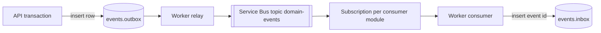

# ADR 0018 — Event-driven integration through a transactional outbox

- Status: Accepted (target architecture; not yet implemented)
- Date: 2026-10-13

## Context

ADR 0002 has no message bus. ADR 0011 adds one specialised outbox, `vector.sync_outbox`, so deletes always reach Qdrant: writers enqueue in the same transaction as the source change and a worker drains with `FOR UPDATE SKIP LOCKED`.

[ADR 0017](0017-bounded-contexts-platform-services.md) requires modules to communicate through events for anything that can be eventual. A lesson completion must reach gamification, analytics, personalisation, and classroom risk signals. A released grade must reach notification and reporting. Publishing directly to a broker after commit loses events on a crash; publishing before commit announces changes that roll back.

## Problem

Choose how domain events are written, delivered, de-duplicated, ordered, described, and versioned.

## Decision

**Write path.** A module records an event by inserting into `events.outbox` in the same transaction as the state change, through `app.core.events.publish(event)`. The outbox row holds the full CloudEvents envelope, `aggregate_type`, `aggregate_id`, `status` (`pending`, `sent`, `failed`), `attempts`, `available_at`, and `sent_at`. Monthly partitions are dropped after 14 days for `sent` rows.

**Relay.** The worker's relay claims pending rows in id order with `FOR UPDATE SKIP LOCKED`, publishes them to the Azure Service Bus topic `domain-events`, and marks them `sent`. Failures back off exponentially up to 1 hour; after 10 attempts the row is `failed` and pages on-call.

**Envelope.** CloudEvents 1.0, JSON. `type` is `com.aimentor.<context>.<entity>.<verb_past>.v<n>` (short name `learning.lesson.completed`). `source` is `/modules/<module>`. `subject` is the aggregate id. Required extensions: `tenantid`, `actorid`, `correlationid`. `id` is a UUIDv7.

**Delivery.** At least once. Each consumer module has one Service Bus subscription with a SQL filter on `type`. Consumers are idempotent: they insert `(consumer, event_id)` into `events.inbox` in the same transaction as their own change and skip duplicates. Messages that fail 10 deliveries go to the subscription's dead-letter queue, which the Admin App shows.

**Ordering.** Guaranteed only per aggregate. The relay sets the Service Bus session id to `aggregate_id`, and subscriptions are session-enabled. There is no global order; consumers must not assume one across aggregates.

**Schema registry in the repository.** Each event type has a JSON Schema at `docs/events/<context>.<entity>.<verb_past>.v<n>.json`. CI validates that every `publish` call site names a registered type and that sample payloads in tests validate.

**Versioning.** Adding an optional field is compatible and keeps the version. Removing or renaming a field, changing a type, or changing meaning creates `v<n+1>`. The producer publishes both versions for at least one release (R-label) and until every subscription has moved, then stops the old one.

**Payload rules.** Payloads carry ids and the minimum attributes consumers need: no names, emails, free-text messages, submission bodies, or tutor content. A consumer that needs more calls the owner's interface. This keeps erasure ([ADR 0021](0021-learner-record-ownership.md)) from having to reach the broker.

**Relationship to `vector.sync_outbox`.** The general outbox generalises that pattern; it does not replace it. `vector.sync_outbox` stays as a specialised work queue for Qdrant operations, because its rows are commands with vector payloads, and the database triggers in ADR 0011 enqueue them. The `retrieval` module may also enqueue vector work from consumed events such as `knowledge.asset_version.published`.

## Alternatives considered

| Alternative | Why it lost |
| --- | --- |
| Publish to the broker after commit | A crash between commit and publish loses the event. |
| PostgreSQL `LISTEN/NOTIFY` only | Not durable, no replay, no dead-letter queue, and consumers must be connected at the time. |
| Change data capture (Debezium) from the WAL | Couples consumers to table shapes rather than domain events, and adds Kafka Connect to operate. Kept for the warehouse feed later. |
| Kafka or Event Hubs | Higher throughput than needed; per-consumer subscriptions, sessions, and dead-lettering come built into Service Bus. Event Hubs remains an option for analytics ingestion volume. |
| Event sourcing | Rejected in ADR 0011; ledgers already give history where it matters. |

## Trade-off analysis

The outbox adds one insert per event to the producing transaction and a relay delay (target p95 under 2 seconds). In exchange, an event exists if and only if its change committed.

At-least-once delivery pushes idempotency onto every consumer. The inbox table makes that a single pattern instead of per-consumer logic. Session ordering limits parallelism per aggregate, which is acceptable because per-aggregate event rates are low.

## Consequences

- R1 creates `events.outbox`, `events.inbox`, the relay, and the topic, and moves the existing XP and mastery side effects that can be eventual (notifications, analytics) onto events.
- Every new event type needs a schema file and an entry in the event table of [06-system-architecture.md](../platform/06-system-architecture.md).
- Local development and tests use an in-process bus that reads the outbox directly, so no Service Bus emulator is needed for unit tests.

## Future considerations

- Outbound customer webhooks (`integration.webhook_endpoints`) as a consumer that re-signs selected events for external systems.
- Replay tooling that re-publishes a time range from the outbox archive to one subscription.
