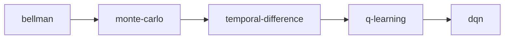

# ADR 0020 — Knowledge graph as the curriculum and adaptivity backbone

- Status: Accepted (target architecture; not yet implemented)
- Date: 2026-10-13

## Context

Today the graph is the `prerequisites` tuples in `backend/app/domain/catalog.py`, about 25 concepts scored in memory by `backend/app/domain/graph.py` (stable topological order; a concept is eligible when its score is below 75 and every prerequisite is at or above 70). ADR 0009 rejected a graph database for a few dozen nodes.

ADR 0011's target DDL stores the graph in `curriculum.concept_relations` with a weight (0 to 1), relation types `prerequisite`, `related`, `extends`, `part_of`, `applies_to`, and a trigger that rejects prerequisite cycles with a recursive CTE under an advisory lock.

The v2 direction expands the catalogue to AI, ML, RL, robotics, data science, generative AI, and research methods (thousands of concepts across many courses), and asks the graph to drive sequencing, recommendations, adaptive learning, and prerequisite gap repair across all apps.

## Problem

Decide what the knowledge graph models, which relation types exist and what they mean, what it drives, and where it is stored.

## Decision

The knowledge graph is a typed, weighted, directed graph of concepts, owned by the `knowledge` module and edited only by `knowledge_steward` holders in Content Studio (`knowledge.concept_relation:edit`).

**Relation types** (from [docs/platform/README.md](../platform/README.md#content-model)):

| Type | Direction reads | Acyclic | Used for |
| --- | --- | --- | --- |
| `prerequisite_of` | A must be mastered before B | yes, enforced | Eligibility, sequencing, gap repair |
| `builds_on` | B extends A without strictly requiring it | yes, enforced | Recommendations, "next up" ordering |
| `related_to` | Symmetric association | no | Discovery, tutor cross-references |
| `part_of` | A is a component of composite concept B | yes, enforced | Rolling mastery up to topics |
| `applies_to` | Technique A is applied in domain B | no | Career and project recommendations |
| `contrasts_with` | Symmetric; commonly confused pair | no | Misconception checks, assessment distractors |

Weight (0.00 to 1.00, default 1.00) on `prerequisite_of` is the strength of the dependency. Edges with weight below 0.5 are "recommended" rather than blocking. Each concept has a `difficulty` from `ref.difficulty_level` (`beginner` to `phd`).

Example from the current catalogue (Bellman Equations to Q-Learning to Deep Q-Networks to advanced RL), as `prerequisite_of` edges:

`q-learning` is also `prerequisite_of` the advanced RL concepts `sac` (with `ppo`), `multi-agent`, and `rl-robotics`.

A learner who fails a `dqn` check with `q-learning` at 62 is routed to a `q-learning` remediation; if `q-learning` checks also fail, the walk continues to `temporal-difference`.

**What the graph drives.**

| Consumer | Rule |
| --- | --- |
| Sequencing (`learning`) | Lessons in a module and modules in a course must respect `prerequisite_of` among their primary concepts; Content Studio blocks publishing a release that violates it |
| Recommendations (`personalisation`) | Eligible concepts as in ADR 0009 (score below 75, blocking prerequisites at or above 70), ranked by `builds_on` adjacency to recent mastery, goal distance, and difficulty fit with the learner's `depth` |
| Adaptive learning (`personalisation`, `tutor`) | When a learner fails a check, the tutor and planner walk `prerequisite_of` backwards to the weakest blocking ancestor (gap repair) and offer a short remediation before returning |
| Assessment (`assessment`) | Items are tagged with concepts; mastery evidence flows to those concepts and to `part_of` parents |
| Search and discovery | `related_to` and `applies_to` expand results |

**Storage.** PostgreSQL stays the source of truth: adjacency rows in `curriculum.concept_relations` (owned by `knowledge` through the content–knowledge interface), with recursive CTEs for ancestor and descendant queries, and the existing cycle trigger extended to all three acyclic types. The `personalisation` module caches the graph per release in memory and refreshes on `knowledge.concept_relation.changed`.

**Migration from the v1 DDL.** `prerequisite` maps to `prerequisite_of` with `from` and `to` swapped (v1 stores "q_learning requires mdp"; v2 stores "mdp prerequisite_of q-learning"). `related` maps to `related_to`; `extends` maps to `builds_on`; `part_of` and `applies_to` are unchanged; `contrasts_with` is new. Concept slugs stay lower-case kebab-case as in the catalogue; the DDL slug check is widened to allow hyphens.

## Alternatives considered

| Alternative | Why it lost |
| --- | --- |
| Neo4j or another graph database now | A second system of record to back up, secure, and keep consistent with mastery rows. At an expected 5,000 to 20,000 concepts and under 100,000 edges, recursive CTEs answer ancestor queries in milliseconds. |
| Prerequisites as course order only | Order is per course; concepts are shared across courses and paths. Gap repair needs edges that cross courses. |
| Untyped edges | "Related" and "required" would be indistinguishable, so recommendations could not block on one and suggest on the other. |
| Graph inferred only from embeddings | Unexplainable, unstable across model changes, and not reviewable by stewards. |

## Trade-off analysis

Keeping the graph in PostgreSQL means graph algorithms beyond traversal (centrality, community detection) run in Python on a cached copy rather than in the database. That is acceptable because those run offline for stewards, not per request.

Typed edges ask more of stewards. Content Studio proposes edges from AI and co-occurrence signals, but a steward approves every edge.

## Consequences

- Prerequisite edits go through the content workflow and publish `knowledge.concept_relation.changed`.
- Release validation in Content Studio runs the sequencing check before `content.course:publish`.
- [13-knowledge-management-architecture.md](../platform/13-knowledge-management-architecture.md) describes the steward workflow.

## Future considerations

- Graph embeddings (node2vec or GNN) as a ranking feature for recommendations, stored in Qdrant, never as the source of edges.
- A graph database only if traversal queries exceed 50 ms p95 at the cached layer.
