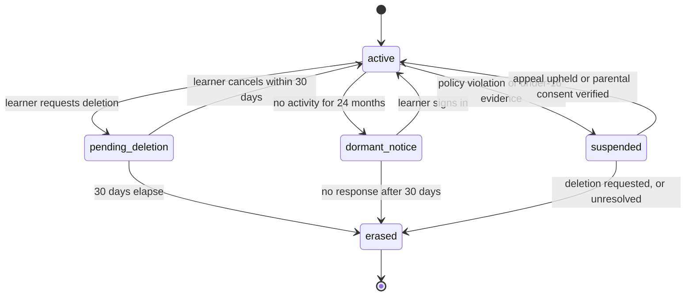

# Data retention policy

How long AI Mentor keeps each kind of data, and how deletion is enforced in the database. The retention periods follow [Security-Compliance.md §11.5](../Security-Compliance.md#115-retention-schedule) and audit requirement AL-5. Where that schedule does not name a table (assessment evidence, product events, analytics facts, operational queues), this document sets the period, and the choice is marked as a **proposal** for the compliance owner to confirm. Neither document is legal advice; have counsel review before launch.

The policy is executable. Nothing below depends on someone remembering to run a script:

| Mechanism | Covers | Defined in |
| --- | --- | --- |
| `util.partition_registry` + `util.run_partition_maintenance()` | Time-partitioned tables: drop, or detach and archive, whole months | `11_partitions.sql` |
| `util.purge_expired_rows()` | Non-partitioned tables: batched deletes every 10 minutes | `12_privacy.sql` |
| `game.compact_xp_ledger()` | Folds old XP ledger months into monthly totals before their partitions are dropped | `12_privacy.sql` |
| `identity.erase_user()` | Right to erasure across every schema, plus blob and vector cleanup | `12_privacy.sql` |
| `ON DELETE CASCADE` from `identity.users` | Every learner-owned table | All schema files |

## Principles

1. **Learning records live as long as the account.** Progress, mastery, badges, and XP totals are the product. They are deleted with the account; only anonymous aggregates remain.
2. **Raw evidence is bounded.** Per-message, per-answer, and per-event rows are kept for a fixed window and then dropped by partition, which costs no vacuum and leaves no bloat.
3. **Minimise at collection.** Raw IP addresses are never stored (keyed hash only). Prompts and completions go to Langfuse with 30-day retention, not to the database. Audit rows carry internal ids only: emails, names, handles, Clerk ids, and free-text profile fields are redacted by the audit trigger (AL-4).
4. **Deletion propagates everywhere.** Database, Qdrant, blob storage, the warehouse, and backups all honour erasure.

## Retention schedule

"Account lifetime" means until the learner deletes the account or it is erased for inactivity (see the account lifecycle below).

### Learner data

| Data | Tables | Retention | Mechanism | Source |
| --- | --- | --- | --- | --- |
| Account and profile | `identity.users`, `user_profiles`, `learning_preferences`, `tutor_avatars`, `user_interests`, `onboarding_assessments`, `consents` | Account lifetime; erased 30 days after a deletion request | `erase_user()` | §11.5 |
| Learning records | `learning.lesson_progress`, `concept_mastery`, `enrollments`, `flashcards`, `study_plans`, `exercise_completions`; `game.user_stats`, `user_badges`, `user_titles`, `xp_monthly_rollup`, `friendships` | Account lifetime | `erase_user()` (cascade) | §11.5 |
| Tutor conversations | `chat.messages`, `message_citations`, `message_feedback` | **24 months rolling**, or sooner when the learner deletes | Monthly partition drop | §11.5 |
| | `chat.conversations`, `conversation_summaries` | Purged when the newest message is older than 24 months; a conversation the learner deletes is soft-deleted, then hard-deleted after **30 days** | `purge_expired_rows()` | §11.5 |
| Code submissions | `learning.code_submissions` | **12 months rolling** | Partition drop | §11.5 |
| | `learning.exercise_completions.best_code` | Account lifetime: the best passing solution is treated as a learning record (the learner's portfolio). **Proposal**: confirm this reading of §11.5, or clear `best_code` after 12 months. | `erase_user()` | Proposal |
| Research documents | Personal `knowledge.assets`, versions, chunks, analyses, files, Qdrant points | Until the learner deletes them, or **90 days after the Research subscription ends** (with notice). Deleted or archived personal assets are purged after 30 days. | Subscription-ended job archives the asset (worker, sends the notice first); `purge_expired_rows()` deletes; cascade enqueues vector deletes; erasure returns blob URIs | §11.5 |
| Quiz attempts and per-question answers | `learning.quiz_attempts`, `question_responses`, `quizzes` | **25 months** | Partition drop; batched delete for `quizzes` | Proposal |
| Mastery change log | `learning.mastery_events` | **25 months**; current mastery stays | Partition drop | Proposal |
| Flashcard review log | `learning.flashcard_reviews` | **13 months**; card scheduling state stays on the card | Partition drop | Proposal |
| Recommendations served | `learning.recommendations` | **13 months** | Partition drop | Proposal |
| XP ledger and daily activity | `game.xp_ledger`, `game.daily_activity` | **25 months**, then monthly totals only (`xp_monthly_rollup`) | Compaction, then partition drop | Proposal |
| Learner reports | `analytics.learner_reports` | **25 months** | `purge_expired_rows()` | Proposal |

### Product, analytics, and operational data

| Data | Tables | Retention in PostgreSQL | Mechanism | Source |
| --- | --- | --- | --- | --- |
| Product events | `activity.events` | **90 days** (warehouse keeps up to 25 months) | Daily partition detach, export, drop | Proposal |
| Sessions | `activity.sessions` | **13 months** | Partition drop | Proposal |
| LLM invocation metadata (no prompt text) | `activity.llm_invocations` | **13 months** | Partition drop | Proposal |
| Prompts and completions | Langfuse, not the database | **30 days** | Langfuse project retention | §11.5 |
| Per-learner daily facts | `analytics.fact_user_daily`, `fact_concept_mastery_daily`, `dim_user` | **25 months** of user-level rows in total, across PostgreSQL and warehouse | Partition drop; `erase_user()` deletes a learner's rows early | Proposal |
| Aggregates without user ids | `analytics.agg_*`, `cohort_retention`, materialised views | Indefinite (anonymous) | None needed | §11.5 |
| Leaderboards | `game.leaderboards`, `leaderboard_entries` | Superseded snapshots **1 day**; closed periods **25 months** | `purge_expired_rows()` | Proposal |
| Vector outbox | `vector.sync_outbox` | Completed operations **7 days** | `purge_expired_rows()` | Proposal |
| Ingestion jobs | `knowledge.ingestion_jobs` | Finished jobs **180 days** | `purge_expired_rows()` | Proposal |
| Webhook payloads | `identity.webhook_events` | **90 days** | `purge_expired_rows()` | Proposal |

### Curated content

Curriculum, curated knowledge assets, their versions and workflow history, the question bank, badges, titles, and challenges are platform content, not personal data. They are kept indefinitely. Archived versions stay so admins can compare and restore them.

### Compliance and security records

| Data | Tables | Retention | Source |
| --- | --- | --- | --- |
| Billing history | `identity.subscriptions` (and Stripe) | As required by tax law, typically 6–10 years by jurisdiction. Detached from the user on erasure (`user_id` set to NULL). | §11.5 |
| Admin actions: governed-table changes | `audit.row_changes` | **2 years** | AL-5 |
| Admin actions: staff access to learner data | `audit.data_access_log` | **2 years** | AL-5 |
| Other security events | `audit.security_events` | **1 year**; IP hash and user agent stripped on erasure | AL-5 |
| Data subject requests | `identity.data_subject_requests` | **6 years** (proof of compliance; needed to replay erasures after a restore). **Proposal.** | Proposal |

Audit partitions are archive-before-drop: the detached month is exported to immutable (WORM) blob storage whose retention policy matches the periods above, then dropped from PostgreSQL. That export is the daily immutable copy AL-3 asks for. The archive does not extend retention.

## Account lifecycle

- **Deletion request.** `users.status = 'pending_deletion'` and `deletion_requested_at` are set, and the account disappears from leaderboards immediately. After the 30-day grace period a worker calls `identity.erase_user(user_id)`, deletes the returned blob URIs, records completion in `data_subject_requests`, and deletes the Clerk identity. The statutory deadline is one month (GDPR Art. 12(3)).
- **Inactivity.** After 24 months without activity the learner is emailed. With no sign-in within 30 days, the account is erased the same way (§11.5).
- **Under-16 evidence.** Suspended and deleted unless parental consent is verified (§11.6).
- **Export.** `kind = 'export'` requests produce a JSON and Markdown archive (profile, preferences, progress, mastery, conversations, documents, XP history), uploaded to blob storage behind a signed URL that expires after 7 days, after which the file is deleted.

## What erasure does

`identity.erase_user(user_id)` runs in one transaction:

1. Collects the learner's personal assets, versions, and files.
2. Deletes rows that have no foreign key to the user: `activity.events`, `analytics.fact_user_daily`, `analytics.fact_concept_mastery_daily`, `analytics.dim_user`.
3. Deletes `identity.users`. The cascade removes profile, preferences, avatar, onboarding, consents, conversations and messages, personal assets and chunks, progress, mastery, quizzes and answers, code, flashcards, plans, XP, badges, challenge participation, leaderboard entries, friendships, sessions, and reports. Subscriptions and LLM invocations are detached (`SET NULL`).
4. The cascade deletes chunk embeddings, and a trigger enqueues the matching Qdrant deletes in `vector.sync_outbox`, so vectors are removed even if the worker is down at that moment.
5. Deletes now-unreferenced file rows and returns their storage URIs for the caller to delete from blob storage.
6. Clears audit payloads for the learner's identity rows and personal assets. The record that a change happened remains; its content does not. Strips IP hash and user agent from their security events.
7. Writes an `account_erased` security event.

`backend/db/tests/smoke.sql` checks each step.

**Outside PostgreSQL:**

| System | How erasure reaches it |
| --- | --- |
| Qdrant | `vector.sync_outbox` delete operations; the nightly reconciler re-checks counts per collection |
| Blob storage | URIs returned by `erase_user()`, deleted by the calling worker |
| Warehouse | CDC delivers the deletes; warehouse tables keyed by `user_id` apply them. Exported partitions are pseudonymised (user id replaced by a keyed HMAC), and the erasure job deletes rows matching the learner's HMAC. |
| Langfuse | Traces deleted by user id through the Langfuse API; 30-day retention bounds exposure regardless |
| Clerk, Stripe | Clerk user deleted. The Stripe customer is kept for tax with only the billing details Stripe requires. |
| Backups | Point-in-time recovery retention is **35 days**, so erased data ages out of backups within 35 days. After any restore, replay every erasure completed since the restore point from `identity.data_subject_requests`. Its `subject_user_id` deliberately has no foreign key, so it survives erasure. |

§11.5 also mentions crypto-shredding keys so deleted users' data is unrecoverable from backups. This schema does not implement per-learner encryption keys. Until it does, backup expiry plus erasure replay is the mechanism, and §11.5 should be updated to match or the key model added.

## Exports and archives

Partitions marked `archive_before_drop = true` are detached by maintenance, exported by an archiver job to Parquet with user ids replaced by a keyed HMAC (key in Key Vault, rotated yearly), loaded into the warehouse, and then dropped. Exports exist to move history to the warehouse safely, not to extend retention: the user-level ceilings above apply to the warehouse too. Beyond them, only anonymous aggregates remain.

## Changing this policy

Retention periods live in three places that must agree: [Security-Compliance.md §11.5](../Security-Compliance.md#115-retention-schedule), this document, and `util.partition_registry` / `util.purge_expired_rows()`. Change them together in one pull request, through a migration that updates the registry (`UPDATE util.partition_registry SET retention = ... WHERE parent_table = ...`). A shorter period takes effect on the next maintenance run, so check how much data it will drop first.
