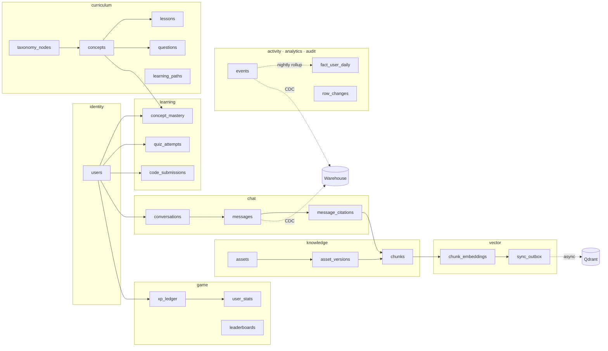
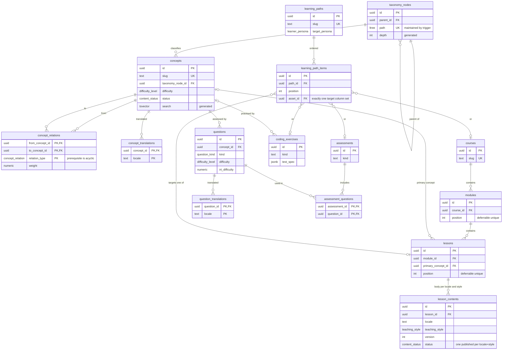
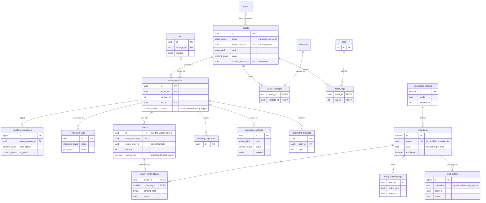
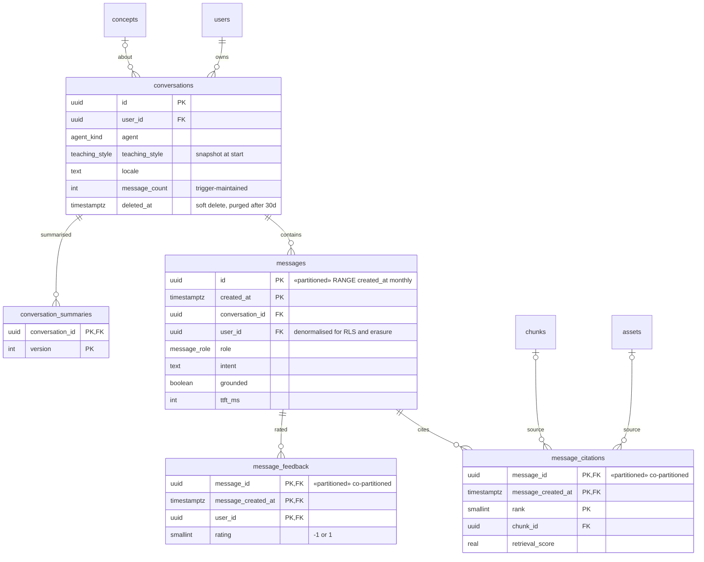

# Entity relationship diagrams

One diagram per domain, plus an overview. Columns are limited to keys and the fields that explain a relationship; the full definitions are in [`backend/db/schema`](../../backend/db/schema). Entity names drop the schema prefix (`users` is `identity.users`), and each diagram heading names its schema.

Partitioned tables are marked `«partitioned»` in their first attribute comment.

## Overview

## User profile model (`identity`, `ref`)

```mermaid
erDiagram
    users ||--o| user_profiles : "has"
    users ||--o| learning_preferences : "teaches with"
    users ||--o| tutor_avatars : "customises"
    users ||--o{ onboarding_assessments : "takes"
    users ||--o{ user_interests : "declares"
    users |o--o{ subscriptions : "pays via"
    users ||--o{ consents : "grants"
    countries ||--o{ user_profiles : "located in"
    languages ||--o{ user_profiles : "prefers"
    voice_accents ||--o{ tutor_avatars : "speaks"
    taxonomy_nodes ||--o{ user_interests : "topic"
    learning_paths |o--o{ onboarding_assessments : "recommended"

    users {
        uuid id PK "uuid v7"
        text clerk_id UK
        citext email UK "unique while not deleted"
        citext handle UK "public leaderboard name"
        user_role role
        account_status status
    }
    user_profiles {
        uuid user_id PK, FK
        char country_code FK
        text region_code "ISO 3166-2"
        text preferred_locale FK
        learner_persona persona
        timestamptz onboarding_completed_at
    }
    learning_preferences {
        uuid user_id PK, FK
        teaching_style teaching_style
        learning_pace pace
        difficulty_level technical_depth
        math_depth math_depth
        breadth_preference breadth
    }
    tutor_avatars {
        uuid user_id PK, FK
        age_appearance age_appearance
        gender_presentation gender_presentation
        text voice_accent FK
        tutor_personality personality
    }
    onboarding_assessments {
        uuid id PK
        uuid user_id FK
        jsonb responses
        numeric initial_skill_score
        uuid recommended_path_id FK
    }
    user_interests {
        uuid user_id PK, FK
        uuid taxonomy_node_id PK, FK
        text kind PK
    }
    subscriptions {
        uuid id PK
        uuid user_id FK "SET NULL on erasure"
        subscription_tier tier
        subscription_status status
    }
    consents {
        uuid id PK
        uuid user_id FK
        text consent_type
        boolean granted
    }
    countries {
        char iso2 PK
        text region
    }
    languages {
        text code PK
    }
    voice_accents {
        text code PK
    }
```

## Curriculum and knowledge graph (`curriculum`)

## Knowledge repository and vector storage (`knowledge`, `vector`)

## Learning and assessment (`learning`)

```mermaid
erDiagram
    users ||--o{ enrollments : "enrols"
    learning_paths ||--o{ enrollments : "enrolled in"
    users ||--o{ lesson_progress : "progresses"
    lessons ||--o{ lesson_progress : "tracked"
    users ||--o{ concept_mastery : "masters"
    concepts ||--o{ concept_mastery : "measured"
    users ||--o{ mastery_events : "evidence"
    users ||--o{ quizzes : "receives"
    quizzes ||--|{ quiz_items : "contains"
    questions |o--o{ quiz_items : "snapshot of"
    quizzes ||--o{ quiz_attempts : "attempted"
    quiz_attempts ||--|{ question_responses : "answers"
    users ||--o{ code_submissions : "submits"
    coding_exercises |o--o{ code_submissions : "solves"
    users ||--o{ exercise_completions : "best solution"
    users ||--o{ flashcards : "studies"
    flashcards ||--o{ flashcard_reviews : "reviewed"
    users ||--o{ study_plans : "follows"
    study_plans ||--o{ study_plan_items : "scheduled"
    users ||--o{ recommendations : "served"

    enrollments {
        uuid id PK
        uuid user_id FK "unique with path_id"
        uuid path_id FK
        numeric progress_pct
    }
    lesson_progress {
        uuid user_id PK, FK
        uuid lesson_id PK, FK
        progress_status status
        int time_spent_seconds
    }
    concept_mastery {
        uuid user_id PK, FK "«partitioned» HASH user_id x16"
        uuid concept_id PK, FK
        numeric score "0-100"
        text band "generated: weak..mastered"
        timestamptz next_review_at
    }
    mastery_events {
        uuid id PK "«partitioned» RANGE occurred_at"
        timestamptz occurred_at PK
        text source
        numeric delta "generated"
    }
    quizzes {
        uuid id PK
        uuid user_id FK
        uuid challenge_id FK
        text generated_by
    }
    quiz_items {
        uuid quiz_id PK, FK
        smallint position PK
        jsonb question_snapshot "what the learner saw"
    }
    quiz_attempts {
        uuid id PK "«partitioned» RANGE started_at"
        timestamptz started_at PK
        numeric score_pct "generated"
    }
    question_responses {
        uuid id PK "«partitioned» co-partitioned with attempts"
        timestamptz attempt_started_at PK, FK
        uuid attempt_id FK
        uuid concept_id "denormalised"
        boolean is_correct
        int latency_ms
    }
    code_submissions {
        uuid id PK "«partitioned» RANGE submitted_at"
        timestamptz submitted_at PK
        submission_status status
    }
    exercise_completions {
        uuid user_id PK, FK
        uuid exercise_id PK, FK
    }
    flashcards {
        uuid id PK
        numeric ease_factor
        timestamptz next_review_at
    }
    flashcard_reviews {
        uuid id PK "«partitioned» RANGE reviewed_at"
        timestamptz reviewed_at PK
    }
    study_plans {
        uuid id PK
    }
    study_plan_items {
        uuid id PK
        date scheduled_for
    }
    recommendations {
        uuid id PK "«partitioned» RANGE generated_at"
        timestamptz generated_at PK
        text reason
        timestamptz clicked_at
    }
```

## Chat history (`chat`)

## Gamification (`game`)

```mermaid
erDiagram
    users ||--|| user_stats : "projection"
    users ||--o{ xp_ledger : "earns"
    users ||--o{ xp_monthly_rollup : "compacted"
    users ||--o{ daily_activity : "per day"
    users ||--o{ user_badges : "earns"
    badges ||--o{ user_badges : "awarded"
    users ||--o{ user_titles : "earns"
    titles ||--o{ user_titles : "awarded"
    challenges ||--o{ challenge_participations : "attempted"
    users ||--o{ challenge_participations : "joins"
    badges |o--o{ challenges : "rewards"
    leaderboards ||--o{ leaderboard_entries : "ranks"
    users ||--o{ leaderboard_entries : "ranked"
    users ||--o{ friendships : "low id"
    users ||--o{ friendships : "high id"

    user_stats {
        uuid user_id PK, FK
        bigint total_xp
        int level
        int current_streak
        date last_active_on "learner local date"
    }
    xp_ledger {
        uuid id PK "«partitioned» RANGE local_date"
        date local_date PK
        int amount
        xp_source source
        text idempotency_key "unique per user and day"
    }
    xp_monthly_rollup {
        uuid user_id PK
        date month PK
        xp_source source PK
    }
    daily_activity {
        uuid user_id PK "«partitioned» RANGE activity_date"
        date activity_date PK
        int xp_earned "daily cap"
    }
    badges {
        smallint id PK
        text slug UK
        jsonb name_i18n
    }
    user_badges {
        uuid user_id PK, FK
        smallint badge_id PK, FK
    }
    titles {
        smallint id PK
        int min_level
    }
    user_titles {
        uuid user_id PK, FK
        smallint title_id PK, FK
        boolean is_equipped "one per user"
    }
    challenges {
        uuid id PK
        date challenge_date
        challenge_kind kind
        learner_persona audience_persona
    }
    challenge_participations {
        uuid challenge_id PK, FK
        uuid user_id PK, FK
        text status
    }
    leaderboards {
        uuid id PK
        leaderboard_scope scope
        text scope_key
        leaderboard_period period
        leaderboard_metric metric
        text status "building, live, closed, superseded"
    }
    leaderboard_entries {
        uuid leaderboard_id PK, FK
        uuid user_id PK, FK
        int rank
        numeric percentile
    }
    friendships {
        uuid user_low_id PK, FK
        uuid user_high_id PK, FK
        text status
    }
```

## Activity, analytics, and audit (`activity`, `analytics`, `audit`)

These tables deliberately have few foreign keys: they are high-volume, written by background jobs, and must outlive or survive changes to the rows they describe. Erasure removes learner rows explicitly (`identity.erase_user`).

```mermaid
erDiagram
    event_types ||--o{ events : "validated at API"
    sessions ||--o{ events : "session_id"
    users |o--o{ sessions : "starts"
    users |o--o{ llm_invocations : "triggers"
    dim_date ||--o{ fact_user_daily : "activity_date"
    dim_user ||--o{ fact_user_daily : "user_id at time"
    dim_date ||--o{ fact_concept_mastery_daily : "snapshot_date"
    concepts ||--o{ agg_concept_daily : "aggregated"
    users ||--o{ learner_reports : "receives"

    events {
        uuid id PK "«partitioned» RANGE received_at DAILY"
        timestamptz received_at PK
        timestamptz occurred_at "client clock"
        text event_name
        jsonb properties
    }
    sessions {
        uuid id PK "«partitioned» monthly"
        timestamptz started_at PK
        bytea ip_hmac "never raw IP"
    }
    llm_invocations {
        uuid id PK "«partitioned» monthly"
        timestamptz created_at PK
        text model
        numeric cost_usd
        int ttft_ms
    }
    event_types {
        text name PK
        boolean contains_pii
    }
    dim_date {
        int date_key PK
    }
    dim_user {
        bigint user_key PK "SCD type 2"
        uuid user_id
        timestamptz valid_from
        timestamptz valid_to
    }
    fact_user_daily {
        date activity_date PK "«partitioned» monthly"
        uuid user_id PK
        int active_seconds
        int xp_earned
    }
    fact_concept_mastery_daily {
        date snapshot_date PK "«partitioned» monthly"
        uuid user_id PK
        uuid concept_id PK
    }
    agg_concept_daily {
        date activity_date PK
        uuid concept_id PK, FK
        numeric correct_rate "generated"
    }
    learner_reports {
        uuid id PK
        text period_type
        date period_start
    }
    row_changes {
        bigint id PK "«partitioned» monthly"
        timestamptz changed_at PK
        text table_name
        text record_id
        text_array changed_columns
    }
    security_events {
        bigint id PK "«partitioned» monthly"
        timestamptz occurred_at PK
        text event_type
    }
    data_access_log {
        bigint id PK "«partitioned» monthly"
        uuid actor_user_id
        uuid subject_user_id
    }
```

