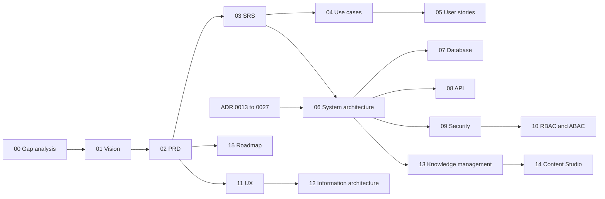

# AI Mentor — Documentation Gap Analysis (v1 → v2 enterprise ecosystem)

| Field | Value |
| --- | --- |
| Document | Documentation gap analysis |
| Version | 2.0 |
| Date | 13 October 2026 |
| Status | Complete. Drives the v2 document set in this folder |
| Owner | Enterprise Architecture, with Product, Learning, and Technical Writing |
| Related | [README.md](README.md) (canonical vocabulary), every document in `docs/`, [ADR index](../adr/README.md) |

## Change record

| Area | What changed | Why | Impacted systems | Implementation implications |
| --- | --- | --- | --- | --- |
| Documentation scope | Audited all 34 hand-written documents in `docs/` (about 23,000 lines) against the enterprise ecosystem direction | The platform vision moved from one AI tutoring app to five applications serving many organisations | All documentation | v1 documents are retained as the learner baseline; the v2 set in `docs/platform/` is authoritative for anything new |
| Gap register | Recorded 32 gaps (G-01 to G-32) and 18 internal inconsistencies (X-01 to X-18) | So that every v2 change traces to a stated gap | All v2 documents | Each gap names the v2 document that closes it and the release that implements it |
| Code impact | Listed the code facts that contradict the new direction | So that engineering can size R1 foundations | `backend/app/domain/access.py`, `backend/app/models/entities.py`, `apps/*`, `backend/db/schema/` | Five apps exist; R1 still includes tenancy and scoped roles (see [15-roadmap.md](15-roadmap.md)) |
| Content Studio spec | Document 14 was referenced from 01–13 and 15 but missing from the tree | The set claimed a first-class Studio app without an application spec | Content Studio, Admin App split | [14-content-studio-specification.md](14-content-studio-specification.md) now exists |
| Resource Catalog | Knowledge Pack v1.0 and catalog screens live in Content Studio | Staff import is not an Admin App concern | `apps/studio/app/catalog`, Learner App `/catalog` | Learner search stays in the Learner App; Studio owns import, quality, and duplicates |

## Relationship to v1 documents

This document changes no v1 document. It records why each one is retained, amended, or superseded. The resulting status of each v1 document is in the [inventory](#3-document-inventory-and-verdicts) and in [README.md](README.md#relationship-to-v1-documents).

## Contents

1. [Method](#1-method)
2. [Summary of findings](#2-summary-of-findings)
3. [Document inventory and verdicts](#3-document-inventory-and-verdicts)
4. [Gap register](#4-gap-register)
5. [Inconsistencies inside the v1 set](#5-inconsistencies-inside-the-v1-set)
6. [Code that contradicts the new direction](#6-code-that-contradicts-the-new-direction)
7. [Requirement coverage matrix](#7-requirement-coverage-matrix)
8. [How the v2 set closes the gaps](#8-how-the-v2-set-closes-the-gaps)
9. [Follow-up work not in this update](#9-follow-up-work-not-in-this-update)

---

## 1. Method

**Corpus.** Every Markdown document under `docs/` (product, requirements, architecture, database, API, security, UX, test, operations, and 12 ADRs), the OpenAPI contract `docs/openapi.yaml`, the root `README.md`, and the code facts those documents cite (`backend/app/domain/access.py`, `backend/app/models/entities.py`, `backend/db/schema/*.sql`, `frontend/app`, `admin/app`). `docs/prompt.md` is the original build prompt and is treated as history.

**Criteria.** Each document was scored on four questions:

| Criterion | Question |
| --- | --- |
| Coverage | Does it describe the capabilities in the new direction (five apps, tenancy, instructor and institution workflows, Content Studio, knowledge graph, gamification scopes, personalisation, localisation, configurable mentor, shared services)? |
| Consistency | Does it agree with the other documents and with the code on names, roles, states, hosting, and releases? |
| Currency | Does it still describe the intended product, or a product the direction has replaced? |
| Traceability | Can a requirement be followed from business goal to use case, story, design, data, API, permission, and test? |

**Severity.**

| Severity | Meaning |
| --- | --- |
| Critical | Blocks the enterprise direction, or is expensive to retrofit after R1 (data model, identity, authorisation) |
| High | A whole application or shared service is undocumented |
| Medium | A capability is described for one context but not generalised (for example leaderboards without institution or cohort scope) |
| Low | Naming, cross-reference, or presentation issue |

## 2. Summary of findings

1. **The v1 set describes one tenant.** No v1 document defines organisation, campus, department, cohort, membership, licence, or tenant isolation. "Institutional cohorts" appear only as SRS `BR-012 [C | R3]` and PRD Phase 2 bullets. Every table in the target DDL is keyed by user, not by tenant (G-01, G-02).
2. **Roles are a linear rank.** `student < instructor < admin` in code, with `content_reviewer` and `support` proposed in `Security-Compliance.md` §4.2. There is no role scope, so "instructor of cohort A but not cohort B" cannot be expressed (G-03).
3. **Two of the five applications do not exist in any document.** The Instructor App and Institution App have no journeys, requirements, screens, data, or API. The v1 "instructor" is a content author, not a teacher (G-05, G-06).
4. **Content Studio is buried in the admin portal.** `Admin.md`, PRD F13–F16 and F22–F23, SRS §14, and `DesignSpec.md` §15–16 specify content tooling inside a staff portal that also handles users, configuration, and audit. Content ownership, releases, and instructor customisation are not defined (G-07, G-08, G-09).
5. **Formal assessment is missing.** v1 has practice (quizzes, flashcards, lab) graded deterministically, with LLM grading only for free text. Rubrics, assignments, gradebooks, manual marking, AI-assisted marking, overrides, and grade release are absent (G-10, G-11).
6. **Shared services are named but not bounded.** The SAD describes one modular monolith with agents. It does not define bounded contexts, ownership of data, or how contexts integrate. Events exist only as a vector `sync_outbox` (G-12, G-13).
7. **The design system is ready for five apps; the IA is not.** `DesignSpec.md` §1–7 (tokens, components, accessibility) can serve every app. §8–17 cover only learner and admin screens (G-20, G-21).
8. **Gamification, personalisation, localisation, and the tutor are well specified for one learner and need generalising.** Leaderboards lack institution and cohort scope; personalisation lacks instructor locks; localisation lacks reports and graded-assessment rules; the tutor lacks modes beyond Socratic and direct (G-14 to G-19).
9. **Interoperability is absent.** No SSO beyond Clerk social login, no SCIM, LTI, OneRoster, xAPI, QTI, or Open Badges. Institutions running Canvas or Moodle cannot adopt the platform without these (G-22, G-23).
10. **Compliance assumes AI Mentor is always the data controller.** For institution-provisioned learners the institution is controller. FERPA, EU AI Act obligations for AI-assisted marking (Annex III, education), DPAs with institutions, and accessibility procurement (EN 301 549) are not covered (G-24, G-25, G-26).

## 3. Document inventory and verdicts

| Document | Lines | Purpose | Verdict | Main gaps | Closed by |
| --- | --- | --- | --- | --- | --- |
| `Requirements.md` | 407 | Original product vision brief | Retain as history | Single learner app; no institutions | 01, 02 |
| `Admin.md` | 276 | Knowledge portal brief | Retain as history | Content tooling mixed with administration; no ownership or releases | 13, 14 |
| `PRD.md` | 1,643 | MVP product requirements, F1–F27 | Amend: keep F1–F27, metrics, monetisation; supersede vision, personas, scope, roadmap | No institution personas, no Instructor or Institution App, B2B only as Phase 2 bullets | 01, 02, 15 |
| `SRS.md` | 1,639 | MVP software requirements | Amend: keep all IDs; supersede §2, §4, §5, §21 | No TEN, IAM, AUTHZ, INS, ORG, CST, ASM requirements; roles §5 linear | 03 |
| `UseCases.md` | 3,292 | 38 use cases, 16 epics | Amend: keep UC-01–38 and epics; supersede actors and permissions | No instructor teaching, institution, or platform-ops use cases | 04, 05 |
| `SystemArchitecture.md` | 2,394 | Target architecture on Azure | Amend: keep §8, §11, §13–17; extend §1–5, §9, §10, §12 | No tenancy, bounded contexts, events, five apps, or interoperability | 06, 13 |
| `Architecture.md` | 89 | The code as it runs | Retain unchanged (describes running code) | n/a until code changes | n/a |
| `Infrastructure.md` | 480 | Azure layout, CI/CD, DR | Retain; follow-up for five Vercel projects | Two frontends only | 06 §deployment, follow-up F-03 |
| `Deployment.md`, `Runbook.md` | 55, 1,994 | Operator notes | Retain; follow-up | No tenant onboarding, SSO, or SCIM runbooks | follow-up F-04 |
| `Database.md` | 60 | Current MVP schema | Retain unchanged (describes running code) | n/a | n/a |
| `database/*.md`, ADR 0011 | 1,266 | Target schema (12 schemas, 97 tables) | Amend: extend to 26 schemas with tenancy | No `tenant_id`, no classroom, assessment, commerce, authz schemas | 07 |
| `API.md`, `openapi.yaml` | 87, contract | Live routes | Retain; v2 target in 08 | No `/orgs`, `/content`, `/platform`, standards endpoints | 08 |
| `Security.md` | 42 | Current controls | Retain unchanged | n/a | n/a |
| `Security-Compliance.md` | 1,048 | Security and privacy specification | Amend: keep §0–3, §6–18; supersede §4–5 | No tenant isolation, SSO, SCIM, LTI, AI-marking, controller/processor split | 09, 10 |
| `DesignSpec.md` | 2,711 | UI/UX specification | Amend: keep §1–7 for all apps; extend §8–17 | Five apps exist; density and tokens still follow ADR 0012 copies until packages land | 11, 12, 14 |
| `TestPlan.md` | 2,513 | MVP test plan | Retain for R1; v2 test plan is follow-up | No tenant isolation, BOLA-across-tenants, SSO, or marking tests | follow-up F-01 |
| `Roadmap.md` | 28 | Current build slice | Retain (describes build slice) | No R2–R5 | 15 |
| `Documentation-Standards.md` | 697 | Doc and comment rules | Retain; add v2 doc conventions (change record) | Does not cover `docs/platform` | README §Document set |
| ADR 0001–0012 | ~750 | Implemented decisions | Retain; 0001, 0002, 0005, 0008, 0009, 0010, 0012 amended by 0013–0025 | No enterprise decisions | ADR 0013–0027 |
| `Knowledge-Catalog.md` | ~100 | Running Resource Catalog and Knowledge Pack | Retain as running-code notes; home is Content Studio | Learner search stays in the Learner App | 13, 14 |

## 4. Gap register

| ID | Gap | Evidence in v1 | Severity | Impact if not closed | Closed by | Release |
| --- | --- | --- | --- | --- | --- | --- |
| G-01 | No tenant model (organisation, campus, department, cohort) | SRS §5 and DDL `01_identity.sql`: users only; PRD §15 "institutional licensing" Phase 2 | Critical | Every table needs `tenant_id` later; retrofitting RLS and indexes on partitioned tables is a multi-month migration | README §Tenancy, ADR 0015, 06, 07 | R1 (schema), R3 (UI) |
| G-02 | No tenant isolation requirements or controls | `Security-Compliance.md` §4.4 covers per-user ownership only | Critical | Cross-tenant data leaks are the top enterprise risk and a procurement blocker | 09 (TI- controls), 10, ADR 0015 | R1 |
| G-03 | Linear role rank, no scopes | `access.py` `_RANK`; SRS §5.1 "Learner < Instructor < Admin" | Critical | Cannot express cohort-, department-, or organisation-scoped authority | ADR 0016, 10 | R1 |
| G-04 | No ABAC: entitlements, content state, and ownership are listed but not modelled as policy | `Security-Compliance.md` §4.1 layers are prose | High | Assessment windows, integrity mode, consent, and licence seats cannot be enforced consistently | ADR 0016, 10 §ABAC | R1 (engine), R3 (conditions) |
| G-05 | Instructor App undocumented | v1 "instructor" authors content (SRS §5.1); no cohorts, plans, marking | High | The core institutional workflow has no specification | 02, 03 (INS), 04, 05, 11, 12 | R3 |
| G-06 | Institution App undocumented | Only PRD §15 bullets ("SSO, admin reporting, custom paths") | High | No buyer-facing product for B2B revenue | 02, 03 (ORG), 04, 05, 11, 12 | R3 |
| G-07 | Content Studio not a first-class application | `Admin.md`; ADR 0012 puts content screens in the admin portal | High | Content operations compete with platform operations for one app's roadmap, permissions, and release cadence | ADR 0013, ADR 0019, 14 | R1 (split), R2 (builders) |
| G-08 | Content ownership undefined | SRS §5.2 lets instructors author; `Admin.md` lets "administrators, instructors, and SMEs" curate | High | Instructors in many organisations editing master content breaks quality and licensing | README §Content model, ADR 0019, 13 | R2 |
| G-09 | No content releases, pinning, overlays, or derived courses | Versioning exists only for assets (`asset_versions`) | High | Publishing a lesson change mid-term silently changes a cohort's graded course | ADR 0019, 07, 13, 14 | R2 (releases), R3 (overlays, derived) |
| G-10 | No formal assessment model | SRS §6.9 quizzes are practice; no assignments, rubrics, gradebook | High | Instructors cannot grade; institutions cannot report attainment | ADR 0025, 03 (ASM), 07 `assessment` | R3 |
| G-11 | No AI-assisted marking or human override | SRS AI-GEN limits LLM grading to free-text practice | High | A headline instructor capability, and an EU AI Act high-risk use, is unspecified | ADR 0025, 09 (AIM-), 11 marking workspace | R3 |
| G-12 | Shared services not bounded | SAD §5.2 package layout is technical layers, not contexts | High | Shared services will couple through each other's tables; later extraction becomes a rewrite | ADR 0017, 06 | R1 (boundaries), ongoing |
| G-13 | No domain event model | Only `vector.sync_outbox` in DDL; SAD mentions Service Bus `domain-events` topic without a catalogue | High | Gamification, analytics, notifications, and search integrations become synchronous calls | ADR 0018, README §Domain events, 06 | R1 (outbox), R2 (consumers) |
| G-14 | Leaderboards lack institution and cohort scopes, and organisation opt-out | SRS §15.6 LB: global and country; friends R2 | Medium | Institutional competition and privacy (managed learners on a global board) unhandled | ADR 0024, 03 (LB-101+), 07 | R2 (scopes), R3 (org, cohort) |
| G-15 | Gamification lacks points, competitions, weekly and seasonal challenges | SRS §15: XP, levels, streaks, badges, daily challenges | Medium | Missing engagement loops named in the direction | ADR 0024, 03 (GAM-101+) | R2 |
| G-16 | Personalisation is per-learner only; no instructor or organisation locks | SRS FR-TCH, AI-PER; DDL `learning_preferences` | Medium | University courses cannot require academic register or minimum depth | README §Personalisation, 03 (PER), 07 `personalisation` | R3 |
| G-17 | Five personalisation dimensions not normalised | `Requirements.md` lists seven teaching modes, six depths, five maths levels | Medium | UI sliders and adaptivity rules cannot be specified consistently | README dimension table, 03 (PER) | R2 |
| G-18 | Mentor modes beyond Socratic and direct are not specified | ADR 0010 agents (tutor, quiz, planner, research, coding, career); no mentor, exam coach, research supervisor as modes | Medium | Mentor experience stays a chatbot with routing, not a configurable mentor | ADR 0022, 03 (TUT-101+) | R2 |
| G-19 | Localisation lacks reports and graded-assessment rules | SRS §22 covers UI, tutor, content | Medium | Translated graded items could be unfair; reports render in one language | ADR 0023, 03 (I18N-101+) | R2 (reports), R3 (graded items) |
| G-20 | No information architecture for five apps or cross-app navigation | `DesignSpec.md` §10 page hierarchies for learner and admin | High | Each new app would invent navigation and terminology | 12 | R1 (shell), R3 |
| G-21 | No UX for instructor, institution, or Studio workflows | `DesignSpec.md` §15–16 admin portal only | High | Builders, gradebook, marking, and reporting have no design basis | 11, 14 | R2–R3 |
| G-22 | No enterprise identity: SAML/OIDC SSO, JIT, SCIM, domain verification | ADR 0005 Clerk social and email only | High | Universities and enterprises require SSO for procurement | ADR 0026, 03 (IAM), 09 (SSO-) | R3 (SSO), R4 (SCIM) |
| G-23 | No LMS interoperability: LTI 1.3, OneRoster, xAPI/cmi5, QTI, Open Badges | Not mentioned anywhere | High | Institutions already on Canvas or Moodle cannot adopt AI Mentor alongside them | ADR 0026, 03 (INT), 08 | R4 |
| G-24 | Controller/processor split absent | `Security-Compliance.md` §12.1 lists AI Mentor as controller | High | Institution contracts (DPAs) and DSAR routing are wrong for managed accounts | ADR 0021, 09 | R3 |
| G-25 | No FERPA, EU AI Act Annex III (education), or institutional DPA coverage | `Security-Compliance.md` §12.8–12.9 cover GDPR, NDPA, CCPA, AI Act transparency only | High | AI marking and US institutions are legally unaddressed | 09, 03 §Compliance | R3 |
| G-26 | Accessibility procurement (EN 301 549, VPAT) not required | SRS NFR-USE: WCAG 2.2 AA only | Medium | Public institutions require conformance reports | 03 NFR-101+, 11 | R3 |
| G-27 | Test plan has no tenancy, cross-tenant BOLA, SSO, marking, or release-pinning tests | `TestPlan.md` §2.1 scope | Medium | Isolation regressions ship undetected | Follow-up F-01; requirements in 03, 09, 10 | R1 onward |
| G-28 | Licences, seats, and organisation billing absent | SRS FR-BIL consumer subscriptions only | High | No way to sell to institutions | 03 (LIC), 07 `commerce`, 08 | R3 |
| G-29 | Reporting is learner and admin only; no institution, workforce, or scheduled exports | SRS §17 RPT-L, RPT-A | Medium | Institutional and workforce buyers cannot prove outcomes | 03 (RPT-101+, ORG), 06 | R3–R4 |
| G-30 | Feature flags, model management, and platform settings described as deployment-time only | `Security-Compliance.md` §5.3 "via deployment, not UI" | Medium | Admin App capabilities in the direction (flags, model management) need runtime, audited configuration | 03 (ADM), 07 `platform`, 09 | R2 |
| G-31 | Extension points for marketplace, mobile, and agent orchestration not designed | SAD §8.7 lists post-MVP AI extensions only | Medium | Data model and permissions could block these later (publisher tenants, on-behalf-of agents) | ADR 0027, 06 | R4–R5 |
| G-32 | Domain coverage narrower than the direction | SRS §4.4 four launch paths; Data Science and Generative AI deferred to PRD Phase 2 | Low | Catalogue scope mismatch with positioning | 01, 02 | R2 (content) |

## 5. Inconsistencies inside the v1 set

These were found while auditing and are resolved in the v2 set or flagged for the owner.

| ID | Inconsistency | Where | Resolution |
| --- | --- | --- | --- |
| X-01 | API host: SRS §2.4 says Azure App Service; SAD and ADR 0006 say Azure Container Apps | `SRS.md` §2.2, §2.4 | ADR 0006 wins. 03 uses Container Apps |
| X-02 | Frontend host: SAD ADR-03 moves Next.js to Container Apps; ADR 0006 keeps Vercel | `SystemArchitecture.md` §1.5, `adr/README.md` | ADR 0006 and ADR 0013 win: five Vercel projects |
| X-03 | Who approves content: SRS §5.2 lets instructors approve others' assets; `Security-Compliance.md` §5.2 denies instructors approval | Both | v2 roles: `content_reviewer` approves, `content_publisher` publishes; teaching instructors never approve master content (10) |
| X-04 | Who publishes: SRS says admin only; `Security-Compliance.md` lets `content_reviewer` publish | Both | `content_publisher` publishes (README roles) |
| X-05 | Workflow state names: `review` (v1, DDL) vs "in review" (DesignSpec labels) | DDL `03_knowledge.sql`, `DesignSpec.md` §16 | Renamed `in_review`, plus `changes_requested` transition (README, 07 migration) |
| X-06 | "Studio" means the learner app in code and README, while the direction introduces Content Studio | `README.md`, ADR 0001, `Architecture.md` | "Studio" now means Content Studio only (ADR 0013) |
| X-07 | Two ADR numbering schemes: SAD §18.2 "ADR-01…" vs `docs/adr/0001…` | `SystemArchitecture.md` §1.5, §18.2 | Only `docs/adr` numbers are decisions. SAD numbers are labels within that document |
| X-08 | Crypto-shredding required by security spec but absent from schema | `Security-Compliance.md` §11.5 vs `database/README.md` known gaps | Still open; customer-managed and per-tenant keys addressed at R4 in 09; owner must pick one approach |
| X-09 | Friends leaderboard: SRS says R2; `database/README.md` designs it now | `SRS.md` §4.2, `database/README.md` | Data model now, UI R2 (15) |
| X-10 | Teaching style vocabulary: seven modes in `Requirements.md`, `socratic`/`direct` in code, styles in DDL `lesson_contents` | Several | Normalised to the five dimensions and the `tutor` technique setting (README) |
| X-11 | Specification conflicts already logged by QA | `TestPlan.md` §2.5 | Carried into F-01 |
| X-12 | `Security.md` and `README.md` say "the studio needs at least one admin" (code message) while the platform now has one platform and many organisations | `access.py` message, `README.md` | Rule becomes "at least one `platform_admin`" and "at least one `org_owner` per organisation" (10) |
| X-13 | Release labels disagree: SRS "MVP" is the first public release, SRS "R2" includes instructor cohorts and voice, native apps are SRS R3 but PRD Phase 2 | `SRS.md` §4, `PRD.md` §18 | R1–R5 in README §Releases; mapping in 15 |
| X-14 | Row-level security in "Phase 2" | `Security-Compliance.md` §18 | Tenant RLS is an R1 foundation (README, 15), because `tenant_id` must land with it |
| X-15 | AI cost budgets: PRD under USD 0.60 Free and 3.00 Pro per active learner; SRS BR-010 USD 1.50 and 6.00 | `PRD.md` §15, `SRS.md` BR-010 | Open question OQ-04 in 02; Product owns |
| X-16 | Static avatar is "Could" in PRD F26 but "Yes" in SRS §2.3 | Both | Persona configuration is R2 in 02 (ADR 0022) |
| X-17 | `Roadmap.md` lists daily challenges, country leaderboards, and multilingual content as "explicitly later"; PRD makes them MVP Musts | Both | `Roadmap.md` describes the running slice; product scope follows 02 and 15 |
| X-18 | PRD F1 "every user has exactly one role" | `PRD.md` F1 | Superseded by scoped role assignments (ADR 0016) |
## 6. Code that contradicts the new direction

The documentation change creates engineering work. These are the facts in the repository today that the v2 documents require to change. [15-roadmap.md](15-roadmap.md) schedules them.

| Code fact | Location | Required change | Release |
| --- | --- | --- | --- |
| Roles are `("student", "instructor", "admin")` with a numeric rank | `backend/app/domain/access.py` | Replace with role assignments and a policy evaluator in `backend/app/domain/authz` (ADR 0016). Keep `role_change_issue` rules as policies | R1 |
| `users.role` column constrained to three values | `backend/app/models/entities.py`, DDL `01_identity.sql` | Add `authz.role_assignments`; backfill with the README mapping; drop `users.role` after cut-over | R1 |
| No `tenant_id` on any table | Models and DDL | Add `tenancy` schema and `tenant_id` with the consumer organisation backfilled; RLS on `app.tenant_id` | R1 |
| Learner frontend named "studio" | `apps/learner/app/(learn)` | Done: moved from `frontend/`; route group is `(learn)` | R1 (done) |
| Admin portal mixes operations and content | `apps/admin` vs `apps/studio` | Done: operations in Admin, catalog and content in Studio (ADR 0013) | R1 (done) |
| API routes are flat (`/admin/users`, `/admin/analytics`) | `backend/app/api/router.py` | Add `/me`, `/learn`, `/orgs/{org_id}`, `/content`, `/platform` roots; keep v1 routes as aliases until clients move | R1–R2 |
| Curriculum source is `catalog.py` | `backend/app/domain/catalog.py` | Becomes a seed import into the `master` workspace (ADR 0019) | R2 |
| `vector.sync_outbox` is the only outbox | DDL `04_vector.sql` | Add `events.outbox` and `events.inbox`; vector outbox may stay specialised | R1 |
| Workflow trigger uses `review` | DDL `13_triggers.sql` | Rename state to `in_review`; add `changes_requested` | R2 |
| Subscriptions live in `identity` | DDL `01_identity.sql` | Move to `commerce`; add licences and seats | R2–R3 |

## 7. Requirement coverage matrix

Each line of the direction, how well v1 covers it, and where v2 specifies it. Coverage: **None**, **Partial** (exists for one context), **Full**.

| Direction requirement | v1 coverage | v2 specification |
| --- | --- | --- |
| Five applications with dedicated journeys, navigation, UX, dashboards, permissions, workflows | None (two apps) | ADR 0013; 02; 11; 12 |
| Learner App capabilities (tutor, paths, courses, lessons, projects, quizzes, coding and daily challenges, progress, gamification, personalisation, leaderboards, research, analytics, search, career) | Partial (no courses as a unit, no knowledge search, no assignments) | 02 L-F; 03 LRN; v1 F1–F27 retained |
| Instructor App (learner and cohort management, assignment, scheduling, assessment, quiz builder, rubrics, manual and AI marking, overrides, risk, attendance, communication, analytics) | None | 02 I-F; 03 INS, ASM, MSG; 04 UC-I; 05 EP-I; 11 |
| Institution App (organisation, campus, department, instructors, cohorts, licences, billing, branding, reporting, compliance, SSO, analytics, workforce reporting) | None | 02 O-F; 03 ORG, TEN, IAM, LIC, RPT; 04 UC-O; 05 EP-O; 11 |
| Admin App (users, content governance, AI config, analytics, audit, security monitoring, subscriptions, global reporting, knowledge governance, flags, models, settings) | Partial (users, analytics, audit, providers in `admin/`) | 02 A-F; 03 ADM; 10; 11 |
| Content Studio (repository, builders, library, taxonomy, graph, versioning, publishing and review workflow, metadata, AI generation, asset management) | Partial (inside admin portal; no course or path builder as releases) | ADR 0019; 13; [14](14-content-studio-specification.md) |
| Knowledge asset types (13) and hierarchy Asset → Lesson → Module → Course → Path | Partial (formats listed; hierarchy without releases) | README §Content model; 13; 07 |
| Central ownership; instructors consume and customise | None | ADR 0019; overlays and derived courses in README, 13, 14 |
| Knowledge graph (relationships, prerequisites, dependencies, difficulty, recommendations, adaptivity) | Partial (typed edges, acyclic prerequisites, recommendations) | ADR 0020; 13; 07 |
| Gamification platform-wide (XP, levels, streaks, points, achievements, badges, titles, competitions, daily, weekly, seasonal) | Partial (no points as distinct, competitions, weekly, seasonal) | ADR 0024; 03 GAM-101+ |
| Leaderboards (global top 10, country top 10, institution, cohort, friends; rank, percentile, XP, achievements, streaks) | Partial (global, country; percentile) | ADR 0024; 03 LB-101+; 11 |
| Personalisation (ten inputs, five dimensions) | Partial (inputs captured; dimensions not normalised) | README; 03 PER; 07 `personalisation` |
| Multilingual (UI, content, AI, assessments, reports) | Partial (no reports; graded items unaddressed) | ADR 0023; 03 I18N-101+ |
| Configurable mentor (seven persona attributes, six modes) | Partial (avatar attributes; agents, not modes) | ADR 0022; 03 TUT-101+; 11 |
| Multi-application, shared services, DDD, events | None to Partial | ADR 0013, 0017, 0018; 06 |
| RBAC and ABAC | Partial (RBAC rank, prose layers) | ADR 0016; 09; 10 |
| Tenant-aware, multi-institution | None | ADR 0015, 0021; 06; 07; 09 |
| Future marketplace, mobile, agent orchestration | Partial (mobile and voice as later items) | ADR 0027; 06; 15 |
| Shared services: authentication, authorisation, tutor engine, knowledge engine, RAG, assessment, analytics, gamification, notification, search, reporting | Partial (tutor, RAG, gamification, analytics) | README §Shared platform services; 06 |

## 8. How the v2 set closes the gaps

Consistency is held by three mechanisms:

1. **One vocabulary.** [README.md](README.md) fixes app names, roles, scopes, permission format, content states, service modules, event names, schema names, API roots, and release labels. Other documents reference it rather than restating it.
2. **Change records.** Every v2 document opens with what changed, why, impacted systems, and implementation implications.
3. **Stable identifiers.** v1 requirement, use case, and story IDs remain valid. v2 identifiers use new prefixes or continue numbering from 100, so no ID changes meaning.

## 9. Follow-up work not in this update

| ID | Work | Owner | Why it is not in this update |
| --- | --- | --- | --- |
| F-01 | Test plan v2: tenant isolation suite (cross-tenant BOLA for every `/orgs` route), permission coverage test, SSO and SCIM conformance, LTI certification, AI-marking evaluation and bias tests, release-pinning tests, localisation equivalence tests | QA lead | Derives from 03, 09, 10 once they are reviewed |
| F-02 | `openapi.yaml` contract entries for v2 routes, marked `x-implementation: contract` | API owner | `openapi.yaml` describes live routes; v2 is specified in 08 and enters the contract as routes are built |
| F-03 | `Infrastructure.md` update: five Vercel projects, domains, Clerk authorised parties, per-app CI | Platform engineering | Follows the monorepo move (ADR 0014) in R1 |
| F-04 | Runbooks: tenant onboarding, SSO troubleshooting, SCIM token rotation, licence changes, break-glass access, content takedown | Operations | Needed before R3 pilots |
| F-05 | Event schema registry `docs/events/*.json` for the canonical events | Architecture | Defined per event as contexts are built (ADR 0018) |
| F-06 | Merge of `DesignSpec.md` §8–17 into the per-app UX in 11 | Design | Avoids a large rewrite of a reviewed document before 11 is approved |

The `docs/platform` conventions (vocabulary first, change record, relationship to v1) were added to `Documentation-Standards.md` §6 in this update.
