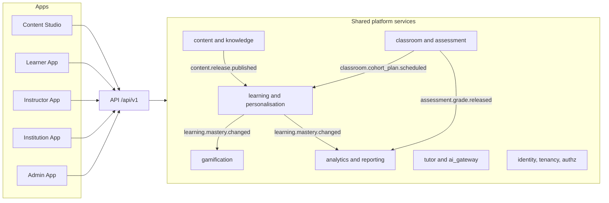

# AI Mentor product vision (v2.0)

| Field | Value |
| --- | --- |
| Document | Product vision |
| Version | 2.0 |
| Date | 13 October 2026 |
| Status | Approved direction. Describes the target; the current build is the v1 learner slice |
| Owner | Product (CPO), with Technology (CTO) and Learning (CLO) |
| Related | [README.md](README.md) (canonical vocabulary), [02-prd.md](02-prd.md), [15-roadmap.md](15-roadmap.md), [06-system-architecture.md](06-system-architecture.md), [../PRD.md](../PRD.md) sections 1–4 and 19, [../Requirements.md](../Requirements.md), [../Admin.md](../Admin.md), ADR 0013, ADR 0015, ADR 0019, ADR 0021 |

## Change record

| Area | What changed | Why | Impacted systems | Implementation implications |
| --- | --- | --- | --- | --- |
| Scope of the product | AI Mentor is defined as a learning ecosystem of five applications on one platform, not one tutoring app | The CPO and CTO set an enterprise, multi-institution direction. Institutions buy for instructors and administrators, not only for learners | All five apps, every shared service | Each user group gets its own app, navigation, and permissions (ADR 0013). Work is planned per app and per shared service (ADR 0017) |
| Customers | Institutions (universities, colleges, enterprises, bootcamps, governments) become first-class customers alongside B2C learners. Publishers follow later | Institutional licences are the larger revenue pool and the route to learners who will not find us alone | `tenancy`, `commerce`, `authz`, Institution App | Every tenant-scoped row carries `tenant_id` from R1 (ADR 0015). Consumer learners live in the built-in consumer organisation |
| Content ownership | Content is owned and released centrally in Content Studio. Instructors consume and customise through overlays | Quality and governance must hold at scale; institutions need stable, versioned material to teach from | `content`, `knowledge`, Content Studio, Instructor App | Content releases are immutable and cohorts pin to them (ADR 0019) |
| Vision statement | Extended from "a private AI tutor" to "a private AI tutor, the teachers around it, and the organisations that run them" | The tutor alone does not reach learners in formal education or the workforce | Positioning, marketing, sales | Messaging differs per segment; the learner promise is unchanged |
| Principles | v1 principles 1–7 kept; principles 8–14 added for tenancy, human authority over grades, open standards, and governed reuse | New risks: cross-tenant leakage, AI marking, lock-in concerns in procurement | All apps | Principles become review criteria for PRD features and ADRs |
| Business model | Freemium B2C stays; institutional licences (Classroom, Campus, Enterprise) added in R3; marketplace in R5 | Diversify revenue; institutional ARR has lower churn | `commerce`, Institution App, Admin App | Seat-based licensing and invoicing need a separate path from Stripe consumer subscriptions |
| Metrics | Weekly Mastering Learners stays the single north star. Segment metrics added for institutions and instructors | One outcome measure prevents each app optimising for its own activity | `analytics`, `reporting` | WML is computed across all tenants and broken down by organisation, cohort, and app |

## Relationship to v1 documents

| v1 section | Status | Notes |
| --- | --- | --- |
| [PRD.md](../PRD.md) section 1, Executive summary | Superseded | Replaced by this document and [02-prd.md](02-prd.md) |
| PRD section 2, Vision, mission, roles, principles, positioning | Amended | Mission kept word for word. The eight learner-facing roles of the tutor are kept and expressed as mentor modes. Principles 1–7 kept |
| PRD section 3, Problem statement | Retained and extended | P1–P8 stay. P8 (educators cannot scale or govern AI teaching) becomes a primary problem |
| PRD section 4, Market opportunity | Amended | Segments re-ranked. SOM model kept as the consumer line; institutional line expanded |
| PRD section 19, Future vision | Superseded | Replaced by [The five-year picture](#the-five-year-picture) |
| [Requirements.md](../Requirements.md), [Admin.md](../Admin.md) | Retained as briefs | Not edited. Their content is distributed across the Learner App and Content Studio |

## Contents

1. [Vision statement](#vision-statement)
2. [Mission](#mission)
3. [The ecosystem](#the-ecosystem)
4. [What AI Mentor is and is not](#what-ai-mentor-is-and-is-not)
5. [Product principles](#product-principles)
6. [Positioning](#positioning)
7. [Customer segments](#customer-segments)
8. [Value propositions per user group](#value-propositions-per-user-group)
9. [Business model evolution](#business-model-evolution)
10. [Defensible moats](#defensible-moats)
11. [The five-year picture](#the-five-year-picture)
12. [North-star and segment metrics](#north-star-and-segment-metrics)

---

## Vision statement

> **Give every person a world-class private AI tutor that knows them and adapts to them, and give the teachers and organisations around them the tools to teach, govern, and prove learning at scale, from a learner's first line of Python to publishable research.**

The first half is the v1 vision and remains the reason the product exists. The second half is new. A tutor that only an individual can buy reaches only the learners who already look for it. Most learners study inside a university, a college, a bootcamp, an employer programme, or a government scheme. Reaching them means serving their instructors and administrators as well.

## Mission

Unchanged from v1: help anyone progress from complete beginner to industry professional, researcher, or PhD-level expert in Artificial Intelligence, Machine Learning, Deep Learning, Reinforcement Learning, Data Science, Robotics, Autonomous Systems, MLOps, and AI Engineering.

The subject focus is deliberate. AI Mentor teaches AI and its neighbouring disciplines. The platform can technically host other subjects, but the content, the knowledge graph, the coding environments, and the research tools are built for this domain, and that depth is the reason to choose us.

## The ecosystem

Four user groups use five applications. Content teams have their own app because content is the asset every other app depends on.

| App | Code name | Who uses it | What it is for | First release |
| --- | --- | --- | --- | --- |
| Learner App | `learner` | Learners, consumer and institutional | Learning, practice, assessment, gamification, career progression, AI tutor | R1 (closed beta), R2 (public) |
| Instructor App | `instructor` | Lead instructors, instructors, teaching assistants | Cohorts, learner management, scheduled journeys, assessment, marking, intervention | R3 |
| Institution App | `institution` | Organisation owners and admins, campus and department admins, billing managers, report viewers, compliance officers | Organisation structure, licences, SSO, branding, policy, reporting | R3 |
| Admin App | `admin` | Platform admins, operators, AI admins, support agents, finance, security auditors | Platform governance and operations | R1 (operations half of today's `admin/`), v1 in R2 |
| Content Studio | `studio` | Content authors, reviewers, publishers, knowledge stewards, localisation editors | Knowledge repository, builders, taxonomy, knowledge graph, workflow, releases, AI generation | R1 (content half of today's `admin/`), v1 in R2 |

How they connect. Content Studio publishes immutable course and path releases. The Instructor App pins a cohort to a release and schedules it as a cohort plan. The Learner App delivers the plan, the tutor, and practice. The assessment platform proposes AI marks that instructors accept or override. The Institution App reports on the result. The Admin App governs the platform, the models, and the policies underneath all of them. No app talks to another app directly; they share one API and one set of services.

One person can use several apps with one sign-in. A lecturer may be an instructor in the Instructor App and a learner in the Learner App. The app launcher shows only the apps that person's role assignments open.

## What AI Mentor is and is not

| AI Mentor is | AI Mentor is not |
| --- | --- |
| A learning ecosystem for AI and adjacent technical disciplines, from beginner to research level | A general-purpose LMS for every subject. Canvas, Moodle, Blackboard, and Brightspace remain the system of record for most institutions; we integrate with them through LTI 1.3 and OneRoster (ADR 0026) |
| A curriculum-grounded, adaptive AI tutor with mastery tracking per concept | A general chatbot. The tutor refuses off-topic work and cites governed sources |
| A tool for instructors to run cohorts, assess, and intervene on AI curricula | A student information system. We do not run admissions, timetabling, fees, or degree conferral |
| A governed content platform with versioned releases and a review workflow | An open publishing site. Nothing reaches learners without review. Community authoring is not planned before the marketplace (R5) |
| Multi-tenant SaaS with organisation-level isolation, SSO, and reporting | Self-hosted or on-premise software. Data residency (R4) is the answer for jurisdictions that require it |
| Trilingual (`en`, `fr`, `es`) across UI, content, AI responses, assessments, and reports | A translation service. Languages beyond the three are not planned before R5 |
| An adult product (16 and over) | A K-12 product for children. A safeguarding and parental consent model does not exist; see the open question in [02-prd.md](02-prd.md) about the `school` organisation kind |
| A provider of mastery evidence and portable achievements (learning passport) | A degree-granting or accrediting body. Accredited certification needs partners and is an R5 objective |

## Product principles

v1 principles 1–7 are kept with their original meaning. Principles 8–14 are new and apply to every app.

| # | Principle | What it means in practice |
| --- | --- | --- |
| 1 | Understanding before answers | The tutor asks and checks before it gives the full solution. Progress is earned (v1) |
| 2 | Grounded, not guessed | The tutor prefers published, reviewed content and cites it. When it does not know, it says so (v1) |
| 3 | Personal by default | Style, depth, pace, and language are under the learner's control, within any bounds an instructor sets (v1, amended) |
| 4 | Fun that serves learning | XP rewards mastery, passing code, and completed reviews, never clicks. Daily cap of 400 XP stays (v1) |
| 5 | Prerequisites are respected | A weak foundation is repaired before the next concept is recommended (v1) |
| 6 | Accessible everywhere | Multilingual, mobile-friendly, regionally priced, usable on modest bandwidth (v1) |
| 7 | Safe and trustworthy | Learner data is private, content is reviewed before learners see it, code runs isolated (v1) |
| 8 | One platform, many apps | Each user group gets an app built for its job. Rules live in the API, never in an app |
| 9 | Tenant first | Every record has an owning organisation. Data never crosses tenants except through an explicit, audited platform feature |
| 10 | Humans decide high-stakes outcomes | AI proposes grades, risk flags, and content; a named person accepts, overrides, or publishes. AI-proposed grades are never shown to a learner before a human acts, except for objectively auto-graded items |
| 11 | Govern once, reuse everywhere | Master content is authored and reviewed once in Content Studio. Institutions customise with overlays, not forks, so fixes reach every cohort that accepts them |
| 12 | Open standards over lock-in | SSO, SCIM, LTI 1.3, OneRoster, xAPI, and Open Badges 3.0. An institution can leave with its data |
| 13 | Same rules in every language | A graded item is used in a locale only after its translation is reviewed. Safety and grounding rules are identical in `en`, `fr`, and `es` |
| 14 | The learner owns their learning record | A personal account's mastery, XP, and achievements follow the learner across organisations. Organisations see only what the learner consented to, for curricula they assigned (ADR 0021) |

## Positioning

AI Mentor combines patterns that each of these products proves. The table states what we take, where we differ, and where they are stronger. Competitor descriptions reflect public product information as of October 2026 and should be refreshed before investor or sales use.

| Product | What we take from it | Where AI Mentor differs | Where it is stronger than us |
| --- | --- | --- | --- |
| Coursera | University and industry partner content, certificates, an enterprise and campus licence business | Adaptive mastery per concept and a Socratic tutor on every lesson, instead of mostly video courses with a fixed sequence | Brand, catalogue breadth across all subjects, accredited degrees, thousands of partner relationships |
| Duolingo | The daily habit loop: streaks, XP, leagues, short sessions, freemium economics | Professional and research depth; XP tied to mastery; content that takes months, not minutes, per unit | Scale, mobile-first polish, years of experimentation on retention mechanics |
| Khan Academy | Mastery learning, a Socratic AI tutor (Khanmigo), teacher dashboards | Adults and professionals; research-level AI; commercial institutional licensing | Trust and reach in schools, a non-profit model, depth in K-12 mathematics and science |
| Canvas | Gradebook, rubrics, assignments, LTI ecosystem, institutional procurement fit | We are not an LMS. We plug into Canvas through LTI 1.3 and return grades, and we add the adaptive tutor and AI-assisted marking for AI curricula | Complete course administration for every subject, entrenched adoption, accessibility track record |
| Moodle | Open standards, extensibility, tenant-level configuration | SaaS only, AI-native, curated AI curriculum included | Open source, self-hosting, a very large plugin community, zero licence cost |
| Microsoft Learn | Role-based learning paths, skills tied to job roles, enterprise integration | Vendor-neutral AI curriculum from fundamentals to research; a personal tutor; cohorts run by instructors | Free, tied to vendor certifications that employers recognise, huge content team |
| ChatGPT | Conversational fluency and on-demand explanation; the expectation that help is instant | Curriculum, prerequisite graph, mastery record, governed and cited content, assessment, instructor oversight, tenant controls | Model capability, ubiquity, general-purpose usefulness. We use frontier models through `ai_gateway`, so raw model quality is not our advantage |

**Positioning statement (learners).** For ambitious learners who want real AI skills, AI Mentor is the personal AI tutor that adapts every lesson to you and checks you understand before moving on. Unlike courses, it is interactive and personal. Unlike chatbots, it follows a curriculum, remembers your progress, and cites trusted sources. (v1, retained.)

**Positioning statement (institutions).** For universities, colleges, bootcamps, and employers teaching AI, AI Mentor is the AI curriculum, tutor, and assessment platform that gives every learner one-to-one support and gives instructors the evidence to intervene early, with governed content, human control over grades, and integration with the LMS you already run.

## Customer segments

| Segment | Organisation `kind` | Buyer | Main users | Entry release | Priority |
| --- | --- | --- | --- | --- | --- |
| Consumer self-learners (B2C) | `consumer` | The learner | Learner App | R1 beta, R2 public | Primary until R3; remains the acquisition engine |
| Researchers and graduate students (B2C premium) | `consumer` | The learner, often grant-funded | Learner App (Research tier) | R1 | Secondary |
| Universities and colleges | `university`, `college` | Head of department, dean, CIO, library | Instructor, Institution, Learner | R3 pilots | Primary from R3 |
| Enterprises and workforce development | `enterprise` | L&D lead, CTO, HR | Institution (workforce reporting), Instructor (internal trainers), Learner | R3 pilots, R4 general | Primary from R4 |
| Bootcamps and training providers | `bootcamp` | Founder, programme director | Instructor, Learner | R3 | Secondary; fast sales cycle, useful design partners |
| Governments and NGOs | `government` | Ministry, skills agency, programme operator | Institution (programme reporting), Learner | R4 | Opportunistic until R4; large contracts in emerging markets |
| Publishers and content partners | `publisher` | Content business | Content Studio (org workspace), marketplace | R5 | Later |
| Schools | `school` | Not in scope while the product is 16+ only | None | Not planned | See open question in [02-prd.md](02-prd.md) |

## Value propositions per user group

| Group | App | Job they hire AI Mentor for | What we promise | Proof we will show |
| --- | --- | --- | --- | --- |
| Learners | Learner App | Learn AI to a standard that changes an exam result, a job, or a research outcome | A tutor that knows what you know, a path that respects prerequisites, practice at the right level, and a habit you keep | Mastery gain on equivalent pre and post checks; weekly retention; path completion |
| Instructors and TAs | Instructor App | Teach a cohort well without marking every script by hand or discovering struggling learners too late | Ready-made, versioned AI curricula; scheduled journeys; AI-proposed marks you accept or override; risk signals with evidence | Time to mark per submission; intervention rate on flagged learners; agreement rate between AI proposals and final grades |
| Institution administrators | Institution App | Deploy AI learning across an organisation safely, measure it, and justify the spend | SSO and provisioning, seat control, branding, policy, compliance tooling, and reports that department heads and finance accept | Seat activation; completion by cohort; licence renewal |
| Workforce and L&D leaders | Institution App | Close named AI skills gaps across teams | Role-based paths, skills reporting by team, evidence of mastery rather than attendance | Skills coverage per role; time to proficiency |
| Content teams | Content Studio | Produce and maintain rigorous AI curricula in three languages with a small team | Builders, AI-generated drafts under review, a knowledge graph editor, versioned releases, localisation workflow | Draft-to-publish lead time; share of AI drafts accepted with minor edits; defect rate after release |
| Platform staff | Admin App | Run a safe, compliant, cost-controlled platform | One place for users, organisations, models, flags, audit, and security monitoring, with MFA and full audit | Incident response times; AI cost per active learner; audit completeness |

## Business model evolution

| Stage | Window | Model | Revenue lines | Notes |
| --- | --- | --- | --- | --- |
| 1. Consumer freemium | R1–R2 (Q4 2026 – Q1 2027) | Free, Pro, Research subscriptions through Stripe, with regional price bands A–C | Consumer subscriptions | Unchanged from v1 [PRD.md](../PRD.md) section 15 |
| 2. Institutional licences | R3 onward (from Q2 2027) | Annual seat licences on three plans: Classroom, Campus, Enterprise. Instructor and admin seats included | Licences, onboarding services, paid certificates | Invoiced, not card-billed, above the Classroom plan. Seat pricing hypotheses are in [02-prd.md](02-prd.md) |
| 3. Programmes and enterprise | R4 (Q4 2027 – Q1 2028) | Multi-year enterprise and government contracts with SSO, SCIM, LTI, data residency, workforce reporting, white-label domains | Contracts, residency premium, professional services | Longer sales cycles; procurement evidence (SOC 2, DPIA) becomes a sales requirement |
| 4. Marketplace | R5 (2028) | Publishers and experts sell courses and paths through Content Studio workspaces; revenue share | Marketplace commission, sponsored challenges | Requires rights management, payouts, and listing review (ADR 0027, proposed) |

Consumer revenue does not stop when institutional revenue starts. The consumer learner base is also the institutional pipeline: learners bring the product to their university or employer, and personal accounts keep their learning record when they join an organisation.

## Defensible moats

| Moat | Why it compounds | What must be true |
| --- | --- | --- |
| Knowledge graph and mastery model | Every check and submission updates which concepts are hard and which prerequisites matter. A prompt cannot replicate a validated graph (ADR 0020) | Prerequisite edges stay acyclic and reviewed by knowledge stewards; mastery evidence is not inflated by gamification |
| Governed, versioned AI curriculum | Reviewed content in three languages, with releases that cohorts pin to, is slow and expensive to copy | Content Studio throughput is high enough to keep the curriculum current with the field |
| Institutional embedding | Cohort plans, gradebooks, SSO, and LMS integration create switching costs that a consumer app never has | Integration quality (LTI grade return, OneRoster sync) matches what LMS administrators expect |
| Learning data across tenants | De-identified, aggregated evidence of which explanations work improves personalisation for every tenant | Strict tenant isolation and consent; only de-identified benchmarks cross tenants (README tenancy rule 4) |
| Trusted evidence of skill | A learning passport backed by mastery and assessed work becomes worth more as employers and institutions accept it | Assessment integrity mode, human-approved grades, and Open Badges 3.0 issuance |
| Learner attachment to their mentor | A configurable mentor that remembers the learner across years and organisations creates high switching costs | Personal-account learning records are portable and private by default |

Model access is not a moat. Every competitor can call the same frontier models. The moat is what surrounds the model: the graph, the content, the evidence, and the institutional workflow.

## The five-year picture

By the end of 2031, the target state is:

1. **A lifelong mentor.** The same mentor knows a learner from their first Python script, through a university course run by their lecturer, to their first job and their first paper. Mentor modes (`tutor`, `mentor`, `research_supervisor`, `coding_coach`, `career_coach`, `exam_coach`) cover each stage.
2. **The reference map of AI knowledge.** A knowledge graph spanning fundamentals to frontier research, maintained by knowledge stewards and validated by learning evidence, used by every course and every recommendation.
3. **The AI teaching layer for institutions.** Universities, colleges, bootcamps, employers, and government programmes run AI cohorts on AI Mentor, launched from their LMS, with AI-assisted marking that instructors trust.
4. **Proof of skill, not attendance.** A learning passport with mastery-backed achievements that employers and admissions teams recognise; accredited certification with partners.
5. **Global by design.** Teaching in `en`, `fr`, and `es` with equal quality, priced for every economy, usable on modest devices, with mobile apps for learners and instructors.
6. **An ecosystem.** Publishers and experts sell content through the marketplace; partners build on a public API; AI agents orchestrate study plans, marking, and interventions within the same policy engine that governs people.

Planning model **(hypothesis)**. The consumer line extends the v1 SOM in [PRD.md](../PRD.md) section 4. Institutional figures are planning assumptions to be replaced with pilot data after R3.

| Year | Registered learners | Organisations on a paid licence | Licensed seats | Consumer ARR | Institutional ARR | Total ARR |
| --- | --- | --- | --- | --- | --- | --- |
| 2027 | 150,000 | 10 (pilots) | 5,000 | ~$0.6M | ~$0.2M | ~$0.8M |
| 2028 | 500,000 | 60 | 40,000 | ~$2.5M | ~$1.5M | ~$4.0M |
| 2029 | 1,200,000 | 180 | 150,000 | ~$5M | ~$6M | ~$11M |
| 2030 | 2,500,000 | 400 | 350,000 | ~$9M | ~$14M | ~$23M |
| 2031 | 4,000,000 | 700 | 650,000 | ~$13M | ~$25M | ~$38M |

The crossover, where institutional ARR exceeds consumer ARR, is expected in 2029. If R3 pilots do not reach the seat activation and renewal targets below, the plan falls back to a consumer-led business with institutional sales as a channel.

## North-star and segment metrics

**North star: Weekly Mastering Learners (WML)**, retained from v1: the number of learners who, in a given week, master at least one new concept (pass its check at the mastery threshold). It is computed across every tenant, including the consumer organisation, and reported per organisation, cohort, path, and locale. It combines return visits with real learning, and it cannot be raised by clicks.

Each app has segment metrics that must move WML, not replace it.

| Segment or app | Metric | Definition | Target **(hypothesis)** |
| --- | --- | --- | --- |
| B2C learners | Week-1 retention | Share of new learners active in their second week | 40% beta, 45% at 12 months (v1) |
| B2C learners | Free-to-paid conversion | Share of activated learners paying within 30 days | 3% beta, 5% at 12 months (v1) |
| All learners | Mastery gain | Average improvement on equivalent pre and post checks | +25 points (v1) |
| Institutions | Seat activation | Share of assigned seats whose learner completes a first lesson within 14 days of assignment | 80% |
| Institutions | Licence renewal | Share of expiring licences renewed (by seat count) | 85% gross |
| Instructors | Weekly active instructors | Instructors with at least one marking, plan, or intervention action in the week, as a share of instructors with an active cohort | 70% |
| Instructors | Time to mark | Median time from submission to released grade for marked work | Under 72 hours |
| Instructors | At-risk intervention rate | Share of risk signals acted on (message, plan change, meeting, or dismissal with reason) within 7 days | 75% |
| Cohorts | Cohort plan completion | Share of cohort learners completing all required plan items by the close date | 70% |
| Content Studio | Draft-to-publish lead time | Median days from first draft to published release for a lesson | Under 10 working days |
| Content Studio | AI draft acceptance | Share of AI-generated drafts approved with minor or no edits | 70% (v1 F22) |
| Platform | AI cost per monthly active learner | Model and retrieval cost | Under $0.60 Free, under $3.00 Pro (v1 PRD; see the budget conflict noted in [02-prd.md](02-prd.md)) |
| All apps | Net Promoter Score | Survey per app audience | Learners 45+, instructors 30+, institution admins 30+ at 12 months after each app launches |

[02-prd.md](02-prd.md) defines the full metric set, guardrails, and release criteria.
