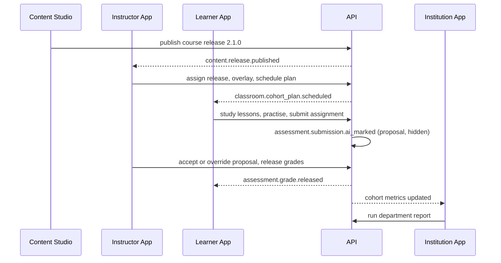

# AI Mentor product requirements (PRD v2.0)

| Field | Value |
| --- | --- |
| Document | Product Requirements Document, v2: five applications on one platform |
| Version | 2.0 |
| Date | 13 October 2026 |
| Status | Draft for review by product, engineering, learning, sales, and security. R1 scope is committed; R2–R5 are planning scope |
| Owner | Product (CPO) |
| Related | [README.md](README.md), [01-product-vision.md](01-product-vision.md), [03-srs.md](03-srs.md), [04-use-cases.md](04-use-cases.md), [05-user-stories.md](05-user-stories.md), [10-rbac-matrix.md](10-rbac-matrix.md), [14-content-studio-specification.md](14-content-studio-specification.md), [15-roadmap.md](15-roadmap.md), [../PRD.md](../PRD.md), [../Requirements.md](../Requirements.md), [../Admin.md](../Admin.md), ADR 0013 to ADR 0027 |

Figures marked **(hypothesis)** are planning assumptions to validate with beta and pilot data. They are not claims of fact.

## Change record

| Area | What changed | Why | Impacted systems | Implementation implications |
| --- | --- | --- | --- | --- |
| Product structure | Features are grouped by application (Learner, Instructor, Institution, Admin, Content Studio) plus platform capabilities, with new feature IDs `L-F`, `I-F`, `O-F`, `A-F`, `C-F`, `P-F` | Each user group gets its own app (ADR 0013). A flat F1–F27 list cannot express who uses a feature and where | All apps; planning and traceability | v1 F1–F27 stay valid and are mapped to v2 features in [v1 feature mapping](#v1-feature-mapping). Requirement IDs in [03-srs.md](03-srs.md) trace to these feature IDs |
| Personas | Amara, Carlos, and Dr. Élodie kept. Seven institutional and content personas added. Dr. Mensah recast as a curriculum designer | Institutions buy for staff as well as learners; content production is now a team workflow | Instructor App, Institution App, Content Studio | UX research recruits instructors, TAs, administrators, and content staff from R2 |
| Roles | "Every user has exactly one role" (v1 F1) is superseded by scoped role assignments | A lecturer can be a learner and an instructor; an admin can hold authority over one department only | `authz`, all apps | `users.role` is migrated to `authz.role_assignments` in R1 using the README mapping. Behaviour for v1 users does not change |
| Content | Content is authored and released in Content Studio; cohorts pin to immutable releases; instructors customise with overlays | Institutions need stable material; fixes must reach every cohort without forks (ADR 0019) | `content`, `knowledge`, `learning`, Content Studio, Instructor App | Release and overlay tables in `curriculum`; `workspace_id` on every authored row from R1 |
| Assessment | Formal assessment, rubrics, AI-assisted marking with human override, and a gradebook are added | Marking load is the main instructor pain point and the main institutional purchase reason (ADR 0025) | `assessment`, `classroom`, Instructor App, Learner App | New `assessment` schema; AI proposals never reach learners before a human acts |
| Monetisation | Consumer tiers Free, Pro, Research kept. Institution plans Classroom, Campus, Enterprise added. Marketplace in R5 | Institutional revenue diversifies the business and lowers churn | `commerce`, Institution App, Admin App | Seat licences and invoicing alongside Stripe subscriptions |
| Releases | v1 MVP, R2, R3, and Phase 0–3 are replaced by R1–R5 | One schedule across five apps | All documents | Mapping in [15-roadmap.md](15-roadmap.md) |
| Metrics | v1 KPIs kept for learners; institutional, instructor, and content KPIs added | Each app needs an outcome measure tied to the north star | `analytics`, `reporting` | Events from the outbox feed metrics per tenant |

## Relationship to v1 documents

| v1 section ([PRD.md](../PRD.md)) | Status | Notes |
| --- | --- | --- |
| 1 Executive summary, 2 Vision | Superseded | See [01-product-vision.md](01-product-vision.md) |
| 3 Problem statement | Retained, extended | P1–P8 stay; P9–P12 added below |
| 4 Market opportunity | Amended | Segments in [01-product-vision.md](01-product-vision.md) |
| 5 Personas | Amended | Primary personas kept; secondary personas kept as learner variants; Dr. Mensah recast |
| 6 User needs | Retained, extended | N1–N13 and A1–A6 stay; needs for new groups added |
| 7 User journeys | Retained | Journeys 1–7 remain the Learner App and Content Studio journeys |
| 8 Core features F1–F27 | Retained by reference | Each feature is re-homed under a v2 app and capability. Acceptance criteria in v1 stay normative unless this document amends them |
| 9 MVP scope | Amended | Restated as R1 in [R1 scope](#r1-scope) |
| 10 Out of scope | Superseded | See [Out of scope](#out-of-scope) |
| 11–14 Metrics | Retained, extended | Learner KPIs unchanged; new KPIs below |
| 15 Monetisation | Retained, extended | Consumer tiers unchanged |
| 16 Risks | Retained, extended | v1 risks R1–R16 are referred to as "v1 risk R1" etc. to avoid confusion with release labels. New risks use `RK-` IDs |
| 17 Release criteria | Retained for R1 | Extended per release below |
| 18 Roadmap, 19 Future vision | Superseded | [15-roadmap.md](15-roadmap.md), [01-product-vision.md](01-product-vision.md) |

## Contents

1. [Summary](#summary)
2. [Problems added in v2](#problems-added-in-v2)
3. [Personas](#personas)
4. [User needs per group](#user-needs-per-group)
5. [v1 feature mapping](#v1-feature-mapping)
6. [Key journeys per app](#key-journeys-per-app)
7. [Learner App capabilities](#learner-app-capabilities)
8. [Instructor App capabilities](#instructor-app-capabilities)
9. [Institution App capabilities](#institution-app-capabilities)
10. [Admin App capabilities](#admin-app-capabilities)
11. [Content Studio capabilities](#content-studio-capabilities)
12. [Platform capabilities](#platform-capabilities)
13. [Cross-app flows](#cross-app-flows)
14. [R1 scope](#r1-scope)
15. [Out of scope](#out-of-scope)
16. [Success metrics](#success-metrics)
17. [Monetisation v2](#monetisation-v2)
18. [Risks and dependencies](#risks-and-dependencies)
19. [Release criteria](#release-criteria)
20. [Open questions](#open-questions)

---

## Summary

AI Mentor v1 is a personal AI tutor for AI and its neighbouring fields. v2 keeps that tutor at the centre and builds four more applications around it on one shared platform: an Instructor App for teaching cohorts, an Institution App for running organisations, an Admin App for governing the platform, and Content Studio for producing the curriculum.

The five Next.js apps live under `apps/` on one FastAPI modular monolith with three ranked roles (`student < instructor < admin`). None of the tenancy, classroom, assessment, or licensing capability in this document exists yet; Instructor and Institution screens that need an organisation show empty queues. R1 ships the v1 learner MVP as a closed beta and lays the foundations that are expensive to add later. R2 is the public consumer launch with Content Studio builders. R3 opens Instructor and Institution Apps to pilot institutions with real tenants.

## Problems added in v2

v1 problems P1–P8 ([PRD.md](../PRD.md) section 3) remain. P8 (educators cannot scale or govern AI teaching) moves from secondary to primary.

| # | Problem | Who feels it | Consequence today |
| --- | --- | --- | --- |
| P9 | Marking open-ended and coding work takes most of an instructor's time | Lecturers, TAs, bootcamp instructors | Feedback arrives too late to change outcomes; cohorts are capped by marking capacity |
| P10 | Instructors see struggling learners only after a failed assessment | Instructors, programme directors | Interventions come weeks late; dropout rises |
| P11 | Institutions cannot adopt AI tutoring without control over content, data, identity, and cost | Department heads, CIOs, L&D leads, compliance officers | Pilots stall in procurement; staff use unmanaged chatbots instead |
| P12 | AI curricula age fast; local copies of courses drift and errors persist in every copy | Curriculum designers, instructors | Learners study outdated material; fixes do not propagate |

## Personas

### Retained learner personas

Amara (university student, Lagos), Carlos (career switcher, Madrid), and Dr. Élodie (early-career researcher, Montréal) remain the primary Learner App personas exactly as in [PRD.md](../PRD.md) section 5. Priya, Kwame, Sofia, and Tom remain secondary learner personas. Two changes apply:

- Amara now usually arrives through her university. Her department holds a Campus licence, so she has a personal account that joined the university organisation, and her ML module runs as a cohort.
- Carlos may arrive through his employer's Enterprise licence with a managed account. His learning record then belongs to the employer (ADR 0021).

### New personas

| Persona | Role assignments | App | Context | Goal | Frustration | Success looks like |
| --- | --- | --- | --- | --- | --- | --- |
| **Dr. Adebayo Ogunleye**, head of department | `department_admin` (Computer Science), `org_report_viewer` | Institution | Runs a department of 1,400 students and 38 staff at a Lagos university; buyer for the Campus licence | Raise pass rates in ML modules and show the faculty that AI tutoring is controlled | Staff and students use unmanaged chatbots; no data on whether they help | Termly report by cohort with mastery, completion, and at-risk counts he can present to the dean |
| **Hélène Marchand**, corporate L&D manager | `org_admin`, `org_billing_manager` | Institution | Leads AI upskilling for 2,000 staff at a Paris bank; works in French | Close named AI skills gaps by role within a year, with evidence for HR | Course completion certificates prove attendance, not ability | Skills coverage report by team and role; SSO with no manual accounts; 80% seat activation |
| **Dr. Rafael Ortiz**, lecturer | `lead_instructor` (his module), `learner` (personal account) | Instructor, Learner | Teaches Machine Learning to 220 students in Mexico City with three TAs; teaches in Spanish | Run the module on a scheduled path, mark weekly assignments fairly, catch strugglers early | Marking 220 scripts a week; finds failing students only at midterm | Weekly plan runs itself; AI proposes marks he accepts or overrides; risk list every Monday |
| **Grace Wanjiru**, teaching assistant | `teaching_assistant` (two cohorts), `learner` | Instructor, Learner | MSc student in Nairobi, 10 hours a week of TA work | Mark quickly and consistently; answer learner questions | Inconsistent marking between TAs; unclear rubrics | Rubric-based marking queue with AI proposals and evidence; marking time halved |
| **Dr. Kofi Mensah**, curriculum designer and SME | `content_author` in `master` | Content Studio | Lecturer and robotics SME contracted by AI Mentor; v1 "Instructor / Content Admin" persona | Turn papers and lecture notes into reviewed lessons and courses quickly | Rewriting the same lesson for three languages and five teaching styles | AI drafts linked to sources, a course builder, and a clear review queue |
| **Lucía Fernández**, content reviewer and localisation editor | `content_reviewer`, `localisation_editor` (`es`) in `master` | Content Studio | Spanish-speaking ML engineer reviewing part time | Approve correct content and accurate Spanish translations without re-reading unchanged material | Reviewing whole documents when one paragraph changed | Diff view against the previous release; glossary checks; per-locale approval |
| **Sam Okonkwo**, platform operator and AI admin | `platform_operator`, `ai_admin` | Admin | On the AI Mentor operations team | Keep the platform reliable and AI cost within budget; ship model changes safely | Model changes without evaluation; flags changed without trace | Model routes gated by evaluation results; every flag and route change audited and reversible |

### Anti-personas

v1 anti-personas stay: children under 16, users seeking a production coding assistant, and learners seeking an accredited degree. Added: institutions seeking a full LMS or student information system for all subjects.

## User needs per group

v1 learner needs N1–N13 and content needs A1–A6 are retained ([PRD.md](../PRD.md) section 6). New needs:

| ID | Group | Job to be done | Importance | Addressed by |
| --- | --- | --- | --- | --- |
| N14 | Learners in an organisation | *Show me what my course requires this week and when it is due.* | Critical | L-F17 |
| N15 | Learners in an organisation | *Let me keep my progress when I leave my university or employer.* | High | L-F19, P-F08 |
| N16 | Learners | *Let me pick the kind of help I need: tutor, coding coach, exam coach, career coach.* | High | P-F05 |
| T1 | Instructors and TAs | *Set up my cohort and schedule a ready-made path in under an hour.* | Critical | I-F02, I-F04 |
| T2 | Instructors and TAs | *Add 200 learners at once, from a list or my institution's system.* | Critical | I-F03, O-F07 |
| T3 | Instructors and TAs | *Mark open-ended work quickly and fairly, and stay in control of the grade.* | Critical | I-F07, I-F08, I-F09 |
| T4 | Instructors and TAs | *Tell me who is falling behind and why, before the exam.* | Critical | I-F10, I-F11 |
| T5 | Instructors and TAs | *Adapt the course to my class without breaking it.* | High | I-F04 (overlays) |
| T6 | Instructors and TAs | *Talk to my cohort in one place.* | High | I-F12 |
| O1 | Institution administrators | *Give the right people access automatically through our identity provider.* | Critical | O-F07 |
| O2 | Institution administrators | *Control seats and spend.* | Critical | O-F04, O-F05 |
| O3 | Institution administrators | *Prove impact to leadership with reports I trust.* | Critical | O-F09, O-F10 |
| O4 | Institution administrators | *Meet our data protection obligations and answer data requests.* | Critical | O-F08 |
| O5 | Institution administrators | *Make it look and feel like our institution.* | Medium | O-F06 |
| C1 | Content teams | *Build a course from lessons and assets, and release a version cohorts can rely on.* | Critical | C-F03 to C-F05, C-F11 |
| C2 | Content teams | *Translate and review content per locale without blocking the English release.* | High | C-F13 |
| C3 | Content teams | *Know which cohorts are affected before I publish a change.* | High | C-F11 |
| S1 | Platform staff | *Change models, prompts, and flags safely, with evaluation and rollback.* | Critical | A-F04, A-F10 |
| S2 | Platform staff | *See who accessed what, across tenants, and why.* | Critical | A-F06, A-F07 |

## v1 feature mapping

All v1 acceptance criteria remain normative for the v2 feature they map to unless the "Amendment" column changes them.

| v1 feature | v2 app | v2 feature | Status | Amendment | Release |
| --- | --- | --- | --- | --- | --- |
| F1 Accounts, roles, profiles | Learner App; platform | L-F01, P-F08 | Amended | "Exactly one role" replaced by scoped role assignments; memberships and account types added | R1 |
| F2 Onboarding and placement | Learner App | L-F02 | Retained | Organisation join flow may pre-fill goal and path | R1 |
| F3 Socratic AI tutor | Learner App; platform | L-F03, P-F05 | Amended | Becomes mentor mode `tutor`; `socratic` and `direct` become a technique setting | R1 |
| F4 Adaptive teaching controls | Learner App; platform | L-F05, P-F03 | Amended | Five controls map to the five dimensions; instructors may lock or bound them | R1 (v1 controls), R2 (dimensions) |
| F5 Learning paths and concept graph | Learner App; platform | L-F04, P-F01 | Amended | Hierarchy becomes lesson, module, course, path; concept graph moves to `knowledge` | R1 |
| F6 Recommendations and study plans | Learner App | L-F05 | Retained | Cohort plan items take priority over self-directed recommendations | R1 |
| F7 Intelligent quiz system | Learner App | L-F06 | Retained | Practice quizzes stay in `learning`; graded quizzes move to `assessment` (I-F05) | R1 |
| F8 Daily challenges | Learner App | L-F08 | Retained | Weekly and seasonal challenges added | R1 |
| F9 Gamification | Learner App; platform | L-F09, P-F02 | Retained | Becomes a platform service usable in cohorts | R1 |
| F10 Leaderboards | Learner App; platform | L-F10, P-F02 | Amended | Institution, cohort, and friend scopes added | R1 (global, country) |
| F11 Progress dashboard | Learner App | L-F11 | Retained | Cohort view added | R1 |
| F12 Multilingual | Platform | P-F04 | Amended | Five localisation surfaces; reviewed translation required for graded items | R1 |
| F13 Knowledge repository | Content Studio | C-F01, C-F02 | Amended | 13 asset types; `workspace_id`; rights and licence terms | R1 (existing), R2 |
| F14 Curriculum, taxonomy, graph | Content Studio | C-F04, C-F05, C-F07, C-F08 | Amended | Builders for each level; typed, weighted concept relations | R1 (existing), R2 |
| F15 Grounded answers with citations | Platform | P-F05 (`retrieval`) | Retained | Retrieval filters by tenant and workspace visibility | R1 |
| F16 Content approval workflow | Content Studio | C-F10 | Amended | State `review` renamed `in_review`; `changes_requested` added; same states for every content type | R1 |
| F17 Trust, safety, privacy | Platform | [09-security-model.md](09-security-model.md) | Retained | Tenant isolation and consent rules added | R1 |
| F18 Subscriptions and billing | Learner App | L-F18 | Retained | Institution licences are separate (O-F04) | R1 |
| F19 Coding lab | Learner App | L-F07 | Retained | Production enablement gated by SEC-01 isolated runner | R1 if gate passes, else R2 |
| F20 Flashcards | Learner App | L-F12 | Retained | None | R1 |
| F21 Research assistant | Learner App | L-F13 | Amended | Delivered through mentor mode `research_supervisor` | R1 (core) |
| F22 AI content generation | Content Studio | C-F12 | Amended | Generation jobs routed through `ai_gateway`; drafts carry source lineage | R1 (existing), R2 |
| F23 Content version control | Content Studio | C-F11 | Amended | Versioned, immutable releases with semantic versions | R2 |
| F24 Admin analytics | Content Studio; Admin App | C-F14, A-F05 | Amended | Split into content analytics and platform analytics | R2 |
| F25 Weekly progress reports | Learner App | L-F11 | Retained | Rendered through `reporting` in the learner's locale | R2 |
| F26 Tutor avatar and personality | Platform | P-F05 | Amended | Becomes the mentor persona | R2 |
| F27 Career advisor | Learner App | L-F14 | Amended | Mentor mode `career_coach` | R1 (basic), R3 (full) |

## Key journeys per app

v1 journeys 1–7 ([PRD.md](../PRD.md) section 7) remain the core Learner App and Content Studio journeys. The journeys below are new.

**Learner App: join an organisation with a personal account (Amara).**
1. Amara opens an invitation link from her department, or enters an enrolment code.
2. She signs in with her existing personal account.
3. The consent screen lists what the University will see: progress and mastery for concepts in curricula it assigns, while she is a member. She accepts.
4. The app launcher now shows her university's branding as an organisation she can switch to; her XP, streak, and badges are unchanged.
5. Her ML cohort plan appears on the dashboard with this week's items and due dates.

**Learner App: complete a cohort assignment.**
1. Amara opens an assignment from her plan and sees its window, attempts, and rubric.
2. The mentor enters assessment integrity mode: it explains concepts but does not disclose solutions.
3. She submits; the submission is acknowledged with a timestamp.
4. When her instructor releases grades, she sees the grade, per-criterion feedback, and recommended review lessons.

**Instructor App: set up and schedule a cohort (Dr. Ortiz).**
1. Creates cohort "ML 2027 Spring" under his department.
2. Adds three TAs.
3. Imports 220 learners from a CSV; the dry run reports 4 rows with errors; he fixes them and commits.
4. Assigns the course release "Machine Learning Foundations 2.1.0" and sets start and end dates.
5. In the overlay, hides one optional module, adds a local dataset as a supplementary item, and sets weekly due dates.
6. Locks `register` at Academic or higher for the cohort.
7. Schedules the plan; learners receive a localised notification.

**Instructor App: mark with AI assistance (Grace).**
1. Opens the marking queue for Assignment 3, filtered to submissions with AI proposals.
2. For each submission, reviews the proposed mark per rubric criterion with the cited evidence from the learner's response.
3. Accepts most proposals, adjusts one criterion with a reason, and flags one submission for full manual marking.
4. Dr. Ortiz reviews the sample set and releases grades for the cohort.

**Instructor App: act on risk (Dr. Ortiz).**
1. Monday's risk list shows 17 learners, each with the signals that triggered it.
2. He messages 12 with a templated, editable note, moves 3 to an extended due date, and dismisses 2 with a reason.
3. The system records each action as an intervention and tracks whether the learner recovers.

**Institution App: onboard an organisation (Hélène).**
1. Accepts the invitation created by AI Mentor sales for her organisation, becoming `org_owner`.
2. Configures SAML SSO with the bank's identity provider and verifies the email domain.
3. Creates departments for Risk, Technology, and Operations.
4. Assigns seats from the Enterprise licence to departments.
5. Applies branding and sets the policy that managed accounts are hidden from public leaderboards.
6. Invites internal trainers as instructors.

**Institution App: termly report (Dr. Ogunleye).**
1. Opens the department report, filtered to the current term.
2. Compares cohort completion, mastery gain, and at-risk counts.
3. Exports a localised PDF and schedules it monthly to the dean.

**Admin App: change a model route (Sam).**
1. Proposes routing `tutor` traffic in `fr` to a new model version.
2. The evaluation gate runs the French evaluation set; accuracy and safety thresholds pass.
3. Re-authenticates with MFA and applies the route to 10% of traffic.
4. Monitors cost and flag rates for 48 hours, then promotes to 100% or rolls back.

**Content Studio: from paper to course release (Dr. Mensah, Lucía).**
1. Uploads a SLAM survey paper as a knowledge asset with rights attestation.
2. Generates draft lessons, checks, and flashcards linked to the source.
3. Edits the drafts, links each lesson to its primary concept, and builds a module.
4. Submits for review; Lucía approves the English and requests changes to one Spanish translation.
5. A publisher publishes "Robotics Perception 1.3.0"; the change summary lists 6 cohorts pinned to 1.2.x.

## Feature specification format

Each feature below states its goal and scope, key behaviours, acceptance highlights, release, and dependencies. Acceptance highlights are the testable minimum; [03-srs.md](03-srs.md) holds the full requirements. Dependencies name modules from the README service table.

## Learner App capabilities

**L-F01 Account, memberships, and app launcher.** R1. Depends on `identity`, `tenancy`, `authz`.
- *Goal and scope:* one sign-in across apps; personal and managed accounts; memberships in many organisations; an organisation switcher and app launcher. Extends v1 F1.
- *Behaviours:* self sign-up creates a `personal` account in the consumer organisation and a `learner` assignment there. The launcher lists only apps the person's assignments open. Switching organisation changes the active tenant context and the dashboard.
- *Acceptance:* v1 F1 criteria, except the single-role rule. A person with no instructor assignment never sees the Instructor App in the launcher, and the API refuses Instructor App calls for them.

**L-F02 Onboarding and placement.** R1. Depends on `personalisation`, `learning`. v1 F2 retained.
- *Behaviours:* when a learner joins through a cohort, onboarding skips the goal question and starts from the cohort's path, but still captures style, depth, and maths comfort.
- *Acceptance:* v1 F2 criteria.

**L-F03 AI Tutor.** R1. Depends on `tutor`, `retrieval`, `ai_gateway`. v1 F3 and F15 retained; mentor modes in P-F05.
- *Behaviours:* in R1 the tutor runs mode `tutor` with the v1 Socratic policy and the v1 research, coding review, and career flows. In assessment integrity mode the tutor gives no solution to the active assessment's items.
- *Acceptance:* v1 F3 and F15 criteria; zero solution disclosures on the integrity-mode evaluation set (from R3).

**L-F04 Learning paths, courses, modules, and lessons.** R1 (paths and lessons), R2 (courses and modules from Content Studio releases). Depends on `content`, `learning`, `knowledge`.
- *Goal and scope:* browse the catalogue, enrol, and study published releases. v1 F5 retained.
- *Behaviours:* a learner on a cohort plan sees the release and overlay their cohort pinned. A self-directed learner sees the latest published release. Progress on a concept counts across every path that contains it.
- *Acceptance:* v1 F5 criteria; a new release never erases progress; a cohort learner never sees items the overlay hides.

**L-F05 Personalised learning and study plans.** R1 (v1 controls), R2 (five dimensions), R3 (cohort locks). Depends on `personalisation`, `knowledge`.
- *Behaviours:* v1 F4 and F6. Dimensions `depth`, `pace`, `approach`, `register`, `breadth` replace the v1 controls with a one-to-one mapping. A locked dimension shows the lock and who set it.
- *Acceptance:* v1 F4 and F6 criteria; a learner cannot move a locked dimension outside its bounds.

**L-F06 Quizzes and practice.** R1. Depends on `learning`. v1 F7 retained.
- *Behaviours:* practice quizzes feed mastery and XP and are never graded for an organisation. Graded quizzes are assignments (I-F05, I-F06).
- *Acceptance:* v1 F7 criteria.

**L-F07 Coding lab and coding challenges.** R1 if the SEC-01 gate passes, otherwise R2. Depends on `learning`, isolated runner.
- *Behaviours:* v1 F19. Coding challenges are daily or weekly challenges whose check is a coding test. Coding assessments in cohorts use the same runner. In-browser notebooks follow in R3.
- *Acceptance:* v1 F19 criteria; the lab is not enabled in production until learner code runs in an isolated, secret-free, network-less runner ([../Security-Compliance.md](../Security-Compliance.md) section 8.6).

**L-F08 Daily, weekly, and seasonal challenges.** R1 (daily: quiz, coding, lesson goal), R2 (research, debugging, robotics types; weekly and seasonal). Depends on `gamification`.
- *Acceptance:* v1 F8 criteria; a seasonal challenge has fixed start and end dates in UTC and a published rule set.

**L-F09 Gamification.** R1. Depends on `gamification`. v1 F9 retained.
- *Behaviours:* XP rules, the 400 XP daily cap, and 250 XP per level stay as built. XP earned in any organisation accrues to the learner's account; organisation leaderboards count only XP earned in that tenant.
- *Acceptance:* v1 F9 criteria.

**L-F10 Leaderboards.** R1 (global and country top 10, own rank and percentile), R2 (friend rankings), R3 (institution and cohort). Depends on `gamification`, `tenancy`.
- *Behaviours:* each leaderboard shows rank, percentile, XP, achievements, and streak. Managed accounts are excluded from global and country leaderboards unless the organisation policy allows them. Guests see the pseudonymous global top 10 only.
- *Acceptance:* v1 F10 criteria; a cohort leaderboard shows only members of that cohort; an instructor can disable the cohort leaderboard.

**L-F11 Progress tracking and learning analytics.** R1 (dashboard), R2 (weekly reports). Depends on `learning`, `analytics`, `reporting`.
- *Behaviours:* v1 F11 and F25. Cohort learners also see plan progress and upcoming due dates.
- *Acceptance:* v1 F11 and F25 criteria.

**L-F12 Flashcards.** R1. v1 F20 retained.

**L-F13 AI research learning.** R1 (upload, summary, equation explanation, methodology critique), R4 (reviewer simulation, gap detection, literature review). Depends on `tutor` (`research_supervisor`), `retrieval`.
- *Acceptance:* v1 F21 criteria.

**L-F14 Career planning.** R1 (basic advice in chat), R3 (career surface: target roles, gap list, plan). Depends on `tutor` (`career_coach`), `knowledge`.
- *Acceptance:* v1 F27 criteria; the career surface maps each target role to concepts and paths.

**L-F15 Knowledge search.** R2. Depends on `search`.
- *Goal and scope:* search lessons, concepts, assets, and the learner's own notes and conversations from one box.
- *Acceptance:* results respect tenant, workspace visibility, and publication state; no draft or archived item appears; p95 latency under 500 ms.

**L-F16 Projects.** R2 (guided projects), R3 (assessed projects in cohorts). Depends on `learning`, `assessment`.
- *Behaviours:* a project has milestones, a coding or written deliverable, and a rubric when assessed. v1 includes one Q-learning project.

**L-F17 Cohort coursework.** R3. Depends on `classroom`, `assessment`, `messaging`.
- *Goal and scope:* the learner side of the Instructor App: plan, due dates, assignments, submissions, released grades, feedback, announcements, and messages.
- *Acceptance:* a learner never sees an AI-proposed grade before release; late submissions are labelled with the time difference.

**L-F18 Consumer subscriptions.** R1. Depends on `commerce`. v1 F18 retained.
- *Behaviours:* a learner covered by an organisation seat gets that organisation's entitlements while acting in its tenant context; their personal tier applies elsewhere.

**L-F19 Learning passport and data controls.** R3 (consent management per organisation), R4 (passport export). Depends on `identity`, `tenancy`, `gamification`.
- *Acceptance:* a learner can see and revoke each organisation's consent; revocation stops new learning-record sharing within 1 minute; export produces Open Badges 3.0 credentials and a JSON transcript.

## Instructor App capabilities

**I-F01 Instructor home.** R3. Depends on `classroom`, `analytics`.
- *Scope:* cohorts the person teaches, today's marking queue, risk list, upcoming plan items, unread messages.
- *Acceptance:* loads in under 2 seconds p95 for an instructor with 10 cohorts of 500 learners.

**I-F02 Cohort management.** R3. Depends on `classroom`, `tenancy`, `authz`.
- *Behaviours:* `lead_instructor` and department or higher admins create cohorts (`classroom.cohort:create`) in an org unit they hold scope over; add instructors and TAs; archive cohorts at term end. Default maximum 1,000 learners per cohort.
- *Acceptance:* an instructor cannot see cohorts outside their assignments; archiving keeps the academic record read-only.

**I-F03 Learner management.** R3. Depends on `identity`, `tenancy`, `classroom`.
- *Behaviours:* create a learner (managed account), bulk import from CSV (`classroom.cohort_member:import`), invite by email, or issue an enrolment code. CSV import runs a dry run first and commits only rows that pass validation. Up to 5,000 rows per file. Invitations expire after 14 days.
- *Acceptance:* a 1,000-row import completes in under 2 minutes; duplicate emails are matched to existing members instead of creating new accounts; a personal-account learner is invited, never created.

**I-F04 Curriculum assignment and cohort plans.** R3. Depends on `content`, `classroom`, `learning`.
- *Behaviours:* assign a course or path release; build an overlay (reorder, hide, add supplementary items, set dates, add instructions); schedule plan items with release, due, and close dates (`classroom.cohort_plan:schedule`). When a newer release exists, the instructor sees a change summary and chooses to adopt it.
- *Acceptance:* overlays never change the master release; adopting a release keeps learner progress on unchanged items; scheduling emits `classroom.cohort_plan.scheduled`.

**I-F05 Assessment creation and quiz builder.** R3. Depends on `assessment`, `content`.
- *Behaviours:* build quizzes, exams, written-response, and coding assessments from the item bank of the pinned release, plus instructor-authored items in the organisation. Items are tagged with concepts.
- *Acceptance:* every item maps to at least one concept; an item without an approved translation cannot be used in that locale.

**I-F06 Assignment management.** R3. Depends on `assessment`, `classroom`, `notification`.
- *Behaviours:* issue an assessment to a cohort or learners with window, attempts, late policy, integrity mode, and accommodations (extra time, extended due date).
- *Acceptance:* publishing emits `assessment.assignment.published`; accommodations apply per learner without changing the cohort settings.

**I-F07 Rubrics.** R3. Depends on `assessment`.
- *Behaviours:* criteria with performance levels and points; reusable across assignments in the organisation; content teams can ship rubrics with releases.
- *Acceptance:* a rubric in use by a submitted assignment cannot be edited, only versioned.

**I-F08 Manual marking and gradebook.** R3. Depends on `assessment`.
- *Behaviours:* marking queue, inline feedback, per-criterion marks, release by assignment or by learner (`assessment.grade:release`), gradebook by cohort with CSV export.
- *Acceptance:* TAs mark (`assessment.submission:mark`) but release only when delegated; release emits `assessment.grade.released`.

**I-F09 AI-assisted marking and override.** R3 behind flag `instructor.ai_marking`. Depends on `assessment`, `ai_gateway`.
- *Behaviours:* for rubric-marked written and coding work, the AI proposes a mark per criterion with rationale and quoted evidence from the response. A human accepts, edits, or overrides (`assessment.grade:override`, reason required). When organisation policy requires it, overrides beyond a set point difference need `lead_instructor` approval. Low-confidence proposals go to manual marking. By default 10% of accepted proposals per assignment are sampled for second marking.
- *Acceptance:* proposals are never visible to learners; every override is audited with before, after, and reason; AI–human agreement (within one rubric level) is reported per assignment; disabling the flag stops new proposals without affecting released grades.

**I-F10 Progress tracking and risk monitoring.** R3. Depends on `classroom`, `learning`, `analytics`.
- *Behaviours:* risk signals with evidence. Defaults: no activity for 7 days; two missed due dates within 14 days; mastery on a required concept falls by 15 points or more; engagement below 30% of the cohort median over 14 days. Instructors record interventions.
- *Acceptance:* each signal shows the data behind it; signals refresh at least daily; an intervention records actor, type, and outcome.

**I-F11 Attendance and engagement analysis.** R3. Depends on `classroom`.
- *Behaviours:* live sessions with attendance recorded manually, by check-in code, or from activity in a required window. Engagement shows active days, time on task, and plan completion.
- *Acceptance:* attendance can be corrected with a reason; corrections are audited.

**I-F12 Communication hub.** R3. Depends on `messaging`, `notification`.
- *Behaviours:* cohort announcements, one-to-one and group threads, scheduled messages, templates per locale.
- *Acceptance:* learners can message staff of their cohorts only; messages are retained per organisation policy.

**I-F13 Performance analytics.** R3, extended in R4. Depends on `analytics`, `reporting`.
- *Scope:* item analysis (difficulty, discrimination), concept mastery heatmap by cohort, comparison across cohorts the instructor teaches.

**I-F14 Cohort mentor policy.** R3. Depends on `tutor`, `personalisation`.
- *Behaviours:* enable or disable mentor modes for the cohort, set dimension locks and bounds, schedule assessment integrity mode.
- *Acceptance:* policies apply to the next tutor turn; learners see which settings are set by their instructor.

## Institution App capabilities

**O-F01 Organisation structure.** R3. Depends on `tenancy`.
- *Behaviours:* create campuses and departments (at most two department levels); move cohorts between units; org units stored as a tree.
- *Acceptance:* a `department_admin` sees only their department and below.

**O-F02 Member and staff management.** R3. Depends on `tenancy`, `authz`, `identity`.
- *Behaviours:* list, invite, suspend, and remove members; assign roles at scopes the admin controls. Only `org_owner` assigns `org_owner` and `org_admin`; at least one `org_owner` always remains.
- *Acceptance:* role changes take effect on the next request and are audited.

**O-F03 Cohort oversight.** R3. Depends on `classroom`.
- *Scope:* read-only view of all cohorts in scope, staffing, plan status, and health; reassign instructors.

**O-F04 Licence and seat management.** R3. Depends on `commerce`, `tenancy`.
- *Behaviours:* view plan, term, and seat count; allocate seats to org units; a seat is consumed when a member with the `learner` role becomes active, and released when the membership ends. 5% overage grace, then new learner activations are blocked and the billing manager is notified.
- *Acceptance:* seat counts reconcile with active memberships within 5 minutes; `commerce.licence.changed` updates entitlements.

**O-F05 Billing.** R3. Depends on `commerce`.
- *Scope:* invoices, payment methods, purchase orders, billing contacts. Classroom plans may pay by card; Campus and Enterprise are invoiced.

**O-F06 Branding and domains.** R3 (logo, colours, name in all apps), R4 (white-label custom domains and email sender).
- *Acceptance:* branding never changes the AI Mentor legal notices or accessibility contrast minimums.

**O-F07 SSO and provisioning.** R3 (SAML 2.0 and OIDC SSO, just-in-time provisioning, verified domains), R4 (SCIM 2.0). Depends on `identity`, `integration`.
- *Behaviours:* configuring SSO requires `tenancy.sso_connection:configure` and a test sign-in before activation.
- *Acceptance:* a misconfigured connection cannot lock out the `org_owner` (password or magic-link fallback kept for owners).

**O-F08 Policies and compliance.** R3. Depends on `tenancy`, `audit`.
- *Scope:* retention periods, consent text, public leaderboard visibility, AI feature policies, IP allowlist, data subject request handling for managed accounts, organisation audit log (`audit.log:read`).
- *Acceptance:* a data subject request for a managed account completes within 30 days with an audit trail.

**O-F09 Reporting and learning analytics.** R3. Depends on `reporting`, `analytics`.
- *Scope:* seat activation, engagement, completion, mastery gain, assessment results, at-risk counts, by org unit and cohort; scheduled and on-demand exports in the viewer's locale.
- *Acceptance:* report numbers match the gradebook and the analytics warehouse within 0.5%; reports are available to `org_report_viewer` read-only.

**O-F10 Workforce development reporting.** R4. Depends on `reporting`, `knowledge`.
- *Scope:* skills coverage by role and team, time to proficiency, skills gap trends.

**O-F11 LMS integration.** R4. Depends on `integration`.
- *Scope:* LTI 1.3 launch and grade return (Canvas, Moodle, Blackboard, Brightspace), OneRoster rostering, xAPI/cmi5 export.

**O-F12 Organisation workspace.** R4, licence feature. Depends on `content`.
- *Scope:* private content and derived courses in an `org` workspace, using Content Studio with the organisation's own authors and reviewers.

## Admin App capabilities

All Admin App calls require the Admin App audience; sensitive actions require fresh MFA.

**A-F01 User administration.** R1 (existing users page, migrated to role assignments), R2. Depends on `identity`, `authz`.
- *Acceptance:* the last-admin and self-role-change guards from v1 hold for `platform_admin`.

**A-F02 Organisation administration.** R3. Depends on `tenancy`, `commerce`.
- *Scope:* create organisations, invite the first `org_owner`, suspend organisations, view health. Reading tenant data from the platform context requires a recorded reason.

**A-F03 Content governance and moderation.** R1 (existing moderation queue), R2. Depends on `tutor`, `content`, `audit`.
- *Scope:* flagged tutor messages (`tutor.message.flagged`), takedown requests, emergency archive of a release.

**A-F04 AI service configuration and model management.** R1 (existing providers page), R2 (model registry, routes, prompt releases, evaluation gates). Depends on `ai_gateway`.
- *Acceptance:* no route or prompt release reaches more than 10% of traffic before its evaluation set passes; every change is reversible in one action (`ai.model_route:edit`).

**A-F05 Analytics and global reporting.** R2. Depends on `analytics`, `reporting`.
- *Scope:* platform KPIs from [Success metrics](#success-metrics), AI cost per active learner, tenant comparisons on de-identified data.

**A-F06 Audit logs.** R1 (existing audit page), R2. Depends on `audit`.
- *Acceptance:* append-only; filter by actor, tenant, action, and time; `security_auditor` is read-only.

**A-F07 Security monitoring.** R2. Depends on `audit`, monitoring stack.
- *Scope:* sign-in anomalies, privilege changes, cross-tenant access attempts, rate-limit breaches, prompt-injection detections.

**A-F08 Subscription and licence management.** R2 (consumer), R3 (licences). Depends on `commerce`.
- *Scope:* `finance_admin` views and adjusts plans, refunds, licence terms, seat counts.

**A-F09 Knowledge governance.** R2. Depends on `knowledge`, `content`.
- *Scope:* read access to Content Studio for `platform_admin`; workspace creation; rights and takedown oversight.

**A-F10 Feature flags and platform settings.** R1 (existing configuration page), R2 (flag rules by tenant, app, locale, and percentage). Depends on `config`.
- *Acceptance:* `platform.feature_flag:edit` changes are audited and take effect within 60 seconds.

**A-F11 Support tooling.** R2. Depends on `identity`, `tenancy`, `commerce`.
- *Behaviours:* `support_agent` views limited account, membership, and subscription data only with a ticket reference; no access to conversations or submissions.

## Content Studio capabilities

[14-content-studio-specification.md](14-content-studio-specification.md) is authoritative for Content Studio detail.

**C-F01 Knowledge repository.** R1 (existing library), R2 (13 asset types, rights, licence terms). Depends on `knowledge`, `retrieval`.
- *Acceptance:* v1 F13 criteria; an asset without a rights attestation cannot be published; publishing emits `knowledge.asset_version.published` and triggers ingestion.

**C-F02 Resource library and learning asset management.** R2. Depends on `knowledge`.
- *Scope:* collections, usage ("where used"), duplicates, expiry of external links, video and audio assets with transcripts (R4).

**C-F03 Lesson builder.** R2. Depends on `content`.
- *Behaviours:* a lesson has a primary concept, objectives, a body per locale and teaching style, linked assets and checks.
- *Acceptance:* a lesson cannot enter `in_review` without a primary concept and at least one check.

**C-F04 Module and course builder.** R2. Depends on `content`.
- *Scope:* ordered modules and lessons, outcomes, prerequisites, course-level assessments; drag-and-drop ordering.

**C-F05 Learning path builder.** R2. Depends on `content`, `knowledge`.
- *Acceptance:* the builder warns when a course's prerequisites are not satisfied by earlier courses in the path.

**C-F06 Quiz and item bank builder.** R2. Depends on `content`, `assessment`.
- *Scope:* items with type, difficulty, concept tags, answer key, rationale, and locale variants; answer keys never sent to learner clients.

**C-F07 Taxonomy management.** R1 (existing), R2. Depends on `knowledge`. Owned by `knowledge_steward`.

**C-F08 Knowledge graph management.** R1 (existing graph page), R2 (typed, weighted relations). Depends on `knowledge`.
- *Acceptance:* `prerequisite_of` cycles are rejected at save (`knowledge.concept_relation:edit`); changes emit `knowledge.concept_relation.changed`.

**C-F09 Metadata management.** R2. Depends on `knowledge`.
- *Scope:* metadata schema and controlled vocabularies per asset kind, owned by knowledge stewards.

**C-F10 Review workflow.** R1 (existing review queue, two-person rule), R2 (all content types). Depends on `content`, `audit`.
- *Behaviours:* states `draft → in_review → approved → published → archived`, with `changes_requested` back to `draft`. A reviewer cannot approve their own work.
- *Acceptance:* v1 F16 criteria with the renamed state; every transition emits `content.item.state_changed`.

**C-F11 Publishing and versioned releases.** R2. Depends on `content`, `learning`.
- *Behaviours:* a publisher publishes an immutable course or path release with a semantic version and change summary, and sees the cohorts pinned to earlier releases. Default proposed here: PATCH releases (corrections only) apply to pinned cohorts automatically; MINOR and MAJOR releases require instructor adoption (I-F04).
- *Acceptance:* a published release cannot be edited; restoring a version creates a new release; publishing emits `content.release.published`.

**C-F12 AI content generation.** R1 (existing generate page), R2. Depends on `ai_gateway`, `retrieval`.
- *Acceptance:* v1 F22 criteria; every generated draft records its sources, model route, and prompt release.

**C-F13 Localisation workflow.** R2. Depends on `i18n`, `content`.
- *Behaviours:* translation jobs per item and locale; machine draft then human review by a `localisation_editor`; translation memory and glossary.
- *Acceptance:* a graded item is served in a locale only with `translation_status = approved`; the English release is not blocked by a pending translation, which falls back to `en` with a visible notice.

**C-F14 Content analytics.** R2. Depends on `analytics`.
- *Acceptance:* v1 F24 criteria, scoped to the workspace.

## Platform capabilities

**P-F01 Knowledge graph and adaptivity.** R1 (v1 prerequisite graph), R2 (typed relations, difficulty progression), R3 (cohort-aware recommendations). Depends on `knowledge`, `personalisation`.
- *Behaviours:* recommendations follow `prerequisite_of` edges and mastery, for example `bellman-equation` before `q-learning` before `deep-q-networks`.
- *Acceptance:* v1 F5 and F6 criteria; no concept is recommended while a prerequisite is below the mastery threshold.

**P-F02 Gamification platform.** R1 (XP, levels, streaks, badges, titles, daily challenges, global and country leaderboards), R2 (friends, weekly and seasonal challenges), R3 (institution and cohort leaderboards, competitions). Depends on `gamification`, events.
- *Behaviours:* awards are driven by events (`learning.lesson.completed`, `assessment.grade.released`) and idempotent on event id.
- *Acceptance:* the same source never pays XP twice; leaderboards refresh at least hourly.

**P-F03 Personalisation engine.** R1 (v1 controls), R2 (learner model and five dimensions), R3 (locks and bounds). Depends on `personalisation`.
- *Acceptance:* every adaptive decision is recorded with its inputs so an instructor or learner can see why.

**P-F04 Multilingual.** R1 (UI, tutor responses, launch-path content in `en`, `fr`, `es`), R2 (localisation workflow), R3 (localised assessments and reports). Depends on `i18n`.
- *Acceptance:* v1 F12 criteria across all five surfaces; identifiers are locale-neutral.

**P-F05 Configurable AI mentor.** R1 (modes `tutor`, `coding_coach`, and `career_coach`, built on the existing v1 agents), R2 (modes `mentor` and `research_supervisor`; persona personality, teaching style, coaching style, static avatar with age appearance and gender presentation), R3 (`exam_coach`, integrity mode), R4 (voice style and accent with voice). Depends on `tutor`, `ai_gateway`, `retrieval`.
- *Acceptance:* personas never change correctness, grounding, or safety outcomes on the evaluation set; v1 F26 criteria for personality.

**P-F06 Unified search.** R2 (Learner App), R3 (all apps, people search scoped by role). Depends on `search`.

**P-F07 Notifications.** R1 (email for account and billing), R2 (in-app, templates per locale, preferences, digests), R4 (push). Depends on `notification`.
- *Acceptance:* every notification renders in the recipient's locale; learners can opt out of non-essential messages per channel.

**P-F08 Identity, tenancy, and authorisation.** R1 (tenant columns, RLS, role assignments, app audience), R3 (organisations, memberships, SSO), R4 (SCIM). Depends on `identity`, `tenancy`, `authz`.
- *Acceptance:* a cross-tenant read test across every tenant-scoped table returns zero rows; every permission check is decided in the API.

**P-F09 Analytics and reporting.** R1 (KPI instrumentation), R2 (platform dashboards), R3 (organisation reports), R4 (warehouse feed, workforce reporting). Depends on `analytics`, `reporting`.

**P-F10 Events and integration.** R1 (outbox and relay), R4 (webhooks, LTI, OneRoster, SCIM, xAPI), R5 (partner API). Depends on `events`, `integration`.
- *Acceptance:* every state change listed in the README event table is published through `events.outbox` in the same transaction.

## Cross-app flows

### Content release to institutional report

1. A publisher publishes "Machine Learning Foundations 2.1.0" (`content.release.published`).
2. The instructor assigns the release to a cohort, creates an overlay, and schedules the plan (`classroom.cohort_plan.scheduled`). Learners are enrolled (`learning.enrolment.created`) and notified.
3. Learners study; mastery changes (`learning.mastery.changed`) feed gamification, personalisation, and risk signals.
4. A learner submits (`assessment.submission.submitted`); the AI proposes a mark (`assessment.submission.ai_marked`) that only staff see.
5. A TA accepts or overrides (`assessment.grade.overridden`, reason recorded); the instructor releases grades (`assessment.grade.released`); XP is awarded for the released result.
6. The institution report reflects completion, mastery gain, and grades within one hour.

### Organisation onboarding

1. Platform staff create the organisation and licence in the Admin App and invite the `org_owner`.
2. The owner configures SSO, structure, branding, and policies in the Institution App.
3. Seats are allocated; staff are invited as instructors (`tenancy.membership.activated`).
4. Instructors create cohorts and import learners in the Instructor App; seats are consumed on activation.

### Release update for a pinned cohort

1. A publisher publishes 2.2.0 (MINOR) of a course pinned at 2.1.0 by six cohorts.
2. Each cohort's instructor sees a change summary on their home page.
3. An instructor adopts it; the overlay is re-applied; items that changed reset only the progress state of the changed items' checks, not mastery.
4. A cohort that does not adopt stays on 2.1.x and still receives PATCH corrections.

### Personal-account learner leaves an organisation

1. The membership ends (`tenancy.membership.ended`); the seat is released.
2. The organisation keeps the academic record (submissions, grades, attendance) under its `tenant_id`.
3. The learner keeps their learning record (mastery, XP, badges) in their personal account; the organisation stops seeing it immediately.

## R1 scope

R1 (Q4 2026, weeks 1–12) is the v1 learner MVP as a closed beta, plus the foundations that are expensive to retrofit. Public launch moves to R2.

| Included in R1 | Notes |
| --- | --- |
| v1 Must features F1–F18 as re-homed above | Acceptance criteria from [PRD.md](../PRD.md) section 8 |
| v1 Should features F19–F26 as capacity allows | F19 only if the SEC-01 isolated runner passes |
| Learner App from `frontend/` renamed to Learner App | The word "studio" for the learner app is retired |
| Content Studio and Admin App split from `admin/` | Existing pages move: library, review, curriculum, taxonomy, graph, generate, challenges to Content Studio; users, providers, configuration, moderation, audit, analytics to the Admin App |
| `tenant_id` on tenant-scoped rows and RLS; consumer organisation | No multi-organisation UI yet |
| `authz.role_assignments` with the v1 mapping; app audience checks | `users.role` removed after migration |
| Transactional outbox and relay | Gamification and analytics consume through it |
| Locale-neutral IDs and `workspace_id` on authored content | `master` workspace only |

[15-roadmap.md](15-roadmap.md) lists the R1 foundations and security gates in detail.

## Out of scope

| Item | Status |
| --- | --- |
| Native iOS and Android apps | Learner mobile R4; Instructor mobile R5 |
| Voice tutor, voice accents, voice translation | R4 |
| Animated or 3D mentor avatar | R5 |
| Robotics simulations and 3D visualisers | R4 at the earliest |
| Community forums and public user-generated content | Not before R5 |
| Content marketplace and talent marketplace | R5 |
| Accredited certification | R5 with partners. Path certificates backed by assessed work: R3 |
| Languages beyond `en`, `fr`, `es` | Not before R5 |
| Learners under 16; K-12 schools | Not planned; see OQ-03 |
| Student information system functions (admissions, timetabling, fees, degree records) | Not planned |
| Self-hosted or on-premise deployment | Not planned; data residency in R4 |
| Proctoring with webcam or lockdown browser | Not planned; integrity mode only |

## Success metrics

**North star:** Weekly Mastering Learners, unchanged from v1, reported per tenant, cohort, path, and locale.

v1 learner KPIs, engagement, retention, and learning outcome metrics ([PRD.md](../PRD.md) sections 11–14), including guardrails, stay in force for the Learner App and the consumer organisation.

### Institutional and instructor KPIs

| KPI | Definition | R3 pilot target | 12 months after R3 **(hypothesis)** |
| --- | --- | --- | --- |
| Seat activation | Assigned seats whose learner completes a first lesson within 14 days | 70% | 80% |
| Weekly active instructors | Instructors with an active cohort who take at least one plan, marking, message, or intervention action in the week | 60% | 70% |
| Time to mark | Median hours from submission to released grade, marked work only | Under 96 | Under 72 |
| AI–human marking agreement | Accepted or edited-within-one-level proposals ÷ all proposals reviewed | 75% | 85% |
| At-risk intervention rate | Risk signals acted on within 7 days ÷ signals raised | 60% | 75% |
| At-risk recovery | Flagged learners who complete the next two plan items on time | Tracked | 50% |
| Cohort plan completion | Learners completing all required items by close date | 60% | 70% |
| Course completion (self-directed, institutional seat) | Completed ÷ enrolled within 6 months | 25% | 35% |
| Licence renewal | Seats renewed ÷ seats expiring | n/a | 85% |
| Net revenue retention | Licence ARR from cohort a year later ÷ starting ARR | n/a | 110% |
| Instructor NPS | Survey each term | 20+ | 30+ |
| Institution admin NPS | Survey each term | 20+ | 30+ |

### Content Studio KPIs

| KPI | Definition | R2 target |
| --- | --- | --- |
| Draft-to-publish lead time | Median working days from first draft to published lesson | Under 10 |
| AI draft acceptance | Drafts approved with minor or no edits | 70% (v1 F22) |
| Post-release defect rate | Corrections (PATCH releases) per 100 lessons per quarter | Under 3 |
| Localisation coverage | Published lessons with approved `fr` and `es` translations | 100% of launch paths |

### Guardrails added in v2

- Mastery gain in cohorts must not fall below self-directed mastery gain on the same concepts.
- AI–human agreement must be measured per locale; a locale below 70% disables AI proposals for that locale.
- Cross-tenant data access incidents: zero.

## Monetisation v2

The full commercial model, including credits, instructor plans, corporate packages, and white label, is in [Pricing-Commercialisation.md](../Pricing-Commercialisation.md). This section remains the short form. Seat prices there match the table below, with one addition: an education enterprise seat at £72, between Campus and the employer price.

### Consumer tiers

Free, Pro, and Research are retained exactly as in [PRD.md](../PRD.md) section 15, including regional bands A–C, student discounts, and trial rules.

### Institution licence plans

Prices are per learner seat per year in Band A markets. Bands B and C apply the v1 consumer ratios (about 53% and 27%). Instructor, TA, and administrator seats are included. **All prices are hypotheses** to test with R3 pilots.

| Plan | For | Learner seats | Price hypothesis (Band A) | Includes | Billing |
| --- | --- | --- | --- | --- | --- |
| Classroom | One course, bootcamp cohort, or small department | 25–500 | $48 per seat per year | Instructor App, cohorts, assessments, rubrics, AI-assisted marking (fair use), cohort leaderboards, standard reports, enrolment codes and invitations, Google and Microsoft sign-in | Card or invoice; monthly or annual |
| Campus | University, college, or large training provider | 500–50,000 | $30 per seat per year, volume tiers above 5,000 | Classroom plus campus and department structure, SAML or OIDC SSO, branding, organisation reports, policy controls, priority support | Annual invoice |
| Enterprise | Employers, government programmes | 250 and above | $90 per seat per year | Campus plus workforce reporting, SCIM, LTI 1.3 and OneRoster (R4), data residency (add-on), white-label domains, organisation workspace, 99.9% availability commitment | Annual or multi-year contract |

Rules:

- A seat is consumed by an active membership with the `learner` role, not by enrolments, so one learner on three cohorts uses one seat.
- Personal-account learners on a seat get the plan's entitlements in that tenant. Their own consumer subscription continues separately and can be paused while they hold a seat.
- AI cost is metered per tenant through `ai_gateway`. Fair-use limits are set per plan and visible to the billing manager.
- Paid path certificates (R3) are sold to consumers and included in Campus and Enterprise plans.

### Marketplace (R5)

Publishers and experts sell courses and paths from their organisation workspace after platform review. Indicative revenue share: 70% to the publisher, 30% to AI Mentor **(hypothesis)**. Requires rights management, payouts, tax handling, and listing review (ADR 0027, proposed).

## Risks and dependencies

v1 risks R1–R16 and dependencies ([PRD.md](../PRD.md) section 16) remain. New risks:

| ID | Risk | Likelihood | Impact | Mitigation | Owner |
| --- | --- | --- | --- | --- | --- |
| RK-01 | Cross-tenant data leak | Low | Critical | RLS on every tenant-scoped table from R1; two-tenant isolation tests in CI; tenant context checked against memberships | Engineering, Security |
| RK-02 | AI marking is wrong or biased, and an instructor accepts it without reading | Medium | High | Evidence quoted per criterion; sampling for second marking; agreement monitored per locale; EU AI Act assessment before R3 | Product, AI, Legal |
| RK-03 | Building five apps at once spreads a small team too thin | High | High | Release sequencing (R3 for Instructor and Institution); shared design system packages; stream-aligned teams | Product, Engineering |
| RK-04 | Foundations delay the R1 beta | Medium | High | Foundations limited to the list in [15-roadmap.md](15-roadmap.md); no multi-organisation UI in R1 | Engineering |
| RK-05 | Institutions require LTI and SCIM before they will pilot | Medium | High | Pilot with bootcamps and departments that accept CSV and SSO in R3; integration in R4 | Sales, Product |
| RK-06 | Procurement asks for SOC 2 and ISO 27001 evidence earlier than planned | High | Medium | SOC 2 Type I readiness during R3 | Security |
| RK-07 | Content Studio throughput cannot keep curricula current | Medium | High | AI drafts with lineage; diff-based review; PATCH releases | Content |
| RK-08 | Consumer and institutional priorities compete for roadmap | High | Medium | WML as the shared north star; capacity split agreed per release | CPO |
| RK-09 | Personal-account consent confuses learners or institutions | Medium | Medium | Plain-language consent screen tested in three languages; institution FAQ | Product, Legal |
| RK-10 | Seat pricing is too high for Band C universities | Medium | High | Regional bands; government and NGO co-funding; Classroom minimum of 25 seats | Sales, Finance |

New dependencies: identity providers for SSO and SCIM (customer side); LMS vendors' LTI certification (R4); Azure Service Bus for event relay; pilot institutions (three universities or colleges and two bootcamps or employers recruited during R2).

## Release criteria

Each release ships only when all its Must criteria are met. Failing a Should criterion requires a documented decision.

| Release | Must criteria |
| --- | --- |
| R1 | v1 release criteria ([PRD.md](../PRD.md) section 17) for closed beta, with the beta exit criteria as the go/no-go for R2; R1 foundations complete and verified ([15-roadmap.md](15-roadmap.md)); launch-blocking security items closed or the affected feature disabled |
| R2 | Public launch criteria from v1 section 17 met in production; Content Studio publishes a versioned course release end to end with review and localisation; Admin App audit, flags, and model routes with evaluation gates live; WCAG 2.1 AA for Content Studio core flows |
| R3 | Three or more pilot institutions live; cohort set-up to first scheduled plan in under 60 minutes in usability tests; AI marking agreement ≥ 75% on the pilot evaluation set in each launched locale; EU AI Act and DPIA assessments for assessment features signed off; SSO verified with two identity providers; zero cross-tenant findings in the external penetration test |
| R4 | LTI 1.3 grade return verified with Canvas and Moodle; SCIM provisioning verified with two providers; data residency for one non-default region; Learner mobile apps pass store review and accessibility tests; SOC 2 Type II report or equivalent evidence |
| R5 | Marketplace listing review, rights checks, and payouts live; agent orchestration governed by the same policy engine with audit; partner API with published rate limits and terms |

## Open questions

| # | Question | Owner | Decide by |
| --- | --- | --- | --- |
| OQ-01 | Final institution seat prices and whether Classroom includes SSO | Product, Finance | End of R2 |
| OQ-02 | Default threshold for override approval by `lead_instructor` | Product, Learning | R3 design |
| OQ-03 | Whether the `school` organisation kind is allowed while the product is 16+ only, or removed until a safeguarding model exists | Legal, Product | Before R3 |
| OQ-04 | AI cost budget per active learner: v1 PRD says under $0.60 Free and $3.00 Pro; v1 SRS BR-010 says $1.50 and $6.00 | Product, Finance | R1 week 4 |
| OQ-05 | Whether PATCH releases apply automatically to pinned cohorts (proposed default) or always need adoption | Content, Product | R2 design |
| OQ-06 | Default risk-signal thresholds per organisation kind (university vs enterprise) | Learning | R3 pilots |
| OQ-07 | Whether organisations may opt managed accounts into global and country leaderboards (proposed in L-F10: yes, off by default), and whether each learner must also consent | Product, Legal | R3 |
| OQ-08 | Revenue share for the marketplace | Finance | R4 |
