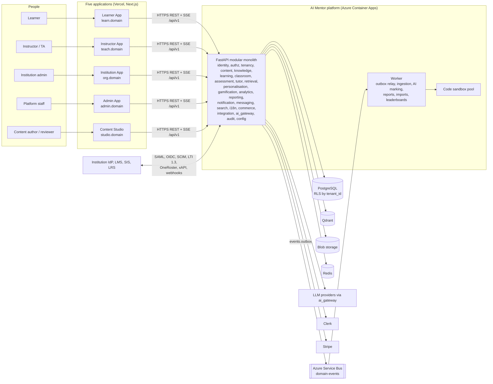

# AI Mentor — Software Requirements Specification v2 (enterprise ecosystem)

| Field | Value |
| --- | --- |
| Document ID | AIM-SRS-002 |
| Version | 2.0 |
| Date | 13 October 2026 |
| Standard | ISO/IEC/IEEE 29148:2018 (Requirements engineering — SRS content) |
| Status | Draft for stakeholder review. Target requirements; most are not built yet (section 2.5) |
| Owner | Product Management (CPO), with Enterprise Architecture (CTO) |
| Related | [README.md](README.md) (canonical vocabulary), [02-prd.md](02-prd.md), [04-use-cases.md](04-use-cases.md), [05-user-stories.md](05-user-stories.md), [06-system-architecture.md](06-system-architecture.md), [07-database-design.md](07-database-design.md), [08-api-specification.md](08-api-specification.md), [09-security-model.md](09-security-model.md), [10-rbac-matrix.md](10-rbac-matrix.md), [13-knowledge-management-architecture.md](13-knowledge-management-architecture.md), [14-content-studio-specification.md](14-content-studio-specification.md), [15-roadmap.md](15-roadmap.md), v1 `../SRS.md` (AIM-SRS-001), ADR 0013 to 0027 |

## Change record

| Area | What changed | Why | Impacted systems | Implementation implications |
| --- | --- | --- | --- | --- |
| Product structure | One learner app plus a staff portal becomes five applications (Learner App, Instructor App, Institution App, Admin App, Content Studio) on one platform | CPO/CTO direction: each user group gets its own application experience (ADR 0013) | `apps/*`, all API routers | Apps exist; shared packages (ADR 0014) and `/orgs` `/content` `/platform` roots still follow the roadmap |
| Tenancy | Every request runs in one organisation (tenant). B2C learners belong to the consumer organisation | Serve up to 2,000 organisations with isolation (ADR 0015) | All schemas, PostgreSQL RLS, Qdrant payloads, caches | `tenant_id` on every tenant-scoped row from R1; tenant-aware tests on every endpoint |
| Authorisation | Linear rank `student < instructor < admin` replaced by scoped role assignments and ABAC policy evaluation | Institutions need roles per campus, department, and cohort (ADR 0016) | `backend/app/domain/access.py`, every router dependency | New `authz` module; `users.role` removed after migration; permission checks replace `is_allowed(role, minimum)` |
| Requirements | New prefixes (PLT, TEN, IAM, AUTHZ, LRN, INS, ORG, ADM, CST, KM, KG, ASM, PER, NTF, MSG, SRCH, ANL, LIC, INT, EVT) and v1 prefixes continued from 101 | Cover instructor, institution, content, and platform capabilities absent from v1 | QA test plans, traceability | All v1 IDs remain valid; amended v1 requirements are listed in [Relationship to v1 documents](#relationship-to-v1-documents) |
| Releases | v1 labels `MVP`, `R2`, `R3` replaced by R1–R5 | One release vocabulary across all documents ([README.md](README.md#releases)) | Roadmap, backlog | v1 `MVP` reads as R1; v1 `R2` reads as R2; v1 `R3` is re-tagged per section 4 |
| Compliance | Adds FERPA, EU AI Act Annex III education obligations for AI-assisted marking, EN 301 549, SOC 2, ISO 27001, controller/processor split by account type | Institutional procurement and AI marking create new obligations (ADR 0021, ADR 0025) | Assessment, audit, identity, contracts | DPIA and AI Act conformity work before R3; accessibility conformance reports per app |

## Relationship to v1 documents

This document extends AIM-SRS-001 (`../SRS.md`). It does not repeat v1 requirements that are unchanged.

1. **All v1 requirement IDs stay valid.** A v1 requirement that this document does not amend remains normative, with its v1 release tag read through the mapping in rule 4.
2. **Superseded v1 sections:** section 2 (Product Overview) by section 2 here; section 4 (Scope) by section 4; section 5 (User Roles and Permissions) by section 5 and [10-rbac-matrix.md](10-rbac-matrix.md); section 21 (Future Considerations) by section 4 and [15-roadmap.md](15-roadmap.md). v1 subscription entitlements (v1 5.3) are retained and moved by reference into section 5.4.
3. **Amended v1 requirements.** Where an amendment and the v1 text disagree, the amendment wins.

| v1 requirement | Amendment | Amended by |
| --- | --- | --- |
| FR-ACC-005 | Profile gains `account_type` (`personal`, `managed`), `home_tenant_id`, and the five personalisation dimensions; teaching controls become dimension settings | TEN-010, PER-002 |
| FR-ACC-009 | "Only an Admin may change a user's role" becomes: role assignments are created by holders of the assigning permission at a containing scope; the last `platform_admin` and the last `org_owner` of an organisation cannot be removed | AUTHZ-006, AUTHZ-007 |
| FR-ACC-010 | `GET /api/v1/me` also returns memberships, active tenant, role assignments summary, and the app launcher list | PLT-004, LRN-002 |
| FR-ACC-011 | Platform suspension (Admin App) is distinct from membership suspension (Institution App) | ADM-003, TEN-012 |
| FR-TCH-001 | The six v1 controls map to the five dimensions (`depth`, `pace`, `approach`, `register`, `breadth`) plus mentor persona; v1 values are migrated | PER-002, PER-003 |
| FR-AVT-001 | Avatar settings become the mentor persona (seven attributes) | TUT-104 |
| FR-TUT-002 | `socratic` and `direct` become a teaching technique setting inside the `tutor` mode | TUT-101, TUT-103 |
| FR-QZ-010 | Disputes on practice items route to the Content Studio review queue; disputes on graded assessments route to the cohort's instructors (ASM-019) | ASM-019, CST-018 |
| FR-ADM-001 | The single admin portal is split: operations move to the Admin App (`admin.<domain>`), content to Content Studio (`studio.<domain>`) | ADM-001, CST-001 |
| FR-ADM-002, -003, -004, -005 | Move to the Admin App with platform roles in place of `admin` | ADM-002 to ADM-012 |
| FR-ADM-006 | Daily challenge management moves to Content Studio | CST-019 |
| KR-021 | Edge types become `prerequisite_of`, `builds_on`, `related_to`, `part_of`, `applies_to`, `contrasts_with` (v1 `prerequisite` → `prerequisite_of`, `related` → `related_to`, `advanced_of` → `builds_on`) | KG-002 |
| KR-023, KR-046 | Workflow state `review` is renamed `in_review`; `changes_requested` is added as the transition back to `draft`; actors become Content Studio roles | CST-008, CST-009 |
| KR-030, KR-034, RPT-015 | "Instructor" in these requirements means `content_author` or `content_reviewer` in a workspace, not the v2 `instructor` role | CST-002, CST-010 |
| LB-001 | Scopes extended with `organisation`, `campus`, `cohort` (and `friends`, `region` from v1 R2) | LB-101 |
| LB-009 | Exclusion of staff is by role assignment in the same scope, not by v1 role | LB-108 |
| SEC-003, SEC-005, SEC-022, SEC-023 | MFA scope, role source (`authz.role_assignments`), and permission checks follow ADR 0016 | IAM-012, AUTHZ-001 to AUTHZ-005 |
| SEC-070 (customer-managed keys) | Re-tagged from v1 R2 to R4 | SEC-108 |
| DATA-002 | The check constraint on `role` is removed; role IDs are validated against `authz.roles` | DATA-104 |
| CMP-010 | Minimum age 16 stays for all accounts; a possible later exception for managed school accounts is CMP-108A | CMP-108, CMP-108A |
| NFR-SCAL (table) | Design targets replaced by section 7.2 | NFR-111 to NFR-120 |
| NFR-USE-001, IF-UI-003 | Apply to all five apps; EN 301 549 added | NFR-131, IF-UI-106 |

4. **Release tag mapping for v1 requirements:** `MVP` → R1; `R2` → R2; `R3` → R3 for instructor cohorts, B2B, certification; R4 for native mobile, multi-region, customer-managed keys; R5 for community and marketplace. v1 requirements that say "before public launch" gate R2, because R1 is a closed beta.
5. Other v1 documents: see [README.md](README.md#relationship-to-v1-documents).

## Contents

1. [Introduction](#1-introduction)
2. [Product overview](#2-product-overview)
3. [Business goals and business requirements](#3-business-goals-and-business-requirements)
4. [Scope by release](#4-scope-by-release)
5. [Actors, roles, and scopes](#5-actors-roles-and-scopes)
6. [Functional requirements](#6-functional-requirements)
7. [Non-functional requirements](#7-non-functional-requirements)
8. [External interfaces](#8-external-interfaces)
9. [Constraints](#9-constraints)
10. [Security summary](#10-security-summary)
11. [Compliance](#11-compliance)
12. [Data requirements](#12-data-requirements)
13. [Acceptance criteria](#13-acceptance-criteria)
14. [Assumptions, dependencies, and risks](#14-assumptions-dependencies-and-risks)
15. [Traceability](#15-traceability)

---

## 1. Introduction

### 1.1 Purpose

This SRS states the software requirements for AI Mentor as an enterprise-scale learning ecosystem: five applications on one shared, multi-tenant platform. It is the contract between Product, Engineering, QA, Security, Learning, Content, Legal, and Commercial teams, and the requirements baseline that institutional buyers can evaluate. Every requirement is uniquely identified, prioritised, assigned to a release, and has a verification method.

### 1.2 Intended audience

| Audience | Use of this document |
| --- | --- |
| Backend, frontend, and mobile engineers | Implement modules, apps, and interfaces |
| AI/ML engineers | Implement mentor modes, AI-assisted marking, retrieval, evaluation, and guardrails |
| QA and test automation | Derive the v2 test plan, tenant-isolation suites, and acceptance tests |
| Security and privacy | Threat modelling, control design, DPIA, AI Act conformity |
| Learning design and content teams | Understand Content Studio workflow, releases, and localisation rules |
| Institution buyers, procurement, and IT | Evaluate SSO, provisioning, interoperability, accessibility, data protection, and service levels (sections 6.3, 6.16, 7, 11) |
| Institution data protection officers | Confirm controller and processor responsibilities (section 11) |
| Product, commercial, and executive stakeholders | Confirm scope, priorities, releases, and measures |

### 1.3 Conventions

**Requirement keywords.** "shall" is mandatory. "should" is a strong recommendation; deviations need written justification in the design record. "may" is optional.

**Requirement format** (unchanged from v1):

> **ID** `[Priority | Release | Verification]` Requirement text.

- **Priority** (MoSCoW): `M` Must, `S` Should, `C` Could. `W` (Won't, in R1–R5) items are listed in section 4.7.
- **Release**: `R1` to `R5` as defined in [README.md](README.md#releases). A requirement tagged with a release is due by the end of that release.
- **Verification**: `T` Test (automated or manual), `D` Demonstration, `I` Inspection (code, configuration, or document review), `A` Analysis (load test, threat model, statistical evaluation).

**ID prefixes.** New prefixes follow [README.md](README.md#identifier-conventions): `PLT`, `TEN`, `IAM`, `AUTHZ`, `LRN`, `INS`, `ORG`, `ADM`, `CST`, `KM`, `KG`, `ASM`, `PER`, `NTF`, `MSG`, `SRCH`, `ANL`, `LIC`, `INT`, `EVT` start at 001. Continued v1 prefixes start at 101: `TUT`, `GAM`, `LB`, `I18N`, `RPT`, `NFR`, `BR`, `AC`, `SEC`, `CMP`, `DATA`, `CON`, `IF-UI`, `IF-API`, `IF-EXT`, `RSK`, `DEP`. Assumptions use `ASU-101` onward because `ASM` is now the assessment prefix (v1 `ASM-01` to `ASM-10` keep their two-digit form and are unaffected).

**Scope phrasing.** "Within scope" means the target resource's org-unit path is at or below the scope of a role assignment the actor holds (section 5.2). "Holder of `x`" means a person with a role assignment granting permission `x` at a containing scope.

**Numbers.** A number in a requirement is the default. It is configurable at platform level (Admin App) unless the requirement says "fixed", and at organisation level only where the requirement says "organisation-configurable", within the bounds stated.

**Time.** Timestamps are stored in UTC (ISO 8601). "Learner day" is as in v1. "Cohort time" is the IANA timezone set on the cohort, used for plan items and due dates.

### 1.4 Definitions

The canonical glossary and vocabulary are in [README.md](README.md#glossary): organisation, campus, department, cohort, org unit, membership, licence, workspace, account types, learning record, academic record, role assignment, scope, permission, knowledge asset, lesson, module, course, learning path, concept, concept relation, content release, overlay, derived course, workflow states, enrolment, cohort plan, plan item, practice, assessment, assignment, submission, rubric, proposed grade, grade override, gradebook, risk signal, attendance, assessment integrity mode, mentor mode, mentor persona, the five dimensions, and locales. v1 Appendix A terms remain valid. Terms specific to this SRS:

| Term | Definition |
| --- | --- |
| Active tenant | The organisation a request acts within (README "tenant context") |
| Seat | One unit of a licence, assigned to one membership |
| Workforce role profile | A named set of concepts with target mastery levels that defines readiness for a job role in an organisation (for example "ML Engineer I"), used by ORG workforce reporting |
| Skills coverage | For a learner or group, the share of concepts in a workforce role profile at or above target mastery |
| Role readiness | Whether a learner meets every target in a workforce role profile, reported as `ready`, `near` (≥ 80% of concepts met), or `not_ready` |
| Season | A calendar quarter (UTC) used for seasonal challenges and season leaderboards |
| Competition | A time-boxed, scoped gamification event with its own rules, metric, and leaderboard |
| Import job | One bulk CSV import of learners into an organisation or cohort, with a dry-run and a commit phase |

### 1.5 References

| Ref | Document |
| --- | --- |
| [R1] | ISO/IEC/IEEE 29148:2018 Systems and software engineering — Requirements engineering |
| [R2] | OWASP ASVS 4.0.3 Level 2; OWASP Top 10 for LLM Applications (2025) |
| [R3] | 1EdTech Learning Tools Interoperability (LTI) 1.3 Core and LTI Advantage (Deep Linking 2.0, Assignment and Grade Services 2.0, Names and Role Provisioning Services 2.0) |
| [R4] | 1EdTech OneRoster 1.2 (Rostering, Gradebook, Resources services; REST binding and CSV) |
| [R5] | IETF RFC 7643 SCIM Core Schema and RFC 7644 SCIM Protocol (SCIM 2.0) |
| [R6] | OASIS SAML 2.0 (Core, Bindings, Profiles, Metadata) |
| [R7] | OpenID Connect Core 1.0 and Discovery 1.0; OAuth 2.0 (RFC 6749), PKCE (RFC 7636) |
| [R8] | ADL Experience API (xAPI) 2.0 (IEEE 9274.1.1-2023) and cmi5 |
| [R9] | 1EdTech Open Badges 3.0 and W3C Verifiable Credentials Data Model 2.0 |
| [R10] | 1EdTech Question and Test Interoperability (QTI) 3.0 |
| [R11] | W3C WCAG 2.2, Level AA |
| [R12] | ETSI EN 301 549 V3.2.1 Accessibility requirements for ICT products and services |
| [R13] | US Family Educational Rights and Privacy Act (FERPA), 20 U.S.C. § 1232g; 34 CFR Part 99 |
| [R14] | EU GDPR (2016/679), UK GDPR and DPA 2018, Nigeria NDPA 2023, California CCPA/CPRA (as v1 [R5]) |
| [R15] | EU AI Act (Regulation 2024/1689), including Article 6 and Annex III point 3 (education and vocational training), Articles 9–15, 26, and 50 |
| [R16] | AICPA SOC 2 (Trust Services Criteria 2017, revised points of focus 2022), Type II |
| [R17] | ISO/IEC 27001:2022 and ISO/IEC 27701:2019 |
| [R18] | CloudEvents 1.0 specification |
| [R19] | RFC 9457 Problem Details for HTTP APIs |
| [R20] | v1 SRS (`../SRS.md`), PRD (`../PRD.md`), ADR 0001–0012, and [README.md](README.md) |

---

## 2. Product overview

### 2.1 Product perspective

AI Mentor is a learning ecosystem for Artificial Intelligence, Machine Learning, Reinforcement Learning, Robotics, Data Science, Generative AI, and AI research. Four user groups (learners, teaching staff, institution administrators, platform staff) and one content group (authors and reviewers) each use their own application. All applications call one API (`/api/v1`) backed by a modular monolith with shared platform services (ADR 0017). Master content is owned centrally in Content Studio and consumed by organisations through releases and overlays (ADR 0019). The knowledge graph defines prerequisites, difficulty progression, and adaptivity (ADR 0020).

### 2.2 Ecosystem context

### 2.3 The five applications

Names, code names, origins, and audiences are canonical in [README.md](README.md#the-five-applications).

| App | Code name | Origin | First release | Main capability groups (section 6) |
| --- | --- | --- | --- | --- |
| Learner App | `learner` | `learn.<domain>` | R1 (closed beta), R2 (public) | LRN, TUT, PER, GAM, LB, ASM (learner side), SRCH |
| Instructor App | `instructor` | `teach.<domain>` | R3 | INS, ASM, MSG, ANL |
| Institution App | `institution` | `org.<domain>` | R3 | ORG, TEN, IAM (SSO), LIC, RPT |
| Admin App | `admin` | `admin.<domain>` | R1 (split from portal), R2 (v1) | ADM, AUTHZ (platform scope), AI configuration, audit |
| Content Studio | `studio` | `studio.<domain>` | R1 (split from portal), R2 (v1) | CST, KM, KG, I18N (content) |

### 2.4 Shared platform services

The 23 modules and their ownership are canonical in [README.md](README.md#shared-platform-services). Each owns its schema and publishes domain events; no module reads another module's tables (NFR-151). Detailed decomposition is in [06-system-architecture.md](06-system-architecture.md).

| Requested service | Module(s) | Requirement groups |
| --- | --- | --- |
| Authentication | `identity` | IAM |
| Authorization | `authz` | AUTHZ |
| AI Tutor Engine | `tutor`, `ai_gateway` | TUT, ADM (AI configuration) |
| Knowledge Engine | `knowledge`, `content` | KM, KG, CST |
| RAG | `retrieval` | KM, v1 RAG-001 to RAG-041 |
| Assessment | `assessment` | ASM, INS |
| Analytics | `analytics` | ANL |
| Gamification | `gamification` | GAM, LB |
| Notification | `notification` | NTF |
| Search | `search` | SRCH |
| Reporting | `reporting` | RPT |
| Tenancy, classroom, learning, personalisation, messaging, i18n, commerce, integration, audit, config | as named | TEN, INS, LRN, PER, MSG, I18N, LIC, INT, CMP, PLT |

### 2.5 Built today versus target

| Area | Built today (13 October 2026) | Target |
| --- | --- | --- |
| Frontends | Five Next.js apps in `apps/{learner,admin,instructor,institution,studio}` | Shared packages and one lockfile (ADR 0014) |
| Roles | `users.role` with linear rank `student < instructor < admin` in `backend/app/domain/access.py`; staff MFA via `fva` | Scoped role assignments with ABAC (section 6.4) |
| Tenancy | None; all data is global or per user | Organisation tenancy with RLS (section 6.2) |
| Content | Knowledge assets with versions and four-eyes workflow (`draft → review → approved → published → archived`), indexing on publish | Content Studio with releases, overlays, `in_review` state, localisation (sections 6.9, 6.10) |
| Learner features | v1 tutor, paths, quizzes, lab, flashcards, XP with idempotency and caps, learner-only leaderboard top 10, rate limits | Learner App with scoped leaderboards, seasons, modes, five dimensions |
| Instructor, institution, assessment, SSO, licences, integrations, events | Not built | Sections 6.6, 6.7, 6.11, 6.3, 6.16 |

### 2.6 Operating environment

- Frontends: five Next.js 16 App Router applications, TypeScript, Tailwind CSS, shadcn/ui-pattern primitives, TanStack Query (ADR 0012), each its own Vercel project and Clerk authorised party, sharing `packages/*` (ADR 0014).
- API: FastAPI on Python 3.12, Pydantic v2, one container image on Azure Container Apps (ADR 0006); one worker image from the same codebase.
- Data: Azure Database for PostgreSQL Flexible Server 16 with row-level security; Qdrant; Azure Blob Storage; Redis for rate limits, caches, and leaderboard sorted sets.
- Messaging: transactional outbox relayed to Azure Service Bus topic `domain-events` (ADR 0018).
- Identity: Clerk for sessions, including organisation SAML and OIDC connections; SCIM endpoints served by the API (R4).
- Clients: evergreen desktop and mobile browsers (v1 NFR-USE-004); native Learner apps on iOS 17+ and Android 12+ from R4.

### 2.7 Design principles

v1 section 2.5 principles 1–5 are retained. Added:

6. **One API, many apps.** No app holds business rules; every permission is enforced by the API (ADR 0013).
7. **Tenant first.** No code path runs without an active tenant or the `platform` context; there is no "no tenant" branch (ADR 0015).
8. **Humans own grades.** AI proposes; a named human accepts or overrides any non-objective grade (ADR 0025).
9. **Master content is immutable to consumers.** Organisations customise through overlays or derived courses, never by editing a master release (ADR 0019).
10. **Events, not reach-through.** Modules integrate through public interfaces and domain events (ADR 0017, ADR 0018).

---

## 3. Business goals and business requirements

### 3.1 Business goals

BG-1 to BG-10 from v1 section 3.1 are retained unchanged for the Learner App, measured in the consumer organisation from R1. Institutional goals:

| ID | Goal | Measure | Target | By |
| --- | --- | --- | --- | --- |
| BG-11 | Prove institutional fit | Pilot organisations running ≥ 1 cohort plan end to end | ≥ 5 pilots; ≥ 3 convert to paid licences | End of R3 |
| BG-12 | Reduce marking effort | Median instructor time per open-ended submission with AI assistance, versus manual baseline on the same rubric | ≥ 40% reduction | R3 + 3 months |
| BG-13 | Keep AI marking trustworthy | Share of accepted AI proposals whose final grade is within 10% of maximum score of the proposal; override rate reported | ≥ 85% | R3 |
| BG-14 | Prove seat value | Assigned seats with ≥ 1 active learner day in the month | ≥ 70% | R4 |
| BG-15 | Retain institutions | Annual gross revenue retention of organisation licences | ≥ 90% | R4 + 12 months |
| BG-16 | Scale content operations | Median business days from first `in_review` to `published` per course release | ≤ 10 | R2 |
| BG-17 | Help at-risk learners | Learners with a high risk signal who return to on-track within 21 days of a recorded intervention | ≥ 30% | R3 |
| BG-18 | Pass enterprise procurement | Organisations > 500 seats using SSO; security questionnaires answered from the trust pack without engineering | ≥ 80%; ≥ 90% of questions | R4 |
| BG-19 | Serve three languages | Published master courses with approved `fr` and `es` variants for all lessons and graded items | ≥ 60% at R3, ≥ 90% at R4 | R4 |

### 3.2 Business requirements

v1 BR-001 to BR-011 are retained. v1 BR-012 is superseded by BR-103, BR-107, and BR-111.

- **BR-101** `[M | R1 | I]` The platform shall serve five distinct applications on one shared platform, each with its own navigation, dashboards, permissions, and workflows.
- **BR-102** `[M | R1 | A]` The platform shall be multi-tenant, serving at least 2,000 organisations, with no organisation able to read or change another organisation's data except through explicit, audited platform features.
- **BR-103** `[M | R3 | D]` Instructors shall be able to run a cohort end to end: create or import learners, assign and schedule learning paths, issue and mark assessments, monitor progress and risk, and communicate, without platform staff involvement.
- **BR-104** `[M | R3 | D]` Institutions shall be able to manage structure, members, instructors, cohorts, licences, billing, branding, SSO, reporting, and compliance requests themselves.
- **BR-105** `[M | R2 | D]` Master content shall be authored, reviewed, versioned, and published centrally in Content Studio and consumed by organisations through immutable releases with non-destructive overlays.
- **BR-106** `[M | R2 | D]` The knowledge graph shall drive prerequisites, difficulty progression, recommendations, and adaptivity in every application that sequences learning.
- **BR-107** `[M | R3 | D]` The platform shall support formal assessment with rubrics, manual and AI-assisted marking, and human accountability for every non-objective grade.
- **BR-108** `[M | R3 | D]` Gamification shall be platform-wide, with leaderboards scoped globally, by country, institution, cohort, and friends, and controllable by organisation policy.
- **BR-109** `[M | R3 | D]` English, French, and Spanish shall be supported across five surfaces: UI, learning content, AI responses, assessments, and reports.
- **BR-110** `[M | R2 | D]` Learners shall be able to configure the AI mentor's persona and choose from six mentor modes, within limits set by their organisation.
- **BR-111** `[M | R4 | I]` The platform shall meet common institutional procurement requirements: SAML/OIDC SSO, SCIM provisioning, LTI 1.3, OneRoster 1.2, WCAG 2.2 AA and EN 301 549 conformance reports, a data processing agreement, SOC 2 Type II, and an ISO/IEC 27001 certification path.
- **BR-112** `[M | R4 | D]` Enterprise and government organisations shall receive workforce development reporting: skills coverage and role readiness against workforce role profiles.
- **BR-113** `[M | R3 | I]` Data controllership shall follow account type: AI Mentor is controller for personal accounts and processor for managed accounts (ADR 0021).
- **BR-114** `[S | R5 | I]` The architecture shall allow a content marketplace, native mobile clients, partner integrations, and AI agent orchestration without re-architecture (ADR 0027).
- **BR-115** `[M | R2 | D]` Platform staff shall govern users, organisations, content, AI services, feature flags, subscriptions, and security from the Admin App, with every action audited.
- **BR-116** `[M | R3 | A]` Institutions shall be able to measure learning outcomes, engagement, and ROI for their members from platform data without manual collection.

---

## 4. Scope by release

Release windows are fixed in [README.md](README.md#releases). Delivery sequencing is in [15-roadmap.md](15-roadmap.md).

### 4.1 R1 Foundation and Learner MVP (Q4 2026)

1. Learner App closed beta on the v1 MVP scope (v1 section 4.1 items 1–19), renamed from "studio".
2. `tenant_id` on every tenant-scoped table; consumer organisation `ai-mentor-public`; RLS enabled (TEN-001 to TEN-006).
3. `authz` module with role assignments; v1 roles migrated (AUTHZ-001 to AUTHZ-010).
4. Monorepo with shared packages; Admin App and Content Studio split from `admin/` on the existing feature set (PLT-001, ADM-001, CST-001).
5. Transactional outbox and event relay (EVT-001 to EVT-006).
6. Five personalisation dimensions replacing v1 teaching controls; mentor modes `tutor`, `coding_coach`, `career_coach`.

### 4.2 R2 Public launch and Content Studio (Q1 2027)

1. Public B2C launch of the Learner App.
2. Content Studio v1: lesson, quiz, course, module, and learning path builders; content releases with semantic versions; workflow with `in_review`; localisation jobs; resource library; taxonomy and graph editors with change sets.
3. Admin App v1: user administration, organisation records, AI service configuration, feature flags, audit, security monitoring, subscriptions.
4. v1 R2 learner items (friends and regional leaderboards, voice, notebooks, research tools, streak freeze); weekly and seasonal challenges; season leaderboards; mentor modes `mentor` and `research_supervisor`; persona voice and accent.

### 4.3 R3 Classrooms (Q2–Q3 2027)

1. Instructor App v1: learner management, CSV import, invites, cohorts, path assignment, scheduling, assessments, quiz builder, rubrics, manual and AI-assisted marking, overrides, gradebook, risk monitoring, attendance, communication hub, analytics.
2. Institution App v1: organisation structure, members, instructors, cohorts, licences and seats, invoiced billing, branding (logo, colours), SAML and OIDC SSO, reporting, compliance requests, retention policy.
3. Assessment platform; assessment integrity mode; `exam_coach` mode; dimension locks.
4. Institution and cohort leaderboards; competitions; localised assessments and reports.

### 4.4 R4 Enterprise (Q4 2027 – Q1 2028)

SCIM 2.0; LTI 1.3 Advantage; OneRoster 1.2; xAPI and cmi5 export; Open Badges 3.0 learning passport; QTI 3.0 import and export; data residency (EU and US regions); advanced analytics and workforce development reporting; white-label custom domains and email sender domains; outbound webhooks; native Learner apps; customer-managed encryption keys; organisation private workspaces and derived courses; contractual SLA.

### 4.5 R5 Ecosystem (2028)

Content marketplace; AI agent orchestration across mentor modes; Instructor mobile app; partner API with OAuth client credentials; de-identified cross-organisation benchmarks.

### 4.6 Capability by application and release

| Capability | R1 | R2 | R3 | R4 | R5 |
| --- | --- | --- | --- | --- | --- |
| Learner App | Closed beta | Public | Cohort plans, assignments | Mobile, passport | Marketplace content |
| Instructor App | — | — | v1 | LTI, OneRoster grade sync | Mobile |
| Institution App | — | — | v1 with SSO | SCIM, residency, white-label, workforce reports | Benchmarks |
| Admin App | Split | v1 | Organisation operations | Residency operations | Marketplace governance |
| Content Studio | Split | v1 | Assessment item authoring | Org workspaces, derived courses, QTI | Marketplace publishing |

### 4.7 Out of scope (Won't, R1–R5)

- Learners under 16 in any organisation (CMP-108). A managed-account exception for ages 13–15 is a gated R4 candidate (CMP-108A).
- Live video conferencing hosted by the platform (live sessions link to external tools).
- Remote proctoring with webcam or screen recording.
- Issuing accredited qualifications based on AI-proposed grades without human acceptance.
- Organisation-specific forks of platform code; per-tenant databases (ADR 0015 chooses shared schema with RLS).
- Training or fine-tuning models on learner or organisation data.
- Offline mode in web apps (offline flashcards in native apps are R4).

---

## 5. Actors, roles, and scopes

Role IDs, scope types, account types, permissions format, and the v1 role migration are canonical in [README.md](README.md#roles-and-scopes). The full permission matrix is in [10-rbac-matrix.md](10-rbac-matrix.md). This section summarises.

### 5.1 Actors

| Actor | Roles | App | Notes |
| --- | --- | --- | --- |
| Guest | none | Learner App public pages | Marketing site, public catalogue, pseudonymous global top 10 |
| Learner | `learner` | Learner App | Personal or managed account; may hold `learner` in several organisations |
| Teaching staff | `teaching_assistant`, `instructor`, `lead_instructor` | Instructor App | Cohort, department, or campus scope |
| Institution administrators | `department_admin`, `campus_admin`, `org_admin`, `org_owner`, `org_billing_manager`, `org_report_viewer`, `org_compliance_officer` | Institution App | Organisation, campus, or department scope |
| Content staff | `content_author`, `content_reviewer`, `content_publisher`, `knowledge_steward`, `localisation_editor` | Content Studio | `workspace` scope |
| Platform staff | `support_agent`, `finance_admin`, `ai_admin`, `platform_operator`, `security_auditor`, `platform_admin` | Admin App | `platform` scope |
| System | `system` | none | One service principal per function |
| External systems | none (OAuth clients, LTI platforms, SCIM clients, IdPs) | Standards endpoints | Credentials scoped to one organisation |

### 5.2 Scope rules

1. Scope types, outermost first: `platform` → `organisation` → `campus` → `department` → `cohort`; `workspace` is separate.
2. An assignment at a scope applies to that org unit and every unit below it.
3. A person may hold many assignments in many organisations; the app launcher lists apps opened by any assignment (PLT-004).
4. Platform roles never imply tenant roles. Platform staff reading tenant data use the audited break-glass procedure (ADM-016).
5. Staff in an organisation are excluded from that organisation's leaderboards (LB-108) but not from leaderboards where they are only learners.

### 5.3 Account types

| Account type | Created by | Controller | Moves between organisations |
| --- | --- | --- | --- |
| `personal` | Self sign-up | AI Mentor | Yes, with per-organisation consent (TEN-014) |
| `managed` | SSO JIT, SCIM, CSV import, instructor creation | The organisation | No |

### 5.4 Entitlements

Consumer subscription entitlements (Free, Pro, Research) are v1 section 5.3, unchanged, and apply in the consumer organisation. In other organisations, entitlements come from the organisation's licence (LIC-003); a personal-account learner studying in an organisation context receives the higher of their subscription and the licence's entitlements for that context.

---

## 6. Functional requirements

### 6.1 Platform (PLT)

- **PLT-001** `[M | R1 | I]` The frontend code shall live in one monorepo with five app packages (`apps/learner`, `apps/instructor`, `apps/institution`, `apps/admin`, `apps/studio`) and shared packages for the design system, API client, authentication, i18n, and analytics (ADR 0014). An app package shall not import from another app package.
- **PLT-002** `[M | R1 | I]` Each app shall be deployed as its own Vercel project on its own origin (README) and registered as its own Clerk authorised party (`azp`).
- **PLT-003** `[M | R1 | T]` One sign-in session shall work across all five apps on the same parent domain; switching apps shall not require re-entering credentials unless the target app requires MFA step-up (IAM-012).
- **PLT-004** `[M | R1 | T]` Every app shall show an app launcher listing only the apps the person's role assignments open, read from `GET /api/v1/me/apps`. A person with no assignment for an app who navigates to it shall see a localised "You don't have access to this app" page with a link to the apps they can open.
- **PLT-005** `[M | R1 | T]` Every app except the Admin App shall show an organisation switcher when the person has more than one active membership. Switching sets the active tenant for subsequent calls and reloads tenant-dependent views without signing out.
- **PLT-006** `[M | R1 | T]` The API shall reject a request whose `X-Org-Id` header or `{org_id}` path parameter names an organisation in which the person has no active membership, with `403` and problem type `not-a-member`. Mismatch between header and path parameter returns `400` `tenant-mismatch`.
- **PLT-007** `[M | R1 | T]` Endpoints under `/api/v1/platform/` shall accept tokens only with the Admin App `azp` and an MFA verification age ≤ 15 minutes for write operations; other audiences receive `403` `wrong-app-audience`.
- **PLT-008** `[M | R1 | I]` Each app's route guards shall decide only what to render. A test suite shall call every API operation used by each app with a token lacking the permission and assert `403` or `404`.
- **PLT-009** `[M | R2 | T]` Feature flags named `<app_or_context>.<feature>` shall be evaluable per platform, organisation, app, role, and percentage rollout, and shall take effect within 60 seconds of change.
- **PLT-010** `[M | R1 | T]` Every app shall provide a help entry point, a localised status banner for platform incidents, and a footer with the privacy notice, terms, accessibility statement, and sub-processor list links.
- **PLT-011** `[S | R3 | T]` Deep links shall carry the target organisation (`?org=<slug>`); opening one switches the active tenant if the person is a member, or shows "Request access" otherwise.
- **PLT-012** `[M | R1 | I]` All apps shall use the shared design system tokens and components (ADR 0012); app-specific components are allowed only for app-specific workflows and shall be built from shared primitives.

### 6.2 Tenancy (TEN)

- **TEN-001** `[M | R1 | T]` The system shall store organisations in `tenancy.organisations` with id, slug (3–48 chars, `[a-z0-9-]`, unique), display name per locale, `kind` (`consumer`, `university`, `college`, `school`, `enterprise`, `bootcamp`, `government`, `publisher`), status (`active`, `suspended`, `closed`), default locale, country, timezone, and data residency region.
- **TEN-002** `[M | R1 | T]` Exactly one consumer organisation (`kind = consumer`, slug `ai-mentor-public`) shall exist. It cannot be suspended, closed, or renamed by any role.
- **TEN-003** `[M | R1 | I]` Every tenant-scoped table shall carry a non-null `tenant_id` and a PostgreSQL row-level security policy filtering on `current_setting('app.tenant_id')`, in addition to the per-user policies of ADR 0011.
- **TEN-004** `[M | R1 | T]` The API shall set `app.tenant_id` at the start of each database transaction from the validated active tenant. A transaction without it shall see no tenant-scoped rows.
- **TEN-005** `[M | R1 | T]` Platform-context requests shall use a separate database role whose RLS policies permit cross-tenant reads only through audited views, each read recording actor, reason, and tenant (ADM-016).
- **TEN-006** `[M | R1 | T]` The migration shall assign every existing v1 row to the consumer organisation and create a `learner` membership there for every existing user, preserving all progress.
- **TEN-007** `[M | R3 | T]` Org units shall form a tree stored as `ltree`: organisation → optional campus → optional department (at most two department levels) → cohort; a department may sit directly under the organisation. The API shall reject a third department level with `422` `org-unit-depth-exceeded`.
- **TEN-008** `[M | R3 | T]` Holders of `tenancy.org_unit:edit` shall create, rename, move, and archive campuses and departments. Moving an org unit shall move its descendants and re-evaluate role-assignment scope within 60 seconds. Archiving requires the unit to have no active cohorts.
- **TEN-009** `[M | R1 | T]` Memberships shall have status `invited`, `active`, `suspended`, or `left`, and record join method (`self`, `invite`, `enrolment_code`, `sso_jit`, `scim`, `csv_import`, `lti`, `oneroster`, `instructor_created`).
- **TEN-010** `[M | R1 | T]` Accounts shall have `account_type` `personal` or `managed` and `home_tenant_id`. A managed account shall have exactly one membership, in its home tenant; the API shall reject any attempt to add a second membership with `403` `managed-account`.
- **TEN-011** `[M | R3 | T]` Invitations shall be sent by email to an address, carry a role and target org unit or cohort, expire after 14 days (organisation-configurable 1–30), be revocable until accepted, and be resendable at most 5 times. Accepting an invitation for an email that matches no account creates a managed account if the organisation's policy `members.managed_by_default` is on, otherwise a personal account.
- **TEN-012** `[M | R3 | T]` Holders of `tenancy.membership:end` shall suspend and reinstate memberships. A suspended membership loses access to the organisation's context immediately (next request), keeps its academic record, and releases no seat until ended.
- **TEN-013** `[M | R3 | T]` Enrolment codes shall be 8 characters from an unambiguous alphabet (no `0`, `O`, `1`, `I`, `L`), target one cohort or course, have an expiry (default 30 days) and an optional maximum use count, and be revocable.
- **TEN-014** `[M | R3 | T]` When a personal-account learner joins an organisation, the system shall show what the organisation will see (learning record for assigned curricula, academic record, identity fields) and record consent with version and timestamp. Joining without consent is not possible; withdrawing consent ends the membership (TEN-016).
- **TEN-015** `[M | R3 | T]` Organisation policies (`tenancy.org_policies`) shall be typed key-value settings with platform-defined defaults and bounds, including: default account type, allowed join methods, gamification and leaderboard settings, mentor mode allow-list, dimension locks, retention periods, MFA requirement, IP allowlist, data export of learning passport.
- **TEN-016** `[M | R3 | T]` When a membership ends (`left`), the organisation shall retain the academic record per its retention policy; for a personal account the learning record stays with the account and the organisation's visibility of it ends immediately.
- **TEN-017** `[M | R4 | T]` A platform admin shall be able to close an organisation. Closure shall make the tenant read-only for 30 days for export by `org_owner`, then delete tenant data per CMP-110, ending all memberships and converting nothing silently: managed accounts are deleted; personal accounts lose the membership.

### 6.3 Identity, SSO, and provisioning (IAM)

- **IAM-001** `[M | R1 | T]` v1 FR-ACC-001 to FR-ACC-004 remain in force for personal accounts (email/password, Google, verification, Clerk webhook sync, JWT verification).
- **IAM-002** `[M | R3 | T]` Holders of `tenancy.sso_connection:configure` shall configure SAML 2.0 (SP-initiated and IdP-initiated with signed assertions) and OIDC (authorisation code with PKCE) connections for their organisation, by metadata URL or upload.
- **IAM-003** `[M | R3 | T]` An SSO connection shall be bound to one or more email domains. Each domain shall be verified by a DNS TXT record before the connection can be enforced; verification is rechecked every 24 hours and a failing domain notifies `org_owner`.
- **IAM-004** `[M | R3 | T]` With SSO enforced for a domain, sign-in with any other method for an address in that domain shall be refused and redirected to the IdP, except for break-glass accounts (IAM-006).
- **IAM-005** `[M | R3 | T]` SSO just-in-time provisioning, when enabled, shall create a managed account and an `active` membership with role `learner` on first sign-in, mapping attributes `email`, `given_name`, `family_name`, `external_id`, and optional `locale`, `department`, and `groups` per the connection's attribute map.
- **IAM-006** `[M | R3 | T]` Each organisation with enforced SSO shall have at least one and at most three break-glass `org_owner` accounts able to sign in with password and MFA; each break-glass sign-in notifies all `org_owner` holders and is audited.
- **IAM-007** `[M | R3 | T]` Group-to-role mappings shall let an organisation map IdP group names to (role, scope) pairs; mappings are re-evaluated at each SSO sign-in and add or remove only assignments that the mapping created.
- **IAM-008** `[M | R4 | T]` The API shall expose a SCIM 2.0 service provider at `/scim/v2/` per RFC 7644 for Users and Groups, with `ServiceProviderConfig`, `ResourceTypes`, and `Schemas` endpoints, filtering (`eq`, `sw`, `and`), PATCH, and bulk operations up to 1,000 operations or 1 MB per request.
- **IAM-009** `[M | R4 | T]` SCIM clients shall authenticate with a per-organisation bearer token (256-bit random, shown once, rotatable, expires after 12 months by default). A token grants access only to its organisation.
- **IAM-010** `[M | R4 | T]` SCIM `active = false` shall suspend the membership within 60 seconds; SCIM DELETE shall end it. Group membership changes shall apply group-to-role mappings (IAM-007).
- **IAM-011** `[M | R3 | T]` Managed accounts created by CSV import or instructor creation shall receive a set-password or SSO sign-in email; until first sign-in, their status is `invited`.
- **IAM-012** `[M | R1 | T]` MFA (TOTP or passkey) shall be required for every platform role, every Content Studio role, `org_owner`, `org_admin`, `org_billing_manager`, and `org_compliance_officer`. For teaching roles MFA is required when organisation policy says so (default on for `lead_instructor`, off for `instructor` and `teaching_assistant`). When SSO is used, the IdP's MFA assertion (`amr` contains `mfa` or equivalent AuthnContext) satisfies this.
- **IAM-013** `[M | R1 | T]` Sensitive actions (role assignment at organisation or platform scope, SSO configuration, licence changes, data exports, break-glass access, grade release for > 500 learners) shall require MFA verification age ≤ 15 minutes (step-up).
- **IAM-014** `[M | R2 | T]` Session lifetimes shall be 7 days of inactivity for learners, 12 hours for platform roles and Content Studio roles, and organisation-configurable (1 hour to 7 days, default 12 hours) for organisation staff roles.
- **IAM-015** `[M | R3 | T]` An `org_admin` shall be able to sign out all sessions of a member of their organisation; the API shall reject that member's existing tokens within 60 seconds.
- **IAM-016** `[S | R4 | T]` Organisations shall be able to restrict sign-in for their staff roles to an IP allowlist of up to 50 CIDR ranges.
- **IAM-017** `[M | R3 | T]` A personal account may link an institutional SSO identity for an organisation that allows personal accounts; the link is shown on the profile and can be removed by the learner.
- **IAM-018** `[M | R1 | T]` The profile shall be editable through `PATCH /api/v1/me`; for managed accounts, fields mastered by the IdP or SCIM (name, email, external id) shall be read-only and marked as such.

### 6.4 Authorisation (AUTHZ)

- **AUTHZ-001** `[M | R1 | T]` Roles, permissions, and role assignments shall be stored in `authz.roles`, `authz.permissions`, `authz.role_permissions`, and `authz.role_assignments`. Token claims shall never grant a role (carries forward SEC-005).
- **AUTHZ-002** `[M | R1 | T]` Permissions shall use the format `<context>.<resource>:<action>` in lower snake case. The set of permissions and the role-to-permission mapping shall be versioned seed data reviewed with [10-rbac-matrix.md](10-rbac-matrix.md).
- **AUTHZ-003** `[M | R1 | T]` The policy decision shall allow a request only when a role assignment grants the permission, its scope contains the target resource, and every applicable attribute condition passes. Default is deny; explicit deny policies win over allows.
- **AUTHZ-004** `[M | R1 | T]` Every router operation shall declare its required permission and resource resolver; a CI check shall fail if any operation under `/api/v1` (other than documented public operations) lacks a declaration.
- **AUTHZ-005** `[M | R1 | T]` A denied request for a resource the caller cannot see shall return `404`; a denied request for a resource the caller can see but not change shall return `403` with problem type `forbidden` naming the missing permission.
- **AUTHZ-006** `[M | R1 | T]` A person may create a role assignment only if they hold `authz.role_assignment:grant` at a scope containing the target scope and the role being granted is in the grantable set of their own role (defined in [10-rbac-matrix.md](10-rbac-matrix.md)). Nobody can grant a role with permissions they do not hold.
- **AUTHZ-007** `[M | R1 | T]` The system shall refuse to remove or demote the last `platform_admin` and the last `org_owner` of an organisation, with `409` `last-owner`.
- **AUTHZ-008** `[M | R1 | T]` The migration shall map v1 roles to v2 assignments exactly as in [README.md](README.md#roles-and-scopes) and shall be reversible until `users.role` is dropped.
- **AUTHZ-009** `[M | R1 | T]` The decision engine shall evaluate subject attributes (account type, active tenant, MFA freshness, `azp`, licence seat, subscription tier), resource attributes (`tenant_id`, org-unit path, owner, workspace, content state, classification, assessment window), relationship attributes (owner, instructor of, TA of, member of, author of), and context attributes (time, integrity mode, IP allowlist, consent, policy flags).
- **AUTHZ-010** `[M | R1 | T]` A policy decision for a single resource shall complete in ≤ 5 ms at p95 in-process, using a per-request cache of the subject's assignments.
- **AUTHZ-011** `[M | R2 | T]` Sampled allow decisions (default 1%) and all deny decisions on write operations shall be written to `authz.decision_log` with subject, permission, resource, decision, matched policy, and trace id; retained 90 days.
- **AUTHZ-012** `[M | R3 | T]` Teaching assistants shall act only on cohorts in which they are assigned as `cohort_staff`. Delegations from an instructor to a TA (release grades, edit plan dates) shall be explicit, per cohort, and revocable.
- **AUTHZ-013** `[M | R3 | T]` The two-person rule shall apply where configured: content approval (author ≠ reviewer), grade overrides above the organisation threshold (overrider ≠ approver), and platform role grants (granter ≠ grantee).
- **AUTHZ-014** `[M | R3 | T]` Role assignments may carry an expiry date; expired assignments stop granting access at expiry and are listed as expired.
- **AUTHZ-015** `[S | R3 | D]` Holders of `authz.role_assignment:read` shall see an access review report listing every assignment in their scope with last-used time, and shall be able to bulk-revoke assignments unused for 90 days.

### 6.5 Learner App (LRN)

v1 functional requirements FR-ACC, FR-ONB, FR-PATH, FR-MST, FR-PLAN, FR-QZ, FR-LAB, FR-FC, FR-RES, FR-CAR, FR-DASH, FR-NOT, and FR-BIL remain normative for the Learner App, with the amendments in [Relationship to v1 documents](#relationship-to-v1-documents).

- **LRN-001** `[M | R1 | T]` The Learner App shall run every learner feature in the active tenant: catalogue, enrolments, tutor, practice, gamification, and analytics calls carry `X-Org-Id`.
- **LRN-002** `[M | R1 | T]` `GET /api/v1/me` shall return v1 FR-ACC-010 fields plus account type, home tenant, memberships (organisation id, name, kind, status), active tenant, and app launcher entries.
- **LRN-003** `[M | R1 | T]` The catalogue in an organisation context shall show master releases licensed to the organisation, the organisation's private courses (R4), and the learner's cohort plans; in the consumer organisation it shows the public catalogue.
- **LRN-004** `[M | R3 | T]` The learner home shall show, per active tenant, "My cohorts" with each cohort plan's next three plan items, due dates in the learner's timezone, and overdue items flagged.
- **LRN-005** `[M | R3 | T]` A learner shall see assignments issued to them with status (`not_started`, `in_progress`, `submitted`, `marked`, `released`, `returned_for_resubmission`), attempts remaining, and the due and close dates.
- **LRN-006** `[M | R3 | T]` A learner shall see grades and feedback only after release (ASM-016); proposed AI grades are never shown before human acceptance (ASM-011).
- **LRN-007** `[M | R1 | T]` Lessons shall render in the hierarchy Knowledge Asset → Lesson → Module → Course → Learning Path, with breadcrumbs, estimated time, objectives, and the concepts taught.
- **LRN-008** `[M | R3 | T]` When a lesson is part of a cohort plan with an overlay, the learner shall see the overlay (hidden items removed, supplementary items added, instructor notes shown) without the master release changing.
- **LRN-009** `[M | R1 | T]` Coding challenges shall reuse the coding lab (v1 FR-LAB) with challenge-specific tests and time guidance; daily challenges follow v1 GAM-040 to GAM-047, and weekly and seasonal challenges follow GAM-105 and GAM-106.
- **LRN-010** `[M | R2 | T]` Projects shall support multi-step briefs with milestones, a submission (repository link, files up to 50 MB total, or lab notebook), and rubric-based feedback when issued as an assignment.
- **LRN-011** `[M | R1 | T]` Progress tracking shall show per-course and per-path completion, mastery per concept with band, time spent, and streak; numbers shall match the Instructor App's view of the same learner and period (ANL-006).
- **LRN-012** `[M | R2 | T]` AI research learning shall include v1 FR-RES and the `research_supervisor` mode (TUT-101) for literature review, methodology critique, and reviewer simulation.
- **LRN-013** `[M | R2 | T]` Knowledge search shall return lessons, concepts, assets, and the learner's own notes and conversations, scoped to the active tenant's licensed content (SRCH-002).
- **LRN-014** `[M | R2 | T]` Career planning shall let the learner pick up to 3 target roles, see concept gaps against each role's profile, and generate a dated plan respecting prerequisites (extends v1 FR-CAR-001).
- **LRN-015** `[M | R2 | T]` Learning analytics for the learner shall include v1 FR-DASH-002 plus cohort-relative position (quartile only, never other learners' names) when the cohort policy allows it.
- **LRN-016** `[M | R3 | T]` A learner with personal and organisation memberships shall see one combined learning record (XP, streak, mastery) and per-organisation academic records separated by organisation name.
- **LRN-017** `[M | R3 | T]` A learner shall see, in privacy settings, each organisation with access to their data, what it can see (TEN-014), and a control to leave the organisation.
- **LRN-018** `[M | R4 | T]` A learner shall be able to export a learning passport (Open Badges 3.0 credentials for earned badges and completed courses plus a JSON transcript of mastery) when their account type and organisation policy allow it (INT-012).
- **LRN-019** `[M | R4 | D]` Native Learner apps (iOS, Android) shall provide tutor chat, lessons, flashcards with offline review of up to 500 due cards, daily challenges, notifications, and leaderboards, using the same API.
- **LRN-020** `[M | R3 | T]` During an assessment in integrity mode, the Learner App shall show a persistent banner stating which features are restricted and until when (TUT-109).

### 6.6 Instructor App (INS)

#### 6.6.1 Learner management and cohorts

- **INS-001** `[M | R3 | T]` Holders of `classroom.cohort:create` (`lead_instructor`, `department_admin` and above) shall create cohorts with name (3–120 chars), code (unique in organisation, 2–32 chars), org unit, timezone, start and end dates, locale, capacity (1–5,000, default 500), and staff.
- **INS-002** `[M | R3 | T]` A `lead_instructor` shall add and remove instructors and teaching assistants on cohorts in their scope; each cohort shall have at least one `instructor` or `lead_instructor` while active.
- **INS-003** `[M | R3 | T]` An instructor shall create an individual learner in a cohort by entering email, given name, family name, and optional external id and locale. If the organisation's default account type is `managed`, a managed account is created; otherwise an invitation is sent (TEN-011).
- **INS-004** `[M | R3 | T]` An instructor shall view the cohort roster with name, email (if their role permits identity fields), status, last active, plan progress, mean mastery on plan concepts, overdue items, and risk level; sortable and filterable, exportable to CSV.
- **INS-005** `[M | R3 | T]` An instructor shall move a learner between cohorts within their scope. Academic records stay with the original cohort's assignments; the learner receives the destination cohort's plan from the move date.
- **INS-006** `[M | R3 | T]` An instructor shall remove a learner from a cohort; removal ends cohort membership, not organisation membership, and keeps the academic record.
- **INS-007** `[M | R3 | T]` Instructors shall record accommodations per learner (extra time 0–200% in 25% steps, separate deadline offset in days, alternative format flag, notes visible to cohort staff only) that apply automatically to timed assessments and due dates.

#### 6.6.2 Bulk import and invitations

- **INS-008** `[M | R3 | T]` Holders of `classroom.cohort_member:import` shall bulk import learners from a UTF-8 CSV (BOM accepted; comma or semicolon delimiter auto-detected) of at most 5,000 data rows and 10 MB. Required column: `email`. Optional columns: `given_name`, `family_name`, `external_id`, `locale`, `cohort_code`, `campus_code`, `department_code`. Unknown columns are reported and ignored.
- **INS-009** `[M | R3 | T]` Every import shall run a dry run first and show a validation report before commit: totals of new accounts, existing members, invitations to personal accounts, and rejected rows, with row-level errors.
- **INS-010** `[M | R3 | T]` Row validation shall reject: invalid email syntax (RFC 5321 length and syntax), duplicate email or external id within the file, `locale` not in `en`, `fr`, `es`, unknown `cohort_code` or org-unit codes, names over 100 chars, and rows that would exceed cohort capacity or available seats (LIC-006). Each error names the row number, column, and reason.
- **INS-011** `[M | R3 | T]` For an email that already belongs to a personal account, the import shall send an invitation requiring the learner's consent (TEN-014) and shall never attach the personal account silently.
- **INS-012** `[M | R3 | T]` Commit shall offer two modes: "import valid rows" (default) and "all or nothing". The import job shall be idempotent: re-uploading the same file (same content hash) within 24 hours shows the earlier result; rows matching an existing member by `external_id` or email update optional fields instead of duplicating.
- **INS-013** `[M | R3 | A]` A 5,000-row import shall complete dry run in ≤ 60 s and commit in ≤ 10 minutes at p95, with progress shown and the instructor notified on completion.
- **INS-014** `[M | R3 | T]` Downloadable error reports shall neutralise spreadsheet formula injection by prefixing any cell starting with `=`, `+`, `-`, `@`, tab, or carriage return with a single quote.
- **INS-015** `[M | R3 | T]` An instructor shall send, resend (maximum 5 times), and revoke invitations to a cohort, see invitation status (`sent`, `opened`, `accepted`, `expired`, `revoked`), and create enrolment codes for the cohort (TEN-013).

#### 6.6.3 Curriculum assignment and scheduling

- **INS-016** `[M | R3 | T]` Holders of `classroom.cohort_plan:schedule` shall assign a course or learning path release to a cohort. The cohort plan pins the release version; the learners are enrolled automatically (`learning.enrolment.created`).
- **INS-017** `[M | R3 | T]` An instructor shall customise the plan through an overlay: reorder modules and lessons, hide items, add supplementary items (lessons, assets, assessments, external links), and add instructions per item (≤ 2,000 chars per locale). The master release shall never change.
- **INS-018** `[M | R3 | T]` The plan editor shall warn, with the concept names, when a reorder or hide places a concept before an unmet prerequisite in the knowledge graph; the instructor may proceed with a reason, which is recorded.
- **INS-019** `[M | R3 | T]` Each plan item shall have release date, due date, and close date in cohort time, with release ≤ due ≤ close. Dates may be absolute or relative to the cohort start ("week 3, Monday 09:00"); relative dates recompute if the cohort start changes.
- **INS-020** `[M | R3 | T]` An instructor shall grant per-learner extensions on due and close dates; extensions are visible to the learner and recorded with the granting instructor.
- **INS-021** `[M | R3 | T]` When a newer release of the pinned course is published, the instructor shall see a change summary (added, removed, and changed items) and choose to upgrade now, upgrade at a date, or stay. Upgrading preserves learner progress on unchanged items and overlay entries that still apply; conflicting overlay entries are listed for resolution.
- **INS-022** `[M | R3 | T]` The schedule shall be viewable as a calendar (week and month) and a list; scheduling conflicts (two due dates for the same learner within 2 hours, or items released after the cohort end date) are highlighted.
- **INS-023** `[M | R3 | T]` Publishing a plan or a schedule change shall notify affected learners once per change batch, not per item (NTF-006).

#### 6.6.4 Assessment creation, rubrics, and marking

- **INS-024** `[M | R3 | T]` Instructors shall create assessments of kinds `quiz`, `exam`, `assignment`, `project`, `coding_assessment`, and `written_response`, from scratch, from the master item bank, from the organisation item bank, or from a Content Studio assessment release (ASM-001 to ASM-006).
- **INS-025** `[M | R3 | T]` The quiz builder shall support item types from v1 FR-QZ-001 plus `essay`, `file_upload`, and `matching`; per-item points; random selection of N items from a pool filtered by concept and difficulty; shuffling of items and options; and a preview as a learner in each available locale.
- **INS-026** `[M | R3 | T]` Rubrics shall have 1–12 criteria, each with 2–6 performance levels, points per level, descriptors per locale (≤ 1,000 chars), and optional linked concepts. Rubrics may be saved to a rubric library in the organisation and reused.
- **INS-027** `[M | R3 | T]` A rubric attached to an assignment shall be locked once the first submission is marked; changes after that create a new rubric version and require remarking or explicit carry-over of existing marks.
- **INS-028** `[M | R3 | T]` The marking queue shall list submissions by assignment with status (`awaiting_marking`, `ai_proposed`, `marked`, `released`), late flag, and accommodation flag, and support anonymous marking (names hidden until release) when enabled on the assignment.
- **INS-029** `[M | R3 | T]` Manual marking shall let the marker select a level per criterion, add per-criterion and overall feedback (≤ 5,000 chars), annotate text and code submissions inline, and save drafts. Marks are not visible to learners until release.
- **INS-030** `[M | R3 | T]` AI-assisted marking, when enabled for the assignment (flag `instructor.ai_marking` and organisation policy), shall generate a proposed grade per criterion with rationale and quoted evidence from the submission (ASM-010 to ASM-014).
- **INS-031** `[M | R3 | T]` For each AI proposal the marker shall accept, adjust, or reject per criterion. Acceptance records the marker as the grader of record. Bulk acceptance is disabled by default; when the organisation enables it, it applies only to proposals with confidence ≥ 0.8 that the marker has opened, at most 50 at a time.
- **INS-032** `[M | R3 | T]` Holders of `assessment.grade:override` shall override any automatic or AI-proposed grade with a new score and a reason (10–1,000 chars) chosen from categories `rubric_misapplied`, `evidence_missed`, `accommodation`, `academic_judgement`, `technical_error`, `other`. The override, previous value, and reason are audited (`assessment.grade.overridden`).
- **INS-033** `[M | R3 | T]` When organisation policy requires approval (default: overrides changing the grade by more than 20% of maximum, or any override after release), the override takes effect only after approval by a `lead_instructor` other than the overrider.
- **INS-034** `[M | R3 | T]` Holders of `assessment.grade:release` shall release grades per assignment, per learner, or on a scheduled date; release sends one notification per learner and is irreversible except by override (which notifies the learner).
- **INS-035** `[M | R3 | T]` Moderation sampling: for assignments with ≥ 20 submissions the lead instructor may require a second marker on a random sample (default 10%, minimum 5); disagreements over 10% of maximum are flagged for resolution before release.
- **INS-036** `[M | R3 | T]` The gradebook shall show learners × assignments with score, status, late flags, and weighted totals by category weights set by the instructor; export to CSV and (R4) OneRoster and LTI AGS (INT-005, INT-007).

#### 6.6.5 Monitoring, attendance, communication, analytics

- **INS-037** `[M | R3 | T]` Risk monitoring shall compute risk signals per learner daily and on relevant events: `inactivity` (no active day in 7 days during an active plan), `missed_due` (≥ 2 missed due dates in 14 days), `mastery_decline` (mean plan-concept mastery down ≥ 15 points over 14 days), `low_engagement` (active time in the bottom 10% of the cohort for 2 consecutive weeks, cohorts ≥ 10 learners only), and `failing_grades` (mean released grade < 50% over ≥ 3 assignments).
- **INS-038** `[M | R3 | T]` Each risk signal shall be explainable: it shows the rule, the evidence (dates, items, values), and when it was computed. Risk level is `high` with ≥ 2 signals or `failing_grades`, `medium` with 1 signal, else `low`. Signals shall not use protected characteristics, demographic data, or tutor conversation content.
- **INS-039** `[M | R3 | T]` Instructors shall record interventions against a risk signal (message sent, meeting, extension, referral, other) with notes, and dismiss a signal with a reason; dismissed signals do not reappear for the same evidence.
- **INS-040** `[M | R3 | T]` Instructors shall create live sessions (title, start, duration, external meeting link, required flag) and record attendance as `present`, `late`, `absent`, or `excused`, manually or by learner check-in with a 6-digit code valid for 15 minutes (organisation-configurable 5–60) from the session start.
- **INS-041** `[M | R3 | T]` For required activity windows, attendance may be derived from activity (learner active on the plan item within the window). Derived and manual records are distinguishable; manual edits are audited.
- **INS-042** `[M | R3 | T]` Engagement analysis shall show per learner and cohort: active days, active time, plan items completed on time, attendance rate, tutor usage counts (never content), and trends over 4 and 12 weeks.
- **INS-043** `[M | R3 | T]` The communication hub shall let instructors post cohort announcements (immediate or scheduled, optional email copy), message individual learners or groups selected from the roster, and run cohort discussion threads (MSG-001 to MSG-008).
- **INS-044** `[M | R3 | T]` Performance analytics shall show per cohort: plan completion, mastery heat map by concept, assignment score distributions (mean, median, quartiles), item analysis for objective items (facility index and discrimination index, shown for ≥ 20 responses), and comparison across cohorts in the instructor's scope.
- **INS-045** `[M | R3 | T]` Every Instructor App table and chart shall be exportable to CSV (and charts to PNG), with exports logged; exports containing identity fields require `reporting.export:create`.

### 6.7 Institution App (ORG)

#### 6.7.1 Organisation, structure, and people

- **ORG-001** `[M | R3 | T]` `org_owner` and `org_admin` shall edit the organisation profile: display names per locale, kind (read-only after creation except by platform admin), country, default locale, timezone, contact emails (billing, privacy, technical).
- **ORG-002** `[M | R3 | T]` Org admins shall manage campuses and departments (TEN-007, TEN-008) through a tree view showing member, instructor, and cohort counts per unit.
- **ORG-003** `[M | R3 | T]` Org admins shall search, filter, and view all members (status, account type, role assignments, seat, last active), invite, suspend, reinstate, and end memberships, and import members by CSV with the same rules as INS-008 to INS-014.
- **ORG-004** `[M | R3 | T]` Org admins, campus admins, and department admins shall assign teaching roles (`teaching_assistant`, `instructor`, `lead_instructor`) and report-viewer roles within their scope, and see each instructor's cohorts, learner counts, and marking backlog.
- **ORG-005** `[M | R3 | T]` Administrators shall view and manage all cohorts in their scope: create, archive (read-only, kept for retention), reassign staff, and view cohort plan status.
- **ORG-006** `[M | R3 | T]` Only `org_owner` shall assign or remove `org_owner` and `org_admin` (AUTHZ-007 applies).

#### 6.7.2 Licences, seats, and billing

- **ORG-007** `[M | R3 | T]` The licence page shall show each licence: plan, seat count, seats assigned, seats active in the last 30 days, term start and end, entitlements, and renewal status.
- **ORG-008** `[M | R3 | T]` Seat assignment shall be automatic on membership activation (default) or manual by holders of `commerce.seat:assign`; learner roles consume seats, staff-only members do not.
- **ORG-009** `[M | R3 | T]` Seat reclamation: an org admin may release a seat from a member; with the policy `seats.reclaim_inactive_days` (default off, 30–365) the system releases seats of members inactive for that period and notifies them 7 days before.
- **ORG-010** `[M | R3 | T]` When no seat is available, new learner activations shall follow the licence's overage policy: `block` (activation queued and admins notified), or `allow_overage` up to 10% of seat count, billed at true-up (LIC-007).
- **ORG-011** `[M | R3 | T]` `org_billing_manager` and `org_owner` shall view invoices and credit notes, download PDFs, update billing contacts, tax ID (validated format per country), purchase order number per invoice, and payment method (card through Stripe-hosted pages, or bank transfer for invoiced plans with net 30 terms).
- **ORG-012** `[S | R3 | T]` Billing managers shall request seat increases from the Institution App; increases on self-serve plans apply immediately with prorated charge; on contract plans they create a request for `finance_admin`.

#### 6.7.3 Branding and white-label

- **ORG-013** `[M | R3 | T]` Org admins shall set branding: logo (SVG or PNG ≤ 1 MB, min 256 px), mark for small sizes, primary and accent colours, and organisation display name in the header of the Learner, Instructor, and Institution apps and in emails.
- **ORG-014** `[M | R3 | T]` Brand colours shall be validated against WCAG 2.2 AA contrast (4.5:1 for text, 3:1 for UI components) against both themes; failing colours are rejected with the measured ratio and a suggested accessible shade.
- **ORG-015** `[M | R4 | T]` White-label (licence feature): a custom domain (`learn.example.edu` style CNAME, TLS certificate issued and renewed automatically), custom email sender domain with SPF, DKIM, and DMARC checks, and removal of AI Mentor branding except the legally required "Powered by AI Mentor" in the footer and AI disclosure labels (CMP-114).

#### 6.7.4 Reporting, analytics, and workforce development

- **ORG-016** `[M | R3 | T]` Institution dashboards shall show for the selected scope and period: active learners, seat utilisation, enrolments, completions, mean mastery gain, assessment pass rates, at-risk counts, and engagement trend, filterable by campus, department, cohort, and course.
- **ORG-017** `[M | R3 | T]` `org_report_viewer` holders shall view and export reports in their scope but change nothing.
- **ORG-018** `[M | R4 | T]` Holders of `reporting.report:create` shall define workforce role profiles: name, description, and 3–200 concepts each with a target mastery (60–100, default 75), optionally imported from a template in the master catalogue.
- **ORG-019** `[M | R4 | T]` Workforce development reports shall show, per role profile and org unit: skills coverage (share of profile concepts at target, mean over learners), role readiness distribution (`ready`, `near`, `not_ready`), top 10 skill gaps by share of learners below target, and trend by month.
- **ORG-020** `[M | R4 | T]` Workforce reports shall map concepts to the organisation's skills taxonomy when provided (CSV of skill id, name, and concept slugs) and export with those skill ids.
- **ORG-021** `[M | R4 | T]` Workforce reports for groups shall suppress cells with fewer than 5 learners unless the viewer holds a role allowed to see individual learners in that scope.
- **ORG-022** `[S | R4 | D]` ROI summary: learning hours, completions, readiness changes, and seat utilisation per licence term, exportable as a localised PDF.

#### 6.7.5 Compliance

- **ORG-023** `[M | R3 | T]` `org_compliance_officer` shall receive, track, and fulfil data subject requests (access, rectification, erasure, restriction, portability, objection) for managed accounts, with due date (30 days default, organisation-configurable to legal requirement), status, and an export or erasure action that executes CMP-105.
- **ORG-024** `[M | R3 | T]` For personal-account members, a data subject request submitted to the organisation shall be fulfilled for the academic record by the organisation and forwarded to AI Mentor for the learning record, with the learner informed.
- **ORG-025** `[M | R3 | T]` Compliance officers shall set retention per data class (academic records, submissions, tutor conversations of managed accounts, attendance, messages, audit logs) within platform bounds (CMP-110), see the schedule, and see when the next purge runs.
- **ORG-026** `[M | R3 | T]` Compliance officers shall place a legal hold on a member, cohort, or the organisation; held data is excluded from purges and erasure until the hold is released, and the hold is audited.
- **ORG-027** `[M | R3 | T]` Compliance officers shall view consent records (TEN-014 join consents, policy acceptances, marketing consents) and export them.
- **ORG-028** `[M | R3 | T]` Compliance officers and org admins shall read the organisation's audit log (filter by actor, action, entity, date; export CSV) through `audit.log:read` at organisation scope.
- **ORG-029** `[M | R3 | D]` The Institution App shall provide a compliance pack: DPA, sub-processor list, AI Act transparency information for AI-assisted marking, accessibility conformance reports, and SOC 2 report (under NDA, from R4).

#### 6.7.6 SSO and learning analytics

- **ORG-030** `[M | R3 | T]` The SSO page shall guide configuration (IAM-002 to IAM-007): metadata exchange, attribute mapping preview, test sign-in with a named test user, domain verification, enforcement toggle, and break-glass accounts.
- **ORG-031** `[M | R4 | T]` The provisioning page shall show SCIM token management, last sync time, and the last 100 provisioning events with outcome.
- **ORG-032** `[M | R3 | T]` Learning analytics in the Institution App shall include cohort comparisons, course effectiveness (mastery gain per course, n ≥ 20), assessment outcomes, and engagement, reusing ANL metric definitions.

### 6.8 Admin App (ADM)

- **ADM-001** `[M | R1 | T]` The Admin App shall be served on `admin.<domain>`, use only `/api/v1/platform/*` operations for platform governance, and be accessible only to people holding a platform-scope role. It shall contain no content-authoring views (those are in Content Studio).
- **ADM-002** `[M | R1 | T]` User administration: search people across all organisations by email, handle, id, or external id; view profile, account type, memberships, role assignments, subscription, and last active; changes are audited (replaces v1 FR-ADM-002).
- **ADM-003** `[M | R1 | T]` `platform_admin` shall suspend and reinstate an account platform-wide; a suspended account receives `403` on all authenticated routes in all apps and is removed from leaderboards within 60 seconds.
- **ADM-004** `[M | R1 | T]` `platform_admin` shall create, edit, and revoke platform-scope role assignments, subject to AUTHZ-006, AUTHZ-007, AUTHZ-013, and MFA step-up.
- **ADM-005** `[M | R2 | T]` Organisation administration: create organisations (kind, name, country, residency region, initial `org_owner` invitation), view status, licences, member counts, and usage; suspend and reinstate organisations with a reason.
- **ADM-006** `[M | R1 | T]` Platform settings: platform staff with `platform.setting:edit` shall edit v1 Appendix B values and v2 defaults with validation ranges; changes are audited and take effect within 60 seconds without redeploy (replaces v1 FR-ADM-003).
- **ADM-007** `[M | R2 | T]` Feature flags: `platform_operator` shall create flags, define rules (platform, organisation, app, role, percentage), schedule changes, and see the evaluation result for a given person and organisation.
- **ADM-008** `[M | R2 | T]` AI service configuration: `ai_admin` shall manage the model registry (provider, model, region, modalities, context window, price per token, data-retention terms), model routes per model class and per mentor mode, and per-organisation overrides allowed by licence.
- **ADM-009** `[M | R2 | T]` Prompt releases: prompts shall be released as versions with an evaluation run attached; promotion to 100% requires the AI-040 and RAG-040 gates to pass and a canary of 10% for 48 hours (extends v1 AI-043).
- **ADM-010** `[M | R2 | T]` AI cost controls: monthly budgets per model class, per organisation (for licences with AI quotas), and platform-wide, with alerts at 80% and the CON-007 degradation at 100%.
- **ADM-011** `[M | R1 | T]` Moderation queue: flagged tutor messages, guardrail blocks, and content takedown requests, with 3 turns of context, resolution, and link to a Content Studio item (replaces v1 FR-ADM-004; SEC-034 applies).
- **ADM-012** `[M | R1 | T]` Audit log viewer across the platform for `security_auditor` and `platform_admin`: filter by tenant, actor, action, entity, and date; export CSV (replaces v1 FR-ADM-005).
- **ADM-013** `[M | R2 | T]` Security monitoring: dashboards for failed sign-ins, MFA failures, denied authorisation spikes per tenant, cross-tenant access attempts, break-glass use, SCIM and SSO errors, and rate-limit hits, with alerts to the security on-call.
- **ADM-014** `[M | R2 | T]` Subscription management: `finance_admin` shall view and manage consumer subscriptions (refund, comp, extend grace) and organisation licences (create, amend seats and term, cancel), with Stripe as the billing record.
- **ADM-015** `[M | R2 | T]` Global reporting: platform KPIs (v1 RPT-010 to RPT-013) plus organisation counts by kind, seats sold and active, AI cost per organisation, and SLA attainment per tenant.
- **ADM-016** `[M | R2 | T]` Break-glass tenant access: `support_agent` and `platform_admin` may read a tenant's data only by opening a time-boxed session (default 60 minutes, max 240) with a ticket reference and reason; the session is read-only unless `platform_admin` elevates it with MFA step-up; every read is audited and the organisation's `org_owner` can see these sessions in its audit log.
- **ADM-017** `[M | R2 | T]` Knowledge governance: platform admins shall see Content Studio workflow metrics, takedown items within 48 hours of a valid notice (archiving the asset and its derived items), and freeze a workspace.
- **ADM-018** `[M | R2 | T]` The Admin App shall not offer impersonation (signing in as another person). Support shall use the read-only support view of ADM-016.
- **ADM-019** `[M | R2 | T]` Job and incident tooling: `platform_operator` shall view background job queues, dead-letter queues, outbox lag, and replay dead-lettered events per consumer (EVT-008).

---

### 6.9 Content Studio (CST)

Detailed screens and workflows are in [14-content-studio-specification.md](14-content-studio-specification.md). v1 KR-001 to KR-073 remain normative for knowledge assets, with the amendments listed above.

- **CST-001** `[M | R1 | T]` Content Studio shall be served on `studio.<domain>` and contain all content views of the v1 admin portal (repository, review queue, taxonomy, graph, curriculum builder, AI generation). Access requires a `workspace`-scope role; `platform_admin` has read access.
- **CST-002** `[M | R1 | T]` Every authored row shall carry `workspace_id`. The `master` workspace belongs to the platform; `org` workspaces (R4, licence feature) belong to one organisation and are visible only to that organisation and platform staff.
- **CST-003** `[M | R2 | T]` The lesson builder shall edit a lesson's primary concept, additional concepts, objectives (1–10), estimated minutes (1–240), body per locale and per teaching approach (Markdown with LaTeX, code, Mermaid, embedded assets), and linked checks (≥ 3 items), with autosave every 10 seconds and offline-safe drafts in the browser.
- **CST-004** `[M | R2 | T]` The module and course builders shall order lessons and checks into modules and modules into courses, set course outcomes (1–20), prerequisites (concepts or courses), assessments, level, and estimated hours (computed, overridable with a reason).
- **CST-005** `[M | R2 | T]` The learning path builder shall order courses and optional standalone modules or projects toward a goal or role, with target audience, level range, and expected duration.
- **CST-006** `[M | R2 | T]` The quiz and item builder shall author item-bank items (v1 FR-QZ-001 types plus INS-025 types) with concept, difficulty, answer key, rubric, explanation per locale, and tags; items are content and follow the workflow.
- **CST-007** `[M | R2 | T]` Builders shall validate on save and on submit: every lesson has a primary concept; no concept precedes its prerequisite within a course or path (warning, overridable with reason); every module has at least one check; every graded item has an approved translation for each locale the course claims (I18N-107).
- **CST-008** `[M | R2 | T]` Every content type (asset, lesson, module, course, path, item, rubric template, challenge) shall use the states `draft`, `in_review`, `approved`, `published`, `archived`, with the transition `changes_requested` returning an item from `in_review` to `draft`. Existing v1 `review` rows are migrated to `in_review`.
- **CST-009** `[M | R2 | T]` Transitions shall be: `draft → in_review` by the author (`content_author`) with mandatory metadata complete; `in_review → approved` or `changes_requested` by a `content_reviewer` other than any author of the version; `approved → published` by `content_publisher`; `published → archived` by `content_publisher` with a reason; `archived → draft` by `content_publisher` (creates a new version). Each transition emits `content.item.state_changed`.
- **CST-010** `[M | R2 | T]` Separation of duties (v1 KR-034) shall be enforced with workspace roles: a person who edited a version cannot approve it. A workspace may enable self-approval with justification only if it has fewer than two reviewers; each such approval is flagged in the audit log.
- **CST-011** `[M | R2 | T]` Courses and learning paths shall be published as content releases with semantic versions: `MAJOR` when items are removed, outcomes change, or graded items change; `MINOR` when items are added; `PATCH` for corrections that change no structure or scoring. The Studio shall propose the version from the diff; the publisher may raise but not lower it.
- **CST-012** `[M | R2 | T]` A content release shall be immutable after publication. Publishing shall show impact (organisations licensed, cohorts pinned to earlier releases, learners enrolled), accept release notes per locale (≤ 5,000 chars), and allow scheduling at a future time.
- **CST-013** `[M | R2 | T]` Archiving a release shall hide it from new assignment and the catalogue; cohorts and enrolments pinned to it keep access until their plan ends.
- **CST-014** `[M | R2 | T]` Version history, compare, and restore (v1 KR-040 to KR-045) shall apply to every content type, with structural diffs for modules, courses, and paths (items added, removed, moved).
- **CST-015** `[M | R2 | T]` The resource library shall list all assets in the workspace with v1 KR-004 search, filters, and bulk actions, plus usage (lessons and releases that reference each asset) and rights status.
- **CST-016** `[M | R2 | T]` `knowledge_steward` holders shall manage the metadata schema: required and optional fields per content type, controlled vocabularies, and validation rules, versioned and applied to new versions only.
- **CST-017** `[M | R2 | T]` AI content generation (v1 KR-050 to KR-053) shall be available to `content_author` for lessons, modules (outline), items, flashcards, exercises, challenges, and translations; outputs are drafts with `ai_generated = true`, provenance, and cannot skip review.
- **CST-018** `[M | R2 | T]` The feedback queue shall collect practice-item disputes (v1 FR-QZ-010), learner reports on lessons, and tutor answers rated "incorrect" that cite the item, and let reviewers resolve them by editing, correcting a grade, or dismissing with reason.
- **CST-019** `[M | R2 | T]` Challenge management (replaces v1 FR-ADM-006): preview, edit, replace, and pin daily challenges; author weekly and seasonal challenges (GAM-105, GAM-106) with schedule and rules.
- **CST-020** `[M | R2 | T]` Localisation jobs shall create `fr` and `es` drafts from a published `en` version (machine translation plus translation memory), assign them to `localisation_editor` holders for the locale, and track `translation_status` (`not_started`, `machine_draft`, `in_review`, `approved`).
- **CST-021** `[M | R4 | T]` Organisations with an `org` workspace shall create derived courses from a master release; the Studio tracks the upstream release and, when a new upstream release is published, shows a three-way diff and lets the organisation merge changes item by item.
- **CST-022** `[M | R2 | T]` Reviewers shall complete a checklist (accuracy, level fit, rights, language quality, accessibility: alt text, captions, transcripts, reading order) and leave inline comments; unresolved blocking comments prevent approval.
- **CST-023** `[M | R2 | T]` Authors and reviewers shall preview any version as a learner in each locale and test the tutor against draft content in the preview index (v1 KR-047).
- **CST-024** `[M | R2 | T]` Content analytics (v1 KR-070 to KR-073) shall be shown per item in the Studio, including usage by organisations (counts only) and feedback-queue rates.

### 6.10 Knowledge management (KM) and knowledge graph (KG)

Architecture is in [13-knowledge-management-architecture.md](13-knowledge-management-architecture.md). v1 RAG-001 to RAG-041 remain normative for ingestion and retrieval.

#### 6.10.1 Knowledge management (KM)

- **KM-001** `[M | R2 | T]` Knowledge assets shall be one of the 13 asset kinds in [README.md](README.md#content-model) (PDF, book, paper, lecture notes, slides, video, dataset, repository, external link, image, audio, assessment, lesson content). v1 KR-002 types are migrated to these kinds by the mapping in [07-database-design.md](07-database-design.md).
- **KM-002** `[M | R2 | T]` Each asset shall record rights: licence (v1 CMP-014 list), licence terms (attribution text, commercial use, derivatives, territory, expiry date), source, and rights holder. Publication requires known rights; assets past their licence expiry are archived automatically and authors notified 30 days before.
- **KM-003** `[M | R2 | T]` Publishing an asset version shall trigger ingestion into RAG (`knowledge.asset_version.published`); the version becomes retrievable only when its ingestion reaches `searchable`.
- **KM-004** `[M | R2 | T]` Retrieval for a learner shall include only chunks from published master assets the learner's active tenant is licensed for, plus published assets of that tenant's `org` workspace. Qdrant payloads shall carry `tenant_id` (or `master`) and `workspace_id`, and every search shall filter on them in one repository function.
- **KM-005** `[M | R2 | T]` Organisation private content shall never be retrievable in another tenant, used to answer other tenants' learners, or used in master content generation; an automated cross-tenant retrieval test shall run in CI.
- **KM-006** `[M | R2 | T]` Every chunk, generated item, and citation shall trace to an asset version (provenance), and the asset view shall list everything derived from it.
- **KM-007** `[M | R2 | T]` A takedown on an asset shall archive it, remove its points within 5 minutes, flag derived drafts and published items for review, and record the notice; target completion within 48 hours of a valid notice.
- **KM-008** `[M | R2 | T]` Duplicate detection (v1 KR-005) shall run across the workspace; near-duplicates of a master asset uploaded in an `org` workspace raise a warning pointing to the master asset.
- **KM-009** `[M | R2 | T]` Taxonomy (v1 KR-010 to KR-012) shall be owned by `knowledge_steward` in the `master` workspace; organisations may add tags in their workspace but not change the master taxonomy.
- **KM-010** `[M | R2 | T]` Controlled vocabularies (difficulty, audience, asset kind, teaching approach, locale) shall be shared across Studio, search, and recommendations from one definition.
- **KM-011** `[S | R4 | T]` Knowledge assets shall support access tiers (all, licensed organisations only, specific organisations) for publisher-supplied content with licence restrictions.
- **KM-012** `[M | R2 | I]` Unanswered-question clusters (v1 KR-073) shall be available per tenant to that tenant's content staff and platform-wide to master content staff, without learner identities.

#### 6.10.2 Knowledge graph (KG)

- **KG-001** `[M | R2 | T]` Concepts shall have an immutable slug, localised name and summary, domain, difficulty (ordinal 1–5 aligned with `depth`), estimated hours, and status.
- **KG-002** `[M | R2 | T]` Concept relations shall be typed `prerequisite_of`, `builds_on`, `related_to`, `part_of`, `applies_to`, or `contrasts_with`, with a weight 0–1 (default 1) and a rationale (≤ 500 chars) for `prerequisite_of`.
- **KG-003** `[M | R2 | T]` The `prerequisite_of` sub-graph shall be acyclic; the editor and the API shall reject an edge that creates a cycle and return the cycle path (v1 KR-022).
- **KG-004** `[M | R2 | T]` Holders of `knowledge.concept_relation:edit` shall edit the graph only through change sets that follow the workflow (CST-008); the learner-facing graph shows only published change sets (`knowledge.concept_relation.changed`).
- **KG-005** `[M | R2 | T]` Before publishing a change set, the editor shall show impact: courses and paths whose order becomes inconsistent, learners whose recommendations change, and items whose concept links reference removed concepts.
- **KG-006** `[M | R2 | T]` Difficulty progression: for every `prerequisite_of` edge A → B, B's difficulty shall be ≥ A's difficulty; violations are warnings with override reason.
- **KG-007** `[M | R2 | T]` Every published lesson shall teach ≥ 1 concept and every graded item shall measure ≥ 1 concept, so mastery and coverage are computable.
- **KG-008** `[M | R2 | T]` The graph shall provide services for other modules: prerequisites of a concept (transitive, depth ≤ 6), next learnable concepts given a mastery vector, concept coverage of a course, and shortest prerequisite path to a target concept; each answers in ≤ 50 ms p95 for graphs up to 20,000 concepts.
- **KG-009** `[M | R2 | T]` Recommendations and adaptive sequencing (PER-008) shall use the graph as the only source of prerequisite order; the LLM shall not invent prerequisite order (v1 principle 2).
- **KG-010** `[M | R2 | T]` The graph editor shall visualise a 2-hop neighbourhood, filter by relation type and domain, and provide a keyboard-accessible list editor equivalent to the visual editor.
- **KG-011** `[S | R4 | T]` Organisations with an `org` workspace may add concepts in their own namespace (`<org-slug>:<concept-slug>`) linked to master concepts; these are visible only in that tenant.
- **KG-012** `[M | R2 | T]` `GET /api/v1/learn/knowledge-graph` shall return published nodes and edges with the learner's mastery overlay (replaces the v1 path; v1 KR-025 rules apply).

### 6.11 Assessment platform (ASM)

- **ASM-001** `[M | R3 | T]` Assessments shall be owned by an organisation (`tenant_id`) and contain items referenced from the master or organisation item bank, or authored inline; inline items belong to the organisation.
- **ASM-002** `[M | R3 | T]` An assignment shall issue an assessment to a cohort, a group within it, or individual learners, with release, due, and close dates; attempts (1–10 or unlimited); grading method for multiple attempts (`highest`, `latest`, `mean`); time limit (1–480 minutes or none); and feedback visibility (`after_release`, `after_close`, `never`).
- **ASM-003** `[M | R3 | T]` Late policy shall be configurable per assignment: `reject`, `accept_flagged`, or `accept_with_penalty` (0–100% per day, up to 1–30 days, floor at 0); accommodations shift deadlines before penalties apply.
- **ASM-004** `[M | R3 | T]` Objective items shall be auto-graded deterministically (v1 FR-QZ-005 rules); assignments made only of objective items may release automatically at close if the instructor enables it.
- **ASM-005** `[M | R3 | T]` Coding assessments shall run hidden tests in the sandbox (v1 SEC-050 to SEC-057) and record per-test results; AI review never sets a pass.
- **ASM-006** `[M | R3 | T]` Submissions shall autosave every 30 seconds, accept file uploads (allowed types per assignment, ≤ 10 files, ≤ 50 MB total, malware-scanned), produce a submission receipt with timestamp and content hash, and become immutable on final submit (`assessment.submission.submitted`).
- **ASM-007** `[M | R3 | T]` Timed attempts shall use a server-authoritative timer; on expiry the latest autosave is submitted. Accommodation extra time is applied automatically (INS-007).
- **ASM-008** `[M | R3 | T]` An explicit deny policy shall freeze an assessment's items, scoring, and rubric once the first attempt starts; changes require creating a new assessment version and a recorded decision on existing attempts.
- **ASM-009** `[M | R3 | T]` Assessment integrity mode shall be set per assignment (`off`, `standard`, `strict`) and is active for a learner from attempt start until submission or close. Effects are in TUT-109 and TUT-110.
- **ASM-010** `[M | R3 | T]` AI-assisted marking shall produce, per rubric criterion, a proposed level and score, a rationale (≤ 1,000 chars), quoted evidence with character offsets into the submission, and a confidence 0–1, stored in `assessment.ai_mark_proposals` and announced with `assessment.submission.ai_marked`.
- **ASM-011** `[M | R3 | T]` A proposed grade shall never be visible to the learner, included in learner-facing analytics, or used for gamification until a human accepts or overrides it.
- **ASM-012** `[M | R3 | T]` The AI marker's input shall be limited to the rubric, the item prompt, the instructor's model answer and marking notes, and the submission; it shall not receive the learner's name, identity, demographics, history, or prior grades. Submission content is fenced as untrusted (v1 SEC-040).
- **ASM-013** `[M | R3 | T]` For each AI proposal the system shall log the model, model version, prompt release, input hash, output, confidence, latency, and the human decision (accept, adjust, override) with the marker id, retained for the life of the grade plus the organisation's retention period.
- **ASM-014** `[M | R3 | A]` The system shall measure agreement between accepted final grades and AI proposals per assignment, rubric, and locale; if agreement on a moderation sample falls below 0.70 (fraction within 10% of maximum), AI marking shall be paused for that rubric and the lead instructor notified.
- **ASM-015** `[M | R3 | T]` Grades shall be computed from marks, late penalties, and overrides in a deterministic order (marks → penalty → override) and stored with the calculation inputs; recomputation from inputs yields the same grade.
- **ASM-016** `[M | R3 | T]` Released grades (`assessment.grade.released`) shall be visible to the learner with per-criterion feedback, rubric levels, and annotations, in the learner's locale where translated feedback exists.
- **ASM-017** `[M | R3 | T]` Instructors may return a submission for resubmission with a new due date; the original submission and its marks are retained.
- **ASM-018** `[M | R3 | T]` Released grades on organisation assessments shall feed the gradebook, learner analytics, mastery evidence (as quiz evidence with weight set by the organisation, default 1.0), and gamification (GAM-104).
- **ASM-019** `[M | R3 | T]` A learner may request review of a released grade within 14 days (organisation-configurable 0–60) with a reason (≥ 20 chars); requests route to the cohort's instructors, and outcomes (`upheld`, `changed`) are recorded and notified. A changed outcome is an override (INS-032).
- **ASM-020** `[M | R4 | T]` Assessments and items shall be importable from and exportable to QTI 3.0 packages; unsupported interaction types are reported per item and not silently dropped.
- **ASM-021** `[S | R4 | T]` Text-similarity checks between submissions in the same assignment shall flag pairs above a configurable threshold (default 0.85) to the marker, as information only; no automated penalty.

### 6.12 Personalisation (PER)

- **PER-001** `[M | R1 | T]` The learner model shall store profile inputs: persona, experience, education, goals, learning style, technical depth, pace, mathematical preference, language, and career objectives (from v1 onboarding, FR-ONB-002).
- **PER-002** `[M | R1 | T]` The five dimensions `depth`, `pace`, `approach`, `register`, and `breadth` shall be stored as ordinals on the scales in [README.md](README.md#personalisation-mentor-and-language-vocabulary) and shown as sliders, at profile level and per conversation.
- **PER-003** `[M | R1 | T]` The migration shall map v1 controls to dimensions: technical depth → `depth` (`phd` → Researcher); pace → `pace`; teaching style and mathematical depth → `approach` (storytelling → Storytelling, visual → Visual, simple or mixed → Balanced, research → Formal, mathematical or full proofs → Mathematical); industry or research mode → `register`; breadth → `breadth`.
- **PER-004** `[M | R1 | T]` Each dimension shall have a normative effect on generation, recommendation, and practice difficulty, defined in [06-system-architecture.md](06-system-architecture.md); v1 FR-TCH-001 effects remain the reference for `pace` word limits.
- **PER-005** `[M | R3 | T]` Instructors (for a cohort) and organisation policy (for org units) shall lock a dimension to one value or bound it to a range (for example `register ≥ Academic`). Locked or bounded sliders show the constraint and who set it.
- **PER-006** `[M | R3 | T]` Precedence shall be: organisation policy bound → cohort lock or bound → learner setting → default from onboarding. A narrower lock that contradicts a wider bound is rejected when saved.
- **PER-007** `[M | R3 | T]` In the consumer organisation and in organisation contexts with no locks, the learner's own settings apply; locks apply only while the learner works in that cohort's plan items or tutor conversations started from them.
- **PER-008** `[M | R2 | T]` Adaptive sequencing shall choose the next item from graph-eligible items (KG-008) ranked by mastery gap, dimension fit, plan dates, and spaced-repetition due state; each decision shall be stored in `personalisation.adaptive_decisions` with inputs and the chosen item.
- **PER-009** `[M | R2 | T]` Each recommendation shown to a learner shall include a one-sentence reason (v1 FR-PLAN-002) generated from the stored decision, not free LLM text.
- **PER-010** `[M | R2 | T]` Personalisation shall not use protected characteristics (for example sex, ethnicity, religion, disability, age beyond the age gate) as inputs; gender presentation and age appearance of the mentor persona are display choices, not learner attributes.
- **PER-011** `[M | R2 | T]` A learner shall be able to turn off profiling-based recommendations, receiving catalogue order and graph order instead, without losing access to any feature.
- **PER-012** `[S | R3 | T]` Instructors shall see a cohort's dimension distribution (counts per value) and the effect of locks, without seeing individual learners' settings unless locks apply.

### 6.13 AI mentor (TUT)

v1 FR-TUT-001 to FR-TUT-014, AI-001 to AI-052, and RAG-001 to RAG-041 remain normative for every mode unless amended here (ADR 0022).

- **TUT-101** `[M | R1 | T]` The mentor shall support modes `tutor` (R1), `coding_coach` (R1), `career_coach` (R1), `mentor` (R2), `research_supervisor` (R2), and `exam_coach` (R3). Each mode is an agent plus a policy profile defining allowed tools, grounding rules, and output formats.
- **TUT-102** `[M | R1 | T]` The orchestrator's intent routing (v1 FR-TUT-006) shall map intents to modes (`tutor` → `tutor`, `code` → `coding_coach`, `career` → `career_coach`, `research` → `research_supervisor`); the learner may also select a mode explicitly, and the current mode is returned in the `meta` event.
- **TUT-103** `[M | R1 | T]` In `tutor` mode, the teaching technique setting shall be `socratic` (default) or `direct`, with v1 FR-TUT-002 and AI-012 behaviour.
- **TUT-104** `[M | R2 | T]` The mentor persona shall have seven attributes: personality, teaching style, voice style, age appearance, gender presentation, accent preference, and coaching style, each from a controlled list in Content Studio vocabularies; voice style and accent apply to TTS (v1 FR-AVT-004).
- **TUT-105** `[M | R1 | A]` Personas shall not change correctness, grounding, citation, abstention, or safety behaviour; the AI-040 gates shall pass for every persona combination in the evaluation matrix (sampled pairwise coverage).
- **TUT-106** `[M | R3 | T]` Organisations shall set a mentor policy: allowed modes, allowed persona attributes, default persona, and whether learners may change the persona; cohorts may narrow but not widen it.
- **TUT-107** `[M | R1 | T]` Mentor context shall be limited to v1 AI-050 items plus the active mode, the active dimensions (after locks), and, in a cohort context, the current plan item; no organisation-confidential data other than the plan item and its content.
- **TUT-108** `[M | R1 | T]` Retrieval in every mode shall follow KM-004 tenant and licence filters.
- **TUT-109** `[M | R3 | T]` In integrity mode `standard`, the mentor shall refuse to solve, hint at, or explain items of the active assessment, detected by item fingerprint match (normalised text similarity ≥ 0.8 to any item in the attempt); `exam_coach` and code execution in chat are unavailable. The refusal is localised and explains when help resumes.
- **TUT-110** `[M | R3 | T]` In integrity mode `strict`, the mentor shall be unavailable for the learner in the organisation context until submission or close; personal-context conversations shall also be blocked for the duration when the organisation's policy says so.
- **TUT-111** `[M | R3 | T]` `exam_coach` shall generate practice exams from released practice pools and past items marked for practice, never from items of an assessment that is scheduled, open, or not yet released to the cohort.
- **TUT-112** `[M | R2 | T]` `research_supervisor` shall review learner-owned documents (v1 FR-RES) and drafts, give structured feedback on methodology, novelty, clarity, and reproducibility, and never write the learner's submission for them when the document is linked to an assignment.
- **TUT-113** `[M | R1 | T]` Tutor conversations are part of the learning record. Instructors and organisation staff shall not read conversation text; organisations see only usage counts per learner and aggregate topics (≥ 5 learners per cell). Exports occur only through data subject requests or legal holds (ORG-023, ORG-026).
- **TUT-114** `[M | R1 | T]` Every mentor surface shall carry the AI disclosure label (v1 CMP-011) regardless of white-label branding.
- **TUT-115** `[M | R5 | D]` Agent orchestration shall let the mentor delegate sub-tasks between modes (for example tutor → coding_coach for an exercise) through a planner that records each step, with tools limited to the union allowed by the active policies (ADR 0027).

---

### 6.14 Gamification (GAM) and leaderboards (LB)

v1 GAM-001 to GAM-052 and LB-001 to LB-013 remain normative unless amended here (ADR 0024).

#### 6.14.1 Gamification

- **GAM-101** `[M | R1 | T]` XP, levels, ranks, titles, streaks, achievement points, and badges shall belong to the learning record (ADR 0021): for a personal account they accumulate across all organisations; for a managed account they exist only in its organisation.
- **GAM-102** `[M | R1 | T]` Every XP event shall carry `tenant_id` of the context in which it was earned, so organisation and cohort scopes can be computed without moving the learning record.
- **GAM-103** `[M | R2 | T]` Points shall be a separate, scoped currency from XP: organisations and competitions may award points for their own rules (for example attendance) without affecting platform XP, levels, or global leaderboards.
- **GAM-104** `[M | R3 | T]` Graded assessments shall award a fixed XP on submission (default 30, organisation-configurable 0–100), not based on the grade, so that competition does not pressure grading. Released grades may award points (GAM-103) if the organisation chooses.
- **GAM-105** `[M | R2 | T]` Weekly challenges shall run Monday to Sunday (learner days) with a goal (for example "complete 5 daily challenges" or "reach strength on 2 concepts"), award a badge counter and XP (default 100), and replace v1 GAM-048 "Weekly Warrior" as one weekly challenge type.
- **GAM-106** `[M | R2 | T]` Seasons shall be calendar quarters in UTC. Each season shall have seasonal challenges (3–10 goals), a season badge set, and season leaderboards; lifetime XP and levels never reset.
- **GAM-107** `[M | R3 | T]` Holders of `gamification.competition:create` (instructors for their cohorts, org admins for their organisation, platform staff globally) shall create competitions with name, scope (cohort, org unit, organisation, global), start and end (1 day to 13 weeks), metric (v1 LB-003 metrics or points), eligibility, and prizes as badges or titles.
- **GAM-108** `[M | R3 | T]` Competitions shall have their own leaderboard and final standings snapshot; ties follow v1 LB-004.
- **GAM-109** `[M | R2 | T]` Achievements shall be definable from rule templates (v1 GAM-025) plus new templates: season goals completed, competition placement, weekly challenge count, cohort plan completed on time, and assessment submitted on time.
- **GAM-110** `[M | R2 | T]` Titles shall include path titles (v1 GAM-012), season titles, and competition titles; a learner displays one title at a time.
- **GAM-111** `[M | R3 | T]` Organisation policy shall enable or disable, per org unit and cohort: XP display, badges, streaks, leaderboards per scope, competitions, and celebrations. Disabling display does not stop XP accrual on the learning record.
- **GAM-112** `[M | R1 | T]` Anti-abuse rules (v1 GAM-050 to GAM-052) shall apply across tenants; a flag raised in one organisation hides the learner from every leaderboard pending review.
- **GAM-113** `[M | R3 | T]` Instructors shall award cohort-scoped badges from a list defined by the organisation (max 50 per organisation) with a reason; such badges carry no platform XP.
- **GAM-114** `[M | R4 | T]` Badges and course completions shall be exportable as Open Badges 3.0 credentials (INT-012).
- **GAM-115** `[M | R1 | T]` Gamification events (`gamification.xp.awarded`, `gamification.badge.earned`, `gamification.level.reached`) shall be emitted through the outbox for notification and analytics.

#### 6.14.2 Leaderboards

- **LB-101** `[M | R1 | T]` Scopes shall be `global` and `country` (R1), `friends` and `region` (R2), `organisation`, `campus`, and `cohort` (R3), plus `competition` (GAM-108).
- **LB-102** `[M | R2 | T]` Periods shall be `weekly`, `monthly`, `season`, and `all_time` (v1 LB-002 plus `season`).
- **LB-103** `[M | R1 | T]` Global and country leaderboards shall show the top 10 (v1 LB-005) and, for a signed-in learner, rank, percentile ("Top X%" per v1 LB-006), XP, achievement points, current streak, and the neighbours above and below.
- **LB-104** `[M | R3 | T]` Organisation, campus, and cohort leaderboards shall be visible only to members of that scope; they show top 10 by default (organisation-configurable 10–100, or full list for cohorts ≤ 100 learners), plus the viewer's own entry.
- **LB-105** `[M | R3 | T]` Organisation-scope entries shall count only XP events with that organisation's `tenant_id`; global and country entries count all of a personal account's XP.
- **LB-106** `[M | R3 | T]` Managed accounts shall appear in global and country leaderboards only when organisation policy allows it (default off) and the learner opts in.
- **LB-107** `[M | R3 | T]` Learner opt-outs shall be per scope family: public (global, country, region), institutional (organisation, campus, cohort), and friends. Organisation policy may make institutional leaderboards pseudonymous (handle only) or disable them.
- **LB-108** `[M | R3 | T]` A person holding a staff role (teaching, institution, content, or platform) in an organisation shall be excluded from that organisation's scoped leaderboards; platform staff are excluded from global and country leaderboards (amends v1 LB-009).
- **LB-109** `[M | R3 | T]` Learners recorded as under 18 shall be excluded from global and country leaderboards by default; they may appear in institutional scopes if organisation policy allows.
- **LB-110** `[M | R2 | T]` Friends leaderboards (v1 LB-012) shall include only mutual friends in the consumer context and shall not reveal organisation memberships.
- **LB-111** `[M | R1 | T]` Percentile N shall count eligible, non-opted-out, non-flagged learners in the scope and period; with N < 20, percentile is hidden and only rank shown.
- **LB-112** `[M | R2 | T]` At each period and season end, final standings shall be snapshotted per scope; the top 10 of global and country receive the v1 "Top 10" badge once.
- **LB-113** `[M | R3 | A]` Leaderboard reads shall meet v1 NFR-PERF-011 for every scope at the section 7.2 scale, including a 50,000-learner organisation.
- **LB-114** `[M | R1 | T]` Guests shall see only the pseudonymous global weekly XP top 10 (v1 LB-011).

### 6.15 Multilingual (I18N)

v1 I18N-001 to I18N-034 remain normative (ADR 0023). Locales are `en` (default and fallback), `fr`, `es`.

- **I18N-101** `[M | R1 | T]` Surface 1, UI: all five apps shall externalise strings in ICU MessageFormat catalogues from the shared i18n package; CI fails on a missing key in `fr` or `es` for any app (extends v1 I18N-002).
- **I18N-102** `[M | R2 | T]` Surface 2, learning content: every lesson, item, course, path, concept, badge, and challenge shall support per-locale variants with `translation_status`; learners see only `approved` variants, falling back to `en` with a notice (v1 AC-042).
- **I18N-103** `[M | R1 | T]` Surface 3, AI responses: every mentor mode shall reply in the learner's tutor language (v1 I18N-020), including AI-assisted feedback drafts shown to instructors in the instructor's UI locale and to learners in the learner's locale.
- **I18N-104** `[M | R3 | T]` Surface 4, assessments: a graded assessment item shall be presented in a locale only when that item's translation is `approved`; otherwise it is presented in the assessment's source locale with no machine translation.
- **I18N-105** `[M | R3 | T]` Surface 5, reports: learner, instructor, and institution reports shall render in the recipient's UI locale, with numbers, dates, and currencies formatted per locale; scheduled reports for several recipients render once per recipient locale.
- **I18N-106** `[M | R3 | T]` Locale resolution shall be: person's UI locale → cohort locale → organisation default locale → `en`. Tutor language may differ from UI locale (v1).
- **I18N-107** `[M | R2 | T]` A course release shall declare its supported locales; a locale is supported only if every lesson and every graded item in the release has an approved variant in it.
- **I18N-108** `[M | R3 | T]` AI marking shall evaluate submissions in any supported locale against the rubric's criteria, not the language used (v1 I18N-023); the rationale is produced in the marker's UI locale.
- **I18N-109** `[M | R2 | T]` Translation memory and a per-locale technical glossary (≥ 300 terms, v1 I18N-021) shall be managed in Content Studio by `localisation_editor` and `knowledge_steward` and used by localisation jobs and mentor prompts.
- **I18N-110** `[M | R3 | T]` Organisation-authored content (overlay instructions, announcements, rubric descriptors) shall be stored per locale entered; missing locales fall back to the authored locale with a "Shown in <language>" notice, with optional machine translation clearly labelled.
- **I18N-111** `[M | R1 | T]` Emails, notifications, and push messages shall use templates per locale (NTF-003).
- **I18N-112** `[M | R1 | I]` All apps shall use logical CSS properties so that RTL locales can be added without refactoring (v1 I18N-006).

### 6.16 Shared services

#### 6.16.1 Notifications (NTF)

- **NTF-001** `[M | R1 | T]` The notification module shall deliver in-app (R1), email (R1), and push to native apps (R4) through one API taking an event, recipients, template, and locale; SMS is out of scope until a later release.
- **NTF-002** `[M | R1 | T]` Recipients shall set preferences per notification category and channel; categories required for academic obligations (assignment published, due soon, grade released, plan changed) can be muted for email only when organisation policy allows.
- **NTF-003** `[M | R1 | T]` Templates shall exist per locale and per category, with organisation branding applied (ORG-013) and one-click unsubscribe for non-mandatory email (v1 FR-NOT-003).
- **NTF-004** `[M | R3 | T]` Learners shall receive "due soon" reminders 48 hours and 24 hours before a due date (organisation-configurable) for incomplete items.
- **NTF-005** `[M | R2 | T]` Quiet hours shall default to 21:00–08:00 recipient time for push and email reminders; transactional security emails are exempt.
- **NTF-006** `[M | R3 | T]` Changes produced in one batch (plan publication, bulk release) shall be grouped into one notification per recipient, and daily or weekly digests shall be available per category.
- **NTF-007** `[M | R1 | T]` Delivery attempts shall be recorded in `notification.deliveries` with status; email bounces and complaints suppress further email to the address until it is verified again.
- **NTF-008** `[M | R1 | T]` Notifications shall carry no more personal data than needed: grade values are not included in email bodies, only a link to sign in.

#### 6.16.2 Communication hub (MSG)

- **MSG-001** `[M | R3 | T]` Cohort staff shall post announcements to a cohort or group, immediately or scheduled, per locale, with optional attachments (≤ 5 files, ≤ 20 MB total) and optional email copy.
- **MSG-002** `[M | R3 | T]` Instructors and TAs shall start direct threads with one or more learners in their cohorts; learners may start threads with their cohort staff when the cohort setting allows it (default on).
- **MSG-003** `[M | R3 | T]` Learner-to-learner direct messages shall be off by default; organisations may enable cohort discussion threads, which cohort staff moderate.
- **MSG-004** `[M | R3 | T]` Messages shall be tenant-scoped, part of the academic record, and visible only to thread participants and (for moderation) cohort staff of the cohort; platform staff need break-glass (ADM-016).
- **MSG-005** `[M | R3 | T]` Messages shall support Markdown (sanitised per v1 SEC-031), read receipts per participant, and editing within 15 minutes with an "edited" marker; deletion leaves a "message removed" placeholder.
- **MSG-006** `[M | R3 | T]` Learners shall be able to report a message; reports go to cohort staff and the organisation's admins.
- **MSG-007** `[M | R3 | T]` Messaging shall apply rate limits (default 30 messages per minute per person) and file scanning (v1 SEC-060).
- **MSG-008** `[S | R3 | T]` Instructors may draft a message to learners with a given risk signal using an AI-suggested draft, which they must edit or confirm before sending.

#### 6.16.3 Search (SRCH)

- **SRCH-001** `[M | R2 | T]` One search service shall index catalogue items, lessons, concepts, published assets, help articles, and (scoped) people, with per-locale analysers for `en`, `fr`, and `es`.
- **SRCH-002** `[M | R2 | T]` Every search shall be filtered by the active tenant's licensed content and the caller's permissions before ranking; results the caller cannot open shall never appear, including in counts and suggestions.
- **SRCH-003** `[M | R3 | T]` People search shall be available only to staff roles, scoped to their org units, and return name, email (if permitted), and roles.
- **SRCH-004** `[M | R2 | T]` Search shall combine keyword and semantic retrieval and support filters by type, level, concept, locale, and duration; results return in ≤ 300 ms p95.
- **SRCH-005** `[M | R2 | T]` Index updates from content events shall be visible within 5 minutes; removals (archive, takedown, membership end) within 60 seconds.
- **SRCH-006** `[M | R2 | T]` Content Studio search shall include drafts in the caller's workspaces and never leak drafts to other apps.
- **SRCH-007** `[S | R2 | T]` Learners shall search their own notes, flashcards, and conversations; these personal indexes are owner-filtered (v1 SEC-020).

#### 6.16.4 Analytics (ANL)

- **ANL-001** `[M | R1 | T]` The analytics module shall ingest domain events and v1 DATA-040 product events with `tenant_id`, pseudonymous person key, app, and locale, consent-aware for product analytics.
- **ANL-002** `[M | R1 | I]` Metric definitions shall be centralised and versioned (v1 17.3 plus the institutional metrics in [02-prd.md](02-prd.md)); every app computes a metric from the same definition.
- **ANL-003** `[M | R3 | T]` Cohort and org-unit aggregates shall be precomputed at least hourly for dashboards and in near real time (≤ 5 minutes) for at-risk counts and marking backlog.
- **ANL-004** `[M | R3 | T]` Group analytics shall apply small-cell suppression (cells < 5 hidden) for viewers not entitled to individual data in that scope.
- **ANL-005** `[M | R4 | T]` A warehouse feed shall export de-identified, tenant-tagged facts daily for platform analytics; organisations on enterprise licences may receive their own tenant's facts by secure export.
- **ANL-006** `[M | R3 | T]` Learner, instructor, and institution views of the same learner and period shall show identical values for shared metrics (completion, mastery, active time); a nightly consistency check reports drift.
- **ANL-007** `[M | R5 | A]` Cross-organisation benchmarks shall use only de-identified aggregates over ≥ 10 organisations and ≥ 1,000 learners per cell and require each organisation's opt-in.
- **ANL-008** `[M | R2 | T]` Analytics opt-out (v1 CMP-004) shall stop product analytics for the person; domain events needed for the service (grades, progress) are unaffected.

#### 6.16.5 Reporting (RPT)

v1 RPT-001 to RPT-015 remain normative for learner and platform reports.

- **RPT-101** `[M | R3 | T]` Report definitions shall specify scope type, filters, columns, schedule options, and export formats (CSV, XLSX, PDF); reports run against the reporting store, not the transactional tables.
- **RPT-102** `[M | R3 | T]` Standard institution reports shall include: enrolment and completion by org unit and course; assessment outcomes; attendance; engagement; at-risk learners; seat utilisation; and, from R4, skills coverage and role readiness (ORG-019).
- **RPT-103** `[M | R3 | T]` Standard instructor reports shall include cohort progress, gradebook, item analysis, attendance, and interventions.
- **RPT-104** `[M | R3 | T]` Reports shall be schedulable daily, weekly, or monthly to recipients who hold read access to the scope; delivery is a link requiring sign-in, never an attachment containing personal data.
- **RPT-105** `[M | R3 | A]` On-demand reports up to 50,000 learner rows shall complete in ≤ 2 minutes at p95; larger reports run asynchronously with a notification.
- **RPT-106** `[M | R3 | T]` Every report shall show its definition version, data freshness timestamp, scope, and filters on screen and in exports.
- **RPT-107** `[M | R3 | T]` Report exports shall be logged with requester, scope, and row count; exports with identity fields require the export permission for the scope.
- **RPT-108** `[M | R3 | T]` Reports shall be localised per I18N-105.
- **RPT-109** `[M | R4 | T]` Organisations shall build custom reports from approved dimensions and measures without SQL, saved per organisation.
- **RPT-110** `[M | R2 | T]` Platform reports (ADM-015) shall include per-tenant usage, AI cost, and SLA attainment.

#### 6.16.6 Commerce and licensing (LIC)

- **LIC-001** `[M | R1 | T]` Consumer subscriptions (v1 FR-BIL-001 to FR-BIL-005) shall move to the `commerce` module unchanged in behaviour.
- **LIC-002** `[M | R3 | T]` Organisation licences shall record plan, seat count, term start and end, billing model (`self_serve` card or `invoiced`), entitlements, AI quota, overage policy, and features (for example `org_workspace`, `white_label`, `sso`, `scim`, `lti`, `data_residency`).
- **LIC-003** `[M | R3 | T]` Entitlements shall be evaluated as subject attributes in the policy engine (AUTHZ-009) from the licence of the active tenant and, for personal accounts, the consumer subscription (section 5.4).
- **LIC-004** `[M | R3 | T]` `commerce.licence.changed` shall update entitlements within 60 seconds.
- **LIC-005** `[M | R3 | T]` Seat assignments shall reference one membership and one licence; a membership holds at most one seat per licence.
- **LIC-006** `[M | R3 | T]` Seat availability shall be checked transactionally when activating memberships, so concurrent imports cannot exceed seat count plus allowed overage.
- **LIC-007** `[M | R3 | T]` Overage shall be measured as the daily maximum of assigned seats above seat count and billed at true-up each quarter or at term end, as configured.
- **LIC-008** `[M | R3 | T]` At licence expiry, the organisation context shall enter a 30-day grace period (organisation features remain, a banner warns admins), then become read-only for learners and staff for 60 days, then follow the closure rules (TEN-017) unless renewed.
- **LIC-009** `[M | R3 | T]` Invoiced plans shall generate Stripe invoices with purchase order numbers, tax IDs, and net 30 terms; payment status updates through Stripe webhooks (v1 FR-BIL-002 idempotency applies).
- **LIC-010** `[M | R3 | T]` Prices shall support USD, EUR, GBP, and NGN (v1 FR-BIL-005) for licences; tax calculation uses Stripe Tax.
- **LIC-011** `[S | R5 | D]` Marketplace content shall be purchasable per organisation or per learner with revenue share to publishers (ADR 0027).
- **LIC-012** `[M | R3 | T]` A personal account learner with a paid consumer subscription who joins an organisation keeps the subscription; the organisation's licence does not cancel or refund it.

#### 6.16.7 Integration (INT)

- **INT-001** `[M | R4 | T]` AI Mentor shall act as an LTI 1.3 tool: register platforms (issuer, client id, deployment ids, JWKS URL, auth and token endpoints) per organisation and pass 1EdTech LTI 1.3 Core and Advantage certification tests.
- **INT-002** `[M | R4 | T]` LTI resource link launches shall use OIDC third-party initiated login with `state` and `nonce`, validate the id token (signature, `iss`, `aud`, `azp`, `exp`, nonce single use), map the user to a managed or linked account, and open the target course or assignment in the Learner or Instructor App by LTI role.
- **INT-003** `[M | R4 | T]` LTI Deep Linking 2.0 shall let an LMS instructor select AI Mentor courses, modules, or assignments to place in the LMS course.
- **INT-004** `[M | R4 | T]` LTI Names and Role Provisioning Services shall sync the LMS course roster into a cohort on launch and on demand.
- **INT-005** `[M | R4 | T]` OneRoster 1.2 gradebook services shall push released results (line items and results) to the SIS for cohorts linked to OneRoster classes.
- **INT-006** `[M | R4 | T]` OneRoster 1.2 rostering (REST consumer, and CSV upload) shall sync orgs, academic sessions, classes, users, and enrolments into org units, cohorts, and memberships nightly and on demand, with a dry-run report of creates, updates, and deactivations.
- **INT-007** `[M | R4 | T]` LTI Assignment and Grade Services shall create line items for linked assignments and post scores on grade release; posting failures retry per v1 NFR-REL-006 and are visible to instructors.
- **INT-008** `[M | R4 | T]` Roster sync from LTI, OneRoster, SCIM, and CSV shall not conflict: each membership records its source, and only its source may deactivate it.
- **INT-009** `[M | R4 | T]` xAPI 2.0 statements (lesson attempted and completed, assessment submitted and scored, badge earned) shall be sent to an organisation's LRS when configured, with actor identified by organisation account id, never email unless the organisation chooses.
- **INT-010** `[S | R4 | T]` Courses shall be exportable as cmi5 packages that launch AI Mentor content from an external LMS and report results.
- **INT-011** `[M | R4 | T]` Outbound webhooks shall deliver selected domain events to organisation endpoints, signed with HMAC-SHA256 over timestamp and body, retried with exponential backoff for 24 hours, with delivery logs for 30 days.
- **INT-012** `[M | R4 | T]` Learning passports shall be issued as Open Badges 3.0 verifiable credentials signed by AI Mentor (or the organisation's issuer profile), verifiable without an account, and revocable by the issuer.
- **INT-013** `[M | R5 | T]` The partner API shall use OAuth 2.0 client credentials per organisation with scoped permissions mapped to AUTHZ permissions, rate limits per client, and the same `/api/v1` resources.
- **INT-014** `[M | R4 | T]` The Institution App shall show integration health per connection: last success, last error, error counts for 7 days, and a test action.

#### 6.16.8 Events (EVT)

- **EVT-001** `[M | R1 | T]` Domain events shall be written to `events.outbox` in the same database transaction as the state change they describe.
- **EVT-002** `[M | R1 | T]` A relay shall publish outbox rows to the Service Bus topic `domain-events` in commit order per aggregate, with publication lag ≤ 5 seconds at p95.
- **EVT-003** `[M | R1 | I]` Events shall use CloudEvents 1.0 JSON with extensions `tenantid`, `actorid`, and `correlationid`, and type `com.aimentor.<context>.<entity>.<verb_past>.v<n>`.
- **EVT-004** `[M | R1 | T]` Consumers shall be idempotent on event `id` using `events.inbox`; processing the same event twice yields one effect.
- **EVT-005** `[M | R1 | I]` Events shall carry ids and the minimum attributes consumers need, never free-text personal data (names, emails, message bodies, submission content).
- **EVT-006** `[M | R1 | I]` Every event type shall have a JSON schema in the event catalogue ([06-system-architecture.md](06-system-architecture.md)); a breaking change creates a new version `v<n+1>` published alongside the old one for at least 90 days.
- **EVT-007** `[M | R1 | T]` Failed consumer processing shall retry with v1 NFR-REL-006 backoff and then dead-letter per consumer, alerting on-call.
- **EVT-008** `[M | R2 | T]` `platform_operator` shall replay dead-lettered events per consumer and replay a time range of events to a consumer for rebuilds.
- **EVT-009** `[M | R1 | T]` Published outbox rows shall be deleted 7 days after publication; events needed for audit are recorded in `audit` separately.
- **EVT-010** `[M | R1 | T]` Erasure (`identity.account.erased`) shall be consumed by every module holding personal data, and each consumer shall confirm completion to the erasure job (CMP-105).

---

## 7. Non-functional requirements

v1 NFR-PERF, NFR-REL, NFR-USE, NFR-MNT, NFR-OBS, and NFR-PORT requirements remain normative for the Learner App unless replaced below.

### 7.1 Multi-tenant isolation

- **NFR-101** `[M | R1 | T]` No API operation shall return, change, or reveal the existence of another tenant's data. An automated suite shall run every operation with a token from tenant A against resources of tenant B and assert `404`, on every pull request that changes a router or repository.
- **NFR-102** `[M | R1 | T]` RLS shall be enabled and forced (`FORCE ROW LEVEL SECURITY`) on every tenant-scoped table; a migration check shall fail if a new tenant-scoped table lacks a policy.
- **NFR-103** `[M | R1 | T]` Cache keys, Redis sorted sets, blob paths, Qdrant payloads, search indexes, and background job payloads shall include `tenant_id`; a static check flags cache and storage calls without it.
- **NFR-104** `[M | R2 | T]` Per-tenant rate limits and quotas (API requests, AI tokens, imports, report runs) shall prevent one tenant from consuming more than 20% of shared capacity; exceeding returns `429` to that tenant only.
- **NFR-105** `[M | R2 | T]` Background jobs shall be fair-queued per tenant so that a 5,000-row import or a 2,000-submission AI marking run does not delay other tenants' jobs by more than 60 seconds at p95.
- **NFR-106** `[M | R1 | I]` Logs, traces, and metrics shall carry `tenant_id` (never names); log access for a tenant's data follows ADM-016.
- **NFR-107** `[M | R2 | A]` The annual penetration test shall include cross-tenant attacks (IDOR, RLS bypass, cache poisoning, retrieval leakage, SCIM and LTI token misuse); critical and high findings block release.
- **NFR-108** `[M | R4 | T]` Tenant data export for an organisation (all tenant-scoped rows and blobs) shall complete in ≤ 24 hours for a 50,000-learner organisation.

### 7.2 Scalability

| Dimension | R1 | R3 | Design target (R4, no re-architecture) | Verified by |
| --- | --- | --- | --- | --- |
| Registered accounts | 5,000 | 200,000 | 1,000,000 | Analysis |
| Daily active learners | 300 | 25,000 | 100,000 | Load test at 1.5× |
| Organisations | 1 (consumer) | 50 | 2,000 | Analysis and load test |
| Learners in one organisation | — | 10,000 | 50,000 | Load test |
| Learners in one cohort | — | 1,000 | 5,000 | Load test |
| Single CSV import | — | 5,000 rows | 5,000 rows | Test (INS-013) |
| Concurrent streaming chats | 50 | 2,500 | 10,000 | Load test |
| Peak API requests per second | 50 | 1,500 | 5,000 | Load test |
| AI-marked submissions per hour (platform) | — | 5,000 | 20,000 | Load test |
| Domain events per second (sustained) | 20 | 500 | 2,000 | Load test |
| Content releases published per day | — | 50 | 500 | Analysis |

- **NFR-111** `[M | R1 | I]` The API and worker tiers shall be stateless and scale horizontally (v1 NFR-SCAL-001 to NFR-SCAL-003).
- **NFR-112** `[M | R3 | A]` Before each release from R3, a load test at the release's column in the table above shall pass all performance targets (section 7.3) for 60 minutes with error rate < 0.5%.
- **NFR-113** `[M | R4 | A]` The design target column shall be demonstrated by load test before R4 general availability.
- **NFR-114** `[M | R3 | I]` Tables expected to exceed 50 million rows (`chat.messages`, `game.xp_events`, `activity` events, `assessment.submission_responses`, `events.outbox`) shall be range-partitioned by month, with `tenant_id` as the leading index column on tenant-scoped indexes.
- **NFR-115** `[M | R3 | T]` A cohort of 5,000 learners shall support plan publication (enrolment of all learners and notification) in ≤ 5 minutes.
- **NFR-116** `[M | R3 | T]` Grade release for 5,000 learners shall complete in ≤ 5 minutes, including notifications queued.
- **NFR-117** `[M | R3 | A]` AI marking of 500 submissions in one assignment shall complete in ≤ 30 minutes at p95, with per-submission proposals ≤ 60 seconds at p95 once started.
- **NFR-118** `[M | R4 | A]` Leaderboard maintenance shall support 2,000 organisations × all scopes and periods without degrading NFR-PERF-011.
- **NFR-119** `[M | R4 | A]` Qdrant collections shall support 50 million curated and organisation chunks with tenant payload filtering meeting v1 NFR-PERF-003.
- **NFR-120** `[M | R4 | A]` Search shall support 5 million indexed documents across tenants with SRCH-004 latency.

### 7.3 Performance by application

Measured server-side at the API boundary at the design load for the release, excluding client network time. v1 NFR-PERF-001 to NFR-PERF-017 apply to the Learner App.

| ID | App | Operation | p50 | p95 | Priority |
| --- | --- | --- | --- | --- | --- |
| NFR-121 | Instructor | Cohort roster (≤ 500 learners) with progress columns | ≤ 300 ms | ≤ 800 ms | M |
| NFR-122 | Instructor | Gradebook (200 learners × 50 assignments) | ≤ 600 ms | ≤ 1.5 s | M |
| NFR-123 | Instructor | Open next submission in marking queue with AI proposal | ≤ 300 ms | ≤ 800 ms | M |
| NFR-124 | Institution | Dashboard for a 50,000-learner organisation (precomputed) | ≤ 800 ms | ≤ 2 s | M |
| NFR-125 | Admin | Cross-tenant person search | ≤ 300 ms | ≤ 1 s | M |
| NFR-126 | Studio | Save draft (lesson ≤ 50 KB) | ≤ 150 ms | ≤ 400 ms | M |
| NFR-127 | Studio | Publish course release (≤ 200 items) visible to learners and retrieval | ≤ 2 min | ≤ 5 min | M |
| NFR-128 | All | Policy decision per request (AUTHZ-010) | ≤ 2 ms | ≤ 5 ms | M |
| NFR-129 | All | App shell first load (Core Web Vitals, v1 NFR-PERF-014) | LCP ≤ 2.0 s | LCP ≤ 2.5 s (p75 device) | M |
| NFR-130 | Learner | Assessment item autosave | ≤ 150 ms | ≤ 400 ms | M |

### 7.4 Accessibility

- **NFR-131** `[M | R1 | A]` All five apps and all emails shall conform to WCAG 2.2 Level AA, verified by automated checks (axe) in CI on every page and a manual audit before each app's first release (extends v1 NFR-USE-001).
- **NFR-132** `[M | R3 | I]` The Learner, Instructor, and Institution apps shall meet EN 301 549 V3.2.1 clauses 9 (web), 10 (non-web documents, including PDF reports and exports), and 11 (software) where applicable; native apps from R4 meet clause 11.
- **NFR-133** `[M | R3 | I]` An Accessibility Conformance Report (VPAT 2.5 INT edition, covering WCAG 2.2, EN 301 549, and Section 508) shall be published per app before that app's first institutional sale and updated each release.
- **NFR-134** `[M | R2 | T]` Generated PDFs (reports, certificates, invoices) shall be tagged PDF/UA-1 with reading order, alternative text, and language set.
- **NFR-135** `[M | R2 | T]` Content Studio shall block publication of content missing alt text for images, captions for video, or transcripts for audio (CST-022).
- **NFR-136** `[M | R3 | T]` Timed assessments shall support accommodations (INS-007) and shall not use time limits on any interaction other than the assessment itself (WCAG 2.2.1).
- **NFR-137** `[M | R3 | T]` Charts in every app shall have a data-table alternative and shall not rely on colour alone.
- **NFR-138** `[M | R1 | I]` Each app shall publish an accessibility statement with conformance status, known issues, and a contact for accessibility requests answered within 5 business days.

### 7.5 Availability and reliability

- **NFR-141** `[M | R2 | A]` Monthly availability of the API for the Learner App shall be ≥ 99.9% from R2 (v1 NFR-REL-001), and for the Instructor and Institution apps ≥ 99.9% from R3, excluding announced maintenance (≤ 4 hours per month, 02:00–05:00 UTC).
- **NFR-142** `[M | R4 | A]` Enterprise licences shall carry a contractual SLA of 99.9% monthly with service credits; availability is reported per tenant (RPT-110).
- **NFR-143** `[M | R3 | T]` No planned maintenance shall start while any organisation has a scheduled timed assessment window with ≥ 100 learners in progress; the maintenance scheduler checks this.
- **NFR-144** `[M | R3 | T]` Submission autosave and final submit shall survive an API instance failure without data loss (autosave stored server-side within 30 seconds; final submit acknowledged only after commit).
- **NFR-145** `[M | R1 | I]` RPO ≤ 15 minutes and RTO ≤ 4 hours (v1 NFR-REL-004) through R3; RTO ≤ 1 hour from R4.
- **NFR-146** `[M | R2 | T]` Failure of an optional dependency (LLM provider, Qdrant, email, LTI platform, SIS) shall not stop non-dependent features; the affected feature shows a localised degraded-mode message.
- **NFR-147** `[M | R3 | T]` AI marking unavailability shall leave submissions in `awaiting_marking` for manual marking; it shall never block submission or manual grading.
- **NFR-148** `[M | R1 | T]` All writes affecting XP, seats, billing, grades, and imports shall be idempotent (v1 NFR-REL-005).

### 7.6 Maintainability

- **NFR-151** `[M | R1 | I]` Module boundaries shall be enforced in CI: an import-contract linter shall fail when a module imports another module's internals or when SQL in one module references another module's schema; modules interact only through public interfaces and events (ADR 0017).
- **NFR-152** `[M | R1 | I]` Each table shall be owned by exactly one module, and each schema by one module except where [07-database-design.md](07-database-design.md) assigns tables of a shared schema to named modules (for example `platform` holds `config` and `ai_gateway` tables); cross-schema foreign keys are allowed only to `identity.users` and `tenancy.organisations`.
- **NFR-153** `[M | R1 | I]` The shared frontend packages shall have their own tests and versioned changelog; an app shall build and test without other apps present.
- **NFR-154** `[M | R1 | I]` OpenAPI shall be generated from code per API root, with contract tests per app client; breaking changes require `/api/v2` (v1 NFR-MNT-005).
- **NFR-155** `[M | R1 | I]` Coverage gates: domain logic ≥ 90%, each module ≥ 80%, shared frontend packages ≥ 80%, apps ≥ 70% (extends v1 NFR-MNT-001).
- **NFR-156** `[M | R1 | I]` Migrations shall be forward-only, include RLS policies for new tenant-scoped tables, and be tested on a production-sized snapshot (v1 NFR-MNT-003).
- **NFR-157** `[M | R2 | I]` Feature flags shall have an owner and expiry; flags older than 90 days after full rollout are reported for removal.

### 7.7 Localisation quality

- **NFR-161** `[M | R1 | T]` Language compliance of AI responses shall be ≥ 0.99 per locale (v1 AI-040) across all mentor modes and AI marking rationales.
- **NFR-162** `[M | R2 | A]` UI strings shall be professionally reviewed for `fr` and `es` before each app's first release in that locale.
- **NFR-163** `[M | R1 | T]` Layouts shall accommodate text expansion of 35% without truncation of labels or actions at 360 px width.

### 7.8 Observability per tenant

- **NFR-171** `[M | R1 | I]` Traces shall carry `tenant_id`, app, and route template (v1 NFR-OBS-001 extended).
- **NFR-172** `[M | R3 | I]` Dashboards shall show availability, latency, error rate, AI cost, and job lag per tenant for the top 50 tenants by usage and on demand for any tenant.
- **NFR-173** `[M | R3 | T]` Alerts shall fire per tenant when its error rate exceeds 2% over 10 minutes or its AI marking backlog exceeds 2 hours.
- **NFR-174** `[M | R2 | I]` AI cost shall be metered per tenant, mode, and model (ADM-010) and reconciled monthly with provider invoices within 2%.
- **NFR-175** `[M | R1 | I]` Outbox lag, consumer lag, and dead-letter depth shall be dashboards with alerts (outbox lag > 60 s; any dead letter).

### 7.9 Data residency

- **NFR-181** `[M | R4 | T]` Each organisation shall have a residency region (`eu` default, `us` from R4) fixed at creation; changing it is a platform-run migration.
- **NFR-182** `[M | R4 | I]` All tenant-scoped data of a resident organisation (PostgreSQL rows, blobs, vectors, search indexes, backups, logs with tenant data) shall be stored and processed in its region.
- **NFR-183** `[M | R4 | I]` AI calls for a resident organisation shall use model routes whose provider processes data in the region or under contractual terms approved for that region (ADM-008).
- **NFR-184** `[M | R4 | T]` Personal accounts remain in the consumer organisation's region; when they join a resident organisation, the academic record lives in that organisation's region and the learning record stays in the consumer region, with the cross-region view assembled at read time.
- **NFR-185** `[M | R4 | A]` Residency shall be verified quarterly by an automated inventory of storage locations per tenant.

### 7.10 Portability

- **NFR-191** `[M | R1 | I]` v1 NFR-PORT-001 and NFR-PORT-002 apply; the event bus, blob store, and identity provider are accessed through adapters.
- **NFR-192** `[M | R4 | I]` Organisations shall be able to export their data in documented open formats (CSV, JSON, OneRoster CSV, QTI 3.0, xAPI) at any time and at closure (TEN-017).
- **NFR-193** `[M | R1 | I]` Every app shall run locally against a local API with seed tenants for development and testing.

---

## 8. External interfaces

### 8.1 User interfaces

- **IF-UI-101** `[M | R1 | D]` Learner App screens: v1 IF-UI-001 plus organisation switcher, app launcher, My cohorts, Assignments, Assignment attempt, Grades and feedback, Competitions, Seasons, Privacy and organisations, Learning passport (R4).
- **IF-UI-102** `[M | R3 | D]` Instructor App screens: Home (today's due work, marking backlog, risk alerts), Cohorts, Cohort detail (roster, plan, schedule, gradebook, attendance, analytics, messages), Learner detail, Import, Invitations, Plan editor, Assessment builder, Rubric library, Marking queue, Marking view, Overrides awaiting approval, Live sessions, Communication hub, Reports.
- **IF-UI-103** `[M | R3 | D]` Institution App screens: Overview, Structure, Members, Instructors, Cohorts, Licences and seats, Billing, Branding, SSO, Provisioning (R4), Integrations (R4), Policies, Reports, Workforce (R4), Compliance (requests, retention, holds, consents, audit log), Settings.
- **IF-UI-104** `[M | R2 | D]` Admin App screens: Overview, People, Organisations, Roles, Subscriptions and licences, AI services (models, routes, prompts, evaluations, budgets), Feature flags, Platform settings, Moderation, Audit log, Security monitoring, Jobs and events, Global reports, Break-glass sessions.
- **IF-UI-105** `[M | R2 | D]` Content Studio screens: Home (my drafts, my reviews), Library, Asset detail, Lesson builder, Course builder, Path builder, Item bank, Rubric templates, Challenges, Taxonomy, Knowledge graph, Review queue, Releases, Localisation, Feedback queue, AI generation, Content analytics, Workspace settings.
- **IF-UI-106** `[M | R1 | I]` All five apps shall use one design system (extends v1 IF-UI-003), with app-specific navigation and density.
- **IF-UI-107** `[M | R1 | T]` A persistent language switcher shall be available in every app (v1 IF-UI-004).

### 8.2 API

- **IF-API-101** `[M | R1 | I]` One REST API at `/api/v1` with the roots in [README.md](README.md#canonical-data-and-api-names): `/me`, `/learn`, `/orgs/{org_id}`, `/content`, `/platform`, plus `/integrations`, `/lti`, `/scim/v2`, and `/webhooks`. Operations are defined in [08-api-specification.md](08-api-specification.md).
- **IF-API-102** `[M | R1 | I]` The active tenant is sent as `X-Org-Id` on `/learn` and `/me` calls and as the path parameter on `/orgs/{org_id}` calls (PLT-006).
- **IF-API-103** `[M | R1 | I]` v1 IF-API-001 to IF-API-006 (health, RFC 9457 errors, cursor pagination, SSE, language, rate-limit headers) apply to all roots.
- **IF-API-104** `[M | R1 | I]` v1 learner endpoints shall remain available during migration as aliases of their `/learn` equivalents for at least 6 months after R2, returning a `Deprecation` header.
- **IF-API-105** `[M | R3 | I]` Bulk operations (imports, grade release, seat assignment) shall be asynchronous jobs returning `202` with a job resource reporting progress and results.

### 8.3 Standards and external system interfaces

| ID | System or standard | Endpoint or direction | Release | Failure behaviour |
| --- | --- | --- | --- | --- |
| IF-EXT-101 | Institution IdP (SAML 2.0, OIDC) | Through Clerk enterprise connections | R3 | SSO sign-in fails with IdP error shown; break-glass available (IAM-006) |
| IF-EXT-102 | SCIM 2.0 clients | Inbound `/scim/v2/Users`, `/scim/v2/Groups` | R4 | RFC 7644 errors; client retries |
| IF-EXT-103 | LMS as LTI 1.3 platform | `/lti/login`, `/lti/launch`, `/lti/jwks`, `/lti/deep-link`; outbound AGS and NRPS calls | R4 | Launch error page with correlation id; grade posts retried |
| IF-EXT-104 | SIS via OneRoster 1.2 | Outbound REST consumer; CSV upload in Institution App | R4 | Sync marked failed; previous roster kept |
| IF-EXT-105 | Learning record store (xAPI 2.0) | Outbound statements | R4 | Queue for 7 days, then drop with report |
| IF-EXT-106 | Organisation webhook endpoints | Outbound signed POST | R4 | Retry 24 hours; endpoint disabled after 3 days of failures |
| IF-EXT-107 | Open Badges 3.0 verifiers | Public credential verification endpoint | R4 | — |
| IF-EXT-108 | Stripe (licences, invoices, Stripe Tax) | REST and signed webhooks | R3 | v1 IF-EXT-002 |
| IF-EXT-109 | Azure Service Bus | `domain-events` topic and subscriptions | R1 | Outbox accumulates; relay resumes |
| IF-EXT-110 | DNS (domain verification, custom domains) | TXT and CNAME lookups | R3 | Verification pending; recheck every 24 hours |
| IF-EXT-111 | Push services (APNs, FCM) | Outbound | R4 | In-app only |
| IF-EXT-112 | Partner API clients (OAuth 2.0 client credentials) | Inbound `/api/v1` | R5 | `401` or `429` |

v1 IF-EXT-001 to IF-EXT-015 and IF-COM-001 to IF-COM-002 remain normative.

---

## 9. Constraints

- **CON-101** `[M | R1 | I]` The technology stack of v1 CON-001 remains fixed; additions are limited to Azure Service Bus (outbox relay), Redis (already in use), and the PostgreSQL `ltree` extension.
- **CON-102** `[M | R1 | I]` The backend shall remain a modular monolith with one worker image (ADR 0002 as amended by ADR 0017); extracting a module into a separate service requires a new ADR.
- **CON-103** `[M | R1 | I]` Tenancy shall use a shared database and shared schemas with RLS (ADR 0015); per-tenant databases are not offered.
- **CON-104** `[M | R1 | I]` Clerk remains the identity provider for sessions (ADR 0005), including enterprise SSO connections; SCIM is implemented by the API because it maps to tenancy and roles.
- **CON-105** `[M | R1 | I]` The v1 hosting constraint CON-002 stands: primary region West Europe, recovery North Europe (decided 2026-10-13); the `us` residency region adds Azure East US 2 in R4.
- **CON-106** `[M | R1 | I]` Frontends are five Next.js apps in one monorepo deployed to Vercel (ADR 0013, ADR 0014); BFF layers hold no business rules.
- **CON-107** `[M | R3 | I]` AI-assisted marking shall be offered only with human review as defined in ASM-011 and INS-031; fully automatic AI grading of open-ended work is not permitted in R1–R5.
- **CON-108** `[M | R1 | I]` v1 CON-003 team assumption applies to R1 only; later releases are sized in [15-roadmap.md](15-roadmap.md).

---

## 10. Security summary

The security model is specified in [09-security-model.md](09-security-model.md) and the permission matrix in [10-rbac-matrix.md](10-rbac-matrix.md). v1 SEC-001 to SEC-083 remain normative with the amendments in [Relationship to v1 documents](#relationship-to-v1-documents). Requirements that bind this SRS:

- **SEC-101** `[M | R1 | T]` Authorisation follows AUTHZ-001 to AUTHZ-015 and tenant isolation follows NFR-101 to NFR-108.
- **SEC-102** `[M | R1 | T]` MFA and step-up follow IAM-012 and IAM-013.
- **SEC-103** `[M | R1 | T]` Audit entries (v1 SEC-073 fields plus `tenant_id`, active app, and decision id) shall be written for role assignments, membership changes, SSO and SCIM configuration, licence changes, grade overrides and releases, break-glass sessions, data exports, retention and legal-hold changes, and content publication. Audit storage is append-only and tamper-evident (hash chain per tenant per day).
- **SEC-104** `[M | R3 | T]` SAML assertions shall be signed, audience-restricted, single use (assertion id replay cache for the assertion lifetime), and with clock skew ≤ 3 minutes; XML signature wrapping test cases shall be part of the test suite.
- **SEC-105** `[M | R4 | T]` SCIM tokens, LTI private keys, and webhook secrets shall be stored in Key Vault, rotatable without downtime, and never displayed after creation.
- **SEC-106** `[M | R3 | T]` CSV imports and exports shall apply formula-injection neutralisation (INS-014) and size limits (INS-008).
- **SEC-107** `[M | R3 | T]` Submissions shall be treated as untrusted input to AI marking (ASM-012), with prompt-injection detection; a submission containing instructions to the marker is flagged to the human marker.
- **SEC-108** `[M | R4 | I]` Customer-managed keys (v1 SEC-070 R2 item, re-tagged R4) shall be available for enterprise licences with residency.
- **SEC-109** `[M | R4 | I]` A SOC 2 Type II report covering Security, Availability, and Confidentiality shall be available by R4; ISO/IEC 27001 certification shall be targeted within 12 months after R4.

---

## 11. Compliance

v1 CMP-001 to CMP-016 remain normative. Added or changed:

- **CMP-101** `[M | R3 | I]` For personal accounts AI Mentor is controller; for managed accounts the organisation is controller and AI Mentor is processor under a data processing agreement that meets GDPR Article 28 (ADR 0021). The privacy notice and DPA shall state this split.
- **CMP-102** `[M | R3 | I]` For academic records of personal-account members, the organisation is controller of the academic record and AI Mentor is processor; AI Mentor remains controller of the learning record. Each party's responsibilities for data subject requests are set out in the DPA (ORG-024).
- **CMP-103** `[M | R3 | I]` The Record of Processing Activities shall list processing per account type and per module, including AI-assisted marking, risk signals, and workforce reporting.
- **CMP-104** `[M | R3 | I]` A DPIA shall be completed before R3 covering AI-assisted marking, risk signals, attendance, workforce reporting, and institutional leaderboards, and offered to organisations to support their own DPIAs.
- **CMP-105** `[M | R1 | T]` Erasure shall complete across all modules and stores within 30 days (v1 FR-ACC-008, DATA-020) through `identity.account.erased` (EVT-010); for managed accounts, erasure is initiated by the organisation (ORG-023) or by AI Mentor on the organisation's instruction.
- **CMP-106** `[M | R3 | I]` FERPA: for US educational organisations, AI Mentor shall act as a "school official" with legitimate educational interest under the organisation's direct control, use education records only for the contracted service, not re-disclose them, and support the organisation's handling of parent and eligible-student requests to inspect and amend records.
- **CMP-107** `[M | R3 | T]` FERPA directory information: institution leaderboards and people search shall treat names and handles as directory information only if the organisation designates them so; otherwise institutional leaderboards are pseudonymous.
- **CMP-108** `[M | R1 | T]` Age: every account, personal or managed, shall be 16 or older (v1 CMP-010), in every organisation kind. Organisations attest in their DPA that provisioned learners meet the age rule.
- **CMP-108A** `[C | R4 | A]` Managed accounts aged 13–15 in organisations of kind `school`, `college`, or `university` may be supported only after a safeguarding model (parental consent or another lawful basis, child-appropriate design code assessment, and disabled leaderboards outside the organisation, marketing email, and friends) is designed, legally reviewed, and approved as an ADR. Under 13 is not supported.
- **CMP-109** `[M | R3 | I]` EU AI Act: AI systems used to evaluate learning outcomes or to steer learning are listed in Annex III point 3. Before R3, Legal shall confirm classification of AI-assisted marking, risk signals, and adaptive sequencing. Unless Legal concludes otherwise, AI-assisted marking shall be treated as high-risk and shall meet: risk management (Article 9), data governance for evaluation sets (Article 10), technical documentation (Article 11), logging (Article 12, met by ASM-013), transparency to deployers (Article 13, ORG-029), human oversight (Article 14, met by ASM-011 and INS-031), and accuracy and robustness monitoring (Article 15, met by ASM-014).
- **CMP-110** `[M | R3 | T]` Retention bounds per data class shall be set by platform policy, and organisations choose values within them (ORG-025). Defaults: academic records 7 years after membership end (range 1–10 years); submissions 3 years after course end (1–10); attendance 3 years (1–10); messages 2 years (1–7); managed-account tutor conversations 24 months inactive (6–60 months); audit logs 2 years (1–7; platform minimum 1 year). Purges run weekly and are logged.
- **CMP-111** `[M | R3 | I]` Organisations as deployers of AI-assisted marking shall be given instructions for use, including intended purpose, known limitations per locale, required human oversight, and how to report incidents (Article 26 obligations of deployers).
- **CMP-112** `[M | R3 | I]` Accessibility procurement: conformance reports (NFR-133) shall be available to buyers on request; public sector organisations in the EU receive EN 301 549 mapping; US buyers receive Section 508 mapping.
- **CMP-113** `[M | R4 | I]` Sub-processors shall be listed per residency region, and organisations shall be notified 30 days before a new sub-processor is added, with a right to object as per the DPA.
- **CMP-114** `[M | R1 | T]` The AI disclosure label (v1 CMP-011, Article 50) shall be shown in every mentor surface and every AI-generated feedback text, and cannot be removed by white-label settings.
- **CMP-115** `[M | R3 | T]` Automated decisions: no decision with legal or similarly significant effect on a learner (grades, progression, certification) shall be made solely by automated processing; a human decision is recorded (GDPR Article 22).

---

## 12. Data requirements

The logical model is in [07-database-design.md](07-database-design.md), using the schemas in [README.md](README.md#canonical-data-and-api-names). v1 DATA-001 to DATA-040 remain normative.

- **DATA-101** `[M | R1 | T]` Every tenant-scoped row shall carry `tenant_id` referencing `tenancy.organisations`; global reference data (`ref`, master content in the `master` workspace, platform settings) carries none.
- **DATA-102** `[M | R1 | T]` Academic-record rows (enrolments through cohorts, assignments, submissions, grades, attendance, instructor notes, messages) shall carry the issuing organisation's `tenant_id`; learning-record rows (mastery, XP, streaks, badges, practice, conversations) carry the tenant in which they were earned and are owned by the account.
- **DATA-103** `[M | R1 | T]` Identifiers exposed to clients shall be UUIDs or slugs (v1 SEC-024); organisation-facing external ids (`external_id`, `sourced_id`) are stored separately and unique per tenant.
- **DATA-104** `[M | R1 | T]` Role IDs shall be validated against `authz.roles`; the v1 check constraint on `users.role` is removed when the column is dropped after migration.
- **DATA-105** `[M | R3 | T]` Content references from tenant data (plan items, assignments) shall reference immutable release ids and item version ids, never mutable draft ids.
- **DATA-106** `[M | R3 | T]` Retention shall be enforced per tenant policy (CMP-110), with legal holds (ORG-026) taking precedence, and purges deleting from PostgreSQL, blobs, Qdrant, search indexes, and the warehouse feed.
- **DATA-107** `[M | R4 | T]` Residency (NFR-181 to NFR-185) shall be recorded on every organisation and enforced by routing writes to the regional data stores.
- **DATA-108** `[M | R1 | I]` Data classification (v1 16.3) adds class `Confidential-academic` for academic records, with controls: tenant-scoped, staff access by scope, retention per tenant, export logged.
- **DATA-109** `[M | R3 | T]` Grade history shall be append-only: marks, proposals, overrides, and releases are stored as new rows; the current grade is derived.
- **DATA-110** `[M | R1 | T]` The v1 to v2 migration shall be verified by reconciliation: row counts, XP totals, mastery, and progress per user before and after match exactly.
- **DATA-111** `[M | R3 | I]` Seed data shall include the consumer organisation, platform roles and permissions, master workspace, and a demonstration organisation with campuses, departments, cohorts, and synthetic learners for non-production environments only.

---

## 13. Acceptance criteria

Given/When/Then. v1 AC-001 to AC-074 remain the Learner App acceptance set for R1. Each app's first release requires the criteria below.

### 13.1 Platform and tenancy

- **AC-101** Given a person with `learner` in the consumer organisation and `instructor` in University A, when they sign in, then the app launcher lists Learner App and Instructor App only, and switching between them requires no new sign-in.
- **AC-102** Given a token for University A, when it requests any resource id of University B on any operation, then the API returns 404 and no B data appears in the body, logs, or timings beyond normal variance (NFR-101 suite).
- **AC-103** Given a database session without `app.tenant_id`, when it selects from any tenant-scoped table, then zero rows are returned.
- **AC-104** Given the v1 to v2 migration on a production snapshot, then every user has a `learner` membership in `ai-mentor-public`, every v1 admin has `platform_admin`, and XP, mastery, and progress totals match exactly (DATA-110).
- **AC-105** Given an event is emitted by a transaction that rolls back, then no event is published; given a committed change, then exactly one event is processed per consumer even if the relay publishes it twice.

### 13.2 Learner App

- **AC-110** Given a learner in a cohort with a plan item due tomorrow 17:00 cohort time, when they open the home screen in another timezone, then the due time is shown in their timezone and a 24-hour reminder was sent once.
- **AC-111** Given an AI proposal exists for a learner's essay, when the learner opens the assignment before release, then no score, level, or rationale is visible and the API returns no proposal fields.
- **AC-112** Given an assignment in integrity mode `standard` is in progress, when the learner pastes an item's text into the mentor, then the mentor refuses with the localised integrity message and logs no solution text.
- **AC-113** Given a personal-account learner joins University A, then the consent screen lists what A will see, and after leaving A, A's instructors can no longer see the learner's mastery.

### 13.3 Instructor App

- **AC-120** Given a CSV of 5,000 rows with 12 invalid emails and 3 duplicate rows, when imported, then the dry run reports 15 rejected rows with row numbers and reasons within 60 s, and committing "import valid rows" creates or invites 4,985 learners within 10 minutes.
- **AC-121** Given a CSV with an email belonging to a personal account, when imported, then the learner receives an invitation requiring consent and is not added to the cohort until accepted.
- **AC-122** Given an error report row whose name cell is `=HYPERLINK("http://x")`, when downloaded, then the cell begins with a single quote.
- **AC-123** Given a cohort pinned to course release 1.2.0 and release 1.3.0 is published, then the instructor sees the change summary, and upgrading preserves completion of unchanged lessons.
- **AC-124** Given an AI proposal of 6/10 on an essay, when the instructor overrides to 9/10 with organisation threshold 20%, then the change awaits approval by a different `lead_instructor`, the learner sees nothing until approval and release, and the audit log holds both values and the reason.
- **AC-125** Given a rubric with a marked submission, when the instructor edits a criterion, then a new rubric version is created and the existing mark keeps the old version.
- **AC-126** Given a learner with no activity for 8 days during an active plan and 2 missed due dates in 14 days, then a `high` risk level shows both signals with dates and items as evidence.
- **AC-127** Given a live session with check-in code, when a learner enters the code 16 minutes after start, then check-in is refused and the instructor can still mark the learner `late` manually.

### 13.4 Institution App

- **AC-130** Given a licence of 1,000 seats with 1,000 assigned and overage policy `block`, when a new learner activates, then activation is queued and org admins are notified; with `allow_overage`, then activation succeeds up to 1,100 seats.
- **AC-131** Given SAML SSO enforced for `uni.edu`, when `x@uni.edu` tries password sign-in, then they are redirected to the IdP; a break-glass `org_owner` can still sign in with password and MFA, and all owners are notified.
- **AC-132** Given a brand primary colour with 2.9:1 contrast against white text, when saved, then it is rejected with the measured ratio and a suggested accessible shade.
- **AC-133** Given an erasure request for a managed account, when the compliance officer executes it, then within 30 days no row, blob, vector, or index entry for the account remains, except data under legal hold, which is listed.
- **AC-134** Given a workforce role profile of 40 concepts at target 75 and a department of 4 learners, when a report viewer without individual access opens the report, then cell values for that department are suppressed.

### 13.5 Admin App

- **AC-140** Given a `support_agent` without a break-glass session, when they request a tenant's member list, then the API returns 403; after opening a 60-minute session with a ticket reference, reads succeed, are audited, and appear in the organisation's audit log.
- **AC-141** Given a token from the Learner App audience with `platform_admin`, when it calls `/api/v1/platform/feature-flags`, then the API returns 403 `wrong-app-audience`.
- **AC-142** Given a prompt release that fails the AI-040 faithfulness gate, then it cannot be promoted beyond canary.

### 13.6 Content Studio

- **AC-150** Given an author submits a lesson, when the same person tries to approve it, then the action is refused; a different reviewer can approve or request changes, and `changes_requested` returns it to `draft`.
- **AC-151** Given a course release removes a module, then the Studio proposes a MAJOR version and the publisher cannot choose MINOR.
- **AC-152** Given a course claims `fr` and one graded item lacks an approved `fr` translation, then publication with `fr` is blocked with the item listed.
- **AC-153** Given an `org` workspace asset of University A is published, when a learner of University B asks a question matching it, then no chunk from it is retrieved (KM-005 test).
- **AC-154** Given a change set adds `prerequisite_of` from B to A while A to B exists, then it is rejected with the cycle path.

### 13.7 Gamification and non-functional

- **AC-160** Given a cohort of 50 with institutional leaderboards and an instructor who is also a learner elsewhere, then the instructor does not appear on that cohort's leaderboard but appears on global leaderboards if eligible.
- **AC-161** Given a global leaderboard with N = 15 eligible learners in a period, then percentile is hidden and rank shown.
- **AC-162** Given a season ends, then season standings are snapshotted per scope, season badges are awarded once, and lifetime XP is unchanged.
- **AC-163** Given the R3 load profile, then all NFR-121 to NFR-130 p95 targets are met for 60 minutes with error rate < 0.5%.
- **AC-164** Given each app's release candidate, then axe reports zero serious or critical violations and the manual WCAG 2.2 AA audit has no open AA failures.

---

## 14. Assumptions, dependencies, and risks

### 14.1 Assumptions

v1 ASM-01 to ASM-10 remain valid for the Learner App.

| ID | Assumption | Impact if false |
| --- | --- | --- |
| ASU-101 | Pilot institutions accept a shared multi-tenant service with RLS isolation and a DPA, without dedicated infrastructure | Dedicated deployments would be needed, contradicting CON-103 |
| ASU-102 | Clerk enterprise connections support the SAML and OIDC IdPs of pilot institutions (Entra ID, Okta, Google Workspace, Shibboleth) | A second SSO broker would be needed for Shibboleth federations |
| ASU-103 | Instructors accept AI-proposed grades as an aid with mandatory human review | Lower marking-time savings (BG-12) |
| ASU-104 | Most institutions use English for graded assessments initially; `fr` and `es` assessment content grows through R4 | Localisation of item banks becomes a critical path |
| ASU-105 | 2,000 organisations fit in one shared PostgreSQL cluster per region with partitioning and read replicas | Sharding by tenant would be required, needing a new ADR |
| ASU-106 | The EU AI Act Annex III obligations apply to AI-assisted marking by the time it reaches EU institutions in R3 (the Regulation's application date, or a later date if amended) | Compliance work can be resequenced, but CMP-109 controls stay in scope |

### 14.2 Dependencies

| ID | Dependency | Owner | Needed by |
| --- | --- | --- | --- |
| DEP-101 | ADR 0013 to 0026 accepted; ADR 0027 proposed | Enterprise Architecture | R1 start (0013–0018), R3 (0021, 0025) |
| DEP-102 | Clerk enterprise SSO plan | Engineering, Finance | R3 |
| DEP-103 | Azure Service Bus namespace per environment | Engineering | R1 |
| DEP-104 | Legal: DPA template, FERPA addendum, AI Act classification, DPIA | Legal | R3 |
| DEP-105 | 1EdTech membership and LTI 1.3, OneRoster 1.2 certification testing | Engineering, Partnerships | R4 |
| DEP-106 | SOC 2 auditor engagement and readiness assessment | Security | R3 |
| DEP-107 | Pilot institutions (≥ 5) with named instructors and IT contacts | Commercial | R3 start |
| DEP-108 | Professional `fr` and `es` translation for UI of four new apps | Content | Each app's first release |
| DEP-109 | Accessibility audit vendor for ACRs | Design, QA | R3 |
| DEP-110 | Azure US region subscription and sub-processor review | Engineering, Legal | R4 |

### 14.3 Risks

v1 RSK-01 to RSK-16 remain open where relevant.

| ID | Risk | Likelihood | Impact | Mitigation | Owner |
| --- | --- | --- | --- | --- | --- |
| RSK-101 | Cross-tenant data leakage through a missed tenant filter | Medium | Critical | RLS forced, cross-tenant suite on every PR (NFR-101), single retrieval filter function, pen test | Backend lead |
| RSK-102 | Retrofitting `tenant_id` and scoped roles in R1 delays the learner closed beta | High | High | Do it first in R1; migration reconciliation (DATA-110); feature freeze during migration | Engineering manager |
| RSK-103 | AI marking bias or inaccuracy harms learners and breaches AI Act duties | Medium | High | Human acceptance, agreement monitoring and auto-pause (ASM-014), no identity inputs, DPIA | AI lead |
| RSK-104 | Scope of five apps overwhelms the team | High | High | Release cut lines in section 4; shared packages; app-first-release minimum scope | CPO |
| RSK-105 | Enterprise procurement blocked by missing SOC 2 or ISO 27001 | Medium | High | SOC 2 readiness from R3, trust pack, CMP-112 | Security |
| RSK-106 | LTI and OneRoster variance across LMS and SIS vendors | High | Medium | Certification tests, per-vendor test matrix, INT-014 health views | Integration lead |
| RSK-107 | Risk signals are perceived as surveillance | Medium | Medium | Explainable signals (INS-038), no conversation content, DPIA, learner transparency | Product |
| RSK-108 | Leaderboards conflict with FERPA directory information rules or school policies | Medium | Medium | Pseudonymous default for institutions (CMP-107), policy controls (GAM-111) | Legal, Product |
| RSK-109 | Noisy-neighbour tenants degrade others during imports or marking | Medium | Medium | Per-tenant quotas and fair queuing (NFR-104, NFR-105) | Platform lead |
| RSK-110 | Content release model confuses instructors (pinning, upgrades) | Medium | Medium | Change summaries, upgrade previews (INS-021), UX testing in pilots | Learning design |

---

## 15. Traceability

Business requirement → requirement groups → applications → modules → releases. Use cases and user stories trace to the same groups in [04-use-cases.md](04-use-cases.md) and [05-user-stories.md](05-user-stories.md).

| Business requirement | Requirement groups | Apps | Modules (services) | Releases |
| --- | --- | --- | --- | --- |
| BR-001 to BR-011 (v1) | v1 FR, AI, RAG, KR, GAM, LB, I18N; LRN, TUT, PER | Learner | `learning`, `tutor`, `retrieval`, `gamification`, `i18n`, `commerce` | R1–R2 |
| BR-101 Five apps on one platform | PLT, IF-UI-101 to IF-UI-107, NFR-151 to NFR-153 | All | `identity`, `authz`, `config` | R1–R3 |
| BR-102 Multi-tenancy at 2,000 organisations | TEN, NFR-101 to NFR-108, NFR-111 to NFR-120, DATA-101 | All | `tenancy`, `authz`, all modules | R1–R4 |
| BR-103 Instructors run cohorts | INS, ASM, MSG, NTF, ANL | Instructor, Learner | `classroom`, `assessment`, `learning`, `messaging`, `notification`, `analytics` | R3 |
| BR-104 Institution self-management | ORG, TEN, IAM, LIC, RPT | Institution | `tenancy`, `identity`, `commerce`, `reporting`, `audit` | R3–R4 |
| BR-105 Central master content and releases | CST, KM, I18N-102, I18N-107 | Content Studio, Instructor | `content`, `knowledge`, `retrieval`, `i18n` | R2–R4 |
| BR-106 Graph-driven adaptivity | KG, PER-008, PER-009, INS-018 | Studio, Learner, Instructor | `knowledge`, `personalisation`, `learning` | R2 |
| BR-107 Assessment with human accountability | ASM, INS-024 to INS-036, CMP-109, CMP-115 | Instructor, Learner | `assessment`, `ai_gateway`, `audit` | R3 |
| BR-108 Platform-wide gamification | GAM-101 to GAM-115, LB-101 to LB-114 | Learner, Instructor, Institution | `gamification`, `analytics` | R1–R3 |
| BR-109 Three languages, five surfaces | I18N-101 to I18N-112, NFR-161 to NFR-163 | All | `i18n`, `content`, `tutor`, `assessment`, `reporting` | R1–R3 |
| BR-110 Configurable mentor | TUT-101 to TUT-115, PER | Learner, Institution (policy) | `tutor`, `ai_gateway`, `personalisation` | R1–R3, R5 |
| BR-111 Procurement readiness | IAM, INT, NFR-131 to NFR-138, SEC-109, CMP-112 | Institution | `identity`, `integration`, `audit` | R3–R4 |
| BR-112 Workforce development reporting | ORG-018 to ORG-022, RPT-102 | Institution | `reporting`, `analytics`, `knowledge` | R4 |
| BR-113 Controllership by account type | TEN-010, TEN-014, TEN-016, CMP-101 to CMP-105 | Learner, Institution | `identity`, `tenancy`, `audit` | R3 |
| BR-114 Extensibility | INT-013, LIC-011, TUT-115, LRN-019, ANL-007 | All | `integration`, `commerce`, `tutor` | R4–R5 |
| BR-115 Platform governance | ADM, AUTHZ, SEC-103, EVT-008 | Admin | `config`, `ai_gateway`, `audit`, `commerce`, `authz` | R1–R2 |
| BR-116 Institutional outcome measurement | ANL, RPT-101 to RPT-110, ORG-016, ORG-032 | Institution, Instructor | `analytics`, `reporting` | R3–R4 |

Requirement group to primary module:

| Group | Primary module | Group | Primary module |
| --- | --- | --- | --- |
| PLT | `config`, shared packages | ASM | `assessment` |
| TEN | `tenancy` | PER | `personalisation` |
| IAM | `identity` | TUT | `tutor`, `ai_gateway` |
| AUTHZ | `authz` | GAM, LB | `gamification` |
| LRN | `learning` | I18N | `i18n` |
| INS | `classroom`, `assessment` | NTF, MSG, SRCH | `notification`, `messaging`, `search` |
| ORG | `tenancy`, `commerce`, `reporting`, `audit` | ANL, RPT | `analytics`, `reporting` |
| ADM | `config`, `ai_gateway`, `audit` | LIC | `commerce` |
| CST | `content` | INT | `integration` |
| KM, KG | `knowledge`, `retrieval` | EVT | `events` schema, all modules |
