# AI Mentor — System Architecture v2 (multi-application platform)

| Field | Value |
| --- | --- |
| Document | System Architecture Document v2 (extension of the v1 SAD) |
| Version | 2.0 |
| Date | 13 October 2026 |
| Status | Approved direction. Target architecture; most of it is not built yet |
| Owner | Enterprise Architecture (Principal Architect, Telixia) |
| Related | [README.md](README.md), [07-database-design.md](07-database-design.md), [08-api-specification.md](08-api-specification.md), [09-security-model.md](09-security-model.md), [10-rbac-matrix.md](10-rbac-matrix.md), [13-knowledge-management-architecture.md](13-knowledge-management-architecture.md), [15-roadmap.md](15-roadmap.md), [../SystemArchitecture.md](../SystemArchitecture.md), [../Architecture.md](../Architecture.md), [../Infrastructure.md](../Infrastructure.md), [ADR 0013–0027](../adr/README.md) |

## Change record

| Area | What changed | Why | Impacted systems | Implementation implications |
| --- | --- | --- | --- | --- |
| Applications | One learner app and one staff portal become five applications: Learner App, Instructor App, Institution App, Admin App, Content Studio | Each user group needs its own journeys, navigation, session rules, and release timing (ADR 0013) | `frontend/`, `admin/`, Vercel, Clerk | Monorepo move in R1 (ADR 0014); new apps in R3; `APP_AUDIENCES` setting in the API |
| Tenancy | The implicit single tenant becomes organisation tenancy with an org-unit tree | Institutions buy licences, need isolation, branding, SSO, and policies (ADR 0015) | Every tenant-scoped table, RLS, API, caches, Qdrant payloads | `tenant_id` on every tenant-scoped row in R1; `app.tenant_id` session setting; tenant context resolver |
| Authorisation | The linear role rank becomes scoped role assignments with attribute conditions | A rank cannot express "instructor of cohort A only" or "no tutor solutions during an exam" (ADR 0016) | `domain/access.py`, every router | `require(permission)` dependency on every route; decision log; route-coverage test |
| Backend structure | Layers (`domain`, `services`, `repositories`) become bounded-context packages with their own schemas and public interfaces | Twenty modules cannot share one service layer without coupling (ADR 0017) | `backend/app` | Package move to `backend/app/modules/<module>` (ADR 0017); import-linter contracts in CI |
| Integration style | Cross-context side effects move from direct calls to domain events through a transactional outbox | Notifications, XP, analytics, and reindexing must survive restarts and not block the request (ADR 0018) | Worker, Service Bus, every producing module | `events.outbox`, `events.inbox`, relay process, topic `domain-events`, one subscription per consumer |
| AI | One tutor with two styles becomes a configurable mentor with six modes, personas, integrity mode, AI marking, and a gateway with per-tenant model policy | Institutions need assessment integrity, cost control, and model choice (ADR 0022, 0025) | `agents/`, `services/llm.py`, `prompts/` | `ai_gateway` module; mode profiles; per-tenant quotas and cost metering |
| Platform services | Search, analytics, reporting, notification, localisation, and integration become shared platform services | All five apps need them, with the same rules (ADR 0017, 0023, 0026) | New modules and worker jobs | Search starts on PostgreSQL full-text plus Qdrant; warehouse feed at R4 |
| Scale | Design load rises from 50,000 MAU to 1M registered, 100,000 DAU, 2,000 organisations, largest organisation 50,000 learners | Enterprise and institutional growth | API, worker, PostgreSQL, Redis, Service Bus | Per-tenant rate limits and SLOs; regional stamps at R4 |

## Relationship to v1 documents

This document extends [SystemArchitecture.md](../SystemArchitecture.md) (the v1 SAD). It does not replace it.

| v1 SAD section | Status under v2 | Where v2 changes it |
| --- | --- | --- |
| 1 Overview, 2 Principles, 3 Context, 4 Containers, 5 Components | Extended | Sections 1–6 of this document |
| 6 Sequence diagrams | Retained for learner flows; new flows added | Section 20 |
| 7 Data flow | Retained. Tenant attributes added to every flow | Section 8 |
| **8 AI services** | **Normative**, except where amended | Section 12 (modes, personas, integrity, marking, gateway) |
| 9 Knowledge management | Extended | Section 5 and [13-knowledge-management-architecture.md](13-knowledge-management-architecture.md) |
| 10 Gamification | Extended | Section 14 (scoped leaderboards, competitions) |
| **11 RAG** | **Normative**, except where amended | Section 12.7 (tenant and workspace filters) |
| 12 API gateway | Extended | Section 7 and [08-api-specification.md](08-api-specification.md) |
| **13 Security** | **Normative**, except where amended | Sections 8–10 and [09-security-model.md](09-security-model.md) |
| **14 Scalability** | **Normative**, except where amended | Section 23 |
| **15 Monitoring** | **Normative**, except where amended | Section 23.4 (per-tenant SLOs) |
| **16 Disaster recovery** | **Normative**, except where amended | Section 8.6 (stamps) |
| **17 Deployment** | **Normative**, except where amended | Section 22 |
| 18.2 Target ADR list | Superseded for new decisions by ADR 0013–0027 | — |

Two v1 hosting statements are settled here. Frontends stay on Vercel ([ADR 0006](../adr/0006-azure-container-apps.md), [ADR 0013](../adr/0013-five-applications-shared-platform.md)); the v1 SAD target ADR-03 (Next.js on Container Apps) is not adopted. The primary region is West Europe with North Europe for recovery, as decided on 2026-10-13 and recorded in the ADR 0006 amendment, SRS CON-002, and [Infrastructure.md](../Infrastructure.md).

[Architecture.md](../Architecture.md) still describes the code that runs today. It changes when code changes.

## Contents

1. [Architecture overview](#1-architecture-overview)
2. [Architecture principles](#2-architecture-principles)
3. [System context](#3-system-context)
4. [Containers](#4-containers)
5. [Bounded contexts](#5-bounded-contexts)
6. [Backend package layout](#6-backend-package-layout)
7. [Request pipeline](#7-request-pipeline)
8. [Multi-tenancy architecture](#8-multi-tenancy-architecture)
9. [Identity architecture](#9-identity-architecture)
10. [Authorisation architecture](#10-authorisation-architecture)
11. [Event-driven architecture](#11-event-driven-architecture)
12. [AI architecture changes](#12-ai-architecture-changes)
13. [Personalisation engine](#13-personalisation-engine)
14. [Gamification architecture changes](#14-gamification-architecture-changes)
15. [Search architecture](#15-search-architecture)
16. [Analytics and reporting architecture](#16-analytics-and-reporting-architecture)
17. [Notification architecture](#17-notification-architecture)
18. [Localisation architecture](#18-localisation-architecture)
19. [Integration architecture](#19-integration-architecture)
20. [Key sequence diagrams](#20-key-sequence-diagrams)
21. [Frontend architecture](#21-frontend-architecture)
22. [Deployment changes](#22-deployment-changes)
23. [Scalability changes](#23-scalability-changes)
24. [Extension points](#24-extension-points)
25. [Architecture fitness functions](#25-architecture-fitness-functions)
26. [Risks and technical debt](#26-risks-and-technical-debt)
27. [Migration path from the current code](#27-migration-path-from-the-current-code)
28. [Appendix: names introduced by this document](#28-appendix-names-introduced-by-this-document)

---

## 1. Architecture overview

### 1.1 Purpose and shape

AI Mentor becomes five applications on one shared platform, serving many organisations. The platform is still one FastAPI modular monolith, one worker image, and one PostgreSQL system of record ([ADR 0002](../adr/0002-fastapi-modular-monolith.md), amended by ADR 0017). What changes is the inside of the monolith (bounded contexts with owned schemas and events), the request model (every request runs in one tenant context and is checked by a policy engine), and the number of clients (five Next.js apps, later mobile apps and partners).

### 1.2 Built today versus target

| Capability | Built today | Target (this document) | Release |
| --- | --- | --- | --- |
| Frontends | `frontend/` (learner), `admin/` (staff), two Vercel projects | Five apps in `apps/*`, shared `packages/*` | R1 (three apps), R3 (five) |
| Tenancy | None; rows belong to a user or to the platform | Organisation tenancy, org-unit tree, RLS on `app.tenant_id` | R1 |
| Roles | `student < instructor < admin` rank in `domain/access.py` | Scoped role assignments, policy engine, decision log | R1 (engine and migration), R3 (classroom roles) |
| Backend layout | `domain`, `services`, `repositories`, `agents`, one `router.py` | `modules/<module>/{domain/, models.py, repositories/, services/, api/, events.py, interface.py}` | R1–R2 |
| Async work | None; ingestion runs in the request | Worker with Service Bus queues and the event relay | R1 |
| Events | None (ADR 0011 specifies `vector.sync_outbox` only) | `events.outbox`, topic `domain-events`, per-consumer subscriptions | R1 |
| Tutor | Socratic and direct, scripted early stages, provider fall-through | Six mentor modes, personas, integrity mode, gateway with tenant policy | R2 (modes), R3 (integrity) |
| Assessment | Practice quizzes graded deterministically | Assessment platform with rubrics and AI-proposed grades | R3 |
| Search | None | PostgreSQL full-text plus Qdrant hybrid | R2 |
| Analytics | `GET /admin/analytics` over live tables | Rollups, reports per locale, warehouse feed | R3 (reports), R4 (warehouse) |
| Integrations | Clerk and Stripe webhooks | SSO, SCIM, LTI 1.3, OneRoster, xAPI, outbound webhooks | R3 (SSO), R4 (rest) |

### 1.3 Quality attribute targets

v1 SAD section 1.3 targets remain. The table adds or tightens:

| Attribute | Target | Measured by |
| --- | --- | --- |
| Tenant isolation | Zero cross-tenant reads or writes. Every RLS-protected query passes the two-tenant test | CI isolation suite; quarterly penetration test; `authz.decision_log` review |
| Per-tenant availability | 99.9% monthly for each organisation with 500 or more seats, measured on that tenant's requests | Per-tenant SLO dashboard (section 23.4) |
| Noisy-neighbour bound | No organisation's traffic raises another organisation's p95 non-AI latency by more than 20% | Load test with one tenant at 10× normal load |
| Non-AI API latency | p95 < 300 ms, p99 < 800 ms, including tenant resolution and authorisation | App Insights, per root |
| Authorisation overhead | p95 < 5 ms per decision, cached assignments | `authz.decision_ms` histogram |
| Event delivery lag | p95 < 5 s from commit to consumer handled; p99 < 60 s | `events.lag_ms` per subscription |
| Bulk operations | 50,000-row learner import completes in ≤ 15 min; grade release to 2,000 learners in ≤ 2 min | Job duration metrics |
| Report freshness | Institution dashboards ≤ 15 min behind; warehouse ≤ 1 h behind (R4) | Rollup watermark |
| Localisation | Every UI string in `en`, `fr`, `es` at release; graded items used only when translation is approved | CI catalogue check; `translation_status` gate |
| Interoperability | LTI 1.3 Advantage and OneRoster 1.2 certification before general availability in R4 | 1EdTech conformance results |

### 1.4 Scale targets and capacity model

| Input | Value | Basis |
| --- | --- | --- |
| Registered accounts | 1,000,000 | Planning target |
| Daily active learners | 100,000 | Planning target (same as ADR 0011) |
| Monthly active learners | ≈ 300,000 | DAU/MAU ≈ 0.33 |
| Organisations | 2,000, plus the consumer organisation | Planning target |
| Largest organisation | 50,000 learners, 2,000 staff, 1,500 cohorts | A large university or public-sector programme |
| Peak concurrent users | ≈ 15,000 | 15% of DAU in the peak hour |
| Peak tutor turns | ≈ 200/s typical peak, 400/s burst (exam season) | 40% of concurrent users chatting, one turn every 30 s |
| Peak non-AI requests | ≈ 4,000/s | Five apps, server components fan out to 3–5 calls per page |
| Domain events | ≈ 5M a day, ≈ 600/s peak | Lesson, practice, assessment, and gamification events |
| Product analytics events | ≈ 20M a day | ADR 0011 estimate |
| Open SSE streams | ≈ 2,400 at 400 turns/s | 6 s average stream |
| PostgreSQL size, year 2 | ≈ 600 GB | Messages and activity dominate; partitioned per ADR 0011 |

The v1 capacity model (50,000 MAU) is the R1–R2 design load. The figures above are the R4 design load. Section 23 lists the topology changes between them.

---

## 2. Architecture principles

P1–P12 from v1 SAD section 2 remain in force. P12 is restated as P19 because it now covers identity, not only progress.

| # | Principle | Rationale | Implication |
| --- | --- | --- | --- |
| P1–P12 | As v1 SAD section 2 | — | — |
| P13 | **Multi-tenant by default** | Retrofitting tenancy is the most expensive change in the plan. B2C is a tenant like any other | Every tenant-scoped table has `tenant_id NOT NULL`. Every cache key, Qdrant payload, blob path, event, and log line carries the tenant. There is no "no tenant" branch |
| P14 | **Apps are clients; no business rules in apps** | Five apps would otherwise implement five versions of a rule | Route guards decide only what to render. Every permission, workflow transition, and calculation is in the API. A BFF aggregates; it never decides |
| P15 | **Contexts own their data** | Shared tables couple modules so they cannot change or be extracted | A context reads and writes only its own schema. Other contexts use its public interface or its events. Import-linter enforces it |
| P16 | **Events for cross-context side effects** | A grade release must not fail because the notification service is slow | The producing context writes an outbox row in its transaction. Consumers react asynchronously and idempotently. Synchronous calls are for queries and for invariants that must hold in one transaction |
| P17 | **Policy-enforced authorisation** | Ad hoc role checks drift and cannot be audited | Every route declares a permission. One engine evaluates roles, scope, and attributes. Denies and sensitive allows are logged |
| P18 | **Locale-neutral identity** | Switching language must never fork a learner, a lesson, or an item | Identifiers and slugs never carry a locale. Translations are rows keyed by the neutral id plus locale |
| P19 | **Language-independent progress** | Carries P12 forward | Mastery, XP, grades, and progress key on concept, lesson, item, and assignment ids |
| P20 | **Interoperability by standards** | Institutions already run identity providers, LMSs, and SISs | Use OIDC and SAML, SCIM 2.0, LTI 1.3, OneRoster 1.2, xAPI, Open Badges 3.0, CloudEvents, Standard Webhooks. No proprietary integration protocol where a standard exists |

---

## 3. System context

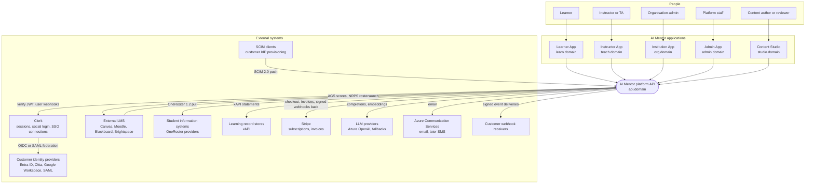

| External system | Interaction | Protocol | Trust |
| --- | --- | --- | --- |
| Clerk | Session JWTs, JWKS, Svix-signed webhooks, enterprise SSO connections | HTTPS, OIDC, SAML | Verified by signature |
| Customer IdP | Federated sign-in through Clerk enterprise connections | OIDC or SAML 2.0 | Trusted for authentication of that organisation's verified domains only |
| SCIM client | Creates, updates, deactivates managed accounts and groups | SCIM 2.0 over HTTPS, bearer token per client | Authenticated per organisation; scoped to that tenant |
| External LMS | Launches AI Mentor as a tool; receives grades and rosters | LTI 1.3 (OIDC launch, JWT), AGS, NRPS, Deep Linking | Verified by platform JWKS; scoped to the LTI deployment's tenant |
| SIS | Provides organisations, classes, enrolments | OneRoster 1.2 REST (OAuth 2.0 client credentials) | Trusted source of roster for one tenant |
| LRS | Receives activity statements | xAPI 1.0.3 / cmi5 | Processor chosen by the organisation |
| Stripe | Consumer subscriptions and organisation invoices | HTTPS, signed webhooks | Verified by signature |
| LLM providers | Model calls through `ai_gateway` | HTTPS, private endpoint for Azure OpenAI | Processor; per-tenant model policy decides which may be used |
| Webhook receivers | Receive outbound domain events | HTTPS, Standard Webhooks HMAC signature | Untrusted endpoint; delivery only, no inbound trust |

---

## 4. Containers

### 4.1 Container diagram

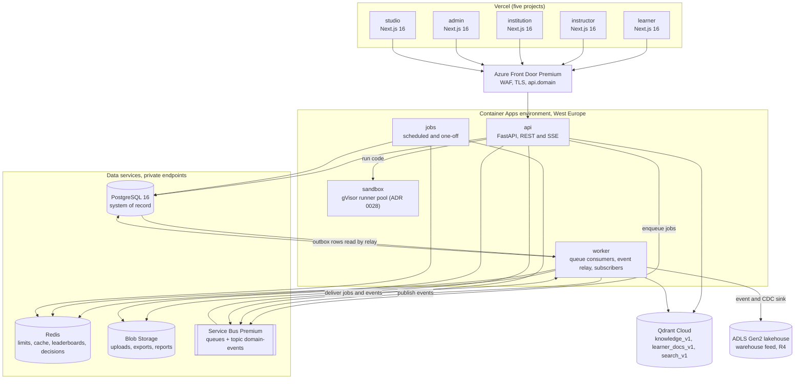

Browsers call the API origin directly (`api.<domain>`), with CORS limited to the five app origins. Server components and route handlers in each app call the same public origin with the user's bearer token. There is no private network path from Vercel to the API.

### 4.2 Container catalogue (changes to v1 SAD 4.1)

| Container | Change | Responsibility | Scale (R4 design load) |
| --- | --- | --- | --- |
| `learner`, `instructor`, `institution`, `admin`, `studio` | Replaces `web` and `admin-web`; on Vercel | UI, BFF aggregation, Clerk session, i18n, theming | Vercel serverless; no replica management |
| `api` | Gains tenant context, policy engine, outbox writes | All HTTP and SSE | 4–60 replicas × 2 vCPU / 4 GiB |
| `worker` | Gains the outbox relay and one consumer per subscribing context | Jobs (ingestion, generation, marking, imports, exports, reports, localisation) and event handlers | 0–40 replicas; relay runs as a single active instance with a lease |
| `jobs` | Gains season close, competition close, rollups, risk signals, OneRoster sync, partition maintenance | Cron and one-off tasks | Scheduled |
| `sandbox` | Unchanged from v1 SAD 13.8 | Learner and coding-assessment code | Pool of 300 at R4 |
| PostgreSQL | 14 new schemas (README), 26 in total; RLS on `app.tenant_id` | System of record, outbox, full-text search | GP D16ds_v5 HA + 2 read replicas at R4 |
| Redis | New key families: tenant limits, AI quotas, decision cache, scoped leaderboards | Derived and rebuildable | Clustered, HA |
| Service Bus | Standard becomes Premium in R1 (sessions, larger messages, private endpoint) | Queues for jobs; topic `domain-events` | 1–4 messaging units |
| Qdrant | New collection `search_v1`; tenant and workspace payload filters on all collections | Derived vectors | 3–6 nodes |
| Lakehouse | New at R4 | Analytics warehouse feed | Elastic |

### 4.3 Decision: search index

| Option | For | Against |
| --- | --- | --- |
| Azure AI Search from R2 | Managed facets, semantic ranker, per-index security filters | Third copy of content and permissions; per-tenant filtering duplicates RLS; cost from day one; another residency surface |
| OpenSearch | Mature full-text and vectors, self-hostable | Cluster to operate; no team experience |
| **PostgreSQL full-text plus Qdrant hybrid** | Uses stores we already run; RLS applies to keyword results; Qdrant already holds embeddings; one fewer processor | Weaker relevance tuning and faceting; full-text load lands on PostgreSQL |

**Decision:** start with PostgreSQL full-text search (per-locale `tsvector` with `english`, `french`, `spanish` configurations, plus `pg_trgm` for names) fused with Qdrant dense results by reciprocal rank fusion inside the `search` module (R2). Move keyword search to Azure AI Search at R4 if any trigger is met: more than 20M indexed documents, p95 search latency above 300 ms on the read replica, facet requirements beyond five fields, or a residency stamp that cannot carry the load. The `search` module's interface does not change when the engine does. Section 15 has the design.

### 4.4 Decision: analytics warehouse feed

Rollups for in-app dashboards stay in PostgreSQL (`analytics` schema, read replica). Cross-tenant platform analytics, workforce reporting, and long-range trends move to a lakehouse in Azure Data Lake Storage Gen2 (Delta tables) at R4, fed by two paths: the `analytics` subscriber writes domain events, and a change-data-capture stream from PostgreSQL logical replication copies selected tables. The query engine (Microsoft Fabric or Azure Databricks) is chosen at R4; the feed contract (Delta tables partitioned by `tenant_id` and date, personal identifiers pseudonymised) is fixed now.

---

## 5. Bounded contexts

### 5.1 Context map

The diagram is logical. Every context runs inside the same `api` and `worker` processes (P15, ADR 0017). Arrows point from upstream (supplier) to downstream (consumer).

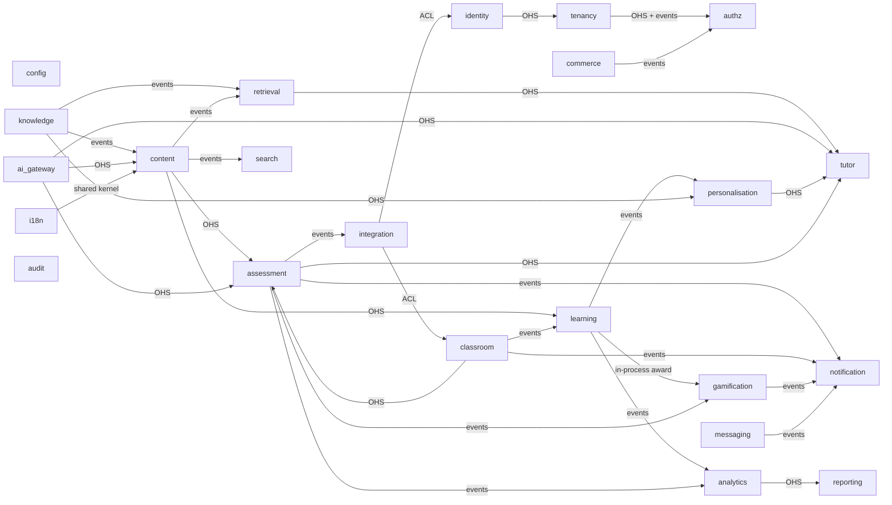

Abbreviations: **OHS** is an open-host service (the upstream's published Python interface, called in process); **ACL** is an anti-corruption layer that translates an external model (LTI, SCIM, OneRoster) into the downstream's own commands; **events** means asynchronous domain events through the outbox; **shared kernel** means a small shared model both sides depend on. `config` and `audit` are used by every context and are omitted from the arrows.

### 5.2 Relationships and integration style

| Upstream | Downstream | Style | What crosses | Why this style |
| --- | --- | --- | --- | --- |
| identity | tenancy | OHS, synchronous | Account id, account type, home tenant | Membership creation needs a valid account in the same transaction |
| tenancy | authz | OHS for queries; events `tenancy.membership.activated`, `.ended` | Org-unit paths, membership status | Decisions need the current tree; assignment cleanup on leave is a side effect |
| commerce | authz | Events `commerce.licence.changed`, `commerce.subscription.changed` | Entitlements, seat status | Entitlement changes invalidate the decision cache asynchronously |
| knowledge | retrieval | Events `knowledge.asset_version.published` | Asset version id | Ingestion and reindexing are slow and retryable |
| content | retrieval, search, learning, notification | Events `content.release.published`, `.archived` | Release id, workspace id, version | Publishing must not wait for reindexing or fan-out |
| content | learning, assessment | OHS, synchronous | Release structure, item definitions | Delivery reads pinned releases on every request |
| retrieval, ai_gateway, personalisation | tutor | OHS, synchronous | Chunks with citations; completions; learner model | On the latency-critical tutor path |
| assessment | tutor | OHS, synchronous, cached 30 s | Integrity state for (tenant, learner) | Must be enforced before the turn is generated |
| classroom | learning | Events `classroom.cohort_member.added`, `classroom.cohort_plan.scheduled` | Cohort, learner, plan ids | Enrolment fan-out to 50,000 learners is asynchronous |
| classroom | assessment | OHS, synchronous | Cohort roster and staff | Assignment publication validates the roster |
| learning | gamification | In-process call to `gamification.award()` in the learning transaction | Reward intent (kind, source id) | Preserves the v1 guarantee that a practice write and its XP commit together (v1 SAD 10.1) |
| assessment | gamification, analytics, notification, reporting, integration | Events `assessment.grade.released`, `.overridden`, `assessment.submission.ai_marked` | Ids and grade summary | Fan-out side effects |
| learning, assessment, gamification | analytics | Events | Ids, measures | Analytics never queries producer tables |
| analytics | reporting | OHS, synchronous (read replica) | Rollups | Reports read curated aggregates |
| integration | classroom, identity, assessment | ACL | LTI claims, SCIM resources, OneRoster records become native commands | External models must not leak into the domain |
| i18n | all | Shared kernel (`Locale`, fallback chain, `translation_status`) | Value objects | Every context needs the same locale rules |

### 5.3 Per-context component summary

"Schema" is the PostgreSQL schema the context owns. Where the README names no schema for a module, the proposal is marked † and listed in section 28.

| Module | Responsibilities | Schema | Public interface (examples) | Publishes | Consumes |
| --- | --- | --- | --- | --- | --- |
| `identity` | Accounts, profiles, Clerk sync, JIT, SCIM provisioning commands | `identity` | `get_account`, `provision_managed_account`, `erase_account` | `identity.account.created`, `.erased` | `tenancy.membership.ended` |
| `tenancy` | Organisations, org units, memberships, invitations, enrolment codes, domains, branding, policies, SSO connection records | `tenancy` | `resolve_tenant_context`, `org_unit_path`, `active_membership` | `tenancy.membership.activated`, `.ended`, `tenancy.organisation.created`‡ | `identity.account.created`, `commerce.licence.changed` |
| `authz` | Roles, permissions, assignments, policies, decisions, decision log | `authz` | `authorize`, `scope_filter`, `apps_for` | `authz.role_assignment.granted`, `.revoked` (ADR 0016) | `tenancy.membership.ended`, `commerce.*.changed` |
| `config` | Feature flags, platform and organisation settings, rollout rules | `platform` (shared with `ai_gateway`, separate tables) | `flag(name, subject)`, `setting(key, tenant)` | `config.flag.changed`‡ | — |
| `commerce` | Plans, subscriptions, licences, seats, invoices, Stripe | `commerce` | `entitlements(subject)`, `assign_seats` | `commerce.licence.changed`, `commerce.subscription.changed`, `commerce.seat.assigned`‡ | `tenancy.membership.ended` |
| `knowledge` | Assets, versions, taxonomy, concepts, relations, metadata schemas | `knowledge`, `curriculum` (taxonomy, concepts) | `concept`, `prerequisites`, `asset_version` | `knowledge.asset_version.published`, `knowledge.concept_relation.changed` | — |
| `content` | Lessons, modules, courses, paths, workspaces, releases, overlays, workflow, localisation jobs | `curriculum` | `release(id)`, `resolve_overlay(plan)`, `item(id, locale)` | `content.release.published`, `.archived`, `content.item.state_changed` | `knowledge.asset_version.published` |
| `retrieval` | Ingestion, chunks, embedding lineage, retrieval, citations | `vector`, `knowledge` (chunks) | `retrieve(query, filters)`, `ingest(version)` | `retrieval.index.updated`‡ | `knowledge.asset_version.published`, `content.release.published`, `identity.account.erased` |
| `ai_gateway` | Model registry, routing, guardrails, prompt releases, quotas, cost metering, evaluation | `platform` (model tables), `activity.llm_invocations` | `complete`, `stream`, `embed`, `quota(tenant)` | `ai_gateway.quota.exceeded`‡ | `commerce.licence.changed` |
| `tutor` | Mentor modes, personas, conversations, Socratic policy, agent orchestration | `chat` | `turn(conversation, message, mode)` | `tutor.message.flagged` | `assessment.assignment.published` (integrity windows) |
| `learning` | Enrolments, plan delivery, progress, mastery, practice, flashcards | `learning` | `progress(learner, release)`, `mastery(learner, concepts)` | `learning.enrolment.created`, `learning.lesson.completed`, `learning.mastery.changed` | `classroom.cohort_member.added`, `classroom.cohort_plan.scheduled`, `content.release.published` |
| `classroom` | Cohorts, members, staff, plans, plan items, live sessions, attendance, risk signals, interventions | `classroom` | `roster(cohort)`, `staff_of(cohort)`, `plan(cohort)` | `classroom.cohort_member.added`, `classroom.cohort_plan.scheduled` | `learning.*`, `assessment.grade.released` (risk) |
| `assessment` | Assessments, assignments, rubrics, submissions, marks, AI proposals, grades, gradebook, accommodations | `assessment` | `integrity_state`, `gradebook(cohort)` | `assessment.assignment.published`, `assessment.submission.submitted`, `.ai_marked`, `assessment.grade.released`, `.overridden` | `classroom.cohort_member.added` |
| `personalisation` | Learner model, dimension settings and locks, personas, adaptive decisions | `personalisation` | `learner_model`, `next_best(learner, goal)`, `effective_dimensions` | `personalisation.recommendation.issued`‡ | `learning.mastery.changed`, `knowledge.concept_relation.changed` |
| `gamification` | XP ledger, levels, streaks, badges, titles, challenges, competitions, seasons, leaderboards | `game` | `award(intent)`, `standing(user, scope)` | `gamification.xp.awarded`, `.badge.earned`, `.level.reached` | `assessment.grade.released`, `learning.*` (badges) |
| `analytics` | Event ingestion, rollups, learner and cohort metrics, warehouse feed | `analytics`, `activity` | `cohort_metrics`, `learner_metrics` | — | All analytic events |
| `reporting` | Report definitions, runs, schedules, rendering per locale, exports | `reporting`† | `run_report(definition, params)` | `reporting.report.generated`‡ | `analytics` rollup watermarks |
| `notification` | Channels, templates per locale, preferences, deliveries, digests | `notification` | `notify(recipient, template, data)` | — | Most domain events |
| `messaging` | Announcements, threads, messages | `messaging` | `post_announcement` | `messaging.announcement.published`‡, `messaging.message.sent`‡ | `classroom.cohort_member.added` |
| `search` | Unified index and query across catalogue, knowledge, people, help | `search`† | `query(q, scope)` | — | `content.*`, `knowledge.*`, `tenancy.membership.*` |
| `i18n` | Locales, message catalogues, translation memory, fallback | `ref` (locales), `i18n`† (translation memory) | `fallback_chain`, `translate_draft` | — | `content.item.state_changed` |
| `integration` | LTI, OneRoster, SCIM endpoints, xAPI export, outbound webhooks | `integration` | `deliver_webhook`, `lti_launch` | `integration.webhook.disabled`‡ | All events with a webhook mapping |
| `audit` | Audit trail, data access log, data subject requests, retention | `audit` | `record`, `data_request` | `audit.data_request.completed`‡ | `identity.account.erased`, `tutor.message.flagged` |

‡ Event name introduced by this document (section 28). The `events` schema belongs to the shared kernel, not to a context.

---

## 6. Backend package layout

### 6.1 Target layout

```text
backend/app/
├── main.py                     # create_app(): middleware, routers from each context
├── worker.py                   # queue consumers, event subscribers, relay (by argument)
├── jobs/                       # scheduled entrypoints: season_close, rollups, risk_signals, oneroster_sync
├── core/                       # shared kernel: ids (UUIDv7), Money, Locale, TenantContext,
│   │                           # Principal, EventEnvelope, Clock, Problem, pagination, Job
│   ├── db.py                   # session factory, SET LOCAL app.tenant_id / app.current_user_id
│   ├── events/                 # app.core.events: publish(event) into events.outbox; inbox decorator
│   └── http/                   # middleware, problem handlers, ETag, idempotency, rate limits
├── domain/
│   └── authz/                  # policy engine (shared kernel, ADR 0016 and 0017)
├── modules/
│   ├── identity/
│   │   ├── domain/             # pure rules, no I/O (P2)
│   │   ├── models.py           # SQLAlchemy models for this module's schema only
│   │   ├── repositories/       # the only code that writes this module's tables
│   │   ├── services/           # use cases and adapters (Clerk)
│   │   ├── api/                # FastAPI routers for this module
│   │   ├── events.py           # event types published, handlers for events consumed
│   │   └── interface.py        # the module's public interface; other modules import only this
│   ├── tenancy/  authz/  config/  commerce/  knowledge/  content/  retrieval/
│   ├── ai_gateway/  tutor/  learning/  classroom/  assessment/  personalisation/
│   ├── gamification/  analytics/  reporting/  notification/  messaging/
│   └── search/  i18n/  integration/  audit/
├── prompts/                    # unchanged; owned by tutor and ai_gateway
└── cli.py                      # migrate, seed, grant-platform-admin
```

Current-code mapping: `domain/access.py` becomes the policy engine in `domain/authz` plus role data in `modules/authz`; `domain/socratic.py`, `intent.py`, `prompt_guard.py` become `modules/tutor/domain`; `domain/mastery.py`, `scheduling.py`, `planner.py` become `modules/learning/domain`; `domain/gamification.py` becomes `modules/gamification/domain`; `domain/grading.py` splits between `learning` (practice) and `assessment` (formal); `services/engine.py` dissolves into module `interface.py` files; `services/llm.py` becomes `modules/ai_gateway/services`; `services/admin_portal.py` splits into `content`, `knowledge`, and `platform`-root routers.

ADR 0016 places the policy engine at `backend/app/domain/authz`. That path is the R1 location, used before the context restructure. It moves to `modules/authz/domain` in R2 without changing its interface.

### 6.2 Import rules (import-linter contracts)

| Contract | Type | Rule |
| --- | --- | --- |
| `layers-per-context` | layers | Within each context: `api` → `application` → `domain`; `infrastructure` → `domain`. `domain` imports nothing outside the standard library, `kernel` value objects, and its own package |
| `context-independence` | independence | `modules.*` never import another module's `domain`, `models`, `repositories`, `services`, or `api`. Cross-module use goes only through `modules.<other>.interface` or events |
| `kernel-is-leaf` | forbidden | `kernel` never imports `contexts` |
| `no-framework-in-domain` | forbidden | `modules.*.domain` and `domain.authz` must not import `fastapi`, `sqlalchemy`, `httpx`, `redis`, `azure`, provider SDKs |
| `provider-sdks-in-gateway` | forbidden | `openai`, `anthropic`, `google.genai` import only in `modules.ai_gateway.services` (P3) |
| `schema-ownership` | custom test | A SQLAlchemy model in context X declares only `schema` values owned by X (table in section 5.3) |

Contracts run in CI with `lint-imports`. A new exception needs an ADR amendment.

---

## 7. Request pipeline

### 7.1 Order

Starlette applies middleware in reverse order of registration; the list below is the effective request order. Steps 1–4 are middleware. Steps 5–10 are FastAPI dependencies, so open routes (health, webhooks, LTI login) stay explicit.

| # | Step | Component | Fails with |
| --- | --- | --- | --- |
| 1 | Request context: `X-Request-Id`, trace span, client IP from `X-Azure-ClientIP` | `RequestContextMiddleware` | — |
| 2 | Security headers | `SecurityHeadersMiddleware` (existing) | — |
| 3 | Body size limit | `BodySizeLimitMiddleware` | 413 |
| 4 | Per-address ceiling before authentication | `AddressRateLimitMiddleware` (existing behaviour) | 429 |
| 5 | Authenticate: verify Clerk JWT, map `azp` to app code, load account | `authenticate` | 401 |
| 6 | App audience: the API root must accept this app (ADR 0013 table) | `app_audience(root)` | 403 `wrong-app-audience` |
| 7 | Tenant context: read `X-Org-Id` or `{org_id}`, reject a mismatch, validate active membership, load organisation status, policy flags, and stamp | `tenant_context` | 400 `tenant-mismatch`, 403 `not-a-member`, 403 `organisation-suspended`, 421 `wrong-stamp` (R4) |
| 8 | Rate limits per user and per tenant, plus the tenant AI quota on AI routes | `rate_limit(class)` | 429 |
| 9 | Authorise: route-level permission check; resource-level check after the resource is loaded | `require(permission)`, `authorize(...)` | 403 `forbidden` (404 when existence must not leak) |
| 10 | Unit of work: begin, `SET LOCAL app.tenant_id`, `SET LOCAL app.current_user_id`, handler, outbox rows, commit | `unit_of_work` | 409, 412, 422 from the handler |
| 11 | After commit: Redis side effects, decision-log flush, cache invalidation | `after_commit` hooks | Logged, never fails the response |

Denies are written to the decision log through a separate buffered writer, because the request transaction may roll back.

### 7.2 Pipeline sequence

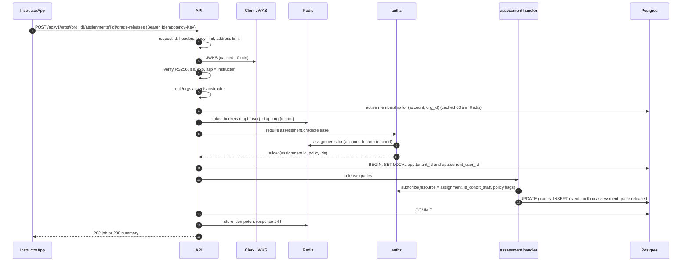

---

## 8. Multi-tenancy architecture

### 8.1 Tenant resolution

| API root | Tenant source | Default when absent |
| --- | --- | --- |
| `/api/v1/me/...` | `X-Org-Id` header (optional; only some `/me` resources are tenant-specific) | Home tenant |
| `/api/v1/learn/...` | `X-Org-Id` header | Home tenant (ADR 0015) |
| `/api/v1/orgs/{org_id}/...` | Path parameter; a different `X-Org-Id` is 400 | Required |
| `/api/v1/content/...` | Workspace in the path; the workspace's owning tenant (`master` belongs to the platform content organisation) | Required |
| `/api/v1/platform/...` | Platform context; no `app.tenant_id` | Not applicable |
| `/lti`, `/scim/v2`, `/api/v1/integrations` | Derived from the credential (LTI deployment, SCIM client, webhook endpoint) | Required by the credential |

The resolved context is an immutable `TenantContext(tenant_id, org_unit_path_root, kind, status, stamp, policy_flags, locale_default)` held in a context variable for the request or job.

### 8.2 Database isolation

- Every tenant-scoped row has `tenant_id uuid NOT NULL`. Composite indexes lead with `tenant_id` (ADR 0015).
- The unit of work sets `SET LOCAL app.tenant_id` and `SET LOCAL app.current_user_id` in every transaction, including worker transactions, which take the tenant from the event's `tenantid` extension or the job payload.
- RLS policies require `tenant_id = current_setting('app.tenant_id')::uuid` and the per-user policies of ADR 0011.
- Platform reads of tenant data use the `mentor_platform` pool, reachable only from `/api/v1/platform/*` handlers. The role has no `BYPASSRLS`; RLS admits a platform read only when `app.access_reason_id` names a recorded reason in `audit.data_access_log` (ADR 0015, 07).
- PgBouncer stays in transaction mode; `SET LOCAL` is safe because it ends with the transaction.

### 8.3 Isolation outside PostgreSQL

| Store | Tenant boundary |
| --- | --- |
| Redis | Every key containing tenant data includes `{tenant_id}`; leaderboards are scoped (section 14) |
| Qdrant | Every point has `tenant_id` and `workspace_id` payloads. The `retrieval` adapter adds the filter; callers cannot omit it (extends v1 SAD 13.6 LLM08) |
| Blob | Paths start with `tenants/{tenant_id}/`; user-owned blobs under `tenants/{tenant_id}/users/{user_id}/` |
| Service Bus | Every message has the `tenantid` application property; consumers set the tenant context from it |
| Logs and traces | `tenant_id` is a span attribute and a log field; no names or emails |
| Search | Keyword index rows carry `tenant_id` under RLS; Qdrant `search_v1` filtered as above |

### 8.4 Per-tenant configuration and feature flags

`config` resolves a setting or flag in this order: user override (where allowed) → cohort → organisation (`tenancy.org_policies`, `platform.settings` with tenant scope) → plan entitlement → platform default. Flags follow `<app_or_context>.<feature>` (README). Rules in `platform.flag_rules` can target organisation id, organisation kind, plan, stamp, app, or a percentage of accounts. Resolved values are cached in Redis for 60 s and invalidated by `config.flag.changed`.

### 8.5 Noisy-neighbour controls

| Control | Mechanism | Default |
| --- | --- | --- |
| Per-tenant request budget | Redis token bucket `rl:{class}:org:{tenant_id}` beside the per-user bucket | `api` class: 20 requests/min per licensed seat, minimum 600/min, maximum 60,000/min |
| Per-tenant AI quota | Monthly token and cost budget per licence in `aiq:{tenant_id}:{yyyy-mm}`; daily soft limit at 1/20 of monthly | From the licence; 80% and 100% alerts to the organisation's billing manager |
| Bulk job concurrency | At most 2 running bulk jobs per tenant per kind; the rest queue | Configurable per plan |
| Worker fairness | Job messages carry `tenantid`; the dispatcher round-robins across tenants within a queue | — |
| Database protection | `statement_timeout` 5 s (API), 30 s (reports on the replica); report queries always filter by `tenant_id` | — |
| Extraction signal | A tenant above 20% of total load is reviewed for a dedicated stamp (ADR 0015) | — |

### 8.6 Data residency with regional deployment stamps (R4)

A **stamp** is a full copy of the API, worker, jobs, PostgreSQL, Redis, Qdrant, Blob, and Service Bus in one region, holding only its tenants. The West Europe stamp (`eu`) is the home stamp and holds the consumer organisation (SRS CON-002). UK (`uk`, UK South) and US (`us`) stamps are added on contract demand.

| Element | Design |
| --- | --- |
| Global directory | A small replicated table mapping organisation id and verified domains to a stamp, read by Front Door rules and by the API |
| Routing | The apps call `api.<domain>`; Front Door routes by the `X-Org-Id` header or `{org_id}` path to the stamp origin group. A request reaching the wrong stamp gets 421 with the correct origin |
| Personal accounts | Live in the home stamp. Joining an organisation in another stamp creates a membership there; the learning record stays home and is shared under the consent rules of ADR 0021 |
| Managed accounts | Live only in their organisation's stamp |
| Clerk | One instance; Clerk holds identity only. Organisations with residency requirements for identity data are an open risk (section 26) |
| Events | Each stamp has its own topic; no cross-stamp event flow except de-identified platform metrics |
| DR | v1 SAD section 16 applies per stamp, with a paired recovery region inside the same jurisdiction |

---

## 9. Identity architecture

| Concern | Design | Release |
| --- | --- | --- |
| Identity provider | One Clerk production instance for all five apps (ADR 0013). Clerk proves who the person is; PostgreSQL holds everything else | R1 |
| Authorised parties | Each app origin is a Clerk authorised party. `APP_AUDIENCES` maps `azp` to `learner`, `instructor`, `institution`, `admin`, `studio`. An unknown `azp` is 401 | R1 |
| Personal accounts | Self sign-up (email, magic link, Google). `identity.users.account_type = personal`, home tenant is the consumer organisation | R1 |
| Enterprise SSO | Clerk enterprise connections (SAML 2.0 or OIDC) per organisation, configured from the Institution App. `tenancy.sso_connections` records the Clerk connection id, verified domains, and JIT rules | R3 |
| Domain verification | DNS TXT record checked by a job before a domain can route sign-in to an organisation's IdP | R3 |
| JIT provisioning | First SSO sign-in creates a `managed` account in the organisation, an `active` membership, a `learner` role assignment, and optional default cohort membership from IdP group claims | R3 |
| SCIM 2.0 | `/scim/v2/Users` and `/Groups` per organisation with a hashed bearer token per `integration.scim_clients` row. Deactivation suspends the membership and revokes sessions through the Clerk API | R4 |
| App launcher | `GET /api/v1/me/apps` returns the apps the person's assignments open, with the organisations available in each. `packages/auth` renders it in every app | R1 |
| Session policies per app | Clerk session lifetime is instance-wide, so per-app policy is enforced by the API and the app: maximum token age and MFA freshness (`fva`) per root | R1 |
| Organisation switching | The app stores the active organisation per tab and sends `X-Org-Id`; switching does not need a new session | R1 |

Session policy per app:

| App | MFA required | MFA freshness for sensitive writes | Idle timeout enforced by app | Notes |
| --- | --- | --- | --- | --- |
| Learner App | No (optional) | — | 30 days | Under-18 accounts have restricted profile visibility (v1 SAD 13.5) |
| Instructor App | Organisation policy | 60 min for grade release and overrides when the organisation enables it | 12 h | |
| Institution App | Yes for `org_owner`, `org_admin`, `org_compliance_officer` | 15 min for SSO, domains, role grants, data requests | 8 h | |
| Content Studio | Yes | 15 min for publish | 8 h | |
| Admin App | Yes | 15 min for every `/platform` write (ADR 0013) | 2 h | IP allow-list optional |

---

## 10. Authorisation architecture

ADR 0016 is the decision. This section shows where the parts run.

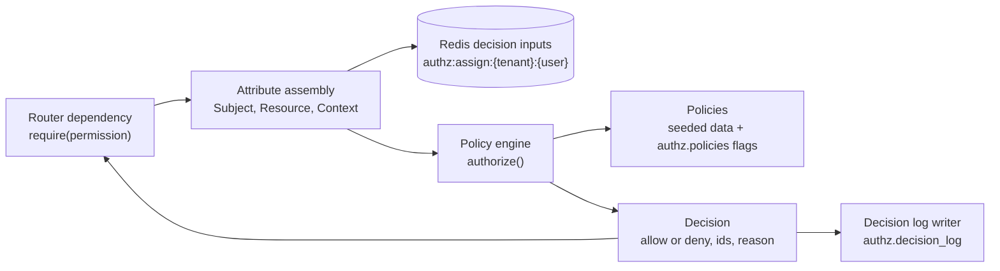

| Part | Design |
| --- | --- |
| Policy decision point | `authz.domain.authorize(subject, permission, resource, context)`, pure Python, in process |
| Policy information | Subject attributes from the token and the cached assignment set; resource attributes from the loaded row (`tenant_id`, `path`, owner, workspace, state, window); context from request state (integrity mode, IP, time) |
| Decision cache | The person's role assignments and permission set per tenant, cached in Redis (`authz:assign:{tenant_id}:{user_id}`, TTL 60 s) and in the request. Invalidated by `authz.role_assignment.granted`, `.revoked`, `tenancy.membership.ended`, `commerce.licence.changed`. Decisions themselves are not cached across requests because resource attributes change |
| List filtering | `authz.scope_filter(subject, permission)` returns SQL predicates (`tenant_id = …`, `path <@ ANY(…)`) that repositories add, so list endpoints never return rows a caller could not open one by one |
| Decision log | Denies and sensitive allows written to `authz.decision_log`; other allows sampled at 1% (ADR 0016). Partitioned monthly; retained 13 months |
| Route coverage | A test enumerates every route and fails when one has no `require(...)`, except the public allow-list |
| Explain | `GET /api/v1/platform/authz/explain` (Admin App, `security_auditor`) returns the decision trace for a subject, permission, and resource |

---

## 11. Event-driven architecture

ADR 0018 is the decision. Envelope, naming, and the outbox table come from the README.

### 11.1 Flow

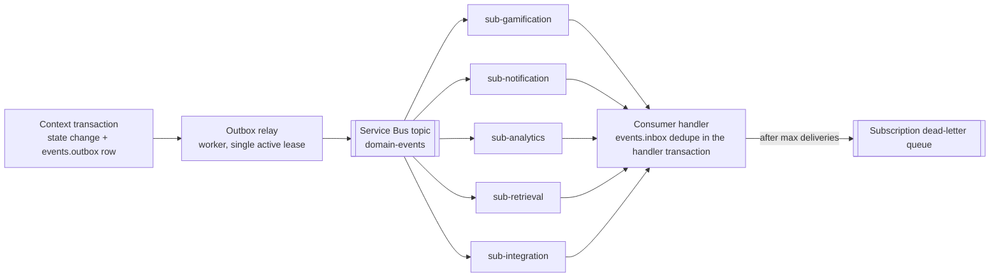

### 11.2 Design rules

| Concern | Rule |
| --- | --- |
| Outbox write | `kernel.outbox.publish(event)` inserts into `events.outbox` in the caller's transaction. Columns: `id` (UUIDv7, also the CloudEvents `id`), `type`, `source`, `subject`, `tenant_id`, `actor_id`, `correlation_id`, `partition_key`, `data` (jsonb), `occurred_at`, `published_at` |
| Relay | Reads unpublished rows in `id` order with `FOR UPDATE SKIP LOCKED` in batches of 500, sends them to the topic, and sets `published_at`. One active relay per stamp holds a lease in PostgreSQL (advisory lock); a standby takes over within 10 s |
| Duplicate detection | Service Bus duplicate detection on `MessageId = event id` (10-minute window) plus consumer inbox de-duplication. Delivery stays at least once |
| Subscriptions | One subscription per consuming context, named `sub-<module>`, with a SQL filter on `type` so a context receives only what it handles |
| Inbox | `events.inbox (consumer, event_id)` unique. The handler inserts the inbox row in the same transaction as its side effect; a conflict means the event was already handled |
| Ordering | Not guaranteed by default. Consumers that need per-aggregate order use session-enabled subscriptions with `SessionId = partition_key` (gamification by account, gradebook by assignment, search by document id). Others compare an aggregate version carried in `data` and ignore stale events |
| Retry | Handler exceptions abandon the message; Service Bus redelivers with the lock. After 10 deliveries the message moves to the subscription's dead-letter queue. Known transient errors (provider 429, database serialisation) back off with a scheduled re-enqueue up to 1 h |
| Dead letters | An alert fires on any dead-lettered message. `platform_operator` inspects and replays from the Admin App (`/api/v1/platform/dead-letters`) |
| Schema registry | One JSON Schema per event type and version in `docs/events/<type>.v<n>.json`. CI checks that a change within a version is additive only; a breaking change creates `v<n+1>` and the producer emits both until consumers move |
| Payloads | Ids and minimum attributes only; never free text or personal data (README). Consumers fetch details through the producer's public interface |
| Retention | Published outbox rows deleted after 7 days; inbox rows after 30 days |
| Jobs versus events | Commands that do work (ingest this version, mark this submission) go to queues (`ingest`, `generate`, `marking`, `imports`, `exports`, `reports`, `localisation`). Facts that something happened go to the topic |

---

## 12. AI architecture changes

v1 SAD section 8 stays normative: orchestrator, agent catalogue, provider router tiers, prompt registry, guardrails pipeline, and evaluation. This section amends it.

### 12.1 Mentor modes

A mentor mode is an agent plus a **mode profile** (ADR 0022). The profile is configuration, versioned as a prompt release.

| Mode | Agent | Retrieval | Disclosure policy | Default tier | Tools | Blocked when |
| --- | --- | --- | --- | --- | --- | --- |
| `tutor` | Tutor (Socratic stages; technique `socratic` or `direct`) | Published knowledge in the learner's releases | Socratic stages 0–1 scripted; full account from stage 3 or on request in `direct` | `fast` | Quiz suggestion, flashcard suggestion | Never; restricted in integrity mode |
| `mentor` | Mentor (study habits, motivation, planning) | Learner's plan and progress | No solutions to assessed work | `fast` | Plan explanation | — |
| `research_supervisor` | Research (v1 Research agent extended) | Learner documents, published papers | Critique must cite (`grounded()`) | `reasoning` | Document analysis | Integrity mode |
| `coding_coach` | Coding | Project brief, learner code | Hints before solutions; never solves an assessed coding task | `code` | Sandbox run (engine-executed) | Integrity mode for coding assessments |
| `career_coach` | Career | Career guides, mastery | — | `fast` | Role match (domain rules) | — |
| `exam_coach` | Exam preparation (practice items, timing strategy) | Practice item bank only, never live assessment items | No access to items in an open assessment | `fast` | Practice quiz | Integrity mode (always) |

Each mode profile names: allowed retrieval scopes, disclosure policy, model tier and escalation rule, allowed tools, the eval suite that gates changes, and whether organisations may disable it (`learner.mentor_modes` flag and organisation policy).

### 12.2 Persona layer

Personas (`personalisation.mentor_personas`) render as a presentation block placed **after** the safety, mode, and grounding blocks in the fixed prompt order of v1 SAD 8.4. A persona block cannot reference tools, retrieval, or disclosure. The output guardrails (grounding, harm, leak) run unchanged regardless of persona. Voice style and accent map to Azure AI Speech voices when voice ships (v1 SAD 8.7).

### 12.3 Assessment integrity mode

| Step | Design |
| --- | --- |
| Source of truth | `assessment` computes integrity state for (tenant, learner) from open assignment windows with integrity enabled |
| Propagation | `assessment.assignment.published` and window changes update Redis `integrity:{tenant_id}:{user_id}` (TTL to window close); `tutor` also calls `assessment.integrity_state` (cached 30 s) on every turn |
| Enforcement | The tutor's mode profile check refuses blocked modes, switches `tutor` to "concept only, no solution" policy, removes the open assessment's items from retrieval, and logs the restriction on the message |
| Learner experience | The Learner App shows the restriction banner from the `meta` SSE event (`integrity_mode: true`) |

### 12.4 AI marking pipeline

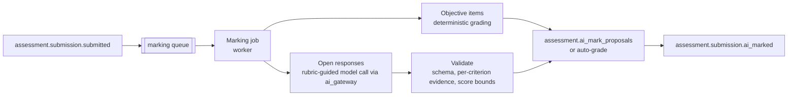

Rules: the model never sees other learners' work or the reference answer beyond what the rubric criterion exposes; each criterion score must quote evidence from the submission or it is dropped to "needs human"; proposals are invisible to the learner until a human accepts or overrides (README); the prompt release, model, and cost are stored on the proposal; acceptance-rate and override-delta metrics feed the eval gate for marking prompts.

### 12.5 Content generation pipeline

Content Studio generation requests (lessons, items, flashcards, translations) become `generate` or `localisation` queue jobs. Output is written as drafts in the requesting workspace with provenance (`generated_by = ai`, prompt release, source asset versions) and enters the workflow at `draft`. Nothing generated reaches learners without the review and publish steps of the content workflow.

### 12.6 AI gateway

`ai_gateway` absorbs `services/llm.py` (the v1 `ProviderRouter`) and adds:

| Capability | Design |
| --- | --- |
| Model registry | `platform.model_registry`: provider, deployment, region, data zone, tiers served, price per token |
| Routes | `platform.model_routes`: tier → ordered providers, with optional tenant overrides |
| Per-tenant model policy | Organisation policy restricts providers (for example Azure OpenAI EU Data Zone only, no fallback outside the data zone). The router filters routes by policy before fallback; if no allowed provider is healthy, the curriculum fallback applies (P4) |
| Quotas | Per-user daily budgets (v1 SAD 8.3) plus per-tenant monthly budgets (section 8.5). Checked before the call; consumption recorded after |
| Cost metering | Every call writes `activity.llm_invocations` with `tenant_id`, feature (`tutor`, `marking`, `generation`, `search`), mode, tokens, and cost. Hourly rollups feed the Institution App usage page and Admin App cost dashboards |
| Prompt releases | `platform.prompt_releases` pins prompt ids and versions per environment; promotion requires a passing `eval_run` |
| Guardrails | v1 SAD 8.5 pipeline unchanged; Content Safety categories configurable per organisation kind (stricter for `school`) |

### 12.7 Retrieval changes

v1 SAD section 11 stays normative. Additions: every retrieval call carries tenant context and the set of releases the learner can see (consumer catalogue, the organisation's pinned releases, its `org` workspace content); the adapter turns these into Qdrant payload filters on `tenant_id`, `workspace_id`, and `release_id`; `master` content is indexed once with `tenant_id` of the platform content organisation and made visible by release filters, not by copying.

### 12.8 Future agent orchestration (R5)

| Concern | Design |
| --- | --- |
| Agents as principals | An agent runs as a `system` principal with a **delegation**: (acting agent, on-behalf-of person, permission subset, expiry) |
| Effective permission | Intersection of the person's permissions and the agent's grant. The policy engine evaluates the person as subject with `context.delegated_by = agent` |
| Tools | Each tool is an existing API operation, invoked through the owning module's `interface.py`, never direct SQL (ADR 0010 future considerations) |
| Human approval | Write tools above a risk threshold (grade changes, messages to many learners, publishing) create a pending action the person approves in the app |
| Audit | Every tool call logs agent, delegation, person, permission, and decision |

---

## 13. Personalisation engine

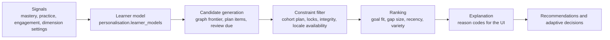

| Part | Design |
| --- | --- |
| Learner model | Per account and tenant context: mastery vector (from `learning.mastery.changed`), effective dimensions, pace estimate, engagement pattern, goal and target path. Updated by events; read through `personalisation.learner_model` |
| Graph-based sequencing | Next-best concepts are the frontier of the knowledge graph whose prerequisites are at mastery ≥ 70 (v1 rule) and that are on the learner's goal path, weighted by edge weights from `knowledge` |
| Cohort constraints | When the learner is in a cohort plan, plan items and dates come first; recommendations fill gaps and remediation only, never skip ahead of a locked plan item |
| Dimension resolution | `effective_dimensions = clamp(learner preference, bounds)` where bounds are applied in order: organisation policy → cohort lock or bound → instructor setting. A lock wins over a learner preference; the UI shows the lock and its owner |
| Adaptive decisions | Each decision (difficulty step, remediation, skip) is stored in `personalisation.adaptive_decisions` with inputs and reason code so instructors can see why |
| Consumers | `tutor` (profile block, mastery block), `learning` (next lesson, practice difficulty), Learner App (recommendations), Instructor App (suggested interventions) |
| Experimentation | Ranking weights are a versioned configuration; A/B assignment through `config` rollout rules |

---

## 14. Gamification architecture changes

v1 SAD section 10 rules (XP table, daily cap, levels, titles, anti-abuse) remain. Changes:

| Change | Design |
| --- | --- |
| Tenant on the ledger | `game.xp_ledger` rows carry the `tenant_id` of the context the XP was earned in (ADR 0015). Level and lifetime XP stay per account |
| Scoped leaderboards | Scopes: `global`, `country`, `organisation` (shown to users as "institution"), `cohort`, `friends`, `competition`. Visibility of `organisation` and `cohort` boards is governed by organisation policy; `global` and `country` exclude managed accounts unless their organisation opts in |
| Competitions | `game.competitions`: a scoped, time-boxed contest with a metric, eligible population (cohort, organisation, or invited cohorts across organisations with both organisations' consent), and prizes (badges). Created in the Instructor App (cohort) or Institution App (organisation) |
| Seasons | `game.seasons` per scope type; weekly and monthly as v1, plus custom term seasons for organisations |
| Leaderboard scope registry | `game.leaderboard_scopes` lists active (scope, scope id, periods, metrics, visibility) so rebuild and close jobs know what to maintain |
| Academic XP | XP for released grades (when the organisation enables it) is awarded by the gamification subscriber on `assessment.grade.released`, idempotent on (account, `assessment_grade`, grade id) |

Redis key format: `lb:{scope}:{scope_id}:{period}:{metric}`.

| Element | Values | Example |
| --- | --- | --- |
| `scope` | `global`, `country`, `organisation`, `cohort`, `competition` | `cohort` |
| `scope_id` | `-` for global; ISO 3166-1 alpha-2; organisation, cohort, or competition UUID | `0192f1c4-…` |
| `period` | `all`, `w2026-W42`, `m2026-10`, `s{season_id}` | `w2026-W42` |
| `metric` | `xp`, `composite` (v1 SAD 10.4 formula), `challenges`, or a competition metric | `xp` |

Examples: `lb:global:-:all:composite`, `lb:country:NG:w2026-W42:composite`, `lb:organisation:{org_id}:m2026-10:xp`, `lb:competition:{competition_id}:all:challenges`. Friends boards keep the v1 approach (`ZMSCORE` over friend ids, no per-user sets) and are limited to friends visible in the active tenant context. The rebuild job recreates every key in `game.leaderboard_scopes` from the ledger; season and competition close write `game.leaderboards` and `game.leaderboard_entries` snapshots.

---

## 15. Search architecture

| Part | Design |
| --- | --- |
| Index | `search.documents`† projection table: `tenant_id`, `doc_type` (`course`, `path`, `lesson`, `asset`, `concept`, `person`, `cohort`, `help`), `ref_id`, `locale`, `title`, `body_excerpt`, `tsv` (generated `tsvector` per locale configuration), `visibility` (release ids, roles), `updated_at`. Dense vectors in Qdrant `search_v1` keyed by the same id |
| Indexing | `sub-search` consumes `content.release.published`, `content.release.archived`, `knowledge.asset_version.published`, `tenancy.membership.activated` and `.ended`; it fetches details through module interfaces and upserts rows and points. A nightly job reconciles counts |
| Query | `search.query(q, scope, types)` runs keyword (`websearch_to_tsquery` in the request locale with `en` fallback, plus `pg_trgm` for people and titles) and dense search in parallel, fuses with reciprocal rank fusion (k = 60), then applies `authz.scope_filter` |
| People search | Only within the active tenant, only for callers with `search.person:query` (or `tenancy.membership:read` for member lists) at the scope; learners find classmates only in shared cohorts where the organisation allows it |
| Apps | Learner App (catalogue, lessons, help), Instructor App (learners, cohorts, items), Institution App (members, cohorts), Content Studio (assets, items, concepts across the workspace), Admin App (organisations, accounts) |
| R4 option | Swap keyword search to Azure AI Search behind the same interface if a trigger in section 4.3 is met |

---

## 16. Analytics and reporting architecture

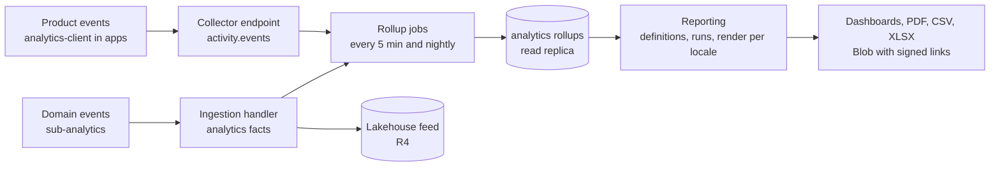

| Part | Design |
| --- | --- |
| Event ingestion | Domain events become facts in `analytics` (partitioned by month, keyed by `tenant_id`). Product events from `packages/analytics-client` go to `POST /api/v1/me/events` in batches, into `activity.events` |
| Rollups | 5-minute incremental rollups for live dashboards (cohort progress, at-risk counts, usage); nightly rollups for trends. Watermarks per rollup expose freshness |
| Risk signals | A `classroom` job reads rollups and writes `classroom.risk_signals` with evidence; instructors see them in the Instructor App |
| Warehouse | R4 lakehouse feed (section 4.4); pseudonymised account ids; organisation exports of their own data as Delta shares or CSV |
| Report definitions | Code-defined report types (cohort progress, assessment outcomes, engagement, licence usage, compliance) with parameters and a permission each |
| Rendering | Reports render server-side in the worker: HTML templates with ICU messages in the requested locale, then PDF with WeasyPrint; CSV and XLSX for data. Numbers, dates, and names of concepts use the locale |
| Delivery | Files in Blob under `tenants/{tenant_id}/reports/`, downloaded through short-lived signed links; `reporting.report.generated` notifies the requester |
| Scheduled reports | Organisation admins schedule reports; the `jobs` scheduler enqueues runs; recipients must hold the report's permission at run time |

---

## 17. Notification architecture

| Part | Design |
| --- | --- |
| Triggers | `sub-notification` maps domain events to notification types (for example `assessment.grade.released` → "Grades released") and resolves recipients through module interfaces |
| Channels | In-app (R1), email through Azure Communication Services (R2), web push (R3), mobile push through Azure Notification Hubs (R4), SMS later |
| Templates | `notification.templates` per type, channel, and locale; ICU message format; organisation branding injected for tenant-originated messages |
| Preferences | `notification.preferences` per account, type, and channel; organisation policy may make some types mandatory (for example deadline reminders) |
| Digests | Low-priority notifications collected into daily or weekly digests per locale and time zone |
| Delivery | `notification.deliveries` records each attempt with provider id and status; bounces suppress the address |
| In-app read path | `GET /api/v1/me/notifications` (cursor) and an SSE stream `GET /api/v1/me/notifications/stream` for live badges |
| Quiet hours | Respect the recipient's time zone; no non-urgent email or push 21:00–07:00 local |

---

## 18. Localisation architecture

ADR 0023 is the decision. Five surfaces, one fallback rule (requested locale → organisation default → `en`).

| Surface | Mechanism |
| --- | --- |
| UI | `packages/i18n` with `next-intl`; ICU messages per app plus shared catalogues; CI fails on a missing key in any of `en`, `fr`, `es` |
| Learning content | Translations are rows keyed by the locale-neutral item id plus locale with `translation_status`; Content Studio localisation jobs create machine drafts that `localisation_editor` reviews |
| AI responses | Reply locale from the request (`Accept-Language` or learner preference) passed to the prompt locale block; retrieval prefers the locale and falls back to `en` with a source-language note (v1 SAD 8.6) |
| Assessments | A graded item is served in a locale only when its translation is `approved`; otherwise the learner sees the source-language item, or the assignment is restricted to approved locales |
| Reports | Rendered per requested locale (section 16) |

Translation memory and glossary (`i18n` module) store approved segment pairs and terms per workspace, reused by localisation jobs and by human editors.

---

## 19. Integration architecture

| Standard | Role of AI Mentor | Endpoints and flows | Release |
| --- | --- | --- | --- |
| OIDC / SAML SSO | Relying party through Clerk | Clerk enterprise connections per organisation | R3 |
| SCIM 2.0 | Service provider | `/scim/v2/Users`, `/scim/v2/Groups` (groups map to cohorts or org units) | R4 |
| LTI 1.3 Advantage | Tool | `/lti/login` (OIDC third-party initiation), `/lti/launch`, `/lti/jwks`; Deep Linking for course and assignment selection; AGS to post scores to the platform; NRPS to pull rosters | R4 |
| OneRoster 1.2 | Consumer (rostering) | Scheduled pull from the SIS; maps orgs, classes, users, and enrolments to org units, cohorts, accounts, and memberships through the `integration` ACL | R4 |
| xAPI / cmi5 | Statement producer | `sub-integration` turns selected events into xAPI statements sent to the organisation's LRS | R4 |
| Open Badges 3.0 | Issuer | Learning passport export (ADR 0021) | R4 |
| Outbound webhooks | Producer | Organisation-configured endpoints receive mapped events with Standard Webhooks signatures; retries for 24 h; endpoints disabled after 5 days of failure | R3 |
| Stripe, Clerk | Consumer of webhooks | `/webhooks/stripe`, `/webhooks/clerk` (v1, unchanged) | R1 |

LTI tenancy: an `integration.lti_platforms` row (issuer, client id, JWKS URL) and `integration.lti_deployments` rows (deployment id) belong to one organisation. A launch resolves the tenant from (issuer, deployment id), the account from the LTI `sub` linked to a managed account (JIT if allowed), and the cohort from the context claim. AGS line items are recorded in `integration.lti_line_items` and updated on `assessment.grade.released`.

---

## 20. Key sequence diagrams

Participants use the same names throughout: `LearnerApp`, `InstructorApp`, `InstitutionApp`, `Studio` (Content Studio), `API`, `Worker`, `Postgres`, `Redis`, `Qdrant`, `ServiceBus`, `Clerk`.

### 20.1 App sign-in with tenant selection

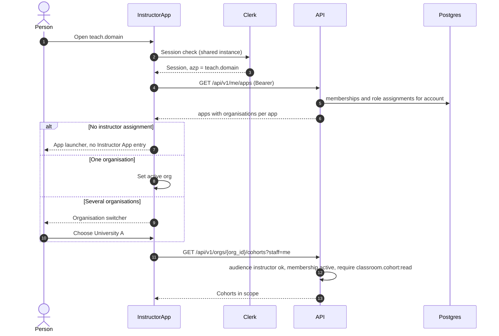

### 20.2 Instructor bulk import into a cohort

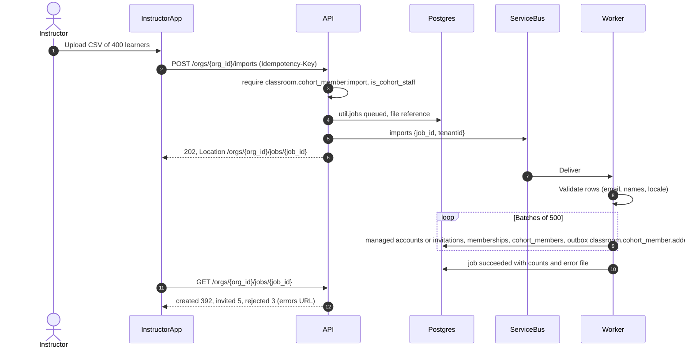

### 20.3 Content Studio publishes a release

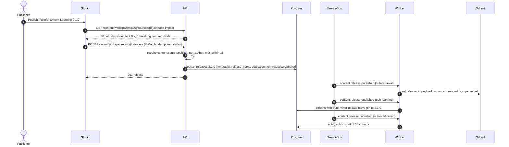

### 20.4 Assignment marking, override, release, XP, analytics

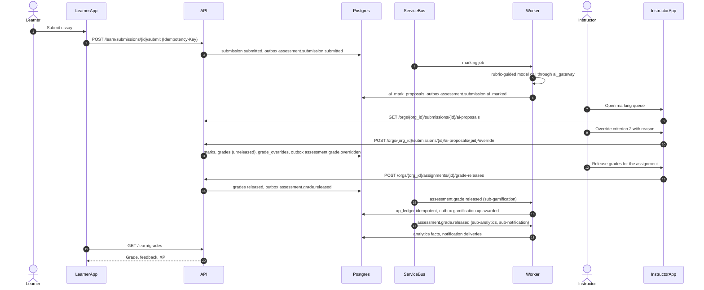

### 20.5 SSO just-in-time provisioning

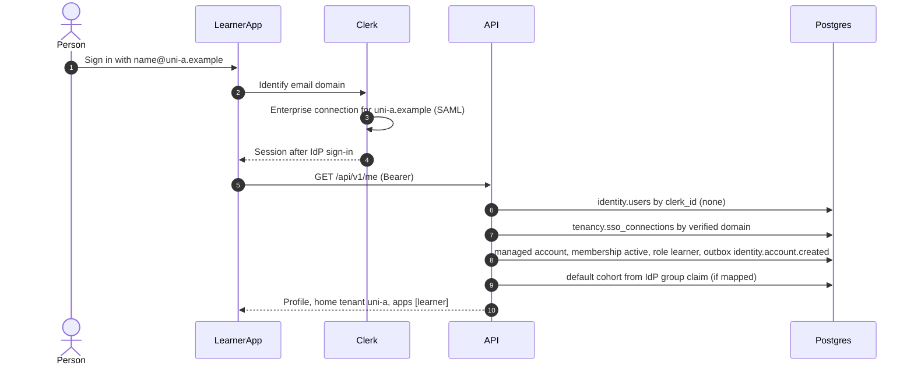

### 20.6 Leaderboard update

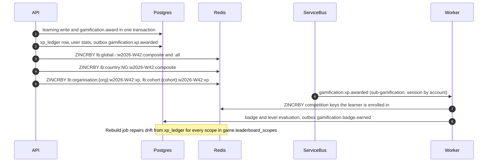

---

## 21. Frontend architecture

| Concern | Design |
| --- | --- |
| Apps | Five Next.js 16 App Router apps in `apps/*` (ADR 0013, 0014), stack per ADR 0012 |
| Packages | `@aimentor/ui`, `content-render`, `api-client`, `auth`, `i18n`, `config`, `analytics-client` (ADR 0014) |
| BFF rules | Server components and route handlers may aggregate API calls, cache public data, and shape view models. They may not hold secrets other than the session, call the database, decide permissions, compute grades or XP, or call model providers. Each BFF call forwards the user's bearer token and `X-Org-Id` |
| Shared auth | `packages/auth` provides `ClerkProvider` setup, `getApiToken()`, the organisation switcher, `useActiveOrg()`, app launcher data, and route guards that read `/me/apps`. A guard failure renders a "no access" page; it never substitutes for the API check |
| API client | `packages/api-client` generated from `docs/openapi.yaml`; includes problem-detail types, cursor pagination helpers, idempotency-key generation, ETag handling |
| i18n | Locale prefix in routes (`/fr/...`) for indexable Learner App and marketing pages; cookie-based locale for the other apps |
| Design tokens | Tokens in `packages/ui` exposed as CSS variables (`--color-primary`, `--color-primary-foreground`, `--radius`, `--font-sans`, …); Tailwind reads the variables |
| Per-tenant branding | `GET /api/v1/me/branding` (active tenant) returns logo URLs, colour tokens, and display name. The app root layout writes them as CSS variables on `:root[data-org]`. Contrast is validated server-side at save time (WCAG 2.2 AA); invalid palettes fall back to defaults |
| Density and navigation | Each app owns its navigation shell and density token set (`comfortable` for Learner, `compact` for Instructor, Institution, Admin, Studio) |
| Content security policy | Per app (ADR 0013). Admin App and Content Studio forbid framing; Learner App allows framing only from registered LTI platform origins for LTI launches |

---

## 22. Deployment changes

v1 SAD section 17 and [Infrastructure.md](../Infrastructure.md) stay normative for the API, worker, jobs, data services, IaC, images, migrations, and rollback.

| Item | Change |
| --- | --- |
| Vercel projects | Five: `aimentor-learner`, `aimentor-instructor`, `aimentor-institution`, `aimentor-admin`, `aimentor-studio`. Root directory `apps/<name>`; ignored-build step via Turborepo (ADR 0014) |
| Domains | `<domain>` and `learn.<domain>` (Learner App), `teach.`, `org.`, `admin.`, `studio.<domain>`; `api.<domain>` on Front Door. Staging uses `<app>.staging.<domain>` |
| White-label domains (R4) | Organisation custom domains for Learner App and Institution App added to the Vercel projects; verified in `tenancy.domains`; added to Clerk allowed origins and API CORS dynamically from a cached list |
| CORS and authorised parties | `CORS_ORIGINS` and `CLERK_AUTHORIZED_PARTIES` list all five origins per environment, plus verified white-label domains. `APP_AUDIENCES` maps each origin to an app code |
| Environments | `local`, `preview` (per PR, per affected app), `staging`, `prod` as v1 SAD 17.2. Preview apps point at the staging API |
| Per-app CI | Turborepo affected builds: lint, typecheck, unit tests, build, Playwright smoke per app. Backend CI unchanged plus import-linter, isolation suite, route-permission test, and event-schema compatibility check |
| Worker deployment | Relay and subscribers run as separate Container Apps from the same image (`ca-worker-relay` with 1–2 replicas and a lease; `ca-worker` scaled by queue and subscription depth) |
| Service Bus | Premium from R1 for sessions and private endpoint; topics and subscriptions declared in Bicep from the event registry |
| Local development | Compose adds the Service Bus emulator (v1 SAD 17.8). `make learner`, `make admin`, `make studio`, `make instructor`, `make institution` |

---

## 23. Scalability changes

### 23.1 Per-component (R4 design load)

| Component | R1–R2 | R4 |
| --- | --- | --- |
| `api` | 2–8 × 2 vCPU / 4 GiB | 4–60 × 2 vCPU / 4 GiB, dedicated D4 profile |
| `worker` | 0–6 | 0–40, KEDA on queue and subscription depth |
| PostgreSQL | GP D4ds_v5 HA, 1 read replica | GP D16ds_v5 HA, 2 read replicas (reports, search) |
| Redis | Balanced B5 HA | Clustered, HA, ≈ 25 GB (leaderboards for all scopes, decision cache, limits) |
| Service Bus | Premium 1 MU | Premium 2–4 MU |
| Qdrant | 3 nodes × 16 GB | 6 nodes; `search_v1` sharded by `tenant_id` hash |

### 23.2 Hot paths for the largest organisation

| Operation | Concern | Design |
| --- | --- | --- |
| Grade release to a 2,000-learner cohort | Fan-out | One transaction updates grades; one event per grade with `partition_key` = assignment; consumers batch |
| Plan scheduled for 50,000 learners | Enrolment fan-out | `classroom.cohort_plan.scheduled` per cohort; `learning` enrols in batches of 1,000 per transaction |
| Organisation dashboard | Large aggregates | Served from 5-minute rollups on the read replica, never from live tables |
| Gradebook export | Large file | Async job, streamed CSV or XLSX to Blob |
| Organisation leaderboard | Large ZSET | 50,000 members per key is small for Redis; top-N plus own rank only |

### 23.3 Database

ADR 0011 partitioning stays. Additions: `tenant_id` leads composite indexes on tenant-scoped tables; partition-local indexes on (`tenant_id`, `created_at`); `authz.decision_log`, `events.outbox`, `events.inbox`, and `analytics` facts are partitioned monthly; report queries run only on replicas. Citus distribution on `tenant_id` remains the later option (ADR 0015).

### 23.4 Per-tenant SLOs and monitoring

v1 SAD section 15 stays normative. Every request span and metric carries `tenant_id` and `app`. Dashboards and alerts add: per-tenant availability and p95 latency for organisations with 500 or more seats; per-tenant AI spend against quota; event lag per subscription; dead-letter counts; decision deny rate per app (a spike indicates a broken UI guard or an attack); job queue age per tenant.

---

## 24. Extension points

ADR 0027 (proposed) is the decision.

| Extension | Seam | Constraint |
| --- | --- | --- |
| Content marketplace (R5) | `content` releases with `listing` metadata; `commerce` licences for content; derived-course links | Listings cross tenants only through explicit, audited publication (README tenancy rule 4) |
| Native mobile (R4 Learner, R5 Instructor) | Same API; mobile clients are Clerk authorised parties mapped to the `learner` or `instructor` audience; push through Notification Hubs | No mobile-only endpoints; offline practice syncs through idempotent submissions |
| Partner API (R5) | OAuth 2.0 client credentials for partner principals, scoped to one organisation and a permission subset; Azure API Management introduced then (v1 SAD ADR-11) | Same permissions and policy engine as first-party apps |
| AI agent orchestration (R5) | Delegated principals (section 12.8) | Tools are API operations; human approval for risky writes |
| Custom roles (R4+) | Embedded Cedar evaluation behind `authorize` (ADR 0016 future considerations) | Existing policies translate one to one |
| Context extraction | Any module with its own schema, `interface.py`, and events can move to its own service; the interface becomes an HTTP or gRPC client | Only when a measured scaling or team-ownership need exists |

---

## 25. Architecture fitness functions

Automated checks that keep the architecture true. Each runs in CI unless stated.

| # | Fitness function | Check | Threshold |
| --- | --- | --- | --- |
| FF-01 | Context boundaries | import-linter contracts (section 6.2) | Zero violations |
| FF-02 | Schema ownership | Model-schema test | Zero cross-context models |
| FF-03 | Route permissions | Route enumeration test | Every non-public route has `require(...)` |
| FF-04 | Tenant isolation | Two-tenant integration suite over every RLS-protected repository method and Qdrant query | Zero cross-tenant rows |
| FF-05 | Tenant column | Migration lint: new tables in tenant schemas must have `tenant_id NOT NULL` and an RLS policy, unless allow-listed as platform reference data | Zero exceptions without review |
| FF-06 | Event contracts | Schema registry compatibility check | Additive only within a version |
| FF-07 | No personal data in events | Schema lint rejects fields named like `email`, `name`, `text`, `content` unless allow-listed | Zero |
| FF-08 | App audience | Contract test: each root rejects tokens from non-allowed `azp` | 100% of roots |
| FF-09 | No business rules in apps | ESLint rule: apps may not import from a forbidden list (grading, XP formulas) and `packages/api-client` is the only network client | Zero |
| FF-10 | Localisation completeness | Message catalogue diff across `en`, `fr`, `es` | Zero missing keys at release |
| FF-11 | Latency budget | k6 nightly on staging at R-specific load | p95 non-AI < 300 ms; TTFT p95 < 1.5 s |
| FF-12 | Noisy neighbour | Monthly load test with one tenant at 10× | Other tenants' p95 within +20% |
| FF-13 | Event lag | Production alert | p95 < 5 s |
| FF-14 | Contract drift | OpenAPI generation diff against `docs/openapi.yaml` for live routes | Zero drift |

---

## 26. Risks and technical debt

| # | Risk or debt | Impact | Mitigation | Owner |
| --- | --- | --- | --- | --- |
| RK-01 | Retrofitting `tenant_id` and RLS onto live tables in R1 | Data exposure if a policy is missed; migration downtime | Expand/contract migration; FF-04 and FF-05 before switch-over; backfill with the consumer organisation id | Backend lead |
| RK-02 | Package restructure while features ship | Merge conflicts, slowed delivery | Move one context per pull request; interfaces first, files second; R1–R2 only | Backend lead |
| RK-03 | Event-driven consistency surprises users (XP or notification appears seconds later) | Support load | Keep practice XP synchronous (section 5.2); show "processing" states; lag SLO | Product and backend |
| RK-04 | Single Clerk instance for all tenants and regions | Identity data residency requirements unmet for some contracts | Clerk holds minimal identity; evaluate per-stamp Clerk instances or a second identity provider at R4 | Architecture |
| RK-05 | PostgreSQL full-text relevance for search | Weak search quality in `fr` and `es` | Locale dictionaries, synonyms, dense fusion; R4 trigger to Azure AI Search | Search owner |
| RK-06 | In-process policy engine is Python-only | Partner or mobile edge checks cannot reuse it | Policies are data shaped like Cedar; edge only renders | Security architecture |
| RK-07 | AI marking errors | Unfair grades | Human-in-the-loop by default; evidence requirement; acceptance and override metrics; per-organisation enablement | Assessment owner |
| RK-08 | Per-tenant AI cost overruns | Margin loss | Quotas checked before calls; alerts; downgrade to `fast` tier then curriculum fallback | AI platform owner |
| RK-09 | v1 documents disagree with code (`openapi.yaml` header text, region names, Qdrant collection names) | Teams implement the wrong thing | Section 28 notes; fix `openapi.yaml` description text when the first v2 route ships | Docs owner |
| RK-10 | Synchronous ingestion and the in-process sandbox still in the current code | Request workers blocked; no isolation | R1 worker and queues; the gVisor runner pool (ADR 0028) before the coding lab is enabled in production (SEC-01) | Backend lead |
| RK-11 | Five apps multiply CSP, CORS, and environment configuration | Misconfiguration | Generated configuration from one `apps.json` registry in `packages/config` | Frontend lead |

---

## 27. Migration path from the current code

The strangler steps keep the product shippable at every step. Each row lists what is built and what is retired.

| Release | Step | Built | Retired or frozen |
| --- | --- | --- | --- |
| R1 | 1. Monorepo | `apps/learner` (from `frontend/`), `apps/admin` and `apps/studio` (split from `admin/`), shared packages | `frontend/`, `admin/` directories |
| R1 | 2. Kernel and worker | `core/` additions (db context, `core.events` outbox and inbox, problems, pagination), worker entrypoint, Service Bus Premium, `events` schema, relay | Synchronous ingestion in the request |
| R1 | 3. Tenancy foundation | `tenancy` schema, consumer organisation, `tenant_id` on tenant-scoped tables (expand, backfill, enforce), RLS on `app.tenant_id`, `X-Org-Id` resolution | Implicit single tenant |
| R1 | 4. Authorisation | `authz` schema and seeded roles; policy engine at `app/domain/authz`; `require(...)` on every route; v1 role migration; `is_allowed` shim | Direct use of `users.role` in routers |
| R1 | 5. App audiences | `APP_AUDIENCES`, `/me/apps`, app launcher | Single `azp` list |
| R2 | 6. Context packages | Move code into `modules/*` one module per pull request; `interface.py` per module; import-linter enforced | `services/engine.py`, and the top-level `services/` and `repositories/` packages (`domain/` keeps only `authz`) |
| R2 | 7. API roots | `/learn`, `/content`, `/platform` routes; v1 flat learner routes become deprecated aliases | `/api/v1/admin/*` (retired at end of R2, ADR 0013) |
| R2 | 8. Content platform | Workspaces, releases, overlays, workflow states with `in_review`; search v1; mentor modes | Code-as-curriculum (`domain/catalog.py` becomes seed only) |
| R2 | 9. Notification and i18n | Email channel, templates per locale, localisation jobs | — |
| R3 | 10. Classrooms | `classroom`, `assessment`, `personalisation`, `commerce` licences, `/orgs/{org_id}` routes, Instructor App, Institution App, SSO with JIT, reporting, outbound webhooks, integrity mode | `users.role` column (contract step) and the rank shim |
| R4 | 11. Enterprise | SCIM, LTI 1.3, OneRoster, xAPI, regional stamps, warehouse feed, white-label domains, mobile Learner App | — |
| R5 | 12. Ecosystem | Marketplace, partner API with API Management, agent orchestration, Instructor mobile app | — |

---

## 28. Appendix: names introduced by this document

These names are not in [README.md](README.md). They follow its conventions and need to be added there (or rejected) in the same pull request as this document.

| Name | Kind | Defined in |
| --- | --- | --- |
| (none: package layout follows ADR 0017, `backend/app/modules/<module>`; shared kernel in `backend/app/core`) | Package layout | Section 6 |
| `APP_AUDIENCES` | Setting (from ADR 0013, not in README) | Section 9 |
| `search_v1` | Qdrant collection | Sections 4, 15 |
| `search` †, `reporting` †, `i18n` † | Proposed schemas for modules the README lists without a schema | Section 5.3 |
| `search.documents` | Table | Section 15 |
| `util.jobs` | Table (generic job resource across contexts) | Section 20.2 |
| `sub-<module>` | Service Bus subscription naming | Section 11 |
| Queues `ingest`, `generate`, `marking`, `imports`, `exports`, `reports`, `localisation` | Service Bus queues (`ingest`, `generate`, `reports` from v1 SAD) | Section 11 |
| `docs/events/<type>.v<n>.json` | Event schema registry path (anticipated in ADR 0014) | Section 11 |
| `tenancy.organisation.created`, `config.flag.changed`, `commerce.seat.assigned`, `retrieval.index.updated`, `ai_gateway.quota.exceeded`, `personalisation.recommendation.issued`, `reporting.report.generated`, `messaging.announcement.published`, `messaging.message.sent`, `integration.webhook.disabled`, `audit.data_request.completed` | Domain events | Section 5.3 |
| `authz.role_assignment.granted`, `.revoked` | Domain events (from ADR 0016, not in README) | Section 5.3 |
| `lb:{scope}:{scope_id}:{period}:{metric}` with scope `organisation` and `competition`, period tokens `all`, `w<ISO week>`, `m<yyyy-mm>`, `s<season_id>` | Redis keys | Section 14 |
| `rl:{class}:org:{tenant_id}`, `aiq:{tenant_id}:{yyyy-mm}`, `authz:assign:{tenant_id}:{user_id}`, `integrity:{tenant_id}:{user_id}` | Redis keys | Sections 8, 10, 12 |
| Stamps `uk`, `eu`, `us`; global directory | Deployment | Section 8.6 |
| Mode profile | AI configuration concept | Section 12.1 |
| `learner.mentor_modes` | Feature flag | Section 12.1 |
| `ca-worker-relay` | Container App | Section 22 |
| Vercel project names `aimentor-<app>` | Deployment | Section 22 |
| `GET /api/v1/me/branding`, `GET /api/v1/me/notifications/stream`, `POST /api/v1/me/events`, `GET /api/v1/platform/authz/explain`, `/api/v1/platform/dead-letters` | Endpoints (specified in 08) | Sections 10, 11, 16, 17, 21 |
| Fitness functions FF-01 to FF-14; risks RK-01 to RK-11; principles P13–P20 | Document identifiers | Sections 2, 25, 26 |

Decisions taken here: PostgreSQL full-text plus Qdrant for search until an R4 trigger; ADLS Gen2 lakehouse feed at R4 with the engine chosen later; practice XP stays synchronous in process while academic XP is event-driven; WeasyPrint for PDF reports; Azure Communication Services for email and Azure Notification Hubs for mobile push; Service Bus Premium from R1; West Europe as the home stamp.
