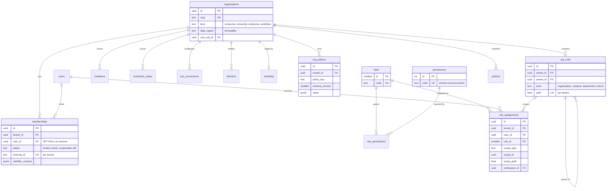
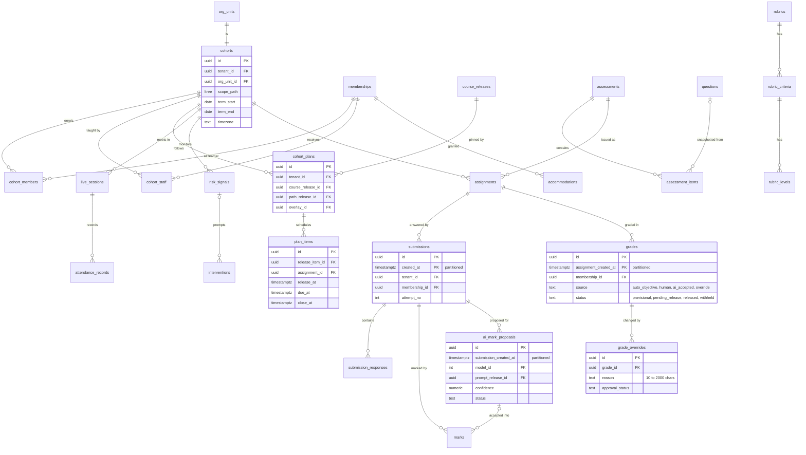
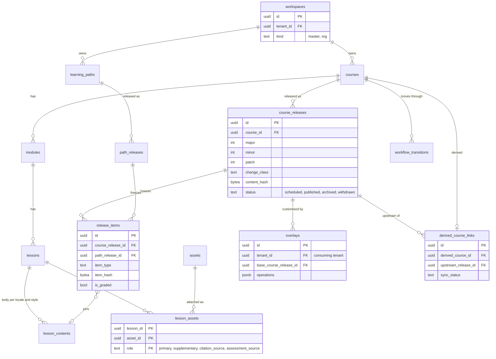
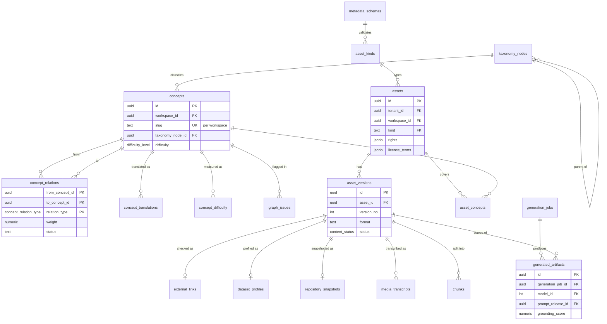
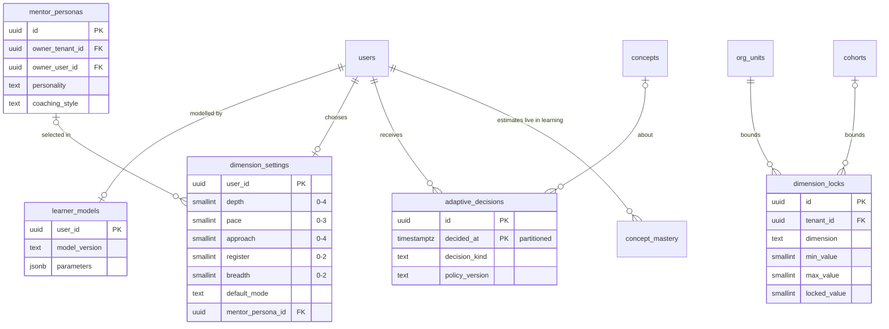
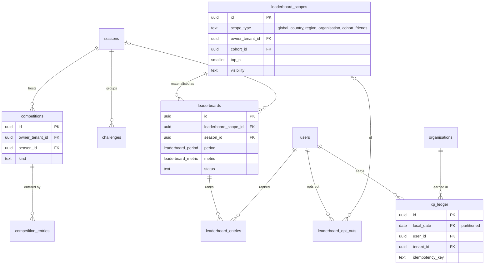
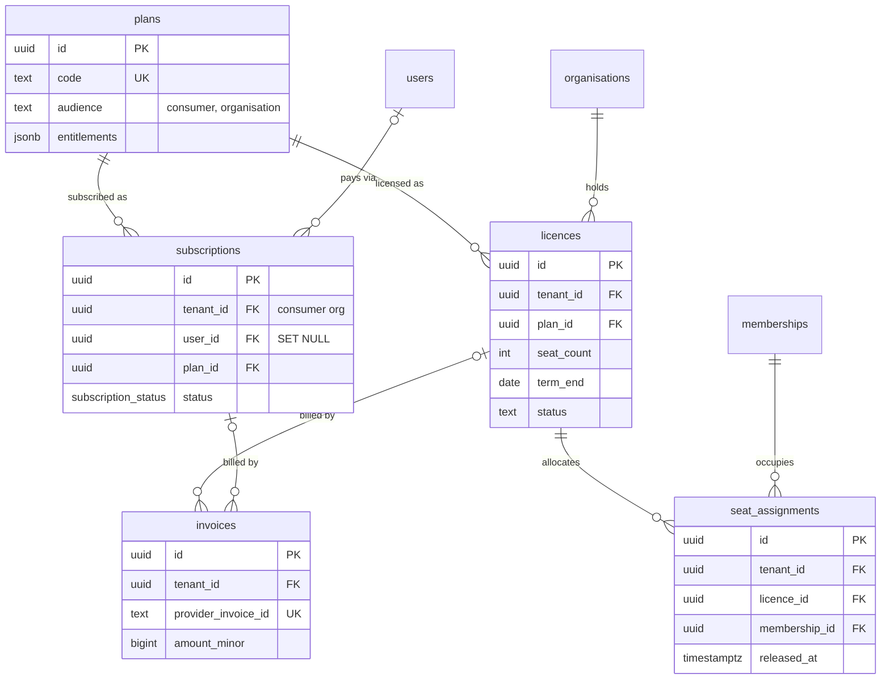

# AI Mentor database design (v2, multi-tenant platform)

| Field | Value |
| --- | --- |
| Document | 07 Database design |
| Version | 2.0 |
| Date | 13 October 2026 |
| Status | Proposed target design. The guided journey tables (`academies`, `topic_pages`, checks, assessments, bookmarks, page progress) now exist in `public`. See [Learning experience](../Learning-Experience.md). The multi-tenant v2 schemas in this document are still the target |
| Owner | Enterprise Architecture (data), with the module owners named in ADR 0017 |
| Related | [README](README.md) (canonical names), [06 System architecture](06-system-architecture.md), [08 API specification](08-api-specification.md), [09 Security model](09-security-model.md), [10 RBAC matrix](10-rbac-matrix.md), [13 Knowledge management architecture](13-knowledge-management-architecture.md), [docs/database](../database/README.md), ADR 0011, 0015–0025 |

## Change record

| Area | What changed | Why | Impacted systems | Implementation implications |
| --- | --- | --- | --- | --- |
| Tenancy | `tenant_id uuid NOT NULL` on every tenant-scoped table; restrictive RLS policy on `app.tenant_id`; composite foreign keys `(tenant_id, id)` | Organisations are tenants (ADR 0015); a missing `WHERE` must return nothing, not another tenant's rows | Every module, PgBouncer session setup, integration tests | R1 adds the column with a consumer-organisation backfill before any institution data exists |
| Schemas | 12 schemas become 23: `tenancy`, `authz`, `classroom`, `assessment`, `personalisation`, `commerce`, `messaging`, `notification`, `integration`, `platform`, `events` | One schema per bounded context (ADR 0017) | Grants in `14_security.sql`, schema-access fitness test | New DDL files `16_` to `30_`; released files `00_` to `15_` are never edited (migration-strategy.md principle 4) |
| Authorisation | `identity.users.role` replaced by scoped `authz.role_assignments`; RLS staff scope from session-set scope paths and `authz.can()` | Scoped RBAC with ABAC (ADR 0016) | `access.py`, every RLS policy that reads `app.user_role` | Shim period in R1–R2; `users.role` dropped at the end of R2 |
| Content | Workspaces, immutable course and path releases with semantic versions and content hashes, overlays, derived courses; `review` renamed `in_review` | Content Studio ownership and releases (ADR 0019) | `content`, `learning`, `classroom`, `retrieval`, workflow trigger | Enum value rename and trigger replacement in one transaction (see [Migration plan](#migration-plan)) |
| Knowledge graph | Taxonomy, concepts, and relations move from `curriculum` to `knowledge`; relation types follow the README; direction normalised to `prerequisite_of` | The `knowledge` module owns the graph (README, ADR 0020) | Planner, personalisation, retrieval payloads | `ALTER TABLE ... SET SCHEMA` (metadata only) plus a column swap for the relation enum |
| Assessment and classroom | Two new schemas: cohorts, plans, attendance, risk, interventions; assessments, rubrics, submissions, AI mark proposals, grades and overrides | Instructor and Institution Apps (ADR 0025) | `assessment`, `classroom`, `ai_gateway`, `reporting` | Partitioned evidence tables; grade integrity in triggers, not only Python |
| Commerce | `identity.subscriptions` moves to `commerce.subscriptions`; licences and seats added | Organisation licensing | Stripe webhooks, entitlements in `authz` | `ALTER TABLE ... SET SCHEMA`; compatibility view for one release |
| Residency, retention, erasure | Regional stamps, tenant pinned to a region; per-tenant retention within platform bounds; erasure split by account type | Enterprise contracts, GDPR controller/processor split (ADR 0021) | `audit`, `tenancy`, `identity.erase_user()` | New `tenancy.erase_organisation()`; academic records keyed by membership, not user |
| Ethical engagement (R1) | `users.longest_streak`, `streak_freezes`, `equipped_title`; `achievements` category/tier/rarity; `user_titles`; `milestones` | Engagement loops without a second ledger | Alembic `20261013_0005`, Learner App | Skill cards stay derived from `concept_mastery`. Target `game.*` is unchanged |

## Relationship to v1 documents

| v1 source | Status under this document |
| --- | --- |
| [docs/database/README.md](../database/README.md) | Retained as the base design. Principles 1–7, the keying, FK, constraint, index, and partitioning rules all still apply. This document adds to them and states where it overrides |
| [erd.md](../database/erd.md) | Retained for the 12 v1 schemas. ERDs here cover new and changed structures only |
| [migration-strategy.md](../database/migration-strategy.md) | Retained. Phases 0–4 and the zero-downtime rules apply to every v2 change. [Migration plan](#migration-plan) sequences v2 work onto releases R1–R5 |
| [data-retention.md](../database/data-retention.md) | Retained as the platform default schedule. [Retention per tenant](#retention-per-tenant) adds bounded overrides |
| ADR 0011 | Retained. 12 → 26 schemas, 97 → 202 tables at the end of R4 (count in [Schema map](#schema-map)) |
| `backend/db/schema/00_`–`15_` | Unchanged and immutable. v2 DDL arrives as new files `16_tenancy.sql` onwards |
| `docs/Database.md` | Describes the running MVP schema (25 tables in `public`) until the migration completes |
| `SystemArchitecture.md` §9.2 | Superseded by this document and [13](13-knowledge-management-architecture.md). Its `superseded` asset state and `advanced` relation type are not adopted |

## Contents

1. [Design targets](#design-targets)
2. [Design principles added in v2](#design-principles-added-in-v2)
3. [Schema map](#schema-map)
4. [Tenancy design](#tenancy-design)
5. [Table classification](#table-classification)
6. [Row-level security patterns](#row-level-security-patterns)
7. [Cross-tenant reference rules](#cross-tenant-reference-rules)
8. [tenancy schema](#tenancy-schema)
9. [authz schema](#authz-schema)
10. [identity changes](#identity-changes)
11. [classroom schema](#classroom-schema)
12. [assessment schema](#assessment-schema)
13. [curriculum extensions](#curriculum-extensions)
14. [knowledge extensions and the knowledge graph](#knowledge-extensions-and-the-knowledge-graph)
15. [personalisation schema](#personalisation-schema)
16. [game extensions](#game-extensions)
17. [commerce schema](#commerce-schema)
18. [messaging, notification, integration](#messaging-notification-integration)
19. [platform and events schemas](#platform-and-events-schemas)
20. [Localisation patterns](#localisation-patterns)
21. [analytics and audit extensions](#analytics-and-audit-extensions)
22. [Retention per tenant](#retention-per-tenant)
23. [Data residency](#data-residency)
24. [Erasure by account type](#erasure-by-account-type)
25. [Partitioning additions](#partitioning-additions)
26. [Index strategy additions](#index-strategy-additions)
27. [Migration plan](#migration-plan)
28. [Entity relationship diagrams](#entity-relationship-diagrams)
29. [Known gaps](#known-gaps)

---

## Design targets

Planning numbers, not measurements. The v1 learner targets (1 M registered, 100 k daily active) stand; v2 adds tenant shape.

| Signal | Target | Notes |
| --- | --- | --- |
| Organisations | 2,000 | Plus the consumer organisation (`ai-mentor-public`) and the platform content organisation (`ai-mentor-content`) |
| Largest organisation | 50,000 learners, 2,000 staff | Sizing case for every per-tenant index and RLS predicate |
| Median organisation | 300 learners | Most tenants are small; plans must stay cheap for them too |
| Registered accounts | 1 M | About 60 % personal (consumer) and 40 % institution members (managed or personal-with-membership) |
| Daily active learners | 100 k | Of which up to 40 k act in an institution context |
| Memberships | 1.3 M | Personal accounts may hold several |
| Concepts | 2,000 at launch, 10,000 by R5 | Master graph plus organisation concepts from R4 |

Per-tenant volume for the **largest** organisation, per academic year (three terms), and for the whole platform:

| Table | Largest tenant / year | Platform / year | Driver |
| --- | --- | --- | --- |
| `tenancy.org_units` | 1,700 | 300 k cumulative | 5 campuses, 120 departments, ~1,500 cohorts |
| `classroom.cohort_members` | 200 k | 1.6 M | 4 cohorts per learner per year |
| `classroom.plan_items` | 60 k | 2.4 M | 40 items per cohort plan |
| `assessment.assignments` | 18 k | 720 k | 12 per cohort |
| `assessment.submissions` | 2.5 M | 20 M | 50 per institutional learner |
| `assessment.submission_responses` | 25 M | 200 M | 10 items per submission |
| `assessment.marks` | 5 M | 40 M | Rubric criteria and manually marked items |
| `assessment.ai_mark_proposals` | 1 M | 8 M | 40 % of submissions AI-assisted |
| `assessment.grades` | 2.5 M | 20 M; 140 M at 7-year retention | One per learner per assignment |
| `classroom.attendance_records` | 7 M | 54 M | 30 sessions per cohort, 30 learners each |
| `classroom.risk_signals` | 2 M | 18 M | Only changes above threshold are stored |
| `authz.decision_log` | 30 M | 365 M | Denies, sensitive allows, 1 % sample of other allows |
| `events.outbox` | n/a | ~4 M a day | ~40 domain events per active learner per day; 7-day retention |
| `events.inbox` | n/a | ~12 M a day | Three consumers per event on average; 14-day retention |

Two consequences drive the rest of the design. First, every per-tenant query must be bounded by `tenant_id` first, because the largest tenant is 2,500 times the median. Second, assessment evidence grows like chat did in v1 (hundreds of millions of rows a year) and has a retention period set by each institution, so it is partitioned by time and purged per tenant inside partitions.

## Design principles added in v2

The seven v1 principles stand. v2 adds:

8. **Tenant first.** Tenant-scoped tables carry `tenant_id uuid NOT NULL`. It leads composite indexes, composite foreign keys, and the restrictive RLS policy. The column name is always `tenant_id`; a nullable "may be platform-wide" owner is always named `owner_tenant_id`, so a reader can tell the two apart.
9. **Academic records hang off memberships, learning records hang off users.** Rows the organisation controls (cohort membership, submissions, grades, attendance) reference `tenancy.memberships`. Rows the account controls (mastery, XP, conversations) reference `identity.users`. Erasure and organisation exit follow from that one rule (ADR 0021).
10. **Published content is immutable.** A release is a frozen manifest with a content hash. Cohorts, assignments, and AI mark proposals point at a release or a snapshot, never at mutable drafts.
11. **AI output is a proposal until a human or an explicit policy accepts it.** The database distinguishes `ai_mark_proposals` from `grades` and refuses a grade whose only source is an unaccepted proposal.
12. **One place per fact, events for the rest.** Modules write only their own schemas (ADR 0017). Cross-module effects travel through `events.outbox`, written in the same transaction as the change (ADR 0018).

## Schema map

| Schema | New or existing | Owning module | Tables (end of R4) | Partitioned | Purpose |
| --- | --- | --- | --- | --- | --- |
| `ref` | existing | shared | 3 + enums | | Languages, countries, accents, enums |
| `util` | existing | shared | 1 | | Partition registry, request-context helpers |
| `identity` | existing, changed | `identity` | 9 | | Accounts and profiles. Loses `subscriptions` |
| `tenancy` | new | `tenancy` | 9 | | Organisations, org units, memberships, SSO, branding, policies |
| `authz` | new | `authz` | 6 | 1 | Roles, permissions, assignments, policies, decision log |
| `curriculum` | existing, extended | `content` | 16 − 4 moved + 9 = 21 | | Courses, modules, lessons, paths, question bank, workspaces, releases, overlays |
| `knowledge` | existing, extended | `knowledge` (assets, graph), `retrieval` (chunks, ingestion) | 12 + 4 moved + 11 = 27 | | Assets, kinds, rights, links, datasets, repositories, transcripts, taxonomy, graph |
| `vector` | existing | `retrieval` | 5 | | Embedding lineage, Qdrant outbox |
| `learning` | existing, extended | `learning` | 15 | 7 | Enrolments, progress, mastery, practice |
| `chat` | existing | `tutor` | 5 | 3 | Conversations and messages |
| `game` | existing, extended | `gamification` | 13 + 5 = 18 | 2 | XP, badges, challenges, seasons, competitions, scoped leaderboards |
| `activity` | existing | `analytics` | 4 | 3 | Product events, sessions, LLM invocations |
| `analytics` | existing, extended | `analytics` | 10 + 4 = 14 | 4 | Facts gain tenant; cohort and workforce facts |
| `audit` | existing, extended | `audit` | 3 + 1 = 4 | 3 | Tenant-aware audit, retention policies |
| `classroom` | new | `classroom` | 9 | 2 | Cohorts, plans, sessions, attendance, risk, interventions |
| `assessment` | new | `assessment` | 13 | 5 | Assessments to grades |
| `personalisation` | new | `personalisation` | 5 | 1 | Learner model, dimensions, locks, personas, decisions |
| `commerce` | new | `commerce` | 5 | | Plans, subscriptions, licences, seats, invoices |
| `messaging` | new | `messaging` | 4 | 1 | Announcements, threads, messages |
| `notification` | new | `notification` | 4 | 1 | Templates, preferences, deliveries, digests |
| `integration` | new | `integration` | 8 | 1 | LTI, SCIM, OneRoster, webhooks, xAPI |
| `platform` | new | `config`, `ai_gateway` | 6 | | Flags, settings, models, routes, prompt releases |
| `events` | new | shared kernel | 2 | 2 | Outbox and inbox |
| `search` | new | `search` | 1 | | Keyword projection for unified search (R2) |
| `i18n` | new | `i18n` | 1 | | Translation memory (R2) |
| `reporting` | new | `reporting` | 3 | | Report definitions, schedules, runs (R3) |

Total at the end of R4: 202 tables across 26 schemas, of which 36 are partitioned.

## Tenancy design

**Model.** Shared database, shared schema (ADR 0015). A tenant is a `tenancy.organisations` row. Two built-in organisations exist from R1:

| Slug | `kind` | Role |
| --- | --- | --- |
| `ai-mentor-public` | `consumer` | Home tenant of every personal account; B2C enrolments, subscriptions, and practice live here |
| `ai-mentor-content` | `publisher` | Owns the `master` workspace. Platform admins, SMEs, curriculum designers, and content teams hold workspace roles here |

Making the master repository's owner an ordinary tenant means every authored row has a non-null `tenant_id`, so composite foreign keys and the restrictive tenant policy need no special case for content. Cross-tenant reading of master content is an explicit permissive policy on released content (see [Row-level security patterns](#row-level-security-patterns)).

**Request context.** The API sets, with `SET LOCAL` inside each transaction (safe under PgBouncer transaction pooling):

| Setting | Value | Read by |
| --- | --- | --- |
| `app.current_user_id` | Person id (v1) | Per-user policies, audit |
| `app.tenant_id` | Active organisation, validated against an `active` membership | Restrictive tenant policy |
| `app.membership_id` | The person's membership in that tenant | Learner-own academic rows |
| `app.context` | `user`, `system` (workers), or `platform` (Admin App handlers) | Every policy |
| `app.staff_scope_paths` | `ltree[]` of org-unit paths where the person holds a staff role, computed from cached assignments | Staff read policies |
| `app.workspace_ids` | `uuid[]` of Content Studio workspaces the person holds a role in | Workspace policies |
| `app.access_reason_id` | Id of the `audit.data_access_log` row for a platform read | Platform read policy |
| `app.request_id`, `app.client_ip_hmac` | As v1 | Audit |

Helper functions in `util` (all `STABLE PARALLEL SAFE`): `current_tenant_id()`, `current_membership_id()`, `staff_scope_paths()`, `workspace_ids()`, `is_platform_context()`. `util.current_user_role()` is kept as a shim until R2 and then dropped.

**Platform staff context.** Admin App handlers run with `app.context = 'platform'` and no `app.tenant_id`. In that context:

1. Global and platform-owned tables (flags, models, plans, `ref`) are readable and writable according to the API permission check.
2. Tenant data is invisible by default. A `/api/v1/platform/*` handler that needs it (support ticket, incident) first inserts an `audit.data_access_log` row with purpose and ticket reference, then sets `app.access_reason_id` and `app.tenant_id` to the target organisation. A permissive policy on tenant tables allows `SELECT` only when `util.is_platform_context()` and the reason row exists, belongs to the current user, and is less than 30 minutes old.
3. ADR 0015 describes a `BYPASSRLS` role for platform reads. This design narrows it: the `mentor_platform` login role used by the Admin App pool does **not** have `BYPASSRLS`, so the tenant reason mechanism above is the only path, and learner-private tables (`chat.*`, personal `knowledge.assets`, `knowledge.document_analyses`) have no platform read policy at all. Moderation reads flagged messages through `tutor.message.flagged` events and a redacted moderation view. `BYPASSRLS` remains only on `mentor_owner` (migrations).

**Org-unit tree.** `tenancy.org_units` holds every organisation, campus, department, and cohort as a node with a materialised `ltree` path. Labels are short per-tenant codes (`u` plus base-36 of a sequence, for example `u1k.u2f.u9q`), not slugs, so renames never rewrite paths. A cohort is both an `org_units` row (for scope) and a `classroom.cohorts` row (for teaching data), linked 1:1.

## Table classification

Every table falls into one class. The class decides the tenant column, the RLS pattern, the erasure path, and the residency rule.

| Class | Meaning | Tenant column | RLS pattern | Erasure |
| --- | --- | --- | --- | --- |
| **G** Global reference | Same for every tenant; not personal | none | none (grants only) | n/a |
| **P** Platform-owned | Platform configuration and catalogues; may be overridden per tenant | `owner_tenant_id` nullable (NULL = platform) where tenant overrides exist | Read all; write in platform context, or own tenant for overrides | n/a |
| **W** Workspace content | Authored content in a Content Studio workspace | `tenant_id NOT NULL` (workspace owner) plus `workspace_id NOT NULL` | Workspace members read and write drafts; released master content readable by all tenants; org content by its tenant | Authorship `SET NULL` |
| **T** Tenant-scoped | Organisation data, including academic records | `tenant_id NOT NULL` | Restrictive tenant policy plus staff-scope or own-membership permissive policies | Retained under institution policy; detached from the person |
| **L** Learning record | Person-owned, follows a personal account | `user_id`; ledgers add `tenant_id NOT NULL` for the context earned in | Owner, plus organisation visibility under ADR 0021 through definer views | Cascade from `identity.users` |
| **X** Learner-private | Person-owned and never visible to an organisation | `user_id`; `tenant_id NOT NULL` for context only | Owner only (v1 policies) | Cascade |
| **I** Infrastructure | Queues, outboxes, registries | `tenant_id` where the payload belongs to a tenant | Worker role only | Purged by retention |

Classification by schema:

| Schema | Table | Class | Notes |
| --- | --- | --- | --- |
| `ref` | `languages`, `countries`, `voice_accents` | G | |
| `util` | `partition_registry` | I | |
| `identity` | `users` | L | Gains `account_type`, `home_tenant_id`; the person row itself |
| `identity` | `user_profiles`, `learning_preferences`, `tutor_avatars`, `onboarding_assessments`, `user_interests`, `consents` | L | `learning_preferences` and `tutor_avatars` are superseded by `personalisation` in R3 |
| `identity` | `data_subject_requests` | T | `tenant_id` is the controller tenant (consumer org for personal accounts) |
| `identity` | `webhook_events` | I | |
| `tenancy` | `organisations` | P | The tenant row; RLS lets members read their own organisation |
| `tenancy` | `org_units`, `memberships`, `invitations`, `enrolment_codes`, `sso_connections`, `domains`, `branding`, `org_policies` | T | |
| `authz` | `roles`, `permissions`, `role_permissions` | G | Seeded; organisations cannot create roles in R1–R3 |
| `authz` | `role_assignments`, `policies` | T | Platform-scope assignments carry the consumer organisation id as storage tenant and `scope_type = 'platform'` (see below) |
| `authz` | `decision_log` | I | Partitioned; `tenant_id` of the request context |
| `curriculum` | `workspaces` | W | |
| `curriculum` | `courses`, `modules`, `lessons`, `lesson_contents`, `lesson_assets`, `learning_paths`, `learning_path_translations`, `learning_path_items`, `questions`, `question_translations`, `assessments`, `assessment_questions`, `coding_exercises`, `workflow_transitions`, `localisation_jobs` | W | |
| `curriculum` | `course_releases`, `path_releases`, `release_items` | W | Immutable |
| `curriculum` | `overlays` | T | Belongs to the consuming organisation, not the content owner |
| `curriculum` | `derived_course_links` | W | In the organisation workspace |
| `knowledge` | `taxonomy_nodes`, `concepts`, `concept_relations`, `concept_translations`, `concept_difficulty` | W | Master workspace through R3; organisation concepts from R4 |
| `knowledge` | `asset_kinds`, `vocabularies`, `vocabulary_terms`, `metadata_schemas` | P | Stewarded in `master` |
| `knowledge` | `files`, `assets`, `asset_versions`, `workflow_transitions`, `tags`, `asset_tags`, `asset_concepts`, `learning_objectives`, `external_links`, `dataset_profiles`, `repository_snapshots`, `media_transcripts`, `generation_jobs`, `generated_artifacts`, `graph_issues` | W | Curated scope |
| `knowledge` | `assets`, `asset_versions`, `chunks`, `files` with `scope = 'personal'`; `document_analyses` | X | `tenant_id` = owner's home tenant |
| `knowledge` | `ingestion_jobs`, `chunks` (curated) | I / W | Chunks inherit the asset's class |
| `vector` | `embedding_models`, `collections` | G | |
| `vector` | `chunk_embeddings`, `entity_embeddings`, `sync_outbox` | I | Follow the source row |
| `learning` | `enrollments` | T | Academic record (README); gains `tenant_id`, `cohort_id`, `course_release_id` or `path_release_id` |
| `learning` | `lesson_progress`, `concept_mastery`, `exercise_completions`, `flashcards`, `study_plans`, `study_plan_items` | L | Current state per person; no `tenant_id` (one record across tenants) |
| `learning` | `mastery_events`, `quizzes`, `quiz_items`, `quiz_attempts`, `question_responses`, `code_submissions`, `flashcard_reviews`, `recommendations` | L | Evidence rows gain `tenant_id NOT NULL` (context earned in) |
| `chat` | all five | X | Gain `tenant_id` (context) for integrity mode and managed-account deletion |
| `game` | `badges`, `titles`, `challenges`, `seasons`, `competitions`, `leaderboard_scopes`, `leaderboards` | P | `owner_tenant_id` NULL = platform-wide |
| `game` | `user_stats`, `daily_activity`, `user_badges`, `user_titles`, `xp_monthly_rollup`, `friendships`, `leaderboard_opt_outs` | L | |
| `game` | `xp_ledger`, `challenge_participations`, `competition_entries`, `leaderboard_entries` | L | Gain `tenant_id NOT NULL` |
| `activity` | `event_types` | G | |
| `activity` | `events`, `sessions`, `llm_invocations` | I | Gain `tenant_id NOT NULL`; cost metering per tenant |
| `analytics` | `dim_date` | G | |
| `analytics` | all other tables | T | Gain `tenant_id`; platform aggregates use `tenant_id` of the consumer org or a platform rollup without tenant |
| `audit` | `row_changes`, `security_events`, `data_access_log` | I | `tenant_id` **nullable**: the one deliberate exception, because platform-context events have no tenant |
| `audit` | `retention_policies` | P | |
| `classroom` | all nine | T | |
| `assessment` | all thirteen | T | |
| `personalisation` | `learner_models`, `dimension_settings`, `adaptive_decisions` | L | `adaptive_decisions` gains `tenant_id` |
| `personalisation` | `dimension_locks` | T | |
| `personalisation` | `mentor_personas` | P | `owner_tenant_id` for organisation personas; `owner_user_id` for a learner's custom persona |
| `commerce` | `plans` | G | |
| `commerce` | `subscriptions`, `licences`, `seat_assignments`, `invoices` | T | Consumer subscriptions carry the consumer org id |
| `messaging`, `notification`, `integration` | all | T | Except `notification.templates`: P with `owner_tenant_id` |
| `platform` | `feature_flags`, `settings`, `model_registry`, `prompt_releases` | G / P | |
| `platform` | `flag_rules`, `model_routes` | P | `target_tenant_id` nullable (NULL = default rule or route) |
| `events` | `outbox`, `inbox` | I | `tenant_id NOT NULL` (CloudEvents `tenantid`) |

Platform-scope role assignments deserve a word. `authz.role_assignments.tenant_id` is `NOT NULL` like every T table. A `platform_admin` assignment carries the consumer organisation id as its storage tenant and `scope_type = 'platform'`; the authorisation engine treats `scope_type`, not `tenant_id`, as the scope. This avoids a nullable tenant column on the most security-sensitive table.

## Row-level security patterns

Policies are layered. A **restrictive** policy isolates the tenant; **permissive** policies grant access within it. PostgreSQL ANDs restrictive policies with the OR of permissive ones, so no permissive policy can widen access across tenants.

**Pattern 1: tenant isolation (every T and W table).**

```sql
CREATE POLICY p_tenant ON classroom.cohorts AS RESTRICTIVE
    USING      (tenant_id = util.current_tenant_id() OR util.is_system_context())
    WITH CHECK (tenant_id = util.current_tenant_id() OR util.is_system_context());
```

**Pattern 2: staff scope by org-unit path.** Rows that belong to an org unit carry its path (`scope_path ltree`, copied from `tenancy.org_units` and maintained by the move trigger). Staff see rows under any path in their session scope:

```sql
CREATE POLICY p_staff_read ON classroom.cohorts FOR SELECT
    USING (scope_path <@ (SELECT util.staff_scope_paths()));   -- ltree <@ ltree[]: any ancestor
```

Wrapping the function in a scalar sub-select makes it an InitPlan, evaluated once per statement rather than per row. The tenant-leading B-tree index does the pruning; the path test is a filter over a tenant's rows, which is at most a few thousand cohorts.

**Pattern 3: own academic rows.** Learners see their own submissions and grades through their membership in the active tenant:

```sql
CREATE POLICY p_own_membership ON assessment.grades FOR SELECT
    USING (membership_id = util.current_membership_id() AND status = 'released');
```

**Pattern 4: cohort children.** Tables below a cohort (plan items, attendance, submissions) carry `cohort_id`. Their staff policy resolves the allowed cohorts once per statement:

```sql
CREATE POLICY p_staff_cohort ON assessment.submissions FOR SELECT
    USING (cohort_id = ANY ((SELECT authz.staff_cohort_ids())));
```

`authz.staff_cohort_ids()` is `SECURITY DEFINER STABLE`, reads `classroom.cohorts` for the current tenant where `scope_path <@ util.staff_scope_paths()`, and returns `uuid[]`. For an `org_admin` (scope = the organisation root) it short-circuits to a sentinel and the policy becomes tenant-wide.

**Pattern 5: sensitive writes through `authz.can()`.** For writes where a stale session scope would be dangerous (grade release and override, role assignment), the `WITH CHECK` clause re-checks against the authoritative tables:

```sql
CREATE FUNCTION authz.can(p_permission text, p_scope_path ltree) RETURNS boolean
LANGUAGE sql STABLE SECURITY DEFINER SET search_path = pg_catalog, pg_temp AS $$
  SELECT EXISTS (
    SELECT 1
    FROM authz.role_assignments ra
    JOIN authz.role_permissions rp ON rp.role_id = ra.role_id
    JOIN authz.permissions p       ON p.id = rp.permission_id AND p.code = p_permission
    WHERE ra.user_id   = util.current_user_id()
      AND ra.tenant_id = util.current_tenant_id()
      AND ra.status    = 'active'
      AND (ra.expires_at IS NULL OR ra.expires_at > now())
      AND (ra.scope_type = 'platform' OR p_scope_path <@ ra.scope_path))
$$;

CREATE POLICY p_override_insert ON assessment.grade_overrides FOR INSERT
    WITH CHECK (authz.can('assessment.grade:override', authz.cohort_path(tenant_id, cohort_id)));
```

`authz.cohort_path(tenant_id, cohort_id)` is a `STABLE SECURITY DEFINER` lookup of `classroom.cohorts.scope_path`. `authz.can()` checks RBAC and scope only. Attribute conditions (MFA freshness, integrity mode, two-person rule, app audience) stay in the Python policy engine (ADR 0016), which runs first. The database function is the second fence, not the policy engine.

**Pattern 6: released master content.** W tables readable across tenants once released:

```sql
CREATE POLICY p_tenant ON curriculum.release_items AS RESTRICTIVE
    USING (tenant_id = util.current_tenant_id()
           OR workspace_id = util.master_workspace_id()
           OR util.is_system_context());
```

Draft master content is not covered by this clause: `courses`, `lessons`, and `lesson_contents` in draft are visible only to members of the workspace (`workspace_id = ANY (util.workspace_ids())`). Learners read released content through `release_items` and the `lesson_contents` rows a release pins.

**Pattern 7: learner-private (X).** The v1 policies (`util.can_access_user_row(user_id)`) are kept unchanged and gain the restrictive tenant policy only where the row's `tenant_id` is the home tenant. Organisation staff and platform staff have no policy on these tables.

The v1 policies on `knowledge.assets` that test `util.current_user_role() IN ('instructor', 'admin')` are replaced in R2 by workspace membership (`workspace_id = ANY (util.workspace_ids())`).

## Cross-tenant reference rules

| Rule | Mechanism |
| --- | --- |
| A tenant row may reference only rows of the same tenant | Every T parent has `UNIQUE (tenant_id, id)`; children use `FOREIGN KEY (tenant_id, parent_id) REFERENCES parent (tenant_id, id)`. A mismatched tenant cannot be written, whatever the application does |
| A tenant row may reference global (G) and platform (P) rows | Plain single-column FK |
| A tenant row may reference released content of another tenant (master, or a licensed marketplace listing in R5) | Single-column FK to `course_releases` / `path_releases` / `release_items`, plus constraint trigger `curriculum.assert_release_usable(tenant_id, release_id)`: the release's workspace is `master`, or belongs to the same tenant, or is covered by an active licence entitlement |
| A tenant row may reference a person | Through `tenancy.memberships (tenant_id, id)`, never `identity.users` directly, for T tables. L and X tables reference `identity.users` |
| Overlays reference a release and a target in the consuming tenant | `(tenant_id, cohort_plan_id)` composite; release by the trigger above |
| Platform rows never reference tenant rows | Checked by a CI schema test over `pg_constraint` |
| No foreign key crosses a residency stamp | Stamps are separate databases; see [Data residency](#data-residency) |

Composite keys cost one extra `uuid` (16 bytes) per FK column and index entry. In return, cross-tenant references are structurally impossible, which matters more than the bytes at 2,000 tenants.

## tenancy schema

| Table | Key columns | Constraints and notes |
| --- | --- | --- |
| `organisations` | `id`, `slug` UK, `kind` (`consumer`, `university`, `college`, `school`, `enterprise`, `bootcamp`, `government`, `publisher`), `name`, `status` (`provisioning`, `active`, `suspended`, `offboarding`, `deleted`), `data_region` (`eu`, `us`, ...), `default_locale`, `timezone`, `country_code`, `root_unit_id`, `created_at` | `data_region` is immutable (trigger). One `consumer` row (partial unique). `deleted_at` coherent with status |
| `org_units` | `id`, `tenant_id`, `parent_id`, `level` (`organisation`, `campus`, `department`, `cohort`), `label` (short code), `path ltree`, `depth` generated, `name`, `code` (institution's own code), `status` | `UNIQUE (tenant_id, id)`, `UNIQUE (tenant_id, path)`. Depth trigger enforces README rules: campus under organisation; department under organisation, campus, or one department (two levels maximum); cohort under any non-cohort. Move trigger cascades paths (pattern of `taxonomy_set_path`) and updates `scope_path` on `classroom.cohorts` and on `authz.role_assignments` |
| `memberships` | `id`, `tenant_id`, `user_id` (nullable, `ON DELETE SET NULL`), `status` (`invited`, `active`, `suspended`, `left`), `account_type_at_join`, `external_id` (student or employee number), `display_name_snapshot`, `primary_unit_id`, `visibility_consent jsonb`, `consent_version`, `joined_at`, `left_at`, `erased_at` | `UNIQUE (tenant_id, user_id) WHERE user_id IS NOT NULL`; `UNIQUE (tenant_id, external_id)`. A managed account has exactly one membership (constraint trigger against `identity.users.account_type`). `visibility_consent` records what a personal account allowed the organisation to see (ADR 0021) |
| `invitations` | `id`, `tenant_id`, `email citext`, `token_hash bytea`, `target_unit_id`, `cohort_id`, `role_id`, `invited_by`, `status` (`pending`, `accepted`, `revoked`, `expired`), `expires_at` | Token stored as SHA-256 only. Partial unique on (`tenant_id`, `email`, `target_unit_id`) while pending |
| `enrolment_codes` | `id`, `tenant_id`, `code_hash`, `code_prefix` (first 4 characters, for display), `target_unit_id`, `cohort_id`, `role_id` (always `learner` in R3), `max_uses`, `use_count`, `valid_from`, `valid_until`, `status` | `use_count <= max_uses`; increments under row lock |
| `sso_connections` | `id`, `tenant_id`, `protocol` (`saml`, `oidc`), `clerk_connection_id`, `status`, `jit_provisioning boolean`, `default_unit_id`, `attribute_mapping jsonb`, `enforced boolean` | One enforced connection per tenant (partial unique). Secrets live in Clerk and Key Vault, never here |
| `domains` | `id`, `tenant_id`, `domain citext`, `purpose` (`sso_routing`, `email_allowlist`, `white_label_host`), `verification_status`, `verification_token_hash`, `verified_at` | `UNIQUE (domain, purpose)` across tenants where verified, so two tenants cannot claim one domain |
| `branding` | `tenant_id` PK, `logo_file_id`, `colours jsonb`, `display_name`, `email_from_name`, `custom_host`, `support_url`, `schema_version` | Colours validated against the design-token schema; contrast checks in the API |
| `org_policies` | `id`, `tenant_id`, `policy_key` (the README's organisation policy keys, for example `leaderboards.public_participation`, `mentor.allowed_modes`, `grades.override_approval`, `records.passport_export`, `members.allow_personal`, `seats.reclaim_inactive_days`), `schema_version smallint`, `value jsonb`, `effective_from`, `set_by`, `superseded_at` | One current row per (`tenant_id`, `policy_key`) (partial unique on `superseded_at IS NULL`). History by supersession, not update. `value` validated against the JSON Schema registered for (`policy_key`, `schema_version`) |

`tenancy.org_policies` and `authz.policies` are different things. Organisation policies are configuration the Institution App edits (how long to keep grades, whether managed learners appear on the global leaderboard). `authz.policies` are authorisation conditions and deny rules evaluated by the policy engine (overrides need lead-instructor approval; freeze an assessment). Both are tenant-scoped and audited.

## authz schema

| Table | Key columns | Constraints and notes |
| --- | --- | --- |
| `roles` | `id smallint`, `code` UK (the 21 README role ids), `scope_types text[]`, `apps text[]`, `is_system` | Seeded. `scope_types` subset of `platform`, `organisation`, `campus`, `department`, `cohort`, `workspace` |
| `permissions` | `id integer`, `code` UK (`<context>.<resource>:<action>`), `is_sensitive` (always logged), `description` | `CHECK (code ~ '^[a-z_]+\.[a-z_]+:[a-z_]+$')` |
| `role_permissions` | `role_id`, `permission_id` | PK both. Generated into [10-rbac-matrix.md](10-rbac-matrix.md) |
| `role_assignments` | `id`, `tenant_id`, `user_id`, `role_id`, `scope_type`, `scope_id`, `scope_path ltree` (NULL for `platform` and `workspace`), `workspace_id` (for `workspace`), `status` (`active`, `suspended`, `revoked`), `source` (`manual`, `invitation`, `enrolment_code`, `sso_jit`, `scim`, `lti`, `cohort_staff`, `migration`), `source_ref`, `granted_by`, `granted_at`, `expires_at`, `revoked_at` | `UNIQUE (user_id, role_id, scope_type, scope_id) WHERE status = 'active'`. Check: `scope_type = ANY(role.scope_types)` (trigger). Last `platform_admin` and last `org_owner` per tenant cannot be revoked (trigger with advisory lock per tenant) |
| `policies` | `id`, `tenant_id`, `policy_key`, `effect` (`allow`, `deny`), `permission_code`, `resource_selector jsonb`, `condition_key`, `parameters jsonb`, `enabled`, `valid_from`, `valid_until` | Only built-in `condition_key` values (ADR 0016); organisations switch and parameterise, they do not author code |
| `decision_log` | `id`, `decided_at` (partition key), `tenant_id`, `user_id`, `app_audience`, `permission_code`, `resource_type`, `resource_id`, `decision`, `reason_code`, `assignment_id`, `policy_ids int[]`, `correlation_id` | Monthly range partitions, 13 months. No FKs (ingest throughput). Writes are batched from the API through the worker |

Indexes: `role_assignments (user_id, status) INCLUDE (tenant_id, role_id, scope_type, scope_path, workspace_id)` serves the per-request assignment load (one index-only scan per person, then cached); `role_assignments USING gist (scope_path)` serves "who are the staff of this cohort" (`scope_path @> $cohort_path`); `role_assignments (tenant_id, role_id) WHERE status = 'active'` serves the Institution App staff lists.

## identity changes

| Change | Detail |
| --- | --- |
| `users.account_type` | `personal` or `managed`, `NOT NULL DEFAULT 'personal'` |
| `users.home_tenant_id` | `NOT NULL` FK to `tenancy.organisations`; backfilled to the consumer organisation |
| `users.role` | Kept read-only through R2 for the `access.py` shim, then dropped by column-swap contract. `ref.user_role` dropped with it |
| `users.email` uniqueness | Stays global among non-deleted users. A managed account and a personal account cannot share an email; an institution provisioning an existing personal email gets a membership invitation instead (see [Known gaps](#known-gaps)) |
| `subscriptions` | Moves to `commerce` |
| `consents` | Unchanged; organisation-specific consent (what a personal account shares with an organisation) lives on `tenancy.memberships` |
| `learning_preferences`, `tutor_avatars` | Superseded by `personalisation.dimension_settings` and `personalisation.mentor_personas` in R3. Dual-written for one release, then dropped |
| `data_subject_requests` | Gains `tenant_id` (the controller handling the request) and `account_type` |

## classroom schema

| Table | Key columns | Constraints and notes |
| --- | --- | --- |
| `cohorts` | `id`, `tenant_id`, `org_unit_id` (1:1, level `cohort`), `scope_path ltree`, `code`, `name`, `term_name`, `term_start date`, `term_end date`, `timezone`, `default_locale`, `status` (`planned`, `active`, `completed`, `archived`), `capacity`, `created_by_membership_id` | `UNIQUE (tenant_id, id)`, `UNIQUE (tenant_id, org_unit_id)`, `term_end >= term_start`. `timezone` validated against `pg_timezone_names` at write |
| `cohort_members` | `tenant_id`, `cohort_id`, `membership_id`, `status` (`active`, `withdrawn`, `completed`), `source` (`manual`, `import`, `enrolment_code`, `invitation`, `scim`, `lti`, `oneroster`), `joined_at`, `left_at`, `import_batch_id` | PK (`tenant_id`, `cohort_id`, `membership_id`); composite FKs to cohorts and memberships. Bulk import writes in batches of 1,000 with one `classroom.cohort_member.added` event per batch plus per-member ids |
| `cohort_staff` | `tenant_id`, `cohort_id`, `membership_id`, `role` (`lead_instructor`, `instructor`, `teaching_assistant`), `delegations text[]` (for example `assessment.grade:release` for a TA), `added_by`, `added_at`, `removed_at` | PK (`tenant_id`, `cohort_id`, `membership_id`). Each row creates an `authz.role_assignments` row with `source = 'cohort_staff'` in the same transaction through the `authz` interface. `authz` is authoritative for permission; `cohort_staff` is the teaching roster and relationship attribute "cohort instructor of" |
| `cohort_plans` | `id`, `tenant_id`, `cohort_id`, `course_release_id` or `path_release_id`, `overlay_id`, `status` (`draft`, `scheduled`, `active`, `completed`, `archived`), `upgrade_policy` (`none`, `patch`, `minor`), `starts_on`, `ends_on`, `scheduled_by`, `scheduled_at` | `CHECK (num_nonnulls(course_release_id, path_release_id) = 1)`. Release usability trigger. One active plan per (cohort, course) by partial unique on a generated `course_id` |
| `plan_items` | `id`, `tenant_id`, `cohort_plan_id`, `release_item_id` or `assignment_id` or `live_session_id` or `overlay_item_key`, `position`, `release_at`, `due_at`, `close_at`, `is_required`, `instructions_md` | Exactly-one target. `release_at <= due_at <= close_at` where present. `DEFERRABLE` position uniqueness per plan |
| `live_sessions` | `id`, `tenant_id`, `cohort_id`, `title`, `starts_at`, `ends_at`, `location_kind` (`in_person`, `online`, `hybrid`), `join_url`, `check_in_code_hash`, `check_in_opens_at`, `check_in_closes_at`, `status` | `ends_at > starts_at`. `UNIQUE (tenant_id, id, starts_at)` so attendance can carry the partition key |
| `attendance_records` | `tenant_id`, `live_session_id`, `session_starts_at` (partition key), `membership_id`, `status` (`present`, `late`, `absent`, `excused`), `source` (`manual`, `check_in`, `activity`, `lti`), `recorded_by`, `recorded_at`, `note` | Monthly partitions. PK (`tenant_id`, `live_session_id`, `membership_id`, `session_starts_at`). Later manual record wins; changes audited |
| `risk_signals` | `id`, `computed_at` (partition key), `tenant_id`, `cohort_id`, `membership_id`, `kind` (`inactivity`, `missed_due_dates`, `falling_mastery`, `low_engagement`, `composite`), `score numeric(5,4)`, `severity` (`low`, `medium`, `high`), `evidence jsonb`, `model_key`, `model_version`, `status` (`open`, `acknowledged`, `resolved`, `dismissed`), `acknowledged_by` | Monthly partitions, 25 months. `evidence` is ids and numbers only (last activity date, missed assignment ids, mastery deltas), never free text. One open signal per (`membership_id`, `cohort_id`, `kind`) by partial unique within partition plus service check |
| `interventions` | `id`, `tenant_id`, `cohort_id`, `membership_id`, `risk_signal_id`, `risk_signal_computed_at`, `kind` (`message`, `meeting`, `plan_adjustment`, `referral`, `extension`), `notes_md`, `evidence_snapshot jsonb`, `outcome` (`pending`, `improved`, `no_change`, `withdrawn`), `created_by`, `follow_up_on` | Not partitioned (low volume, academic record). The FK to the partitioned `risk_signals` carries `risk_signal_computed_at`; `evidence_snapshot` copies the signal so the intervention survives signal retention (`ON DELETE SET NULL`) |

Learning delivery (`learning` module) reads plans through the `classroom` interface and writes progress to `learning`. Classroom never writes `learning` rows.

## assessment schema

| Table | Key columns | Constraints and notes |
| --- | --- | --- |
| `assessments` | `id`, `tenant_id`, `kind` (`quiz`, `exam`, `assignment`, `project`, `coding`, `written`), `title`, `source_release_item_id` (when based on a released master assessment), `locales text[]`, `grading_mode` (`auto`, `manual`, `ai_assisted`), `default_rubric_id`, `integrity_mode` (`none`, `restricted_mentor`, `no_mentor`), `status` (`draft`, `ready`, `retired`), `owner_membership_id` | `UNIQUE (tenant_id, id)` |
| `assessment_items` | `id`, `tenant_id`, `assessment_id`, `position`, `question_id` (bank, nullable), `question_content_hash bytea`, `snapshot jsonb` (prompt, options, metadata per locale), `answer_key_snapshot jsonb`, `points`, `rubric_id`, `concept_id`, `is_objective boolean` | Snapshot taken when the assessment becomes `ready`; immutable afterwards (trigger). `answer_key_snapshot` is not granted to `mentor_readonly` and is redacted in audit. Locally authored items have `question_id IS NULL` |
| `assignments` | `id`, `tenant_id`, `assessment_id`, `cohort_id` or `membership_id` (individual), `opens_at`, `due_at`, `closes_at`, `attempts_allowed`, `late_policy jsonb`, `ai_marking` (`off`, `propose`, `auto_objective`), `grade_release` (`manual`, `on_close`, `immediate_objective`), `override_requires_approval boolean`, `status` (`draft`, `published`, `closed`, `archived`), `published_at`, `created_at` | `opens_at < due_at <= closes_at`. Exactly one target. `ai_marking` and `grade_release` bounded by `org_policies.assessment.ai_marking` (service check). Publishing emits `assessment.assignment.published` |
| `rubrics` | `id`, `tenant_id`, `family_id`, `version`, `title`, `scoring` (`points`, `levels`, `holistic`), `total_points`, `status` (`draft`, `locked`), `locked_at`, `source_release_item_id` | `UNIQUE (tenant_id, family_id, version)`. Locked automatically when first used by a published assignment; a change makes a new version. Marks reference the version, so regrading against a new rubric is explicit |
| `rubric_criteria` | `id`, `tenant_id`, `rubric_id`, `position`, `title`, `description`, `max_points`, `weight`, `concept_id` | Immutable once the rubric is locked (trigger) |
| `rubric_levels` | `id`, `tenant_id`, `criterion_id`, `position`, `label`, `points`, `descriptor` | `points <= criterion.max_points` (trigger) |
| `submissions` | `id`, `created_at` (partition key), `tenant_id`, `assignment_id`, `cohort_id`, `membership_id`, `attempt_no`, `status` (`in_progress`, `submitted`, `late`, `marking`, `marked`, `returned`, `voided`), `submitted_at`, `locale`, `integrity_flags jsonb`, `accommodation_id` | Monthly partitions. PK (`id`, `created_at`). `UNIQUE (assignment_id, membership_id, attempt_no, created_at)` plus service check against `attempts_allowed` |
| `submission_responses` | `submission_id`, `submission_created_at`, `tenant_id`, `item_id`, `response jsonb`, `file_ids uuid[]`, `auto_score`, `auto_marked_at` | Co-partitioned with submissions. Size cap on `response` (256 KB). Uploaded files are stored in the tenant's blob container and referenced by `knowledge.files` id; they are never assets and never ingested into RAG |
| `marks` | `id`, `submission_id`, `submission_created_at`, `tenant_id`, `item_id` or `criterion_id`, `rubric_id`, `level_id`, `points`, `comment_md`, `source` (`human`, `ai_accepted`, `ai_modified`, `auto`), `ai_proposal_id`, `marked_by_membership_id`, `marked_at`, `superseded_at` | Co-partitioned. One current mark per (submission, item or criterion) by partial unique on `superseded_at IS NULL`. `source IN ('ai_accepted', 'ai_modified')` requires `ai_proposal_id` and `marked_by_membership_id` |
| `ai_mark_proposals` | `id`, `submission_id`, `submission_created_at`, `tenant_id`, `rubric_id`, `model_id` (FK `platform.model_registry`), `prompt_release_id` (FK `platform.prompt_releases`), `llm_invocation_id`, `proposed_points`, `per_criterion jsonb` (criterion id, level id, points, confidence, rationale), `evidence_spans jsonb` (response id, start, end, quote hash), `confidence numeric(4,3)`, `status` (`proposed`, `accepted`, `modified`, `rejected`, `superseded`, `failed`), `reviewed_by_membership_id`, `reviewed_at` | Co-partitioned. `status IN ('accepted', 'modified', 'rejected')` requires a reviewer. Never readable by learners (no learner policy). Emits `assessment.submission.ai_marked` |
| `grades` | `id`, `assignment_created_at` (partition key), `tenant_id`, `assignment_id`, `cohort_id`, `membership_id`, `points`, `percentage`, `letter`, `source` (`auto_objective`, `human`, `ai_accepted`, `override`), `status` (`provisional`, `pending_release`, `released`, `withheld`), `submission_id`, `released_by`, `released_at`, `version` | Monthly partitions by assignment creation so a gradebook column is one partition. `UNIQUE (assignment_id, membership_id, assignment_created_at)` |
| `grade_overrides` | `id`, `tenant_id`, `cohort_id`, `grade_id`, `assignment_created_at`, `previous_points`, `new_points`, `previous_source`, `reason text`, `ai_proposal_id`, `overridden_by_membership_id`, `approval_status` (`not_required`, `pending`, `approved`, `rejected`), `approved_by_membership_id`, `created_at` | Append-only ledger. `char_length(reason) BETWEEN 10 AND 2000`. Approver differs from overrider. Emits `assessment.grade.overridden` |
| `accommodations` | `id`, `tenant_id`, `membership_id`, `scope` (`all`, `assessment`, `assignment`), `assessment_id`, `assignment_id`, `kind` (`extra_time`, `separate_window`, `alternative_format`, `assistive_technology`, `reduced_load`), `parameters jsonb`, `valid_from`, `valid_until`, `approved_by`, `evidence_ref` | Medical or disability evidence is never stored; `evidence_ref` points to the institution's own system. Data classification `special_category` in audit redaction |

**Integrity rules** (constraint and trigger enforced, in addition to the service layer):

| Rule | Enforcement |
| --- | --- |
| Grade release is a state machine: `provisional → pending_release → released`, `provisional → withheld → pending_release`, `released → released` only through an override | `assessment.enforce_grade_state()` trigger on `UPDATE OF status, points` |
| A released grade's points change only by inserting `grade_overrides` | Trigger rejects direct `UPDATE OF points` when `status = 'released'` unless the transaction set `app.grade_override_id` to a row it just inserted for this grade |
| An override needs a reason and, when the assignment requires it, an approval before taking effect | Check constraint on `reason`; trigger applies `new_points` to `grades` only when `approval_status IN ('not_required', 'approved')` |
| An AI proposal cannot become a grade without a human, unless the assignment is auto-graded and every item is objective | Trigger on `grades`: `source = 'ai_accepted'` requires every current mark to have `source IN ('human', 'ai_accepted', 'ai_modified')` with a reviewer; `source = 'auto_objective'` requires `assignments.ai_marking = 'auto_objective'` and all items `is_objective`. There is no `source = 'ai'` value at all |
| Learners never see AI proposals or unreleased grades | No learner `SELECT` policy on `ai_mark_proposals`; learner policy on `grades` requires `status = 'released'` |
| Rubric changes never rewrite past marks | Locked rubrics and criteria are immutable; marks reference `rubric_id` (a version) |
| Grade overrides on AI-proposed grades are attributable | `ai_proposal_id` on the override when the overridden mark came from a proposal; reported in AI marking quality analytics |

## curriculum extensions

**Workspaces.** `curriculum.workspaces (id, tenant_id, kind, slug, name, settings jsonb, status)` with `kind` in `master`, `org`. Exactly one `master` (partial unique), owned by `ai-mentor-content`. At most one `org` workspace per tenant in R3 (licence feature), more from R4. Every authored row in `curriculum` and `knowledge` gains `workspace_id NOT NULL` and `tenant_id NOT NULL`, with a composite FK `(tenant_id, workspace_id) → workspaces (tenant_id, id)`, so a row's tenant always equals its workspace's tenant.

Slugs become unique per workspace: `UNIQUE (workspace_id, slug)` replaces the global `UNIQUE (slug)` on courses, lessons, paths, assessments, and exercises.

**Releases.**

| Table | Key columns | Constraints and notes |
| --- | --- | --- |
| `course_releases` | `id`, `tenant_id`, `workspace_id`, `course_id`, `major`, `minor`, `patch`, `version text` generated (`major.minor.patch`), `change_class` (`major`, `minor`, `patch`), `content_hash bytea`, `manifest jsonb`, `locales text[]`, `status` (`scheduled`, `published`, `archived`, `withdrawn`), `scheduled_for`, `published_at`, `approved_by`, `published_by`, `release_notes_md`, `previous_release_id` | `UNIQUE (course_id, major, minor, patch)`. Version strictly greater than the previous release of the course (trigger), and the bump matches `change_class`. Immutable except `status` moves `scheduled → published → archived` and any → `withdrawn` (takedown); trigger rejects other updates and every delete. `approved_by <> published_by` is not required (publisher may be the approver), but `approved_by` must not be an author of any included item (two-person rule, checked at release creation) |
| `path_releases` | as above, with `path_id` | Pins exact `course_releases` in its items |
| `release_items` | `id`, `tenant_id`, `workspace_id`, `course_release_id` or `path_release_id`, `position`, `parent_item_id` (module within course), `item_type` (`module`, `lesson`, `assessment`, `exercise`, `asset`, `course`, `project`), entity id columns (one non-null), `lesson_content_ids uuid[]` (pinned bodies per locale and style), `asset_version_id`, `concept_id`, `item_hash bytea`, `is_graded`, `title_snapshot jsonb` | Exactly one parent release and one entity. Immutable with its release. `item_hash` is the SHA-256 of the canonical item; `content_hash` of the release is the hash of the ordered item hashes |
| `overlays` | `id`, `tenant_id`, `base_course_release_id` or `base_path_release_id`, `target` (`cohort_plan`, `org_unit`), `org_unit_id`, `operations jsonb`, `schema_version`, `created_by_membership_id`, `status` (`draft`, `active`, `retired`) | `operations` is an ordered array of `{op, target_item_key, ...}` with `op` in `hide`, `reorder`, `add_item`, `set_dates`, `add_instruction`, validated against the base manifest. `hide` on a graded item is refused when an assignment is published against it. Overlays never touch W rows |
| `derived_course_links` | `id`, `tenant_id`, `workspace_id` (org), `derived_course_id`, `upstream_course_id`, `upstream_release_id` (the release copied), `last_reviewed_release_id`, `sync_status` (`up_to_date`, `update_available`, `merging`, `diverged`), `created_at` | Derived course is a normal course in the org workspace. A newer upstream release sets `update_available` (event consumer) |
| `workflow_transitions` | `id bigint`, `tenant_id`, `entity_type` (`course`, `module`, `lesson`, `lesson_content`, `learning_path`, `question`, `assessment`, `coding_exercise`, `question_translation`), `entity_id`, `from_status`, `to_status`, `action` (`submit`, `request_changes`, `approve`, `withdraw`, `publish`, `archive`, `revive`), `actor_id`, `comment` | Written by a generic workflow trigger on every W table with a `status` column. Same transition table as `knowledge.enforce_version_workflow` |
| `lesson_assets` | `tenant_id`, `lesson_id`, `asset_id`, `role` (`primary`, `supplementary`, `citation_source`, `assessment_source`), `position`, `pinned_version_id` | PK (`lesson_id`, `asset_id`, `role`). At most one `primary` per lesson. Releases snapshot the pinned asset version |
| `localisation_jobs` | `id`, `tenant_id`, `workspace_id`, `entity_type`, `entity_id`, `source_locale`, `target_locale`, `mode` (`machine_draft`, `human`), `status`, `assignee_id`, `model_id`, `prompt_release_id`, `due_at` | Content-owned queue for the localisation pipeline ([13](13-knowledge-management-architecture.md#localisation-pipeline)) |

**Workflow states.** README: `draft → in_review → approved → published → archived`, with `changes_requested` back to `draft`. This design treats `changes_requested` as a **transition action** recorded in `workflow_transitions.action = 'request_changes'` (from `in_review` to `draft`), not as a sixth state, because the README lists five states and the v1 trigger already has `review → draft`. Content Studio derives "changes requested" for an author's queue from the latest transition. Allowed transitions:

| From | To | Action | Who |
| --- | --- | --- | --- |
| `draft` | `in_review` | `submit` | Author |
| `in_review` | `draft` | `request_changes` | Reviewer (comment required) |
| `in_review` | `approved` | `approve` | Reviewer who is not an author (trigger checks `created_by` and every `editor_id` on the entity's versions) |
| `approved` | `draft` | `withdraw` | Author or reviewer |
| `approved` | `published` | `publish` | Publisher; for courses and paths this creates a release |
| `published` | `archived` | `archive` | Publisher |
| `archived` | `draft` | `revive` | Publisher (new version) |

**Enrolments.** `learning.enrollments` gains `tenant_id`, `cohort_id`, `course_id` (nullable), `course_release_id` or `path_release_id`; `path_id` becomes nullable with `CHECK (num_nonnulls(path_id, course_id) = 1)`. The uniqueness becomes a unique index on `(tenant_id, user_id, coalesce(path_id, course_id))`. The table name keeps its v1 spelling (`enrollments`) to avoid a rename of the busiest learning table; the event is `learning.enrolment.created`.

## knowledge extensions and the knowledge graph

**Graph tables move to `knowledge`.** The README assigns taxonomy, the concept graph, and metadata to the `knowledge` module, and ADR 0017 gives `content` the `curriculum` schema. `taxonomy_nodes`, `concepts`, `concept_relations`, and `concept_translations` therefore move with `ALTER TABLE curriculum.x SET SCHEMA knowledge` in R2. The move is a catalogue update: foreign keys, indexes, triggers, and RLS policies follow the table. Compatibility views `curriculum.concepts` etc. exist for one release so un-migrated queries keep working, then are dropped.

**Concepts.**

| Change | Detail |
| --- | --- |
| `concepts.workspace_id`, `tenant_id` | Master through R3. From R4 an organisation workspace may add concepts; organisation concepts may depend on master concepts, never the reverse (trigger) |
| `concepts.difficulty` | Kept (`ref.difficulty_level`); this is the authored level. The enum becomes the README's five levels: in R2, rows with `phd` are updated to `researcher`, then the type is rebuilt without `phd` (`CREATE TYPE` new, `ALTER COLUMN ... TYPE` on every user of the enum, drop old), because PostgreSQL cannot drop an enum value |
| `concepts.slug` | Unique per workspace; master slugs are the stable public identifiers (`bellman_equation`) |
| `concept_difficulty` (new) | `concept_id`, `source` (`authored`, `irt`, `cohort_observed`), `locale`, `value numeric(6,3)`, `sample_size`, `computed_at`, `model_version`. Empirical difficulty from question responses (IRT b-parameters averaged over the concept's items) and observed time to mastery. Feeds difficulty progression checks |
| `concept_translations` | Gains `translation_status` (see [Localisation patterns](#localisation-patterns)) |

**Relation types.** The v1 enum `ref.concept_relation` (`prerequisite`, `related`, `extends`, `part_of`, `applies_to`) is replaced by `ref.concept_relation_type` with the README values. Direction is normalised so every edge reads left to right as an English sentence:

| v2 type | Reads as | v1 value and direction | Acyclic | Default weight meaning |
| --- | --- | --- | --- | --- |
| `prerequisite_of` | A must be mastered before B | `prerequisite` with from = B, to = A (**reversed** in migration) | Yes (trigger) | Strength of dependency; 1.0 = hard prerequisite, below 0.5 = recommended |
| `builds_on` | A extends or deepens B | `extends` (same direction) | Yes (shares the prerequisite check) | Overlap of content |
| `related_to` | A and B are associated | `related` | No; stored once with `from < to` | Similarity |
| `part_of` | A is a component of B | `part_of` | Yes | n/a (1.0) |
| `applies_to` | A is applied in B | `applies_to` | No | Relevance |
| `contrasts_with` | A is commonly confused with or opposed to B | new | No; stored once with `from < to` | Confusion rate when computed |

`concept_relations` gains `workspace_id`, `tenant_id`, `rationale`, `source` (`authored`, `suggested`, `imported`), `status` (`active`, `proposed`, `retired`), and `updated_at`. The cycle trigger `prevent_prerequisite_cycle()` is retained with two changes: it walks `prerequisite_of`, `builds_on`, and `part_of` edges together (a learning dependency through any of them must not loop), and with the new direction the reachability test starts at `NEW.to_concept_id` following outgoing edges and fails if it reaches `NEW.from_concept_id`. The advisory lock key becomes per workspace graph (`hashtext('knowledge.concept_relations:' || workspace_id)`) and organisation edits also take the master lock, because organisation graphs extend the master graph.

**Asset kinds.** `ref.asset_kind` (14 values) is replaced by a lookup table `knowledge.asset_kinds`, because each kind carries configuration (required metadata, parser, RAG eligibility) that the knowledge steward changes without a migration:

| `code` | Covers | v1 values mapped to it |
| --- | --- | --- |
| `pdf` | General documents (PDF, DOCX, TXT, Markdown) not better described by another kind | `pdf`, `document`, `markdown` |
| `book` | Books and chapters | `book` |
| `research_paper` | Papers and preprints | `research_paper` |
| `lecture_notes` | Notes and handouts | `lecture_notes` |
| `slides` | Presentations | `slides` |
| `video` | Video | `video` |
| `audio` | Audio and podcasts | `audio` |
| `image` | Images and diagrams | `image` |
| `dataset` | Datasets | `dataset` |
| `repository` | Code repositories and code samples | `repository`, `code_sample` |
| `external_link` | Web pages and external resources not copied in | `website` |
| `assessment` | Source material for assessments (item banks, past papers) | new |
| `lesson_content` | Authored lesson material managed as an asset | new |

The mapping is lossy for `document`, `markdown`, `code_sample`, and `website`. The original format is preserved in the new `asset_versions.format` column (`pdf`, `docx`, `pptx`, `txt`, `md`, `html`, `csv`, `json`, `parquet`, `mp4`, `mp3`, `wav`, `png`, `jpg`, `svg`, `git`, `url`), so nothing is lost. `asset_kinds` columns: `code` PK, `name_i18n`, `allowed_formats text[]`, `metadata_schema_id`, `rag_mode` (`full_text`, `transcript`, `profile_only`, `docs_only`, `caption_only`, `none`), `requires_rights_review boolean`.

**Asset additions.**

| Table or column | Detail |
| --- | --- |
| `assets.workspace_id`, `tenant_id` | `CHECK ((scope = 'curated') = (workspace_id IS NOT NULL))`; personal assets have `tenant_id` = owner's home tenant |
| `assets.rights` | `jsonb`: `{basis: owned | licensed | open_licence | fair_dealing | public_domain | link_only, holder, evidence_file_id, territories, expires_on}` |
| `assets.licence_terms` | `jsonb`: `{spdx_id, attribution_text, allows_derivatives, allows_commercial, allows_ai_processing, allows_translation}`. `allows_ai_processing = false` excludes the asset from embedding and generation |
| `assets.metadata` | `jsonb` validated against `knowledge.metadata_schemas` for the kind and schema version (core fields in [13](13-knowledge-management-architecture.md#metadata-model)) |
| `assets.review_due_at`, `courses.review_due_at`, `learning_paths.review_due_at` | Next scheduled content review, set from the review cadence for the topic and kind at publish; drives the staleness queue (partial index `WHERE review_due_at < now()`) |
| `ref.ingestion_stage` | Gains `scan`, `ocr`, `transcribe`, `profile`, `snapshot`, `link_check` (added with `ALTER TYPE ... ADD VALUE`, one revision each) for the per-kind pipelines in [13](13-knowledge-management-architecture.md#ingestion-handling) |
| `metadata_schemas` | `id`, `kind_code`, `version`, `json_schema jsonb`, `status`; stewarded |
| `vocabularies`, `vocabulary_terms` | Controlled vocabularies (audience, Bloom level, accessibility features, resource type) with `code`, `labels_i18n`, `status`; terms referenced by code from metadata |
| `external_links` | `asset_version_id` PK, `url`, `canonical_url`, `last_checked_at`, `http_status`, `check_status` (`ok`, `redirected`, `broken`, `blocked`, `changed`), `content_hash`, `consecutive_failures`, `archived_snapshot_file_id` |
| `dataset_profiles` | `asset_version_id` PK, `row_count`, `column_profile jsonb` (name, type, null rate, distinct estimate, example values redacted), `byte_size`, `format`, `pii_scan` (`clean`, `suspected`, `confirmed`), `sample_file_id` |
| `repository_snapshots` | `asset_version_id` PK, `remote_url`, `commit_sha` (40 hex), `default_branch`, `licence_spdx`, `languages jsonb`, `tree_hash`, `snapshot_file_id` (archive of docs, README, docstrings), `secret_scan` |
| `media_transcripts` | `id`, `asset_version_id`, `locale`, `source` (`provided`, `asr`, `human`), `segments jsonb` (start ms, end ms, speaker, text), `model_id`, `status` (`draft`, `in_review`, `approved`), `word_error_estimate` |
| `generation_jobs` | `id`, `tenant_id`, `workspace_id`, `source_asset_version_ids uuid[]`, `requested_kinds ref.artifact_kind[]`, `model_id`, `prompt_release_id`, `status`, `requested_by`, `quality_report jsonb` |
| `generated_artifacts` | Gains `tenant_id`, `workspace_id`, `generation_job_id`, `model_id`, `prompt_release_id` (replacing free-text `model`, `prompt_version` by column swap), `grounding_score`, `unsupported_claims jsonb` |
| `graph_issues` | `id`, `workspace_id`, `kind` (`orphan_concept`, `unreachable_concept`, `missing_assessment`, `difficulty_inversion`, `untranslated`, `cycle_attempt`), `concept_id`, `details jsonb`, `detected_at`, `resolved_at` — output of the nightly graph quality job |

**Qdrant.** `vector.collections.purpose` gains `org_knowledge` (multitenant on `tenant_id`, `is_tenant = true`). Master content stays in `curated_knowledge`. Payloads gain `tenant_id`, `workspace_id`, `release_ids` (releases that include the asset version), `rights_ai_ok`. Retrieval scopes are in [13](13-knowledge-management-architecture.md#rag-platform-integration).

## personalisation schema

| Table | Key columns | Constraints and notes |
| --- | --- | --- |
| `learner_models` | `user_id` PK, `model_key`, `model_version`, `parameters jsonb` (learning rate, forgetting half-life, guess and slip estimates), `profile_inputs jsonb` (persona, goals, experience, education, career objectives, mathematical preference), `recomputed_at` | **Per-concept estimates stay in `learning.concept_mastery`**; the learner model holds the parameters that turn evidence into estimates and is the pointer to them. Duplicating 50 M mastery rows here would create two truths |
| `dimension_settings` | `user_id` PK, `depth smallint` (0–4), `pace` (0–3), `approach` (0–4), `register` (0–2), `breadth` (0–2), `default_mode` (`tutor`, `mentor`, `research_supervisor`, `coding_coach`, `career_coach`, `exam_coach`), `teaching_technique` (`socratic`, `direct`), `mentor_persona_id`, `updated_at` | Ordinals per README scales. `CHECK` per range. History from the audit trigger |
| `dimension_locks` | `id`, `tenant_id`, `org_unit_id`, `cohort_id`, `dimension`, `min_value`, `max_value`, `locked_value`, `reason`, `set_by_membership_id`, `valid_from`, `valid_until` | `min_value <= max_value`; `locked_value` between them when set. Effective value = learner value clamped by every active lock on the cohort's path (nearest unit wins on conflict, cohort over department over organisation). Computed in the service, cached per request |
| `mentor_personas` | `id`, `owner_tenant_id`, `owner_user_id`, `slug`, `name_i18n`, `personality`, `teaching_style`, `voice_style`, `age_appearance`, `gender_presentation`, `accent_code`, `coaching_style`, `tts_voice_id`, `status` | At most one of `owner_tenant_id`, `owner_user_id` set (NULL both = platform persona). Personas never carry correctness, grounding, or safety settings (no such columns exist) |
| `adaptive_decisions` | `id`, `decided_at` (partition key), `user_id`, `tenant_id`, `decision_kind` (`next_item`, `difficulty`, `remediation`, `mode_suggestion`, `pace_adjustment`), `concept_id`, `inputs jsonb`, `chosen jsonb`, `alternatives jsonb`, `policy_version`, `model_version`, `outcome jsonb`, `outcome_at` | Monthly partitions, 13 months. Inputs are ids and numbers. Used for offline evaluation of sequencing policies |

`identity.learning_preferences` maps to `dimension_settings` (`technical_depth` → `depth`, `pace` → `pace`, `teaching_style` + `math_depth` → `approach`, `breadth` → `breadth`, `register` default `Balanced`). `identity.tutor_avatars` becomes one `mentor_personas` row per learner with `owner_user_id`, only where it differs from a platform persona.

## game extensions

| Change | Detail |
| --- | --- |
| `xp_ledger.tenant_id` | `NOT NULL`, the context the XP was earned in. Totals in `user_stats` stay per person. Organisation boards sum ledger rows with their `tenant_id`; the global board sums all |
| `seasons` (new) | `id`, `owner_tenant_id`, `slug`, `name_i18n`, `starts_on`, `ends_on`, `status`, `rules jsonb`. Non-overlapping per owner (exclusion constraint on `daterange`) |
| `competitions` (new) | `id`, `owner_tenant_id`, `season_id`, `kind` (`individual`, `team`, `cohort_vs_cohort`), `title_i18n`, `metric`, `opens_at`, `closes_at`, `eligibility jsonb` (scope, account types, cohorts), `status` |
| `competition_entries` (new) | `competition_id`, `user_id`, `tenant_id`, `team_key`, `score`, `rank`, `entered_at` |
| `challenges` | Gains `owner_tenant_id`, `cadence` (`daily`, `weekly`, `seasonal`), `season_id`; the slot uniqueness becomes (`owner_tenant_id`, `cadence`, `challenge_date`, `kind`, `difficulty`, `audience_persona`) `NULLS NOT DISTINCT` |
| `leaderboard_scopes` (new) | `id`, `scope_type` (`global`, `country`, `region`, `organisation`, `cohort`, `friends`), `owner_tenant_id`, `cohort_id`, `country_code`, `top_n` (10 for public boards), `visibility` (`public_pseudonymous`, `members`, `cohort`, `self_and_friends`), `account_types text[]`, `status`. One row per concrete board family (one per organisation, one per cohort with boards enabled) |
| `leaderboards` | Gains `leaderboard_scope_id` (FK) and `season_id`; `scope`/`scope_key` kept for global, country, region until R3 contract. `ref.leaderboard_scope` gains `organisation`, `cohort`, `friends` |
| `leaderboard_opt_outs` (new) | `user_id`, `scope_type`, `leaderboard_scope_id` (NULL = all of that type), `created_at`. Global opt-out remains `user_profiles.show_on_leaderboards` |

Visibility rules: managed accounts appear on global and country boards only when `org_policies.gamification.visibility` allows it (default off); a personal account appears on an organisation's board only while its membership is active. Friends boards stay computed on read (friends ∩ board) and are only offered between accounts whose organisations allow cross-tenant friendships. Public boards show the handle and never the organisation name of a managed account.

## commerce schema

| Table | Key columns | Constraints and notes |
| --- | --- | --- |
| `plans` | `id`, `code` UK, `audience` (`consumer`, `organisation`), `tier` (`free`, `pro`, `research`, `team`, `institution`, `enterprise`), `billing_interval`, `prices jsonb` (currency → minor units), `entitlements jsonb` (feature keys and limits), `stripe_product_id`, `status` | Global. Entitlement keys share the feature-flag namespace (`instructor.ai_marking`) |
| `subscriptions` | v1 columns plus `tenant_id` (consumer org), `plan_id` | Moved from `identity` by `SET SCHEMA`. `ux_subscriptions_one_live` and the audit trigger move with it. Billing retention unchanged (detach on erasure) |
| `licences` | `id`, `tenant_id`, `plan_id`, `seat_count`, `term_start`, `term_end`, `status` (`trial`, `active`, `grace`, `expired`, `cancelled`), `entitlement_overrides jsonb`, `contract_ref`, `provider_subscription_id`, `auto_assign boolean` | `UNIQUE (tenant_id, id)`. One active licence per (tenant, plan) |
| `seat_assignments` | `id`, `tenant_id`, `licence_id`, `membership_id`, `assigned_at`, `released_at`, `assigned_by` | One open seat per (licence, membership). Seat count enforced by trigger under `pg_advisory_xact_lock` on the licence id. `tenancy.membership.ended` releases seats |
| `invoices` | `id`, `tenant_id`, `user_id` (`SET NULL`), `licence_id`, `subscription_id`, `provider_invoice_id` UK, `currency`, `amount_minor`, `tax_minor`, `status`, `issued_at`, `paid_at`, `pdf_file_id` | Kept for the tax period; detached from the person on erasure |

## messaging, notification, integration

| Schema | Table | Key columns and rules |
| --- | --- | --- |
| `messaging` | `announcements` | `tenant_id`, `org_unit_id` or `cohort_id`, `title`, `body_md` per locale (`body_i18n jsonb`), `publish_at`, `expires_at`, `author_membership_id`, `status` |
| `messaging` | `threads` | `tenant_id`, `kind` (`direct`, `cohort_discussion`, `submission_feedback`), `cohort_id`, `subject`, `created_by`, `locked` |
| `messaging` | `thread_participants` | `tenant_id`, `thread_id`, `membership_id`, `role`, `last_read_at`, `muted` |
| `messaging` | `messages` | `id`, `created_at` (partition key, monthly), `tenant_id`, `thread_id`, `author_membership_id`, `body_md`, `attachments uuid[]`, `edited_at`, `deleted_at`. Learner-to-staff messages are academic record (T), retained under the organisation's policy |
| `notification` | `templates` | `owner_tenant_id`, `key`, `channel` (`in_app`, `email`, `push`), `locale`, `version`, `subject`, `body`, `status`. Tenant templates override platform ones by key and locale |
| `notification` | `preferences` | `user_id`, `tenant_id`, `category`, `channel`, `enabled`, `digest` (`none`, `daily`, `weekly`). Organisation policy may mark categories mandatory (assignment due) |
| `notification` | `deliveries` | `id`, `created_at` (partition key, monthly, 90 days), `tenant_id`, `user_id`, `template_key`, `locale`, `channel`, `status`, `provider_message_id`, `source_event_id` |
| `notification` | `digests` | `user_id`, `tenant_id`, `period_start`, `status`, `item_count`, `sent_at` |
| `integration` | `lti_platforms`, `lti_deployments` | Issuer, client id, JWKS URL, deployment ids per tenant. `UNIQUE (issuer, client_id)` |
| `integration` | `lti_line_items` | `tenant_id`, `assignment_id`, `lti_deployment_id`, `line_item_url`, `last_pushed_at`. Grade passback reads only `released` grades |
| `integration` | `scim_clients` | `tenant_id`, `token_hash`, `sso_connection_id`, `status`, `last_seen_at` |
| `integration` | `oneroster_syncs` | `tenant_id`, `source`, `started_at`, `status`, `counts jsonb`, `error_report_file_id` |
| `integration` | `webhook_endpoints` | `tenant_id`, `url`, `secret_ref` (Key Vault), `event_types text[]`, `status` |
| `integration` | `webhook_deliveries` | `id`, `created_at` (partition key, monthly, 30 days), `tenant_id`, `endpoint_id`, `event_id`, `attempt`, `status`, `response_code` |
| `integration` | `xapi_exports` | `tenant_id`, `lrs_endpoint`, `cursor`, `status`, `statements_sent` |

## platform and events schemas

| Table | Key columns | Constraints and notes |
| --- | --- | --- |
| `platform.feature_flags` | `id`, `key` UK (`<app_or_context>.<feature>`), `kind` (`boolean`, `variant`), `default_value jsonb`, `owner_team`, `status` (`active`, `retired`), `expires_on` | `CHECK (key ~ '^[a-z_]+\.[a-z_.]+$')` |
| `platform.flag_rules` | `id`, `flag_id`, `priority`, `target_tenant_id`, `target_app`, `target_account_type`, `target_org_kind`, `percentage smallint` (0–100), `value jsonb`, `starts_at`, `ends_at` | First matching rule by priority wins. Percentage bucket = `hashtext(flag_key || subject_id) % 100`, stable per person |
| `platform.settings` | `key` PK, `value jsonb`, `schema_version`, `updated_by` | Platform-wide only; per-tenant configuration is `tenancy.org_policies` |
| `platform.model_registry` | `id`, `provider`, `model`, `version`, `capabilities text[]`, `regions text[]`, `data_retention_terms`, `status` (`candidate`, `approved`, `deprecated`, `blocked`), `eval_summary jsonb`, `cost_per_mtok jsonb` | `UNIQUE (provider, model, version)` |
| `platform.model_routes` | `id`, `purpose` (`tutor.answer`, `assessment.ai_mark`, `content.generate`, `content.translate`, `retrieval.embed`, `retrieval.rerank`, ...), `target_tenant_id`, `model_id`, `fallback_model_id`, `weight`, `region_constraint`, `status` | One default route per purpose (`target_tenant_id IS NULL`). Routed model must list the tenant's `data_region` (trigger) |
| `platform.prompt_releases` | `id`, `prompt_key`, `version` (semver), `content_hash`, `template_file_id`, `eval_run_ref`, `status` (`candidate`, `approved`, `active`, `retired`), `approved_by`, `activated_at` | One `active` per key; `approved_by` differs from the author |
| `events.outbox` | `id uuid` (CloudEvents id), `occurred_at` (partition key, daily), `tenant_id`, `type`, `source`, `subject`, `aggregate_type`, `aggregate_id`, `data jsonb`, `actor_id`, `correlation_id`, `published_at`, `attempts` | Written in the business transaction. Relay reads `WHERE published_at IS NULL` (partial index) with `FOR UPDATE SKIP LOCKED`. 7-day retention. `data` size cap 64 KB and no free-text personal data (README) |
| `events.inbox` | `consumer`, `event_id`, `occurred_at` (partition key, daily), `received_at`, `processed_at`, `status` | PK (`consumer`, `event_id`, `occurred_at`). `occurred_at` comes from the event, so a redelivery lands in the same partition and hits the key. 14-day retention, longer than the Service Bus duplicate-detection window |

`vector.sync_outbox` stays separate from `events.outbox`. It carries Qdrant operations for one internal consumer, whereas `events.outbox` carries domain facts for many.

## search, i18n, and reporting schemas

| Table | Key columns | Constraints and notes |
| --- | --- | --- |
| `search.documents` | `id`, `tenant_id`, `workspace_id`, `doc_type` (`course`, `path`, `lesson`, `asset`, `concept`, `person`, `cohort`, `help`), `ref_id`, `locale`, `title`, `body_excerpt`, `tsv tsvector` (generated with the locale's text-search configuration), `visibility jsonb` (release ids, roles), `updated_at` | `UNIQUE (tenant_id, doc_type, ref_id, locale)`; GIN on `tsv`. A projection built by the `search` module from events, never written by other modules. Dense vectors live in Qdrant `search_v1` under the same id. `person` rows hold display name and handle only |
| `i18n.translation_memory` | `id`, `tenant_id`, `workspace_id`, `source_locale`, `target_locale`, `source_hash bytea`, `source_text`, `target_text`, `approved_by`, `approved_at`, `use_count` | `UNIQUE (workspace_id, source_locale, target_locale, source_hash)`. Only approved segments are stored |
| `reporting.report_definitions` | `id`, `key` UK, `owner_tenant_id`, `params_schema jsonb`, `required_permission`, `min_cell_size smallint DEFAULT 10` | Platform definitions have `owner_tenant_id IS NULL` |
| `reporting.report_schedules` | `id`, `tenant_id`, `definition_id`, `params jsonb`, `cron`, `timezone`, `locale`, `format` (`csv`, `xlsx`, `pdf`), `recipients uuid[]`, `created_by`, `paused_at` | Recipients must hold `required_permission` at each run |
| `reporting.report_runs` | `id`, `tenant_id`, `definition_id`, `schedule_id`, `params jsonb`, `status` (`queued`, `running`, `succeeded`, `failed`), `blob_path`, `expires_at`, `requested_by`, `completed_at` | Files live in Blob under `tenants/{tenant_id}/reports/`; `reporting.report.generated` on success |

## Localisation patterns

| Surface | Pattern | Where |
| --- | --- | --- |
| UI strings | Message catalogues in the frontend packages; not in the database | ADR 0023 |
| Learning content | Per-locale rows: `lesson_contents`, `concept_translations`, `learning_path_translations`, `question_translations`, `media_transcripts` | `curriculum`, `knowledge` |
| Short catalogue text | `*_i18n jsonb` with `? 'en'` check (badges, titles, challenges, seasons, plans, vocabularies) | v1 rule retained: no review workflow needed |
| AI responses | Locale recorded on `chat.conversations` and messages; no stored translation | `chat` |
| Assessments | Per-locale snapshot inside `assessment_items.snapshot`; only locales whose source translation is `approved` are snapshotted | `assessment` |
| Reports | `locale` on report runs and `analytics.learner_reports`; rendered from language-neutral facts | `analytics`, `reporting` |

**`translation_status`** (`ref.translation_status`: `not_started`, `machine_draft`, `in_review`, `approved`, `stale`) is added to every per-locale content row (`lesson_contents` gains it beside its workflow `status`; `question_translations`, `concept_translations`, `learning_path_translations`, `media_transcripts`). A trigger sets `stale` on every translation when the source-locale row's content hash changes. Rules:

1. A graded item is used in a locale only when its `question_translations.translation_status = 'approved'` and the approval post-dates the source change (equivalence review). The snapshot step refuses others.
2. Learners may see `machine_draft` lesson bodies only when the organisation or platform setting allows it, labelled as machine-translated; never for assessments.
3. Translation memory (source segment hash → approved target segment per locale) belongs to the `i18n` module. Its table `i18n.translation_memory` is the only table in the `i18n` schema, added in R2.

## analytics and audit extensions

| Change | Detail |
| --- | --- |
| Tenant on facts | `fact_user_daily`, `fact_concept_mastery_daily`, `agg_*`, `learner_reports` gain `tenant_id`. Platform aggregates are computed over all tenants without exposing per-tenant rows to other tenants |
| `dim_organisation` (new) | Type 2 dimension: kind, country, region, licence tier, size band |
| `dim_cohort` (new) | Type 2: tenant, org-unit path, term, timezone |
| `fact_cohort_daily` (new) | Per cohort per day: active learners, completions, submissions, on-time rate, mean mastery on plan concepts, open risk signals. Monthly partitions, 25 months |
| `fact_skills_coverage` (new) | Workforce reporting: per tenant, org unit, concept cluster (taxonomy node), and week: learners at each mastery band, target coverage. Learner ids are not stored, only counts; minimum cell size 5 before display |
| `audit.row_changes`, `security_events`, `data_access_log` | Gain `tenant_id` (nullable for platform-context rows) and `app_context`. Trigger reads `app.tenant_id` |
| Org-scoped audit views | `audit.v_org_row_changes`, `audit.v_org_security_events`, `audit.v_org_data_access` with `security_barrier`, filtered to `tenant_id = util.current_tenant_id()`, granted to the API role and opened only for `audit.log:read` at organisation scope (`org_compliance_officer`, `org_owner`). They include platform staff reads of the organisation's data, so a compliance officer can see that support opened a record and why |
| `audit.retention_policies` (new) | Platform default and bounds per data category (see next section) |
| Governed tables | The audit trigger list is extended to every W, T configuration, and authz table (organisations, org units, memberships, SSO, policies, role assignments, cohorts, plans, assessments, rubrics, grades, overrides, licences, flags, routes, prompt releases, releases). Redaction adds `external_id`, `display_name_snapshot`, `email` on invitations, `answer_key_snapshot`, `notes_md` on interventions, and accommodation `parameters` |

## Retention per tenant

The v1 schedule (data-retention.md) is the platform default. Institutions may change retention for their own academic records **within bounds** set by the platform, and cannot change learning-record or security retention.

`audit.retention_policies (category, default_period, min_period, max_period, legal_basis, mechanism)`:

| Category | Tables | Default | Bounds | Mechanism |
| --- | --- | --- | --- | --- |
| `academic.grades` | `grades`, `grade_overrides` | 7 years after term end | 1–15 years | Per-tenant batched delete; partition drop at the 15-year ceiling |
| `academic.submissions` | `submissions`, `submission_responses`, `marks`, `ai_mark_proposals` | 2 years | 6 months – 7 years | Per-tenant batched delete inside partitions; drop at ceiling |
| `academic.attendance` | `attendance_records` | 2 years | 1–7 years | Same |
| `academic.messages` | `messaging.messages` | 2 years | 6 months – 7 years | Same |
| `classroom.risk` | `risk_signals` | 13 months | 6–25 months | Partition drop at ceiling plus per-tenant delete |
| `classroom.interventions` | `interventions` | 7 years | 1–15 years | Batched delete |
| `audit.org` | Audit rows with the tenant's id | 2 years | 2–7 years | Archive-before-drop; organisation's WORM export prefix extends to its period |
| Learning record, chat, security | v1 tables | v1 schedule | Not overridable | v1 mechanisms |

The organisation's choice is `org_policies` key `retention` (schema-versioned, validated against the bounds). `util.purge_tenant_expired_rows(p_batch)` runs every 10 minutes like `purge_expired_rows()`, iterating tenants whose policy makes rows eligible, deleting by (`tenant_id`, partition key range) through the tenant-leading indexes. Partition drop at the category ceiling remains the backstop, so no tenant setting can keep data forever. Retention clocks for academic categories run from the cohort's `term_end`, not row creation, so the purge joins through `cohorts`; for that reason `submissions`, `grades`, and `attendance_records` carry `cohort_id`.

## Data residency

| Rule | Detail |
| --- | --- |
| Regional stamps | Each region (`eu`, `us` first; more on demand) runs a full stamp: API, worker, PostgreSQL, Qdrant, blob storage, Service Bus. Stamps share no database |
| Tenant pinned at creation | `tenancy.organisations.data_region` is set on creation and immutable. Moving a tenant is an offline export–import project, not a column update |
| Global directory | A small directory database outside the stamps maps organisation id, slug, verified domains, and SSO routing to a stamp. It holds no learner data. Clerk is the global identity layer |
| Platform content | The `master` workspace is authored in the primary stamp and replicated to every stamp as released content (release manifests, items, lesson bodies, asset versions, chunks, re-embedded locally). Replication is one-way and keyed by release id |
| Personal accounts | Live in the home stamp of the consumer organisation for their region. A personal account joining an organisation in another stamp gets a membership and a stub person row in that stamp; its learning record stays home and is shared with the organisation only as consented aggregates through the API (R4 design work; see Known gaps) |
| No cross-region foreign keys | Ids are UUIDv7 and globally unique, so references across stamps are opaque ids resolved through APIs, never FKs |
| Models | `platform.model_routes` must route to a model available in the tenant's region (trigger against `model_registry.regions`) |

## Erasure by account type

| Case | Learning record (L, X) | Academic record (T) | Mechanism |
| --- | --- | --- | --- |
| Personal account erasure request | Erased (v1 cascade) | Each organisation the person belonged to keeps its academic records under its policy, detached from the person: `memberships.user_id` set NULL, `erased_at` stamped, `display_name_snapshot` and `external_id` kept only if the organisation's policy says the record must remain identifiable to the institution | `identity.erase_user()` extended; emits `identity.account.erased`; each tenant's controller is notified |
| Managed account erased by the organisation | Erased | Retained or purged per the organisation's policy | Organisation-initiated through the Institution App; same function with `p_initiated_by_tenant` |
| Managed account requests erasure directly | Request routed to the organisation as controller; AI Mentor acts as processor on instruction | As above | `data_subject_requests.tenant_id` = organisation |
| Organisation leaves the platform | Managed accounts erased; personal members keep their learning record, lose the membership | All tenant rows deleted after the contractual export window (default 90 days) | `tenancy.erase_organisation(tenant_id)`: deletes T rows in dependency order in batches, archives audit to the organisation's WORM prefix, deletes the org workspace and its Qdrant points via `vector.sync_outbox` |

Because T tables reference `tenancy.memberships` and not `identity.users`, deleting a user never cascades into an institution's gradebook. `memberships.user_id` is `ON DELETE SET NULL`, and the erasure function sets it explicitly before deleting the user so that the order is deterministic and the audit payloads of those membership rows are cleared in the same transaction. Evidence rows in L tables that carry `tenant_id` (XP ledger, quiz attempts) are learning record and go with the account, even when earned in an organisation context.

## Partitioning additions

Added to `util.partition_registry` (16 new partitioned parents; 36 in total). The registry's `grain` check gains nothing: every new table uses `day` or `month`.

| Table | Method | Grain | Retention in PostgreSQL | Notes |
| --- | --- | --- | --- | --- |
| `authz.decision_log` | range `decided_at` | month | 13 months | Archive before drop for sensitive decisions |
| `events.outbox` | range `occurred_at` | day | 7 days | |
| `events.inbox` | range `occurred_at` | day | 14 days | Key includes event time for idempotency |
| `classroom.attendance_records` | range `session_starts_at` | month | ceiling 7 years | Per-tenant purge inside |
| `classroom.risk_signals` | range `computed_at` | month | ceiling 25 months | |
| `assessment.submissions` | range `created_at` | month | ceiling 7 years | Parent of the next three |
| `assessment.submission_responses` | range `submission_created_at` | month | ceiling 7 years | Co-partitioned; `drop_order` before submissions |
| `assessment.marks` | range `submission_created_at` | month | ceiling 7 years | Co-partitioned |
| `assessment.ai_mark_proposals` | range `submission_created_at` | month | ceiling 7 years | Co-partitioned |
| `assessment.grades` | range `assignment_created_at` | month | ceiling 15 years | Gradebook column in one partition |
| `personalisation.adaptive_decisions` | range `decided_at` | month | 13 months | |
| `messaging.messages` | range `created_at` | month | ceiling 7 years | |
| `notification.deliveries` | range `created_at` | month | 90 days | |
| `integration.webhook_deliveries` | range `created_at` | month | 30 days (effective at month boundary) | |
| `analytics.fact_cohort_daily` | range `activity_date` | month | 25 months | |
| `analytics.fact_skills_coverage` | range `week_start` | month | 25 months | Counts only |

Grades are partitioned by assignment creation month rather than hashed by learner because the dominant read is "one assignment's column for one cohort", and because range partitions let the 15-year ceiling drop whole months. Per-learner reads ("my grades") touch every partition of the learner's study period, which is acceptable at a few dozen partitions per learner and served by `(membership_id)` indexes per partition.

## Index strategy additions

v1 rules 1–8 stand. Additions:

1. **Tenant leads.** Every composite index on a T or W table starts with `tenant_id`, then equality columns, then range or sort: `(tenant_id, cohort_id, due_at)` on assignments, `(tenant_id, assignment_id, membership_id)` on grades, `(tenant_id, status, updated_at)` on review queues. The tenant column also makes RLS predicates index-assisted.
2. **Composite-FK targets.** `UNIQUE (tenant_id, id)` on every T parent, in addition to the primary key. The extra index is the price of structural tenant isolation.
3. **`ltree` GiST** on `tenancy.org_units (path)`, `classroom.cohorts (scope_path)`, and `authz.role_assignments (scope_path)`.
4. **Queue partial indexes:** `ai_mark_proposals (tenant_id, created_at) WHERE status = 'proposed'`; `grades (tenant_id, assignment_id) WHERE status = 'pending_release'`; `grade_overrides (tenant_id, created_at) WHERE approval_status = 'pending'`; `events.outbox (occurred_at) WHERE published_at IS NULL`; `external_links (last_checked_at) WHERE check_status <> 'ok'`; `risk_signals (tenant_id, cohort_id) WHERE status = 'open'`; `course_releases (scheduled_for) WHERE status = 'scheduled'`.
5. **Assignment cache index:** `role_assignments (user_id, status) INCLUDE (...)` so loading a person's scopes is one index-only scan.
6. **Release lookups:** `release_items (course_release_id, position)`, `release_items (concept_id)` (which releases teach a concept), `release_items (asset_version_id)` (impact analysis when an asset changes).
7. **Graph traversal:** `knowledge.concept_relations (to_concept_id, relation_type)` (v1) plus `(from_concept_id, relation_type) WHERE status = 'active'`; with the direction reversal both directions are hot.
8. **Not indexed:** `decision_log` beyond `(tenant_id, decided_at)` and `(user_id, decided_at)`; `adaptive_decisions.inputs`; `events.outbox.data`.

## Migration plan

The v1 phases (freeze 0001, expand, dual-write and backfill, switch reads, contract) apply to everything below. Two starting points exist: databases still on the MVP `public` schema, and databases already on the v1 target DDL. In both cases the tenant work is done **before** any institution data exists, which is why it sits in R1.

| Release | Database work | Notes |
| --- | --- | --- |
| **R1** Foundation | (1) Apply v1 target DDL `00_`–`15_` if not yet applied (MVP path: follow migration-strategy.md, with the tenant columns below added in the same expand). (2) `16_tenancy.sql`, `17_authz.sql`, `18_events.sql`. (3) Insert `ai-mentor-public` and `ai-mentor-content` organisations and the `master` workspace. (4) Add `tenant_id` to every T and W table and to L evidence tables: nullable, backfill with the consumer org (content rows with the content org), `CHECK (tenant_id IS NOT NULL) NOT VALID`, validate, `SET NOT NULL`, then composite FKs `NOT VALID` and validate. (5) `identity.users.account_type`, `home_tenant_id` backfilled. (6) One `memberships` row per user in the consumer org. (7) `role_assignments` from `users.role` using the README mapping (`student` → `learner`; `instructor` → `content_author` in `master` + `learner`; `admin` → `platform_admin` + `content_publisher` + `knowledge_steward` in `master` + `learner`). (8) Restrictive tenant policies; API sets `app.tenant_id`, `app.membership_id`. (9) `events.outbox` relay in the worker | `users.role` stays, read by the `access.py` shim. Integration tests run every RLS query as two tenants |
| **R2** Content Studio | (1) `ALTER TYPE ref.content_status RENAME VALUE 'review' TO 'in_review'` in the **same transaction** as `CREATE OR REPLACE FUNCTION knowledge.enforce_version_workflow()` with the new literals (the v1 function body contains `'review'` literals that would fail at run time after the rename; partial indexes store the enum value and follow the rename). Content Studio writes are paused for the deploy window, which is acceptable because only staff write workflow states. (2) `curriculum.workflow_transitions`, `action` column, generic workflow trigger on W tables. (3) Workspaces, `workspace_id` backfill to `master`, per-workspace slug uniqueness (new unique index concurrently, then drop the global one). (4) Releases: create a `1.0.0` release for every currently published course and path, snapshotting today's content; repoint `learning.enrollments` to those releases. (5) Graph tables `SET SCHEMA knowledge` with compatibility views; relation type column swap to `ref.concept_relation_type` with `prerequisite` rows reversed (insert in topological order so the new trigger validates them). (6) `knowledge.asset_kinds` and column swap of `assets.kind`, `asset_versions.format` backfilled from MIME type. (7) `rights`, `licence_terms`, metadata schemas, vocabularies. (8) `translation_status`; `i18n.translation_memory`. (9) `platform` schema; move model and prompt identifiers to FKs on `generated_artifacts`. (10) `commerce` schema: `ALTER TABLE identity.subscriptions SET SCHEMA commerce`, view `identity.subscriptions` for one release, add `plan_id`, `tenant_id`. (11) Contract: drop `users.role`, `ref.user_role`, `util.current_user_role()`; replace v1 asset RLS policies | The audit trigger function reads `TG_TABLE_SCHEMA`, so audit rows for subscriptions show `commerce` from the move onwards; reports that filter on `identity.subscriptions` need updating |
| **R3** Classrooms | `classroom`, `assessment`, `personalisation`, `messaging`, `notification` schemas; `curriculum.overlays`, `derived_course_links`, `lesson_assets`; licences and seats; SSO connections, domains, branding, org policies; `game` seasons, competitions, scopes, opt-outs; `xp_ledger.tenant_id` already present from R1; `dimension_settings` dual-write from `learning_preferences`, then drop; `reporting` schema | First real institution tenants. Retention bounds for academic categories go live before the first term ends |
| **R4** Enterprise | `integration` schema (SCIM, LTI, OneRoster, webhooks, xAPI); regional stamps and global directory; `fact_skills_coverage`, `dim_organisation`, `dim_cohort`; white-label `domains.purpose = 'white_label_host'`; organisation concepts in org workspaces; per-tenant retention overrides for audit | Residency requires the stamp tooling to rebuild a tenant from export |
| **R5** Ecosystem | Marketplace listings and entitlements to third-party releases (extends `assert_release_usable`); partner API clients; agent orchestration records | Not designed here (see [Known gaps](#known-gaps)) |

Rollback follows migration-strategy.md. Two steps are not reversible by `downgrade` alone and need a backup checkpoint: the enum value rename (reversible by renaming back, in the same transaction as restoring the old function) and the relation-direction reversal (keep the v1 column until R3 contract).

## Entity relationship diagrams

Columns are limited to keys and relationship-bearing fields. Schema prefixes are dropped; each heading names the schemas.

### Tenancy and authorisation (`tenancy`, `authz`)



### Classroom and assessment (`classroom`, `assessment`)



### Curriculum releases and overlays (`curriculum`)



### Knowledge assets and graph (`knowledge`)



### Personalisation (`personalisation`)



### Gamification scopes (`game`)



### Commerce (`commerce`)



## Known gaps

- **Split ownership of `knowledge`.** Decided (README): `ingestion_jobs` and `chunks` stay in `knowledge`, written only by `retrieval` repositories, and the schema-access fitness test carries a per-table allow-list for them. Revisit moving them to `vector` if the allow-list grows.
- **Email collision between account types.** A global unique email means an institution cannot provision a managed account for an address that already has a personal account. The current answer (invite the personal account as a member) gives the institution less control than a managed account. Options: per-tenant uniqueness for managed accounts with Clerk organisation-scoped identities, or account conversion with learner consent.
- **Cross-stamp learners.** A personal account in the EU stamp joining a US-pinned organisation needs a federated learning-record view. Not designed.
- **Organisation concepts.** Rules for organisation concepts extending the master graph (R4) are stated, but merge of an organisation concept into master (promotion) is not designed.
- **Marketplace (R5).** Licensing third-party releases, revenue share, and cross-tenant content entitlements are outside this document.
- **Grade partition skew.** A very large single assignment (a 50,000-learner MOOC-style assessment) concentrates writes in one grade partition. Acceptable at the targets; revisit if a tenant runs such assessments routinely.
- **Per-tenant retention cost.** Batched per-tenant deletes inside partitions create bloat that partition drops avoid. If many tenants choose short periods, consider sub-partitioning large tenants' months by `tenant_id` list.
- **Crypto-shredding.** Still open from v1. Per-tenant keys (customer-managed keys for enterprise, R4) would make the organisation-exit case cleaner and are not represented.
- **Children's data.** Every account must be 16 or over (README; SRS CMP-108), including in `kind = school` organisations. Learners aged 13–15 need a guardian-consent model and safeguarding flags, which are not represented; they wait for the safeguarding ADR (SRS CMP-108A, R4).
- **Decision log volume.** The 1 % allow sample is an estimate; measure in R1 before the largest tenant arrives.
- **`changes_requested` as a state.** If Content Studio needs "changes requested" as a filterable state with its own SLA, it becomes a sixth `ref.content_status` value (`ALTER TYPE ... ADD VALUE`), and the README workflow line must change first.
