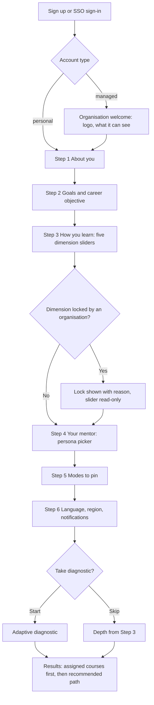
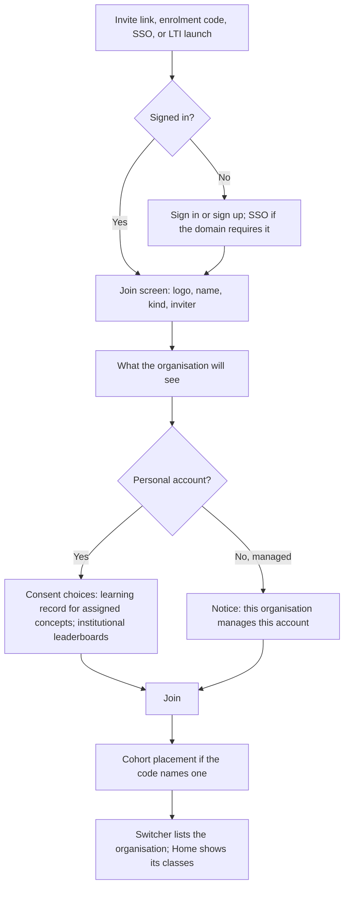
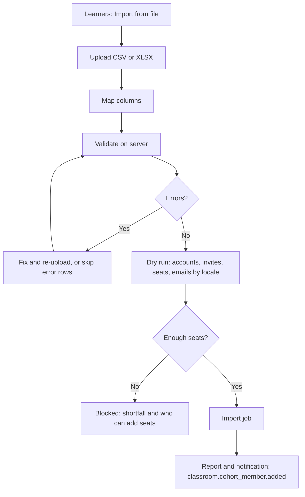
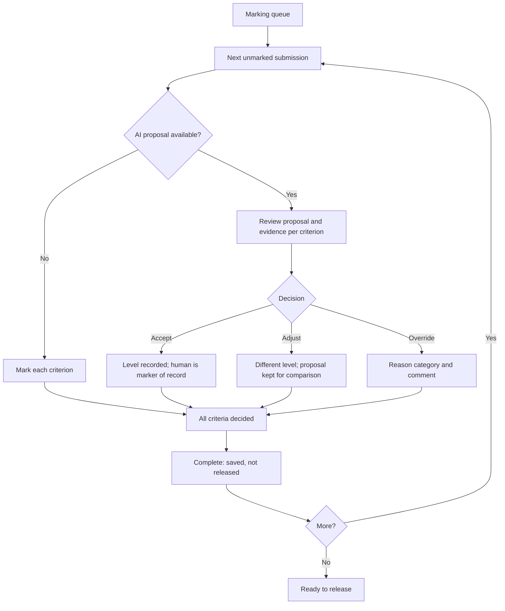
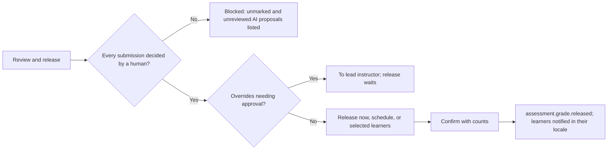
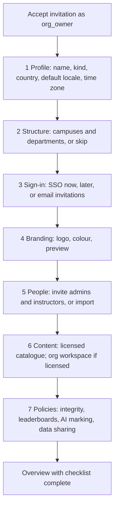
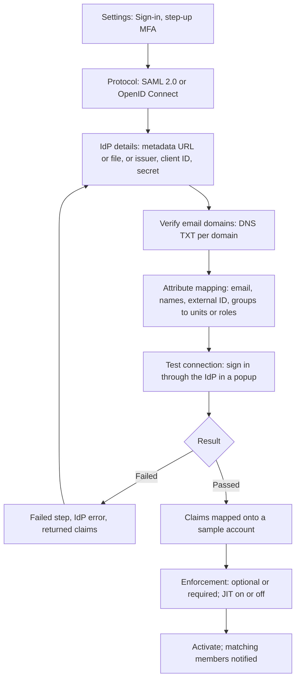
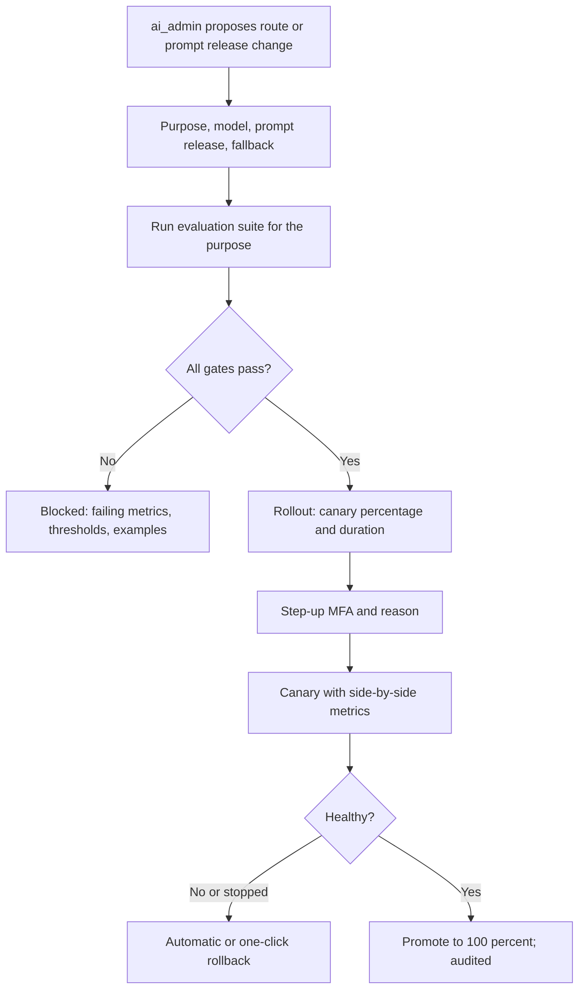

# AI Mentor UX specification (v2, five applications)

| Field | Value |
| --- | --- |
| Document | 11 — UX specification |
| Version | 2.0 |
| Date | 13 October 2026 |
| Status | Approved direction. Target design; the Learner App and the admin portal exist today, the other three apps do not |
| Owner | Product Design, with Frontend Engineering |
| Related | [README.md](README.md) (canonical vocabulary), [12-information-architecture.md](12-information-architecture.md), [14-content-studio-specification.md](14-content-studio-specification.md), [03-srs.md](03-srs.md), [07-database-design.md](07-database-design.md), [09-security-model.md](09-security-model.md), [10-rbac-matrix.md](10-rbac-matrix.md), [../DesignSpec.md](../DesignSpec.md), ADR [0013](../adr/0013-five-applications-shared-platform.md), [0014](../adr/0014-monorepo-shared-packages.md), [0015](../adr/0015-organisation-tenancy.md), [0016](../adr/0016-scoped-rbac-abac.md), [0019](../adr/0019-content-studio-releases.md), 0022, 0023, 0024, 0025 |

## Change record

| Area | What changed | Why | Impacted systems | Implementation implications |
| --- | --- | --- | --- | --- |
| Applications | One learner app plus one staff portal become five applications with their own shells, navigation, and tone | ADR 0013: user groups have different jobs, density, and release timing | `frontend/`, `admin/`, new `apps/instructor`, `apps/institution`, `apps/studio` | Each app configures one shared `AppShell`; no app renders another app's routes |
| Shared shell | App launcher, organisation switcher, workspace switcher, locale switcher, notifications, and account menu defined once | One person can hold roles in several apps and organisations | `packages/ui`, `packages/auth`, `GET /api/v1/me/apps` | Apps pass navigation and capabilities into the shell |
| Branding | Per-tenant logo and primary colour mapped to tokens with automatic AA enforcement; no custom CSS | Institutions need their identity; accessibility must not depend on a customer palette | `tenancy.branding`, `packages/ui` theme provider | Theme resolved server-side and injected as CSS variables; contrast checked at save and at render |
| Tokens | Per-app accent token and density tokens | People switch apps and must know where they are | `packages/ui` token JSON | New `color.app.accent.*`, `density.*`; v1 tokens unchanged |
| Components | 21 shared components specified for `packages/ui` | Four of the five apps need the same data and workflow components | `packages/ui`, Storybook | Built once, stories in every density |
| Learner App | Organisations, classes, grades and feedback, five leaderboard scopes, mentor modes, integrity mode, five dimensions, knowledge search, career planner | README, ADR 0021, 0022, 0024 | `apps/learner`, `/api/v1/learn` | Extends DesignSpec 8–14 and 17; existing routes keep working |
| Instructor App | New: queues, learner management, CSV import, cohort plans, builders, marking workspace, risk monitor, attendance, messaging, analytics | R3 Classrooms | `apps/instructor`, `/api/v1/orgs/{org_id}` | Tablet marking is a launch requirement |
| Institution App | New: setup wizard, structure, people, licences, billing, branding, SSO, reports, workforce reporting, compliance | R3 and R4 | `apps/institution`, `/api/v1/orgs/{org_id}` | Reports render in the viewer's locale; tagged PDFs |
| Admin App | Operations half of `admin/` gains AI services, flags, security, commerce, governance | ADR 0013 split | `apps/admin`, `/api/v1/platform` | Step-up MFA before writes |
| Content Studio | Content half of `admin/`; detail moved to document 14 | ADR 0019 | `apps/studio`, `/api/v1/content` | This document fixes only shared patterns |
| Localisation | Expansion budget raised to 35%; translation status and mixed-locale fallback patterns | ADR 0023 | `packages/i18n`, all apps | Visual regression in `fr`, `es`, and a pseudo-locale |
| AI transparency | One pattern set for AI labels, confidence, evidence, and human decisions | ADR 0022, 0025; EU AI Act human oversight (03 CMP-109) | All apps | `AIProposalCard` is the only way to show an AI-proposed decision |

## Relationship to v1 documents

| v1 document and section | Status | What this document does |
| --- | --- | --- |
| `DesignSpec.md` 1–7 (philosophy, colour, typography, tokens, components, responsive, accessibility) | Retained for all five apps | Adds accents, density, branding, and components. Nothing is removed |
| `DesignSpec.md` 8, 9, 11, 12, 13, 14, 17 | Retained for the Learner App, extended | Adds organisations, cohorts, grades, scopes, mentor modes, integrity mode, dimensions |
| `DesignSpec.md` 10 (page hierarchies) | Superseded | By [12-information-architecture.md](12-information-architecture.md) |
| `DesignSpec.md` 15 (admin portal) | Split | Operations screens in [section 11](#11-admin-app); content screens in [14](14-content-studio-specification.md) |
| `DesignSpec.md` 16 (knowledge management) | Moved | Superseded by [14](14-content-studio-specification.md), which starts from its wireframes |
| `DesignSpec.md` Appendix B question 1 | Closed | The Content Manager role is replaced by the Content Studio roles in the README |
| `Admin.md` | Retained as the original brief | Features allocated to the Admin App and Content Studio |

Wording rule from ADR 0013: where `DesignSpec.md` says "studio" it means the Learner App. Here "Studio" means Content Studio only.

## Contents

1. [Scope and conventions](#1-scope-and-conventions)
2. [Ecosystem UX principles](#2-ecosystem-ux-principles)
3. [Shared shell and app launcher](#3-shared-shell-and-app-launcher)
4. [Tenant branding](#4-tenant-branding)
5. [App-level token deltas](#5-app-level-token-deltas)
6. [Shared components for packages/ui](#6-shared-components-for-packagesui)
7. [Standard screen states](#7-standard-screen-states)
8. [Learner App](#8-learner-app)
9. [Instructor App](#9-instructor-app)
10. [Institution App](#10-institution-app)
11. [Admin App](#11-admin-app)
12. [Content Studio](#12-content-studio)
13. [Multilingual UX](#13-multilingual-ux)
14. [Accessibility](#14-accessibility)
15. [Responsive and mobile](#15-responsive-and-mobile)
16. [Notifications UX](#16-notifications-ux)
17. [AI transparency patterns](#17-ai-transparency-patterns)
18. [Design QA checklist](#18-design-qa-checklist)
19. [Open questions](#19-open-questions)

---

## 1. Scope and conventions

This document designs how the five applications look and behave. Permissions are in [10-rbac-matrix.md](10-rbac-matrix.md), routes in [12-information-architecture.md](12-information-architecture.md), and Content Studio screens in [14-content-studio-specification.md](14-content-studio-specification.md). "Must" is required for the release that ships the screen; "Should" is expected unless a design record explains otherwise. Wireframes use DesignSpec 9.1 notation plus `✦` (AI-generated or AI-proposed), `[lock]` (locked by policy), `[flame]` (streak), `{org}` (active organisation), and `▌` (app accent strip); wireframe copy is English and every string is a catalogue key (`I18N-001`). Role IDs, permissions, events, and states are written exactly as in the README; requirement IDs (`INS-037`, `LB-101`) refer to [03-srs.md](03-srs.md).

---

## 2. Ecosystem UX principles

### 2.1 One design system, five experiences

The eight DesignSpec principles hold in every app. Five more apply across the ecosystem:

1. **Same parts, different jobs.** Every app is built from `packages/ui`. A table in the Admin App and in the Instructor App is the same `DataTable`; they differ in density, columns, and default actions, never in behaviour or keyboard model.
2. **Always know where you are.** App name, accent strip, and active organisation or workspace are visible on every screen. A person with roles in three apps must never act in the wrong one.
3. **Context is explicit.** Every tenant-scoped screen shows which organisation it acts in. Switching is deliberate and confirmed when unsaved work exists. The API enforces the same rule (`X-Org-Id`, `/orgs/{org_id}`).
4. **Humans decide, AI proposes.** AI output that affects a grade, a published item, a learner record, or configuration is a proposal with confidence and evidence and needs a named human action ([section 17](#17-ai-transparency-patterns)).
5. **Policy is visible.** When an organisation policy, assessment window, licence, or dimension lock limits an action, the screen names the source ("Locked by ML 101: register is Academic or higher").

### 2.2 Density and tone per app

| App | Character | Density default | Tone | Primary surface |
| --- | --- | --- | --- | --- |
| Learner App | Motivating and calm | Comfortable (52 px rows, 24 px card padding) | Warm, encouraging, never guilt (DesignSpec 1.3) | Cards, 68ch reading column |
| Instructor App | Efficient, task-first | Comfortable queues, compact gradebook (40 px) | Direct: "12 to mark. 3 due today." | Queues, split workspaces, grids |
| Institution App | Executive, reporting | Comfortable, whitespace around figures | Measured, factual, board-ready | Stat tiles, charts with takeaways, reports |
| Admin App | Dense, operational | Compact (40 px), 1440 px max | Neutral, exact | Tables with detail panels |
| Content Studio | Authoring, editorial | Comfortable editors, compact library | Precise: "v2.3 approved by @m_diallo" | Editors, split review, canvases |

Celebrations (particle bursts, level-up dialogs) exist only in the Learner App. Other apps confirm with toasts. Motion outside the Learner App is functional only.

### 2.3 Voice by app

| App | Success | Blocked |
| --- | --- | --- |
| Learner | "Lesson complete. +40 XP." | "Your instructor has paused exam coach until 16:00." |
| Instructor | "Grades released to 28 learners." | "3 AI proposals are not reviewed. Review them before releasing." |
| Institution | "SSO is active for lagos-uni.edu.ng." | "412 of 400 seats are assigned. Add seats or remove members." |
| Admin | "Flag `instructor.ai_marking` set to 25% of pilot organisations." | "This route change needs a passing evaluation run." |
| Studio | "Release 2.1.0 scheduled for 20 Oct 06:00 UTC." | "You authored this version. Another reviewer must approve it." |

---

## 3. Shared shell and app launcher

### 3.1 Anatomy

All five apps use `AppShell` from `packages/ui`: top bar, primary navigation (sidebar, rail, or bottom nav by breakpoint), content region.

```text
+--------------------------------------------------------------------------------------------+
|▌(4 px app accent strip)                                                                    |
| [logo] Teach  {Lagos University ▾}   [Search learners, cohorts…  ⌘K]   EN▾  [bell] [⊞] (av) |
+--------------------+-----------------------------------------------------------------------+
| Home               | Breadcrumbs                                                           |
| Cohorts            | Page title (heading-1)                              [Primary action]  |
| Learners           |                                                                       |
| Assessments        | (content)                                                             |
| Marking        12  |                                                                       |
| Messages           |                                                                       |
| Insights           |                                                                       |
| ── Help · Theme ── |                                                                       |
+--------------------+-----------------------------------------------------------------------+
```

| Region | Content | Rules |
| --- | --- | --- |
| Accent strip | 4 px `color.app.accent` | Decorative, `aria-hidden`; the app name is always printed too |
| Logo and app name | Platform wordmark or tenant logo ([section 4](#4-tenant-branding)), then the app's short name | App name links to app home; never replaced by the tenant name |
| Context switcher | Organisation (Learner, Instructor, Institution), workspace (Studio), environment chip (Admin) | Visible at ≥ 768 px; on phones it moves into the account menu and the active name shows under the page title |
| Search | App-scoped search and `⌘K` command menu | Scopes in [12](12-information-architecture.md#11-search-scopes) |
| Locale | `EN ▾` | [13.1](#131-locale-switching) |
| Notifications | Bell with a quiet dot | [section 16](#16-notifications-ux) |
| App launcher | `⊞` (lucide `layout-grid`) | Only when the person can open two or more apps |
| Account menu | Profile, notifications, language, accessibility, help, sign out; plus learning preferences and My organisations in the Learner App | Help in the same place in every app (WCAG 3.2.6). Personal settings are shared across apps through `/api/v1/me/preferences` |

Skip links: "Skip to content", "Skip to navigation", plus "Skip to composer" (Learner tutor) and "Skip to rubric" (Instructor marking).

### 3.2 App launcher

Fed by `GET /api/v1/me/apps`, listing only the apps the person's role assignments open (ADR 0013 rule 3).

```text
+--------------------------------------------+
| Your apps                                  |
| ▌Learn            Current ✓                |
| ▌Teach            2 organisations          |
| ▌Organisation     Lagos University         |
| ▌Content Studio   Master repository        |
+--------------------------------------------+
```

- Each tile: app accent strip, short name, one-line context (where the person holds a role), link to the app's origin.
- Short names: "Learn", "Teach", "Organisation", "Admin", "Content Studio". The accessible name adds the product name: "Teach, Instructor App, 2 organisations".
- Opening another app carries `?org={orgSlug}` when the target supports it. Without a role in that organisation, the target opens its default.
- Menu semantics (`role="menu"`); Enter opens in the same tab, `⌘↵` / `Ctrl ↵` in a new tab.

### 3.3 Organisation switcher

```text
{Lagos University ▾}
+------------------------------------------------+
| Search organisations                           |
| ✓ Lagos University        University · 3 roles |
|   Acme Robotics Academy   Bootcamp · Learner   |
|   AI Mentor (personal)    Your own learning    |   <- consumer organisation, Learner App only
| Join with a code ›                             |   <- Learner App only
+------------------------------------------------+
```

- The consumer organisation (`ai-mentor-public`) appears as "AI Mentor (personal)" in the Learner App only.
- With unsaved work: "Switch to Acme Robotics Academy? Unsaved changes on this page will be lost." [Stay] [Switch].
- After switching, focus moves to the page `h1` and a polite live region says "Now in Acme Robotics Academy". Branding changes with the organisation, without a full reload.
- In the Instructor and Institution Apps the organisation is in the URL (`/o/{orgSlug}/…`); switching opens the same page in the other organisation when it exists, otherwise its home.

### 3.4 Workspace switcher and environment chip

- **Content Studio**: workspace switcher in the same slot ("Master repository" or "{org} workspace"); see [14](14-content-studio-specification.md#3-workspaces-and-switching).
- **Admin App**: no organisation switcher, because platform staff act in the `platform` context (README tenancy rule 3). The slot shows the environment chip ("Production" with a filled dot; "Staging" in warning colours). During a break-glass session (03 `ADM-016`) a persistent banner reads "Break-glass session · Lagos University · read-only · ticket SUP-2231 · 47 min left · [End session]".

---

## 4. Tenant branding

### 4.1 What an organisation can brand

| Element | Input | Where it appears | Constraints |
| --- | --- | --- | --- |
| Logo (light, optional dark) | SVG or PNG | Shell, sign-in on custom domain, emails, PDF reports, certificates | SVG is rasterised at upload (09 T33); ≤ 512 KB; rendered 32 px high. Without a dark variant the logo sits on a white rounded plate in dark mode |
| Square mark | SVG or PNG, 1:1, ≥ 192 px | Favicon, launcher, home-screen icon | Rasterised |
| Display name | 2–80 characters | Switcher, emails, reports | Checked by support on first set |
| Primary colour | One hex value | Action tokens ([4.2](#42-colour-mapping-and-contrast-enforcement)) | Contrast enforced |
| Custom domain (R4) | Hostname | Learner App and Institution App only (ADR 0013) | DNS TXT verification and certificate (09 SSO-14) |
| Email sender name | Text | Notification emails | Sender domain changes only with the white-label entitlement (03 `ORG-015`) |
| Sign-in message | ≤ 280 characters per locale | Custom-domain sign-in page | Plain text |

Not brandable: fonts, radius, spacing, status and mastery colours, focus ring, AI violet, icons, layout, copy. **No custom CSS and no custom scripts**, in any app: accessibility (contrast and focus cannot be guaranteed), security (per-app CSP), and supportability. White-label keeps the "Powered by AI Mentor" footer and AI disclosure labels (03 `ORG-015`).

Branding applies in the Learner, Instructor, and Institution Apps when the active organisation has it. It never applies in the Admin App or Content Studio; an `org` workspace shows the organisation logo inside the workspace switcher only.

### 4.2 Colour mapping and contrast enforcement

| Token | Derived from brand colour `B` | Enforcement |
| --- | --- | --- |
| `color.action.primary.bg` (light) | `B`, darkened if needed | Darken in OKLCH lightness steps of 0.02 until white text on it is ≥ 4.5:1 |
| `.bg.hover`, `.bg.active` (light) | One and two further steps darker | Same check |
| `color.action.primary.bg` (dark) | `B`, lightened if needed | Lighten until `#0B1020` text on it is ≥ 4.5:1 and it is ≥ 3:1 against dark canvas |
| `color.text.link` | Light `action.primary.bg` | Used only if ≥ 4.5:1 on both canvas and surface; otherwise platform link colour |
| `color.brand.decorative` | `B` exactly | Header strip and illustration tint only; never text or control boundary |
| `color.focus.ring` | Not derived | Always platform blue, so focus visibility never depends on a customer palette |

Rules:

1. Enforcement runs at save (Institution App) and at theme generation, so a platform token change cannot reintroduce a failure.
2. The branding screen shows submitted colour, adjusted colour, and measured ratio per pair: "Your colour #F59E0B was darkened to #B45309 so button text meets 4.5:1."
3. A colour within 20° hue of `status.danger` with OKLCH chroma ≥ 0.12 is accepted with a warning: "This colour is close to the error colour. Buttons may look like warnings."
4. Brand colour never replaces `color.app.accent`.
5. Themes are cached per organisation and injected server-side as CSS custom properties on `<html data-org="{orgSlug}">`, so there is no flash of unbranded content.

The preview is specified in [10.8](#108-branding-preview-and-custom-domain).

---

## 5. App-level token deltas

DesignSpec section 4 tokens are unchanged. These are added to the `packages/ui` token JSON.

### 5.1 App accent

Used for the shell strip, launcher tile strip, app name on the sign-in page, and Storybook theme label. Never a button colour: actions stay on `color.action.primary` in every app.

| Token | App | Light | Dark | Light on white |
| --- | --- | --- | --- | --- |
| `color.app.accent.learner` | Learner App | blue-700 `#1D4ED8` | blue-300 `#93C5FD` | 6.70:1 |
| `color.app.accent.instructor` | Instructor App | teal-700 `#0F766E` | teal-300 `#5EEAD4` | 5.47:1 |
| `color.app.accent.institution` | Institution App | indigo-700 `#4338CA` | indigo-300 `#A5B4FC` | 7.9:1 |
| `color.app.accent.admin` | Admin App | slate-700 `#334155` | slate-300 `#CBD5E1` | 10.4:1 |
| `color.app.accent.studio` | Content Studio | orange-800 `#9A3412` | orange-300 `#FDBA74` | 7.3:1 |

Ratios are given because the accent may colour the app name text on the sign-in page. Teal matches the Robotics path accent (DesignSpec 2.7); they never meet, because path accents live inside content cards and app accents in the shell.

### 5.2 Density, layout, and component tokens

| Token | Learner | Instructor | Institution | Admin | Studio |
| --- | --- | --- | --- | --- | --- |
| `density.table.row` | 52 px | 52 px queues, 40 px gradebook | 52 px | 40 px | 40 px library, 52 px queues |
| `density.card.padding` | 24 px | 20 px | 24 px | 16 px | 20 px |
| `size.sidebar` | 240 px | 248 px | 248 px | 264 px | 264 px |
| `size.content.max` | 1280 px | 1440 px | 1280 px | 1440 px | 1600 px editors, 1440 px lists |

Any table can be switched between Comfortable and Compact; the choice is remembered per table per person.

| New component token | Value | Use |
| --- | --- | --- |
| `color.grade.released` | success fg/bg | Gradebook cell, released |
| `color.grade.proposed` | `status.ai` fg/bg with `✦` | Cell holding an unreviewed AI proposal |
| `color.grade.overridden` | `status.info` fg/bg with `pencil` | Overridden grade |
| `color.risk.{low,medium,high}` | slate-600 / amber-700 / rose-700 with `circle`, `triangle-alert`, `octagon-alert` | Risk level (03 `INS-038`); never colour alone |
| `color.workflow.changes_requested` | amber-700 on amber-50, `message-square-warning` | Author-facing "Changes requested" status |
| `color.lock` | slate-700 with `lock` | Dimension and policy locks |

---

## 6. Shared components for packages/ui

These join the DesignSpec 5.2 inventory. Each ships with Storybook stories in both densities, both themes, and `en` and `fr`.

### 6.1 Inventory

| Component | Purpose | Key behaviour | Accessibility | Main users |
| --- | --- | --- | --- | --- |
| `DataTable` | Server-paginated, sortable, selectable table (TanStack Table) | Column visibility, pinned first column, density, saved views (personal or shared in the organisation or workspace), CSV export, URL state | `<caption>` with active filters, `aria-sort`, row headers, labelled checkboxes | All |
| `FilterBar` | Search plus filter chips plus saved views | Filters in URL; "More filters" sheet; "Clear all" | Chips with `aria-pressed`; result count announced | All |
| `BulkActionBar` | Replaces the filter bar when rows are selected | "12 selected"; allowed actions only; "Select all 412 matching" needs a second click | Announced; Escape clears | Instructor, Institution, Admin, Studio |
| `ImportWizard` | CSV/XLSX import with mapping, validation, dry run | [6.2](#62-importwizard) | Stepper, error summary, errors as a table | Instructor, Institution, Studio |
| `Scheduler` | Month, week, agenda calendar; drag to reschedule | Plan items, sessions, windows, release schedules | Agenda is the accessible primary; "Move to date…" alternative | Instructor, Institution, Studio |
| `GradebookGrid` | Learner × assignment grid | Sticky column and header; cell states | ARIA grid; cells announce learner, assignment, grade, state | Instructor |
| `RubricEditor` | Criteria × levels | Add, reorder, weight, describe levels | Table semantics; move buttons | Instructor, Studio |
| `RubricMarkingPanel` | Mark against a rubric | Level per criterion, comment, AI proposal per criterion | Radio group per criterion; scoped shortcuts | Instructor |
| `AIProposalCard` | AI-proposed decision with confidence and evidence | Accept, Adjust, Override with reason | AI label in text; confidence as word and number | Instructor, Studio, Admin |
| `DiffViewer` | Text, structure, metadata diffs (Monaco diff for source) | Side-by-side or inline; next and previous change | Underline and strikethrough, not colour alone | Studio, Instructor, Admin |
| `WorkflowStatusBadge` | Content workflow status | [6.4](#64-workflowstatusbadge) | Icon plus text | Studio, Instructor |
| `ReleaseImpactDialog` | What a release or change affects | Counts, then lists | Summary first; lists as tables | Studio, Instructor |
| `Leaderboard` | Ranked table plus "You" row | Scopes, periods, metrics; sticky You row | DesignSpec 13.8 | Learner, Instructor |
| `ScopeTabs` | Scope selector | URL-synced; unavailable scopes hidden | Tabs as links with `aria-current` | Learner, Instructor, Institution |
| `PercentileChip` | "Top 9%" | "Not ranked yet" when ineligible | "Top 9 percent" | Learner |
| `StreakFlame` | Streak indicator | DesignSpec 5.11 states | Text carries meaning | Learner |
| `PersonaPicker` | Mentor persona attributes | Portraits, preview line, voice sample | Option cards; voice sample has a transcript | Learner |
| `DimensionSlider` | One dimension with lock and bound state | [6.5](#65-dimensionslider) | `role="slider"`, `aria-valuetext`, lock reason in description | Learner, Instructor |
| `LocaleBadge` | Locale plus translation status | `EN ✓` approved, `FR ◐` machine draft or in review, `ES ○` missing, `FR !` stale | Status in accessible name ("French, machine draft, not reviewed") | All |
| `EmptyState` | DesignSpec empty state with reasons | `no-data`, `no-results`, `not-started`, `permission`, `policy` | Title, sentence, one action | All |
| `AuditTrailDrawer` | Who did what to this object | Sheet from any detail page | Timeline list; JSON diff in a disclosure | Instructor, Institution, Admin, Studio |

Shell components in `packages/ui`: `AppShell`, `AppLauncher`, `OrgSwitcher`, `WorkspaceSwitcher`, `LocaleSwitcher`, `NotificationPanel`, `PolicyBanner`, `PermissionDenied`. Learner lists use "Show more"; staff tables paginate (25, 50, 100). Below 768 px people and queue tables become stacked cards; dense tables (gradebook, library, audit) scroll inside their container with a sticky first column.

### 6.2 ImportWizard

```text
Import learners into ML 101 · Autumn 2026
Step 3 of 5  ▓▓▓░░   Upload · Map columns · Validate · Dry run · Import
+---------------------------------------------------------------------------------+
| 248 rows · 3 errors · 11 warnings                      [ Download error report ] |
| Row  Email                      Given name   Problem                            |
| 14   amaka@lagos-uni            Amaka        Error: email is not valid          |
| 37   tunde.b@lagos-uni.edu.ng   Tunde        Warning: already a member; will    |
|                                              be added to this cohort only       |
| 52   (empty)                    Bisi         Error: email is required           |
| ( ) Skip rows with errors and continue   (•) Fix the file and upload again       |
| [ ‹ Back ]                                                     [Continue]       |
+---------------------------------------------------------------------------------+
```

| Step | Content | Rules |
| --- | --- | --- |
| 1 Upload | Drop zone (CSV, XLSX), template per locale, encoding detection | ≤ 10,000 rows, ≤ 10 MB; first row is headers |
| 2 Map columns | Target field ← source column select, auto-matched by header in en, fr, es; 5-row preview | Required targets mapped; one source per target |
| 3 Validate | Server validation; errors block a row, warnings change it | Error summary by type, linked to filtered rows |
| 4 Dry run | What will happen: accounts created, invitations, existing members added, seats used, roles | Nothing written; seat impact shown ("Uses 212 of 400 seats; 188 left") |
| 5 Import | Background job; person may leave; notified on completion | Report: created, updated, skipped, failed; re-running the same file is idempotent |

### 6.3 AIProposalCard

The single component for an AI-proposed decision: grade, criterion level, generated item, taxonomy merge, drafted intervention message.

```text
+-----------------------------------------------------------------------+
| ✦ AI proposal · Criterion 2: Derivation correctness                   |
| Proposed level: Proficient (3 of 4) · 6 of 8 points                   |
| Confidence: Medium (0.68)   [What does this mean?]                    |
| Evidence                                                              |
|  "…applying the Bellman optimality operator to V…"  ¶2, lines 4–6 ›   |
|  Missing: no justification that γ < 1 ensures convergence.  ¶3 ›      |
| Rubric level: "Correct derivation with minor gaps in rigour."         |
| [Accept]   [ Adjust ]   [ Override… ]        Model: marking v3.2      |
+-----------------------------------------------------------------------+
```

- **Label**: "✦ AI proposal" in `status.ai` colours plus text.
- **Confidence**: word plus number: Low (< 0.5), Medium (0.5–0.8), High (> 0.8). Thresholds are configuration per assessment. Low confidence collapses the card and makes "Mark this criterion yourself" the primary action.
- **Evidence**: each item quotes the source and links to the exact location; selecting it scrolls and highlights the passage. With no evidence the card shows "No evidence cited" and Accept is unavailable until Adjust.
- **Actions**: Accept (the human becomes marker of record), Adjust (edit level and points with the proposal kept visible), Override (reason category plus comment ≥ 10 characters; on a final grade this records `assessment.grade.overridden`).
- **Provenance**: model and prompt release in `caption`, linking for authorised staff to the evaluation record.

### 6.4 WorkflowStatusBadge

The README states are `draft`, `in_review`, `approved`, `published`, `archived`. `changes_requested` is a transition back to `draft` (07 records it as `request_changes`); the badge shows it as a derived status to the author until a new version is saved.

| Status | Label | Icon | Colours |
| --- | --- | --- | --- |
| `draft` | Draft | `pencil` | slate |
| `in_review` | In review | `eye` | info blue (v1 "Review") |
| Derived: changes requested | Changes requested | `message-square-warning` | `color.workflow.changes_requested` |
| `approved` | Approved | `badge-check` | violet-700 on violet-50 |
| `published` | Published 2.1.0 | `globe` | success |
| `archived` | Archived | `archive` | slate, dashed border |
| Modifier: scheduled | Publishes 20 Oct 06:00 WAT | `clock` | as approved |

### 6.5 DimensionSlider

```text
Depth          Beginner ─ Intermediate ─ ●Advanced ─ Expert ─ Researcher
Register [lock] Professional ─ Balanced ─ ●Academic
               Locked by ML 101 (Lagos University): Academic or higher. Applies in ML 101 only
Pace           Slow ─ ●Moderate ─ Fast ─ Intensive
               Bounded by Lagos University: Moderate to Fast
```

- One instance per dimension (`depth`, `pace`, `approach`, `register`, `breadth`) with README scale labels.
- **Locked**: read-only (`aria-readonly="true"`), lock icon, reason naming the cohort or organisation; still focusable.
- **Bounded**: out-of-bound steps visible but not selectable; arrow keys stop at the bound and announce "Fast is the highest Lagos University allows".
- Effective value is the learner's value clamped by every active lock; on conflict the nearest unit wins (cohort over department over organisation, 07 `dimension_locks`). The panel says where a lock applies.

### 6.6 ReleaseImpactDialog

```text
Publish Reinforcement Learning Foundations 2.0.0 (MAJOR)?
+----------------------------------------------------------------------+
| 14 cohorts pinned to 1.4.2 in 6 organisations: offered, not moved    |
| 2 cohorts have an open assessment: stay on 1.4.2 until it closes     |
| 3,120 self-directed learners move at their next module boundary      |
| Progress carries over for 41 of 44 lessons                           |
| [ View cohorts (14) ]  [ View removed items (3) ]                    |
| Release notes  en ✓  fr ✓  es ○ missing                              |
| [ Cancel ]                                         [Publish 2.0.0]   |
+----------------------------------------------------------------------+
```

Counts follow ADR 0019 pinning rules. The same dialog serves overlay changes (Instructor), structure moves (Institution), and taxonomy merges (Studio).

---

## 7. Standard screen states

Every key screen specifies these five states. Per-screen sections list only what is specific.

| State | Pattern | Copy rule |
| --- | --- | --- |
| Loading | Layout-matching skeletons within 100 ms; `aria-busy` | Hidden "Loading {section}" |
| Empty | `EmptyState` with reason | Why it is empty and the one next step |
| Error | Error variant; preserved work named; Retry; reference on 5xx | "We couldn't load the gradebook. Your marks are saved. [Retry] Ref 7F3A-21" |
| Permission denied | `PermissionDenied` for any 403: what is needed, who grants it, a way back | "You need the instructor role in ML 101 to mark submissions. Ask Dr Bello (lead instructor)." |
| Read-only by policy | `PolicyBanner` naming the source; controls rendered as read-only text, not disabled inputs | "This assessment is frozen because grades were released on 3 Nov. Overrides need a reason." |

App-specific states:

| App | Screen | States |
| --- | --- | --- |
| Learner | Home | No organisation work; season inactive; managed account first visit (organisation welcome card) |
| Learner | Tutor | Integrity mode; mode turned off by organisation; quota reached; limited mode |
| Learner | Leaderboards | Scope off by policy; frozen; fewer than 5 participants (scope hidden, 04 `BR-136`); not ranked; opted out |
| Learner | Grades | No classes; marking in progress; review request pending; regraded |
| Instructor | Home | No cohorts ("A lead instructor adds you", or [Create cohort] for lead instructors) |
| Instructor | Learners | Seats exhausted; SSO-provisioned organisation ("Accounts come from your organisation's sign-in system") |
| Instructor | Plan | Update offered; open assessment blocks automatic advance; plan locked by policy |
| Instructor | Marking | AI marking off; proposals pending; anonymised; released (read-only) |
| Instructor | Risk | New cohort ("Signals start after the first week") |
| Institution | Overview | Setup incomplete; unit-scoped admin; not enough data (n < 20) |
| Institution | Licences, SSO | No licence; seats exhausted; expired (most settings read-only); feature not in plan; certificate expiring |
| Institution | Reports, Compliance | Dataset unavailable for organisation kind; suppressed cells; request overdue |
| Admin | All writes | MFA not fresh: step-up dialog before submit (`step-up-required`, 09 AU-16) |
| Admin | Tenant data | Break-glass session required (gate before data loads) |
| Admin | Routes, Flags | Evaluation running; gate failed; canary active; kill switch active (danger banner) |

Hide versus disable rules are in [12](12-information-architecture.md#13-permission-aware-navigation).

---

## 8. Learner App

### 8.1 Purpose, personas, top tasks

The Learner App is where people learn, practise, are assessed, compete, and plan careers. It keeps every DesignSpec learner feature and adds organisational learning.

| Persona | Context | First need |
| --- | --- | --- |
| Self-directed learner (`personal`) | Consumer organisation; may join others | One next step, motivation, the mentor |
| University student (`managed` or `personal`) | Cohort in an institution | Due work, grades and feedback, class standing |
| Workforce learner (`managed`) | Enterprise, assigned paths | Path progress, role readiness |
| Researcher | Personal or university | Research supervisor mode, paper analysis, `depth` Researcher |

Top tasks: continue the recommended item; ask the mentor in the right mode; complete assigned work on time; practise; check grades and feedback; see standing; search knowledge; plan a career goal.

### 8.2 Home

DesignSpec 11 is the base; v2 changes the widget set by organisation context.

| Priority | Widget | Data | Empty state |
| --- | --- | --- | --- |
| 1 | Continue | Top recommendation, or the next plan item due within 48 hours | "Pick a path to get a recommendation." [Browse paths] |
| 2 | Due soon (cohort members) | Next 3 assignments and plan items: due date, class, status | Hidden without cohorts; "Nothing due this week." |
| 3 | Today | Daily challenge, due flashcards, streak | DesignSpec 11.2 |
| 4 | Standing | Level, XP, `StreakFlame`, rank and `PercentileChip` (default scope Institution for organisation learners, Global for personal), achievements | "Not ranked yet. Earn XP this week to be ranked." |
| 5 | New feedback | Grades released and comments since last visit | Hidden when none |
| 6 | Mastery | Strengths and gaps | DesignSpec |
| 7 | Season (when active) | Name, days left, personal and team progress | Hidden |
| 8 | Paths and courses | Enrolled and assigned, with assigning organisation | "Start a path" |
| 9 | Career goal | Target role, readiness, next skill | "Set a goal to see how close you are." |

In the consumer organisation, Due soon and New feedback never appear.

### 8.3 Onboarding with dimensions and mentor persona

DesignSpec 8.1 and 9.3–9.5 remain; v1 teaching style, mathematics, and pace controls become the five dimensions.



```text
+--------------------------------------------------------------------------+
| How do you like to learn?                         Step 3 of 6  ▓▓▓░░░    |
| Change any of this later, even in the middle of a conversation.          |
| Depth      Beginner ─ ●Intermediate ─ Advanced ─ Expert ─ Researcher     |
|            "Q-learning updates an estimate of how good each action is."  |
| Pace       Slow ─ ●Moderate ─ Fast ─ Intensive    About 3 hours a week   |
| Approach   Storytelling ─ Visual ─ ●Balanced ─ Formal ─ Mathematical     |
| Register   Professional ─ ●Balanced ─ Academic                           |
| Breadth    Broad survey ─ ●Balanced ─ Deep specialist                    |
| [ ‹ Back ]                                               [Continue]      |
+--------------------------------------------------------------------------+
```

Each slider updates a one-sentence example on the same concept, in a polite live region.

`PersonaPicker` (attribute IDs in ADR 0022):

| Attribute | Control | Options |
| --- | --- | --- |
| Portrait (age appearance, gender presentation) | Filterable grid of 18 | DesignSpec `FR-AVT-001` |
| Name | Text, 1–24 characters | Default from portrait |
| Personality | Option cards | Friendly, Professional, Academic, Motivational, Calm, Demanding |
| Teaching style | Option cards | Socratic first, Explain then check, Worked examples |
| Coaching style | Segmented control | Gentle, Balanced, Challenging |
| Voice style and accent | Select with play button and transcript | When voice is enabled (R2) |

A preview line updates live. A fixed note: "Your mentor's style changes how it talks, not what is correct." (README: personas never change correctness, grounding, or safety.)

### 8.4 Joining an organisation



Required categories (academic record for work the organisation issues) appear as fixed text, not disabled checkboxes: "Required to take part in this organisation's classes". Optional consent can be withdrawn later in Settings › Organisations. Joining never exposes the personal learning record beyond the consent given.

### 8.5 Today view

```text
Today · Tuesday 13 October                          [flame] 12 day streak
+--------------------------------------------------------------------------+
| Due today                                                                |
|  ML 101 · Problem set 3 (Lagos University)      Due 23:59   [Open]       |
|  Live session: Policy gradients  14:00–15:00    [Join]   Attendance on   |
| Practice                                                                 |
|  Daily challenge · Debugging · 50 XP · 9 h left [Start]                  |
|  23 flashcards due                              [Review]                 |
| Season: Autumn RL Sprint · day 12 of 30 · cohort 3rd of 8  [View season] |
+--------------------------------------------------------------------------+
```

Collects everything time-bound for the learner day across all organisations, naming the organisation where it is not the active one. Empty: "Nothing scheduled today. Keep your streak with 5 flashcards." Integrity mode: "Some practice is paused during your ML 101 exam" when the policy covers practice.

### 8.6 Tutor with mode switcher and integrity mode

```text
+----------+--------------------------------------------------------------+--------------+
| sidebar  | (Ada) Ada · [ Tutor ▾ ]   Bellman equation ▾          ⋯      | Sources      |
|          | ▌Assessment in progress: ML 101 Midterm (until 16:00).       | [S1] Sutton  |
|          |  Ada can explain concepts but won't solve assessed           |  & Barto §3.5|
|          |  questions. Exam coach is off. [What's allowed?]             |              |
|          | Ada: What do you think the agent is trying to maximise?      |              |
|          | [Type your answer…                                  ] [Send] |              |
+----------+--------------------------------------------------------------+--------------+
```

Mode switcher (menu button beside the mentor name):

| Mode | Label | Menu description | Availability |
| --- | --- | --- | --- |
| `tutor` | Tutor | Learn a concept step by step | Always |
| `mentor` | Mentor | Goals, habits, and study plans | Always (R2) |
| `research_supervisor` | Research supervisor | Critique papers, methods, research questions | Plan or organisation entitlement (R2) |
| `coding_coach` | Coding coach | Review and debug your code | Always |
| `career_coach` | Career coach | Roles, skills, next steps | Always |
| `exam_coach` | Exam coach | Practise under exam conditions | Not during integrity mode |

- Switching starts a new segment with a divider ("Switched to Coding coach"); focus stays in the composer.
- Unavailable modes are shown with the reason ("Off during ML 101 Midterm until 16:00", "Turned off by Lagos University"), not hidden.
- The v1 Socratic/Direct toggle moves into Tutor's settings popover as "Teaching technique".

Integrity mode banner (`PolicyBanner`, AI variant): shown in tutor, lab, and any practice screen the policy restricts, for the whole window; not dismissible; states the assessment, end time, what the mentor will and won't do, and links to the organisation's policy. A refused request appears as a system notice, not a mentor reply: "This looks like part of your assessed work, so Ada can't answer it during the exam. You can ask about the underlying concept." When the window ends: "Assessment ended. All modes are available again." for 30 seconds. Integrity mode never disables assistive technology.

### 8.7 Leaderboards

DesignSpec 13 is the base; `ScopeTabs` adds three scopes.

```text
Leaderboards
[ Global | Nigeria | Lagos University | ML 101 ▾ | Friends ]   [ Week | Month | All time ]  [ XP ▾ ]
Week of 12 Oct · resets Monday 00:00 your time (in 5 days)
+-----------------------------------------------------------------------------------------+
| Rank  Learner             Title             Level   XP      Achievements   Streak       |
|  1    (av) @kemi_ml       RL Engineer        31    3,180    24             41 days      |
|  …                                                                                      |
| 10    (av) @mei           RL Explorer        14    2,011     9              3 days      |
| ┄┄┄┄┄┄┄┄┄┄┄┄┄┄┄┄┄┄┄┄┄┄┄┄┄┄┄┄┄┄┄┄┄┄┄┄┄┄┄┄┄┄┄┄┄┄┄┄┄┄┄┄┄┄┄┄┄┄┄┄┄┄┄┄┄┄┄┄┄┄┄┄┄┄┄┄┄┄┄┄┄┄┄ |
|▌1,204 (av) You  Top 9%    RL Explorer         7      450     6              12 days      |
+-----------------------------------------------------------------------------------------+
240 XP to pass 10 more people.                         [ Leaderboard privacy ]
```

| Tab label | Scope ID (07) | Shows | Rules |
| --- | --- | --- | --- |
| Global | `global` | Top 10 plus own row with neighbours | Pseudonymous handles; guests see top 10 only. Managed accounts appear only when their organisation policy allows (default off) |
| {Country} | `country` | Top 10 in profile country plus own row | Needs a country set |
| {Institution name} | `organisation` | Full paginated ranking in the active organisation | Hidden in the consumer organisation; organisation may disable or make pseudonymous (03 `LB-107`); personal accounts only with join consent |
| {Cohort} ▾ | `cohort` | Full ranking in one cohort; select when in several | Instructor may disable per cohort |
| Friends | `friends` | The learner and accepted friends | Hidden until one friend; follows 03 `LB-110` and organisation cross-tenant policy |

`campus` and `region` scopes (03 `LB-101`) appear in an overflow "More" menu when enabled. Columns: rank, learner, title, level, metric, achievements, streak. Percentile shows for scopes with at least 20 ranked learners; smaller scopes show "4th of 12". Scopes under 5 participants are not shown. Opt-outs are per scope family: public, institutional, friends (03 `LB-107`).

Fairness additions: organisational scopes exclude that cohort's or organisation's staff; during an integrity window the affected cohort board is frozen ("Frozen during ML 101 Midterm"); no notifications for rank loss (DesignSpec 13.7).

### 8.8 Seasonal challenge

The season page (`/seasons/{seasonSlug}`) shows the season name and end date, personal progress against weekly goals as a progress bar with "6 of 10 weekly goals", the reward badge, the learner's team (cohort or organisation) standing as a `Leaderboard`, this week's goals, and "Today's challenge" as the primary action. Rules come from ADR 0024 (`game.seasons`, `game.competitions`). Rewards are badges and titles only; no random rewards.

### 8.9 Grades and feedback

```text
Grades · Lagos University                        [ All classes ▾ ]  [ Download transcript ]
| ML 101 · Autumn 2026                                     Current: 68%            |
|  Problem set 1       Released 2 Oct    18 / 20   [View feedback]                 |
|  Problem set 2       Released 9 Oct    14 / 20   [View feedback]  Regraded       |
|  Midterm             Submitted 12 Oct  Marking in progress                       |
|  Project proposal    Due 20 Oct        Not submitted                             |
```

```text
Problem set 2 · 14 / 20 · Released 9 Oct by Dr Bello
+------------------------------------+--------------------------------------------+
| Your submission                    | 1 Problem setup   Proficient   5 / 6       |
| (rendered, comment anchors ①)      | 2 Derivation      Developing   4 / 8       |
|                                    |   ① "Justify why γ < 1 gives convergence." |
|                                    | 3 Code            Proficient   5 / 6       |
|                                    | Overall comment · Dr Bello                 |
|                                    | Marked with AI assistance, reviewed by     |
|                                    | Dr Bello.                                  |
|                                    | [Ask Ada about criterion 2]                |
|                                    | [ Request a review of this grade ]         |
+------------------------------------+--------------------------------------------+
```

- Learners never see proposed grades; "Marking in progress" covers unmarked and AI-proposed.
- AI assistance is disclosed: "Marked with AI assistance, reviewed by {name}" (ADR 0025).
- "Regraded" marks a later override with its date; the previous grade shows only if organisation policy allows.
- "Request a review" (reason, 10–1,000 characters) goes to the instructor's queue, within the policy deadline.
- Objective auto-graded items release at once when the assignment auto-releases.

### 8.10 Knowledge search

```text
[Search lessons, concepts, papers, your notes…                          ] [Search]
Scope: ( ) Everything  (•) My courses  ( ) Lagos University library
| Concepts   Bellman equation  ◎ Developing · 64  3 lessons · 1 quiz · 2 papers › |
| Lessons    Bellman expectation equation · RL Foundations · 20 min · EN FR       |
| Sources    Sutton & Barto, ch. 3 §3.5 · book · "The value of a state under…"    |
| Yours      Conversation 4 Oct · "why does γ<1 converge"                          |
| [Ask Ada about "Bellman equation"]                                              |
```

Results are grouped by type (5 per group, "Show all") and filtered by entitlement; inaccessible lessons show as catalogue entries ("Part of Advanced RL, Pro plan"). Other-locale results carry a `LocaleBadge`. Empty: "No matches for 'bellmen'. Did you mean 'Bellman'?" then "Ask Ada instead".

### 8.11 Career planner

```text
Career · Target role: Reinforcement Learning Engineer          [ Change goal ]
| Readiness 46%  ▓▓▓▓▓░░░░░  38 required concepts: Strong 12 · Developing 6 · Gap 9 · Not started 11 |
| Next skills  Policy gradients  Gap · 41      RL Foundations M4    [Start]                          |
|              PyTorch training  Developing    Project: CartPole    [Open]                           |
| Path to role: RL Engineer path (5 courses) · 62 h left at your pace   [Open Career coach]           |
```

Readiness uses the same definition as the workforce report ([10.10](#1010-workforce-development-report)), so learner and employer see the same number, always with its breakdown.

---

## 9. Instructor App

### 9.1 Purpose, personas, top tasks

Teaching staff manage learners and cohorts, plan journeys, assess, mark, and intervene early. Home is a set of queues.

| Persona | Role ID | Primary jobs |
| --- | --- | --- |
| Lecturer, trainer | `instructor` | Plan, assess, mark, release grades, monitor |
| Course lead | `lead_instructor` | Create and staff cohorts; approve overrides when policy requires |
| Teaching assistant | `teaching_assistant` | Mark, monitor, message in assigned cohorts |

Top tasks: mark and release; see who is at risk and act; schedule and adjust a journey; add learners; build an assessment and rubric; message; take attendance.

### 9.2 Home

```text
Home · Lagos University                                       [ All my cohorts ▾ ]
+------------------------------------------+---------------------------------------+
| To mark                          32      | At risk                         7     |
|  Problem set 3 · ML 101   18     [Mark]  |  Bisi A.   ML 101  High               |
|  Midterm · ML 101  12 · 9 ✦ ready [Mark] |   inactivity 9 days · missed_due ›    |
|  Proposal · RL 201         2     [Mark]  |  Tunde B.  ML 101  Medium             |
|                                          |   mastery_decline: MDP ›   [View 7]   |
+------------------------------------------+---------------------------------------+
| This week                                | Ready to release                      |
|  Mon 14:00 Live: Policy gradients        |  Problem set 2 · ML 101  28 marked    |
|  Wed 23:59 Problem set 3 due             |   [Review and release]                |
+------------------------------------------+---------------------------------------+
| Messages 3 unread ›   Review requests 2 ›   Release updates offered 1 ›          |
```

| Widget | Data | Empty state |
| --- | --- | --- |
| To mark | Awaiting submissions per assignment, AI proposal readiness, marking due date | "Nothing to mark. Submissions appear here when learners hand in work." |
| At risk | Learners with open risk signals, `high` first, top 5, leading signal in words | "No learners at risk right now. Signals update daily." |
| This week | Plan items, sessions, due dates | "Nothing scheduled this week." [Open calendar] |
| Ready to release | Fully marked, unreleased assignments | Hidden |
| Footer | Unread messages, grade review requests, MINOR or MAJOR releases offered | Hidden at zero |

A teaching assistant's home hides Ready to release (unless delegated) and release updates.

### 9.3 Learner management, import, invites

**Learner list** (`DataTable`): name, email, cohorts, membership status (`invited`, `active`, `suspended`), last active, plan progress, current grade, risk level. Bulk actions: message, add to or remove from cohort, resend invite, export.

| Add path | Result | Notes |
| --- | --- | --- |
| Add one learner | Form: email, names, external ID, cohort | `managed` account if the organisation provisions, otherwise an invitation |
| Import from file | `ImportWizard` | Needs `classroom.cohort_member:import` |
| Invite link or code | Enrolment code (8 characters, expiry, max uses) and link | Invitations expire after 14 days by default (organisation setting) |

Import target fields: email (required unless SSO with external ID; domain must be allowed), given and family name (1–100 characters, required), external ID (unique; required if the organisation says so), cohort (defaults to current), locale (`en`, `fr`, `es`), accommodations (organisation list, for example extra time 25%). Dry run example: "Will create 212 accounts, add 31 existing members to ML 101, send 243 welcome emails: English 198, French 45. Uses 212 seats; 188 left."



### 9.4 Cohort creation

For `lead_instructor` and above, a four-step sheet: (1) **Basics**: name (3–120), code, org unit within the person's scope, term dates, locale; (2) **Content**: a licensed course or path release, or a derived course from the `org` workspace, with version and locales; (3) **Staff**: instructors and TAs, with TA delegations (release grades, edit plan); (4) **Policies**: integrity defaults, dimension locks and bounds, cohort leaderboard on or off, AI-assisted marking (needs `instructor.ai_marking` and organisation policy), late policy. The result opens the cohort plan with "Generate a draft schedule".

### 9.5 Scheduling a learning journey

```text
ML 101 · Plan · Pinned: Machine Learning Foundations 1.4.2           [ Week | Month | Agenda ]
Update offered: 1.5.0 (MINOR) · 2 lessons added    [ Review update ]
|  Mon 13            Wed 15             Fri 17                                       |
|  [M3 opens]        [PS3 due 23:59]    [Live: Policy grads 14:00 · Attendance]      |
| Outline (overlay)                                      [ + Add supplementary item ] |
| ⠿ Module 3 · Linear models        opens Mon 13                                     |
|   ⠿ 3.1 Least squares            visible                                           |
|   ⠿ 3.2 Regularisation           hidden by you  [Show]                             |
|   ⠿ + Reading: Lagos lecture notes week 3 (supplementary)                          |
|   ⠿ Problem set 3                release Mon 13 · due Wed 15 · close Fri 17        |
```

- Calendar and outline are two views of the same plan items. Drag on the calendar changes a date; "Move to date…" is the keyboard alternative.
- **Overlay editing**: reorder, hide, add supplementary items, set dates, add instructions. Each change is marked ("hidden by you", "moved", "added"); "Compare with release" opens a structure `DiffViewer`. The master never changes (ADR 0019).
- **Release updates**: PATCH advances automatically with an info note; MINOR and MAJOR are offered through `ReleaseImpactDialog` showing how overlay changes carry over ("3 overlay changes still apply; 1 moved lesson was removed upstream").
- **Validation**: due before release, close before open, or item after cohort end is an inline error; prerequisite order conflicts warn with "Override" (reason).
- "Save plan" emits `classroom.cohort_plan.scheduled` and notifies learners of date changes within 7 days.

### 9.6 Quiz builder and rubric builder

The Instructor App uses reduced forms of the Content Studio builders ([14 sections 11 and 12](14-content-studio-specification.md)):

| Aspect | Instructor App | Content Studio |
| --- | --- | --- |
| Items live in | Organisation assessment library, plus licensed master item banks | Master or `org` workspace bank |
| Workflow | None; draft until assigned | Full review workflow |
| Answer keys | Visible to the assessment's owners and cohort staff | Protected |
| Master items | Usable, not editable; editing makes a local "Adapted from master item" copy | Edited through workflow |

Quiz builder: item list, item editor, settings (attempts, time limit, shuffle, feedback timing, integrity mode, accommodations, auto-release of objective items), "Preview as learner".

```text
Rubric · Derivation problems                        Scoring ( ) Levels only  (•) Points
| Criterion        | Exemplary (4) | Proficient (3) | Developing (2) | Missing (0) | Weight |
| ⠿ Problem setup  | States MDP…   | …              | …              | …           | 25%    |
| ⠿ Derivation     | …             | …              | …              | …           | 50%    |
| ⠿ Code           | …             | …              | …              | …           | 25%    |
| [+ Add criterion]                         ✦ AI marking guidance per criterion (optional) |
```

Validation: 1–12 criteria, 2–6 levels, weights total 100%, each level description 10–500 characters. A rubric used by a released assignment is read-only; editing creates a new version.

### 9.7 Marking workspace

```text
Midterm · ML 101 · Submission 7 of 32 · Learner 7 (anonymised)           [ ‹ Prev ] [ Next › ]
+---------------------------------+------------------------------+----------------------------+
| Submission                      | Rubric                       | ✦ AI proposal              |
| Q2 (derivation)                 | 1 Problem setup              | Criterion 2: Derivation    |
|  "…applying the Bellman         |   ( ) 4 (•) 3 ( ) 2 ( ) 0    | Proficient · 6 / 8         |
|   optimality operator to V…"    | 2 Derivation                 | Confidence Medium (0.68)   |
|   [highlighted evidence]        |   ( ) 4 ( ) 3 ( ) 2 ( ) 0    | Evidence ¶2 l.4–6 ›        |
|  Q3 (code)  [Run tests]         |   ✦ Proposed: 3  Comment [ ] | Missing: convergence ›     |
|  tests 5 of 6 passed            | 3 Code   Auto: 5 / 6 (tests) | [Accept] [Adjust]          |
|                                 | Total 16 / 20 (draft)        | [Override…]                |
|                                 | [ Save draft ]   [Complete]  |                            |
+---------------------------------+------------------------------+----------------------------+
```

- **Anonymous marking** is the default for summative assessments where the organisation enables it; names appear after release or when revealed with a reason (audited).
- **AI proposals** appear only when AI-assisted marking is on and `assessment.submission.ai_marked` has arrived; otherwise "AI proposal pending" or no column.
- **Accept, Adjust, Override** per [6.3](#63-aiproposalcard). Override reason categories: misread submission, rubric misapplied, evidence missing, other. Reasons feed AI evaluation.
- **Complete** needs a human decision on every criterion and says what is missing: "Criterion 2 needs your decision."
- **Integrity indicators** (similarity, where enabled) show as an info panel with evidence, never as an automatic penalty.
- Autosave every 5 seconds; "Saved" in `caption`.

Shortcuts, active only inside the workspace and switchable off (WCAG 2.1.4): `J`/`K` next and previous submission; `Alt+1`–`Alt+9` focus a criterion; `1`–`6` select a level in the focused criterion; `A` accept its AI proposal; `O` override it; `C` comment; `E` jump to evidence; `F6` cycle panes; `⌘↵`/`Ctrl ↵` complete and next; `?` list shortcuts.



States add: late (how late, policy applied), accommodation ("Extra time 25%"), released (read-only: "Released 3 Nov. Changes are overrides and need a reason.").

### 9.8 Grade release



The summary shows learner count, grade distribution (histogram with table), overrides, late penalties, and visible feedback. The button names the count: "Release grades to 28 learners". Releases over 500 learners need step-up MFA (03 `IAM-013`). Scheduled releases can be cancelled before they run; an immediate release is corrected only by per-learner overrides.

### 9.9 Risk monitor

```text
At risk · ML 101                                        [ Signal ▾ ] [ Level ▾ ]
| Learner    Level   Signals                                  Since   Last action     |
| Bisi A.    High    inactivity: no activity for 9 days       4 Oct   None   [Act ▾]  |
|                    missed_due: PS2, PS3                                             |
| Tunde B.   Medium  mastery_decline: MDP 72 → 51 in 14 days  8 Oct   Message 9 Oct   |
```

The explanation panel shows each signal (03 `INS-037`: `inactivity`, `missed_due`, `mastery_decline`, `low_engagement`, `failing_grades`) with its rule, evidence (dates, items, values), and computation time (`INS-038`); history of signals and interventions; and actions: message (template per locale, optional AI draft that must be edited or confirmed, `MSG-008`), meeting, extension, referral, dismiss with reason, snooze 7 days. Each action is an intervention record (`classroom.interventions`). Learners are not notified of individual signals; the organisation's privacy notice explains that signals exist. No single opaque risk score is shown, and signals never use conversation content or protected characteristics.

### 9.10 Attendance, communication, analytics

- **Attendance**: register per session (`present`, `late`, `absent`, `excused`; manual, check-in code, or activity). Check-in shows a 6-character code large enough to project. "Mark all present" then edit exceptions. Engagement analysis shows plain statements only with n ≥ 20 ("Learners who attended 80% or more averaged 12 points higher on PS3").
- **Communication hub**: Announcements (cohorts, scheduled, per-locale versions with machine drafts labelled), Messages (threads; learner sees the instructor's name and role), Templates. Organisation quiet hours apply. Read receipts are counts ("Read by 24 of 31").
- **Analytics**: progress against plan, results by criterion, mastery heat map with numbers, engagement, attendance; each chart with takeaway and table. Cross-cohort comparison for `lead_instructor` and above.

---

## 10. Institution App

### 10.1 Purpose, personas, top tasks

Organisation setup and operation: structure, people, licences, billing, branding, SSO, reporting, compliance. Executive tone: figures with explanations, reports fit for a board.

| Persona | Role ID | Primary jobs |
| --- | --- | --- |
| Owner | `org_owner` | Contract, licences, admins |
| Administrator | `org_admin` | Structure, people, SSO, branding, policies |
| Unit administrator | `campus_admin`, `department_admin` | Instructors, cohorts, reports for their unit |
| Billing manager | `org_billing_manager` | Seats, invoices, payment |
| Report viewer | `org_report_viewer` | Reports |
| Compliance officer | `org_compliance_officer` | Data requests, retention, consent, audit |

Top tasks: set up; add instructors and create cohorts at scale; manage seats; configure SSO and branding; run and schedule reports; answer compliance requests.

### 10.2 Overview

```text
Overview · Lagos University                                   [ Last 30 days ▾ ] [Export PDF]
| Active learners 2,980 (+6%) | Seats 3,412 / 4,000 (85%) | On plan 71% (+3) | Avg mastery 64 Developing |
+---------------------------------------+ +-------------------------------------+
| Engagement by faculty (bar + table)   | | Needs attention                     |
| Takeaway: Engineering engagement fell | |  SSO certificate expires in 21 days›|
| 8 points after midterms.              | |  4 cohorts have no instructor ›     |
|                                       | |  2 data requests due in 5 days ›    |
+---------------------------------------+ +-------------------------------------+
```

| Widget | Data | Empty state |
| --- | --- | --- |
| Active learners | Members active in period | "No learner activity yet. Invite learners or create cohorts." |
| Seats | Assigned / licensed, renewal | "No licence. Contact sales or choose a plan." |
| On plan | Plan items completed on time ÷ due | "Starts when cohorts have scheduled plans" |
| Average mastery | Mean on assigned concepts with band | "Not enough activity yet (n < 20)" |
| Engagement by unit | Weekly active rate per faculty or department | Same |
| Needs attention | Expiring certificates, unstaffed cohorts, seat thresholds, due data requests, failed syncs | "Nothing needs attention." |

Unit admins see the same page limited to their unit, named in the title.

### 10.3 Setup wizard



Resumable; steps can be skipped; a checklist card stays on Overview until steps 1, 3, and 7 are done. Step 7 states each consequence plainly ("Learners can see the cohort leaderboard for their own cohorts").

### 10.4 Structure tree

```text
Organisation › Structure                                   [ + Add unit ] [ Import ]
+--------------------------------+---------------------------------------------------+
| ▾ Lagos University             | Faculty of Engineering                            |
|   ▾ Main campus                | Department · 2 sub-units · 41 cohorts · 1,204     |
|     ▾ Faculty of Engineering   | learners · Admin: Dr Okoye (department_admin)     |
|        Computer Science        | [ Rename ] [ Move… ] [ Archive ]                  |
|   ▸ Yaba campus                | Tabs: Cohorts (41) · Instructors (36) · Reports   |
+--------------------------------+---------------------------------------------------+
```

`react-arborist` tree (`role="tree"`). Depth follows the README (organisation, optional campus, departments at most two levels, cohort); a third department level is blocked with the reason. Move has drag and a "Move…" dialog, and a summary of role assignments and reports affected. Archive is blocked while active cohorts exist.

### 10.5 Instructors and cohorts at scale

- **Instructors**: people with Instructor App roles, scope, cohorts, last active. Adding one assigns a role at a scope chosen from units within the admin's own scope.
- **Cohorts**: filters by unit, term, release, staffing. Bulk: create from file (name, unit, dates, release, lead instructor email), assign release, set policies, archive. "Term roll-over" clones structure into a new term with new dates and no learners.

### 10.6 Licences, seats, billing

```text
Licences and billing · Lagos University
| Plan: University Standard · 4,000 seats · 1 Feb 2026 – 31 Jan 2027               |
| ▓▓▓▓▓▓▓▓▓░  3,412 assigned · 588 available · auto-assign on join: on            |
| Entitlements: Instructor App ✓  AI-assisted marking ✓  Org workspace ○  SSO ✓    |
| Seats by unit: Engineering 1,204 · Science 980 · Business 760 · Unassigned 468   |
| [ Request more seats ]  [ Seat rules ]       Invoices ›   Payment methods ›      |
```

Seat rules: auto-assign on join, reclaim after N inactive days (with notice), reserve per unit. At 90% a warning banner shows for owners and billing managers; at 100% new joins queue as "Waiting for a seat". Billing changes need step-up MFA. Amounts use the contract currency formatted in the viewer's locale.

### 10.7 Reports, schedules, and the builder

```text
Reports › New report                                                   [ Save ] [Run]
| Template [ Progress by unit ▾ ]   | Preview (first 50 rows)                         |
| Rows     [ Org unit ▾ ]           | Unit          Learners  On plan  Avg mastery    |
| Columns  [Learners][On plan][+]   | Engineering   1,204     73%      66 Developing  |
| Filters  Term: Autumn 2026 ×      | Science         980     69%      61 Developing  |
| Chart    ( ) None (•) Bar ( ) Line|                                                 |
| Locale   [ Viewer's locale ▾ ]    |                                                 |
```

- Datasets: enrolments and progress, assessments and grades, engagement, attendance, licences and seats, workforce skills.
- Filters are limited to the viewer's scope; a department admin cannot add another department.
- Personal-account members appear in learner rows only within their consent; otherwise in aggregates.
- Schedules: daily, weekly, monthly, term end; recipients (members with report access, or external email receiving an expiring PDF link); PDF (tagged), CSV, XLSX; locale per recipient. The list shows last run status and next run.
- De-identified aggregate cells below the organisation minimum group size (platform minimum 5) show "<5". Exports are a separate permission, with step-up and volume alerts (09 T37).

### 10.8 Branding preview and custom domain

```text
Settings › Branding
+------------------------------------+-----------------------------------------------+
| Logo (light) lagos-logo.svg ✓      | Preview  ( ) Learn (•) Teach ( ) Organisation |
| Logo (dark)  [ Upload ]            |          ( ) Light (•) Dark   [ Phone ▾ ]     |
| Primary colour [#F59E0B] [picker]  | |▌[logo] Teach {Lagos University ▾} …       | |
|  Adjusted to #B45309 for contrast  | | [Mark]  [ Quiet ]  link text              | |
|  Button text 4.84:1 ✓   Link 4.6 ✓ |                                               |
|  ⚠ Close to the warning colour     |                                               |
| Sign-in message (EN FR ES)         |                                               |
| [ Discard ]          [Save branding]                                               |
+------------------------------------+-----------------------------------------------+
```

The preview renders real components with the derived tokens per app, theme, and frame. Saving restates the ratios. Custom domain (R4): enter host, show TXT and CNAME records, verify, issue certificate: Pending DNS → Verified → Certificate issued → Live. One custom host per app per organisation (04 `BR-153`).

### 10.9 SSO setup wizard



Test connection reports each step (redirect, assertion received, signature valid, audience valid, attributes present) with icon and text, and the returned attributes beside their mapped fields. A failed test cannot be enforced (09 SSO-1). "Required" is blocked until an `org_owner` has signed in through SSO, so admins cannot lock everyone out. Certificate expiry warnings at 30, 14, and 3 days.

### 10.10 Workforce development report

```text
Workforce development · Acme Robotics · Engineering division     Target roles [RL Engineer][ML Ops][+]
| Role readiness     Ready  Close  Developing  Early   People                  |
| RL Engineer          12     18        24       9       63                    |
| Skills matrix   Probability  MDPs    Policy grad.  PyTorch  Deployment       |
| A. Mensah        ◉ 82        ◉ 78    ◎ 64          ◉ 80     ◌ 40             |
| K. Duarte        ◎ 70        ◌ 52    ◌ 38          ◉ 76     ◎ 61             |
| Takeaway: Policy gradients is the largest gap: 41 of 63 below Developing.    |
| [ View as table ]  [ Export ]                                                |
```

**Role readiness** = share of the role path's required concepts at the Strength band. Bands: Ready ≥ 80%, Close 60–79%, Developing 30–59%, Early < 30%. Cells use mastery band icons and numbers. Person rows appear for managed accounts and consenting personal accounts; otherwise unit aggregates.

### 10.11 Compliance centre

| Tab | Content | Actions |
| --- | --- | --- |
| Data requests | Access, export, rectification, erasure requests with statutory due dates | Assign, fulfil, reject with reason, escalate to platform |
| Retention | Rules per category within platform limits | Edit with reason; preview affected records |
| Consent | Consent records of personal-account members | Export |
| Audit log | Organisation-scoped log, including platform break-glass sessions (03 `ADM-016`) | Filter, export |
| Policies | Accessibility statement link, acceptable use, integrity policy per locale | Edit |

Erasure of a managed account lists consequences (learning record removed, academic record kept per policy, anonymised in reports) and requires typing the person's email.

---

## 11. Admin App

### 11.1 Purpose and personas

Platform operation: tenants and users, AI services, configuration, security, commerce, governance. Extends DesignSpec 15.

| Persona | Role ID | Primary jobs |
| --- | --- | --- |
| Platform administrator | `platform_admin` | Everything, including platform-scope role assignment |
| Platform operator | `platform_operator` | Flags, settings, jobs, incidents |
| AI administrator | `ai_admin` | Models, routes, prompt releases, evaluations |
| Support agent | `support_agent` | Account lookup with a ticket reference |
| Finance administrator | `finance_admin` | Subscriptions, plans, licences, refunds |
| Security auditor | `security_auditor` | Audit logs, security monitoring (read-only) |

Writes to `/api/v1/platform` need fresh MFA. The UI runs step-up before submitting, not after a failure.

### 11.2 Operations home

```text
Operations · Production ●                                         [ Last 24 hours ▾ ]
| API p95 182 ms | Tutor first token 1.2 s | Errors 0.21% | AI spend 64% of month | Queue lag 4 s |
NEEDS ATTENTION                                  RECENT CHANGES
• Provider degraded: Gemini (fallback active) ›  • Flag learner.friends 10% → 25% (@op_k) ›
• 3 flagged tutor replies (1 unsafe) ›           • Route assessment.ai_mark → v3.2 (@ai_m) ›
• 2 ingestion jobs failed ›                      • Setting rate_limit.tutor 30 → 40 ›
TENANTS  Organisations 214 · Active learners 48,920 · Seats used 71%
```

Each attention item links to a filtered view; recent changes are the last 10 audited configuration changes with diffs.

### 11.3 Users and organisations

- **Organisations**: name, kind, plan, seats, status, region. Detail tabs: Profile, Licences, Members (counts; listing requires break-glass), SSO, Branding, Policies, Audit. Suspension needs reason and MFA. No impersonation (09).
- **Users**: DesignSpec 15.3 extended with account type, home tenant, memberships and roles per organisation, platform roles. Platform role assignment: role, reason, MFA. Conversation content is never shown here.
- **Break-glass**: entering tenant data opens a time-boxed read-only session (default 60 minutes, max 240) with ticket and reason; elevation to write needs `platform_admin` and step-up (03 `ADM-016`).

### 11.4 AI services and model routing with evaluation gates

The routes table lists each purpose (`tutor.answer`, `assessment.ai_mark`, `content.generate`, and the others in 07 `model_routes`) with model and prompt release, fallback, last evaluation result, and traffic split.



Gate panel: groundedness, citation accuracy, refusal correctness, agreement with human markers (for `assessment.ai_mark`), safety, latency, cost per 1,000 requests; each with threshold, result, and delta. A failed gate cannot be bypassed in the UI; thresholds are configuration with their own audit. The model registry shows provider, region, data terms, status (`candidate`, `approved`, `deprecated`, `blocked`). API keys are never displayed.

### 11.5 Feature flags with targeting

```text
Flags › instructor.ai_marking                                   ● On (targeted)  [ Kill switch ]
| Owner: Assessment team · review by 1 Dec                                                 |
| Rules (first match wins)                                                                 |
| 1 Organisation in [Lagos University, Acme Robotics]                → On                  |
| 2 Organisation kind = university                                   → 25% of organisations|
| 3 Everyone else                                                    → Off                 |
| Evaluate for [ organisation / person / app ] → Result: On (rule 1)                       |
| [ Discard ]                                  Reason [__________]   [Save changes]        |
```

Keys follow `<app_or_context>.<feature>`. Targets: app, organisation, organisation kind, account type, percentage (stable per subject), time window (07 `flag_rules`). "Evaluate for" previews the result. Saving shows before and after and the count of organisations and people affected. The kill switch is visually separated, uses the danger button, and needs MFA and reason.

### 11.6 Other Admin screens

| Screen | Content |
| --- | --- |
| Audit log explorer | Filters: actor, actor type, action, resource, tenant, scope, app audience, date, data access only. Rows expand to before and after, correlation ID, reason. Saved queries; exports are audited. `security_auditor` read-only everywhere |
| Security monitoring | Sign-in anomalies, MFA adoption by role, break-glass sessions, privilege changes, rate-limit blocks by tenant, CSP reports per app, scanning status; each anomaly with evidence and actions |
| Subscriptions | Consumer subscriptions and organisation licences; refunds and licence changes by `finance_admin` with MFA |
| Global reporting | Growth, retention, outcomes, content effectiveness, AI quality, cost. Cross-tenant figures are aggregates; organisation names never in benchmark exports |
| Knowledge governance | Rights gaps and expiries, takedown requests, retrieval index health per workspace, moderation queue (DesignSpec 15.4), unanswered topics; links open Content Studio |
| Platform settings | DesignSpec 15.6 forms; organisation-overridable settings marked "Organisations can change this within 100–400"; reason and MFA on save |

---

## 12. Content Studio

Full specification: [14-content-studio-specification.md](14-content-studio-specification.md). Shared rules fixed here: `AppShell` with `color.app.accent.studio` and the workspace switcher, never tenant branding; navigation Home, Library, Build, Knowledge, Review, Releases, Localisation ([12](12-information-architecture.md)); compact library and comfortable editors up to 1600 px; the shared workflow components (`WorkflowStatusBadge`, `DiffViewer`, `ReleaseImpactDialog`, `AIProposalCard`, `LocaleBadge`, `AuditTrailDrawer`, `RubricEditor`, `ImportWizard`, `Scheduler`); lesson preview through `packages/content-render`, the same renderer as the Learner App (ADR 0014); phones limited to reading, commenting, and review decisions (DesignSpec 17.8).

---

## 13. Multilingual UX

### 13.1 Locale switching

- `LocaleSwitcher` options in their own language: "English", "Français", "Español".
- Switching keeps screen state (`I18N-003`), updates `<html lang>`, announces the change in the new language, and saves to `/me/preferences` for all apps.
- UI, content, and mentor reply locales match by default. Learners may set a separate content locale ("Show course content in English when available").
- The organisation default locale applies to new managed accounts and organisation emails; it never overrides a person's choice.

### 13.2 Text expansion

- Budget 35% over English for labels, buttons, tabs, and headers, and 100% for strings of 10 characters or fewer ("Save" → "Enregistrer", "Grades" → "Calificaciones").
- Buttons and tabs wrap to two lines and never truncate a primary action (DesignSpec 3.3); table headers wrap, with minimum widths from the longest locale; navigation must fit the 248 px sidebar in all three locales.
- A pseudo-locale `en-XA` (accented, 40% padded) runs in CI for every app.

### 13.3 Translation status indicators

Values follow 07: `machine_draft`, `in_review`, `approved`, `stale`, plus "missing" when no row exists.

| Audience | Indicator |
| --- | --- |
| Learners | Banner on machine-translated content (`I18N-031`): "Machine translated. Not yet reviewed. [Show original]"; catalogue cards list available locales |
| Instructors | `LocaleBadge` on plan items and assessments: "ES ○ Not available in Spanish: 4 learners prefer Spanish" |
| Studio staff | Full status per item and locale ([14](14-content-studio-specification.md)) |
| Institution | Report locale selector and per-locale template availability |

Graded items appear in a locale only when approved. Otherwise the item shows in its source locale with a notice, and the instructor sees the count before assigning.

### 13.4 Mixed-locale fallback notice

One notice per affected region, not per block:

```text
ⓘ Parts of this lesson are shown in English because the French version isn't ready yet.  [Use English for this course]
```

Fallback blocks carry `lang="en"`. Mentor replies follow the UI locale; quotes keep their original `lang`. Dates, numbers, and currencies follow the UI locale; deadlines show the organisation's zone when it differs ("Due 23:59 WAT (00:59 your time)").

---

## 14. Accessibility

Target for all five apps: WCAG 2.2 AA and EN 301 549 v3.2.1. DesignSpec section 7 applies in full. Additions:

### 14.1 Keyboard-first marking and grading

- The marking workspace works end to end without a pointer: queue, submission, panes (`F6`; each pane a labelled region), criteria, complete, next.
- Shortcuts are scoped, listed under `?`, and can be turned off.
- Evidence links move focus to the passage and announce "Evidence for criterion 2, paragraph 2".
- `GradebookGrid` follows the ARIA grid pattern: arrows, `Enter` edit, `Escape` cancel, `Home`/`End`, `Ctrl+Home`. Edits announce value and state ("Problem set 2, Bisi A., 14 of 20, draft").

### 14.2 Screen-reader tables

- `<caption>` includes active filters ("Learners in ML 101, at risk only, 7 rows"); first column is `<th scope="row">`.
- Sort changes are announced; icon cells carry text.
- Sticky headers on wide tables; "View as list" for very wide data such as the skills matrix.

### 14.3 Focus management in builders

| Action | Focus rule |
| --- | --- |
| Add a block, criterion, item, or module | First field of the new element |
| Delete | Previous sibling, or parent; undo toast |
| Reorder with move buttons | Stays on the moved handle; "Moved to position 3 of 7" |
| Open a panel or sheet | Into it; back to the trigger on close |
| Validation on save | Error summary at top, each entry linking to its field |
| Canvas editors (graph, scheduler) | List or agenda view is the primary editing surface, one key away (`L` toggles while focus is in the editor) |

### 14.4 Other additions

- Assessment time limits honour accommodations, show remaining time as text, announce at 10 and 2 minutes, and never auto-submit without a 60-second warning (WCAG 2.2.1).
- Institution PDF reports are tagged (reading order, table headers, language; EN 301 549 clause 10).
- DesignSpec 7.8 gates run on every app. Keyboard journeys add: import learners, mark and release, configure SSO, create a release.

---

## 15. Responsive and mobile

| App | Approach | Phones (< 768) | Tablets (768–1023) | Desktop (≥ 1024) |
| --- | --- | --- | --- | --- |
| Learner | Mobile-first | Full features (DesignSpec 17); bottom nav Home, Tutor, Learn, Practice, Me | Rail | Sidebar |
| Instructor | Tablet-first for marking | Queues, messages, attendance check-in, risk actions; marking read-only ("Mark on a tablet or computer") | Two-pane marking | Three-pane marking |
| Institution | Desktop-first | Overview, attention items, approvals, reading reports | Most screens, builders single-column | All |
| Admin | Desktop-first | Overview, incidents, moderation, kill switch (MFA) | Read screens | All |
| Studio | Desktop-first | Read, comment, review decisions | Editors as single-pane tabs | All |

Tablet marking: in landscape (1024–1279 px) submission and rubric sit side by side and the AI proposal opens as an end sheet from "✦ Proposal" on each criterion. In portrait the panes become tabs with the proposal inline under each criterion. Level choices are 44 px option buttons.

---

## 16. Notifications UX

`NotificationPanel` lists the current app first, then "From other apps" with app names. Each item: icon, one sentence, time, organisation when not active, one action.

| Channel | Use | Controls |
| --- | --- | --- |
| In-app | Everything with an action | Always on |
| Email | Digests and time-sensitive items (due tomorrow, grades released, data request due) | Per category (`notification.preferences`); organisations may mark some mandatory |
| Push (Learner mobile, R4) | Streak, due today, grades released | Per category; quiet hours |

Rules: no red count badges on navigation (DesignSpec 1.5); queues show plain counts. No rank-loss notifications. Instructors get a daily digest instead of one email per submission. Organisation emails carry its branding, a one-click category unsubscribe, and the recipient's locale. Organisation quiet hours apply to messages to learners. Security and compliance notifications cannot be turned off and say so.

---

## 17. AI transparency patterns

| Pattern | Where | Rule |
| --- | --- | --- |
| AI label | Every AI-generated or AI-proposed artefact | `✦` plus "AI" in text and accessible name, `status.ai` colours. Mentor replies use the mentor's name, with "AI mentor" on its profile card |
| Confidence | AI proposals | Word plus number; thresholds configurable; never shown to learners about their own grades |
| Evidence | AI proposals | At least one evidence link to the exact location; none blocks Accept |
| Provenance | Generated content, AI marks | Model, prompt release, source assets and versions, date, initiator |
| Human in the loop | Grades, publication, configuration | Accept, Adjust, Override with reason; the human is decision-maker of record. AI cannot release grades or publish |
| Learner disclosure | Feedback, AI-assisted lessons | "Marked with AI assistance, reviewed by {name}"; "Created with AI assistance, reviewed by AI Mentor editors" in the lesson info popover |
| Machine translation | All surfaces | [13.3](#133-translation-status-indicators) |
| Limitations | Tutor, research supervisor | Limited-mode banner; "Ada can be wrong. Check sources." once per conversation |
| Feedback loop | Every AI output | Thumbs, "Report a problem", override reasons feed evaluation; the UI says where feedback goes |
| Restriction | Integrity mode | Restrictions visible and explained ([8.6](#86-tutor-with-mode-switcher-and-integrity-mode)) |

---

## 18. Design QA checklist

| # | Check | Pass condition |
| --- | --- | --- |
| 1 | App identity | App name, accent strip, and context visible |
| 2 | Context | Tenant requests use the visible organisation; mid-task switch confirms unsaved work |
| 3 | Tokens | No hex in components; brand tokens only on the allowed set |
| 4 | Branding | Passes with reference brands yellow `#F59E0B`, red `#DC2626`, pale `#E0F2FE` |
| 5 | States | Loading, empty, error, permission denied, read-only by policy |
| 6 | Hide or disable | Follows [12](12-information-architecture.md#13-permission-aware-navigation) |
| 7 | Keyboard | Full task by keyboard; shortcuts scoped and documented |
| 8 | Screen reader | Landmarks, headings, captions, live regions for async results |
| 9 | Focus | Predictable after add, delete, reorder, dialogs, validation |
| 10 | Locales | `en`, `fr`, `es`, `en-XA` without truncated actions; fallback notice and `lang` correct |
| 11 | AI | Label, confidence, evidence, provenance, human decision where AI is involved |
| 12 | Policy | Restrictions name their source |
| 13 | Responsive | Matches [section 15](#15-responsive-and-mobile) |
| 14 | Copy | App voice; sentence case; no guilt or fake urgency |
| 15 | Data minimisation | Personal data within scope and consent; small groups suppressed |
| 16 | Audit | Consequential actions visible in `AuditTrailDrawer` |
| 17 | Performance | LCP ≤ 2.5 s, INP ≤ 200 ms, CLS ≤ 0.1 |

---

## 19. Open questions

1. **Cohort board freeze during integrity mode** is proposed as default; organisations may want it configurable.
2. **Learner-facing risk nudges.** Signals stay staff-only here; a learner nudge would be an intervention message, not the signal.
3. **Anonymous marking default** for summative work needs confirmation with pilot institutions.
4. **Instructor App custom domain.** ADR 0013 lists only the Learner and Institution Apps; white-label instructors will see the platform domain.
5. **Launcher short names** ("Learn", "Teach", "Organisation") need localisation review; "Content Studio" stays untranslated as a product name.
6. **Friends limit.** 04 `BR-138` says 500 and 05 `US-L-023` says 200; the UI shows whatever limit the API returns.
