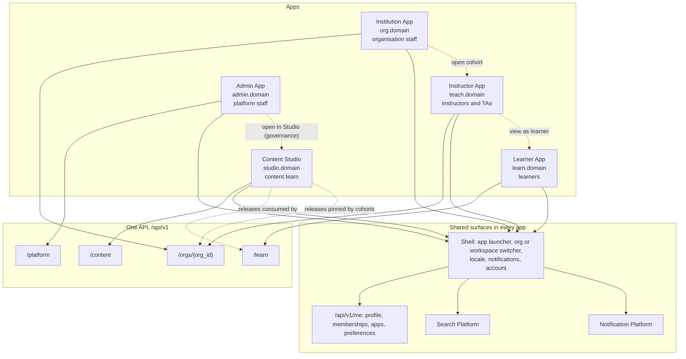

# AI Mentor information architecture (v2, five applications)

| Field | Value |
| --- | --- |
| Document | 12 — Information architecture |
| Version | 2.0 |
| Date | 13 October 2026 |
| Status | Approved direction. Target structure; only the Learner App and the admin portal routes exist today |
| Owner | Product Design (information architecture), with Frontend Engineering |
| Related | [README.md](README.md), [11-ux-specification.md](11-ux-specification.md), [14-content-studio-specification.md](14-content-studio-specification.md), [16-public-website-specification.md](16-public-website-specification.md), [08-api-specification.md](08-api-specification.md), [10-rbac-matrix.md](10-rbac-matrix.md), [13-knowledge-management-architecture.md](13-knowledge-management-architecture.md), [../DesignSpec.md](../DesignSpec.md) section 10, ADR [0013](../adr/0013-five-applications-shared-platform.md), [0014](../adr/0014-monorepo-shared-packages.md), [0015](../adr/0015-organisation-tenancy.md), [0016](../adr/0016-scoped-rbac-abac.md), [0019](../adr/0019-content-studio-releases.md), 0023 |

## Change record

| Area | What changed | Why | Impacted systems | Implementation implications |
| --- | --- | --- | --- | --- |
| Site structure | One learner sitemap plus one admin sitemap become five app sitemaps | ADR 0013 | `apps/*/app` route trees | Each app owns its routes; no route appears in two apps |
| URL conventions | Organisation slug in the path for the Instructor and Institution Apps (`/o/{orgSlug}/…`); workspace slug for Content Studio (`/w/{workspaceSlug}/…`); active organisation from the switcher in the Learner App; no tenant prefix in the Admin App | Shareable, bookmarkable, unambiguous tenant context for staff; stable learner URLs | Next.js route groups, BFF, `X-Org-Id` | BFF resolves slug to `org_id`; old slugs redirect |
| Navigation | Primary navigation per app capped at 7 items; secondary navigation defined | Wayfinding with five distinct jobs | `AppShell` navigation config | Navigation is data passed to the shell, filtered by capabilities from `GET /me/apps` |
| Object model | Objects each app exposes and their hierarchy | Same data, different views per app | Pages, breadcrumbs, search | Breadcrumbs and search are generated from the object model |
| Deep links | Cross-app link patterns ("Open in Content Studio", "View as learner") | People move between apps mid-task | `packages/ui` `AppLauncher`, `packages/config` origins | Links are absolute URLs to the target origin; the target re-checks access |
| Search | Search scopes per app | Different apps search different objects at different scopes | Search Platform (`search`) | Scope is a request parameter; results are security-trimmed server-side |
| Terminology | UX label versus data model term per locale | Consistent wording in en, fr, es; org-specific labels | `packages/i18n` catalogues, organisation settings | Glossary feeds translation memory |
| Route mapping | Current routes in `apps/learner`, `apps/admin`, `apps/studio`, `apps/instructor`, `apps/institution` | Five apps are live; remaining IA routes wait on APIs | Redirect tables | Admin content paths redirect to Studio |
| Marketing site | Apex `<domain>` is the public website; `learn.<domain>/` sends guests there | ADR 0013 named marketing at `<domain>` but left the app unspecified | `apps/www` on port 3005; Learner `/` redirects guests there | See [16-public-website-specification.md](16-public-website-specification.md) |

## Relationship to v1 documents

| v1 document | Status | What this document does |
| --- | --- | --- |
| `DesignSpec.md` 10.1 (sitemap) | Superseded | Replaced by the five site maps here. Learner routes are carried forward; existing paths keep working |
| `DesignSpec.md` 10.2 (primary navigation) | Superseded for desktop; mobile bottom nav retained | Learner desktop nav gains Classes and Compete; mobile keeps 5 items |
| `DesignSpec.md` 10.3 (heading hierarchy) | Retained for all apps | Applied unchanged |
| `DesignSpec.md` 10.4 (screen inventory) | Extended | Per-app inventories in the site maps |
| `DesignSpec.md` 15.1 (admin role-aware navigation) | Superseded | Replaced by [permission-aware navigation](#13-permission-aware-navigation) |
| `Admin.md` | Retained as brief | Its sections map to Content Studio and Admin App routes |

## Contents

1. [IA principles](#1-ia-principles)
2. [Ecosystem map](#2-ecosystem-map)
3. [URL conventions](#3-url-conventions)
4. [Learner App](#4-learner-app)
5. [Instructor App](#5-instructor-app)
6. [Institution App](#6-institution-app)
7. [Admin App](#7-admin-app)
8. [Content Studio](#8-content-studio)
9. [Shared routes in every app](#9-shared-routes-in-every-app)
10. [Deep links across apps](#10-deep-links-across-apps)
11. [Search scopes](#11-search-scopes)
12. [Breadcrumbs](#12-breadcrumbs)
13. [Permission-aware navigation](#13-permission-aware-navigation)
14. [Labelling and terminology](#14-labelling-and-terminology)
15. [Taxonomy-driven catalogue navigation](#15-taxonomy-driven-catalogue-navigation)
16. [Content hierarchy navigation](#16-content-hierarchy-navigation)
17. [Mapping from current routes](#17-mapping-from-current-routes)
18. [Open questions](#18-open-questions)

---

## 1. IA principles

1. **One app, one job.** An app's navigation contains only the work of its user group. A page that two groups need exists twice, as two thin pages over the same API, with different scope and density (ADR 0013 trade-off).
2. **Objects before features.** Navigation is organised around the objects people manage (cohorts, learners, courses, releases), not around system features. Features appear as tabs or actions on the object.
3. **Seven or fewer.** Primary navigation has at most 7 items in every app. More is a sign that two items are one object or that a feature belongs inside an object.
4. **Context in the URL for staff.** Any URL a staff member shares must open the same tenant context for the recipient. Learner URLs stay stable when the learner switches organisation, because learners rarely share tenant-specific links and often belong to one organisation.
5. **The hierarchy is the breadcrumb.** Breadcrumbs follow the object model (Organisation › Cohort › Assignment), never the click path.
6. **Same word, same thing.** A term means one thing across all apps and all three locales ([section 14](#14-labelling-and-terminology)). Where organisations need their own word (Class instead of Cohort), it is a label setting, not a different object.
7. **Permission shapes navigation, the API decides access.** Navigation hides what a person can never do and explains what they cannot do now ([section 13](#13-permission-aware-navigation)). The API enforces every rule regardless.
8. **Old links keep working.** Every moved route redirects for at least 12 months ([section 17](#17-mapping-from-current-routes)).

---

## 2. Ecosystem map



| Surface | Lives in | Shared by |
| --- | --- | --- |
| App launcher, switchers, account menu, notification panel | `packages/ui` shell components | All five apps |
| Sign-in and sign-up | Clerk, one production instance across subdomains (ADR 0013 rule 2) | All five apps; sign-up only in the Learner App |
| Personal settings (profile, language, notifications, accessibility) | `/api/v1/me/preferences`, rendered by each app's `settings` route | All five apps |
| Marketing site, public catalogue, public leaderboard | Marketing at `<domain>`; catalogue and guest leaderboard in the Learner App public routes | Guests |

---

## 3. URL conventions

### 3.1 Decision

| App | Origin | Tenant or workspace in URL | Pattern |
| --- | --- | --- | --- |
| Learner App | `learn.<domain>` | No. Active organisation comes from the switcher, stored in a first-party cookie and sent as `X-Org-Id` | `/courses/{courseSlug}/lessons/{lessonSlug}` |
| Instructor App | `teach.<domain>` | Yes, path prefix | `/o/{orgSlug}/cohorts/{cohortId}/gradebook` |
| Institution App | `org.<domain>` | Yes, path prefix | `/o/{orgSlug}/people/members` |
| Admin App | `admin.<domain>` | No; platform context. Tenant objects are addressed by ID | `/organisations/{orgId}` |
| Content Studio | `studio.<domain>` | Yes, workspace prefix; `master` for the master workspace, the organisation slug for an `org` workspace | `/w/master/build/courses/{courseId}` |

Why path prefixes rather than subdomains per organisation: one Vercel project and one certificate per app, one CSP, no wildcard DNS, and Clerk sessions shared on the parent domain. Custom domains (R4) are a separate mapping of a hostname to the Learner App or Institution App for one organisation (ADR 0013); on a custom domain the Institution App omits the `/o/{orgSlug}` prefix because the host fixes the organisation, and both forms resolve.

### 3.2 Rules

| Rule | Detail |
| --- | --- |
| Slugs | `orgSlug` is `tenancy.organisations.slug`: lower case, `a-z0-9-`, 3–48 characters. Renaming keeps the old slug as a redirect for 12 months |
| IDs versus slugs | Content with stable public identity uses slugs (`courseSlug`, `pathSlug`, `lessonSlug`, concept slug). Operational records use IDs (`cohortId`, `assignmentId`, `submissionId`, `releaseId`). IDs are opaque UUIDs |
| Learner deep links with a tenant | A link that must open in a specific organisation carries `?org={orgSlug}`. If it differs from the active organisation and the learner is a member, the app asks "Open in Lagos University?" [Switch] [Stay]; if not a member, it shows the join or access screen |
| Locale | Never in the path. Locale comes from the person's preference, then `Accept-Language`, then `en`. Public catalogue pages accept `?hl=fr` for sharing and SEO alternates (`hreflang`) |
| Filters and views | Query string, so views are shareable: `?status=active&risk=high&sort=-last_active` |
| Tabs | Path segments for primary object tabs (`/cohorts/{id}/gradebook`), query for minor tabs (`?tab=history`) |
| Kebab case | Route segments are kebab-case English, matching API style (`data-requests`, `release-impact`). Segments are not translated |
| Trailing slashes | None; redirected |
| Mismatch | When a URL's `orgSlug` names an organisation the person cannot access, the app renders `PermissionDenied` (not 404) only if the organisation exists and the person has some membership in it; otherwise a generic 404, so URLs cannot probe for tenant names |

### 3.3 Next.js App Router layout

Each app uses an `(app)` route group for the signed-in shell and a `(public)` group where guests are allowed. Tenant-scoped trees sit under a dynamic segment whose layout loads the organisation, checks membership, injects branding, and provides context to children.

```text
apps/instructor/app/
├── layout.tsx                       Clerk provider, i18n, theme
├── sign-in/[[...sign-in]]/page.tsx
└── (app)/
    ├── layout.tsx                   AppShell (no org yet)
    ├── page.tsx                     Organisation picker, or redirect to the only organisation
    └── o/[orgSlug]/
        ├── layout.tsx               Resolve org, check membership, brand, nav
        └── cohorts/[cohortId]/gradebook/page.tsx
```

---

## 4. Learner App

### 4.1 Site map

```text
apps/learner/app/
├── (public)/
│   ├── catalogue/page.tsx                         Catalogue home (taxonomy browse, section 15)
│   ├── catalogue/[...taxonomyPath]/page.tsx       Subject area, e.g. /catalogue/reinforcement-learning/value-based
│   ├── paths/[pathSlug]/page.tsx                  Path overview (public); lessons need sign-in
│   ├── courses/[courseSlug]/page.tsx              Course overview (public)
│   ├── leaderboard/page.tsx                       Guest: global weekly top 10; signed in: full board
│   ├── pricing/page.tsx
│   └── legal/[doc]/page.tsx, accessibility/page.tsx
├── sign-in/[[...sign-in]]/, sign-up/[[...sign-up]]/
├── join/page.tsx                                   Enter an enrolment code
├── join/[code]/page.tsx                            Join screen with consent (invite link or code)
└── (app)/
    ├── onboarding/[step]/page.tsx                  Steps 1–6, diagnostic, results
    ├── dashboard/page.tsx                          Home
    ├── today/page.tsx                              Today view
    ├── tutor/page.tsx, tutor/[conversationId]/page.tsx
    ├── learn/page.tsx                              Hub: classes, paths, courses, plan, map
    ├── paths/[pathSlug]/page.tsx                   Path detail (enrolled view)
    ├── courses/[courseSlug]/page.tsx               Course detail with module outline
    ├── courses/[courseSlug]/lessons/[lessonSlug]/page.tsx
    ├── graph/page.tsx                              Concept map
    ├── plan/page.tsx                               Study plan
    ├── classes/page.tsx                            My classes in the active organisation
    ├── classes/[cohortId]/page.tsx                 Class home: plan, announcements, staff
    ├── classes/[cohortId]/assignments/[assignmentId]/page.tsx    Brief, attempt, submit
    ├── grades/page.tsx                             Grades across classes
    ├── grades/[assignmentId]/page.tsx              Feedback view
    ├── practice/page.tsx                           Hub: today's challenge first
    ├── quiz/page.tsx, quiz/[quizId]/page.tsx, quiz/[quizId]/results/page.tsx
    ├── lab/page.tsx, lab/[projectId]/page.tsx
    ├── flashcards/page.tsx, flashcards/decks/page.tsx
    ├── challenges/page.tsx, challenges/history/page.tsx
    ├── seasons/[seasonSlug]/page.tsx
    ├── achievements/page.tsx                       Badges, titles, level history
    ├── friends/page.tsx
    ├── research/page.tsx, research/[docId]/page.tsx
    ├── career/page.tsx                             Career planner
    ├── search/page.tsx
    ├── analytics/page.tsx                          Personal analytics
    ├── notifications/page.tsx
    ├── profile/[handle]/page.tsx
    └── settings/[tab]/page.tsx                     profile, learning, mentor, language, notifications,
                                                    privacy, organisations, accessibility, plan
```

The leaderboard route serves both guests and signed-in learners; scope, period, and metric are query parameters: `/leaderboard?scope=organisation&period=weekly&metric=xp`, with `cohort={cohortId}` when `scope=cohort`.

### 4.2 Primary navigation

| # | Desktop sidebar | Contains | Visible when |
| --- | --- | --- | --- |
| 1 | Home | `/dashboard` | Always |
| 2 | Today | `/today` (R1 live route `/daily`) | Always |
| 3 | Tutor | `/tutor` | Always |
| 4 | Learn | `/learn` hub: paths, courses, plan, concept map, research. R1 also exposes World at `/academies` and Collection at `/collection` | Always |
| 5 | Practice | `/practice` hub: challenges, quiz, flashcards, lab | Always |
| 6 | Classes | `/classes`, `/grades` | The learner has a cohort membership in the active organisation |
| 7 | Compete | `/leaderboard`, `/seasons`, `/achievements`, `/friends`. R1 live route `/ranks` (global and country) | Always (a learner who opts out still sees achievements) |

Account menu holds Me items: profile, career, analytics, notifications, settings, help. Mobile bottom navigation keeps 5 items: **Home, Tutor, Learn, Practice, Me** (DesignSpec 17.2). On mobile, Today is the first card on Home, Classes is the first section of Learn when present, and Compete sits in Me.

### 4.3 Secondary navigation

| Area | Secondary items |
| --- | --- |
| Learn | My classes (when present), Paths, Courses, Study plan, Concept map, Research |
| Practice | Today's challenge, Quiz, Flashcards, Lab, Challenge history |
| Classes | Class switcher, then tabs: Plan, Assignments, Announcements, Grades |
| Compete | Leaderboards (scope tabs), Seasons, Achievements, Friends |
| Settings | Tabs as listed in the site map |

### 4.4 Object model

```text
Person (me)
├── Memberships ── Organisation ── Cohort (class) ── Cohort plan ── Plan items
│                                    └── Assignments ── My submissions ── Grade, feedback
├── Enrolments ── Learning path release ── Course release ── Module ── Lesson ── Assets (sources)
├── Mastery per concept ── Concept (graph)
├── Practice: quizzes, flashcard decks, lab projects, challenge attempts
├── Gamification: XP, level, streak, badges, titles, season progress, friends
├── Conversations (per mentor mode)
├── Research documents
└── Career goal ── Target role ── Required concepts
```

---

## 5. Instructor App

### 5.1 Site map

```text
apps/instructor/app/(app)/
├── page.tsx                                       Organisation picker or redirect
├── notifications/page.tsx, settings/[tab]/page.tsx
└── o/[orgSlug]/
    ├── page.tsx                                   Home (queues)
    ├── calendar/page.tsx                          All my cohorts' plan items and sessions
    ├── cohorts/page.tsx                           My cohorts
    ├── cohorts/new/page.tsx                       lead_instructor and above
    ├── cohorts/[cohortId]/page.tsx                Overview
    ├── cohorts/[cohortId]/plan/page.tsx           Calendar and overlay outline
    ├── cohorts/[cohortId]/plan/compare/page.tsx   Overlay or release diff
    ├── cohorts/[cohortId]/learners/page.tsx
    ├── cohorts/[cohortId]/assignments/page.tsx
    ├── cohorts/[cohortId]/assignments/[assignmentId]/page.tsx
    ├── cohorts/[cohortId]/gradebook/page.tsx
    ├── cohorts/[cohortId]/attendance/page.tsx
    ├── cohorts/[cohortId]/attendance/[sessionId]/page.tsx    Register and check-in
    ├── cohorts/[cohortId]/risk/page.tsx
    ├── cohorts/[cohortId]/leaderboard/page.tsx
    ├── cohorts/[cohortId]/analytics/page.tsx
    ├── cohorts/[cohortId]/settings/page.tsx       Staff, policies, locks
    ├── learners/page.tsx                          All my learners
    ├── learners/[learnerId]/page.tsx              Learner profile in this organisation
    ├── learners/import/page.tsx                   ImportWizard
    ├── learners/invites/page.tsx
    ├── assessments/page.tsx                       Organisation assessment library
    ├── assessments/new/page.tsx
    ├── assessments/[assessmentId]/page.tsx        Quiz builder
    ├── assessments/[assessmentId]/preview/page.tsx
    ├── assessments/rubrics/page.tsx, assessments/rubrics/[rubricId]/page.tsx
    ├── marking/page.tsx                           Queue across cohorts
    ├── marking/[assignmentId]/page.tsx            Submission list for one assignment
    ├── marking/[assignmentId]/[submissionId]/page.tsx    Marking workspace
    ├── marking/[assignmentId]/release/page.tsx    Release summary
    ├── marking/requests/page.tsx                  Grade review requests
    ├── messages/page.tsx                          Announcements and threads
    ├── messages/threads/[threadId]/page.tsx
    ├── messages/templates/page.tsx
    └── insights/page.tsx                          Cross-cohort analytics, risk, attendance
```

### 5.2 Navigation

| # | Primary | Secondary |
| --- | --- | --- |
| 1 | Home | Calendar |
| 2 | Cohorts | Cohort tabs: Overview, Plan, Learners, Assignments, Gradebook, Attendance, Risk, Leaderboard, Analytics, Settings |
| 3 | Learners | All learners, Import, Invites |
| 4 | Assessments | Library, Rubrics |
| 5 | Marking | Queue, By assignment, Review requests |
| 6 | Messages | Announcements, Threads, Templates |
| 7 | Insights | Analytics, Risk, Attendance (across cohorts) |

Cohort tabs over 7 collapse into a "More" menu below 1280 px. Teaching assistants see Cohorts, Learners, Marking, Messages, and Home; Assessments and Insights are hidden unless delegated.

### 5.3 Object model

```text
Organisation
└── Org unit (campus, department)
    └── Cohort
        ├── Staff (instructor, lead_instructor, teaching_assistant)
        ├── Members (learners) ── Learner record in this org: progress, grades, attendance, risk signals, interventions
        ├── Cohort plan ── pinned release ── overlay ── plan items (lesson, module, assignment, live session)
        ├── Assignments ── Submissions ── Marks (per criterion) ── AI mark proposals ── Grade ── Overrides
        ├── Live sessions ── Attendance records
        ├── Announcements, threads
        └── Leaderboard (cohort scope)
Assessment library (organisation) ── Assessments ── Items ── Rubrics ── Criteria ── Levels
```

---

## 6. Institution App

### 6.1 Site map

```text
apps/institution/app/(app)/
├── page.tsx                                       Organisation picker or redirect
├── notifications/page.tsx, settings/[tab]/page.tsx  (personal settings)
└── o/[orgSlug]/
    ├── page.tsx                                   Overview
    ├── setup/[step]/page.tsx                      Setup wizard
    ├── organisation/page.tsx                      Structure tree
    ├── organisation/units/[unitId]/page.tsx       Unit detail: cohorts, instructors, reports
    ├── organisation/cohorts/page.tsx              Cohorts at scale
    ├── organisation/cohorts/import/page.tsx
    ├── organisation/cohorts/[cohortId]/page.tsx   Read view, link to Instructor App
    ├── organisation/terms/page.tsx                Terms and roll-over
    ├── people/page.tsx                            Members
    ├── people/[membershipId]/page.tsx
    ├── people/instructors/page.tsx
    ├── people/admins/page.tsx                     Organisation-level role assignments
    ├── people/invitations/page.tsx
    ├── people/import/page.tsx
    ├── reports/page.tsx                           Library and templates
    ├── reports/new/page.tsx                       Builder
    ├── reports/[reportId]/page.tsx
    ├── reports/schedules/page.tsx
    ├── reports/workforce/page.tsx                 Workforce development
    ├── licences/page.tsx                          Licences and seats
    ├── licences/seats/page.tsx
    ├── licences/invoices/page.tsx
    ├── licences/payment/page.tsx
    ├── compliance/page.tsx
    ├── compliance/data-requests/page.tsx, compliance/data-requests/[requestId]/page.tsx
    ├── compliance/retention/page.tsx
    ├── compliance/consent/page.tsx
    ├── compliance/audit/page.tsx
    ├── compliance/policies/page.tsx
    └── settings/
        ├── profile/page.tsx                       Name, kind, locale, time zone, labels
        ├── branding/page.tsx
        ├── sign-in/page.tsx, sign-in/new/page.tsx SSO connections and wizard
        ├── domains/page.tsx                       Email domains and custom domains
        ├── policies/page.tsx                      Integrity, leaderboards, AI marking, data sharing, dimension bounds
        ├── integrations/[kind]/page.tsx           lti, oneroster, scim, webhooks
        └── content/page.tsx                       Licensed catalogue, org workspace (link to Studio)
```

### 6.2 Navigation

| # | Primary | Secondary |
| --- | --- | --- |
| 1 | Overview | Setup checklist (until complete) |
| 2 | Organisation | Structure, Cohorts, Terms |
| 3 | People | Members, Instructors, Admins, Invitations, Import |
| 4 | Reports | Library, Schedules, Workforce |
| 5 | Licences and billing | Licences, Seats, Invoices, Payment |
| 6 | Compliance | Data requests, Retention, Consent, Audit log, Policies |
| 7 | Settings | Profile, Branding, Sign-in, Domains, Policies, Integrations, Content |

Role-shaped defaults: an `org_billing_manager` lands on Licences and billing; an `org_compliance_officer` on Compliance; an `org_report_viewer` sees only Overview and Reports.

### 6.3 Object model

```text
Organisation (tenant)
├── Profile, branding, domains, SSO connections, policies, integrations
├── Licences ── Seat assignments ── Memberships
├── Org units: Campus ── Department (≤ 2 levels) ── Cohort
├── People: Memberships ── Role assignments (role, scope)
├── Reports ── Report definitions ── Schedules ── Runs
├── Compliance: Data requests, retention rules, consent records, audit log
└── Content access: licensed releases, org workspace (Content Studio)
```

---

## 7. Admin App

### 7.1 Site map

```text
apps/admin/app/(app)/
├── page.tsx                                       Operations home
├── operations/jobs/page.tsx                       Worker jobs, ingestion failures
├── operations/incidents/page.tsx
├── organisations/page.tsx
├── organisations/[orgId]/[[...tab]]/page.tsx      profile, licences, members, sso, branding, policies, audit
├── users/page.tsx
├── users/[userId]/page.tsx
├── ai/routes/page.tsx, ai/routes/[purpose]/page.tsx
├── ai/models/page.tsx
├── ai/prompts/page.tsx, ai/prompts/[promptKey]/page.tsx
├── ai/evaluations/page.tsx, ai/evaluations/[runId]/page.tsx
├── ai/providers/page.tsx
├── ai/spend/page.tsx
├── platform/flags/page.tsx, platform/flags/[flagKey]/page.tsx
├── platform/settings/page.tsx, platform/settings/[group]/page.tsx
├── trust/moderation/page.tsx, trust/moderation/[itemId]/page.tsx
├── trust/security/page.tsx
├── trust/audit/page.tsx
├── trust/break-glass/page.tsx                     Session history and active sessions
├── trust/data-requests/page.tsx                   Personal-account DSARs
├── trust/knowledge/page.tsx                       Knowledge governance: rights, takedowns, index health
├── commerce/subscriptions/page.tsx
├── commerce/licences/page.tsx
├── commerce/plans/page.tsx
├── commerce/invoices/page.tsx
├── insights/reports/page.tsx                      Global reporting
├── insights/analytics/page.tsx
└── settings/[tab]/page.tsx                        Personal settings
```

### 7.2 Navigation

| # | Primary | Secondary |
| --- | --- | --- |
| 1 | Operations | Home, Jobs, Incidents |
| 2 | Organisations and users | Organisations, Users |
| 3 | AI services | Routes, Models, Prompt releases, Evaluations, Providers, Spend |
| 4 | Platform | Feature flags, Settings |
| 5 | Trust and governance | Moderation, Security, Audit log, Break-glass, Data requests, Knowledge governance |
| 6 | Commerce | Subscriptions, Licences, Plans, Invoices |
| 7 | Insights | Global reports, Analytics |

Items are grouped as sidebar sections with headings (DesignSpec 15.1 style), not as nested flyouts. Queue counts (Moderation, Data requests) show as plain numbers.

### 7.3 Object model

```text
Platform
├── Organisations ── licences, SSO status, policies, break-glass sessions
├── Users (accounts) ── memberships ── role assignments (all scopes, read); platform role assignments (edit)
├── AI: providers ── models (registry) ── routes per purpose ── prompt releases ── evaluation runs
├── Configuration: feature flags ── rules; platform settings
├── Trust: moderation items, security events, audit entries, DSARs, takedown requests
├── Commerce: plans, subscriptions, licences, invoices
└── Insights: global report definitions
```

---

## 8. Content Studio

### 8.1 Site map

```text
apps/studio/app/(app)/
├── page.tsx                                       Redirect to last workspace, or workspace picker
├── notifications/page.tsx, settings/[tab]/page.tsx
└── w/[workspaceSlug]/                             `master` or an organisation slug
    ├── page.tsx                                   Home: my drafts, review queue, scheduled releases, health
    ├── health/page.tsx                            Content health queues
    ├── insights/page.tsx                          Content analytics
    ├── library/page.tsx                           Resource Library
    ├── library/upload/page.tsx                    Knowledge Repository upload flow
    ├── library/collections/page.tsx, library/collections/[collectionId]/page.tsx
    ├── library/[assetId]/page.tsx                 Asset detail (tabs via ?tab=)
    ├── library/[assetId]/versions/page.tsx        Version history and compare
    ├── library/[assetId]/usage/page.tsx           Usage graph, replace, retire
    ├── build/lessons/page.tsx, build/lessons/[lessonId]/page.tsx     Lesson Builder
    ├── build/lessons/[lessonId]/preview/page.tsx  Preview as learner
    ├── build/items/page.tsx, build/items/[itemId]/page.tsx           Item bank
    ├── build/assessments/page.tsx, build/assessments/[assessmentId]/page.tsx   Quiz Builder
    ├── build/courses/page.tsx, build/courses/[courseId]/page.tsx     Course Builder
    ├── build/paths/page.tsx, build/paths/[pathId]/page.tsx           Learning Path Builder
    ├── build/curricula/page.tsx, build/curricula/[curriculumId]/page.tsx   Curriculum Builder
    ├── build/generate/page.tsx, build/generate/[jobId]/page.tsx      AI Content Generation
    ├── build/challenges/page.tsx                  Challenge definitions (ADR 0013)
    ├── build/derived/[courseId]/merge/page.tsx    Derived course upstream merge (org workspaces)
    ├── knowledge/taxonomy/page.tsx, knowledge/taxonomy/[nodeId]/page.tsx
    ├── knowledge/graph/page.tsx, knowledge/graph/[conceptSlug]/page.tsx
    ├── knowledge/quality/page.tsx                 Graph quality report
    ├── knowledge/metadata/page.tsx, knowledge/metadata/[kindCode]/page.tsx
    ├── knowledge/vocabularies/page.tsx, knowledge/vocabularies/[vocabularyCode]/page.tsx
    ├── review/page.tsx                            Review queue
    ├── review/[entityType]/[entityId]/page.tsx    Review screen
    ├── releases/page.tsx
    ├── releases/new/page.tsx
    ├── releases/[releaseId]/page.tsx              Release detail, impact, notes
    ├── releases/[releaseId]/compare/page.tsx
    ├── localisation/page.tsx                      Queue by locale
    ├── localisation/jobs/[jobId]/page.tsx         Translation editor
    ├── localisation/memory/page.tsx
    └── localisation/glossary/page.tsx
```

### 8.2 Navigation

| # | Primary | Secondary |
| --- | --- | --- |
| 1 | Home | Overview, Content health, Insights |
| 2 | Library | All assets, Upload, Collections, Saved views |
| 3 | Build | Lessons, Item bank, Assessments, Courses, Paths, Curricula, Generate, Challenges |
| 4 | Knowledge | Taxonomy, Graph, Quality, Metadata schemas, Vocabularies |
| 5 | Review | Assigned to me, All in review, Changes requested (mine) |
| 6 | Releases | Scheduled, Published, Archived, Withdrawn |
| 7 | Localisation | Queue (per assigned locale), Memory, Glossary |

Full behaviour is in [14](14-content-studio-specification.md#4-navigation-and-dashboard).

### 8.3 Object model

```text
Workspace (master | org)
├── Knowledge assets ── versions ── files, transcripts, link checks, dataset profiles, repository snapshots
│   └── Collections (curated lists of assets)
├── Concepts (graph nodes) ── relations ── taxonomy node (exactly one)
├── Taxonomy tree ── controlled vocabularies ── metadata schemas per asset kind
├── Lessons ── per-locale, per-approach bodies ── blocks ── linked assets (role) ── embedded checks
├── Items (item bank) ── translations ── answer keys (protected)
├── Assessments (templates) ── items ── rubrics
├── Modules ── lessons and checks
├── Courses ── modules, outcomes, prerequisites (derived), assessments ── releases
├── Learning paths ── courses, electives, projects ── releases
├── Curricula ── programme outcomes ── mapped courses
├── Releases ── release items (pinned versions) ── impact analysis ── notes per locale
├── Generation jobs ── generated artifacts
└── Localisation jobs ── translation memory ── glossary
```

---

## 9. Shared routes in every app

Every app has `/sign-in/[[...sign-in]]` (Clerk; sign-up exists only in the Learner App), `/settings/[tab]` (personal profile, language, notifications, accessibility, all on `/api/v1/me/preferences`, plus learner tabs in the Learner App), `/notifications` (full list behind the shell panel), `/help` (same position in every app), and error pages `/403`, `/404`, `/offline` (the 403 page names the role needed).

---

## 10. Deep links across apps

| From | Link label | To | Target URL pattern | Shown when | If the person lacks access |
| --- | --- | --- | --- | --- | --- |
| Instructor plan item, lesson | Open in Content Studio | Studio lesson or course | `studio.<domain>/w/{workspaceSlug}/build/lessons/{lessonId}` | Person holds a Studio role in the owning workspace | Hidden |
| Instructor plan item, assessment, cohort | View as learner | Learner App preview | `learn.<domain>/preview/cohorts/{cohortId}?item={planItemId}` | Instructor of the cohort | n/a |
| Instructor plan item | Report a content problem | Studio feedback intake | `studio.<domain>/w/{workspaceSlug}/review/feedback/new?item=…` (intake form only) | Always | Intake opens without Studio access; it is a form, not the workspace |
| Institution cohort | Open in Instructor App | Instructor cohort | `teach.<domain>/o/{orgSlug}/cohorts/{cohortId}` | Person has an Instructor App role in that cohort | Read view stays in the Institution App |
| Institution settings, content | Manage organisation content | Studio org workspace | `studio.<domain>/w/{orgSlug}` | Org workspace licensed and person holds a Studio role in it | "Ask a content admin for access" |
| Studio release | View cohorts using this | Not linked across tenants | n/a | Master publishers see counts only (13 impact analysis) | n/a |
| Studio lesson | Preview as learner | Studio preview route | `/w/{workspaceSlug}/build/lessons/{lessonId}/preview` | Always in Studio | n/a |
| Admin organisation | Open Institution App as support | Not provided | n/a | Admin uses break-glass views inside the Admin App; no impersonation (09) | n/a |
| Admin knowledge governance | Open in Content Studio | Studio asset | `studio.<domain>/w/master/library/{assetId}` | Person holds a Studio role (or `platform_admin` read) | Hidden |
| Learner lesson | Ask the mentor | Tutor with concept | `/tutor?concept={conceptSlug}&lesson={lessonSlug}` | Always | n/a |
| Learner grade | Message instructor | Learner App thread | `/classes/{cohortId}?tab=messages&thread=new` | Messaging on for the cohort | Hidden |
| Any app | App launcher tile | Target app home | Origin root, with `?org={orgSlug}` where supported | Person can open the app | Not listed |

Rules:

1. Cross-app links are absolute and open in the same tab by default; the target app re-checks access and never trusts the source.
2. Links carry only identifiers, never tokens or personal data.
3. "View as learner" renders a read-only preview inside the Learner App under `/preview/...` with a banner "Preview as a learner in ML 101. Nothing you do here is recorded." No submissions, XP, or mastery are written.
4. Every cross-app link has an `external-link`-style app icon and the target app's short name in its accessible name ("Open in Content Studio").

---

## 11. Search scopes

The shell search (`⌘K`) searches the current app's scope. Results are security-trimmed by the Search Platform.

| App | Default scope | Object types | Other scopes offered | Not searchable |
| --- | --- | --- | --- | --- |
| Learner App | My courses in the active organisation | Concepts, lessons, courses, paths, sources (published), my conversations, my notes, my research documents | Everything I can access (all memberships), organisation library | Other learners (except handles in Friends search), assessment items, drafts |
| Instructor App | My cohorts in the organisation | Learners, cohorts, assignments, submissions (by learner), assessments, rubrics, plan items, messages | Whole organisation (lead instructor and above), licensed catalogue | Learners outside my cohorts; other organisations |
| Institution App | My scope in the organisation | Members, instructors, cohorts, org units, reports, data requests, invoices | Whole organisation (`org_admin`, `org_owner`) | Submission content, conversations |
| Admin App | Platform | Organisations, users (by email, handle, ID), flags, settings, routes, models, audit entries, moderation items | Single organisation (break-glass) | Tenant learning content and conversations |
| Content Studio | Current workspace | Assets (metadata and full text), lessons, items (including answer-key-protected items for permitted roles), courses, paths, concepts, taxonomy nodes, releases | Master (read) from an org workspace; all workspaces I hold roles in | Learner data |

Search conventions: results grouped by object type, at most 5 per group with "Show all"; keyword and semantic modes in the Learner App and Studio; the search page URL holds the query (`/search?q=bellman&scope=all`); zero-result queries are logged as knowledge gaps (13 search integration).

---

## 12. Breadcrumbs

| Rule | Detail |
| --- | --- |
| When | Pages three or more levels deep in the object model (DesignSpec 5.7) |
| Source | The object hierarchy in the app's object model, not the click path |
| Root | The app home is never a crumb (the app name in the shell is the home link). Tenant-prefixed apps start with the organisation or workspace only when the page belongs to a child object |
| Labels | Object display names, truncated to 32 characters with the full name in a tooltip and the accessible name |
| Current page | Last crumb, `aria-current="page"`, not a link |
| Mobile | Collapses to "‹ Parent" |
| Overlays | A lesson reached through a cohort plan shows the cohort, not the course: Classes › ML 101 › Module 3 › Least squares |

Examples:

| App | Page | Breadcrumb |
| --- | --- | --- |
| Learner | Lesson in a path | Academies › Reinforcement Learning Academy › RL Foundations › Markov Decision Processes › States & Actions › What is a State? |
| Learner | Assignment | Classes › ML 101 › Problem set 3 |
| Instructor | Marking workspace | Cohorts › ML 101 › Midterm › Submission 7 |
| Institution | Unit | Organisation › Main campus › Faculty of Engineering |
| Studio | Lesson in a course | Build › Courses › RL Foundations › Module 2 › Bellman expectation equation |
| Studio | Asset version compare | Library › Sutton & Barto ch. 3 › Versions › v1.3 ⇄ v1.4 |

---

## 13. Permission-aware navigation

Navigation is built from capabilities returned by `GET /api/v1/me/apps` (per app, per organisation or workspace). The API remains the authority (ADR 0013 rule 4).

| Situation | Treatment | Example |
| --- | --- | --- |
| The person holds no role in this app or scope that could ever grant the action | **Hide** the navigation item, tab, or action | A teaching assistant does not see "Create cohort" |
| The action exists for the person's role but a state or policy blocks it now | **Show, enabled, explain on use**, or show as read-only text with a reason (DesignSpec 1.5) | "Release grades" with 3 unreviewed AI proposals opens the explanation |
| Blocked by the two-person rule | Show the action replaced by text: "You can't approve your own work" | Studio review |
| Blocked by licence or plan, and the person can change the plan (`org_owner`, `org_billing_manager`) | Show with "Not in your plan" and a link to Licences | SSO for an organisation without it |
| Blocked by licence or plan, and the person cannot change it | **Hide** | An instructor does not see AI marking settings when the licence lacks it |
| Blocked by a frozen object (released grades, published release) | Read-only view with `PolicyBanner` | Gradebook after release |
| Needs MFA step-up | Show, enabled; step-up runs before submit | Admin writes, SSO configuration |
| Needs break-glass | Show the object list; data loads after the break-glass gate | Admin organisation members |
| Direct URL to a hidden route | `PermissionDenied` page (when the object exists in a tenant the person belongs to) or 404 | Typed URL |
| Empty sections | An item whose every child is hidden is itself hidden | Institution "Compliance" for a report viewer |

Navigation never shows counts for queues the person cannot act on.

---

## 14. Labelling and terminology

### 14.1 Terminology table

The UX label is what people see. The data model term is what the API, database, and documents use. Organisation-configurable labels are marked †.

| Data model term | UX label (en) | fr | es | Notes |
| --- | --- | --- | --- | --- |
| `organisation` (kind university, college, school, bootcamp) | Institution | Établissement | Institución | Label follows organisation kind |
| `organisation` (kind enterprise, government, publisher) | Organisation | Organisation | Organización | |
| `organisation` (consumer) | AI Mentor (personal) | AI Mentor (personnel) | AI Mentor (personal) | Learner App only |
| `cohort` † | Cohort (default); Class, Section, Intake, Group | Cohorte; Classe, Section, Promotion, Groupe | Cohorte; Clase, Sección, Promoción, Grupo | One label per organisation (setting `cohort_label`); learners see "Classes" in navigation regardless |
| `learning_path` | Learning path | Parcours d'apprentissage | Ruta de aprendizaje | Short form "Path" / "Parcours" / "Ruta" in navigation |
| `course` | Course | Cours | Curso | |
| `module` | Module | Module | Módulo | |
| `lesson` | Lesson | Leçon | Lección | |
| `knowledge asset` | Resource (learners); Asset (Studio) | Ressource; Ressource documentaire | Recurso; Recurso de conocimiento | Learners never see "asset" |
| `concept` | Concept | Notion | Concepto | "Notion" reads more naturally in French pedagogy |
| `assignment` | Assignment | Devoir | Tarea | |
| `assessment` | Assessment | Évaluation | Evaluación | |
| `submission` | Submission | Rendu | Entrega | |
| `rubric` | Rubric | Grille d'évaluation | Rúbrica | |
| `grade` | Grade | Note | Calificación | |
| `proposed grade` | AI proposal (staff only) | Proposition de l'IA | Propuesta de la IA | Never shown to learners |
| `grade override` | Override | Modification de la note | Modificación de la calificación | |
| `risk signal` | At risk; signal names in plain words | À risque | En riesgo | Staff only |
| `assessment integrity mode` | Assessment in progress | Évaluation en cours | Evaluación en curso | The policy name is not shown to learners |
| `cohort plan` | Plan (staff); Schedule (learners) | Plan; Calendrier | Plan; Calendario | |
| `overlay` | Customisation | Personnalisation | Personalización | "Overlay" is not shown in the UI |
| `content release` | Release, with version | Version publiée | Versión publicada | Learners see "Updated 14 Oct" instead |
| `workspace` | Workspace (Master repository, {org} workspace) | Espace de travail | Espacio de trabajo | Studio only |
| `mentor` (AI mentor) | Mentor, or the persona name ("Ada") | Mentor | Mentor | The persona name is used in conversation |
| Mentor modes | Tutor, Mentor, Research supervisor, Coding coach, Career coach, Exam coach | Tuteur, Mentor, Directeur de recherche, Coach de code, Coach carrière, Coach d'examen | Tutor, Mentor, Supervisor de investigación, Coach de programación, Coach de carrera, Coach de exámenes | |
| `leaderboard` | Leaderboard | Classement | Clasificación | |
| `streak` | Streak | Série | Racha | "12 day streak" / "Série de 12 jours" / "Racha de 12 días" |
| `xp` | XP | XP | XP | First use in onboarding spells it out: "experience points (XP)" / "points d'expérience (XP)" / "puntos de experiencia (XP)" |
| `badge` | Badge | Badge | Insignia | |
| `enrolment` | Enrolled | Inscrit | Inscrito | |
| `membership` | Member | Membre | Miembro | |
| `licence` / seat | Licence, seat | Licence, siège | Licencia, plaza | |
| Roles | Instructor, Lead instructor, Teaching assistant | Enseignant, Enseignant responsable, Assistant d'enseignement | Instructor, Instructor principal, Asistente docente | Enterprise kinds use Trainer / Formateur / Formador for `instructor` |

### 14.2 Rules

- English labels use British spelling (Organisation, Licence, Enrolment), matching the documents.
- App short names in the launcher: Learn, Teach, Organisation, Admin, Content Studio. "Content Studio" is not translated.
- The glossary in this section is loaded into translation memory (13 localisation pipeline) so machine drafts use these terms.
- Organisation-configurable labels apply in the Learner, Instructor, and Institution Apps for that organisation only; Studio and Admin always use the data model label.

---

## 15. Taxonomy-driven catalogue navigation

The catalogue (Learner App public and signed-in, and the licensed catalogue in the Institution App and Instructor App) is navigated by the knowledge taxonomy (`knowledge.taxonomy_nodes`), not by a hand-made menu.

| Rule | Detail |
| --- | --- |
| URL | `/catalogue/{segment}/{segment}`, where segments are taxonomy slugs with `_` written as `-` (`artificial_intelligence.reinforcement_learning.value_based` → `/catalogue/artificial-intelligence/reinforcement-learning/value-based`). Segments are English and stable; labels are localised |
| Depth shown | Navigation lists up to three levels; deeper nodes appear as facets on the results page. The taxonomy itself may be deeper (DesignSpec `KR-010` limit 6) |
| Counts | Each node shows the number of courses and paths available to the viewer (after entitlement); nodes with zero are hidden from navigation but reachable by URL with an empty state |
| Facets | Difficulty, duration, locale available, format (course, path, project), organisation-assigned (when signed in to an organisation) |
| Ordering | Steward-defined order per level, then alphabetical in the viewer's locale |
| Moves and merges | A taxonomy move or merge in Studio creates redirects from old catalogue URLs |
| Concepts | A concept page (`/catalogue/concepts/{conceptSlug}`) lists courses teaching it and its prerequisites; it links into the concept map for signed-in learners |
| Organisation content | Courses from an organisation's `org` workspace appear under the same taxonomy, with the organisation logo, only for its members |

---

## 16. Content hierarchy navigation

Hierarchy: Learning path › Course › Module › Lesson › Asset (README content model).

| App | Path | Course | Module | Lesson | Asset |
| --- | --- | --- | --- | --- | --- |
| Learner | Path page lists courses with progress and electives | Course page with module outline and outcomes | Section in the course outline (no own page) | Lesson reader with module outline in a collapsible side panel; previous and next | Opened as a Source card or sheet (`?source={assetId}`); never a standalone page for learners, except research documents |
| Instructor | Plan for a cohort pinned to a path release | Course in the plan outline | Outline group with dates | Plan item; "View as learner" | Supplementary items added through the overlay |
| Institution | Licensed catalogue entries; read-only | Same | n/a | n/a | n/a |
| Studio | Path Builder | Course Builder | Module inside Course Builder (no own route) | Lesson Builder | Library asset detail; referenced from lessons by role |

Rules:

1. Modules have no learner route of their own; deep links to a module open the course page scrolled to it (`#module-{moduleSlug}`).
2. A lesson belongs to exactly one module in a release, so the lesson URL needs only the course: `/courses/{courseSlug}/lessons/{lessonSlug}`. A `?path={pathSlug}` parameter sets breadcrumb context when the lesson was reached from a path.
3. In a cohort, the learner reaches lessons through Classes; the URL is the same lesson URL with `?cohort={cohortId}`, so the pinned release and overlay apply.
4. Previous and next follow the cohort overlay order when in a cohort, otherwise the release order.

---

## 17. Mapping from current routes

### 17.1 Learner App (`apps/learner/app`)

| Current route | Target app | Target route | Notes |
| --- | --- | --- | --- |
| `/` (landing, `apps/www`) | Marketing site | `<domain>/` | `learn.<domain>/` redirects guests to `<domain>` and signed-in learners to `/dashboard` |
| `/sign-in`, `/sign-up` | Learner App | Same | Clerk, unchanged |
| `/(learn)/dashboard` | Learner App | `/dashboard` (label "Home") | Route group renamed from `(studio)` to `(learn)` |
| `/(learn)/academies` | Learner App | `/academies` (label "World") | All learning paths; Faculty and Level filters; academies are filters; skill tree on `/academies/[slug]` |
| `/(learn)/daily` | Learner App | `/daily` (label "Today") | R1 daily authored item; weekly/seasonal still R2 |
| `/(learn)/collection` | Learner App | `/collection` | Skill cards from mastery |
| `/(learn)/ranks` | Learner App | `/ranks` | Live global and country; Compete hub later |
| `/(learn)/tutor` | Learner App | `/tutor`, `/tutor/[conversationId]` | |
| `/(learn)/quiz` | Learner App | `/quiz` | Reached from Practice |
| `/(learn)/paths` | Learner App | `/paths` redirects to `/learn?tab=paths`; public `/catalogue` | |
| `/(learn)/paths/[slug]` | Learner App | `/paths/[pathSlug]` | Lesson links inside move to `/courses/[courseSlug]/lessons/[lessonSlug]`; the legacy `/paths/[slug]/[lessonId]` (DesignSpec 10.1) redirects |
| `/(learn)/graph` | Learner App | `/graph` | |
| `/(learn)/flashcards` | Learner App | `/flashcards` | |
| `/(learn)/lab` | Learner App | `/lab` | |
| `/(learn)/research` | Learner App | `/research` | |
| `/(learn)/admin` | Learner App | App launcher page | Lists the other apps this account may open |

### 17.2 Admin App and Content Studio (`apps/admin`, `apps/studio`)

Allocation follows ADR 0013. Old `admin.<domain>` content URLs redirect to `studio.<domain>/w/master/...`.

| Current route | Target app | Target route | Notes |
| --- | --- | --- | --- |
| `/` (overview) | Admin App and Content Studio | Admin `/` (operations metrics); Studio `/w/master` (content summary) | The v1 overview's "Content health" block moves to Studio |
| `/catalog` | Content Studio | `/w/master/library` | Resource Catalog list |
| `/catalog/import` | Content Studio | `/w/master/library/upload` | Bulk import and source refresh |
| `/catalog/duplicates` | Content Studio | `/w/master/library` (duplicates view) | |
| `/catalog/quality` | Content Studio | `/w/master/health` | Quality scorecard |
| `/library` | Content Studio | `/w/master/library` | |
| `/library/new` | Content Studio | `/w/master/library/upload` | |
| `/library/[id]` | Content Studio | `/w/master/library/[assetId]` | |
| `/review` | Content Studio | `/w/master/review` | |
| `/generate` | Content Studio | `/w/master/build/generate` | |
| `/curriculum` | Content Studio | `/w/master/build/paths` and `/w/master/build/courses` | v1 curriculum edits paths; v2 splits course and path builders |
| `/taxonomy` | Content Studio | `/w/master/knowledge/taxonomy` | |
| `/graph` | Content Studio | `/w/master/knowledge/graph` | |
| `/challenges` | Content Studio | `/w/master/build/challenges` | Authoring of definitions; scheduling and scoring stay in gamification (ADR 0013) |
| `/analytics` | Admin App and Content Studio | Admin `/insights/analytics` (platform); Studio `/w/master/insights` (content) | |
| `/moderation` | Admin App | `/trust/moderation` | |
| `/users` | Admin App | `/users` | |
| `/configuration` | Admin App | `/platform/settings` | |
| `/providers` | Admin App | `/ai/providers` | Routing moves to `/ai/routes` |
| `/audit` | Admin App | `/trust/audit` | |
| `/sign-in` | Admin App and Content Studio | Each app's `/sign-in` | |

Admin and Studio each have their own shell. The Admin App redirects former content paths (`/library`, `/catalog`, `/review`, …) to Content Studio. The app launcher replaces "Back to studio".

### 17.3 Instructor and Institution Apps

First slices live under `apps/instructor/app/o/[orgSlug]/` and `apps/institution/app/o/[orgSlug]/` with the navigation from sections 5 and 6. Organisation-scoped APIs are not routed yet; those pages render empty queues against the shared API.

### 17.4 Routes still ahead of the API

Learner `/today`, `/classes`, `/grades`, `/seasons`, `/achievements`, `/friends`, `/career`, `/search`, `/join`, `/catalogue`; Admin `/ai/*` except providers, `/platform/flags`, `/trust/security`, `/trust/break-glass`, `/trust/knowledge`, `/commerce/*`, `/insights/reports`; Studio `/w/[workspace]/…` builders, `/releases`, `/localisation`.

---

## 18. Open questions

1. **Marketing site ownership.** Closed. Apex `<domain>` is the public website ([16](16-public-website-specification.md)) in `apps/www` on port 3005. `learn.<domain>/` redirects guests to the apex and signed-in learners to `/dashboard`.
2. **Learner tenant in URL.** Learners use the switcher, not a path prefix. If organisations start sharing lesson links widely (LMS embeds), `?org=` may not be enough; LTI launches already carry context.
3. **`cohort_label` setting.** The configurable cohort label is introduced here as an organisation setting; it needs a field in `tenancy.org_policies` or organisation profile (07).
4. **Taxonomy slug style.** 07 and 13 use underscores in slugs (`bellman_equation`), the README example uses hyphens (`bellman-equation`). URLs here convert underscores to hyphens; the canonical slug style should be fixed in the README.
5. **Studio feedback intake.** "Report a content problem" from the Instructor and Learner Apps needs an endpoint that accepts reports from people without Studio roles (08).
