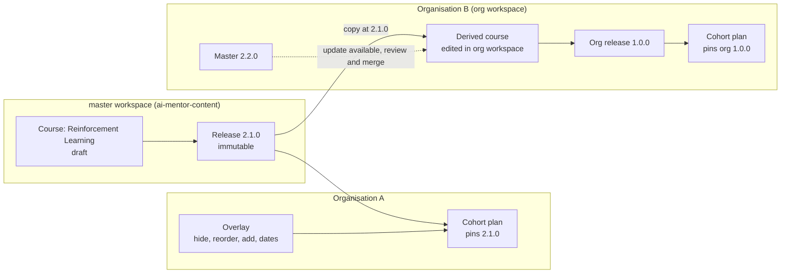
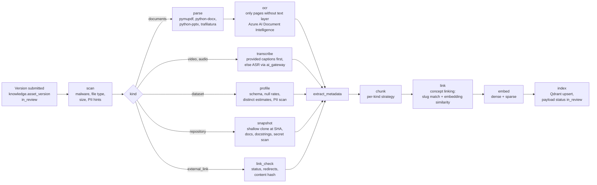
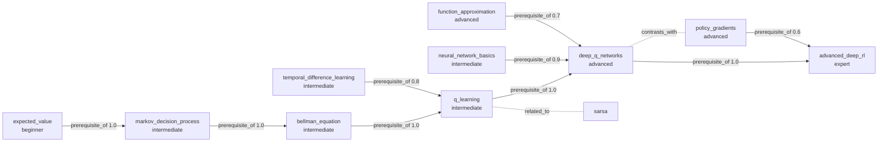
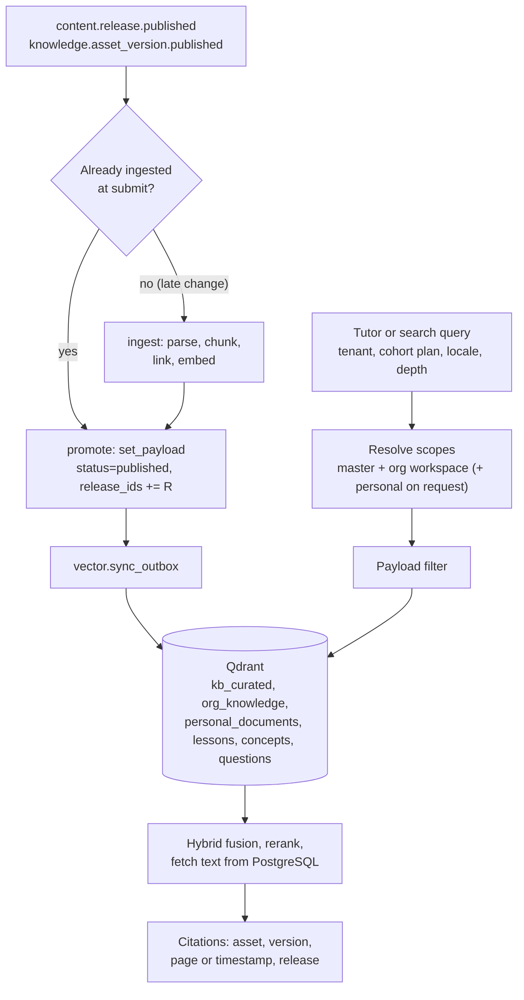
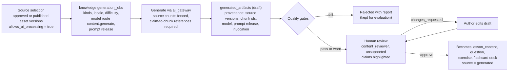
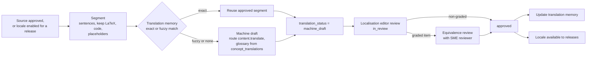

# AI Mentor knowledge management architecture

| Field | Value |
| --- | --- |
| Document | 13 Knowledge management architecture |
| Version | 2.0 |
| Date | 13 October 2026 |
| Status | Proposed target architecture. The v1 knowledge pipeline (ADR 0007, 0009) is what runs today |
| Owner | Learning (CLO) for governance; Enterprise Architecture for services and data flow |
| Related | [README](README.md), [07 Database design](07-database-design.md), [14 Content Studio specification](14-content-studio-specification.md), [06 System architecture](06-system-architecture.md), [10 RBAC matrix](10-rbac-matrix.md), ADR 0007, 0009, 0019, 0020, 0022, 0023 |

## Change record

| Area | What changed | Why | Impacted systems | Implementation implications |
| --- | --- | --- | --- | --- |
| Governance | The master repository is centrally governed by the platform content organisation; organisations own only their workspace content; instructors customise through overlays | Content quality and ownership at multi-tenant scale (ADR 0019) | `knowledge`, `content`, Content Studio, Instructor App | Workspace scope on every authored row; RACI below becomes the seeded role–permission data |
| Assets | 13 asset kinds with per-kind metadata, ingestion, RAG eligibility, and chunking | README content model; v1 had 14 format-led kinds | `knowledge`, `retrieval` | `knowledge.asset_kinds` lookup; new ingestion stages (`scan`, `ocr`, `transcribe`, `profile`, `snapshot`, `link_check`) |
| Graph | Taxonomy and knowledge graph separated by purpose; README relation types; quality checks as a publishing gate | Adaptive learning depends on graph correctness (ADR 0020) | Planner, `personalisation`, `retrieval` | Graph moves to the `knowledge` schema; nightly quality job writes `knowledge.graph_issues` |
| Lifecycle | `review` renamed `in_review`; `changes_requested` transition; immutable releases with semantic versions and impact analysis; scheduled publishing; takedown | Cohorts pin releases; content can no longer change under a live class | `content`, `classroom`, `assessment`, `retrieval` | Release manifests and content hashes; takedown SLA tooling |
| RAG | Retrieval scopes for master, organisation workspace, and personal content; release-aware payload filters | Organisation private content and pinned releases | `retrieval`, Qdrant, `tutor` | New `org_knowledge` multitenant collection; payload `tenant_id`, `workspace_id`, `release_ids` |
| AI generation and localisation | Provenance, grounding gates, and human review for generated drafts; machine draft → editor review → approved per locale | Generated and translated content must be traceable and checked against its source | `ai_gateway`, `content`, `i18n` | `knowledge.generation_jobs`; `translation_status` on per-locale rows |
| Knowledge Pack | Pack v1.1 (4,839 resources, five named academies, graph, items) is the seed import into the `master` workspace, not a second catalog | Launch must not be an empty library; `domain/catalog.py` remains the v1 lesson seed | `knowledge`, Content Studio, Learner App search | `make seed-pack` is a one-off CLI; API start does not load the pack ([Knowledge-Catalog.md](../Knowledge-Catalog.md)) |

## Relationship to v1 documents

| v1 source | Status under this document |
| --- | --- |
| `Admin.md` | Retained as the original brief. Every capability it lists is mapped here or in [14](14-content-studio-specification.md) |
| `SystemArchitecture.md` §9 | Extended. §9.1 responsibilities and §9.5 source connectors are carried forward. §9.2 data model is replaced by [07](07-database-design.md). §9.3 workflow is replaced by [Content lifecycle and workflow](#content-lifecycle-and-workflow) (the `superseded` state is not adopted; releases supersede instead). §9.4 role table is replaced by the [RACI](#ownership-model-and-raci). §9.7 recommendation scoring is retained as an input to the planner |
| `SystemArchitecture.md` §11 | Retained: ingestion stages, 450-token structure-aware chunking, hybrid retrieval, reranking, abstention threshold, re-indexing procedure. Extended with per-kind chunking, scopes, and release-aware filters |
| ADR 0007 | Retained for personal documents: grounded analysis, `grounded()` checks, extractive fallback. The synchronous ingestion and "no OCR" decisions are superseded by the worker pipeline (ADR 0017) |
| ADR 0009 | Superseded as the curriculum source of truth: the database, governed through Content Studio, replaces `domain/catalog.py` (kept for seeding and tests). Retained rules: prerequisite eligibility on the server; research documents never satisfy a prerequisite; answer keys never reach the browser |
| `docs/database/README.md` | Retained knowledge repository and vector models; extended by [07](07-database-design.md) |

## Contents

1. [Scope](#scope)
2. [Knowledge management strategy](#knowledge-management-strategy)
3. [Ownership model and RACI](#ownership-model-and-raci)
4. [Workspaces, overlays, and derived courses](#workspaces-overlays-and-derived-courses)
5. [Knowledge asset types](#knowledge-asset-types)
6. [Ingestion handling](#ingestion-handling)
7. [Hierarchy and asset attachment](#hierarchy-and-asset-attachment)
8. [Metadata model](#metadata-model)
9. [Taxonomy and knowledge graph](#taxonomy-and-knowledge-graph)
10. [Knowledge graph architecture](#knowledge-graph-architecture)
11. [Graph quality checks](#graph-quality-checks)
12. [Content lifecycle and workflow](#content-lifecycle-and-workflow)
13. [RAG platform integration](#rag-platform-integration)
14. [AI content generation pipeline](#ai-content-generation-pipeline)
15. [Localisation pipeline](#localisation-pipeline)
16. [Search integration](#search-integration)
17. [Knowledge analytics](#knowledge-analytics)
18. [Governance](#governance)
19. [Events published](#events-published)
20. [Open questions](#open-questions)

---

## Scope

This document is the backend and system architecture of knowledge management: services, pipelines, data flow, and the governance model. Screens, navigation, and editor behaviour belong to [14 Content Studio specification](14-content-studio-specification.md). Tables and columns belong to [07 Database design](07-database-design.md); this document names them but does not redefine them.

Modules involved (ADR 0017):

| Module | Responsibility in knowledge management | Writes |
| --- | --- | --- |
| `knowledge` | Assets, versions, kinds, rights, metadata schemas, vocabularies, taxonomy, concepts, concept relations, graph quality | `knowledge` (except chunks and ingestion jobs) |
| `content` | Lessons, modules, courses, paths, question bank, workflow, releases, overlays, derived courses, localisation jobs | `curriculum` |
| `retrieval` | Ingestion pipeline, chunks, embeddings lineage, Qdrant, retrieval, citations | `knowledge.ingestion_jobs`, `knowledge.chunks`, `vector` |
| `ai_gateway` | Model routes and prompt releases for generation, translation, captioning, transcription, embedding | `platform.model_*`, `platform.prompt_releases` |
| `i18n` | Translation memory, glossary, locale fallback | `i18n` |
| `search` | Unified index across catalogue, library, concepts, help | Its own index |
| `analytics` | Content and knowledge metrics | `analytics` |
| `audit` | Workflow and takedown evidence | `audit` |

All long-running work runs in the single worker process (ADR 0017), driven by `events.outbox` and job tables, with `FOR UPDATE SKIP LOCKED` claims.

## Knowledge management strategy

The platform's teaching is grounded in a managed repository, not in a model's parametric memory (Admin.md). v2 keeps that principle and adds ownership boundaries for many organisations.

| Principle | Consequence |
| --- | --- |
| **One governed master.** The `master` workspace, owned by the platform content organisation (`ai-mentor-content`), is the canonical body of AI, ML, RL, robotics, data science, GenAI, and research content | Every organisation starts from the same reviewed material; quality effort is spent once |
| **Consume, customise, do not fork by default.** Instructors adapt a release for their cohort with overlays. Organisations that need lasting changes create a derived course in their own workspace | The master is never edited by a tenant; upstream fixes reach every cohort that wants them |
| **Release, then teach.** Learners and cohorts see only released content. A release is immutable and versioned | A class never sees a lesson change mid-term without the instructor choosing it |
| **Everything is attributable.** Every asset version, generated draft, translation, and graph edge records who or what produced it, from which source, and who approved it | Audit, takedown, and quality analysis are queries, not investigations |
| **Graph before sequence.** Course order, prerequisites, and adaptive paths derive from the concept graph | The planner can repair gaps and validate paths automatically |
| **Rights before reach.** An asset's rights and licence terms decide whether it may be stored, embedded, transformed, translated, or shown, before anything else happens | No unlicensed material enters retrieval or generation |
| **Private stays private.** Organisation workspace content is visible only in its tenant; personal documents only to their owner (ADR 0007, 0009) | Separate Qdrant collections and payload filters, plus RLS |

## Ownership model and RACI

**People and roles.** The README roles are workspace-scoped. The content organisations' job titles map to them as follows:

| Person | Typical role assignments in `master` | Notes |
| --- | --- | --- |
| Subject-matter expert (SME) | `content_author`; `content_reviewer` for their domain | Writes and reviews technical accuracy |
| Curriculum designer | `content_author` | Owns course and path structure, outcomes, sequencing, assessment blueprint |
| Content team (editors, producers, media) | `content_author`; some `content_publisher` | Production, media, accessibility, release operations |
| Reviewer | `content_reviewer` | Independent approval; never of own work |
| Publisher | `content_publisher` | Release creation, scheduling, archive, restore, takedown execution |
| Knowledge steward | `knowledge_steward` | Taxonomy, graph, metadata schemas, controlled vocabularies, graph quality |
| Localisation editor | `localisation_editor` for assigned locales | Translation review and approval |
| Platform admin | `platform_admin` (read in Studio) | Assigns roles, resolves escalations; does not author by default |
| Instructor | `instructor` (cohort) | Consumes releases; authors overlays and cohort assessments |
| Organisation content team | Same Studio roles, in the organisation's `org` workspace | Owns org content and derived courses |

**RACI** (R responsible, A accountable, C consulted, I informed):

| Activity | Author | Reviewer | Publisher | Steward | Localisation editor | Platform admin | Instructor | Org admin |
| --- | --- | --- | --- | --- | --- | --- | --- | --- |
| Create or edit drafts (assets, lessons, courses, paths, items) | R/A | | | C | | | | |
| Submit for review | R/A | I | | | | | | |
| Review and approve, or request changes | I | R/A | I | C | | | | |
| Create and publish a release | C | C | R/A | I | I | I | I | I |
| Schedule a release | C | | R/A | | | | I | |
| Impact analysis sign-off for MAJOR releases | C | C | R | C | | A | I | I |
| Archive a release | C | | R/A | I | | I | I | I |
| Takedown (rights, legal, safety) | I | C | R | I | | A | I | I |
| Taxonomy, concept graph, relation edits | C | C | | R/A | | | | |
| Metadata schemas and controlled vocabularies | C | | | R/A | | I | | |
| Rights clearance before publish | R | C | A | | | C | | |
| Translate and approve a locale | I | C (graded items) | I | | R/A | | | |
| Run AI content generation | R/A | I | | C | | | | |
| Graph quality triage | C | | | R/A | | | | |
| Scheduled content review (staleness) | R | C | I | A | | | | |
| Cohort overlay | | | | | | | R/A | I |
| Derived course in an org workspace | R (org) | R (org) | R/A (org) | C | C | | C | I |
| Grant Studio roles | | | | | | R/A (master) | | R/A (org workspace) |

The two-person rule (README: reviewers cannot approve their own work) is enforced in the database: an approver must not be the creator or an editor of any version under approval ([07](07-database-design.md#curriculum-extensions)).

## Workspaces, overlays, and derived courses



| Mechanism | Who | Changes | Upstream updates | When to use |
| --- | --- | --- | --- | --- |
| Overlay | Instructor or organisation | Hide, reorder, add supplementary items, set dates, add instructions; never edits master text | Overlay is re-validated against a new release when the plan upgrades; conflicting operations are reported, not dropped | Normal teaching |
| Derived course | Organisation content team (licence feature) | Full edit in the `org` workspace | `derived_course_links.sync_status = 'update_available'`; a three-way diff (base release, new upstream release, derived head) is offered for review | Institution-specific curriculum, accreditation, local regulation |
| Organisation-original content | Organisation content team | Anything | n/a | Proprietary training, internal knowledge |

Overlay operations are validated against the base release manifest: an overlay cannot hide a graded item an active assignment depends on, cannot add an item the organisation cannot access, and cannot change a lesson body. Added supplementary items may be organisation workspace assets or master assets; they are attached with role `supplementary` and are not part of the release hash.

## Knowledge asset types

All 13 kinds from the README. "Required metadata" is in addition to the core fields required for every asset ([Metadata model](#metadata-model)).

| Kind | Formats | Required metadata (beyond core) | RAG eligibility | Chunking strategy |
| --- | --- | --- | --- | --- |
| `pdf` | PDF, DOCX, TXT, Markdown, HTML file | Resource type; page count (extracted) | Full text | Structure-aware: headings, then paragraphs, then sentences; 450 tokens target, 700 maximum, ~15 % overlap; equations, code, and tables never split; page anchors |
| `book` | PDF, EPUB | ISBN; edition; chapter list; rights holder | Full text within licence; excerpt-only when rights limit it | Two levels: chapter or section **parent** chunks (up to 2,000 tokens, not embedded) and 450-token **child** chunks (embedded); retrieval returns children, context packing may expand to the parent |
| `research_paper` | PDF, LaTeX source, HTML | DOI or arXiv id; authors; venue; year; peer-review status | Full text; references section excluded from embedding but parsed for the citation list | Section-aware (abstract, introduction, method, results, discussion, appendix); abstract always its own chunk; equation-safe |
| `lecture_notes` | PDF, DOCX, Markdown | Course or concept linkage; author | Full text | As `pdf`; heading path prefix for embedding only |
| `slides` | PPTX, PDF, Google Slides export | Slide count; speaker notes present | Full text including speaker notes | One chunk per slide (title, body, notes); consecutive slides merged up to 450 tokens under the same section heading; slide number is the citation anchor |
| `video` | MP4, WebM, YouTube or Vimeo link | Duration; captions available; transcript locale; speaker | Transcript only (approved or provided) | Transcript windows of ~300 tokens aligned to sentence ends, snapped to chapter markers where present; start and end timestamps are the citation anchor |
| `audio` | MP3, WAV, M4A, podcast feed item | Duration; transcript locale | Transcript only | As `video` |
| `image` | PNG, JPEG, SVG, WebP | Alt text (human-written for publication); caption; diagram type | Caption, alt text, and OCR text as one chunk; labelled AI-generated when captioned by a model | Single chunk per image |
| `dataset` | CSV, JSON, Parquet, external dataset URL | Row count; schema; source; collection date; licence; PII scan result | Data card only; rows are never embedded | One data-card chunk: description, schema, column profiles, intended use, limitations |
| `repository` | Git URL at a pinned commit, archive | Remote URL; commit SHA; licence (SPDX); primary language | README, docs, docstrings, and code symbols | Docs as `pdf`; code chunked by symbol (function, class) with file path and line range as anchor; vendored, generated, and binary paths excluded |
| `external_link` | URL | Canonical URL; publisher; access date; link-check status | Metadata only by default; full text only when `rights.basis` allows copying | Metadata chunk (title, description, publisher); optional snapshot chunks as `pdf` |
| `assessment` | Item bank exports (QTI 2.x, CSV, JSON), past papers (PDF) | Assessment blueprint; answer key location; security level | **Never** in learner-retrievable collections; embedded into the `questions` collection for author-side duplicate and similarity search | Per item |
| `lesson_content` | Markdown with LaTeX and code blocks | Primary concept; objectives; locale; teaching style | Full text, per locale and style, in the `lessons` collection | By lesson section; each section one chunk if ≤ 700 tokens, else structure-aware split |

Rules common to every kind:

1. `licence_terms.allows_ai_processing = false` excludes the asset from embedding, generation, and translation by model, whatever the kind.
2. Assets with role `assessment_source` on any lesson, and every `assessment` asset, are excluded from learner retrieval, so the tutor cannot leak an answer key or a past paper.
3. Personal documents (learner uploads, ADR 0007) are always `pdf`, `research_paper`, or `lecture_notes`, live in the `personal_documents` collection, and never enter the graph.

## Ingestion handling

The pipeline is a sequence of stages recorded in `knowledge.ingestion_jobs` (`ref.ingestion_stage`). Each kind runs a subset:



| Handler | Behaviour | Failure handling |
| --- | --- | --- |
| Scan | Defender for Storage verdict on the blob; MIME sniffing against `asset_kinds.allowed_formats`; size limits per kind (documents 100 MB, video 4 GB, datasets 2 GB for profiling); regex and classifier PII hints on extracted text | Infected or mismatched files stop the pipeline; the version cannot be submitted again without a new file |
| Parsers | v1 connectors (SystemArchitecture §9.5): `pymupdf` with layout and page numbers, LaTeX kept where extractable; `python-docx`; `python-pptx` with speaker notes; `markdown-it`; `trafilatura` for HTML | Parse errors recorded per page; a version with more than 5 % unparsed pages is flagged for the author |
| OCR | Runs only on pages with no text layer, so mixed PDFs are cheap; confidence per page stored in `metrics` | Pages under the confidence floor are listed; reviewers see them |
| Transcription | Provided captions (WebVTT, SRT, YouTube captions) are preferred. Otherwise ASR through the `content.transcribe` model route. Output is a `media_transcripts` row with `status = 'draft'` | Transcripts must be `approved` (author or localisation editor) before the media version can be approved; accessibility metadata depends on it |
| Dataset profiling | Reads up to 1 M rows or 2 GB; column types, null rates, distinct estimates, example values with PII masked, `pii_scan` verdict | `pii_scan = 'confirmed'` blocks publication |
| Repository snapshot | Shallow clone at the pinned SHA; archive of README, docs, and docstrings; licence detection; secret scan | Detected secrets block publication and notify the author; a moved or deleted remote does not affect the snapshot |
| Link check | On ingestion and then weekly (daily for links used in active releases); records status, redirects, and content hash. A changed hash on a link whose rights allow a snapshot creates a draft version for review | Three consecutive failures set `check_status = 'broken'`, emit `retrieval.link_check.failed`, and add the asset to the content health queue |
| Concept linking | Exact slug and alias match first, then embedding similarity of chunks to concept summaries; links above 0.80 similarity are proposed with `source = 'auto'`; the author confirms | Auto links never become `is_primary` without a human |

Ingestion starts when a version is **submitted for review**, not on every draft save, so reviewers can preview retrieval behaviour while compute is not spent on abandoned drafts. Chunks are indexed with payload `status = 'in_review'`, which no learner query matches. Publishing updates the payload; it does not re-embed.

## Hierarchy and asset attachment

```text
Knowledge Asset → Lesson → Module → Course → Learning Path
                     ▲
                 Concept (graph node). Lessons teach concepts; assessment items measure concepts.
```

Assets attach to lessons through `curriculum.lesson_assets` with a **role**:

| Role | Meaning | Learner visibility | Retrieval | Release behaviour |
| --- | --- | --- | --- | --- |
| `primary` | The main source the lesson is built from (at most one) | Shown as "Based on" | Boosted (+0.10) when the learner is on this lesson | Asset version pinned in the release |
| `supplementary` | Further reading, alternative explanation, simulation, dataset | Listed under resources | Normal | Pinned; overlays may add more without changing the release hash |
| `citation_source` | A source the lesson text cites | Cited inline | Normal; citations prefer these | Pinned |
| `assessment_source` | Material assessment items are drawn from | Hidden | Excluded from learner retrieval | Pinned; changes to it raise the release change class (see [semver rules](#release-publishing-and-semantic-versions)) |

Modules, courses, and paths do not attach assets directly except as path items (`learning_path_items.asset_id`, v1) for standalone resources and projects. Concepts link to assets through `knowledge.asset_concepts` (coverage, relevance, primary flag), independently of lessons, which is how the recommendation engine finds "a visual explanation of the Bellman equation" that no lesson uses yet.

## Metadata model

Core fields are aligned with Dublin Core terms and LRMI (schema.org learning resource properties), so catalogue exports, LTI deep links, and marketplace listings (R5) need no remapping.

| Field | Dublin Core | LRMI / schema.org | Required | Vocabulary |
| --- | --- | --- | --- | --- |
| Title | `dcterms:title` | `name` | All kinds, per locale | Free text, 1–500 characters |
| Description | `dcterms:description` | `description` | All | Free text |
| Topics | `dcterms:subject` | `about`, `teaches` | All published learner-facing assets: at least one concept | `knowledge.concepts`, `knowledge.taxonomy_nodes` |
| Difficulty | | `educationalLevel` | Learner-facing kinds | `ref.difficulty_level` (`beginner`, `intermediate`, `advanced`, `expert`, `researcher`) |
| Author or creator | `dcterms:creator` | `author` | `book`, `research_paper`, `video`, `audio`, `lecture_notes` | Free text list; ORCID optional |
| Source and publisher | `dcterms:source`, `dcterms:publisher` | `isBasedOn`, `publisher` | `book`, `research_paper`, `external_link`, `dataset` | Free text, URL |
| Publication date | `dcterms:issued` | `datePublished` | `book`, `research_paper`, `dataset` | ISO 8601 date |
| Version | `dcterms:hasVersion` | `version` | System-set | `asset_versions.version_no`; releases use semver |
| Learning objectives | | `teaches`, `educationalAlignment` | `lesson_content`, `lecture_notes`, `assessment` | `knowledge.learning_objectives`, each optionally linked to a concept |
| Estimated study time | | `timeRequired` (ISO 8601 duration) | Learner-facing kinds | Minutes, stored as integer |
| Tags | `dcterms:subject` (uncontrolled) | `keywords` | Optional | `knowledge.tags` |
| Language | `dcterms:language` | `inLanguage` | All | `ref.languages` (BCP 47) |
| Licence and rights | `dcterms:license`, `dcterms:rights`, `dcterms:rightsHolder` | `license`, `copyrightHolder` | All | SPDX ids plus `rights.basis` vocabulary |
| Accessibility | `dcterms:accessRights` (not used for this) | `accessibilityFeature`, `accessibilityHazard`, `accessMode`, `accessibilitySummary` | `video`, `audio` (captions or transcript), `image` (alt text), `slides` | schema.org accessibility vocabulary |
| Audience | `dcterms:audience` | `audience`, `educationalRole` | Optional | Learner persona (`ref.learner_persona`) and role (`learner`, `instructor`) |
| Bloom level | | `educationalAlignment` with framework "Bloom revised" | `lesson_content`, assessment items | `remember`, `understand`, `apply`, `analyse`, `evaluate`, `create` |
| Resource type | `dcterms:type` | `learningResourceType` | All | Controlled list (lecture, tutorial, worked example, exercise, simulation, reference, case study, ...) |
| Identifier | `dcterms:identifier` | `identifier` | `research_paper` (DOI or arXiv), `book` (ISBN), `repository` (URL plus SHA) | Format checks |
| Format | `dcterms:format` | `encodingFormat` | System-set from the file | `asset_versions.format` |

**Validation.** Per-kind JSON Schemas in `knowledge.metadata_schemas` (versioned, stewarded) validate `assets.metadata` and `asset_versions.metadata`. A schema change is a new version; existing assets keep validating against the version they were written with until next edited. Required fields are enforced at **submit for review**, not at draft save, so authors can work incrementally.

**Controlled vocabularies** live in `knowledge.vocabularies` and `vocabulary_terms` with localised labels. The steward adds terms without a migration; removing a term is a retirement (`status = 'retired'`) with a mapping to its replacement, so no stored metadata dangles.

## Taxonomy and knowledge graph

Two structures that are easy to confuse and must stay separate:

| | Taxonomy | Knowledge graph |
| --- | --- | --- |
| Purpose | Classification and navigation: "where does this belong?" | Learning dependencies: "what must I know first, and what comes next?" |
| Shape | Tree (`ltree` path), one parent per node | Directed, typed, weighted graph; prerequisite subgraph acyclic |
| Nodes | Subject areas (`artificial_intelligence.reinforcement_learning.value_based`) | Concepts a learner masters (`bellman_equation`) |
| Used by | Catalogue browsing, search facets, interest profiles, leaderboard and report grouping, workforce skills clusters | Planner, prerequisite checks, gap repair, curriculum validation, adaptive difficulty, retrieval concept boost |
| Changes | Rare; renames and moves | Frequent and consequential; every change re-validates releases |
| Table | `knowledge.taxonomy_nodes` | `knowledge.concepts`, `knowledge.concept_relations` |
| Link | Each concept has exactly one taxonomy node (`taxonomy_node_id`) | |

A concept may be relevant to several subject areas, but it is classified under one. Cross-area relevance is expressed in the graph (`applies_to`, `related_to`), not by giving the taxonomy multiple parents. This keeps facet counts honest and the tree cheap to query.

## Knowledge graph architecture

**Relation types** (README; [07](07-database-design.md#knowledge-extensions-and-the-knowledge-graph) for storage):

| Type | Meaning | Acyclic | Weight | Planner use |
| --- | --- | --- | --- | --- |
| `prerequisite_of` | A must be mastered before B | Yes | 0.8–1.0 hard; 0.5–0.79 recommended; below 0.5 informational | Gates eligibility; drives gap repair |
| `builds_on` | B deepens A without strictly requiring it | Yes | Content overlap | Suggests progression after mastery |
| `part_of` | A is a component of B | Yes | 1.0 | Mastery of B aggregates its parts |
| `related_to` | Associated | No | Similarity | Lateral recommendations, retrieval expansion |
| `applies_to` | A is used in B (a technique in a domain) | No | Relevance | Career and project recommendations |
| `contrasts_with` | Commonly confused or opposed | No | Confusion rate | Misconception checks, comparison exercises |

**Difficulty progression.** Each concept has an authored `difficulty` and empirical estimates in `knowledge.concept_difficulty` (IRT difficulty of its items, observed time to mastery by locale). Along any `prerequisite_of` chain, authored difficulty should not decrease; an inversion is a graph issue, not a hard error, because an advanced foundation (measure theory) can legitimately precede an intermediate application.

**Prerequisite mapping and learning dependencies.** Course prerequisites are derived, not typed in: the prerequisites of a course are the concepts with a hard `prerequisite_of` edge into any concept the course teaches, minus the concepts the course itself teaches. The same rule gives path validation: a path is out of order when a course teaches a concept whose hard prerequisite is taught only by a later course. Content Studio shows both as warnings at submit and as blockers at release (see [Graph quality checks](#graph-quality-checks)).

**Curriculum recommendations.** The planner (owned by `personalisation`, reading the graph through the `knowledge` interface and mastery through `learning`) ranks next items with the v1 formula (SystemArchitecture §9.7: 0.4 prerequisite gap, 0.25 style match, 0.2 effectiveness, 0.15 freshness), restricted to concepts that are **eligible**. Eligibility, carried forward from ADR 0009 with the v2 mastery bands:

| Condition | Rule |
| --- | --- |
| Not yet mastered | Concept score below 75 |
| Hard prerequisites met | Every `prerequisite_of` edge with weight ≥ 0.8 into the concept has source mastery ≥ 70 (`strong`) with confidence ≥ 0.6; ≥ 85 (`mastered`) when the target concept's difficulty is `advanced` or above |
| Recommended prerequisites | Weight 0.5–0.79 below 70 produces a warning and a suggested review, not a block |
| Cohort context | In a cohort plan the plan order wins; the planner adds remediation as supplementary practice but does not reorder required items (the instructor's overlay governs) |
| Integrity mode | No recommendations that would surface solutions for an open graded assessment |

**Adaptive learning: worked example.** A learner on a reinforcement learning path wants to start Deep Q Networks.



Learner state: `bellman_equation` 62 (`developing`), `q_learning` 74 (`strong`), `neural_network_basics` 88, `temporal_difference_learning` 71.

1. **Eligibility check for `deep_q_networks`.** Its difficulty is `advanced`, so hard prerequisites need ≥ 85. `q_learning` at 74 fails; `neural_network_basics` passes. `function_approximation` (weight 0.7) is recommended only: warning.
2. **Diagnose.** The planner walks hard prerequisites of the failing concept. `q_learning`'s own hard prerequisite `bellman_equation` is at 62, below 70. The weakest link is two hops back.
3. **Gap repair, deepest first.** The plan inserts: a `bellman_equation` repair lesson in the learner's `approach` setting (for example the visual body), a 4–6 item check at the learner's difficulty, then `q_learning` targeted practice. Repair depth is capped at three hops and 90 minutes of estimated study time; beyond that the planner proposes the prerequisite course instead of a micro-repair.
4. **Recompute.** Each check writes `learning.mastery_events`. When `bellman_equation` ≥ 70 and `q_learning` ≥ 85, `deep_q_networks` becomes eligible and is recommended first.
5. **Retention.** `next_review_at` on the repaired concepts schedules a spaced check; a decay event that drops `bellman_equation` below 70 re-flags `q_learning` and `deep_q_networks` as at risk, and, in a cohort, contributes a `falling_mastery` risk signal.
6. **Progression.** After `deep_q_networks` is mastered, `advanced_deep_rl` needs ≥ 85 on `deep_q_networks` (hard) and suggests `policy_gradients` (0.6). The `contrasts_with` edge between DQN and policy gradients adds a comparison exercise, a common source of confusion.

Every decision in steps 1–6 is recorded in `personalisation.adaptive_decisions` with its inputs and policy version, so sequencing policies can be evaluated offline.

**Graph change propagation.** An edit to `concept_relations` emits `knowledge.concept_relation.changed`. Consumers: `personalisation` recomputes eligibility lazily on next request; `content` re-runs validation for unreleased drafts and flags released courses whose derived prerequisites changed (informational, since releases are immutable); `retrieval` updates `concept_ids` payloads only for `part_of` changes (concept boosts use the concept and its parts).

## Graph quality checks

A nightly job (and an on-demand run before each release) writes findings to `knowledge.graph_issues`.

| Check | Definition | Severity | Gate |
| --- | --- | --- | --- |
| Cycle | Any cycle across `prerequisite_of`, `builds_on`, `part_of` in master ∪ organisation graph | Blocking | Prevented at write by trigger; the job re-checks unions across workspaces |
| Orphan concept | Published concept with no relations and no lesson teaching it | Warning | None |
| Unreachable concept | Concept whose hard-prerequisite closure includes an archived or unpublished concept, or which cannot be reached from any entry concept | Blocking for releases teaching it | Release |
| Missing assessment | Concept taught by a graded course with fewer than 6 published questions across at least two difficulties | Blocking for graded releases; warning otherwise | Release |
| Missing lesson | Concept referenced as a hard prerequisite by released content but taught by no released lesson | Warning | None |
| Difficulty inversion | Hard prerequisite with higher authored difficulty than its dependant, or empirical difficulty diverging from authored by more than one level | Warning | None |
| Weak hard edge | `prerequisite_of` with weight ≥ 0.8 where learners who skipped the prerequisite master the dependant at the same rate (needs 200 learners) | Advisory | None |
| Redundant edge | A → C hard edge when A → B → C exists with both hard | Advisory | None |
| Untranslated | Concept used in a release whose locales include one where `concept_translations.translation_status <> 'approved'` | Blocking for that locale | Release locale |

Blocking issues stop a release from publishing (or a locale from being included). Warnings appear in the steward's queue with the affected releases and cohorts counted.

## Content lifecycle and workflow

**State machine** (all content types; README):

```mermaid
stateDiagram-v2
    [*] --> draft: create or new version
    draft --> draft: edit
    draft --> in_review: submit (author, metadata complete, ingestion succeeded)
    in_review --> draft: changes_requested (reviewer, comment required)
    in_review --> approved: approve (reviewer who is not an author or editor)
    approved --> draft: withdraw
    approved --> published: publish (publisher; creates release for courses and paths)
    published --> archived: archive (publisher)
    archived --> draft: revive as new version
    archived --> [*]
```



`changes_requested` is a transition action recorded in `workflow_transitions.action`, returning the item to `draft`; it is not a sixth state ([07](07-database-design.md#curriculum-extensions)). Leaf items (asset versions, lesson bodies, questions) move through this machine individually. A course or path release requires that every included item is `approved` or already `published`, and publishing the release publishes the approved items it contains in the same transaction.

**Two-person rule.** For every item in a release: the approver is not its creator nor an editor of any of its versions. For graded items, the approver must also hold `content_reviewer` with SME standing for the concept's taxonomy area (an attribute condition, see [Open questions](#open-questions)). Translations of graded items additionally need a localisation editor approval per locale.

### Release publishing and semantic versions

Releases are `MAJOR.MINOR.PATCH`, strictly increasing per course or path, immutable once published.

| Class | Counts as | Examples | Effect on pinned cohorts |
| --- | --- | --- | --- |
| **MAJOR** | Changes what is taught, assessed, or required | Required item removed or reordered; learning outcomes changed; any graded item changed outside its explanation and feedback fields; rubric or scoring changed; course prerequisites changed (derived from the graph); a locale removed; an `assessment_source` asset version changed | Never auto-upgraded. Instructors are notified with a diff; existing plans stay pinned until they choose to move between terms |
| **MINOR** | Adds without breaking | Optional lesson, supplementary asset, practice items, new locale, substantive non-graded body revision with the same outcomes, explanation or feedback text on a graded item | Auto-upgraded only when `cohort_plans.upgrade_policy = 'minor'`, and only for plan items not yet released to learners |
| **PATCH** | Corrects without changing meaning | Typos, wording clarity, broken-link replacement with an equivalent, metadata, alt text and captions, non-graded translation corrections | Auto-upgraded when the upgrade policy is `patch` or `minor` |

The minimum class is computed: the release builder diffs the new manifest against the previous release (`release_items.item_hash`, `is_graded`, structure, derived prerequisites) and proposes the lowest class consistent with the rules. The publisher may raise it, never lower it. Assessment snapshots (`assessment_items.snapshot`) are taken when an assessment becomes ready, so even a MAJOR release cannot change an assignment already issued.

**Impact analysis** runs before the publish action is enabled and is stored with the release:

| Measure | Source |
| --- | --- |
| Organisations, cohorts, and active learners pinned to earlier releases of the course or path | `classroom.cohort_plans` (counts only for master publishers; organisation names are not shown across tenants) |
| Active and scheduled assignments built on changed graded items | `assessment.assessment_items.question_id` and `source_release_item_id` |
| Derived courses tracking this course | `curriculum.derived_course_links` |
| Paths that include the course and would need a new path release | `curriculum.release_items` |
| Retrieval change: asset versions entering and leaving | Manifest diff |
| Locales affected and their translation readiness | `translation_status` |

MAJOR releases with more than 50 pinned cohorts or any active assignment on changed graded items need platform admin sign-off (RACI).

**Scheduled publishing.** A release can be created with `status = 'scheduled'` and `scheduled_for`. Ingestion and index promotion are prepared in advance: chunks are already indexed with `in_review` payloads, and at the scheduled time the worker flips the release to `published`, enqueues the payload updates in `vector.sync_outbox`, and emits `content.release.published`. The target is retrievable within 2 minutes of the scheduled time; release and payload flips are idempotent so a delayed worker catches up without double publishing.

**Archival.** `archived` releases accept no new pins. Cohorts already pinned continue to their plan end date; their learners still see the content and retrieval still serves it to them through `release_ids` payloads. Archived master assets disappear from general retrieval (payload `status` update, v1 trigger).

**Takedown.** For rights claims, legal orders, safety, or serious factual error, a release (or an asset version) moves to `withdrawn`. Unlike archival it affects everyone immediately: learners see a notice instead of the item, chunks are deleted from Qdrant through the outbox, cached tutor answers citing the asset are invalidated, instructors of affected cohorts are notified, and assignments referencing withdrawn items are flagged for instructor action. Takedown SLAs are in [Governance](#governance).

## RAG platform integration



**Collections** (aliases; physical names carry model and version, v1 convention):

| Alias | Content | Tenancy | Tenant index |
| --- | --- | --- | --- |
| `kb_curated` | Master workspace chunks, all locales | Shared | none |
| `org_knowledge` | Organisation workspace chunks | Multitenant | `tenant_id` with `is_tenant = true` |
| `personal_documents` | Learner uploads | Multitenant | `owner_user_id` with `is_tenant = true` (v1) |
| `lessons` | Released lesson bodies per locale and style | Shared, plus `tenant_id` filter for org lessons | `tenant_id` |
| `concepts` | One point per concept per locale | Shared | none |
| `questions` | Question bank items, author-side only | Shared and org | `tenant_id` |

**Payload fields added in v2:** `tenant_id`, `workspace_id`, `release_ids` (releases that pin the asset version), `is_current` (the asset's current published version), `role_flags` (`assessment_source` present), `rights_ai_ok`. Existing indexed fields stay (`status`, `concept_ids`, `taxonomy_path`, `locale`, `difficulty`, `kind`).

**Retrieval scopes:**

| Scope | Who | Filter |
| --- | --- | --- |
| Master published | Every learner in every tenant | `kb_curated`: `status = published AND is_current AND NOT assessment_source AND rights_ai_ok` |
| Master pinned | Learners in a cohort plan pinned to release R | `kb_curated`: `status IN (published, archived) AND release_ids CONTAINS R` (union with master published for items outside the release) |
| Organisation workspace | Learners and staff of tenant T | `org_knowledge`: `tenant_id = T AND workspace_id IN allowed AND status = published` |
| Personal | The owner, only in research mode or when the learner explicitly asks about their document | `personal_documents`: `owner_user_id = me` (and `document_id` when scoped) |
| Studio preview | Workspace members reviewing a version | Same collections, `status = in_review`, workspace filter, never exposed in the Learner App |

The tutor queries master and organisation scopes together and merges with reciprocal rank fusion before reranking. Personal documents are never merged into curated answers (v1 rule): they are a separate mode so a private paper cannot be presented as curriculum. In assessment integrity mode the tutor's retrieval is restricted to the cohort's pinned release with `assessment_source` excluded (already the default) and solution-bearing kinds (`repository` code symbols marked as solutions) excluded.

**Citations.** Every answer citation stores the chunk, asset version, and, in cohort context, the release id (`chat.message_citations`). Labels render from payload (`citation_label`, page or timestamp), so a learner clicking a citation opens the exact version they were taught, even after a newer release. Abstention (top rerank score below 0.35, v1) logs a knowledge gap with the concept and the scopes searched.

## AI content generation pipeline



Outputs (Admin.md, `ref.artifact_kind`): lesson notes, flashcards, quizzes, coding exercises, project ideas, study guides, concept maps, translations.

**Provenance** recorded on every artifact: source asset version ids; the chunk ids each generated claim or item cites; `model_id` and `prompt_release_id` (FKs into `platform`); `llm_invocation_id`; generation parameters; requesting author. A published entity keeps `generated_artifact_id` (v1 `questions.generated_artifact_id`), so "which published questions came from prompt release 3.2.0" is one query.

**Quality gates** (automated, run in the worker before a draft reaches a reviewer):

| Gate | Check | Outcome |
| --- | --- | --- |
| Schema | Output matches the artifact kind's JSON schema (MCQ has 2+ options, one key, explanation present) | Fail |
| Grounding | Each claim sentence is checked for entailment against its cited chunks by an independent verifier model; claims with no supporting chunk are listed in `unsupported_claims`; `grounding_score` = supported claims / total | Fail below 0.85; warn below 0.95 |
| Answer key verification | Objective items are solved by a second model without the key, and the key is checked against the source; disagreement flags the item | Warn per item |
| Duplicate detection | Embedding similarity against the `questions` collection and existing lesson bodies above 0.92 | Warn with the near-duplicate |
| Difficulty estimate | Predicted difficulty versus requested; readability for the locale | Warn |
| Safety and policy | Content Safety categories; content policy checks (no personal data, no unsafe instructions in robotics labs) | Fail |
| Rights | Source licence allows derivatives (and commercial use where the plan is paid) | Fail |
| Math and code | LaTeX parses; code compiles and its tests pass in the sandbox | Fail for exercises; warn for notes |

Generated content is labelled `source = 'generated'` through publication; the Learner App may show provenance. Acceptance rate, reviewer edit distance, and post-publication defect rate are reported per prompt release, and are the evaluation gate for promoting a prompt release from `candidate` to `active` (owned by `ai_admin`).

## Localisation pipeline



| Step | Detail |
| --- | --- |
| Trigger | `content.item.state_changed` to `approved` on a source-locale row, or a publisher enabling a locale on a release. Jobs are `curriculum.localisation_jobs` |
| Glossary | Approved `concept_translations` act as the term base so "Bellman equation" is translated consistently ("équation de Bellman", "ecuación de Bellman") |
| Machine draft | Through the `content.translate` route; LaTeX, code, and placeholders are protected and verified unchanged after translation |
| Editor review | `localisation_editor` for the locale edits and approves; sets `translation_status = 'approved'` |
| Graded item equivalence | Same answer key, no cue introduced or removed by translation, distractors equally plausible, numeric formats and units consistent. Back-translation is shown to the SME reviewer. Both approvals are required |
| Post-release check | After 200 responses per locale, item statistics are compared across locales controlling for learner ability; differential item functioning beyond the threshold reopens the translation |
| Staleness | A source change sets every translation of that row to `stale`; a stale graded translation leaves the locale out of new assessment snapshots until re-approved |
| Fallback | Learner content falls back to `en` with a notice when a locale is not approved; assessments never fall back silently: the item is unavailable in that locale and the assignment shows which locales it supports |
| Reports | Rendered from language-neutral facts in the requested locale; concept names come from approved translations |

## Search integration

The Search Platform maintains its own index fed by events; it never queries content tables at search time.

| Index document | Source events | Fields | Security trimming |
| --- | --- | --- | --- |
| Catalogue item (course, path, release) | `content.release.published`, `content.release.archived`, `content.release.withdrawn` | Title and description per locale, concepts, taxonomy path, difficulty, duration, locales | Master: all tenants. Org workspace: `tenant_id` |
| Library asset | `knowledge.asset_version.published`, `knowledge.asset.taken_down` | Metadata fields, concepts, kind, licence badge | As above; `assessment` kind never indexed for learners |
| Concept | `knowledge.concept_relation.changed`, concept publish | Name and summary per locale, aliases, prerequisites | All |
| Studio drafts | `content.item.state_changed` | Title, state, owner, workspace | Workspace members only; separate index |

Full-text relevance is lexical plus semantic: the search service queries the `concepts` and `lessons` collections for semantic matches and merges them with lexical results. Queries with no results are logged as knowledge gaps (concept inferred where possible).

## Knowledge analytics

| Metric | Definition | Source | Consumer |
| --- | --- | --- | --- |
| Resource effectiveness | Mean mastery change on the asset's linked concepts within 7 days of engaging with it, against matched learners who did not (v1 definition plus a comparison group) | `learning.mastery_events`, `activity.events`, `analytics.agg_content_daily` | Authors, planner (effectiveness term) |
| Most difficult concepts | Correct rate, IRT difficulty, time to mastery, repair loops triggered | `analytics.agg_concept_daily`, `concept_difficulty` | Stewards, curriculum designers |
| Knowledge gaps | Tutor abstentions, low-score retrievals, and zero-result searches clustered by concept and locale | Retrieval logs, search logs | Content planning |
| Coverage | Concepts without lessons, without assets, without enough assessment items, without approved translations | `graph_issues`, `release_items` | Stewards |
| Content health | Broken links, overdue reviews, negative feedback ratio on citations, stale translations, open graph issues, takedowns | `external_links`, `review_due_at`, `chat.message_feedback`, `translation_status` | Content operations dashboard |
| Engagement and completion | Visits, completion rate, drop-off position per lesson and release | `analytics.agg_content_daily`, `fact_cohort_daily` | Authors, instructors |
| Generation quality | Acceptance rate, edit distance, post-publish defects per prompt release | `generated_artifacts`, workflow transitions | `ai_admin`, authors |
| Release adoption | Cohorts and learners per release; upgrade lag | `cohort_plans` | Publishers |

Organisation-level views of these metrics are restricted to that organisation's cohorts; master authors see platform aggregates with no organisation identified and a minimum cell size of 5.

## Governance

**Content policies** (owned by the CLO, enforced through workflow gates and review checklists):

| Policy | Rule |
| --- | --- |
| Accuracy | Technical claims traceable to a cited source or SME authorship; mathematical content checked by an SME reviewer |
| Sourcing | Prefer primary sources and peer-reviewed work for research-level content; preprints labelled |
| AI-generated content | Labelled; human-approved; grounding report retained |
| Assessment security | Answer keys and `assessment_source` material never exposed to learner retrieval or the browser (ADR 0009) |
| Inclusivity and accessibility | Captions or transcripts for all media, alt text for images, WCAG 2.2 AA for lesson bodies; inclusive examples |
| Safety | Robotics and code labs carry safety notes; no instructions for harm (Content Safety plus review) |
| Personal data | No real personal data in examples or datasets unless consented and documented |

**Rights management.** Before submit, every asset declares `rights.basis` and `licence_terms`. Reviewers check evidence for `licensed` and `fair_dealing` bases. A daily job warns 60 days before `rights.expires_on` and withdraws on expiry unless renewed. `allows_ai_processing`, `allows_derivatives`, and `allows_translation` gate the corresponding pipelines. Territorial restrictions are stored; enforcing them per tenant country is an open question.

**Takedown SLAs:**

| Trigger | Block (retrieval and display) | Decision | Owner |
| --- | --- | --- | --- |
| Credible safety risk (harmful instructions, dangerous lab step) | 1 hour | 24 hours | Publisher on call, platform admin accountable |
| Legal order | As the order requires, at most 24 hours | 72 hours | Platform admin with counsel |
| Copyright or licence claim | 24 hours | 5 working days | Publisher, rights review |
| Serious factual error in graded content | 24 hours (affected items only) | 3 working days (PATCH or MAJOR release) | SME reviewer, publisher |
| Personal data exposure | 4 hours | 72 hours | Platform admin, compliance |

Every takedown records the trigger, evidence reference, actor, timestamps, and affected tenants and cohorts in `audit.security_events` and the release or version history; affected organisations see the event in their audit view.

**Review cadence and staleness.** `review_due_at` is set at publish from the cadence for the concept's taxonomy area and the asset kind:

| Content | Cadence |
| --- | --- |
| Fast-moving topics (GenAI, LLM engineering, tooling) | 6 months |
| Applied ML, robotics software stacks | 12 months |
| Foundations (probability, linear algebra, MDPs, classic algorithms) | 24 months |
| External links | Link check weekly; content review 12 months |
| Datasets and repositories | 12 months (licence, availability, deprecation) |

Overdue items enter the steward's staleness queue. Overdue by more than 90 days lowers the quality scorecard and, for fast-moving topics, shows a "last reviewed" notice to learners.

**Quality scorecards** per asset and per course release, recomputed weekly:

| Dimension | Weight | Measure |
| --- | --- | --- |
| Accuracy | 0.30 | Defects reported and confirmed per 1,000 learners; negative citation feedback |
| Effectiveness | 0.25 | Resource effectiveness or course mastery gain |
| Freshness | 0.15 | Days relative to `review_due_at` |
| Accessibility | 0.10 | Required accessibility metadata complete and verified |
| Localisation | 0.10 | Approved locale coverage for enabled locales |
| Engagement | 0.10 | Completion and drop-off against peers of the same kind and difficulty |

A score below 60 opens a review task; below 40 for a release in use triggers a publisher decision to patch, re-release, or archive.

## Events published

CloudEvents 1.0 through `events.outbox` (ADR 0018). Type format `com.aimentor.<context>.<entity>.<verb_past>.v1`; payloads carry ids and minimum attributes only.

| Event | Producer | Trigger | Main consumers |
| --- | --- | --- | --- |
| `content.item.state_changed` | content | Any workflow transition | search (studio index), notification (authors, reviewers), i18n (approved source) |
| `content.release.published` | content | Release published (including scheduled) | retrieval (payload promotion), search, learning, classroom (update available), notification |
| `content.release.archived` | content | Release archived | search, classroom |
| `content.release.scheduled` | content | Release scheduled | notification (instructors of pinned cohorts) |
| `content.release.withdrawn` | content | Takedown | retrieval (delete points), search, classroom, assessment, tutor (cache), notification, audit |
| `content.localisation.approved` | content | A locale of an item approved | search, release builder |
| `knowledge.asset_version.published` | knowledge | Asset version published | retrieval, search, personalisation (candidate resources) |
| `retrieval.ingestion_job.completed` | retrieval | Ingestion completed or failed | content (submit gate), notification (author) |
| `knowledge.asset.taken_down` | knowledge | Asset version withdrawn | retrieval, search, content (affected releases), audit |
| `knowledge.concept_relation.changed` | knowledge | Edge created, updated, retired | personalisation, content (validation), retrieval |
| `retrieval.link_check.failed` | retrieval | Link check fails three times | knowledge (health queue), notification |
| `knowledge.graph_issue.detected` | knowledge | New blocking or warning issue | notification (stewards), content (release gate) |
| `knowledge.generation_job.completed` | knowledge | Generation job finished | notification (author), analytics |

The first, second, third, seventh, and tenth rows are canonical README events. The others are introduced here and must be added to the README event table.

## Open questions

1. **Reviewer domain standing.** The two-person rule for graded items needs "SME for this taxonomy area". Options: an attribute on `authz.role_assignments` (taxonomy paths per reviewer), or a separate expertise table in `knowledge`. Neither is in the README.
2. **Territorial rights.** Some licences limit territories. Enforcing them needs a per-tenant country filter in retrieval and the catalogue; for personal accounts, country of residence is self-declared.
3. **Organisation concept promotion.** How an organisation-workspace concept or derived-course improvement is proposed back to master (contribution workflow, rights assignment) is not designed.
4. **Generated content in assessments.** Whether AI-generated questions may be used in high-stakes exams before collecting item statistics, or only after a calibration period in practice.
5. **Video hosting.** Whether `video` assets are stored and streamed by the platform (Azure Media alternatives) or always linked from external hosts, which changes rights, transcription, and takedown mechanics.
6. **Master graph granularity.** 2,000 concepts at launch suits courses; adaptive gap repair may need finer sub-concepts (`bellman_expectation_equation`, `bellman_optimality_equation`). Splitting concepts later re-keys mastery; a `part_of` split procedure is needed.
7. **Translation of personal documents.** Whether the research assistant may translate a learner's paper (licence terms of a personal upload are unknown).
8. **Retrieval across stamps.** Master content replicates to every regional stamp; organisation content does not. Federated organisations spanning regions are not handled.
9. **Release counts per publish.** Paths pin course releases; a PATCH to one course forces a new path release for every path containing it. Whether path releases may float within a course's PATCH range needs a decision before R2.
