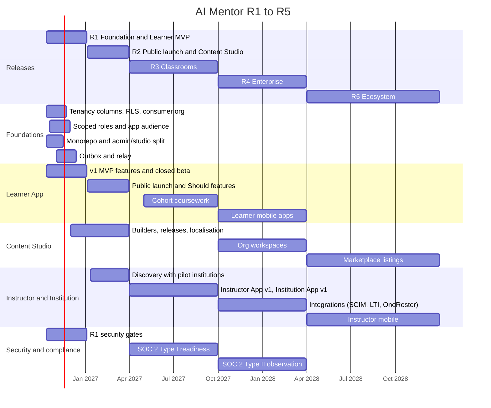
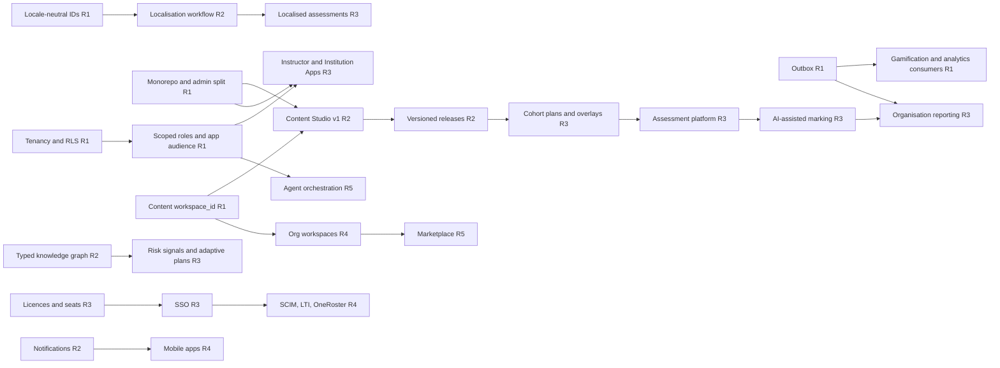

# AI Mentor roadmap (v2.0, R1–R5)

| Field | Value |
| --- | --- |
| Document | Roadmap: releases R1 to R5 |
| Version | 2.0 |
| Date | 13 October 2026 |
| Status | R1 committed. R2 planned. R3–R5 directional; re-planned at each release review |
| Owner | Product (CPO) and Technology (CTO) |
| Related | [README.md](README.md) (release labels), [02-prd.md](02-prd.md), [03-srs.md](03-srs.md), [06-system-architecture.md](06-system-architecture.md), [07-database-design.md](07-database-design.md), [09-security-model.md](09-security-model.md), [../Roadmap.md](../Roadmap.md), [../PRD.md](../PRD.md) section 18, [../SRS.md](../SRS.md) section 1.3, [../Security-Compliance.md](../Security-Compliance.md) sections 0 and 18, ADR 0013 to ADR 0027 |

Dates are planning estimates. Week 1 of R1 is the week of 12 October 2026.

## Change record

| Area | What changed | Why | Impacted systems | Implementation implications |
| --- | --- | --- | --- | --- |
| Release labels | v1 labels (PRD Phase 0–3, SRS MVP/R2/R3, Security-Compliance "Immediate / Before public launch / Phase 2") replaced by R1–R5 | Three v1 documents used three different schedules; five apps need one | All documents, planning, issue tracker | Every requirement, story, and ADR carries an R1–R5 label. Mapping in [Mapping from v1 labels](#mapping-from-v1-labels) |
| Public launch | Moves from the end of the v1 MVP to R2 (Q1 2027). R1 ends with a closed beta | R1 also carries the platform foundations; a closed beta limits exposure while they settle | Learner App, marketing, security gates | v1 beta exit criteria become the R1 exit and the R2 go/no-go |
| Foundations | Tenancy, scoped roles, monorepo, outbox, locale-neutral IDs, and content workspaces move into R1 | Each is far cheaper before real tenant data and second apps exist | Database, API, all frontends | About 30% of R1 engineering capacity **(hypothesis)** is reserved for foundations |
| Row-level security | Moves from v1 "Phase 2 (institutional readiness)" to R1 | Tenant isolation must exist before the first institutional row is written | PostgreSQL, `tenancy`, every repository | Every tenant-scoped query runs with `app.tenant_id` set |
| Institutions | Instructor App and Institution App ship in R3 with pilots; enterprise integrations in R4 | Sequencing protects the consumer launch and lets pilots shape the apps | `classroom`, `assessment`, `commerce`, `integration` | Pilot recruitment starts in R2 |
| Team shape | Stream-aligned teams per app plus platform teams per service group | Five apps on shared services need clear ownership of both | Engineering organisation | Team ownership maps to modules in the README service table |
| Public website | R2 gains the apex marketing site specified in 16 | Public launch needs conversion IA, not only the Learner App stub | `apps/www` or Learner `(public)`, DNS, Clerk | See [16-public-website-specification.md](16-public-website-specification.md) |

## Relationship to v1 documents

| v1 source | Status | Notes |
| --- | --- | --- |
| [Roadmap.md](../Roadmap.md) | Retained as the description of the current build slice | Its "Next, in order" list is absorbed into R1 below |
| [PRD.md](../PRD.md) section 18 (Phase 0–3) | Superseded | Mapped to R1–R5 |
| [SRS.md](../SRS.md) release labels `MVP`, `R2`, `R3` | Amended | Requirement IDs stay valid; their release label is re-read through the mapping table. v1 `R2` and `R3` do not mean v2 R2 and R3 |
| [Security-Compliance.md](../Security-Compliance.md) section 0 findings and section 18 | Retained as gates | Placed into R1–R4 below |

## Contents

1. [Releases at a glance](#releases-at-a-glance)
2. [Timeline](#timeline)
3. [R1 Foundation and Learner MVP](#r1-foundation-and-learner-mvp)
4. [R2 Public launch and Content Studio](#r2-public-launch-and-content-studio)
5. [R3 Classrooms](#r3-classrooms)
6. [R4 Enterprise](#r4-enterprise)
7. [R5 Ecosystem](#r5-ecosystem)
8. [Workstream dependencies](#workstream-dependencies)
9. [Team topology](#team-topology)
10. [Mapping from v1 labels](#mapping-from-v1-labels)

---

## Releases at a glance

| Release | Window | Theme | Apps live at exit | Primary customers |
| --- | --- | --- | --- | --- |
| **R1** Foundation and Learner MVP | Q4 2026 (weeks 1–12) | Learner App closed beta on the v1 MVP scope, plus foundations that are expensive to retrofit | Learner (beta); Admin, Instructor, Institution, and Content Studio (internal) | 100–300 beta learners |
| **R2** Public launch and Content Studio | Q1 2027 | Public B2C launch; Content Studio v1; Admin App v1 | Learner (public), Content Studio v1, Admin v1 | Consumer learners |
| **R3** Classrooms | Q2–Q3 2027 | Instructor App v1 and Institution App v1 with pilot institutions | All five | Consumer learners; 3–5 pilot institutions |
| **R4** Enterprise | Q4 2027 – Q1 2028 | SCIM, LTI 1.3, OneRoster, data residency, advanced and workforce analytics, white-label domains, Learner mobile apps | All five; Learner mobile | Universities, enterprises, governments |
| **R5** Ecosystem | 2028 | Content marketplace, AI agent orchestration, Instructor mobile app, partner API | All five; Learner and Instructor mobile; partner API | Plus publishers and partners |

## Timeline

## R1 Foundation and Learner MVP

**Window:** Q4 2026, weeks 1–12 (12 October 2026 to 3 January 2027).

**Goals.**
1. Prove habit, learning gain, and willingness to pay with 100–300 closed-beta learners (v1 hypotheses H1–H6, [PRD.md](../PRD.md) section 9).
2. Lay every foundation in the list below so that R2 and R3 add apps and tenants without data migrations of learner records.
3. Close every launch-blocking security item, or keep the affected feature disabled.

### Scope per app

| App | R1 scope |
| --- | --- |
| Learner App | v1 Must features F1–F18 (as L-F01 to L-F18 in [02-prd.md](02-prd.md)); Should features F19–F26 as capacity allows. Built today: tutor, four paths, graph, recommendations, mastery, XP, streaks, badges, quizzes, SM-2 flashcards, restricted lab, research analysis, one global leaderboard endpoint, Stripe checkout behind configuration. Still to build for the beta: daily challenges, country leaderboards, French and Spanish content, streaming replies, Clerk middleware ([Roadmap.md](../Roadmap.md)) |
| Content Studio | App exists at `apps/studio`: library, review, curriculum, taxonomy, graph, generate, challenges, catalog import. Remaining: Knowledge Pack seed into `master`. No new builders. Spec: [14](14-content-studio-specification.md) |
| Admin App | Existing operations pages stay in `apps/admin`: users, providers, configuration, moderation, audit, analytics. Users page edits role assignments instead of `users.role` |
| Instructor App, Institution App | None. Discovery interviews only |

### Scope per platform service

| Service | R1 scope |
| --- | --- |
| `identity`, `tenancy`, `authz` | Foundations 1–3 below |
| `events` | Foundation 5 below. Gamification XP awards and analytics consume through the outbox |
| `tutor`, `retrieval`, `ai_gateway` | v1 tutor (`tutor` mode) with Socratic opening; retrieval filtered by publication state and `workspace_id`; provider routing as built |
| `learning`, `gamification` | v1 rules (400 XP daily cap, 250 XP per level); daily challenges; country leaderboard |
| `i18n` | UI catalogues and tutor responses in `en`, `fr`, `es`; launch-path content reviewed in all three |
| `commerce` | Free, Pro, Research via Stripe with regional bands |
| `audit` | Append-only audit with IP and trace id (SEC-07) |

### Foundations that are expensive to retrofit

| # | Foundation | What R1 delivers | Why it is expensive later | Done when |
| --- | --- | --- | --- | --- |
| 1 | `tenant_id` and row-level security | `tenancy.organisations` with the consumer organisation (`kind = consumer`, slug `ai-mentor-public`); `tenant_id` on every tenant-scoped row in the existing schemas; RLS policies on `app.tenant_id` alongside the per-user policies of ADR 0011; `X-Org-Id` handling on `/me` and `/learn` | Back-filling tenant columns and policies on live multi-tenant data needs downtime and a full re-audit of every query | A two-tenant isolation test over every tenant-scoped table returns zero foreign rows; CI fails a migration that adds a tenant-scoped table without `tenant_id` and a policy |
| 2 | Scoped role assignments | `authz.roles`, `permissions`, `role_permissions`, `role_assignments`; migration from `users.role` using the README mapping (`student` → `learner` in the consumer organisation; `instructor` → `content_author` in `master` plus `learner`; `admin` → `platform_admin`, `content_publisher`, `knowledge_steward` in `master`, plus `learner`); `backend/app/domain/access.py` rank checks replaced by permission checks; `users.role` dropped | Every endpoint added on top of rank checks would need rewriting; two-axis roles (scope and permission) cannot be emulated with a rank | Every v1 test passes with the same allow and deny outcomes; no code reads `users.role` |
| 3 | App audience checks | Each app is its own Clerk authorised party; `/platform` endpoints accept only the Admin App audience with fresh MFA; Content Studio endpoints accept only the Content Studio audience | Retrofitting audiences after apps share tokens breaks sessions for every user | A Learner App token is refused on every `/content` and `/platform` route (tested) |
| 4 | Monorepo and the five apps | Done for layout: `apps/learner`, `apps/admin`, `apps/instructor`, `apps/institution`, `apps/studio`. Remaining per ADR 0014: shared packages, one lockfile, Turborepo. "Studio" means Content Studio only | Splitting later would have meant migrating live users between origins | Five apps build and deploy independently; no app imports another app's code |
| 5 | Transactional outbox | `events.outbox` and `events.inbox`; relay to the Azure Service Bus topic `domain-events`; CloudEvents envelope with `tenantid`, `actorid`, `correlationid`; first events `learning.lesson.completed`, `learning.mastery.changed`, `gamification.xp.awarded`, `content.item.state_changed`, `identity.account.created`, `identity.account.erased` | Adding events later means finding every write path again; dual writes without an outbox lose events | Killing the relay mid-run loses no event; replaying a batch awards no duplicate XP |
| 6 | Locale-neutral identifiers | Concepts, lessons, paths, items, and badges keyed by stable slugs or UUIDs, never by English titles; localised text in separate rows per locale | Renaming keys after content and learner records reference them breaks history and URLs | Changing an English title changes no identifier; every learner-facing string resolves through `i18n` |
| 7 | Content `workspace_id` | `curriculum.workspaces` with `master`; `workspace_id` on every authored row in `curriculum` and `knowledge`; retrieval filters on it | Organisation workspaces (R4) and the marketplace (R5) depend on it; adding it later requires re-indexing every vector | Every authored row and every Qdrant point carries `workspace_id`; retrieval tests pass with a second workspace present |

`identity.users` also gains `account_type` and `home_tenant_id` in R1. Multi-organisation UI, organisation switching, and memberships beyond the consumer organisation are not in R1.

### Security gates

Every item below is open in the current build ([Security-Compliance.md](../Security-Compliance.md) section 0). Items from the section 18 "Immediate" list are already fixed (SEC-02, SEC-03, SEC-04, SEC-08).

| Gate | Finding or section | R1 rule |
| --- | --- | --- |
| Isolated, secret-free, network-less runner for learner code | SEC-01 (critical), §8.6 | The coding lab stays disabled in production until the runner passes the escape suite and an external test. If it is not ready, F19 moves to R2 and coding quiz items stay withheld |
| Document parsing in a worker with memory, time, page-count, and decompressed-size limits | SEC-13, §8.7 | Required before beta learners upload research papers |
| Tier-aware daily entitlements and AI spend circuit breaker | SEC-05, §8.3 | Required for beta |
| Deletion-verification job; crypto-shredding of backups | SEC-06, §12.5 | Verification job required for beta; backup shredding required before R2 public launch |
| Audit of staff reads of learner data, IP and trace id per row, append-only enforcement in the database | SEC-07, §13 | Required for beta |
| Container image and IaC scanning in CI | SEC-10, §16.2 | Required for beta |
| Next.js 16 upgrade to clear the PostCSS advisory | SEC-16 | **Done 2026-10-13** (Next 16.4); CI blocks on high and critical advisories |
| Hashed Python lockfile used by CI and images | SEC-17 | Required for beta |
| MFA for staff; Clerk bot and breach protection; Qdrant private networking | §3.2, §7.3 | Required for beta |
| DPIA, RoPA, LIAs, DPAs, privacy notice in `en`, `fr`, `es`, AI transparency notice, cookie consent | §12 | Required for beta |
| Red-team suite of at least 100 prompts in three languages with zero critical failures | §9.2 | Required for beta exit |
| External penetration test covering LLM and sandbox scope; tabletop exercise; `security.txt` | §16.3, §15.5, §17.5 | Required for beta exit (R2 go) |

### Exit criteria

1. v1 beta exit thresholds met: onboarding completion ≥ 65%, week-1 retention ≥ 35%, mastery gain ≥ +20 points, tutor CSAT ≥ 4.0, Sean Ellis "very disappointed" ≥ 30%, paid signal ≥ 2% ([PRD.md](../PRD.md) section 17).
2. Foundations 1–7 meet their "done when" tests.
3. All security gates above closed, or the dependent feature disabled with a recorded decision.
4. All v1 KPIs instrumented through the outbox, visible per tenant (only the consumer organisation exists).

### Key risks

Foundations crowd out learner features (RK-04); French and Spanish content review is not complete (v1 risk R6); the isolated lab runner slips (SEC-01); the beta sample is too small for reliable metrics (v1 risk R16).

## R2 Public launch and Content Studio

**Window:** Q1 2027 (4 January to 31 March 2027).

**Goals.** Public B2C launch in `en`, `fr`, `es`. Content Studio becomes the only way content reaches learners, with versioned releases. Admin App governs models, flags, and audit. Recruit R3 pilot institutions.

| App | R2 scope |
| --- | --- |
| Learner App | Public launch; remaining v1 Should features; friend leaderboards; research, debugging, and robotics daily challenges; weekly and seasonal challenges; knowledge search (L-F15); guided projects; five personalisation dimensions; mentor modes as policy profiles and static persona avatars |
| Public website | Apex `<domain>` per [16](16-public-website-specification.md): full sitemap, three funnels (free signup, instructor demo, enterprise demo), SEO, no fake social proof |
| Content Studio | Lesson, module, course, path, and item bank builders; 13 asset types with rights and licence terms; review workflow for all content types with `in_review` and `changes_requested`; versioned releases with change summaries; localisation workflow with translation memory and glossary; content analytics |
| Admin App | Model registry, routes, prompt releases, evaluation gates; flag rules; global analytics; security monitoring; support tooling; subscription management |
| Instructor App, Institution App | Discovery and design with 5–8 pilot candidates; clickable prototypes tested |

| Service | R2 scope |
| --- | --- |
| `content` | `course_releases`, `path_releases`, `release_items`; semantic versions |
| `personalisation` | `learner_models`, `dimension_settings`; v1 controls migrated to dimensions |
| `tutor`, `ai_gateway` | Modes `mentor`, `research_supervisor`, `coding_coach`, `career_coach`; persona; cost metering per tenant |
| `notification` | In-app and email, templates per locale, preferences, digests |
| `search` | Learner App index over catalogue and knowledge |
| Security | Items from Security-Compliance §18 "Within one release after launch": multilingual injection classifier and canary tokens, envelope encryption for research documents and conversations, two-person approval on all content, retrieval isolation tests, SIEM integration, container signing and SBOMs |

**Exit criteria.** v1 public-launch release criteria met in production. A course release goes from draft to published with review and localisation, entirely in Content Studio, with no engineer involved. At least 3 signed pilot agreements for R3. 5,000+ registered learners and W4 retention ≥ 25% (v1 Phase 1 outcome).

**Key risks.** Content throughput (RK-07); "why not ChatGPT" positioning at public launch (v1 risk R3); AI cost growth at public scale (v1 risk R2).

## R3 Classrooms

**Window:** Q2–Q3 2027 (1 April to 30 September 2027).

**Goals.** Instructor App v1 and Institution App v1 live with 3–5 pilot institutions (at least two universities or colleges and one bootcamp or employer). Prove that AI-assisted marking saves instructor time without lowering grading quality.

| App | R3 scope |
| --- | --- |
| Instructor App | I-F01 to I-F14: cohorts, learner creation, CSV import, invitations, enrolment codes, cohort plans with overlays, assessments, rubrics, manual marking, gradebook, AI-assisted marking behind `instructor.ai_marking`, risk signals, attendance, communication hub, performance analytics, cohort mentor policy |
| Institution App | O-F01 to O-F09: structure, members and staff, cohort oversight, licences and seats, billing, branding, SAML and OIDC SSO with just-in-time provisioning, policies and compliance, reporting |
| Learner App | Cohort coursework (L-F17); institution and cohort leaderboards; competitions; organisation switcher and consent management; full career surface; assessed projects; path certificates |
| Admin App | Organisation administration; licence management for `finance_admin` |
| Content Studio | Rubrics shipped with releases; release adoption view for instructors |

| Service | R3 scope |
| --- | --- |
| `tenancy`, `identity` | Organisations beyond the consumer organisation; memberships; invitations; SSO connections |
| `classroom`, `assessment` | New schemas in full |
| `commerce` | Licences, seat assignments, invoices; Classroom, Campus, Enterprise plans |
| `tutor` | `exam_coach`; assessment integrity mode |
| `reporting` | Organisation and cohort reports in the viewer's locale |
| Security and compliance | EU AI Act assessment and DPIA for AI-assisted marking and certificates; institutional DPA and sub-processor notice process; SOC 2 Type I readiness; external penetration test with cross-tenant scope |

**Exit criteria.** See [02-prd.md](02-prd.md) release criteria for R3. In addition: seat activation ≥ 70% and time to mark under 96 hours across pilots; at least two pilots state intent to renew.

**Key risks.** Pilots require LMS integration before R4 (RK-05); AI marking quality per locale (RK-02); five apps stretch the team (RK-03); procurement evidence demanded early (RK-06).

## R4 Enterprise

**Window:** Q4 2027 – Q1 2028 (1 October 2027 to 31 March 2028).

**Goals.** Make AI Mentor procurable by large universities, enterprises, and government programmes, and put the Learner App on phones.

| App | R4 scope |
| --- | --- |
| Institution App | SCIM 2.0; LTI 1.3 launch and grade return; OneRoster sync; xAPI/cmi5 export; workforce development reporting; white-label domains and email sender; organisation workspace (licence feature); data residency selection |
| Instructor App | Advanced analytics (item analysis across cohorts); LTI-launched cohorts |
| Learner App | iOS and Android apps with push notifications and offline flashcards; voice mentor with voice style and accent; learning passport export (Open Badges 3.0); advanced research tools (reviewer simulation, gap detection, literature review) |
| Content Studio | Organisation workspaces and derived courses with upstream tracking; video and audio assets with transcripts |
| Admin App | Residency-aware tenant placement; warehouse feed administration |

**Platform services.** `integration` in full; `analytics` warehouse feed; `notification` push channel; second-region deployment for residency. Security: customer-managed keys, SOC 2 Type II observation period, ISO/IEC 27001 and 27701 gap assessment.

**Exit criteria.** See [02-prd.md](02-prd.md) release criteria for R4.

**Key risks.** Integration certification timelines with LMS vendors; data residency doubles operational load; mobile apps divert Learner App capacity.

## R5 Ecosystem

**Window:** 2028 (1 April to 31 December 2028).

**Goals.** Open the platform to publishers, partners, and governed AI agents.

| Area | R5 scope |
| --- | --- |
| Content Studio | Marketplace listings from organisation workspaces; listing review; rights checks; revenue share and payouts |
| Learner App | Marketplace catalogue; animated mentor avatar; accredited certification with partners |
| Instructor App | iOS and Android app (marking queue, risk list, messages) |
| Platform | AI agent orchestration under the same policy engine and audit as people (ADR 0027, proposed); partner API with keys, scopes, rate limits, and terms; outbound webhooks for partners |

**Exit criteria.** See [02-prd.md](02-prd.md) release criteria for R5.

**Key risks.** Marketplace quality dilutes the governed-content moat; agent actions without clear human accountability; partner API abuse.

## Workstream dependencies

Arrows read "must exist before".

The critical path to R3 runs through foundations 1, 2, and 4, then versioned releases, then cohort plans, then the assessment platform. A slip in any of these moves R3.

## Team topology

Stream-aligned teams own an app end to end. Platform teams own groups of shared services and offer them through the module interfaces in [06-system-architecture.md](06-system-architecture.md). Enabling teams help others adopt a capability and do not own a backlog of features.

| Team | Type | Owns | Forms in | Indicative size **(hypothesis)** |
| --- | --- | --- | --- | --- |
| Learner Experience | Stream-aligned | Learner App; `learning` UX; mobile from R4 | R1 | 4–6 engineers, 1 designer, 1 PM |
| Content Studio | Stream-aligned | Content Studio; `content` module | R1 (from the `admin/` team) | 3–4 engineers, 1 designer |
| Classroom | Stream-aligned | Instructor App; `classroom`, `assessment` | R2 (discovery), R3 (build) | 4–6 engineers, 1 designer, 1 PM |
| Institution | Stream-aligned | Institution App; `commerce` licences; `integration` from R4 | R3 | 3–5 engineers, 1 designer |
| Platform Operations | Stream-aligned | Admin App; `config`; support tooling | R2 | 2–3 engineers |
| Identity and Access | Platform | `identity`, `authz`, `tenancy`, `audit` | R1 | 3 engineers |
| AI Platform | Platform | `tutor`, `ai_gateway`, `retrieval`, `personalisation`; evaluation sets | R1 | 4–5 engineers, ML engineers included |
| Learning Data | Platform | `gamification`, `analytics`, `reporting`, `events` relay | R1 (combined with Learner Experience), separate in R2 | 3 engineers, 1 analyst |
| Core Services | Platform | `notification`, `messaging`, `search`, `i18n`; infrastructure and CI | R2 | 3 engineers |
| Design System | Enabling | Shared front-end packages (ADR 0014), accessibility | R1 | 1–2 engineers |
| Security | Enabling | Threat models, gates, penetration tests, compliance evidence | R1 | 1–2 engineers |
| Knowledge and Learning Science | Enabling | Knowledge graph quality, evaluation of mastery and marking, content standards | R1 | Learning scientist, knowledge stewards |

In R1 the team is small, so several teams share people: Learner Experience and Learning Data are one team, and Identity and Access carries the foundations. Each module still has one named owning team from R1, so that ownership is clear when teams split.

## Mapping from v1 labels

| v1 label | Source | v2 release | Notes |
| --- | --- | --- | --- |
| Phase 0, MVP and closed beta (Q4 2026) | PRD §18 | R1 | Same scope plus foundations |
| Phase 1, Public launch and product-market fit (Q1 2027) | PRD §18 | R2 | Content Studio v1 and Admin App v1 added |
| Phase 2, Depth, mobile, institutions (Q2–Q3 2027) | PRD §18 | R2 for the drag-and-drop builder, side-by-side version compare, and new paths (content work); R3 for institution accounts, cohorts, class analytics, SSO, path certificates, notebooks; R4 for native mobile with offline flashcards, voice tutor, robotics visualisers, video and audio ingestion | Mobile and voice move later than v1 planned |
| Phase 3, Platform and ecosystem (Q4 2027 – 2028) | PRD §18 | R4 for enterprise upskilling, government programmes, research supervision tools, low-bandwidth experience; R5 for marketplace, accredited certification, talent marketplace, animated avatar | Additional languages beyond `en`, `fr`, `es` are not scheduled |
| `MVP` | SRS §1.3 | R1 for build; R2 for "first public release" | v1 SRS treated the MVP as the public release |
| `R2` (MVP + 3 months) | SRS §1.3, §4.2 | R2 for regional and friend leaderboards, research and robotics challenges, streak freeze, hybrid search; R3 for instructor cohorts, in-browser notebooks; R4 for voice tutor, literature review, reviewer simulation, MP4, YouTube, GitHub ingestion; R5 for animated avatar | v1 `R2` is not v2 R2 |
| `R3` (later) | SRS §1.3, §4.3 | R3 for certification-grade assessment and B2B cohorts (BR-012); R4 for native apps; R5 for accredited certification and community features | |
| Immediate | Security-Compliance §18 | R1 week 1 | Mostly fixed on 13 October 2026 |
| Before public launch | Security-Compliance §18 | R1 exit (R2 go) | See [Security gates](#security-gates) |
| Within one release after launch | Security-Compliance §18 | R2 | |
| Phase 2, institutional readiness | Security-Compliance §18 | R1 for RLS; R3 for SSO, institutional DPA, EU AI Act assessment, SOC 2 Type I; R4 for customer-managed keys, SOC 2 Type II, ISO/IEC 27001 and 27701 gap assessment | |
| "Next, in order" items 1–7 | Roadmap.md | R1 | FSRS (item 5) may slip to R2 without blocking the beta |
| "Explicitly later" | Roadmap.md | Multilingual content, daily challenges, country leaderboards: R1; voice and mobile: R4; 3D robotics visualiser: R4 at the earliest | The v1 PRD made these MVP Musts; R1 follows the PRD |
