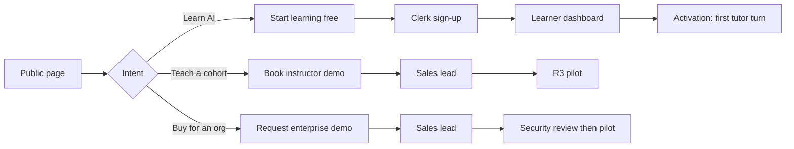

# AI Mentor public website specification

| Field | Value |
| --- | --- |
| Document | 18 — Public website specification |
| Version | 1.0 |
| Date | 13 October 2026 |
| Status | `apps/www` on port 3005 is the public site. Learner `/` redirects guests here |
| Owner | Product (CPO), with Product Design, Growth, and Frontend Engineering |
| Related | [README.md](README.md), [01-product-vision.md](01-product-vision.md), [02-prd.md](02-prd.md), [11-ux-specification.md](11-ux-specification.md), [12-information-architecture.md](12-information-architecture.md), [14-content-studio-specification.md](14-content-studio-specification.md), [15-roadmap.md](15-roadmap.md), [../DesignSpec.md](../DesignSpec.md) §§1–7, ADR [0013](../adr/0013-five-applications-shared-platform.md) |

The public website is how strangers become learners, instructors, and institutional buyers. It is not a sixth product app. It sells the five applications, then hands the person to the right origin: `learn.`, `teach.`, `org.`, `studio.`, or `admin.`.

## Change record

| Area | What changed | Why | Impacted systems | Implementation implications |
| --- | --- | --- | --- | --- |
| Marketing ownership | Apex `<domain>` (and `www`) is a dedicated public site. `learn.<domain>` is the Learner App only | ADR 0013 already split marketing from the Learner App; [12](12-information-architecture.md) left ownership open | `apps/learner` landing, future `apps/www`, DNS, Clerk authorised parties, CSP, robots | R1 keeps the stub in `apps/learner/app/page.tsx`. R2 extracts `apps/www` (port 3005) or a `(public)` group that deploys to the apex |
| Indexing | Only the public site and selected Learner App catalogue pages are indexable | Staff apps must not leak content or org structure to search engines | `X-Robots-Tag`, `robots.ts` in each app | Admin, Instructor, Institution, and Content Studio stay `noindex` |
| Truthfulness | Marketing copy may describe shipped behaviour as present tense and R3–R5 capabilities as "coming" or "talk to sales" | Superlatives and unshipped voice, white-label, and accredited certificates would be false claims | All public pages, legal, sales | A claims table in this document is the source of truth. No fake learner counts or invented customer logos |
| Conversion | Three funnels: Start learning free, Book instructor demo, Request enterprise demo | One CTA cannot convert B2C, instructors, and procurement | Forms, Clerk, HubSpot or equivalent, `/api/v1/me` | Learner signup is Clerk. Instructor and enterprise forms create a sales lead, not an account with extra privilege |

## Relationship to v1 documents

| v1 / current source | Status | Notes |
| --- | --- | --- |
| `apps/learner/app/page.tsx` and `components/marketing/hero.tsx` | Retained as the R1 stub | Hero, four tracks, three steps, Studio/Pro/Research prices, three FAQs. This document supersedes it for R2 |
| [DesignSpec.md](../DesignSpec.md) §§1–7 | Retained | Public site uses the same tokens, type, colour, motion, and WCAG AA rules. No separate brand |
| [PRD.md](../PRD.md) §§2–4, 15 | Amended | Learner positioning and Free/Pro/Research stay. Institutional plans come from [02-prd.md](02-prd.md) |
| [01-product-vision.md](01-product-vision.md) | Extended | Messaging per segment is specified here; the vision statements are not rewritten |
| [12-information-architecture.md](12-information-architecture.md) §18 Q1 | Closed | Marketing lives at `<domain>`; see [Site ownership](#2-site-ownership) |

## Contents

1. [Claims and honesty](#1-claims-and-honesty)
2. [Site ownership](#2-site-ownership)
3. [Brand positioning](#3-brand-positioning)
4. [Messaging framework](#4-messaging-framework)
5. [Sitemap and information architecture](#5-sitemap-and-information-architecture)
6. [Navigation](#6-navigation)
7. [Conversion funnels](#7-conversion-funnels)
8. [Design system for the public site](#8-design-system-for-the-public-site)
9. [SEO strategy](#9-seo-strategy)
10. [Page specifications](#10-page-specifications)
11. [Component specifications](#11-component-specifications)
12. [Responsive and accessibility](#12-responsive-and-accessibility)
13. [Implementation](#13-implementation)

---

## 1. Claims and honesty

The public site must convert without lying. Present tense is for behaviour that runs in production today. Future tense or "talk to sales" is for R3–R5.

| Claim | Status | What we may say |
| --- | --- | --- |
| Socratic tutor that asks before it explains | Shipped | Present tense. Direct mode is one switch |
| Four v1 tracks (AI Fundamentals, RL, Robotics, LLM Engineering) plus Knowledge Pack paths | Shipped | Present tense. Pack figures from the live catalog |
| Restricted Python lab, not a general sandbox | Shipped | Present tense. Name the allowlist and the timeout |
| Research assistant cites the uploaded document | Shipped | Present tense. Critique only when a model is configured; otherwise extractive |
| Knowledge Pack depth (thousands of resources, items, challenges, graph) | Shipped | Use live counts, not rounded marketing fiction |
| XP, levels, streaks, public pseudonymous leaderboard | Shipped | Present tense. Daily XP cap is 400 |
| Five applications on one API | Shipped shells | Do not imply Instructor and Institution workflows are complete. Those apps exist; organisation APIs and R3 classroom features still follow the roadmap |
| Instructor cohorts, AI marking, scheduling | R3 | "For teaching teams" pages. CTA: Book instructor demo. Badge: "Pilots from R3" |
| Institution SSO, branding, seat licences | R3–R4 | CTA: Request enterprise demo. Do not show a self-serve checkout for Campus or Enterprise |
| Voice tutor | Not shipped | Do not put "voice" in the hero. Optional "on the roadmap" on the tutor page |
| Accredited degrees or vendor certs (Microsoft, AWS) | Not us | We issue mastery evidence and, later, Open Badges. We are not an awarding body ([01](01-product-vision.md)) |
| K-12 / under 16 | Out of scope | Schools pages describe 16+ programmes only. No children's product |
| White-label domains | R4 Enterprise | Named on Pricing and Institution pages as an Enterprise add-on |
| Learner or university logos | None yet | Use persona scenarios labelled as illustrative. No invented testimonials |
| "World's most advanced" | Aspiration, not a claim | Allowed in internal brand work. Not an H1, ad headline, or schema `slogan` |

**Proof we can show now.** Knowledge Pack live counts from Content Studio home (published catalog, questions, challenges, graph nodes). Four curriculum tracks. The socratic exchange in the hero. Restricted lab copy. "Illustrative scenarios, not customer claims" on any story block.

---

## 2. Site ownership

| Host | What it is | Indexable | Primary CTA |
| --- | --- | --- | --- |
| `<domain>` and `www.<domain>` | Public website (this spec) | Yes | Start learning free / Request demo |
| `learn.<domain>` | Learner App | Catalogue and signed-out path pages only | Sign in / Dashboard |
| `teach.<domain>` | Instructor App | No | Sign in |
| `org.<domain>` | Institution App | No | Sign in |
| `studio.<domain>` | Content Studio | No | Sign in |
| `admin.<domain>` | Admin App | No | Sign in |

Guests hitting `learn.<domain>/` redirect to `<domain>/`. Signed-in learners hitting `<domain>/` go to `learn.<domain>/dashboard`. Login on the public site is Clerk against the Learner App authorised party; people with staff roles then use the app launcher.

**R1.** Public pages remain `apps/learner/app/page.tsx` (and later a `(public)` group) on port 3000.

**R2.** Extract `apps/www`, port 3005, apex domain. Shared tokens from DesignSpec. No product API writes except demo-lead POST and newsletter consent.

---

## 3. Brand positioning

**Category.** AI and data-science learning ecosystem: personal tutor, governed curriculum, coding lab, research tools, and (from R3) instructor and institution control.

**For learners.** For ambitious people who want real AI skills, AI Mentor is the personal tutor that adapts every lesson and checks understanding before it moves on. Unlike a video course, it is interactive. Unlike a chatbot, it follows a curriculum, remembers mastery, and cites governed sources.

**For instructors.** For people who teach AI cohorts, AI Mentor is the versioned curriculum, assessment, and intervention layer. AI can propose a mark. A named human releases it.

**For institutions.** For universities, colleges, bootcamps, and employers, AI Mentor is the AI curriculum you can govern: SSO, seats, branding, reports, and an LMS integration rather than a second source of truth.

**Against.** Coursera (catalogue and certificates, less adaptive tutoring). Duolingo (habit loops, not research depth). DataCamp (exercises, weaker Socratic mentor). Microsoft Learn (vendor certs, not vendor-neutral research). Khan Academy (K-12 trust, not adult AI). Databricks Academy (platform training). DeepLearning.AI (courses). ChatGPT (fluency without curriculum or assessment).

**Personality.** Paper and ink. Editorial, calm, specific. Sentence case. No exclamation marks on marketing except a single celebration on a success screen. "You" for the visitor. The tutor is named, never "the AI".

**Taglines (approved).**

| Use | Line |
| --- | --- |
| Master (H1-capable) | A mentor that makes you try before it explains |
| Supporting | From first Python to publishable research |
| Institution | Curriculum, tutor, and evidence your organisation can govern |
| Product line | Five applications. One platform. One learning record |

---

## 4. Messaging framework

### 4.1 Audience messages

| Audience | Job | Message | Proof | Primary CTA |
| --- | --- | --- | --- | --- |
| Student / career changer | Get hireable AI skill without a second degree | A path that respects prerequisites and a tutor that will not skip the hard part | Four tracks, mastery bands, lab | Start learning free |
| Professional | Upskill without pausing work | Short sessions, daily cap, a streak that rewards understanding | 400 XP/day cap, flashcards, challenges | Start learning free |
| Researcher | Read and critique papers without invented citations | Uploads are quoted. Critique appears only when a model and a citation support it | Research page behaviour | Start Research trial |
| Instructor / professor | Teach a cohort without drowning in marking | Versioned paths, scheduled journeys, AI-proposed marks you accept | R3 Instructor App (demo) | Book instructor demo |
| University / college | Raise pass rates with auditability | Seats, SSO, reports a dean can read, human control over grades | Institution page, SOC path | Request enterprise demo |
| Bootcamp | Run a cohort on a pinned release | Classroom plan, enrolment codes, cohort leaderboards | Pricing Classroom | Book instructor demo |
| Corporate L&D | Close named skill gaps | Role paths, workforce reports, SSO | Enterprise plan | Request enterprise demo |
| Content / CLO | Govern the repository | Knowledge Pack, graph, four-eyes publishing | Content Studio (staff) | Talk to content |

### 4.2 Message house

- **Roof.** Understanding before answers.
- **Pillars.** Grounded tutor. Prerequisite graph. Practice that counts. Humans decide high-stakes outcomes. One record the learner owns.
- **Foundation.** Reviewed content, isolated code, private data, three languages (`en`, `fr`, `es`).

### 4.3 Words we use and avoid

| Use | Avoid |
| --- | --- |
| Tutor, mentor, path, mastery, cohort, release | Chatbot, magic, guaranteed job, accredited (unless a partner exists) |
| Governed, cited, pinned release | Hallucination-free, 100% accurate |
| Restricted lab | Full IDE, unlimited cloud compute |
| Illustrative scenario | Customer story (until we have a signed one) |
| 16 and over | Kids, K-12, child-safe |

---

## 5. Sitemap and information architecture

```text
/                               Home
/platform                       Platform overview
/platform/tutor                 AI Tutor
/platform/paths                 Learning engine (canonical: /paths)
/platform/lab                   Coding lab
/platform/research              Research assistant
/platform/gamification          XP, streaks, leaderboards
/platform/assessments           Practice and (R3) assessments
/platform/analytics             Learner and org analytics (split CTAs)
/solutions/learners             Learner solution
/solutions/instructors          Instructor solution
/solutions/universities         Universities and colleges
/solutions/schools              16+ school programmes (not K-12)
/solutions/bootcamps            Bootcamps
/solutions/corporates           Workforce and enterprise
/content-studio                 Content Studio
/pricing                        Pricing
/paths                          Learning paths catalogue
/certifications                 Mastery evidence and future badges
/resources                      Resources hub
/resources/blog                 Blog index
/resources/blog/[category]      Category
/resources/blog/authors/[slug]  Author
/resources/blog/[slug]          Article
/resources/guides               Guides
/resources/hub                  Learning hub (public excerpts)
/resources/docs                 Docs (link to docs. or GitHub)
/resources/faq                  FAQ
/company/about                  About
/company/careers                Careers
/company/contact                Contact
/company/partners               Partners
/legal/privacy                  Privacy
/legal/terms                    Terms
/legal/cookies                  Cookies
/legal/dpa                      DPA (enterprise)
/demo/instructor                Instructor demo form
/demo/enterprise                Enterprise demo form
/login                          Sign in (Clerk when configured; local DEV_AUTH continues to the Learner App)
/register                       Create account (16+, terms). Success lands on the Learner App
/start                          Redirects to /register
```

Public catalogue pages that already exist on the Learner App (`/paths`, `/catalog` when signed in) stay there. The marketing `/paths` is a curated, SEO-able overview that deep-links into `learn.<domain>/paths/{slug}`.

### 5.1 Conversion architecture (which page sells whom)

| Funnel | Entry pages | Exit |
| --- | --- | --- |
| B2C signup | Home, Learners, Tutor, Paths, Pricing (Free/Pro/Research), Blog | `/start` → `/register` → Clerk (or local DEV_AUTH) → Learner `/dashboard` |
| Instructor pipeline | Instructors, Bootcamps, Assessments, Pricing Classroom | `/demo/instructor` |
| Enterprise pipeline | Universities, Corporates, Schools (16+), Institution features, Pricing Campus/Enterprise | `/demo/enterprise` |
| Content talent / CLO | Content Studio, About | Contact "content" or careers |

---

## 6. Navigation

### 6.1 Desktop primary (max 7)

1. Platform (mega: Tutor, Paths, Lab, Research, Gamification, Assessments, Analytics, Content Studio)
2. Solutions (mega: Learners, Instructors, Universities, Schools, Bootcamps, Corporates)
3. Paths
4. Pricing
5. Resources (Blog, Guides, FAQ, Docs)
6. Login (ghost) → Clerk
7. Start learning free (primary pill, `color.action.primary`)

Utility, right of logo on large screens: language (`en` / `fr` / `es`), theme toggle.

**Sticky bar after 80px scroll.** Logo, Pricing, Login, Start learning free. Institution pages swap the primary to Request enterprise demo.

### 6.2 Mega-menu copy (one line each)

| Item | Line |
| --- | --- |
| AI Tutor | Asks first. Explains after you have tried |
| Learning paths | Prerequisites on a graph, not a pile of videos |
| Coding lab | Short-lived Python with an allowlist |
| Research assistant | Quotes your PDF. Will not invent a paper |
| Gamification | XP for mastery, not for clicks |
| Certifications | Evidence of skill. Not a degree |
| Learners | Personal tutor from beginner to research |
| Instructors | Cohorts, marking, intervention (pilots) |
| Universities | Seats, SSO, reports |
| Schools | 16+ programmes only |
| Bootcamps | Pinned releases for a cohort |
| Corporates | Role paths and workforce reports |
| Content Studio | The repository everyone else consumes |

### 6.3 Mobile

1. Hamburger, full-height sheet, first focus trap.
2. Primary: Start learning free (full width).
3. Accordion: Platform, Solutions, Resources.
4. Flat: Paths, Pricing, About, Contact, Login.
5. Language and theme at the bottom.
6. No mega-menu hover. One panel at a time.
7. Sticky bottom bar on solution pages: the page's primary CTA. Hide when a form is focused.

### 6.4 Footer (four columns + legal)

| Product | Solutions | Resources | Company |
| --- | --- | --- | --- |
| Tutor, Paths, Lab, Research, Gamification, Content Studio, Pricing | Learners, Instructors, Universities, Schools, Bootcamps, Corporates | Blog, Guides, FAQ, Docs, Status | About, Careers, Contact, Partners, Privacy, Terms |

Left: wordmark, one-line supporting tagline, locale. Bottom: © year, "16 and over", "Not an awarding body".

---

## 7. Conversion funnels



### 7.1 Learner: Start learning free

1. CTA → Clerk sign-up (email or Google/Microsoft when enabled).
2. Locale from the public site cookie.
3. First session: tutor in Socratic mode on a chosen track, or the dashboard "continue" card.
4. Activation event: first tutor turn **or** first quiz submitted (Growth tracks both).
5. Day 3: if no second session, one email. Consent required (CMP-001).
6. Paywall: lab run and generated quizzes on Pro; document critique on Research. Buttons explain the gate. Never look like an error ([DesignSpec](../DesignSpec.md) 1.5).

**Lead magnets (optional, consenting).** "RL concept map PDF", "Knowledge Pack sample reading list". Delivered after email confirm. Not required to start learning.

### 7.2 Instructor demo

Form fields: name, work email, organisation, role, cohort size, start month, message. Honeypot + rate limit. Success: calendar link (once scheduling exists) or "we will write within two working days". Does not grant Instructor App admin. Role stays `student` until an admin or SSO grant.

### 7.3 Enterprise demo

Form fields: name, work email, organisation, country, approximate seats, SSO requirement (yes/no), LMS (Canvas / Moodle / other / none), message. Attach security pack link (SOC path, DPA). Success copy must not promise a timeline we cannot keep.

### 7.4 CTA map

| Page type | Primary | Secondary |
| --- | --- | --- |
| Home, Learners, Tutor, Paths, Gamification, Certifications, Blog article | Start learning free | See pricing |
| Instructors, Bootcamps | Book instructor demo | Start learning free |
| Universities, Schools, Corporates, Institution slices | Request enterprise demo | See security |
| Content Studio | Explore Content Studio (staff sign-in) or Talk to content | Read the knowledge catalog |
| Pricing | Context-aware: Free / Demo / Sales | Compare plans |
| Contact | Submit | |

Every primary button is a pill using `color.action.primary`. Secondary is quiet (`variant="quiet"`). Enterprise pages may use a second primary "Request demo" in the hero only.

---

## 8. Design system for the public site

Do not fork the product brand. Extend [DesignSpec.md](../DesignSpec.md) §§1–7.

| Element | Rule |
| --- | --- |
| Canvas | `#F6F7FB` light, `#0B1020` dark |
| Display type | Fraunces, page titles and H1–H2 |
| Body | Source Sans 3 |
| Action | Blue-700 `#1D4ED8` |
| AI / tutor | Violet-700 `#6D28D9` |
| Progress | Emerald for XP bars only, never as body text on white |
| Radius | Cards 24px, buttons pills, inputs 16px |
| Grid | 4px. Public pages max-width 72rem (same as current landing) |
| Motion | Hero tutor exchange may stagger 150ms. Honour `prefers-reduced-motion`. No autoplay video with sound |
| Illustration | Line, two-colour spot (blue + violet). No 3D mascots, no stock-photo grids of laptops |
| Photography | Only signed assets. Until then, product UI frames (tutor, path outline, graph) |
| Dark mode | Same toggle as the apps. Cards outlined with `dark-border` |
| Accessibility | WCAG 2.2 AA. Skip link, 4.5:1 text, visible focus `#1D4ED8`, captions on any motion demo |

**Marketing-only components** (still in `packages/ui` later): `MegaMenu`, `PriceCard`, `ComparisonTable`, `FaqAccordion`, `DemoForm`, `ProofBar` (live pack counts), `ScenarioCard` (labelled illustrative), `AppRibbon` (five apps).

---

## 9. SEO strategy

### 9.1 Principles

- One H1 per page. Title ≤ 60 characters. Description ≤ 155.
- Canonical apex; `www` redirects.
- `hreflang` for `en`, `fr`, `es` on every public page.
- JSON-LD: `Organization`, `WebSite`, `Course` (paths), `FAQPage`, `BreadcrumbList`. No `AggregateRating` until we have real reviews.
- Internal links: every solution page links to Pricing and the matching product page. Every product page links to Learners or Instructors. Blog posts link to one path and one product page.
- Do not index query strings, demo thank-you pages, or legal print views.

### 9.2 Keyword clusters (English; localise, do not translate keywords blindly)

| Cluster | Intent | Primary URL |
| --- | --- | --- |
| AI tutor / Socratic AI tutor | Product | `/platform/tutor` |
| Reinforcement learning course | Path | `/paths` → RL |
| Learn machine learning with a tutor | Solution | `/solutions/learners` |
| AI bootcamp platform | Solution | `/solutions/bootcamps` |
| University AI tutoring | Solution | `/solutions/universities` |
| AI curriculum knowledge graph | Product | `/content-studio` |
| Grounded paper reading AI | Product | `/platform/research` |
| AI coding lab for students | Product | `/platform/lab` |

### 9.3 Metadata examples

| Page | Title | Description |
| --- | --- | --- |
| Home | AI Mentor — a tutor that asks before it explains | Learn AI, machine learning, reinforcement learning, and robotics with a Socratic tutor, a restricted coding lab, and a governed knowledge catalog. |
| Tutor | AI Tutor \| AI Mentor | Socratic and direct modes, grounded in reviewed content. The tutor checks you understand before it moves on. |
| Pricing | Pricing \| AI Mentor | Free, Pro, and Research for learners. Classroom, Campus, and Enterprise for organisations. |
| Universities | AI curriculum for universities \| AI Mentor | Seats, SSO, reports, and a tutor for every learner. Humans release grades. |

### 9.4 Content hub

Blog taxonomy: Curriculum, Tutor design, Research notes, Engineering, Teaching, Policy. Each article ends with a path CTA. Do not publish invented paper summaries; research posts must cite.

### 9.5 Technical

- Core Web Vitals: LCP ≤ 2.5s, INP ≤ 200ms, CLS ≤ 0.1 on Home, Pricing, Tutor (TestPlan PERF-014).
- OG images: 1200×630, Fraunces headline, no small text.
- Sitemap.xml: public routes only. Staff apps omitted.
- CSP as on the Learner App. Forms POST to our origin.

---

## 10. Page specifications

Wireframe notation follows DesignSpec 9.1: `[]` button, `{}` input, `<>` nav, `==` region.

### 10.1 Home `/`

**Purpose.** Qualify the visitor in ten seconds (learner vs teacher vs buyer) and start the highest-intent funnel.

**Wireframe.**

```
<logo  Platform  Solutions  Paths  Pricing  Resources  Login  [Start learning free]>
== Hero: H1 + supporting + [Start learning free] [See how it works] | socratic exchange card ==
== Proof bar: live catalog counts (not learner vanity) ==
== Problem: three columns, what courses and chatbots miss ==
== Why AI Mentor: four pillars ==
== Platform: five apps ribbon + six capability cards ==
== How it works: 1 ask  2 practice  3 read with citations ==
== Personalised learning / tutor / paths / gamification / research  (product frames) ==
== Instructors | Institutions  (two-up, each with own CTA) ==
== Scenarios (labelled illustrative) ==
== Pricing preview (Free / Pro / Research) + link to full pricing ==
== FAQ accordion ==
== Closing CTA ==
== Footer ==
```

**Hero**

| Field | Copy |
| --- | --- |
| Eyebrow | Beginner to research |
| Headline | A mentor that makes you try before it explains |
| Subheading | AI Mentor teaches machine learning, reinforcement learning, robotics, and research methods. The tutor asks. The lab runs a restricted Python file. Paper notes stay tied to the pages you uploaded. |
| Primary CTA | Start learning free |
| Secondary CTA | See the platform |
| Visual | Existing socratic exchange: You "Teach me reinforcement learning." Mentor "What do you think an agent does in an environment?" |
| Conversion | Clerk sign-up |

**Problem statement**

| Field | Copy |
| --- | --- |
| Headline | Courses play. Chatbots guess. Neither knows what you understand |
| Subheading | Video libraries do not stop you skipping the Bellman equation. A general model will happily invent a citation. Institutions cannot see either. |
| Content | Three cards: (1) Fixed sequences that ignore prerequisites. (2) Ungrounded help with no mastery record. (3) Teachers who cannot scale 1:1 without losing control of grades. |
| Visual | Simple three-column, no stock photos |
| Conversion | Scroll to Why |

**Why AI Mentor**

| Field | Copy |
| --- | --- |
| Headline | Understanding before answers |
| Subheading | A governed curriculum, a tutor that checks you, and a record you keep. |
| Content | Four pillars from the message house, each one sentence. |
| Conversion | Platform overview |

**Platform overview**

| Field | Copy |
| --- | --- |
| Headline | Five applications. One platform |
| Subheading | Learners, instructors, institutions, operators, and content teams each get an app. Rules live in the API. |
| Content | App ribbon: Learner, Instructor, Institution, Admin, Content Studio. Capability cards: Tutor, Paths, Lab, Research, Gamification, Content Studio. Instructor and Institution cards carry "Pilots from R3" where the workflow is not complete. |
| Conversion | Click through to a product page |

**How it works** — keep the shipped three steps.

1. Ask, then wait. The first reply is a question.
2. Practice on purpose. Quizzes, flashcards, and a small Python lab.
3. Read papers without inventing them.

**Showcases** (tutor, paths, gamification, research). Each: 40-word caption, product screenshot or frame, link to the dedicated page. Gamification must say XP is for mastery, passing code, and completed reviews.

**Instructor features / Institution features.** Two-up. Instructor CTA Book demo. Institution CTA Request enterprise demo. Do not imply SSO is self-serve today.

**Student success.** Three scenario cards from the current landing, labelled "Illustrative scenarios, not customer claims": a first RL course; a lab hour; a paper afternoon.

**Statistics (allowed).** Pull live or last-seeded catalog figures: published resources, question items, coding challenges, catalog paths, graph concepts. Caption: "Knowledge Pack v1.0 in the master catalog." Do not invent MAU.

**Pricing preview.** Studio/Free, Pro $29, Research $79 as on the current landing, plus a line "Organisations: Classroom, Campus, Enterprise — see Pricing." Checkout disabled until Stripe is configured; the button says so.

**FAQ (home, five items).** Shipped three plus: "Is this an LMS?" (No. We integrate later via LTI.) "Is it for children?" (16 and over.)

**Closing CTA.** Headline: Start with a question, not a video. [Start learning free] [Request a demo].

**Footer.** Section 6.4.

### 10.2 Platform overview `/platform`

**Purpose.** One URL that sales can send. Depth without six clicks.

**Headline.** The ecosystem, in one place.

**Subheading.** A Socratic tutor, a knowledge graph, a restricted lab, a research desk, and the apps that govern them.

**Sections.** Card for each: AI Tutor, Learning engine, Research assistant, Coding lab, Knowledge repository, Content Studio, Gamification, Leaderboards, Assessment, Analytics. Each card: 40 words, "Available now" or "R3", and a link.

**CTA.** Start learning free / Request enterprise demo.

### 10.3 Learner solution `/solutions/learners`

**Audience.** Students, professionals, career changers, researchers.

**Headline.** A private tutor that already knows the syllabus.

**Subheading.** Personal paths, a coach that will not skip prerequisites, practice at the right difficulty, and a research desk when you need papers.

**Blocks.** Personalised learning (style, depth, locale). Paths. AI coach (Socratic/Direct). Career roadmaps (R2 career planner — label if not shipped). Progress (mastery bands). Daily challenges. Badges. Competitions (global leaderboard now; cohort/season R2–R3). Research assistant.

**CTA.** Start learning free. Secondary: Explore paths.

### 10.4 Instructor solution `/solutions/instructors`

**Headline.** Teach the cohort. Let the tutor handle the 1:1.

**Subheading.** Versioned AI curricula, scheduled journeys, and marks you release. Pilots from R3.

**Blocks.** Learner management, cohorts, assessment creation, AI marking (human release), scheduling, analytics, communication, path pinning. Each block states target release if not live.

**CTA.** Book instructor demo. Secondary: Start learning free (many instructors try the tutor first).

### 10.5 Institution `/solutions/universities` (template for schools, bootcamps, corporates)

**Headline.** Every learner gets a tutor. You keep control.

**Subheading.** Seats, reporting, and (from R3–R4) SSO, branding, and LMS integration. We are not your SIS.

**Blocks.** Dashboard, analytics, reporting, branding, SSO, compliance, student success, workforce (corporates). Schools page: 16+ only, safeguarding ADR required before under-16.

**CTA.** Request enterprise demo. Secondary: Download security overview (when the pack exists).

**Segment variants.**

| Path | Extra angle |
| --- | --- |
| `/solutions/schools` | Sixth-form and 16+ college programmes. No under-16 |
| `/solutions/bootcamps` | Pinned releases, enrolment codes, Classroom plan |
| `/solutions/corporates` | Role paths, team skills coverage, Enterprise SSO/SCIM |

### 10.6 Content Studio `/content-studio`

**Headline.** One repository. Many classrooms.

**Subheading.** Authors, reviewers, and publishers work in Content Studio. Instructors consume releases. Learners never see a draft.

**Blocks.** Knowledge repository (pack counts). Curriculum / path builder. Knowledge graph. Assessment / item bank (no keys in screenshots). Publishing workflow (four-eyes). Versions. AI drafts that stay in review. CTA Explore Content Studio for staff; otherwise Talk to content.

Do not invite the public to self-provision a Studio admin.

### 10.7 AI Tutor `/platform/tutor`

**Headline.** It asks first.

**Subheading.** Socratic mode is the default. Direct mode is one switch. Off-topic work is refused. Sources are cited.

**Blocks.** Modes; teaching styles / personalisation; research mentor; coding mentor; career coach (label roadmap if needed); multilingual `en` `fr` `es`; interactive demo = the hero exchange, not a live unauthenticated model (cost and safety). Voice: roadmap only.

**CTA.** Start learning free → `/tutor`.

### 10.8 Gamification `/platform/gamification`

**Headline.** Fun that serves learning.

**Subheading.** XP for mastery, passing labs, and finished reviews. Daily cap 400. Never for clicks.

**Blocks.** XP, levels, achievements, badges, leaderboards (pseudonymous public top 10), challenges, streaks. Seasonal competitions and cohort boards: R2–R3, labelled.

**Sample leaderboard.** Use the live public endpoint shape (`rank`, `display_name`, `xp`, `level`, `streak_days`). No real names. Caption: "Public board. Staff and opted-out learners are excluded."

**CTA.** Start learning free.

### 10.9 Pricing `/pricing`

**Headline.** Start free. Pay when the lab and the papers matter.

**Learner plans (shipped names; Stripe still optional).**

| Plan | Price (Band A, as on the current site) | Includes |
| --- | --- | --- |
| Studio / Free | $0 | Fundamentals, Socratic tutor, flashcards |
| Pro | $29 / month | Every track, coding lab, generated quizzes |
| Research | $79 / month | Document upload and model critique when a provider is configured |

Regional bands B and C follow [PRD.md](../PRD.md) / [02-prd.md](02-prd.md). Checkout button: if Stripe is unset, "Checkout is not configured yet."

**Instructor.** No separate SKU. Included in Classroom+. CTA: Book instructor demo.

**Institution (hypotheses from 02-prd; label as such).**

| Plan | Seats | Band A hypothesis | Billing |
| --- | --- | --- | --- |
| Classroom | 25–500 | $48 / seat / year | Card or invoice |
| Campus | 500–50,000 | $30 / seat / year | Annual invoice |
| Enterprise | 250+ | $90 / seat / year | Contract; white-label and residency add-ons |

**White label.** Enterprise add-on, R4. Not a self-serve plan.

**Comparison matrix.** Rows: tutor, all tracks, lab, research critique, cohorts, SSO, branding, SCIM, LTI, data residency, white-label. Columns: Free, Pro, Research, Classroom, Campus, Enterprise.

**ROI examples.** Must be labelled "illustrative arithmetic, not a guarantee." Example: Campus 1,000 seats vs equivalent teaching-assistant hours. No fake case-study numbers.

**FAQ.** Billing, seats vs enrolments (one learner, one seat), pause consumer sub while on a seat, students 16+.

### 10.10 Certifications `/certifications`

**Headline.** Evidence of skill, not a diploma mill.

**Subheading.** We record mastery, labs, and reviews. Open Badges and employer-recognised certificates need partners (R5). We do not confer degrees.

**Blocks.** Domain list (AI, ML, RL, Robotics) as **pathways**, not accredited certs. Assessment process (practice now; summative R3). Digital badges (roadmap). Employer recognition (honest: none yet).

**CTA.** Start the relevant path. Secondary: Talk to partnerships.

### 10.11 Learning paths `/paths`

**Headline.** Tracks with prerequisites, not a pile of videos.

**Subheading.** The graph decides what you are ready for. Weak foundations are repaired first.

**Catalogue to display.**

| Path | Origin | Difficulty | Outcomes (one line) |
| --- | --- | --- | --- |
| AI Fundamentals | v1 curriculum | Beginner | Rules versus learning, then the maths later tracks assume |
| Reinforcement Learning | v1 curriculum | Intermediate | Agent loop through Bellman, Q-learning, PPO, SAC |
| Robotics | v1 curriculum | Intermediate | ROS 2, vision, SLAM, navigation, when a policy may touch a motor |
| LLM Engineering | v1 curriculum | Intermediate | Grounded systems and research habits |
| Pack paths (ML Engineer, Data Scientist, Deep Learning, RL Engineer, Robotics, LLM, Researcher, …) | Knowledge Pack | Varies | From catalog titles; link to `learn.` path or resource |

Each card: skills (from graph), duration estimate from `estimated_minutes` when present, difficulty, [Start this path].

Do not invent durations. If unknown, omit.

### 10.12 Resources hub `/resources`

**Headline.** Notes from the same catalog we teach.

**Hub tiles.** Articles, Guides, Research summaries (only with citations), Learning resources (public excerpts), Career guides, Industry reports (none until we have one), Webinars, Tutorials.

R1: FAQ + docs link + blog stub. Do not empty-state with fake reports.

### 10.13 About `/company/about`

**Headline.** Give every person a world-class private tutor — and give their teachers the tools to govern it.

**Mission / vision.** Quoted from [01](01-product-vision.md), not paraphrased into slogans.

**Story.** Product is adult, domain-specific AI education. Built as five apps on one API.

**Leadership, advisors, partners.** Real names and photos only. Until then, omit the grid. Do not use placeholders.

**Values.** Principles 1–14 summarised in plain language.

**Social impact.** Access, three languages, regional pricing. Not a K-12 charity claim.

### 10.14 Contact `/company/contact`

**Headline.** Tell us which door you need.

**Forms (tabs).** Sales, Support, Partnerships, Enterprise demo (same fields as §7.3). Support: no PII in the ticket beyond contact fields. SLA: do not promise 24/7 unless ops can keep it.

### 10.15 FAQ `/resources/faq`

Groups: Platform, Pricing, Tutoring, Institutions, Research, Privacy, Security, Certifications. Reuse home FAQs. Add:

- Where does my data live? (See Security-Compliance; residency is R4 add-on.)
- Who sees the leaderboard? (Pseudonymous public top 10; opt-out.)
- Can I export my learning record? (`GET /me/export`.)
- Does an Instructor App login appear after I request a demo? (No. A person grants the role.)
- Are answer keys in the Learner App? (No.)

Use `FAQPage` schema. Answers stay consistent with SRS and this claims table.

### 10.16 Blog

**Index.** Featured + latest. Categories in §9.4.

**Category / author.** Standard list + person bio (real authors only).

**Article.** Fraunces title, byline, updated date, 80-character standfirst, body in Source Sans, one product CTA, related paths. No invented research. Code samples use the same sandbox constraints as the product.

**SEO.** Unique titles. No thin listicles of "top 10 AI tools."

---

## 11. Component specifications

| Component | Behaviour | Notes |
| --- | --- | --- |
| `PublicHeader` | Desktop mega-menus, mobile sheet, sticky compact bar | Primary CTA swaps on `/solutions/universities` etc. |
| `HeroSplit` | Copy + product frame | Reduced-motion: no stagger |
| `ProofBar` | Live or cached pack counts | Fallback: omit, never show zeros as if empty catalog |
| `PillarGrid` | 3–4 editorial cards | 24px radius, 1.5px blue bar optional (current track cards) |
| `AppRibbon` | Five apps, current highlighted | Links to solution or studio page |
| `PriceCard` | Plan, price, includes, CTA | Disabled checkout must explain why |
| `ComparisonTable` | Horizontal scroll on mobile | First column sticky |
| `FaqAccordion` | `<details>` acceptable | One heading level |
| `DemoForm` | Visible labels, errors under fields | Work email suggested, not required-format until we have a reason |
| `ScenarioCard` | Must include "illustrative" caption | Dark cards as on current landing are allowed |
| `LeaderboardPreview` | Public API shape | No avatars of real people |
| `PathCard` | Title, difficulty, outcome, CTA | Links to `learn.` when the path exists |
| `LegalNote` | 16+, not an awarding body | Footer and certifications |

---

## 12. Responsive and accessibility

| Breakpoint | Behaviour |
| --- | --- |
| < 640px | Single column. Sticky bottom CTA. Footer columns stack. Comparison table scrolls. Mega-menu becomes accordion |
| 640–1023px | Two-column cards. Compact header |
| ≥ 1024px | Full mega-menus, hero split, proof bar in one row |
| ≥ 1440px | Same max-width 72rem, extra margin. Do not stretch text |

Must: skip link, keyboard mega-menu (Esc closes), 44px targets on mobile CTAs, captions, no information in hover only, form errors as text, language switcher announces locale. Dark mode contrast per DesignSpec 2.3.

---

## 13. Implementation

| Release | What ships |
| --- | --- |
| R1 (now) | Stub landing in `apps/learner`: hero, tracks, steps, prices, FAQ. This document is the spec |
| R2 public launch | Full sitemap in `apps/www` on port 3005, Clerk start on the Learner App, demo forms (`POST /api/v1/leads`), SEO metadata, pack proof bar (`GET /api/v1/catalog/stats`), no fake social proof |
| R3 | Instructor and institution pages lose "pilot" hedges where those apps are generally available; Classroom checkout if commerce is ready |
| R4 | SSO/SCIM/LTI language in present tense for Enterprise; white-label as add-on |
| R5 | Certifications and marketplace pages in present tense only with partners |

**Engineering notes.**

- Demo forms are a small API (`POST /api/v1/leads` or a form provider). They must not grant roles.
- Proof bar reads a public catalog summary or a build-time snapshot of pack counts. Do not call staff `/content/home` from the public site.
- Screenshots of Studio must not include answer keys or hidden tests.
- Legal pages are not this document; Privacy/Terms stay in their own files.

**Success metrics (Growth).** Sign-up start rate from Home; activation (first tutor turn) within 24h; demo form completion; qualified enterprise demos. North star remains Weekly Mastering Learners ([01](01-product-vision.md)), not sessions on the marketing site.
