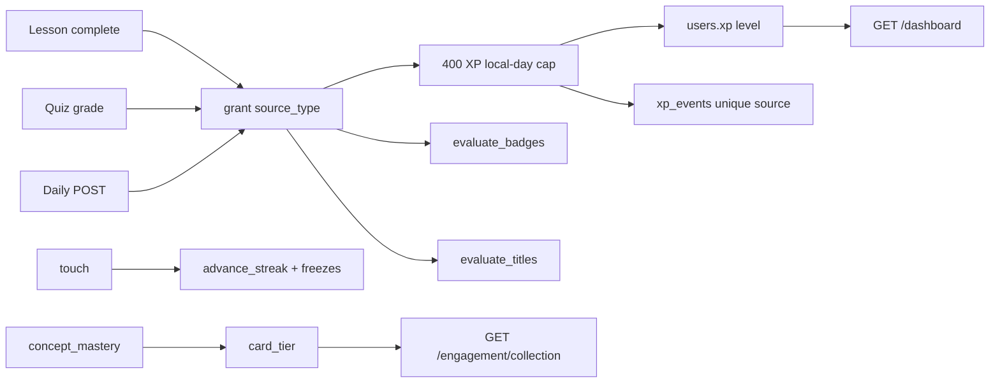

# AI Mentor ethical engagement specification

| Field | Value |
| --- | --- |
| Document | 19 — Ethical engagement specification |
| Version | 1.0 |
| Date | 13 October 2026 |
| Status | Live on the Learner App and `/api/v1` for R1 loops. Weekly/seasonal challenges and institution/friends boards remain R2–R3 |
| Owner | Product Design, Learning Science, with Backend Engineering |
| Related | [README.md](README.md), [02-prd.md](02-prd.md) L-F08–L-F11, [03-srs.md](03-srs.md) GAM-116+, [05-user-stories.md](05-user-stories.md) EP-L11, [06-system-architecture.md](06-system-architecture.md) §14, [07-database-design.md](07-database-design.md), [08-api-specification.md](08-api-specification.md), [11-ux-specification.md](11-ux-specification.md), [12-information-architecture.md](12-information-architecture.md), ADR [0008](../adr/0008-gamification-engine.md), [0024](../adr/0024-platform-gamification.md), [../openapi.yaml](../openapi.yaml) |

STEM learning should feel like a game, an adventure, a quest for mastery, a professional journey, and a skill-building challenge. Engagement copies the *positive* loops of Duolingo, Microsoft Learn, Pokémon, LinkedIn, GitHub, Khan Academy, and Brilliant: visible progress, collections earned by skill, daily practice, and recognition. It does **not** copy loot boxes, paid streak restores, rank-loss nagging, variable-ratio chat XP, or fake accredited certificates.

## Change record

| Area | What changed | Why | Impacted systems | Implementation implications |
| --- | --- | --- | --- | --- |
| Progress language | Dashboard, academies, and paths always show remaining work and percent complete | Goal-gradient effect; honest near-win copy | Learner App, `near_win` | Cues are remaining lessons/concepts, never countdown timers that fake scarcity |
| Streak grace | One freeze covers a single missed calendar day; personal best is kept | Healthy habit, not punishment | `users.streak_freezes`, `longest_streak` | Freezes earned at 7 and 30 days, max 2, never purchasable |
| Collection | Skill cards from mastery tiers | Collection drive without chance | `GET /engagement/collection` | Bronze 60, silver 75, gold 90. No random drops |
| Daily loop | One authored item per learner day, 25 XP | Habit without a slot machine | `GET\|POST /engagement/daily` | Hash of user id + local date over published items; keys never leave the API |
| Boards | Live `global` and `country` with own rank | R1 of LB-101 | `GET /leaderboards` | Institution, cohort, friends remain 422 until classrooms |
| Mentor silhouette | Cosmetic stages from level | Identity without a paywall | Dashboard | novice 1, practitioner 5, expert 10, research 20, grandmaster 40 |
| Titles | Recognition titles from level | Professional identity | `user_titles`, `PATCH /me` | Display names such as "Professor of AI" are not academic appointments |

## Relationship to v1 documents

| Source | Status |
| --- | --- |
| ADR 0008, ADR 0024 | Retained. This spec implements them on the running SQLAlchemy path (`users.xp`, `xp_events`), not unused `game.*` DDL |
| v1 GAM-001–052, LB-001–013 | Retained. Daily cap 400, level `1 + xp // 250`, no XP for chat, public board is pseudonymous |
| [DesignSpec.md](../DesignSpec.md) colour, motion, WCAG | Retained. Progress colours below map onto existing tokens |
| Target `game.*` schema | Still the v2 destination. R1 extends `public` tables |

## Contents

1. [Philosophy](#1-philosophy)
2. [What we steal, and what we refuse](#2-what-we-steal-and-what-we-refuse)
3. [Progress visibility](#3-progress-visibility)
4. [Academy world and skill trees](#4-academy-world-and-skill-trees)
5. [XP, rewards, and the daily cap](#5-xp-rewards-and-the-daily-cap)
6. [Streaks](#6-streaks)
7. [Daily challenges](#7-daily-challenges)
8. [Achievements, titles, and certificates](#8-achievements-titles-and-certificates)
9. [Collection](#9-collection)
10. [Leaderboards](#10-leaderboards)
11. [Mentor avatar](#11-mentor-avatar)
12. [Social recognition](#12-social-recognition)
13. [Design system](#13-design-system)
14. [Screens and components](#14-screens-and-components)
15. [Architecture](#15-architecture)
16. [Data model](#16-data-model)
17. [APIs](#17-apis)
18. [Deferred](#18-deferred)

---

## 1. Philosophy

Learning on AI Mentor should feel like:

| Metaphor | Product translation |
| --- | --- |
| A game | XP, levels, skill trees, collections earned by mastery |
| An adventure | Academies as a world map; remaining-work cues |
| A quest for mastery | Skill cards and mastery bands, not vanity points |
| A professional journey | Titles, badges, and a public (pseudonymous) standing |
| A skill-building challenge | Daily authored item, labs, quizzes with keys on the server |

Personas: students, working professionals, researchers, universities, and enterprise buyers. The visual language is modern, friendly, and professional — not childish.

Guardrail (v1 PRD): mastery gain must not drop when engagement features are added. XP never pays for opening a map pin, sending a chat message, or watching an animation.

## 2. What we steal, and what we refuse

Positive mechanics taken from high-engagement products (including gambling UX research, used ethically):

| Mechanic | Source pattern | Ethical use here |
| --- | --- | --- |
| Goal gradient | "Almost there" | Honest remaining lessons and percent complete |
| Collection | Pokémon / cards | Cards unlock at mastery thresholds |
| Daily ritual | Duolingo / Brilliant | One authored item per local day |
| Streak | Habit apps | Grace freeze; personal best survives a reset |
| Variable *display* | Slot "near miss" | Near-win *copy* only; rewards stay deterministic |
| Status | LinkedIn / GitHub | Titles and badges from real evidence |
| Public standing | Leaderboards | Pseudonyms, opt-out, no rank-loss push |

Refused (never ship):

- Random loot, gacha, or paid chests
- Purchasable streak restores
- Push or email that the learner "dropped a rank"
- XP for chat, idle time, or page views
- Fake university certificates or accredited diplomas
- Dark-pattern confirmshaming after a missed day
- Infinite scroll of other people's celebrations

## 3. Progress visibility

Learners always see that they are moving.

| Signal | Rule | Surface |
| --- | --- | --- |
| XP bar | `level = 1 + xp // 250`; fill is `xp % 250` of 250 | Home |
| Mastery ring | Mean of stored concept scores, 0 if none | Home |
| Path percent | Completed lessons / lessons on the path | World, academy, path |
| Remaining copy | `near_win` | Home, academy cards |
| Skill tree | Lesson nodes with mastery and prerequisites | Academy |
| Collection count | Concepts at mastery ≥ 60 | Home, Collection |

Copy examples (generated, never authored as fake scarcity):

- "87% complete."
- "Only 2 lessons remaining."
- "One lesson remaining on this path."
- "Complete this module to unlock Robotics Foundations."
- "Start a lesson to open today's run."

## 4. Academy world and skill trees

`/academies` is the Learning World, not a plain list. Each academy card shows percent complete, remaining lessons, and a cue. Opening an academy shows a skill tree of its lessons (unlocked after completion or mastery ≥ 60) then the ordered paths.

Academies in the catalog (examples): AI Foundations → Machine Learning → Deep Learning → AI Engineering; Robotics (ROS 2, navigation, vision, robot learning). Travel is visual progress through those nodes. Unlocking a later path still requires finishing the previous path (`locked` on the path card).

## 5. XP, rewards, and the daily cap

Awards stay in `domain/gamification.py`. Chat updates the streak and grants 0 XP.

| Source | Amount | Daily award limit |
| --- | --- | --- |
| Lesson | 40 + streak bonus | none (still under the 400 cap) |
| Quiz | `10 + round(40 × score ratio)` | 10 |
| Project / lab pass | 25 | none |
| Flashcard review | 5 | 20 |
| Research analysis | 10 | 3 |
| Daily challenge | 25 | 1 |
| Knowledge check | 5 | 20 |

Streak bonus applies to **lessons only**: +5% at 7 days, +10% at 30, +15% at 100. It cannot exceed the 400 XP cap on the learner's local day.

Every grant is idempotent on `(user_id, source_type, source_id)`. Retrying a completed lesson pays nothing.

Rewards that accompany XP: badges, titles, skill cards (from mastery, not from the XP event), cosmetic mentor stages, and (later) completion certificates that are **platform recognitions**, never accredited credentials.

## 6. Streaks

The streak is counted on the learner's IANA timezone.

| Event | Result |
| --- | --- |
| Same local day | Keep the count |
| Consecutive day | +1 |
| Missed exactly one day **and** a freeze remains | +1, consume one freeze, milestone "Streak freeze used" |
| Missed two or more days | Reset to 1. Unused freezes stay. Personal best (`longest_streak`) is kept. Welcome-back copy, no guilt |

Freezes: earned when the run first crosses 7 and 30 days; maximum 2; never for sale. Milestones at 1, 7, 30, 100, 365 days. Badges: `streak_3`, `week_streak`, `streak_30`, `streak_100`, `streak_365`.

Home copy: "{n}-day streak · {k} freeze(s) ready. Best streak {best} days. A freeze covers one missed day."

## 7. Daily challenges

`GET /engagement/daily` picks one published `question_bank_items` row (fallback: catalog `QUESTIONS`) with `sha256(user_id:local_date)`. The payload is prompt, options, concept, and 25 XP — never the answer key.

`POST /engagement/daily` grades on the server. A wrong answer does not consume the daily award and does not break the streak. A second correct submit the same local day returns `xp: 0` and `completed: true`.

Weekly and monthly challenges are specified in GAM-105 / GAM-106 and are **not** live.

## 8. Achievements, titles, and certificates

Badges have slug, name, description, icon, category (`learning`, `streak`, `mastery`, `coding`, `research`, `community`, `challenge`, `special`), tier (`bronze`–`platinum`), and rarity (`common`–`legendary`). They are granted from counters in `evaluate_badges`, never from chance. Examples: Python Explorer (`first_steps`), RL Pioneer (`rl_pioneer`), Grandmaster AI Architect (`grandmaster_architect`).

Titles (`TITLES` in domain) are worn one at a time (`users.equipped_title`). They appear on Home and on boards. They are recognitions, not degrees. Equipping an unearned title is 422.

Certificates, when added, are generated documents of completion. Copy must say they are not accredited.

## 9. Collection

A skill card exists only after demonstrated mastery:

| Mastery | Tier |
| --- | --- |
| 0–59 | none |
| 60–74 | bronze |
| 75–89 | silver |
| 90–100 | gold |

Each card shows description, mastery, difficulty, prerequisite connections, and skill value (the mastery score). Examples the catalog can mint: Bellman Equation, Q-Learning, YOLO, Transformer — whenever those concept slugs reach the threshold.

## 10. Leaderboards

| Scope | Status |
| --- | --- |
| Public global top 10 | Live `GET /leaderboard` (guests) |
| Signed-in global + own rank | Live `GET /leaderboards?scope=global` |
| Country (profile `country_code`) | Live; 409 if unset |
| Institution, cohort, friends | 422 until R2/R3 |

Rows: rank, pseudonym or handle, XP, level, streak, optional title, badge count. Staff, suspended, and opted-out accounts are excluded. No notification when rank falls.

## 11. Mentor avatar

The silhouette is rings around a knowledge dot. Stage follows level and is cosmetic: Novice, Practitioner, Expert, Research, Grandmaster Mentor. It is not a loot skin and not a paywall.

## 12. Social recognition

`milestones` is the learner's own feed: badge, title, level, streak, card, path, daily. Home shows recent rows. There is no global "everyone's drops" stream in R1. Copy examples: "Reached level 4", "7-day learning streak", "Daily challenge completed".

## 13. Design system

Progress colours (existing Learner tokens):

| Colour | Hex | Meaning |
| --- | --- | --- |
| Knowledge blue | `#1D4ED8` | Links, primary actions, percent |
| AI purple | `#6D28D9` | Mentor rings, secondary |
| Mastery green | `#10B981` | XP fill, progress ring |
| Achievement gold | amber-400 | Gold cards, earned titles |
| Challenge red | `#B91C1C` | Daily challenge label only |

Motion: `xp-pop`, `card-reveal`, `progress-ring` in `apps/learner/app/globals.css`. `prefers-reduced-motion: reduce` disables them. Style: professional, not childish.

Components: `ProgressRing`, `MentorMark`, `SkillCardView`, `StreakFlame` in `apps/learner/components/engagement.tsx`.

## 14. Screens and components

| Route | Purpose |
| --- | --- |
| `/dashboard` | Mentor, cue, XP, streak, mastery ring, continue, bands, milestones, badges |
| `/academies` | World map of academies |
| `/academies/[slug]` | Skill tree + paths |
| `/daily` | Today's authored item |
| `/collection` | Skill cards |
| `/ranks` | Global / country boards |

Sidebar labels: Home, Tutor, World, Today, Collection, Ranks, then catalog and practice.

## 15. Architecture

Rules live in `backend/app/domain/gamification.py` (no FastAPI/SQLAlchemy). Persistence is `MentorEngine.grant` / `touch` / `collection` / `daily` with `SqlRepository`. The Learner App is a view: it never computes XP or grades.

R2/R3 still target the `game` schema and outbox events in [06](06-system-architecture.md) §14. R1 does not run a parallel ledger.

## 16. Data model

Alembic `20261013_0005`:

| Object | Purpose |
| --- | --- |
| `users.longest_streak` | Personal best; never decremented by a reset |
| `users.streak_freezes` | 0–2 grace tokens |
| `users.equipped_title` | Worn title slug |
| `achievements.category`, `.tier`, `.rarity` | Badge metadata |
| `user_titles` | Earned titles (`UNIQUE (user_id, slug)`) |
| `milestones` | Own celebrations (`UNIQUE (user_id, kind, source_id)`) |

`xp_events.source_type` gains `daily`. Skill cards are derived from `concept_mastery`; they are not a separate table in R1.

## 17. APIs

Live routes (see [openapi.yaml](../openapi.yaml)):

| Method | Path | Notes |
| --- | --- | --- |
| GET | `/dashboard` | Cue, mentor, streak extras, collection_count, milestones |
| GET | `/progress` | Cards + mentor |
| GET | `/leaderboard` | Public top 10 |
| GET | `/leaderboards` | `scope=global\|country` |
| GET | `/engagement/collection` | Earned cards |
| GET | `/engagement/daily` | Today's item, no key |
| POST | `/engagement/daily` | Grade; idempotent XP |
| PATCH | `/me` | `equipped_title`, `country_code` |

v2 `/learn/challenges/today` and `/learn/leaderboards` remain the target aliases in [08](08-api-specification.md).

## 18. Deferred

| Item | Release |
| --- | --- |
| Weekly and seasonal challenges | R2 (GAM-105, GAM-106) |
| Friends boards | R2 |
| Institution and cohort boards, competitions | R3 |
| Open Badges / learning passport | R4 |
| Purchasable cosmetics | Never, unless they cannot affect mastery, XP, or ranks |
| Animated 3D mentor | R5 (roadmap) |
